# مبانی معماری نرم‌افزار: رویکردی مهندسی و مدرن

**Fundamentals of Software Architecture: A Modern Engineering Approach**

ویرایش دوم — Mark Richards و Neal Ford (O’Reilly، ۲۰۲۵)

> ترجمهٔ فارسی؛ تصاویر شکل‌ها از کتاب اصلی برداشته شده و عنوان‌هایشان ترجمه شده است.

<a id="toc"></a>

## فهرست مطالب

- [حمایت از پروژه](#support)
- [فصل ۱: مقدمه](#chapter-01)

**بخش اول: مبانی**

- [فصل ۲: تفکر معماری](#chapter-02)
- [فصل ۳: ماژولاریتی](#chapter-03)
- [فصل ۴: تعریف ویژگی‌های معماری](#chapter-04)
- [فصل ۵: شناسایی ویژگی‌های معماری](#chapter-05)
- [فصل ۶: سنجش و حاکمیت بر ویژگی‌های معماری](#chapter-06)
- [فصل ۷: دامنهٔ ویژگی‌های معماری](#chapter-07)
- [فصل ۸: تفکر مؤلفه‌محور](#chapter-08)

**بخش دوم: سبک‌های معماری**

- [فصل ۹: مبانی](#chapter-09)
- [فصل ۱۰: سبک معماری لایه‌ای](#chapter-10)
- [فصل ۱۱: سبک معماری تک‌پارچهٔ ماژولار](#chapter-11)
- [فصل ۱۲: سبک معماری خط لوله](#chapter-12)
- [فصل ۱۳: سبک معماری میکروکرنل](#chapter-13)
- [فصل ۱۴: سبک معماری مبتنی بر سرویس](#chapter-14)
- [فصل ۱۵: سبک معماری رویدادمحور](#chapter-15)
- [فصل ۱۶: سبک معماری مبتنی بر فضا](#chapter-16)
- [فصل ۱۷: معماری سرویس‌گرای ارکستراسیون‌محور](#chapter-17)
- [فصل ۱۸: معماری میکروسرویس‌ها](#chapter-18)
- [فصل ۱۹: انتخاب سبک معماری مناسب](#chapter-19)
- [فصل ۲۰: الگوهای معماری](#chapter-20)

**بخش سوم: تکنیک‌ها و مهارت‌های نرم**

- [فصل ۲۱: تصمیمات معماری](#chapter-21)
- [فصل ۲۲: تحلیل ریسک معماری](#chapter-22)
- [فصل ۲۳: نمودارکشی معماری](#chapter-23)
- [فصل ۲۴: اثربخش کردن تیم‌ها](#chapter-24)
- [فصل ۲۵: مهارت‌های مذاکره و رهبری](#chapter-25)
- [فصل ۲۶: تقاطع‌های معماری](#chapter-26)
- [فصل ۲۷: بازنگری در قوانین معماری نرم‌افزار](#chapter-27)

- [پیوست: پرسش‌های بحث](#appendix)
- [واژه‌نامهٔ اصلی کتاب](#glossary)

---

<a id="support"></a>

## حمایت از پروژه

اگر این پروژه برای یادگیری معماری نرم‌افزار برای شما مفید بوده است، می‌توانید با حمایت از آن به ادامهٔ ترجمه، تکمیل، به‌روزرسانی و نگهداری این مجموعه کمک کنید. حمایت شما، چه مالی و چه با معرفی پروژه به دیگران، باعث می‌شود بتوانم زمان بیشتری برای توسعه و بهبود این کار اختصاص دهم.

**حمایت از پروژه:**  
[https://www.alirostami.com/support/](https://www.alirostami.com/support/)

**مخزن پروژه در GitHub:**  
[https://github.com/alirostami01/fundamentals-of-software-architecture-persian](https://github.com/alirostami01/fundamentals-of-software-architecture-persian)

---

<a id="chapter-01"></a>

# فصل ۱: مقدمه

پس به معماری نرم‌افزار (Software Architecture) علاقه‌مند شده‌اید. شاید توسعه‌دهنده‌ای هستید که می‌خواهید به گام بعدی مسیر حرفه‌ای‌تان ارتقا یابید، یا شاید مدیر پروژه‌ای هستید که می‌خواهد بداند معماری نرم‌افزار در عمل چگونه به موفقیت می‌انجامد. شاید هم یک «معمار اتفاقی» (Accidental Architect) باشید: کسی که تصمیمات معماری (Architecture Decisions) می‌گیرد —که تعریف آن را در ادامه می‌خوانید— اما هنوز عنوان «معمار نرم‌افزار» (Software Architect) را در شناسنامهٔ شغلی خود ندارد؛ دست‌کم هنوز نه.

چرا باید سراغ قلمرو معماری نرم‌افزار رفت؟ شاید در پروژه‌های متعددی تجربه اندوخته‌اید و می‌خواهید عمیق‌تر دریابید بخش‌های کلان یک سیستم چگونه در کنار هم قرار می‌گیرند و در این مسیر، با چه موازنه‌ها و دادوستدهایی (Trade-offs) روبه‌رو می‌شوید. اگر چنین است، ورود به دنیای معماری نرم‌افزار بی‌گمان گام بعدی پیشرفت حرفه‌ای شماست.

این کتاب برای همهٔ شما نگاشته شده است؛ مروری است جامع بر جایگاه شغلی بسیار چندوجهی و کلیدیِ «معمار نرم‌افزار».

معماران نرم‌افزار باید سیستم‌های نرم‌افزاری را با تمام پیچیدگی‌هایشان عمیقاً بشناسند و تحلیل کنند و تصمیمات حیاتیِ مبتنی بر موازنه و دادوستد (Trade-off) اتخاذ کنند، آن هم گاه با اطلاعاتی ناقص. بسیاری از توسعه‌دهندگان نرم‌افزار که نگران‌اند هوش مصنوعی مولد (Generative AI) به‌مرور جایگاه کاری‌شان را تصاحب کند، به ورود به معماری نرم‌افزار می‌اندیشند؛ نقشی راهبردی که جایگزین‌کردن آن با ماشین بسیار دشوارتر است. معماران نرم‌افزار دقیقاً همان نوع تصمیماتی را اتخاذ می‌کنند که هوش مصنوعی از عهده‌اش برنمی‌آید: سنجش و ارزیابی موازنه‌ها و دادوستدها در بستر زمینه‌ها و شرایط (Context) پیچیده و پیوسته در حال دگرگونی.

معماری نیز مانند بسیاری از هنرها، تنها در زمینه و بافتار (Context) اختصاصی خود قابل درک است. معماران تصمیماتشان را بر پایهٔ واقعیت‌ها و محدودیت‌های محیط پیرامون استوار می‌سازند. برای نمونه، یکی از اهداف بزرگ معماری نرم‌افزار در اواخر قرن بیستم، به‌کارگیری هرچه کارآمدتر زیرساخت‌ها و منابع اشتراکی بود، چرا که سیستم‌عامل‌ها، سرورهای برنامه‌های کاربردی (اپلیکیشن‌سرورها)، سرورهای پایگاه‌داده و نظایر آن‌ها همگی تجاری و بسیار گران‌قیمت بودند.

در سال ۲۰۰۲، تلاش برای ساختن معماری‌ای مانند میکروسرویس‌ها (Microservices) هزینه‌ای باورنکردنی به همراه داشت. تصور کنید قدم‌زنان وارد مرکزداده‌ای در سال ۲۰۰۲ می‌شوید و به مدیر بخش عملیات می‌گویید: «سلام! ایدهٔ درخشانی برای یک سبک معماری انقلابی دارم؛ هر سرویس روی سخت‌افزار مجزا و اختصاصی خودش، همراه با پایگاه‌دادهٔ مستقل خودش اجرا می‌شود. ۵۰ لایسنس Windows می‌خواهم، ۳۰ لایسنس سرور برنامه‌های کاربردی دیگر، و دست‌کم ۵۰ مجوز سرور پایگاه‌داده.» امروزه تنها به لطف ظهور فناوری‌های متن‌باز (Open Source) و شیوه‌های مهندسیِ نوین برآمده از انقلاب DevOps است که می‌توانیم چنین معماری‌هایی بسازیم. همهٔ معماری‌ها محصول و زاییدهٔ زمینه و بافتار (Context) زمانهٔ خویش‌اند؛ این نکتهٔ کلیدی را هنگام خواندن این کتاب همواره به یاد داشته باشید.

---

## تعریف معماری نرم‌افزار

اما معماری نرم‌افزار واقعاً چیست؟ شکل ۱-۱ دیدگاه ما را از ماهیت معماری نرم‌افزار به تصویر می‌کشد. این تعریف چهار بُعد دارد: معماری نرم‌افزار یک سیستم از یک سبک معماری (Architecture Style) به‌عنوان نقطهٔ شروع تشکیل شده است و با ویژگی‌های معماری (Architecture Characteristics) که سیستم باید از آن‌ها پشتیبانی کند، مؤلفه‌های منطقی (Logical Components) که رفتارش را پیاده‌سازی می‌کنند، و سرانجام تصمیمات معماری (Architecture Decisions) که مبنای توجیه همهٔ این‌هاست، ترکیب شده است. خطوط ضخیم مشکی در تصویر، ساختار سیستم را نشان می‌دهند که ارکان معماری را در بر گرفته و استوار نگه داشته است. این ابعاد چهارگانه را به همان ترتیبی که معماران تحلیل می‌کنند، به‌سرعت مرور می‌کنیم؛ فصل‌های بعدی جزئیات بیشتری ارائه خواهند داد.

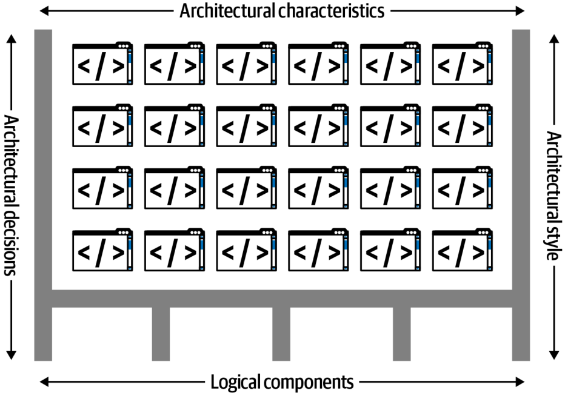

> **شکل ۱-۱.** معماری از ساختار سیستم تشکیل شده است که با ویژگی‌های معماری («-ilities»)، مؤلفه‌های منطقی، سبک‌های معماری و تصمیمات ترکیب می‌شود.

ویژگی‌های معماری (شکل ۱-۲) معیارهای موفقیت و توانمندی‌های یک سیستم را تعریف می‌کنند —که در زبان انگلیسی به‌دلیل پسوند مشترک ویژگی‌هایی چون مقیاس‌پذیری، پایایی و دسترس‌پذیری، معمولاً «‎-ilities‎» خوانده می‌شوند— و مشخص می‌سازند که سیستم تحت چه شرایطی و با چه کیفیتی باید کار کند. ویژگی‌های معماری آن‌قدر مهم‌اند که چندین فصل از این کتاب را صرف شناختن و تعریف‌کردنشان کرده‌ایم.

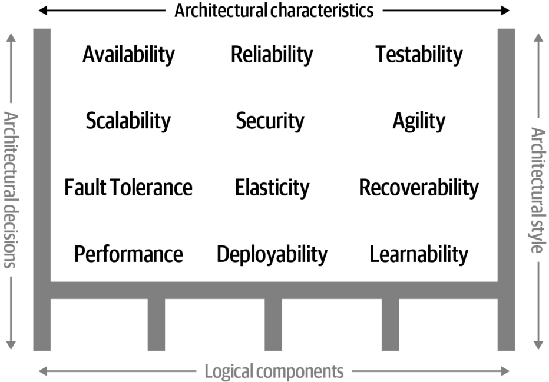

> **شکل ۱-۲.** «ویژگی‌های معماری» به همان «‎-ilities‎»هایی اشاره دارد که سیستم باید از آن‌ها پشتیبانی کند.

ویژگی‌های معماری توانمندی‌های سیستم را تعیین می‌کنند، اما مؤلفه‌های منطقی رفتار آن را شکل می‌دهند. طراحی مؤلفه‌های منطقی یکی از کلیدی‌ترین فعالیت‌های ساختاری برای معماران است. در شکل ۱-۳، مؤلفه‌های منطقی، حوزه‌ها، موجودیت‌ها و گردش‌کارهای برنامهٔ کاربردی را می‌سازند.

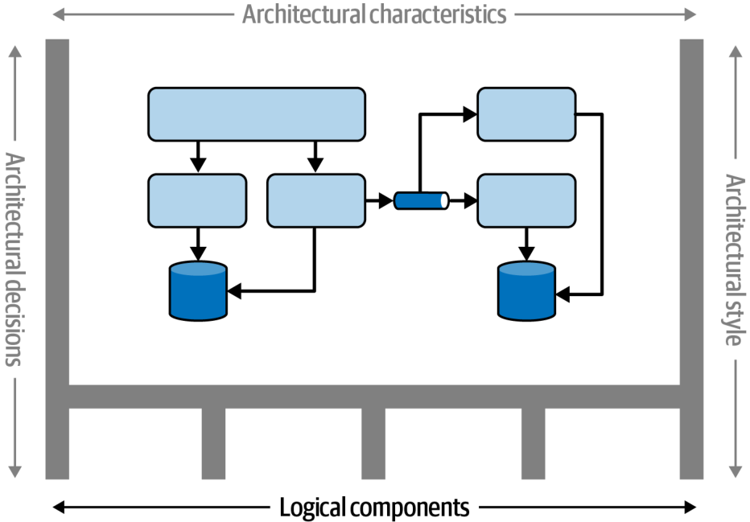

> **شکل ۱-۳.** مؤلفه‌های منطقی، رفتار سیستم را ساختار می‌دهند.

هنگامی که معمار، ویژگی‌های معماری و مؤلفه‌های منطقی موردنیاز سیستم را تحلیل کرد —که هر دو بعداً با جزئیات شرح داده می‌شوند— شناخت کافی به دست می‌آورد تا بتواند سبک معماری مناسبی را به‌عنوان نقطهٔ شروعِ پیاده‌سازی راه‌حلش انتخاب کند (شکل ۱-۴).

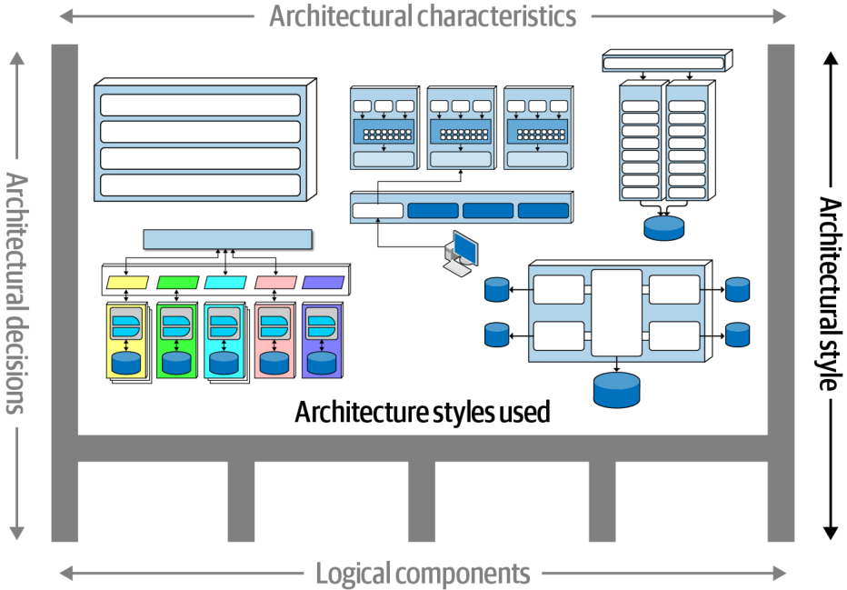

> **شکل ۱-۴.** انتخاب سبک معماری یعنی یافتن آسان‌ترین مسیر پیاده‌سازی برای مجموعه‌ای مشخص از الزامات.

چهارمین بُعدی که معماری نرم‌افزار را تعریف می‌کند، تصمیمات معماری است: قواعدی که مشخص می‌کنند سیستم باید چگونه ساخته شود. برای نمونه، معمار ممکن است تصمیم بگیرد که تنها لایه‌های کسب‌وکار (Business) و سرویس‌ها (Services) درون یک معماری لایه‌ای (Layered Architecture) اجازهٔ دسترسی به پایگاه‌داده را داشته باشند (شکل ۱-۵) و لایهٔ ارائه و نمایش (Presentation) را از فراخوانی مستقیم پایگاه‌داده باز بدارد. تصمیمات معماری، قید و محدودیت‌های سیستم را شکل می‌دهند و به تیم‌های توسعه نشان می‌دهند که چه چیزی مجاز است و چه چیزی نیست.

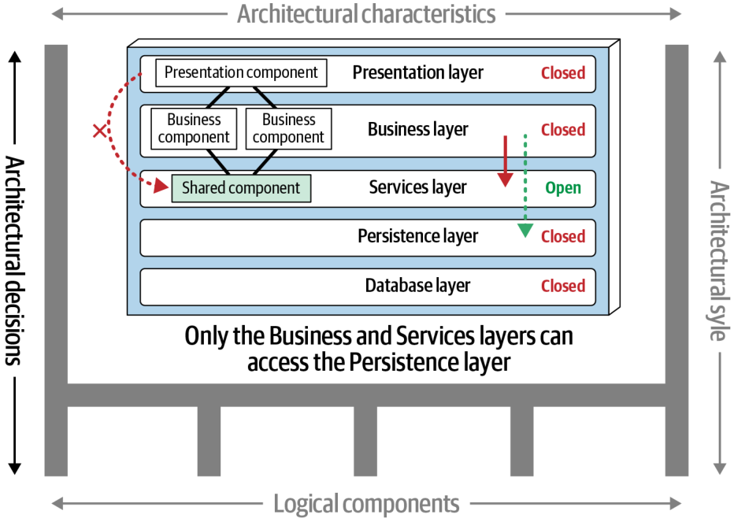

> **شکل ۱-۵.** تصمیمات معماری، قواعدی برای ساخت سیستم‌ها هستند.

تصمیمات معماری و شیوهٔ مستندسازی مختصر آن‌ها را در فصل ۲۱ بررسی می‌کنیم.

---

## قوانین معماری نرم‌افزار

وقتی ما دو مؤلف، نوشتن ویرایش نخست این کتاب را آغاز کردیم، هدف بلندپروازانه‌ای داشتیم: امیدوار بودیم چیزهایی بیابیم که دربارهٔ معماری نرم‌افزار جهان‌شمول به نظر می‌رسند و آن‌ها را به‌صورت «قوانین» معماری نرم‌افزار (Laws of Software Architecture) درآوریم. هنگام نوشتن، پیوسته در پی اصولی بودیم که بتوان آن‌ها را مدون ساخت؛ امید داشتیم شاید ۱۰ یا ۱۵ قانون بیابیم. در کمال شگفتی ما، در ویرایش نخست در نهایت تنها به دو قانون رسیدیم و در حین نوشتن ویرایش دوم، قانون دیگری هم کشف کردیم. این سه قانون تا حد زیادی جهان‌شمول‌اند و بسیاری از دیدگاه‌های مهم را برای معماران فعال در صنعت روشن می‌کنند.

قانون اول معماری نرم‌افزار (First Law of Software Architecture) را با برخوردن پیوسته به آن آموختیم؛ و به نظرمان همین قانون به کانون این پرسش اشاره دارد که چرا حقایق جهان‌شمول در این حوزه این‌چنین گریزان و دست‌نیافتنی به نظر می‌رسند:

> **در معماری نرم‌افزار، همه‌چیز یک موازنه و مصالحه (Trade-off) است.**
>
> — قانون اول معماری نرم‌افزار

> هیچ‌چیز روی یک طیف تمیز و ساده جا نمی‌گیرد. هر تصمیمی که یک معمار نرم‌افزار می‌گیرد باید متغیرهای زیادی را در نظر بگیرد که بسته به شرایط، مقادیر متفاوتی می‌گیرند. موازنه‌ها و دادوستدها (Trade-offs) جوهرهٔ تصمیمات معماری نرم‌افزارند. اگر فکر می‌کنید چیزی یافته‌اید که مصالحه نیست، احتمالاً هنوز جنبه‌های منفی و هزینه‌های پنهان آن را نیافته‌اید… دست‌کم هنوز نه.
>
> — نتیجهٔ فرعی ۱ (Corollary 1)

> تحلیل موازنه و مصالحه کاری نیست که یک‌بار انجام دهید و تمام‌شده بپندارید.
>
> — نتیجهٔ فرعی ۲ (Corollary 2)

تیم‌ها عاشق استانداردند و خوب می‌شد اگر معماران می‌توانستند یک «جشنوارهٔ بزرگ دادوستدها و مصالحه‌ها» (One Big Trade-off Jamboree) برگزار کنند و پیش‌فرض‌های طراحی را—از قبیل اینکه کدام سبک‌های معماری را به کار ببریم، بخش‌های معماری چگونه با هم ارتباط برقرار کنند، کارکردهای اشتراکی چگونه مدیریت شوند و انبوهی از تصمیمات پیچیدهٔ دیگر—یک‌جا مشخص کنند. اما چنین کاری ممکن نیست، چون هر موقعیتی ایجاب می‌کند همهٔ آن مصالحه‌ها را دوباره ارزیابی کنیم. (دیده‌ایم تیم‌ها تلاش کنند—مثلاً پیش‌فرض کنند که در گردش‌کارهای توزیع‌شده فقط از کرئوگرافی (Choreography) استفاده شود—اما بعد دریابند که این الگو در برخی موارد کارساز و در مواردی دیگر به شکستی فاجعه‌بار می‌انجامد. برای بحث ما در این باره، بخش «کرئوگرافی و ارکستراسیون» (Choreography and Orchestration) در صفحهٔ ۳۴۱ را ببینید.)

معماری فراتر از صرف ترکیب عناصر ساختاری است؛ به همین دلیل است که تعریف جامع ما، اصول و ویژگی‌ها و غیره را هم در خود جای می‌دهد. این نکته در قانون دوم معماری نرم‌افزار (Second Law of Software Architecture) ما بازتاب یافته است:

> **«چرا» مهم‌تر از «چگونه» است.**
>
> — قانون دوم معماری نرم‌افزار

به‌عنوان معماری باتجربه، اگر کسی معماری‌ای را نشانم دهد که تاکنون ندیده‌ام، می‌توانم بفهمم چگونه کار می‌کند، اما به‌سختی ممکن است دریابم چرا معمار یا تیم قبلی چنان تصمیماتی را گرفته‌اند. معماران در بافتارهای بسیار خاص تصمیم می‌گیرند و همین، تصمیم‌گیری‌های کلی و سرتاسری را دشوار می‌کند. چراییِ تصمیم خاص یک معمار، مصالحه‌هایی را که در نظر گرفته نیز در بر می‌گیرد و به بافتارِ «چرا این تصمیم و نه آن یکی» می‌افزاید. معلوم می‌شود یکی از ویژگی‌های تعیین‌کنندهٔ تصمیمات معماری این است که به‌ندرت دودویی‌اند. این ما را به قانون سوم معماری نرم‌افزار (Third Law of Software Architecture) می‌رساند:

> **بیشتر تصمیمات معماری دودویی (صفر و یکی) نیستند، بلکه روی طیفی میان دو نقطهٔ افراطی قرار دارند.**
>
> — قانون سوم معماری نرم‌افزار

در سراسر کتاب، چراییِ تصمیم‌گیری‌های خاص معماران را همراه با مصالحه‌هایشان برجسته می‌کنیم. تکنیک‌های خوب برای ثبت تصمیمات مهم را نیز در فصل ۲۱ نشان می‌دهیم.

خوانندگان این قوانین را در سراسر کتاب در عمل خواهند دید و توصیه می‌کنیم هنگام ارزیابی تصمیمات معماری نرم‌افزار، آن‌ها را به یاد داشته باشید. به این قوانین در فصل ۲۷ با چند مثال دیگر بازمی‌گردیم.

با آماده‌شدن تعریفِ کارآمدی از معماری نرم‌افزار، حالا سراغ خودِ این نقش می‌رویم.

---

## انتظارات از یک معمار

نقش معمار نرم‌افزار می‌تواند از یک برنامه‌نویس خبره تا تعیین‌کنندهٔ مسیر راهبردی فناوری برای کل یک سازمان متغیر باشد. همین تنوع گسترده، ارائهٔ تعریفی یکتا از این نقش را دشوار می‌سازد؛ اما آنچه با دقت می‌توان بیان کرد، انتظاراتی است که از یک معمار نرم‌افزار می‌رود. ما هشت انتظار محوری را برای هر معمار نرم‌افزار شناسایی کرده‌ایم، فارغ از اینکه نقش، عنوان شغلی یا شرح شغلشان چه باشد:

- گرفتن تصمیمات معماری
- تحلیل پیوستهٔ معماری
- به‌روزماندن با آخرین روندها
- اطمینان از انطباق با تصمیمات
- شناخت فناوری‌ها، چارچوب‌ها، پلتفرم‌ها و محیط‌های گوناگون
- شناخت حوزهٔ کسب‌وکار
- رهبری تیم و برخورداری از مهارت‌های میان‌فردی
- شناخت سیاست‌های سازمانی و حرکت درست در میان آن‌ها

موفقیت به‌عنوان معمار نرم‌افزار به شناختن این انتظارات و پاسخ‌گویی به هر یک از آن‌ها بستگی دارد. این بخش هر هشت مورد را یکی‌یکی بررسی می‌کند.

---

### گرفتن تصمیمات معماری

از معمار انتظار می‌رود تصمیمات معماری و اصول طراحی (Design Principles)‌ای را تعریف کند که برای هدایت تصمیمات فناوری در سطح تیم، واحد یا سراسر سازمان به کار می‌روند.

«هدایت» کلیدواژهٔ همین انتظار نخست است: معماران باید انتخاب‌های فناوری را هدایت کنند، نه اینکه از پیش برایشان تعیین کرده باشند. برای نمونه، تصمیم‌گیری برای به‌کارگیری React.js در توسعهٔ سمت کاربر (Frontend) یک تصمیم فنی است، نه یک تصمیم معماری. معمار به‌جای گرفتن این تصمیم، باید از تیم‌های توسعه بخواهد که برای توسعهٔ وب از چارچوب واکنش‌گرا (Reactive Framework) استفاده کنند و آن‌ها را به سمت انتخاب Angular، Elm، React.js، Vue یا هر چارچوب وب واکنش‌گرای دیگری راهنمایی کند. نکتهٔ کلیدی این پرسش است که آیا تصمیم معماری، تیم‌ها را در انتخاب‌های درستِ فنی راهنمایی می‌کند یا اینکه انتخاب را از دستشان درمی‌آورد. با این همه، گاهی معماران باید تصمیمات فناوری مشخصی بگیرند تا ویژگی معماری خاصی—مانند مقیاس‌پذیری (Scalability)، عملکرد (Performance) یا دسترس‌پذیری (Availability)—را حفظ کنند. معماران اغلب برای یافتن این تعادل دچار مشکل می‌شوند؛ به همین دلیل است که فصل ۲۱ تماماً دربارهٔ تصمیمات معماری است.

---

### تحلیل پیوستهٔ معماری

از معمار انتظار می‌رود معماری و محیط فناوری فعلی را به‌طور پیوسته تحلیل کند و راه‌حل‌هایی برای بهبود پیشنهاد دهد.

سرزندگی معماری (Architecture Vitality) می‌سنجد که معماری‌ای که سه سال یا بیشتر پیش تعریف شده، با در نظر گرفتنِ تغییرات کسب‌وکار و فناوری، امروز تا چه حد پابرجاست. بر اساس تجربهٔ ما، معماران به اندازهٔ کافی انرژی‌شان را صرف تحلیل پیوستهٔ معماری‌های موجود نمی‌کنند. در نتیجه، بیشتر معماری‌ها دچار عناصری از فرسایش ساختاری (Structural Decay) می‌شوند؛ حالتی که توسعه‌دهندگان تغییرات کدنویسی یا طراحی‌ای ایجاد می‌کنند که بر ویژگی‌های معماری موردنیاز—مثل عملکرد، دسترس‌پذیری و مقیاس‌پذیری—تأثیر نامطلوب بگذارد.

جنبه‌های فراموش‌شدهٔ دیگرِ این انتظار، محیط‌های آزمون و انتشار است. توانایی تغییر سریع کد نوعی چابکی (Agility) با منافع آشکار است، اما اگر آزمون تغییرات هفته‌ها طول بکشد و انتشار ماه‌ها، کل معماری نمی‌تواند به چابکی دست یابد.

معماران باید تغییرات فناوری و حوزهٔ مسئله را به‌صورت یکپارچه تحلیل کنند تا استواریِ مستمر معماری را بسنجند. همین‌گونه ملاحظات است که سامانه‌های نرم‌افزاری را کارآمد، زنده و به‌روز نگه می‌دارد، هرچند این نکته در آگهی‌های استخدامی به‌ندرت به چشم می‌خورد.

---

### به‌روزماندن با آخرین روندها

از معمار انتظار می‌رود با آخرین روندهای فناوری و صنعت به‌روز بماند.

توسعه‌دهندگان باید از آخرین فناوری‌ها و نیز فناوری‌هایی که هر روز استفاده می‌کنند به‌روز بمانند تا جایگاه حرفه‌ای خود را حفظ کنند (و شغلشان را از دست ندهند!). برای معماران، به‌روزماندن با آخرین روندهای فناوری و صنعت حتی حیاتی‌تر است. تصمیمات معماران معمولاً ماندگار و دیرپا هستند و تغییر دادن آن‌ها دشوار است. شناخت روندها به معماران کمک می‌کند تصمیماتی بگیرند که در آینده هم کارآمد بمانند. برای نمونه، معماران در سال‌های اخیر ناگزیر شده‌اند دربارهٔ ذخیره‌سازی و استقرار مبتنی بر ابر (Cloud) بیاموزند و همین حالا که این ویرایش دوم را می‌نویسیم، هوش مصنوعی مولد تأثیری عظیم بر بخش‌های بسیاری از اکوسیستم توسعه دارد.

پیگیری روندها و به‌روزماندن با آن‌ها دشوار است، به‌ویژه برای معمار نرم‌افزار. در فصل ۲، تکنیک‌ها و منابعی را برای نحوهٔ مدیریت این کار بررسی می‌کنیم.

---

### اطمینان از انطباق با تصمیمات

از معمار انتظار می‌رود از انطباق تصمیمات معماری و اصول طراحی اطمینان حاصل کند.

اطمینان از انطباق یعنی پیوسته راستی‌آزمایی کنید که تیم‌های توسعه از تصمیمات و اصول طراحی‌ای پیروی می‌کنند که معمار تعریف کرده، مستند ساخته و اطلاع‌رسانی کرده است.

فرض کنید شما به‌عنوان معمار تصمیم می‌گیرید دسترسی به پایگاه‌داده در یک معماری لایه‌ای را فقط به لایه‌های Business و Services محدود کنید (نه لایهٔ Presentation). این—همان‌طور که در فصل ۱۰ خواهید دید—یعنی لایهٔ Presentation باید از همهٔ لایه‌های معماری عبور کند تا حتی ساده‌ترین فراخوانی پایگاه‌داده را انجام دهد. اما توسعه‌دهندهٔ رابط کاربری (UI) با این تصمیم مخالف است و به دلایل عملکردی و سرعت، به لایهٔ Presentation دسترسی مستقیم به پایگاه‌داده می‌دهد. شما آن تصمیم معماری را با دلیل مشخصی گرفته‌اید: تا تغییرات پایگاه‌داده روی لایهٔ Presentation اثر نگذارد. اگر از انطباق تصمیمات معماری‌تان مطمئن نشوید، چنین تخطی‌هایی رخ می‌دهد. نتیجه می‌تواند این باشد که معماری از فراهم‌کردن ویژگی‌های موردنیاز باز بماند و برنامه یا سیستم آن‌طور که انتظار می‌رود کار نکند. در فصل ۶، اندازه‌گیری انطباق را با استفاده از توابع برازش خودکار (Automated Fitness Functions) و ابزارهای دیگر بررسی می‌کنیم.

---

### شناخت فناوری‌های گوناگون

از معمار انتظار می‌رود با فناوری‌ها، چارچوب‌ها، پلتفرم‌ها و محیط‌های متعدد و گوناگون آشنایی داشته باشد.

از هیچ معماری انتظار نمی‌رود در همهٔ چارچوب‌ها، پلتفرم‌ها و زبان‌ها خبره باشد، اما دست‌کم باید با انواع فناوری‌ها آشنا باشد. بیشتر محیط‌های امروزی ناهمگون (Heterogeneous)‌اند؛ بنابراین معماران دست‌کم باید بدانند چگونه با سیستم‌ها و سرویس‌های متعدد—فارغ از زبان، پلتفرم یا فناوری‌شان—ارتباط برقرار کنند.

یکی از بهترین راه‌ها برای پاسخ‌گویی به این انتظار، پا را فراتر از حاشیهٔ امن (Comfort Zone) گذاشتن و جست‌وجویی جدی برای فرصت‌های کسب تجربه در زبان‌ها، پلتفرم‌ها و فناوری‌های متعدد است. معماران باید به جای ژرفای فنی (Technical Depth)، بر گستردگی فنی (Technical Breadth) تمرکز کنند. گستردگی فنی یعنی داشتن شناختی جامع و کلان از گسترهٔ فناوری‌ها، در کنار حوزه‌های محدودی که در آن‌ها تخصص و عمق فراوان دارید. برای نمونه، آشنا بودن با مزایا و معایب ۱۰ محصول مختلفِ کش‌گذاری (Caching) برای معمار بسیار ارزشمندتر از خبره‌شدن در فقط یکی از آن‌هاست.

---

### شناخت حوزهٔ کسب‌وکار

از معمار انتظار می‌رود سطح معینی از تخصص در حوزهٔ کسب‌وکار (Business Domain) داشته باشد.

معماران اثربخش نرم‌افزار، مسئلهٔ کسب‌وکار، اهداف و الزاماتی را که معماری باید حل‌شان کند به‌خوبی درک می‌کنند؛ مجموع این‌ها را حوزهٔ کسب‌وکارِ فضای مسئله می‌نامند. اگر الزامات کسب‌وکار را نشناسید، طراحی معماری‌ای اثربخش دشوار است. تصور کنید معمار بانک بزرگی هستید اما اصطلاحات رایج مالی—مثل میانگین جهت‌دار (Average Directional Index)، قراردادهای تصادفی (Aleatory Contracts)، جهش نرخ‌ها (Rates Rally) یا حتی بدهی‌های غیراولویت‌دار (Nonpriority Debt)— را نمی‌فهمید. در این صورت نخواهید توانست با ذی‌نفعان (Stakeholders) و کاربران کسب‌وکار ارتباط برقرار کنید و به‌سرعت اعتبارتان را از دست می‌دهید.

موفق‌ترین معمارانی که می‌شناسیم، دانش فنی گسترده و عملی و شناخت عمیقی از حوزه‌ای خاص دارند. آن‌ها می‌توانند با مدیران ارشد (C-level Executives) و کاربران کسب‌وکار به زبانی سخن بگویند که این ذی‌نفعان می‌فهمند و درک می‌کنند؛ این‌گونه اطمینان ایجاد می‌کنند که می‌دانند چه می‌کنند و صلاحیت ساختن معماری‌ای مؤثر و درست را دارند.

---

### داشتن مهارت‌های میان‌فردی

از معمار انتظار می‌رود مهارت‌های میان‌فردی چشمگیری داشته باشد، از جمله کار تیمی (Teamwork)، تسهیل‌گری (Facilitation) و رهبری (Leadership).

ما اهالی فناوری هستیم و توسعه‌دهندگان و معماران معمولاً حل مسائل فنی را به چالش‌های انسانی ترجیح می‌دهند؛ همین، داشتن رهبری و مهارت‌های میان‌فردی چشمگیر را به انتظاری دشوار تبدیل می‌کند. با این حال، همان‌طور که Gerald Weinberg معروف می‌گفت: «هرچه به شما بگویند، همیشه یک مسئلهٔ انسانی است.» راهنمایی‌ای که معماران ارائه می‌دهند فقط فنی نیست؛ شامل رهبری تیم‌های توسعه در مسیر پیاده‌سازی معماری هم می‌شود. مهارت‌های رهبری دست‌کم نیمی از شروط لازم برای تبدیل‌شدن به یک معمار اثربخش نرم‌افزار را تشکیل می‌دهند؛ فارغ از نقش یا عنوان شغلی.

صنعت نرم‌افزار مملو از معمارانی است که همگی بر سر تعداد محدودی جایگاه کلیدی رقابت می‌کنند. کسانی که مهارت‌های رهبری و میان‌فردی قوی‌ای دارند، از میان جمعیت متمایز می‌شوند. برعکس، معماران نرم‌افزار زیادی را می‌شناسیم که فناورانی عالی‌اند اما در رهبری تیم‌ها، مربی‌گری و راهنمایی توسعه‌دهندگان، یا رساندن ایده‌ها و تصمیمات و اصول معماری به دیگران دچار مشکل‌اند. نیازی به گفتن نیست که چنین معمارانی در حفظ شغلشان دچار مشکل می‌شوند.

---

### شناخت سیاست‌های سازمانی و حرکت در آن‌ها

از معمار انتظار می‌رود آب‌وهوای سیاسی سازمان را بشناسد و بتواند در میان سیاست‌های آن حرکت کند.

شاید عجیب به نظر برسد که در کتابی دربارهٔ معماری نرم‌افزار از سیاست‌های اداری (Office Politics) حرف بزنیم، اما مهارت‌های مذاکره (Negotiation Skills) برای این نقش حیاتی‌اند. برای روشن‌شدن، دو سناریو را در نظر بگیرید.

در سناریوی نخست، توسعه‌دهنده‌ای تصمیم می‌گیرد از الگوی طراحی خاصی (Design Pattern) برای کاهش پیچیدگی تکه‌کد درهم‌پیچیده‌ای بهره بگیرد. این تصمیم خوبی است و توسعه‌دهنده نیازی ندارد برایش دنبال تأیید بگردد. جنبه‌های برنامه‌نویسی—مانند ساختار کد، طراحی کلاس، انتخاب الگوی طراحی و گاهی حتی انتخاب زبان—همگی بخشی از هنر برنامه‌نویسی‌اند.

در سناریوی دوم، معمار مسئول سیستم بزرگ مدیریت ارتباط با مشتری (CRM) در کنترل‌کردن دسترسی سیستم‌های دیگر به پایگاه‌داده، ایمن‌سازی داده‌های خاص مشتری و اعمال تغییرات در طرح‌وارهٔ پایگاه‌داده (Database Schema) دچار مشکل است. همهٔ این مشکلات از اینجا سرچشمه می‌گیرد که سیستم‌های بیش از حد زیادی از پایگاه‌دادهٔ CRM استفاده می‌کنند. بنابراین معمار تصمیم می‌گیرد جزیره‌های برنامه‌ای (Application Silos) بسازد؛ جایی که پایگاه‌دادهٔ هر برنامه فقط از خودِ برنامه‌ای که مالک آن پایگاه‌داده است در دسترس باشد. این تصمیم، کنترل بهتری بر داده‌های مشتری، امنیت و تغییرات به معمار می‌دهد.

اما برخلاف تصمیم توسعه‌دهنده در سناریوی نخست، معمار می‌تواند انتظار داشته باشد تقریباً همه در شرکت در برابر تصمیمش مقاومت کنند (شاید به استثنای تیم برنامهٔ CRM). برنامه‌های کاربردی دیگر به داده‌های CRM نیاز دارند و اگر دیگر نتوانند مستقیم به پایگاه‌داده دسترسی داشته باشند، باید داده را از طریق فراخوانی‌های ارتباط از راه دور (Remote Access) از سیستم CRM بخواهند. مالکان محصول (Product Owners)، مدیران پروژه و ذی‌نفعان کسب‌وکار ممکن است با افزایش هزینه یا تلاش تیم خود مخالفت کنند، در حالی که توسعه‌دهندگان ممکن است رویکرد پیشین را ترجیح دهند. تقریباً هر تصمیمی که معمار بگیرد، به چالش کشیده می‌شود. در مواجهه با هر مخالفت، معمار باید در مناسبات و سیاست‌های سازمانی حرکت کند و با مهارت مذاکره تصمیماتش را به تأیید برساند. این کار می‌تواند بسیار طاقت‌فرسا باشد؛ بیشتر معماران نرم‌افزار کارشان را به‌عنوان توسعه‌دهنده شروع کردند و عادت داشتند بدون نیاز به تأیید یا حتی بازبینی تصمیم بگیرند. حالا به‌عنوان معمار بالاخره توانایی گرفتن تصمیمات گسترده و مهم را دارند، اما باید تقریباً برای هر کدام استدلال بیاورند و بجنگند. مهارت‌های مذاکره، مانند مهارت‌های رهبری، آن‌قدر ضروری‌اند که فصل کاملی را به آن‌ها اختصاص داده‌ایم (فصل ۲۵).

---

## نقشهٔ راه کتاب

این کتاب از سه بخش تشکیل شده است:

### بخش اول: مبانی

بخش اول، اجزای کلیدی معماری نرم‌افزار را تعریف می‌کند و بر دو عنصر کلیدی ساختار معماری تمرکز دارد: ویژگی‌های معماری و مؤلفه‌های منطقی. تحلیل هر یک به تکنیک‌های متفاوتی نیاز دارد که آن‌ها را با جزئیات کامل پوشش می‌دهیم. خروجی این فعالیت‌ها، اطلاعات کافی را در اختیار معمار نرم‌افزار می‌گذارد تا سبک معماری مناسبی را به‌عنوان داربست و چارچوب اولیه (Scaffolding) برای پیاده‌سازی انتخاب کند.

### بخش دوم: سبک‌های معماری

بخش دوم، فهرستی از سبک‌های معماری—یعنی توپولوژی‌های نام‌دار (Named Topologies)ِ معماری نرم‌افزار—ارائه می‌دهد. تفاوت‌های ساختاری و ارتباطی هر سبک را نشان می‌دهیم و مبنایی برای مقایسه در طیفی گسترده فراهم می‌کنیم که توپولوژی‌های داده، تیم‌ها و معماری‌های فیزیکی را هم در بر می‌گیرد.

### بخش سوم: تکنیک‌ها و مهارت‌های نرم

بخش‌های اول و دوم بر جنبه‌های فنی شغل تمرکز دارند، اما بخش بزرگی از نقش معمار نرم‌افزار به چیزی برمی‌گردد که به‌طور سنتی مهارت‌های نرم (Soft Skills) می‌نامند: مهارت‌هایی که با فناوری نه، بلکه با آدم‌ها سر و کار دارند. جالب اینکه مهارت‌های نرم غالباً دشوارترین چیزی است که معماران تازه‌کار باید به دست آورند، چون مسیرهای اصلی رسیدن به نقش معمار نرم‌افزار معمولاً بیشتر به درخشش فنی تکیه دارند تا میان‌فردی. با این حال، معماران به محض ورود به شغل درمی‌یابند که این مهارت‌ها حیاتی‌اند. بنابراین، بخش سوم کتابمان چند مهارت نرم حیاتی را پوشش می‌دهد تا در این نقش پیروز شوید.

---

## واژه‌نامهٔ اختصاصی این فصل

| واژهٔ انگلیسی | معادل مصوب/به‌کاررفته در این فصل |
|---|---|
| Software Architecture | معماری نرم‌افزار |
| Software Architect | معمار نرم‌افزار |
| Accidental Architect | معمار اتفاقی |
| Architecture Decision | تصمیم معماری (جمع: تصمیمات معماری) |
| Trade-off | موازنه و دادوستد (Trade-off) |
| Generative AI | هوش مصنوعی مولد |
| Context | بافتار |
| Open Source | متن‌باز / کدمنبع‌باز (Open Source) |
| Microservices | میکروسرویس |
| Architecture Style | سبک معماری |
| Architecture Characteristics | ویژگی‌های معماری |
| Logical Component | مؤلفهٔ منطقی |
| Layered Architecture | معماری لایه‌ای |
| Laws of Software Architecture | قوانین معماری نرم‌افزار |
| First Law of Software Architecture | قانون اول معماری نرم‌افزار |
| Data Center | مرکزداده |
| Application Server | سرور برنامهٔ کاربردی |
| Database Server | سرور پایگاه‌داده |
| Domain | حوزه |
| Entity | موجودیت |
| Workflow | گردش‌کار |
| Requirements | الزامات |
| "-ilities" | همان اختصار انگلیسی حفظ می‌شود (توانمندی‌های سیستم) |
| Presentation / Business / Services Layer | لایه‌های ارائه (نمایش) / منطق کسب‌وکار / سرویس‌ها |
| Windows, DevOps | نام ابزار/شیوه؛ دست‌نخورده به انگلیسی |
| Corollary | نتیجهٔ فرعی |
| One Big Trade-off Jamboree | جشنوارهٔ بزرگ دادوستدها و مصالحه‌ها |
| Choreography | کرئوگرافی |
| Orchestration | ارکستراسیون |
| Second Law of Software Architecture | قانون دوم معماری نرم‌افزار |
| Third Law of Software Architecture | قانون سوم معماری نرم‌افزار |
| Design Principle | اصل طراحی (جمع: اصول طراحی) |
| Scalability | مقیاس‌پذیری |
| Performance | عملکرد / کارایی (Performance) |
| Availability | دسترس‌پذیری (Availability) |
| Frontend | سمت کاربر |
| Reactive Framework | چارچوب واکنش‌گرا |
| Architecture Vitality | سرزندگی معماری |
| Structural Decay | فرسایش ساختاری |
| Agility | چابکی |
| Cloud-based Storage and Deployment | ذخیره‌سازی و استقرار مبتنی بر ابر |
| User Interface (UI) | رابط کاربری (UI) |
| Automated Fitness Functions | توابع برازش خودکار |
| Platform | پلتفرم |
| Heterogeneous | ناهمگون |
| Comfort Zone | حاشیهٔ امن / منطقهٔ امن |
| Technical Breadth | گستردگی فنی |
| Technical Depth | ژرفای فنی |
| Caching | کش‌گذاری |
| Business Domain | حوزهٔ کسب‌وکار |
| Average Directional Index | میانگین جهت‌دار |
| Aleatory Contract | قرارداد تصادفی |
| Rates Rally | جهش نرخ‌ها |
| Nonpriority Debt | بدهی غیراولویت‌دار |
| Stakeholder | ذی‌نفع |
| C-level Executives | مدیران ارشد |
| Teamwork | کار تیمی |
| Facilitation | تسهیل‌گری |
| Leadership | رهبری |
| Coaching and Mentoring | مربی‌گری و راهنمایی |
| Office Politics | سیاست‌های اداری |
| Negotiation Skills | مهارت‌های مذاکره |
| Design Pattern | الگوی طراحی |
| Customer Relationship Management (CRM) | مدیریت ارتباط با مشتری (CRM) |
| Database Schema | طرح‌وارهٔ پایگاه‌داده |
| Application Silo | جزیرهٔ برنامه‌ای |
| Product Owner | مالک محصول |
| Remote Access | ارتباط / دسترسی از راه دور |
| Roadmap | نقشهٔ راه |
| Scaffolding | داربست‌بندی کد / اسکلت‌بندی اولیه |
| Named Topology | توپولوژی نام‌دار |
| Soft Skills | مهارت‌های نرم |

---

<a id="chapter-02"></a>

# فصل ۲: تفکر معماری

تفکر معماری یعنی دیدن چیزها با چشم یک معمار—به بیان دیگر، از دیدگاه معماری. درک اینکه یک تغییر خاص چگونه می‌تواند بر مقیاس‌پذیری کلی اثر بگذارد، توجه به نحوهٔ تعامل بخش‌های گوناگون یک سیستم، و دانستن اینکه کدام کتابخانه‌ها و چارچوب‌های شخص ثالث برای موقعیتی معین مناسب‌ترند، همه نمونه‌هایی از تفکر معماری‌اند.

توانایی تفکر مانند یک معمار، نخست مستلزم درک ماهیت معماری نرم‌افزار و تفاوت‌های بنیادین میان معماری و طراحی است. سپس به داشتن دامنهٔ گسترده‌ای از دانش نیاز دارد تا راه‌حل‌ها و امکاناتی را ببینید که دیگران نمی‌بینند؛ تا محرک‌های کسب‌وکار (Business Drivers) و نحوهٔ تبدیل آن‌ها به دغدغه‌های معماری را درک کنید؛ و تا موازنه‌ها و دادوستدهای میان راه‌حل‌ها و فناوری‌های گوناگون را بسنجید، تحلیل کنید و به تعادل برسانید.

در این فصل، این جنبه‌های تفکر مانند یک معمار را بررسی می‌کنیم.

---

## معماری در برابر طراحی

لحظه‌ای در ذهنتان خانهٔ رویایی‌تان را تصور کنید. چند طبقه دارد؟ سقفش مسطح است یا شیب‌دار؟ خانه‌ای یک‌طبقه و پهناور است یا چندطبقه و مدرن؟ چند اتاق خواب دارد؟ همهٔ این‌ها ساختار کلی خانه را—به بیان دیگر، معماری‌اش—تعریف می‌کنند. حالا لحظه‌ای داخل خانه را تصور کنید. کف‌پوش فرش دارد یا پارکت چوبی؟ دیوارها چه رنگی‌اند؟ آباژور کنار اتاق دارد یا چراغ از سقف آویزان است؟ همهٔ این‌ها به طراحی خانه مربوط می‌شوند.

به همین ترتیب، معماری نرم‌افزار کمتر به ظاهر سیستم و بیشتر به ساختار بنیادین آن می‌پردازد، در حالی که طراحی بیشتر دربارهٔ ظاهر سیستم و کمتر دربارهٔ ساختار آن است. برای نمونه، انتخاب میکروسرویس‌ها ساختار و شکل سیستم (یعنی معماری‌اش) را تعیین می‌کند، در حالی که ظاهر و حسِ صفحهٔ رابط کاربری (UI) طراحی سیستم را تعیین می‌کند.

اما تصمیماتی مانند اینکه یک سرویس را به بخش‌های کوچک‌تر تقسیم کنیم یا چارچوبی برای رابط کاربری انتخاب کنیم چطور؟ متأسفانه، بیشتر تصمیمات از این دست، جایی روی طیف میان معماری و طراحی قرار می‌گیرند و همین امر، تشخیص اینکه چه چیزی را باید معماری دانست دشوار می‌کند.

به‌کارگیری معیارهای زیر کمک می‌کند تشخیص دهید چیزی بیشتر معماری است یا بیشتر طراحی:

- بیشتر از جنس راهبردی است یا تاکتیکی؟
- تغییر یا ساختنش به چه میزان تلاش نیاز دارد؟
- موازنه‌ها و دادوستدهایش چقدر بااهمیت‌اند؟

این عوامل در شکل ۲-۱ نشان داده شده‌اند؛ طیف میان معماری و طراحی را تصویر می‌کنند تا تعیین کنیم یک تصمیم در کجای این طیف قرار می‌گیرد و مسئولیتش بر عهدهٔ کیست.

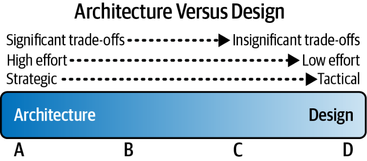

> **شکل ۲-۱.** طیف میان معماری و طراحی

---

## تصمیمات راهبردی در برابر تاکتیکی

هر چه تصمیمی راهبردی‌تر باشد، جنبهٔ معمارانه‌تری پیدا می‌کند. برعکس، هر چه تصمیمی تاکتیکی‌تر باشد، احتمالاً بیشتر به طراحی مربوط می‌شود. تصمیمات راهبردی عموماً بلندمدت‌اند، در حالی که تصمیمات تاکتیکی عموماً کوتاه‌مدت‌اند و معمولاً مستقل از اقدامات یا تصمیمات دیگر گرفته می‌شوند.

یک راه خوب برای تشخیص راهبردی‌بودن یا تاکتیکی‌بودن یک تصمیم، توجه به این پرسش‌هاست:

**چقدر اندیشه و برنامه‌ریزی در این تصمیم دخیل است؟**

تصمیمی که چند دقیقه طول می‌کشد، احتمالاً تاکتیکی و در نتیجه بیشتر از جنس طراحی است، در حالی که تصمیمی که به هفته‌ها برنامه‌ریزی نیاز دارد، احتمالاً راهبردی‌تر و در نتیجه بیشتر از جنس معماری است.

**چند نفر در این تصمیم دخیل‌اند؟**

تصمیمی که به‌تنهایی یا با یک همکار گرفته می‌شود، احتمالاً تاکتیکی‌تر و در سمت طراحیِ طیف است، در حالی که تصمیمی که به جلسات متعدد با ذی‌نفعان گوناگون نیاز دارد، احتمالاً راهبردی‌تر و در سمت معماریِ طیف قرار می‌گیرد.

**آیا این تصمیم یک چشم‌انداز بلندمدت است یا اقدامی کوتاه‌مدت؟**

تصمیمی که احتمالاً به‌زودی تغییر می‌کند، معمولاً از جنس تاکتیک است و بیشتر به طراحی مربوط می‌شود، در حالی که تصمیمی که ماندگار و دیرپاست، معمولاً راهبردی‌تر و بیشتر از جنس معماری است.

هرچند این پرسش‌ها تا حدی کیفی‌اند، با این حال به تشخیص اینکه موضوعی راهبردی است یا تاکتیکی—و در نتیجه بیشتر معماری یا بیشتر طراحی—کمک شایانی می‌کنند.

---

## سطح تلاش

Martin Fowler در مقالهٔ معروفش «Who Needs an Architect?» می‌نویسد که معماری «چیزهایی است که تغییردادنشان دشوار است.» هر چه چیزی دشوارتر تغییر کند، عموماً به تلاش بیشتری نیاز دارد و آن تصمیم یا فعالیت را به سمت معماریِ طیف می‌برد. برعکس، چیزی که برای پیاده‌سازی یا تغییر به حداقل تلاش نیاز دارد، در سمت طراحیِ طیف قرار می‌گیرد.

برای نمونه، جابه‌جایی از معماری لایه‌ای تک‌پارچه (Monolithic) به میکروسرویس‌ها به تلاش قابل‌توجهی نیاز دارد و بنابراین بیشتر از جنس معماری است. جابه‌جاکردن فیلدهای یک صفحهٔ وب تلاش ناچیزی می‌خواهد و بنابراین بیشتر از جنس طراحی است.

---

## اهمیت مصالحه‌ها

تحلیل موازنه‌ها و مصالحه‌های یک تصمیم خاص، در تشخیص معماری‌بودن یا طراحی‌بودن آن بسیار کمک می‌کند. هر قدر مصالحه‌ها بااهمیت‌تر باشند، تصمیم معمولاً معمارانه‌تر است. برای نمونه، انتخاب سبک معماری میکروسرویس مقیاس‌پذیری، چابکی، کشسانی (Elasticity) و تحمل خطا (Fault Tolerance) بهتری فراهم می‌کند. اما این معماری بسیار پیچیده است، بسیار پرهزینه است، یکپارچگی داده‌اش چالش‌برانگیز است و به دلیل جفت‌شدگی سرویس‌ها (Service Coupling) عملکرد و سرعت بالایی ندارد. این‌ها موازنه‌ها و مصالحه‌هایی نسبتاً بااهمیت‌اند. می‌توانیم نتیجه بگیریم که این تصمیم بیشتر در سمت معماریِ طیف است تا طراحی.

حتی تصمیمات طراحی هم مصالحه دارند. برای نمونه، تفکیک فایل کلاس، قابلیت نگهداری (Maintainability) و خوانایی (Readability) بهتری فراهم می‌کند—به بهای مدیریت کلاس‌های بیشتر.

این مصالحه‌ها چندان بااهمیت نیستند (به‌ویژه در مقایسه با مصالحه‌های میکروسرویس‌ها)، بنابراین این تصمیم بیشتر در سمت طراحیِ طیف قرار می‌گیرد.

---

## گستردگی فنی

برخلاف توسعه‌دهندگان که برای انجام کارشان به ژرفای فنی قابل‌توجهی نیاز دارند، معماران نرم‌افزار باید گستردگی فنی بالایی داشته باشند تا پدیده‌ها را از دیدگاه معماری ببینند. ژرفای فنی یعنی داشتن دانشی عمیق در یک زبان برنامه‌نویسی، پلتفرم، چارچوب یا محصولی خاص، در حالی که گستردگی فنی یعنی داشتن شناختی جامع از فناوری‌ها و ابزارهای متنوع.

برای درک بهتر این تفاوت، هرم دانش (Knowledge Pyramid) را در نظر بگیرید که در شکل ۲-۲ آمده است. این هرم تمام دانش فنی جهان را در خود جا می‌دهد و به سه سطح قابل تفکیک است: چیزهایی که می‌دانید، چیزهایی که می‌دانید نمی‌دانید، و چیزهایی که نمی‌دانید نمی‌دانید.

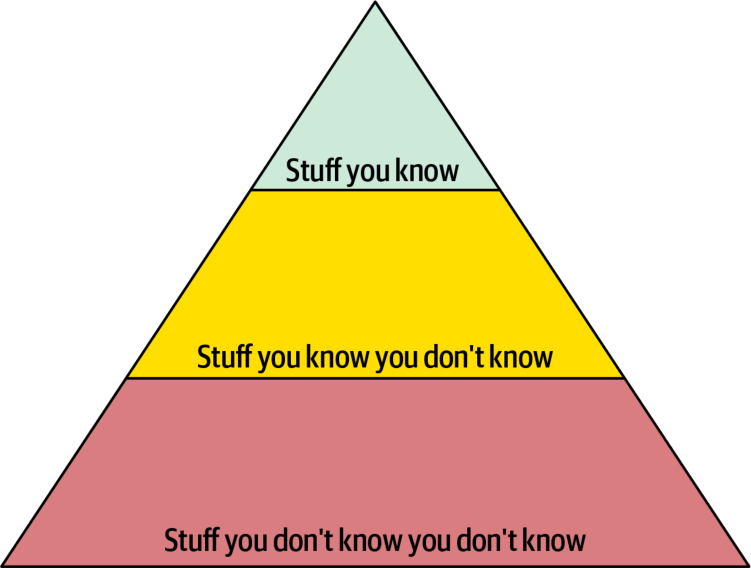

> **شکل ۲-۲.** هرمی که تمام دانش را نمایندگی می‌کند

سطح «چیزهایی که می‌دانید» شامل فناوری‌ها، چارچوب‌ها، زبان‌ها و ابزارهایی می‌شود که مهندسان هر روز برای انجام کارشان به کار می‌برند (مثلاً برنامه‌نویسی که زبان Java را می‌داند). آن‌ها در این ابزارها مسلط یا حتی خبره‌اند. توجه کنید که این سطح از دانش (که بخش بالایی هرم را نشان می‌دهد) کوچک‌ترین سطح و کم‌حجم‌ترین آن‌هاست. دلیلش این است که بیشتر متخصصان ناگزیرند حوزه‌های محدودی را برای کسب تخصص انتخاب کنند—هیچ‌کس نمی‌تواند در همه‌چیز خبره باشد.

سطح «چیزهایی که می‌دانید نمی‌دانید» (بخش میانی هرم) شامل چیزهایی می‌شود که مهندس نرم‌افزار کمی درباره‌شان می‌داند یا نام‌شان را شنیده، اما تجربه یا تخصص اندکی در آن‌ها دارد. برای نمونه، بیشتر مهندسان نام Clojure را شنیده‌اند و می‌دانند زبان برنامه‌نویسی‌ای مبتنی بر Lisp است، اما نمی‌توانند به آن کدی بنویسند. این سطح از دانش بسیار بزرگ‌تر از سطح بالایی است؛ چون انسان‌ها می‌توانند با چیزهای بسیار بیشتری آشنا شوند، تا آنکه بتوانند در همهٔ آن‌ها تخصص پیدا کنند.

سطح «چیزهایی که نمی‌دانید نمی‌دانید» بزرگ‌ترین بخش هرم دانش است؛ شامل انبوه فناوری‌ها، ابزارها، چارچوب‌ها و زبان‌هایی می‌شود که چه بسا راه‌حل کامل همان مسئلهٔ موردنظر باشند، اما مهندسی که در حال حل مسئله است اصلاً از وجودشان آگاهی ندارد. هدف در هر مسیر حرفه‌ای باید این باشد که موضوعات از لایهٔ «چیزهایی که نمی‌دانید نمی‌دانید» به بخش میانی هرم—«چیزهایی که می‌دانید نمی‌دانید»—منتقل شوند و، هنگامی که تخصص در آن‌ها ضرورت یافت، از بخش میانی هرم به بخش بالایی برسند: «چیزهایی که می‌دانید».

در آغاز کار یک توسعه‌دهنده، گسترش بخش بالایی هرم (شکل ۲-۳) یعنی کسب تخصصی ارزشمند. اما هر آنچه می‌دانید، نیازمند مراقبت و به‌روزرسانی مداوم است—در دنیای نرم‌افزار هیچ‌چیز ایستا نیست. اگر توسعه‌دهنده‌ای در Ruby on Rails خبره شود، اما یک یا دو سال آن را کنار بگذارد، این تخصص پایدار نمی‌ماند. نگه‌داشتن دانش در بالای هرم نیازمند صرف وقت مداوم برای حفظ تخصص است. این بخش بالایی، ژرفای فنیِ فرد را نشان می‌دهد: چیزهایی که واقعاً به‌خوبی بر آن‌ها مسلط است.

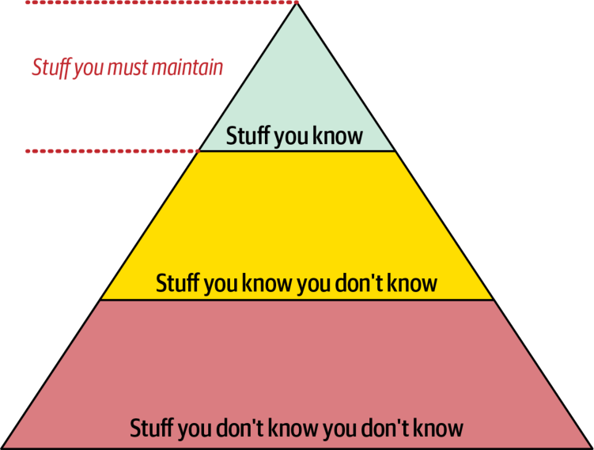

> **شکل ۲-۳.** توسعه‌دهندگان باید تخصصشان را حفظ کنند تا از دستش ندهند

اما ماهیت دانش هنگام گذار توسعه‌دهندگان به نقش معمار تغییر می‌کند. بخش بزرگی از ارزش یک معمار در این است که شناختی گسترده از فناوری و چگونگی به‌کارگیری آن برای حل مسائل خاص دارد. برای نمونه، برای معمار بسیار مفیدتر است بداند برای مسئله‌ای خاص پنج راه‌حل وجود دارد، تا آنکه تنها در یکی از آن‌ها تخصص داشته باشد. مهم‌ترین بخش‌های هرم برای معماران، بخش‌های بالایی و میانی‌اند؛ هر قدر بخش میانی عمیق‌تر به بخش پایینی نفوذ کند، گستردگی فنی معمار بیشتر خواهد بود، همان‌طور که در شکل ۲-۴ آمده است.

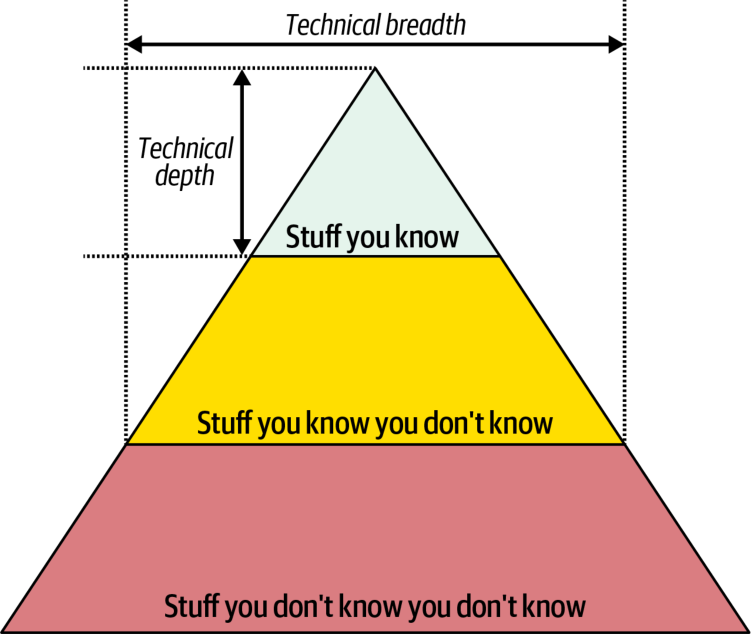

> **شکل ۲-۴.** اینکه کسی دربارهٔ موضوعی چقدر می‌داند، ژرفای فنی است؛ و اینکه چند موضوع می‌داند، گستردگی فنی

برای معمار، گستردگی فنی مهم‌تر از ژرفا است. چون معماران باید تصمیماتی بگیرند که توانمندی‌ها را با قیدوبندهای فنی هماهنگ سازد، درک گسترده از طیف وسیعی از راه‌حل‌ها بسیار ارزشمند است. بنابراین، مسیر هوشمندانه برای یک معمار این است که از برخی تخصص‌های به‌سختی‌آموخته‌اش دست بکشد و آن زمان را صرف گسترش سبد دانشش کند، همان‌طور که در شکل ۲-۵ آمده است. برخی حوزه‌های تخصصی باقی می‌مانند—به‌ویژه حوزه‌های فناوری‌ای که برایش جذاب‌ترند—و برخی دیگر به‌درستی کمرنگ می‌شوند.

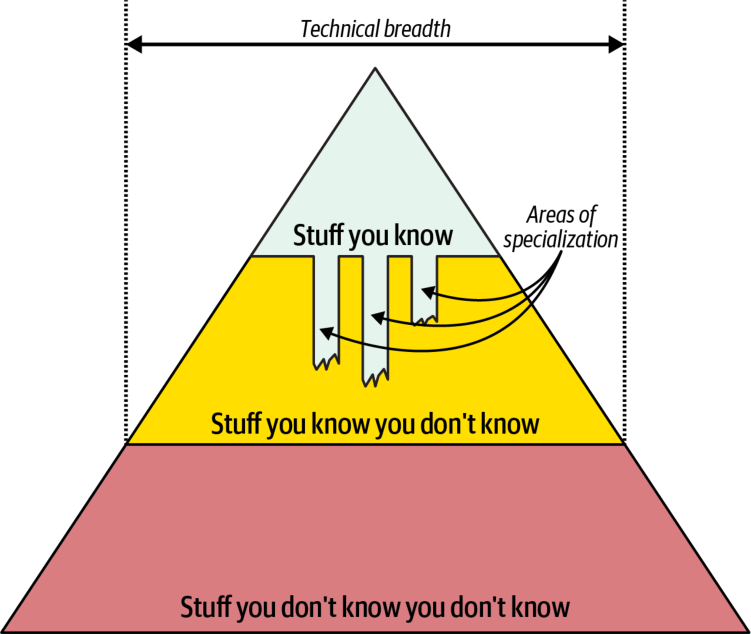

> **شکل ۲-۵.** گستردگی افزایش‌یافته و ژرفای رو به کاهش برای نقش معمار

هرم دانش ما نشان می‌دهد نقش معمار و توسعه‌دهنده تا چه حد بنیادین با هم تفاوت دارند. توسعه‌دهندگان تمام سال‌های کاری‌شان را صرف عمیق‌تر کردن تخصص فنی می‌کنند. گذار به نقش معمار یعنی دگرگون‌کردن این دیدگاه، که بسیاری از افراد آن را دشوار می‌یابند. این چالش به دو تلهٔ رایج می‌انجامد: نخست، معماری که می‌کوشد تخصصش را در طیف گسترده‌ای از حوزه‌ها عمیق نگه دارد، در هیچ‌یک موفق نمی‌شود و در این مسیر خود را فرسوده می‌کند. دوم، تخصصش به شکل تخصص کهن‌شده (Stale Expertise) درمی‌آید—احساس نادرستِ اینکه اطلاعات منسوخ‌شده‌اش هنوز به‌روز و راه‌گشاست. این وضعیت را اغلب در شرکت‌های بزرگ می‌بینیم، جایی که توسعه‌دهندگان بنیان‌گذار شرکت به نقش‌های رهبری رسیده‌اند اما هنوز با معیارهای گذشته برای تصمیمات امروزی فناوری تصمیم می‌گیرند («ضدالگوی انسان غارنشین منجمد» را در صفحهٔ ۲۴ ببینید).

---

## ضدالگوی انسان غارنشین منجمد

ضدالگو (Antipattern) را برنامه‌نویس سرشناس Andrew Koenig این‌گونه تعریف می‌کند: چیزی که هنگام شروع، ایدهٔ خوبی به نظر می‌رسد، اما سرانجام شما را به دردسر می‌اندازد. ضدالگوی رفتاریِ شایعی که در دنیای واقعی دیده می‌شود—ضدالگوی انسان غارنشین منجمد (Frozen Caveman Antipattern)—توصیف‌گر معمارانی است که در مواجهه با هر معماریِ جدیدی، ناخودآگاه به نگرانیِ غیرمنطقیِ همیشگی‌شان بازمی‌گردند. برای نمونه، یکی از همکاران Neal روی سیستمی کار می‌کرد که معماری متمرکزی داشت. هر بار که طرح را برای معماران مشتری می‌فرستادند، این پرسش پی‌درپی مطرح می‌شد: «اما اگر ایتالیا را از دست بدهیم چه؟» چند سال قبل، مشکلی غریب در خطوط ارتباطی مانع از ارتباط دفتر مرکزی مشتری با فروشگاه‌هایش در ایتالیا شده و دردسر زیادی ایجاد کرده بود. با اینکه احتمال تکرار چنین رویدادی بسیار ناچیز بود، معماران روی این سناریوی خاص وسواس پیدا کرده بودند.

به‌طور کلی، این ضدالگو در معمارانی بروز می‌کند که در گذشته از یک تصمیم نادرست یا رویدادی غیرمنتظره آسیب دیده‌اند و گزیده شده‌اند، و همین امر آن‌ها را در برابر هر مسئلهٔ مشابهی بیش از حد محتاط و نگران کرده است. ارزیابی ریسک (Risk Assessment) امری حیاتی است، اما باید واقع‌بینانه باشد. شناخت تفاوت میان ریسک فنیِ واقعی و ریسک ذهنی و توهمی، بخشی از فرایند یادگیری مستمر است. تفکر مانند یک معمار مستلزم غلبه بر این تجارب و ایده‌های منجمد، دیدن راه‌حل‌های جایگزین و پرسیدن پرسش‌های واقعی‌تر و مرتبط‌تر است.

معماران باید بر گستردگی فنی تمرکز کنند تا تیرهای بیشتری در ترکش خود برای حل مسائل داشته باشند. توسعه‌دهندگانی که به نقش معمار می‌رسند، باید شیوهٔ نگاه‌شان به فراگیری دانش را دگرگون سازند. ایجاد تعادل میان ژرفا و گستردگیِ سبد دانش (Portfolio of Knowledge)، دغدغه‌ای است که هر متخصص نرم‌افزار در طول زندگی حرفه‌ای‌اش با آن روبه‌رو می‌شود. اما معمار چگونه گستردگی فنی به دست می‌آورد؟ بخش‌های بعدی چند تکنیک کاربردی ارائه می‌دهند که به شما کمک می‌کند لایهٔ «چیزهایی را که نمی‌دانید نمی‌دانید» کشف و آشکار کنید.

---

## قانون بیست‌دقیقه‌ای

همان‌طور که در شکل ۲-۵ نشان داده شد، گستردگی فنی برای معماران مهم‌تر از ژرفای فنی است. اما چگونه می‌توان همزمان با کار تمام‌وقت، پیشرفت شغلی، وقت‌گذرانی با دوستان و رسیدگی به خانواده، با آخرین روندها و اصطلاحات روز (Buzzwords) به‌روز ماند؟

یکی از تکنیک‌هایی که ما به کار می‌بریم، قانون بیست‌دقیقه‌ای است. ایده این است که دست‌کم روزی ۲۰ دقیقه را صرف یادگیری موضوعی تازه یا بررسی دقیق یک فناوری خاص کنید. شکل ۲-۶ چند جای خوب برای گذراندن آن ۲۰ دقیقه را نشان می‌دهد، مثل InfoQ، DZone Refcardz و Thoughtworks Technology Radar. می‌توانید با جست‌وجوی واژه‌های داغِ ناآشنا در اینترنت، دانش‌شان را از «چیزهایی که نمی‌دانی نمی‌دانی» به «چیزهایی که می‌دانی نمی‌دانی» ارتقا دهید. حتی می‌توانید آن وقت را صرف خواندن کتابی مثل همین کتاب کنید. هدف این است که در دل شلوغی‌های روزمره، زمانی اختصاصی برای خود خالی کنید و بر توسعهٔ گستردگی فنی—و در نتیجه آیندهٔ حرفه‌ای‌تان—متمرکز شوید.


> **شکل ۲-۶.** قانون بیست‌دقیقه‌ای

بسیاری از متخصصان وقتی برای نخستین بار این راهبرد را می‌پذیرند، ۲۰ دقیقهٔ خود را برای زمان ناهار یا پایان روز کاری برنامه‌ریزی می‌کنند؛ اما بر پایهٔ تجربیات ما، این زمان‌بندی‌ها به‌ندرت جواب می‌دهند. بسیار محتمل است که وقت ناهار به‌جای استراحت صرف کارهای عقب‌افتاده شود، و شب‌ها اوضاع از این هم پیچیده‌تر است: پس از یک روز طولانی، خستگی، تعاملات خانوادگی و برنامه‌های اجتماعی مانع می‌شوند. در عوض، شدیداً توصیه می‌کنیم این ۲۰ دقیقه را اول صبح انجام دهید—درست پس از نوشیدن فنجانی قهوه یا چای و، مهم‌تر از همه، پیش از آنکه ایمیل‌تان را چک کنید. به محض اینکه ایمیل را چک کردید، صبحتان تمام شده و روزتان آغاز شده است. ۲۰ دقیقه‌تان را در حالی انجام دهید که ذهنتان تازه است و پیش از آنکه حواس‌پرتی‌ها غلبه کنند.

پیروی از قانون بیست‌دقیقه‌ای، گستردگی فنی شما را افزایش می‌دهد و به پرورش و حفظ دانشی کمک می‌کند که شما را به یک معمار مؤثرِ نرم‌افزار بدل می‌کند.

---

## توسعهٔ رادار شخصی

در بیشتر دههٔ ۹۰ و آغاز دههٔ ۲۰۰۰، یکی از مؤلفان ما مدیر فناوری (CTO) شرکت کوچکی در حوزهٔ آموزش و مشاوره بود. هنگامی که او شروع کرد، پلتفرم اصلی Clipper بود؛ ابزاری برای توسعهٔ سریع برنامه (Rapid Application Development) که برنامه‌های DOS را روی فایل‌های dBASE می‌ساخت. تا اینکه یک روز ناپدید شد. شرکت ظهور Windows را دیده بود، اما بازار کسب‌وکار هنوز DOS بود… تا اینکه ناگهان دیگر بازاری نماند. یکی از همکاران زار می‌زد که نمی‌توانند انبوه دانش بی‌فایدهٔ Clipper خود را با چیز دیگری جایگزین کنند. آن همکار با تعجب می‌پرسید: آیا در تاریخ گروهی بوده که اعضایش در طول عمر خود—به‌عنوان توسعه‌دهندهٔ نرم‌افزار—به این اندازه دانش جزئی بیاموزند و دور بیفکنند؟ این تجربه تأثیری ماندگار بر جا گذاشت: پیشروی فناوری را نادیده بگیرید، تا به زیان خودتان تمام شود.

این تجربه درس مهمی هم دربارهٔ حباب‌های فناوری به ما آموخت. هنگامی که توسعه‌دهندگان، معماران و دیگر متخصصان فناوری سرمایه‌گذاری سنگینی روی فناوری خاصی می‌کنند و کار و اندیشه‌شان را در آن می‌ریزند، درون حبابی میمی (Memetic Bubble) زندگی می‌کنیم. درون این حباب—که همزمان اتاق پژواک (Echo Chamber) هم هست—همه به همان اندازهٔ ما آن فناوری را می‌شناسند و برایش اهمیت قائل‌اند. شاید اصلاً ارزیابی‌های صادقانهٔ بیرون از حباب را نبینیم، به‌ویژه اگر اولِ امر خودِ فروشندهٔ فناوری این حباب را ساخته باشد. و هنگامی که حباب شروع به فروپاشی می‌کند، تا دیر شود خبری از هشدار نیست.

آنچه در حبابمان کم داریم، یک رادار فناوری (Technology Radar) است: سندی زنده که به ما کمک می‌کند مخاطرات و پاداش‌های فناوری‌های موجود و نوظهور را بسنجیم. مفهوم رادار از Thoughtworks می‌آید، جایی که Neal هم عضو هیئت‌مدیره است و هم معمار نرم‌افزار. در این بخش، توصیف می‌کنیم این مفهوم چگونه شکل گرفت و سپس نشان می‌دهیم چگونه رادار شخصی بسازید.

---

### رادار فناوری Thoughtworks

هیئت مشاورهٔ فناوری (Technology Advisory Board) یا TAB، گروهی از رهبران ارشد فناوری در Thoughtworks است که به CTO در گرفتن تصمیمات دربارهٔ جهت‌گیری‌ها و راهبردهای فناوریِ شرکت و مشتریانش کمک می‌کند. برای به‌روزماندن، این گروه شروع به تولید چیزی کرد که اکنون رادار فناوریِ دوبار در سال است.

این کار عوارض جانبی غیرمنتظره‌ای داشت. هنگامی که Neal در کنفرانس‌ها سخن می‌راند، حاضران دنبالش می‌گشتند تا از کمکش در تولید رادار تشکر کنند و غالباً اضافه می‌کردند که شرکت خودشان هم نسخهٔ خودش را تولید کرده است. Neal همچنین دریافت که این، پاسخ پرسشی است که در پنل‌های سخنرانان کنفرانس‌ها مدام مطرح می‌شود: «چطور با فناوری همگام می‌مانید؟ چطور می‌فهمید دنبال چه چیزی بروید؟» پاسخ، البته، این است که همهٔ این سخنرانان نوعی رادار داخلی دارند.

**اجزاء (Parts).** رادار Thoughtworks از چهار ربع تشکیل شده است که می‌کوشند بیشتر چشم‌انداز توسعهٔ نرم‌افزار را پوشش دهند:

- **Tools** — همه‌چیز، از ابزارهای توسعه مثل IDEها تا ابزارهای یکپارچه‌سازی در حدِّ سازمانی
- **Languages and frameworks** — زبان‌های کامپیوتری، کتابخانه‌ها و چارچوب‌ها، معمولاً متن‌باز
- **Techniques** — هر رویه‌ای که به توسعهٔ نرم‌افزار به‌طور کلی کمک کند، از جمله فرایندها، شیوه‌های مهندسی و توصیه‌ها
- **Platforms** — سکوهای فناوری، از جمله پایگاه‌داده‌ها، ارائه‌دهندگان ابری و سیستم‌عامل‌ها

**حلقه‌ها (Rings).** رادار چهار حلقه دارد که در اینجا از بیرون به داخل فهرست شده‌اند:

- **Hold** — معنای اصلی حلقهٔ Hold این بود «فعلاً دست نگه دارید»؛ نمایندهٔ فناوری‌هایی که هنوز برای ارزیابی منصفانه تازه بودند—فناوری‌هایی با سروصدای زیاد اما هنوز اثبات‌نشده. حلقهٔ Hold تکامل یافته و اکنون چیزی شبیه «با این فناوری هیچ کار جدیدی را شروع نکنید» نشان می‌دهد. استفاده از آن در پروژه‌های موجود آسیبی ندارد، اما برای توسعهٔ جدید دو بار فکر کنید.
- **Assess** — نشان می‌دهد فناوری‌ای ارزش کاوش دارد (مثلاً از طریق اسپایک‌های توسعه (Development Spikes)، پروژه‌های تحقیقاتی یا نشست‌های کنفرانسی) تا ببینید چگونه بر سازمان اثر می‌گذارد. برای نمونه، هنگامی که مرورگرهای موبایل برجسته شدند، بسیاری از شرکت‌های بزرگ آشکارا هنگام تدوین راهبرد موبایل این مرحله را پشت سر گذاشتند.
- **Trial** — برای فناوری‌هایی که ارزش پیگیری دارند. اگر توانمندی‌ای در این حلقه است، درک چگونگی ساخت آن مهم است. حالا زمان آزمایش پروژه‌ای کم‌ریسک است.
- **Adopt** — Thoughtworks به‌شدت معتقد است صنعت باید موارد فهرست‌شده در حلقهٔ Adopt را بپذیرد.

در نمای نمونهٔ رادار در شکل ۲-۷، هر نقطه (Blip) فناوری یا تکنیک متفاوتی را نمایندگی می‌کند. Thoughtworks از رادار برای انتشار نظرات جمعی‌اش دربارهٔ دنیای نرم‌افزار بهره می‌برد؛ بسیاری از توسعه‌دهندگان و معماران نیز از آن به‌عنوان شیوه‌ای برای ساختاردادن به فرایند ارزیابی فناوری‌شان و سازمان‌دهی اندیشه‌شان دربارهٔ اینکه وقت را صرف چه چیزی کنند استفاده می‌کنند. برای کاربرد شخصی، پیشنهاد می‌کنیم معانی ربع‌ها را به شکل زیر تغییر دهید:

- **Hold** — این حلقه فقط فناوری‌ها و تکنیک‌هایی را در بر نمی‌گیرد که باید از آن‌ها پرهیز کنید، بلکه عادت‌هایی را هم که می‌خواهید ترک کنید. برای نمونه، اگر معماری از دنیای .NET هستید، شاید عادت داشته باشید آخرین اخبار و شایعات را در انجمن‌ها دربارهٔ مسائل داخلیِ تیم بخوانید. این کار سرگرم‌کننده است، اما می‌تواند جریان اطلاعاتی کم‌ارزشی باشد. قراردادنش در حلقهٔ Hold یادآوری‌ای است از اینکه از چه چیزی باید پرهیز کنید.
- **Assess** — حلقهٔ Assess را برای فناوری‌های امیدوارکننده‌ای به کار ببرید که چیزهای خوبی درباره‌شان شنیده‌اید اما هنوز فرصت نکرده‌اید خودتان ارزیابی‌اش کنید. این حلقه، منطقهٔ تجمعی برای پژوهش‌های جدی‌تر آینده می‌سازد.
- **Trial** — حلقهٔ Trial نشان‌دهندهٔ پژوهش و توسعهٔ فعال است، مثل انجام آزمایش‌های اسپایک درون پایگاه کد بزرگ‌تری (Code Base). این‌ها فناوری‌هایی‌اند که ارزش صرف‌کردن وقت برای درک عمیق‌ترشان را دارند تا بتوانید آن‌ها را به‌شکل مؤثر در تحلیل مصالحه‌ها بگنجانید.
- **Adopt** — حلقهٔ Adopt شخصیِ شما، چیزهای تازه‌ای را نمایندگی می‌کند که بیشتر از همه هیجان‌زده‌تان می‌کنند، و بهترین شیوه‌ها را برای حل مسائل خاص.

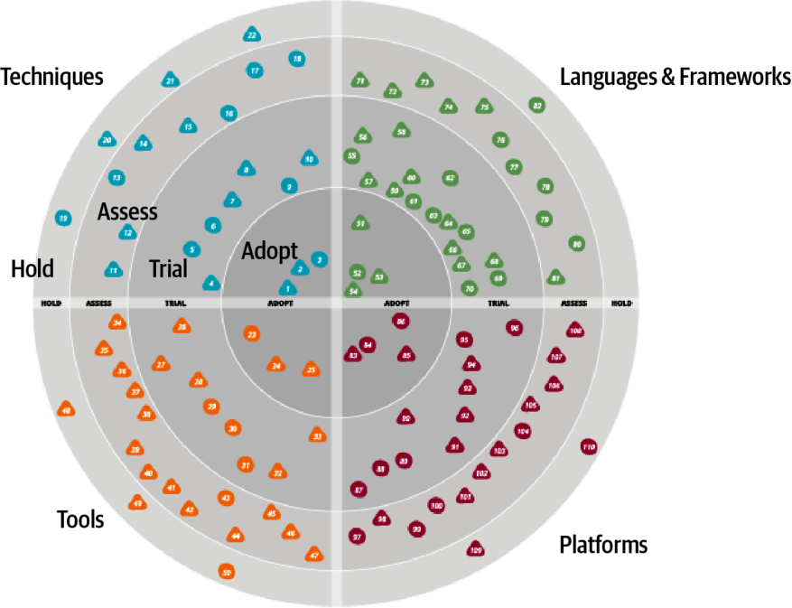

> **شکل ۲-۷.** نمونه‌ای از رادار فناوری Thoughtworks

بیشتر متخصصان فناوری‌ها را بیش‌وبه‌اندازه به‌صورت اتفاقی انتخاب می‌کنند، بر اساس اینکه چه چیزی خوش‌قیافه است یا کارفرمایانشان از چه چیزی استفاده می‌کنند—اما داشتن موضعی از سرِ رهاکردن (Laissez-faire) نسبت به سبد فناوری‌تان برای حرفه‌تان خطرناک است. ساختن رادار فناوری به شما کمک می‌کند اندیشه‌تان دربارهٔ فناوری را رسمیت ببخشید و معیارهای متضاد تصمیم‌گیری را به تعادل برسانید. (برای نمونه، شاید گرفتن شغل جدیدی با تمرکز بر فناوریِ جذاب و مد روز (Cool Technology) دشوارتر باشد، در حالی که فناوری بالغ‌تر ممکن است بازار کار بزرگی داشته باشد اما کارهای جالب‌تری عرضه نکند.)

با سبد فناوری‌تان مثل یک سبد مالی برخورد کنید: متنوع‌سازی کنید! برخی فناوری‌ها و/یا مهارت‌هایی را که تقاضای گسترده دارند انتخاب کنید و آن تقاضا را دنبال کنید. اما شاید هم بخواهید چند ریسک هوشمندانه و گامبیت فناوری (Technology Gambits) را هم امتحان کنید، مثل هوش مصنوعی مولد یا دستگاه‌های اینترنت اشیای تعبیه‌شده (Embedded IoT). حکایت‌ها فراوان‌اند از توسعه‌دهندگانی که خود را از بندِ سکونشینیِ پشت میزکار رها کردند، با کارکردن تا دیروقت روی پروژه‌های متن‌بازی که محبوب شدند و سرانجام توسط شرکت‌های بزرگ به کار گرفته یا خریداری شدند. این، دلیلی دیگر است بر تمرکز بر گستردگی به‌جای ژرفا.

ساختن رادار شخصی داربست و چارچوب اولیهٔ مناسبی برای گسترش سبد فناوری‌تان فراهم می‌کند—اما در نهایت، خودِ تمرین مهم‌تر از نتیجه است. ساختن این مصورسازی بهانه‌ای به شما می‌دهد تا در برنامهٔ شلوغتان زمانی اختصاص دهید و به این چیزها فکر کنید؛ غالباً همین تنها راه انجام‌دادن این نوع تفکر است.

هرچند مهم‌ترین بخش ساختن رادار شخصی، گفت‌وگوهایی است که به راه می‌اندازد، اما مصورسازی‌های بسیار مفیدی هم تولید می‌کند. پس از استقبال فراوانِ متخصصان که رادارهای خودشان را می‌ساختند، Thoughtworks ابزاری به نام Build Your Own Radar منتشر کرد. با یک صفحهٔ گستردهٔ Google به‌عنوان ورودی، مصورسازی راداری تولید می‌کند که رادار شخصی شما را نشان می‌دهد. از همهٔ مهندسان و معماران دعوت می‌کنیم از آن بهره ببرند.

---

## تحلیل مصالحه‌ها

تفکر مثل یک معمار یعنی دیدن مصالحه‌ها در هر راه‌حلی—فنی یا غیرفنی—و تحلیل آن مصالحه‌ها برای تعیین بهترین راه‌حل. دلیل اینکه این فعالیت، یکی از فعالیت‌های کلیدی یک معمار است (و بنابراین بخشی از تفکر معماری) را می‌توان با نقل‌قول زیر از Mark (یکی از مؤلفان ما) نشان داد:

> **معماری همان چیزی است که نه می‌توانی در گوگل پیدایش کنی و نه از یک LLM بپرسی.**
>
> — Mark Richards

همه‌چیز در معماری یک مصالحه است؛ به همین دلیل است که پاسخ معروف به هر پرسش معماری در جهان این است: «بستگی دارد.» این پاسخ شاید آزاردهنده باشد، اما متأسفانه درست است. نمی‌توانید پاسخ را در گوگل بجویید یا از موتور هوش مصنوعی یا مدل زبانی بزرگ (LLM) بپرسید که REST برای سیستم‌تان بهتر است یا پیام‌رسانی، یا اینکه میکروسرویس‌ها سبک معماری درستی برای محصول جدیدتان هستند، چون پاسخ واقعاً بستگی دارد. بستگی دارد به محیط استقرار، محرک‌های کسب‌وکار، فرهنگ شرکت، بودجه‌ها، چارچوب‌های زمانی، مهارت‌های توسعه‌دهندگان و ده‌ها عامل دیگر. محیط، وضعیت و مسئلهٔ هر کسی متفاوت است. به همین دلیل است که معماری این‌قدر دشوار است. با نقل‌قول Neal، مؤلف دیگر ما:

> **در معماری پاسخ درست یا غلط وجود ندارد—فقط مصالحه.**
>
> — Neal Ford

برای نمونه، سیستم مزایدهٔ کالا (شکل ۲-۸) را در نظر بگیرید که در آن پیشنهاددهندگان آنلاین روی کالاهای مزایده‌شده قیمت پیشنهاد می‌دهند. سرویس Bid Producer یک پیشنهاد (Bid) را از پیشنهاددهنده می‌سازد و سپس مبلغ آن را برای سرویس‌های Bid Capture، Bid Tracking و Bid Analytics می‌فرستد.

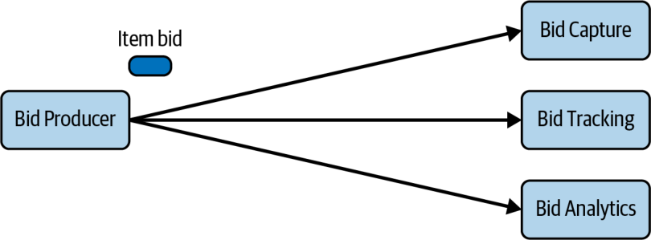

> **شکل ۲-۸.** نمونهٔ مصالحه در سیستم مزایده—صف‌ها یا موضوع‌ها؟

برای رفتار ناهمزمان در این سیستم، معمار می‌تواند از صف‌ها (Queue) به شیوهٔ پیام‌رسانی نقطه‌به‌نقطه (Point-to-Point) استفاده کند، یا از موضوع (Topic) به شیوهٔ پیام‌رسانی انتشار-اشتراک (Publish-and-Subscribe). کدام را باید انتخاب کند؟ نمی‌تواند پاسخ را گوگل کند. تفکر معماری ایجاب می‌کند مصالحه‌های هر گزینه را تحلیل کند و با توجه به موقعیت خاص، بهترین (یا کم‌بدترین) گزینه را برگزیند.

دو گزینهٔ پیام‌رسانی برای سیستم مزایدهٔ کالا در شکل ۲-۹ نشان داده شده‌اند که استفاده از موضوع‌ها را در مدل پیام‌رسانی انتشار-اشتراک تصویر می‌کند، و شکل ۲-۱۰ که استفاده از صف‌ها را در مدل پیام‌رسانی نقطه‌به‌نقطه نشان می‌دهد.

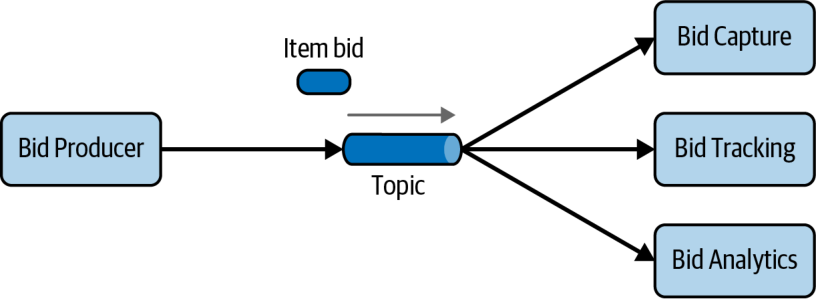

> **شکل ۲-۹.** استفاده از موضوع برای ارتباط میان سرویس‌ها

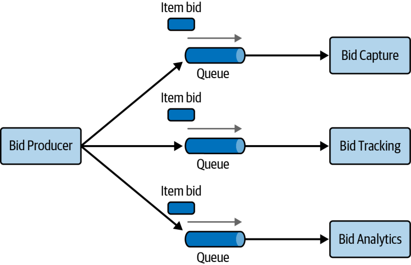

> **شکل ۲-۱۰.** استفاده از صف‌ها برای ارتباط میان سرویس‌ها

مزیت روشن (و راه‌حل آشکار)ِ این مسئله در شکل ۲-۹، گسترش‌پذیری معماری است. سرویس Bid Producer فقط به یک اتصال به موضوع نیاز دارد. آن را با راه‌حل صف در شکل ۲-۱۰ مقایسه کنید که در آن Bid Producer باید به سه صف مختلف متصل شود. اگر سرویس جدیدی به نام Bid History به این سیستم افزوده شود (تا به هر پیشنهاددهنده، تاریخچهٔ همهٔ پیشنهادهایش را نشان دهد)، هیچ تغییری در سرویس‌های موجود یا زیرساخت لازم نیست. سرویس جدید Bid History می‌تواند صرفاً مشترک همان موضوعی شود که اطلاعات پیشنهاد را در خود دارد.

اما با گزینهٔ صف در شکل ۲-۱۰، سرویس Bid History به صف جدیدی نیاز دارد و Bid Producer باید برای افزودن اتصالی اضافی به صف جدید اصلاح شود. نکته اینجاست که استفاده از صف‌ها یعنی افزودن قابلیت جدیدِ پیشنهاددادن به تغییرات قابل‌توجهی در سرویس‌ها و زیرساخت نیاز دارد، در حالی که با رویکرد موضوع، هیچ تغییری در زیرساخت موجود لازم نیست. همچنین، Bid Producer در گزینهٔ موضوع کوپلینگ کمتری دارد، جایی که نمی‌داند اطلاعات پیشنهاد چگونه و توسط کدام سرویس‌ها به کار خواهد رفت. در گزینهٔ صف، Bid Producer دقیقاً می‌داند اطلاعات پیشنهاد چگونه (و توسط چه کسی) به کار می‌رود و بنابراین کوپلینگ بیشتری با سیستم دارد.

تا اینجا، این تحلیل مصالحه‌ها آشکار می‌سازد که رویکرد موضوع با مدل انتشار-اشتراک، انتخاب آشکار و بهتر است. اما با نقل‌قول Rich Hickey، خالق زبان برنامه‌نویسی Clojure:

> **برنامه‌نویسان مزایای همه‌چیز را می‌دانند و مصالحه‌های هیچ‌چیز را نه. معماران باید هر دو را درک کنند.**
>
> — Rich Hickey

تفکر معمارانه یعنی نه‌تنها به مزایای راه‌حل خاصی نگریستن، بلکه تحلیل جنبه‌های منفیِ مرتبط—یا همان مصالحه‌ها—نیز هست. ادامهٔ مثال سیستم مزایده، معمار نرم‌افزار منفی‌های راه‌حل موضوع را هم‌چون مثبت‌هایش تحلیل می‌کند. در شکل ۲-۹ می‌بینید که با موضوع، هر کسی می‌تواند به داده‌های پیشنهاد دسترسی داشته باشد که مسئلهٔ احتمالیِ دسترسی به داده و امنیت داده را پیش می‌آورد. اما در مدل صفِ شکل ۲-۱۰، داده‌ای که به صف فرستاده می‌شود فقط توسط مصرف‌کنندهٔ خاصی که آن پیام را دریافت می‌کند قابل دسترسی است. اگر سرویس سرکش و غیرمجازی (Rogue Service) در صفی شنود می‌کرد، سرویس مربوط آن پیشنهادها را دریافت نمی‌کرد و بلافاصله اعلانی دربارهٔ ازدست‌رفتن داده (و نفوذ احتمالی امنیتی) ارسال می‌شد. به بیان دیگر، شنودِ یک موضوع بسیار آسان است، اما شنودِ صف نه.

علاوه بر مسئلهٔ امنیت، راه‌حل موضوع در شکل ۲-۹ فقط از قراردادهای همگون (Homogeneous) پشتیبانی می‌کند. همهٔ سرویس‌هایی که داده‌های پیشنهاد را دریافت می‌کنند باید همان قرارداد داده و مجموعهٔ دادهٔ پیشنهاد را بپذیرند. در گزینهٔ صف، هر مصرف‌کننده می‌تواند قرارداد خودش را داشته باشد، متناسب با داده‌ای که لازم دارد. برای نمونه، فرض کنید سرویس جدید Bid History قیمت فعلی درخواستی را همراه با پیشنهاد می‌خواهد، اما هیچ سرویس دیگری به آن اطلاعات نیاز ندارد. در این حالت باید قرارداد اصلاح شود که بر همهٔ سرویس‌های دیگرِ استفاده‌کننده از آن داده اثر می‌گذارد. در مدل صف، این یک کانال مجزا و در نتیجه قراردادی مجزاست که بر هیچ سرویس دیگری اثر نمی‌گذارد.

عیب دیگر مدل موضوع این است که از پایش تعداد پیام‌ها در موضوع پشتیبانی نمی‌کند و بنابراین نمی‌تواند قابلیت مقیاس‌پذیری خودکار (Autoscaling) را پشتیبانی کند. اما با گزینهٔ صف، هر صف را می‌توان جداگانه پایش کرد و توازن‌بار برنامه‌پذیر (Programmatic Load Balancing) را روی هر مصرف‌کنندهٔ پیشنهاد اعمال کرد تا هر کدام بتوانند مستقلاً و به‌طور خودکار مقیاس بگیرند. توجه کنید این مصالحه، وابسته به فناوری است: پروتکل پیشرفتهٔ صف‌بندی پیام (Advanced Message Queuing Protocol) یا AMQP، به لطف جدایش میان یک مرکز تبادل پیام (Exchange) —چیزی که تولیدکننده به آن می‌فرستد— و یک صف —چیزی که مصرف‌کننده به آن گوش می‌سپارد— می‌تواند از توازن‌بار برنامه‌پذیر و پایش پشتیبانی کند.

با این تحلیل کامل‌ترِ مصالحه‌ها، کدام گزینه بهتر است؟

بستگی دارد! جدول ۲-۱ این مصالحه‌ها را خلاصه می‌کند.

**جدول ۲-۱.** مصالحه‌های موضوع‌ها

| مزایای موضوع | معایب موضوع |
|---|---|
| گسترش‌پذیری معماری | نگرانی‌های دسترسی به داده و امنیت داده |
| جداسازی سرویس‌ها | نبود قراردادهای ناهمگون |
| — | نبود پایش و مقیاس‌پذیری برنامه‌پذیر |

دوباره، همه‌چیز در معماری نرم‌افزار مصالحه دارد: مزایا و معایب. تفکر مثل یک معمار یعنی تحلیل این مصالحه‌ها، سپس پرسیدن پرسش‌هایی مثل: «کدام مهم‌تر است: گسترش‌پذیری یا امنیت؟» انتخاب یک معمار همیشه به محرک‌های کسب‌وکار، محیط و انبوه عوامل دیگر بستگی دارد.

---

## درک محرک‌های کسب‌وکار

تفکر مثل یک معمار همچنین یعنی درک محرک‌های کسب‌وکاری که برای موفقیت سیستم لازم‌اند و ترجمهٔ آن الزامات به ویژگی‌های معماری مثل مقیاس‌پذیری، عملکرد و دسترس‌پذیری. این کاری دشوار است و نیاز دارد معمار، دانشی در حوزهٔ کسب‌وکار و روابطی سالم و مشارکتی با ذی‌نفعان کلیدی کسب‌وکار داشته باشد. ما چهار فصل از کتاب را به همین موضوع اختصاص داده‌ایم: در فصل ۴، ویژگی‌های معماری گوناگون را تعریف می‌کنیم. در فصل ۵، شیوه‌های شناسایی و کیفی‌سازی ویژگی‌های معماری را شرح می‌دهیم. در فصل ۶، توصیف می‌کنیم چگونه هر ویژگی را اندازه بگیریم تا مطمئن شویم نیازهای کسب‌وکارِ سیستم برآورده می‌شود. و سرانجام، در فصل ۷ دامنهٔ ویژگی‌های معماری و ارتباطشان با کوپلینگ را بررسی می‌کنیم.

---

## توازن میان معماری و کدنویسی مستقیم

یکی از کارهای دشواری که یک معمار با آن روبه‌روست، یافتن توازن میان کدنویسی مستقیم (Hands-On Coding) و معماری نرم‌افزار است. ما با اطمینان باور داریم که هر معماری باید کدنویسی کند و باید سطح معینی از ژرفای فنی را حفظ کند (بخش «گستردگی فنی» را در صفحهٔ ۲۰ ببینید). با اینکه این کار ساده به نظر می‌رسد، انجام‌دادنش گاهی دشوار است.

نخستین توصیهٔ ما به هر کسی که می‌کوشد میان کدنویسی مستقیم و معمار بودن توازن برقرار کند، پرهیز از تلهٔ گلوگاه (Bottleneck Trap) است. ضدالگوی تلهٔ گلوگاه زمانی رخ می‌دهد که معمار مالکیت کدِ مسیر بحرانی (Critical Path) یک سیستم را —معمولاً کدِ چارچوبِ زیرین یا بخش‌های دشوارتر— بر عهده می‌گیرد و برای تیم به گلوگاهی بدل می‌شود. دلیلش این است که معمار توسعه‌دهندهٔ تمام‌وقت نیست و بنابراین باید میان کار توسعه —مثل نوشتن و آزمودن کد منبع— و نقش معماری —رسم نمودارها، شرکت در جلسات، و خب، شرکت در جلساتِ بیشتر— توازن بدهد.

یک راه برای پرهیز از تلهٔ گلوگاه این است که معمار بخش‌های حیاتی سیستم را به دیگران در تیم توسعه واگذار کند و خودش روی کدنویسی تکه‌ای کوچک از کارکرد کسب‌وکار —مثل یک سرویس یا صفحهٔ رابط کاربری— متمرکز شود، تکه‌ای که یک تا سه تکرار (Iteration) بعدتر اجرا خواهد شد. این کار سه اثر مثبت دارد. نخست، معمار با نوشتن کد عملیاتی (Production Code) تجربهٔ عملی به دست می‌آورد و در عین حال گلوگاه تیم نمی‌شود. دوم، کدِ مسیر بحرانی و کدِ چارچوب در تیم توسعه —که جای اصلی‌شان همان‌جاست— توزیع می‌شود و این به تیم مالکیت و درک بهتری از بخش‌های دشوار سیستم می‌دهد. سوم، و شاید مهم‌تر از همه، معمار دقیقاً همان کدِ منبعِ مرتبط با کسب‌وکاری را می‌نویسد که تیم توسعه می‌نویسد. این کار به او کمک می‌کند با دردهای تیم توسعه دربارهٔ فرایندها، روش‌ها و محیط توسعه بهتر همدلی کند —و امیدواریم برای بهبود آن‌ها نیز دست به کار شود.

حال فرض کنیم معمار نتواند با تیم توسعه کد بنویسد. چگونه می‌تواند همچنان دست‌به‌کد بماند و سطحی از ژرفای فنی را حفظ کند؟ چند توصیه و تکنیک برای معمارانی که می‌خواهند به تعمیق توانایی‌های فنی‌شان ادامه دهند:

---

### اثبات‌های مفهوم مکرر

انجام پیاپیِ اثبات مفهوم‌ها (POC) از معمار می‌خواهد کد منبع بنویسد؛ همچنین این کار به راستی‌آزمایی یک تصمیم معماری با درنظرگرفتن جزئیات پیاده‌سازی کمک می‌کند. برای نمونه، فرض کنید معماری بر سر انتخاب میان دو راه‌حل کش‌گذاری گیر کرده است. یک راه مؤثر برای تصمیم‌گیری این است که در هر دو محصولِ کش یک نمونهٔ کارآمد پیاده‌سازی کنید و نتایج را مقایسه کنید. این کار به معمار اجازه می‌دهد جزئیات پیاده‌سازی و میزان تلاش لازم برای ساخت راه‌حل کامل را از نزدیک ببیند. همچنین می‌تواند ویژگی‌های معماریِ راه‌حل‌های مختلف کش —مثل مقیاس‌پذیری، کارایی و در کل تحمل خطا— را بهتر مقایسه کند.

هر جا ممکن بود، معمار باید بهترین کدِ عملیاتی‌ای را که از دستش برمی‌آید بنویسد. این تمرین را به دو دلیل توصیه می‌کنیم. نخست، کدِ اثبات مفهومِ «یک‌بارمصرف» (Throwaway Code) در بسیاری اوقات راهش را به مخزن کد منبع (Source Code Repository) باز می‌کند و به معماری مرجع (Reference Architecture) یا نمونه‌ای راهنما برای دیگران بدل می‌شود. هیچ معماری دوست ندارد کدِ شلختهٔ یک‌بارمصرفش را نمایندهٔ کیفیت معمول کارش بدانند. دوم، نوشتن کدِ اثبات مفهومِ باکیفیت یعنی تمرین نوشتن کدِ باکیفیت و خوش‌ساخت، به‌جای آنکه مدام با ساختن POC‌های سریع و شلخته، عادات بدِ کدنویسی را در خود پرورش دهد.

---

### پرداختن به بدهی فنی

راه دیگری برای دست‌به‌کد ماندن، دست‌زدن به بخشی از بدهی فنی (Technical Debt) است؛ با این کار تیم توسعه آزاد می‌شود تا روی داستان‌های کاربری (User Stories) حیاتیِ کارکردی کار کند. بدهی فنی معمولاً اولویت پایینی دارد، پس اگر معمار فرصت نکند وظیفهٔ مرتبط با بدهی فنی را در یک تکرارِ مشخص تمام کند، دنیا به آخر نمی‌رسد و این کار در کل بر موفقیت آن تکرار اثر نمی‌گذارد.

---

### رفع اشکال‌ها

به همین ترتیب، کار روی رفع اشکال‌ها (Bug Fixes) درونِ یک تکرار، راه دیگری برای حفظ مهارت‌های کدنویسی مستقیم است که هم‌زمان به تیم توسعه کمک می‌کند. این تکنیک هرچند اصلاً جلوهٔ درخشانی ندارد، به معمار اجازه می‌دهد مشکلات و ضعف‌های درونِ پایگاه کد —و شاید خودِ معماری— را شناسایی کند.

---

### خودکارسازی

بهره‌گیری از خودکارسازی (Automation) با ساختن ابزارهای سادهٔ خط فرمان (Command-Line Tools) و تحلیل‌گرها برای کمک به کارهای روزمرهٔ تیم توسعه، راه عالی دیگری برای حفظ مهارت‌های کدنویسی مستقیم است که هم‌زمان تیم توسعه را کارآمدتر می‌کند. کارهای تکراری‌ای را که تیم توسعه انجام می‌دهد پیدا کنید و خودکارشان کنید؛ تیم قدردان این خودکارسازی خواهد بود. چند نمونه: اعتبارسنج‌های خودکارِ کد منبع برای بررسی استانداردهای مشخصِ کدنویسی که در آزمون‌های lint دیگر پیدا نمی‌شوند، چک‌لیست‌های خودکار، و وظایف تکراریِ بازآرایی کد (Code Refactoring) به‌صورت دستی.

خودکارسازی به شکل تحلیل معماری و توابع برازش خودکار، برای تضمین سرزندگی و انطباق معماری، راه عالی دیگری برای دست‌به‌کد ماندن است. برای نمونه، معمار می‌تواند با نوشتن کد Java در ArchUnit روی پلتفرم Java، انطباق معماری را خودکار کند، یا توابع برازشِ سفارشی‌ای بنویسد که هم انطباق معماری را تضمین کند و هم تجربهٔ عملی به دست آورد. دربارهٔ این تکنیک‌ها در فصل ۶ صحبت می‌کنیم.

---

### بازبینی کد

آخرین تکنیک برای دست‌به‌کد ماندن به‌عنوان معمار، انجام پیاپی بازبینی کد (Code Reviews) است. معمار هرچند عملاً کد نمی‌نویسد، دست‌کم این کار او را درگیرِ کد منبع نگه می‌دارد. فایده‌های دیگر بازبینی کد عبارت‌اند از تضمینِ انطباق با معماری و شناسایی فرصت‌های مربی‌گری و راهنمایی در تیم.

---

## چیزهای بیشتری در تفکر معماری هست

این فصل بنیان‌های آغازِ اندیشیدن مثل یک معمار را شکل می‌دهد. با این حال، اندیشیدن مثل یک معمار بسیار فراتر از آن چیزی است که در این فصل آمد. اندیشیدن مثل یک معمار یعنی درکِ ساختار کلیِ یک سیستم (این موضوع را در فصل ۳ دنبال می‌کنیم)، درکِ دغدغه‌های کسب‌وکار و ترجمهٔ آن دغدغه‌ها به ویژگی‌های معماری (چهار فصل به همین موضوع اختصاص داده‌ایم)، و سرانجام، دیدن سیستم از راه مؤلفه‌های منطقی‌اش —بلوک‌های سازندهٔ یک سیستم— (این موضوع را در فصل ۸ بررسی می‌کنیم).

---

## واژه‌نامهٔ اختصاصی این فصل

| واژهٔ انگلیسی | معادل مصوب/به‌کاررفته در این فصل |
|---|---|
| Architectural Thinking | تفکر معماری |
| Business Driver | محرک کسب‌وکار |
| Strategic Decision | تصمیم راهبردی |
| Tactical Decision | تصمیم تاکتیکی |
| Level of Effort | سطح تلاش |
| Monolithic Architecture | معماری تک‌پارچه |
| Elasticity | کشسانی |
| Fault Tolerance | تحمل خطا |
| Service Coupling | جفت‌شدگی / کوپلینگ سرویس‌ها |
| Maintainability | قابلیت نگهداری |
| Readability | خوانایی |
| Knowledge Pyramid | هرم دانش |
| Antipattern | ضدالگو |
| Frozen Caveman Antipattern | ضدالگوی انسان غارنشین منجمد |
| Stale Expertise | تخصص کهن‌شده و فرسوده |
| Risk Assessment | ارزیابی ریسک |
| 20-Minute Rule | قانون بیست‌دقیقه‌ای |
| Buzzword | واژهٔ داغ / اصطلاح روز |
| Portfolio of Knowledge | سبد دانش |
| Technology Radar | رادار فناوری |
| Personal Radar | رادار شخصی |
| Memetic Bubble | حباب میمی |
| Echo Chamber | اتاق پژواک |
| Technology Advisory Board (TAB) | هیئت مشاورهٔ فناوری |
| Quadrant | ربع |
| Ring | حلقه |
| Blip | نقطهٔ رادار |
| Development Spike | اسپایک توسعه |
| Code Base | پایگاه کد |
| Technology Gambit | ریسک هوشمندانه / گامبیت فناوری (Technology Gambit) |
| Embedded IoT Device | دستگاه اینترنت اشیای تعبیه‌شده |
| Technology Portfolio | سبد فناوری |
| CTO | مدیر فناوری (CTO) |
| Rapid Application Development (RAD) | توسعهٔ سریع نرم‌افزار (RAD) |
| Trade-off Analysis | تحلیل موازنه‌ها و دادوستدها (Trade-off Analysis) |
| Large Language Model (LLM) | مدل زبانی بزرگ (LLM) |
| Point-to-Point Messaging | پیام‌رسانی نقطه‌به‌نقطه |
| Publish-and-Subscribe | انتشار-اشتراک |
| Topic | موضوع / تاپیک |
| Queue | صف |
| Architectural Extensibility | گسترش‌پذیری معماری |
| Service Decoupling | جداسازی سرویس‌ها |
| Data Contract | قرارداد داده |
| Homogeneous Contract | قرارداد همگون |
| Autoscaling | مقیاس‌پذیری خودکار |
| Load Balancing | توازن بار / متعادل‌سازی بار |
| Advanced Message Queuing Protocol (AMQP) | پروتکل پیشرفتهٔ صف‌بندی پیام (AMQP) |
| Exchange | مرکز تبادل پیام / مبادله‌گر (Exchange) |
| Rogue Service | سرویس سرکش / خودسر (Rogue Service) |
| Hands-On Coding | کدنویسی مستقیم |
| Bottleneck Trap | تلهٔ گلوگاه |
| Critical Path | مسیر بحرانی |
| Iteration | تکرار |
| Production Code | کد عملیاتی (محیط پروداکشن) |
| Proof of Concept (POC) | اثبات مفهوم (POC) |
| Throwaway Code | کد یک‌بارمصرف |
| Source Code Repository | مخزن کد منبع |
| Reference Architecture | معماری مرجع |
| Technical Debt | بدهی فنی |
| User Story | داستان کاربری |
| Bug Fix | رفع اشکال |
| Automation | خودکارسازی |
| Command-Line Tool | ابزار خط فرمان |
| Code Refactoring | بازآرایی کد |
| Code Review | بازبینی کد |

---

<a id="chapter-03"></a>

# فصل ۳: ماژولاریتی

معماران و توسعه‌دهندگان مدت‌هاست با مفهوم ماژولاریتی (Modularity) دست‌وپنجه نرم کرده‌اند؛ همان‌طور که از این نقل‌قول در کتاب Composite/Structured Design (Van Nostrand Reinhold، ۱۹۷۸) برمی‌آید:

> **۹۵٪ واژه‌هایی که [دربارهٔ معماری نرم‌افزار] نوشته شده، صرف ستایش فواید «ماژولاریتی» می‌شود و دربارهٔ راهِ دستیابی به آن، اگر هم سخنی رفته، بسیار اندک است.**
>
> — Glenford J. Myers

پلتفرم‌های گوناگون سازوکارهای متفاوتی برای بازاستفاده از کد دارند، اما همهٔ آن‌ها به شیوه‌ای کدهای مرتبط را در کنار هم و در قالب ماژول (module) گرد می‌آورند. با اینکه این مفهوم در معماری نرم‌افزار فراگیر است، ارائهٔ تعریفی جهان‌شمول و دقیق از آن همواره دست‌نیافتنی بوده است. یک جست‌وجوی ساده در اینترنت ده‌ها تعریف —بدون هیچ هماهنگی و حتی گاه متناقض— به دست می‌دهد. این مشکل تازه‌ای نیست؛ اما از آنجا که تعریف پذیرفته‌شده‌ای وجود ندارد، برای یکدستیِ سراسرِ کتاب ناچاریم دست‌به‌کار شویم و تعریف خودمان را ارائه دهیم.

درک ماژولاریتی و جلوه‌های گوناگونش در پلتفرمِ توسعهٔ دلخواه، برای معماران حیاتی است. بسیاری از ابزارهایی که برای تحلیل معماری در اختیار داریم —مثل معیارها، توابع برازش و مصورسازی‌ها— بر ماژولاریتی و مفاهیم مرتبط استوارند. ماژولاریتی یک اصل سازمان‌دهنده است. اگر معمار، سیستمی را بدون اندیشیدن به نحوهٔ پیوند و اتصال قطعات طراحی کند، آن سیستم با مشکلات بی‌شماری روبه‌رو خواهد شد. به‌عنوان تمثیلی از علم فیزیک: سیستم‌های نرم‌افزاری نمونه‌هایی از سیستم‌های پیچیده‌اند که به سوی آنتروپی (بی‌نظمی) گرایش دارند. در یک سیستم فیزیکی برای حفظ نظم باید انرژی وارد کرد. سیستم‌های نرم‌افزاری هم همین‌طورند: معماران باید مدام انرژی صرف کنند تا یکپارچگی و سلامت ساختاری را تضمین نمایند — امری که هرگز اتفاقی رخ نمی‌دهد.

حفظِ ماژولاریتیِ خوب نمونهٔ بارزی از تعریفِ ما از یک ویژگی نامشهود (implicit architecture characteristic) است: تقریباً هیچ خواستهٔ پروژه‌ای صراحتاً از معمار نمی‌خواهد که مرزبندی و ارتباطِ ماژولارِ خوب را تضمین کند، اما پایگاه‌های کدِ پایدار دقیقاً به همان نظم و یکپارچگی‌ای نیاز دارند که این کار پدید می‌آورد.

---

## ماژولاریتی در برابر دانه‌بندی

توسعه‌دهندگان و معماران اغلب واژه‌های ماژولاریتی و دانه‌بندی (Granularity) را به‌جای هم به کار می‌برند، حال آنکه معنایشان بسیار متفاوت است. ماژولاریتی دربارهٔ تفکیک و خرد کردنِ سیستم‌ها به بخش‌های کوچک‌تر است، مثلاً حرکت از سبک معماری تک‌پارچه (مثل معماری لایه‌ای سنتی با n لایه) به سبک معماریِ بسیار توزیع‌شده مانند میکروسرویس‌ها. دانه‌بندی اما دربارهٔ اندازهٔ همان بخش‌هاست — اینکه بخش معینی از سیستم (یا سرویس) باید چقدر بزرگ باشد. با این حال، همان‌طور که در نقل‌قولی از یکی از مؤلفان این کتاب می‌بینید، این دانه‌بندی است که معماران و توسعه‌دهندگان را به دردسر می‌اندازد:

> **ماژولاریتی را در آغوش بگیر، اما از دانه‌بندی بپرهیز.**
>
> — Mark Richards

دانه‌بندی نامناسب باعث می‌شود سرویس‌ها یا مؤلفه‌ها به یکدیگر کوپل شوند و ضدالگوهای معماریِ پیچیده و دشوار برای نگهداری بسازند، مثل معماری اسپاگتی (Spaghetti Architecture)، تک‌پارچه‌های توزیع‌شده (Distributed Monoliths)، و توپِ بزرگِ گِلِ توزیع‌شدهٔ معروف (Big Ball of Distributed Mud). ترفندِ پرهیز از این ضدالگوهای معماری، توجه به دانه‌بندی و کنترل سطح کلیِ کوپلینگ (Coupling) میان سرویس‌ها و مؤلفه‌هاست.

---

## تعریف ماژولاریتی

Merriam-Webster ماژول را این‌گونه تعریف می‌کند: «هریک از مجموعهٔ قطعات استانداردشده یا واحدهای مستقلی که می‌توان از آن‌ها برای ساختنِ ساختاری پیچیده‌تر بهره گرفت.» اما ما در این کتاب از ماژولاریتی برای توصیفِ گروهی منطقی از کدهای مرتبط بهره می‌بریم؛ گروهی از کلاس‌ها در یک زبان شی‌گرا (object-oriented) یا گروهی از توابع در زبانی ساخت‌یافته یا تابعی. توسعه‌دهندگان معمولاً ماژول‌ها را راهی برای گردآوریِ کدهای مرتبط می‌دانند. برای نمونه، بسته (package) com.mycompany.customer در Java باید هر آنچه را که به مشتریان مربوط می‌شود در خود جای دهد. اکثر زبان‌ها سازوکارهایی برای ماژولاریتی دارند (بسته در Java، فضای نام (namespace) در .NET، و نظایر آن‌ها).

زبان‌های برنامه‌نویسیِ مدرن انواع و اقسام سازوکارهای بسته‌بندی دارند و بسیاری از توسعه‌دهندگان انتخاب میانشان را دشوار می‌یابند. برای نمونه، در بسیاری از زبان‌های مدرن، توسعه‌دهندگان می‌توانند رفتار را در توابع/متدها، کلاس‌ها یا بسته‌ها/فضاهای نام تعریف کنند که هرکدام قواعدِ دید و دامنهٔ خود را دارند. برخی زبان‌ها با افزودنِ سازه‌های برنامه‌نویسی، مانند پروتکل فراشیء (meta-object protocol)، این وضع را پیچیده‌تر می‌کنند تا سازوکارهای بسطِ بیشتری فراهم کنند.

معماران باید بدانند توسعه‌دهندگان کدها را چگونه بسته‌بندی می‌کنند، چون بسته‌بندی پیامدهای مهمی در معماری دارد. برای نمونه، اگر چند بسته محکم به هم کوپل باشند، بازاستفاده از یکی از آن‌ها برای کارهای مرتبط دشوارتر می‌شود.

> **بازاستفادهٔ ماژولار پیش از کلاس‌ها**
>
> توسعه‌دهندگانی که در روزگار پیش از زبان‌های شی‌گرا آموزش دیده‌اند، شاید از اینکه چرا این‌همه طرحِ جداییِ گوناگون وجود دارد در شگفت بمانند. بخش بزرگی از دلیل به سازگاری رو به عقب (backward compatibility) مربوط می‌شود — نه به کد، بلکه به شیوهٔ فکرکردنِ توسعه‌دهندگان.
>
> در مارس ۱۹۶۸، نشریهٔ Communications of the Association for Computing Machinery (ACM) مقاله‌ای از دانشمندِ رایانه Edsger Dijkstra با عنوان «Go To Statement Considered Harmful» منتشر کرد. او استفادهٔ رایج از دستور GOTO — که در آن روزگار در زبان‌های برنامه‌نویسی مرسوم بود — را به‌شدت به چالش کشید و نقد کرد، چون این دستور پرش‌های غیرخطی را در دلِ کد ممکن می‌ساخت و استدلال‌کردن و اشکال‌زدایی را دشوار می‌کرد.
>
> مقالهٔ Dijkstra راه را برای دورانِ برنامه‌نویسیِ ساخت‌یافته (structured programming) در اواسطِ دههٔ ۱۹۷۰ هموار کرد — دورانی که Pascal و C نمایندهٔ آن بودند و توسعه‌دهندگان را به اندیشیدنِ عمیق‌تر دربارهٔ چگونگیِ درکنارهم‌نشستنِ بخش‌ها فرامی‌خواندند. توسعه‌دهندگان به‌سرعت دریافتند بیشترِ زبان‌های برنامه‌نویسی راه خوبی برای گروه‌بندیِ منطقیِ چیزهای هم‌جنس ارائه نمی‌دهند. از همین‌جا، دورانِ کوتاهِ زبان‌های ماژولار در اواسطِ دههٔ ۱۹۸۰ زاده شد، مانند Modula (زبان بعدیِ Niklaus Wirth، خالق Pascal) و Ada. این زبان‌ها سازهٔ برنامه‌نویسیِ ماژول را در آغوش گرفتند، درست همان‌طور که امروز بسته‌ها یا فضاهای نام را تصور می‌کنیم (اما بدون کلاس‌ها).
>
> دورانِ برنامه‌نویسیِ ماژولار اواسطِ دههٔ ۱۹۸۰ اما کوتاه بود، چون زبان‌های شی‌گرا محبوب شدند و راه‌های نوینی برای کپسوله‌سازی (Encapsulation) و بازاستفاده از کد پیش آوردند. با این حال، طراحان زبان به کاراییِ ماژول‌ها پی بردند و آن‌ها را به شکلِ بسته‌ها و فضاهای نام حفظ کردند. بسیاری از زبان‌ها هنوز قابلیت‌های سازگاری‌ای در خود دارند که امروز عجیب به نظر می‌رسند اما برای پشتیبانی از همین الگوهای برنامه‌نویسیِ گوناگون افزوده شده بودند. برای نمونه، Java هم از الگوهای ماژولار (از راهِ بسته‌ها و مقداردهیِ اولیه در سطحِ بسته با استفاده از بلوک‌های مقداردهی اولیهٔ static) پشتیبانی می‌کند، و هم از الگوهای شی‌گرا و تابعی، که هرکدام قواعدِ دامنه‌بندی و رفتارهای خاص خود را دارند.

در بحث‌های این کتاب دربارهٔ معماری، ماژولاریتی را اصطلاحی کلی برای نامیدنِ گروهی مرتبط از کد به کار می‌بریم: کلاس‌ها، توابع، یا هر گروه‌بندیِ دیگر. این بدان معنا نیست که جداییِ فیزیکی در کار است؛ فقط جداییِ منطقی. (این تفاوت گاهی اهمیت دارد.) برای نمونه، گردآوردنِ تعداد زیادی کلاس در کنار هم در یک برنامهٔ تک‌پارچه شاید راحت باشد؛ اما وقتی زمانِ بازآراییِ معماری برسد، کوپلینگی که مرزبندیِ سست تقویت می‌کند می‌تواند سدِّ راهِ تجزیه‌کردنِ آن تک‌پارچه شود. به همین دلیل است که سخن‌گفتن از ماژولاریتی به‌عنوان یک مفهوم، جدای از جداییِ فیزیکی‌ای که پلتفرمِ معینی تحمیل یا القا می‌کند، سودمند است.

ارزش دارد از مفهومِ کلیِ فضای نام نیز سخن بگوییم، که با پیاده‌سازیِ فنیِ آن در پلتفرمِ .NET —که آن را نیز «فضای نام» می‌نامند— جداست. توسعه‌دهندگان اغلب به نام‌های دقیق و کاملاً معتبر (fully qualified) برای دارایی‌های نرم‌افزاریِ گوناگون (مؤلفه‌ها، کلاس‌ها و نظایر آن‌ها) نیاز دارند تا آن‌ها را از یکدیگر تفکیک کنند. بدیهی‌ترین نمونه‌ای که مردم هر روز از آن بهره می‌برند همین اینترنت است که بر شناسه‌های یکتا و سراسریِ متصل به نشانی‌های IP استوار است.

اکثر زبان‌ها سازوکارِ ماژولاریتی‌ای دارند که هم‌زمان در نقش فضای نام هم عمل می‌کند و چیزهایی مانند متغیرها، توابع یا متدها را سازمان می‌دهد. گاهی ساختارِ ماژول به‌صورتِ فیزیکی بازتاب می‌یابد: برای نمونه، ساختارِ بسته‌های Java باید ساختارِ دایرکتوریِ فایل‌های کلاسِ فیزیکی را منعکس کند.

> **زبانی بدون تداخل نام: Java 1.0**
>
> طراحان اصلی Java تجربهٔ گسترده‌ای در برخورد با تداخل و تعارضِ نام‌ها داشتند که در آن روزگار در پلتفرم‌های برنامه‌نویسی امری رایج بود. Java 1.0 ترفندِ هوشمندانه‌ای به کار برد تا هنگامی که دو کلاس نامِ یکسانی داشتند از ابهام پرهیز شود — مثلاً اگر حوزهٔ مسئله شامل یک «سفارشِ کاتالوگ» و یک «سفارشِ نصب» می‌شد که هر دو نام order داشتند اما مفاهیم (و کلاس‌های) بسیار متفاوتی بودند. راه‌حلِ طراحان Java ساختنِ سازوکارِ بسته به‌عنوان فضای نام بود، همراه با این شرط که ساختارِ دایرکتوریِ فیزیکی باید با نامِ بسته یکی باشد. چون سیستم‌فایل‌ها اجازه نمی‌دهند دو فایل با نامِ یکسان در یک دایرکتوری جای گیرند، این کار از ویژگی‌های ذاتیِ سیستم‌عامل برای رفعِ ابهام و تداخلِ نام‌ها بهره برد. در نتیجه، classpath اصلیِ Java فقط شامل دایرکتوری‌ها می‌شد.
>
> اما همان‌طور که طراحان زبان دریافتند، واداشتنِ هر پروژه به داشتنِ ساختارِ دایرکتوریِ کامل، آزاردهنده بود، به‌ویژه آنکه پروژه‌ها بزرگ‌تر می‌شدند. افزون بر این، ساختنِ دارایی‌های بازاستفاده‌پذیر دشوار بود: چارچوب‌ها و کتابخانه‌ها باید باز و اکسترکت می‌شدند و در ساختارِ دایرکتوری پخش می‌شدند. در دومین انتشارِ اصلیِ Java (نسخهٔ 1.2، اما با نام Java 2) طراحان سازوکارِ jar را افزودند که به فایلِ آرشیو اجازه می‌دهد در classpath نقشِ ساختارِ دایرکتوری را بازی کند. در دههٔ بعد، توسعه‌دهندگان Java بر سرِ درست‌کردنِ classpath به‌عنوان ترکیبی از دایرکتوری‌ها و فایل‌های JAR کلنجار رفتند. نیتِ اصلی‌شان نقض شده بود: حالا دو فایل JAR می‌توانستند نام‌های متعارضی در یک classpath بسازند. به همین دلیل است که توسعه‌دهندگان Javaِ آن دوران معمولاً خاطراتِ پُرماجرای بسیاری دربارهٔ اشکال‌زداییِ بارگذار کلاس (class loader) دارند.

---

## سنجشِ ماژولاریتی

چون ماژولاریتی این‌همه اهمیت دارد، معماران به ابزارهایی نیاز دارند که کمک‌شان کند آن را بهتر دریابند. خوشبختانه پژوهشگران برای همین منظور معیارهای مستقلِ از زبان (language-agnostic) گوناگونی ساخته‌اند. ما در اینجا روی سه مفهوم کلیدی تمرکز می‌کنیم: انسجام (Cohesion)، کوپلینگ و هم‌بستگی (Connascence).

### انسجام

انسجام به این اشاره دارد که اجزای یک ماژول تا چه حد باید در خودِ همان ماژول جای گیرند. به بیان دیگر، می‌سنجد که این اجزا تا چه اندازه به یکدیگر مرتبط‌اند. ماژولِ ایده‌آلِ منسجم، ماژولی است که همهٔ اجزایش در کنار هم بسته‌بندی شده باشند؛ تکه‌تکه‌کردنِ چنین ماژولی باعث می‌شود اجزا برای رسیدن به یک نتیجهٔ معنادار، ناچار شوند از راهِ فراخوانی میانِ ماژول‌ها به هم کوپل شوند. این داستانِ هشداردهندهٔ ماژولاریتی در پیوند با انسجام، در نقل‌قولی از کتاب Structured Design (Pearson، ۲۰۰۸) این‌گونه نمود می‌یابد:

> **تلاش برای تقسیمِ یک ماژولِ منسجم، جز افزایشِ کوپلینگ و کاهشِ خوانایی، ثمری ندارد.**
>
> — Larry Constantine

دانشمندانِ رایانه دامنه‌ای از انسجام را تعریف کرده‌اند که از بهترین تا بدترین سنجیده می‌شود:

**انسجام کارکردی (Functional Cohesion):** هر بخشی از ماژول به بخش دیگر مرتبط است و ماژول هر آنچه را برای کارکردن لازم دارد در خود دارد.

**انسجام ترتیبی (Sequential Cohesion):** دو ماژول با هم کار می‌کنند: یکی داده‌ای را بیرون می‌دهد که ورودیِ دیگری می‌شود.

**انسجام ارتباطی (Communicational Cohesion):** دو ماژول زنجیرهٔ ارتباطی‌ای می‌سازند که در آن هر یک روی اطلاعاتی کار می‌کند و/یا به خروجی‌ای کمک می‌کند. برای نمونه، یکی رکوردی به پایگاه‌داده می‌افزاید و دیگری بر پایهٔ همان اطلاعات ایمیلی می‌سازد.

**انسجام رویه‌ای (Procedural Cohesion):** دو ماژول باید کدی را در ترتیبی معین اجرا کنند.

**انسجام زمانی (Temporal Cohesion):** ماژول‌ها بر پایهٔ وابستگی‌های زمانی با هم مرتبط‌اند. برای نمونه، بسیاری از سیستم‌ها فهرستی از چیزهای به‌ظاهر نامرتبط دارند که هنگام راه‌اندازی سیستم باید مقداردهیِ اولیه شوند؛ این وظایفِ گوناگون از نظر زمانی با هم منسجم‌اند.

**انسجام منطقی (Logical Cohesion):** اجزای درونِ ماژول‌ها منطقی‌اند اما نه کارکردی. برای نمونه، ماژولی را در نظر بگیرید که اطلاعات را از متن، اشیای سریال‌شده یا جریان‌ها به قالبی دیگر تبدیل می‌کند. عملیات‌هایش مرتبط‌اند، اما کارکردها بسیار متفاوت‌اند. نمونهٔ رایجِ این نوع انسجام را تقریباً در هر پروژهٔ Java می‌توان یافت: بستهٔ StringUtils، گروهی از متدهای static که روی String کار می‌کنند اما در غیر این صورت نامرتبط‌اند.

**انسجام اتفاقی (Coincidental Cohesion):** اجزای یک ماژول جز در اینکه در یک فایلِ منبعِ واحدند، نامرتبط‌اند. این منفی‌ترین شکلِ انسجام است.

با وجودِ همهٔ این گونه‌ها، انسجام معیاری کم‌دقت‌تر از کوپلینگ است. اغلب، درجهٔ انسجامِ ماژولِ معینی به صلاحدیدِ معمار بستگی دارد. این تعریفِ ماژول را در نظر بگیرید:

```text
Customer Maintenance
• add customer
• update customer
• get customer
• notify customer
• get customer orders
• cancel customer orders
```

آیا این دو عملیاتِ آخر باید در همین ماژول جای گیرند؟ یا توسعه‌دهنده باید دو ماژولِ جدا بسازد؟ ببینیم آن حالت چه شکلی می‌شود:

```text
Customer Maintenance
• add customer
• update customer
• get customer
• notify customer
```

```text
Order Maintenance
• get customer orders
• cancel customer orders
```

کدام ساختار درست است؟ مثل همیشه، بستگی دارد:

- آیا این‌ها تنها دو عملیاتِ Order Maintenance هستند؟ اگر آری، شاید به‌صرفه باشد که آن عملیات‌ها را دوباره در Customer Maintenance ادغام کنیم.

- آیا انتظار می‌رود Customer Maintenance بسیار بزرگ‌تر شود؟ اگر آری، شاید توسعه‌دهندگان باید به دنبالِ فرصت‌هایی بگردند تا رفتار را به ماژولی دیگر (یا تازه) منتقل کنند.

- آیا Order Maintenance به این‌همه دانش دربارهٔ اطلاعاتِ Customer نیاز دارد که جداسازیِ دو ماژول نیازمندِ کوپلینگِ درجه‌بالایی شود تا کارا باشد؟ (این به همان نقل‌قولِ پیشینِ Larry Constantine بازمی‌گردد.)

این پرسش‌ها همان نوع تحلیلِ مصالحه را نشان می‌دهند که در قلبِ کارِ یک معمارِ نرم‌افزار جای دارد.

دانشمندانِ رایانه معیارِ ساختاریِ خوبی برای سنجشِ انسجام به دست آورده‌اند — به‌ویژه، «فقدانِ انسجام» (Lack of Cohesion) که با توجه به ذهنی‌بودنِ این ویژگی، اندکی تعجب‌آور است. مجموعه‌معیارهای شناخته‌شده‌ای به نامِ Chidamber and Kemerer Object-Oriented Metrics Suite جنبه‌های معینی از سیستم‌های نرم‌افزارِ شی‌گرا را می‌سنجد. این مجموعه معیارهای رایجِ کدِ بسیاری را در بر می‌گیرد، مثلاً پیچیدگیِ چرخه‌ای (Cyclomatic Complexity؛ «پیچیدگیِ چرخه‌ای» را در صفحهٔ ۸۴ ببینید) و چندین معیارِ مهمِ کوپلینگ که در «کوپلینگ» (صفحهٔ ۴۴) بحث شده‌اند.

Chidamber و Kemerer همچنین معیارِ «فقدانِ انسجام در متدها» (Lack of Cohesion in Methods — LCOM) را ساخته‌اند که انسجامِ ساختاریِ یک ماژول را می‌سنجد. نسخهٔ نخست در فرمول ۳-۱ آمده است.

**فرمول ۳-۱.** LCOM، نسخهٔ ۱

```latex
\mathrm{LCOM} =
\begin{cases}
|P| - |Q|, & \text{if } |P| > |Q| \\
0, & \text{otherwise}
\end{cases}
```

در این فرمول، P برای هر متدی که به فیلدِ اشتراکیِ معینی دسترسی ندارد یک واحد زیاد می‌شود؛ و Q برای متدهایی که فیلدِ اشتراکیِ معینی را با دیگران شریک‌اند، یک واحد کم می‌شود. اگر این فرمول‌بندی گیج‌کننده به نظر می‌رسد، با شما همدردیم — و این فرمول کم‌کم باز هم پیچیده‌تر شده است. دومین گونه، که در ۱۹۹۶ معرفی شد (و از همین‌جا نامش LCOM96B شد)، در فرمول ۳-۲ آمده است.

**فرمول ۳-۲.** LCOM96B

```latex
\mathrm{LCOM}_{96b} = \frac{1}{a} \sum_{j=1}^{a} \frac{m - \mu(A_j)}{m}
```

سراغِ باز کردنِ متغیرها و عملگرهای فرمول ۳-۲ نمی‌رویم، چون توضیحِ مکتوبِ پیش رو روشن‌تر است. به‌اختصار، معیارِ LCOM کوپلینگِ ناخواسته (incidental coupling) را در دلِ کلاس‌ها آشکار می‌کند. تعریفِ بهتری برای LCOM این است: «مجموعِ مجموعه‌هایی از متدها که از راهِ اشتراکِ فیلدها، با هم مشترک نشده‌اند.»

کلاسی را در نظر بگیرید با فیلدهای خصوصی a و b. بسیاری از متدها فقط به a دسترسی دارند و بسیاری دیگر فقط به b. مجموعِ مجموعه‌هایِ متدهایی که از راهِ اشتراکِ فیلدها (a و b) با هم مشترک نشده‌اند بالاست؛ بنابراین، این کلاس امتیازِ LCOM بالایی می‌گیرد که از فقدانِ چشمگیرِ انسجام در متدها خبر می‌دهد.

سه کلاسِ نشان‌داده‌شده در شکل ۳-۱ را در نظر بگیرید. در اینجا فیلدها تک‌حرف‌هایی درونِ هشت‌ضلعی‌ها و متدها بلوک‌هایی هستند. در کلاس X امتیازِ LCOM پایین است که از انسجامِ ساختاریِ خوب خبر می‌دهد. اما کلاس Y انسجام ندارد؛ هر یک از جفت‌هایِ فیلد/متد در کلاس Y می‌تواند در کلاسی مستقل جای گیرد بی‌آنکه بر رفتارِ سیستم اثری بگذارد. کلاس Z انسجامی آمیخته نشان می‌دهد؛ آخرین ترکیبِ فیلد/متد می‌تواند به کلاسی مستقل بازآرایی شود.

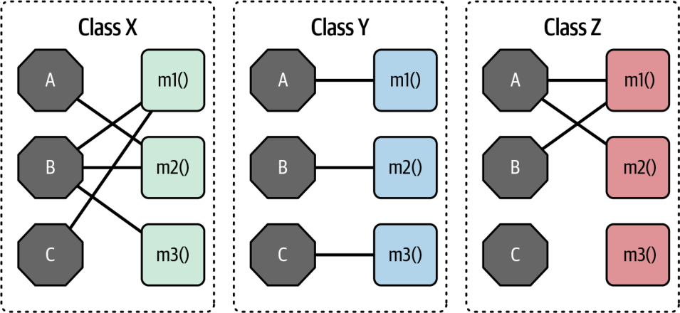

> **شکل ۳-۱.** معیارِ LCOM که فیلدها را با هشت‌ضلعی‌ها و متدها را با مربع‌ها نشان می‌دهد.

معیارِ LCOM برای معمارانی سودمند است که پایگاه‌های کد را برای بازآرایی، مهاجرت یا درکِ آن تحلیل می‌کنند. کلاس‌های ابزاریِ مشترک هنگامِ جابه‌جاییِ معماری دردسرساز می‌شوند. با بهره‌گیری از معیارِ LCOM، معماران می‌توانند کلاس‌هایی را بیابند که به‌طورِ اتفاقی کوپل شده‌اند و اصلاً نباید از همان ابتدا یک کلاسِ واحد می‌بودند.

بسیاری از معیارهای نرم‌افزاری کاستی‌های جدی دارند و LCOM هم از این قاعده مستثنا نیست. تنها چیزی که این معیار می‌تواند بیابد فقدانِ ساختاریِ انسجام است؛ هیچ راهی ندارد تشخیص دهد آیا قطعاتِ معینی از نظرِ منطقی به هم می‌خورند یا نه. این موضوع به قانون دومِ معماری نرم‌افزار ما بازمی‌گردد: چرا مهم‌تر از چگونه است.

### کوپلینگ

خوشبختانه ابزارهای بهتری برای تحلیلِ کوپلینگ در پایگاه‌های کد داریم. این ابزارها بخشی بر نظریهٔ گراف استوارند: چون فراخوانی‌ها و بازگشت‌های متدها گرافِ فراخوانی (call graph) می‌سازند، می‌توان آن را به‌شیوهٔ ریاضی تحلیل کرد. کتابِ Edward Yourdon و Larry Constantine با نامِ Structured Design: Fundamentals of a Discipline of Computer Program and Systems Design (Prentice-Hall، ۱۹۷۹) بسیاری از مفاهیمِ بنیادین را تعریف کرد، از جمله معیارهای کوپلینگِ ورودی (afferent coupling) و کوپلینگِ خروجی (efferent coupling). کوپلینگِ ورودی شمارِ اتصال‌های ورودی به یک قطعهٔ کد (مؤلفه، کلاس، تابع و نظایر آن‌ها) را می‌سنجد. کوپلینگِ خروجی، اتصال‌های خروجی به قطعاتِ کدِ دیگر را می‌سنجد. تقریباً برای هر پلتفرمی ابزارهایی هست که به معماران اجازه می‌دهد ویژگی‌های کوپلینگِ کد را تحلیل کنند.

> **چرا این‌همه شباهتِ نام میانِ معیارهای کوپلینگ؟**
>
> چرا دو معیارِ حیاتی در جهانِ معماری که مفاهیمی متضاد را نمایندگی می‌کنند، تقریباً همین‌قدر هم‌نام‌اند و تنها تفاوت‌شان در واکه‌هایی است که آوایشان بیش از همه به هم می‌ماند؟ این اصطلاحات از کتاب Structured Design آمده‌اند. Yourdon و Constantine با وام‌گرفتنِ مفاهیمی از ریاضیات، اصطلاحِ امروزیِ afferent coupling و efferent coupling را رواج دادند. در اصل بهتر بود آن‌ها را incoming coupling و outgoing coupling بنامیم، اما مؤلفان بیشتر به تقارنِ ریاضی مایل بودند تا به وضوح. توسعه‌دهندگان چندین یادیار ابداع کرده‌اند. برای نمونه، a پیش از e در الفبای انگلیسی می‌آید، درست به‌ترتیبی که incoming پیش از outgoing می‌آید. حرفِ e در efferent با حرفِ نخستِ exit یکی است و به یادآوردنِ اینکه نمایانگرِ اتصال‌های خروجی است کمک می‌کند.

### معیارهای هسته

با اینکه کوپلینگِ مؤلفه‌ها به‌خودیِ‌خود برای معماران ارزشمند است، چند معیارِ مشتق (derived metric) دیگر امکانِ ارزیابیِ عمیق‌تری فراهم می‌کنند. معیارهایی که در این بخش بررسی می‌شوند ساختهٔ مهندسِ نرم‌افزار Robert C. Martin هستند و در بیشترِ زبان‌های شی‌گرا کاربردی گسترده دارند.

میزانِ انتزاع (Abstractness) نسبتِ مصنوعاتِ انتزاعی —کلاس‌های انتزاعی (abstract classes)، واسط‌ها (interfaces) و نظایر آن‌ها— به مصنوعاتِ عینی (concrete artifacts)، یعنی پیاده‌سازی‌ها، است. معیارِ میزانِ انتزاع، درجهٔ انتزاعِ یک پایگاه کد را در برابرِ پیاده‌سازی می‌سنجد. برای نمونه، در یک سرِ این طیف پایگاه کدی قرار می‌گیرد که هیچ انتزاعی ندارد و فقط یک تابعِ واحدِ غول‌آساست (مثلاً همه‌چیز در یک متدِ main()). سرِ دیگرِ طیف پایگاه کدی است با انتزاع‌هایی بیش از اندازه، به‌طوری که توسعه‌دهندگان به‌سختی درمی‌یابند اجزا چگونه به هم وصل می‌شوند. (برای نمونه، مدتی طول می‌کشد تا توسعه‌دهندگان بفهمند با کلاسِ انتزاعیِ AbstractSingletonProxyFactoryBean چه کنند، آن هم با این‌همه لایهٔ انتزاع و نامی چنین مبهم.)

فرمولِ میزانِ انتزاع در فرمول ۳-۳ آمده است.

**فرمول ۳-۳.** میزانِ انتزاع

```latex
A = \frac{\sum m^a}{\sum m^c + \sum m^a}
```

معماران میزانِ انتزاع را با محاسبهٔ نسبتِ مجموعِ مصنوعاتِ انتزاعی به مجموعِ مصنوعاتِ عینی و انتزاعی به دست می‌آورند. در این فرمول، ma نمایندهٔ عناصرِ انتزاعیِ ماژول (واسط‌ها یا کلاس‌های انتزاعی) و mc نمایندهٔ عناصرِ عینی (کلاس‌های غیرانتزاعی) است. این معیار به دنبالِ همان ملاک‌هاست. ساده‌ترین راه برای مجسم‌کردنِ این معیار، در نظر گرفتنِ برنامه‌ای است با ۵٬۰۰۰ خط کد که همه در یک متدِ main() جای گرفته‌اند. صورتِ کسرِ میزانِ انتزاعِ آن ۱ و مخرجش ۵٬۰۰۰ است و امتیازی نزدیک به صفر به دست می‌دهد. این معیار نسبتِ انتزاع‌ها در کد را این‌گونه می‌سنجد.

معیارِ مشتقِ دیگر، ناپایداری (Instability)، نسبتِ کوپلینگِ خروجی به مجموعِ کوپلینگِ خروجی و ورودی تعریف می‌شود که در فرمول ۳-۴ نشان داده شده است.

**فرمول ۳-۴.** ناپایداری

```latex
I = \frac{C^e}{C^e + C^a}
```

در این فرمول، Ce نمایندهٔ کوپلینگِ خروجی و Ca نمایندهٔ کوپلینگِ ورودی است.

معیارِ ناپایداری، نوسان‌پذیری (volatility) یک پایگاه کد را تعیین می‌کند. پایگاه کدی که درجهٔ بالایی از ناپایداری نشان می‌دهد، به سببِ کوپلینگِ بالا هنگامِ تغییر آسان‌تر می‌شکند. برای نمونه، اگر کلاسی برای واگذاریِ کار، کلاس‌های بسیار زیادی را فراخوانی کند، با تغییرِ یک یا چند متدِ فراخوانده‌شده، کلاسِ فراخواننده به‌شدت در معرضِ شکستن خواهد بود.

### فاصله از دنبالهٔ اصلی

یکی از معدود معیارهای جامعی که معماران برای ساختارِ معماری در اختیار دارند، فاصله از دنبالهٔ اصلی (Distance from the Main Sequence) است: معیاری مشتق بر پایهٔ ناپایداری و میزانِ انتزاع که در فرمول ۳-۵ نشان داده شده است.

**فرمول ۳-۵.** فاصله از دنبالهٔ اصلی

```latex
D = \left| A + I - 1 \right|
```

در این فرمول، A همان میزانِ انتزاع و I همان ناپایداری است.

توجه کنید که میزانِ انتزاع و ناپایداری هر دو کسرهایی هستند که حاصلشان همواره میان ۰ و ۱ قرار می‌گیرد (جز در برخی موارد حدی). از همین رو، رسمِ نمودارِ رابطهٔ آن‌ها نموداری را پدید می‌آورد که در شکل ۳-۲ می‌بینید.

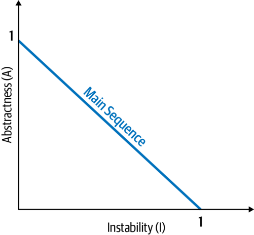

> **شکل ۳-۲.** دنبالهٔ اصلی رابطهٔ آرمانی میانِ میزانِ انتزاع و ناپایداری را تعریف می‌کند.

معیارِ فاصله، رابطه‌ای آرمانی میانِ میزانِ انتزاع و ناپایداری را فرض می‌گیرد؛ کلاس‌هایی که نزدیکِ این خطِ آرمانی قرار می‌گیرند، آمیزه‌ای سالم از این دو دغدغهٔ رقیب را نشان می‌دهند. برای نمونه، رسمِ یک کلاسِ معین روی نمودار به توسعه‌دهندگان امکان می‌دهد معیارِ فاصله از دنبالهٔ اصلی را محاسبه کنند که در شکل ۳-۳ نشان داده شده است.

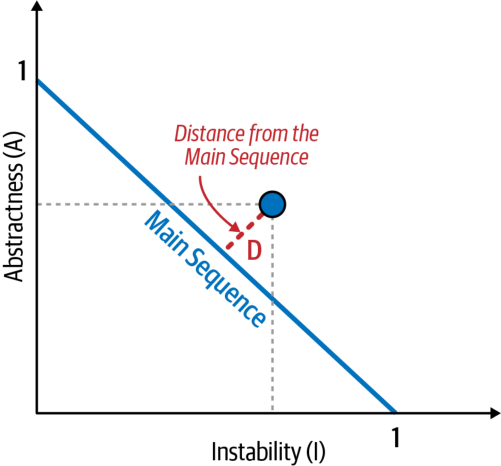

> **شکل ۳-۳.** فاصلهٔ نرمال‌شده از دنبالهٔ اصلی برای یک کلاسِ معین

معیارِ شکل ۳-۳ کلاسِ مورد نظر را روی نمودار می‌برد و سپس فاصله‌اش را از خطِ آرمانی می‌سنجد. هرچه به خط نزدیک‌تر باشد، کلاس متوازن‌تر است. کلاس‌هایی که بیش از اندازه به گوشهٔ بالا-راست می‌روند، وارد چیزی می‌شوند که معماران آن را منطقهٔ بی‌فایدگی (Zone of Uselessness) می‌نامند: کدی که بیش از اندازه انتزاعی است، به‌سختی به کار می‌آید. در مقابل، کدی که به گوشهٔ پایین-چپ می‌افتد، همان‌طور که در شکل ۳-۴ آمده، وارد منطقهٔ درد (Zone of Pain) می‌شود: کدی با پیاده‌سازیِ بیش از اندازه و انتزاعِ ناکافی، شکننده و نگهداری‌اش دشوار می‌شود.

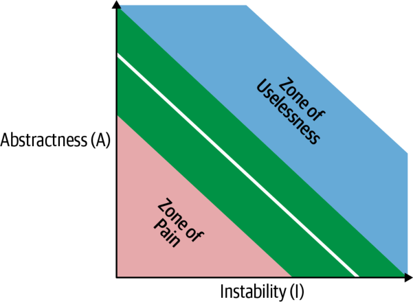

> **شکل ۳-۴.** منطقه‌های بی‌فایدگی و درد

بسیاری از پلتفرم‌ها ابزارهایی برای محاسبهٔ این معیارها فراهم می‌کنند که به معماران کمک می‌کنند هنگامِ تحلیلِ پایگاه‌های کد با آن‌ها آشنا شوند، برای مهاجرت آماده شوند یا بدهی فنی را ارزیابی کنند.

> **محدودیت‌های معیارها**
>
> با اینکه صنعت چند معیارِ سطحِ کد دارد که بینشِ ارزشمندی فراهم می‌کنند، ابزارهای ما در مقایسه با ابزارهای تحلیلِ دیگر رشته‌های مهندسی بسیار زمخت و کم‌دقت‌اند. حتی معیارهایی که مستقیماً از ساختارِ کد به دست می‌آیند، به تفسیر نیاز دارند. برای نمونه، پیچیدگیِ چرخه‌ای («پیچیدگیِ چرخه‌ای» را در صفحهٔ ۸۴ ببینید) پیچیدگی را در پایگاه‌های کد می‌سنجد، اما این معیار نمی‌تواند میانِ پیچیدگیِ ذاتی (essential complexity) —کد پیچیده است چون مسئلهٔ زیربنایی پیچیده است— و پیچیدگیِ عارضی (accidental complexity) —کد پیچیده‌تر از آن است که باید باشد— تمایز بگذارد. تقریباً همهٔ معیارهای سطحِ کد به تفسیر نیاز دارند، اما همچنان سودمند است که برای معیارهای حیاتی‌ای مانند پیچیدگیِ چرخه‌ای خطِ مبنا (baseline) تعیین شود تا معماران بتوانند ارزیابی کنند پایگاه کد کدام نوع را نشان می‌دهد. چگونگیِ برپاییِ همین آزمون‌ها را در «حاکمیت و توابع برازش» (Governance and Fitness Functions؛ صفحهٔ ۸۶) بررسی می‌کنیم.

کتابِ Structured Design نوشتهٔ Yourdon و Constantine، که در ۱۹۷۹ منتشر شد، پیش از رواجِ زبان‌های شی‌گرا نگاشته شده است. این کتاب در عوض بر سازه‌های برنامه‌نویسیِ ساخت‌یافته، مانند توابع (نه متدها)، تمرکز دارد. همچنین گونه‌های دیگری از کوپلینگ را تعریف می‌کند که به سببِ طراحیِ زبان‌های برنامه‌نویسیِ مدرن منسوخ شده‌اند. برنامه‌نویسیِ شی‌گرا مفاهیمِ دیگری را پیش کشید که بر کوپلینگِ ورودی و خروجی سوار می‌شوند، از جمله واژگانی دقیق‌تر برای توصیفِ کوپلینگ به نامِ هم‌بستگی.

### هم‌بستگی

کتابِ What Every Programmer Should Know about Object-Oriented Design نوشتهٔ Meilir Page-Jones (Dorset House، ۱۹۹۶) زبانی دقیق‌تر برای توصیفِ انواعِ گوناگونِ کوپلینگ در زبان‌های شی‌گرا پدید آورد. هم‌بستگی معیارِ کوپلینگی مانند کوپلینگِ ورودی و خروجی نیست؛ بلکه زبانی است که به معماران کمک می‌کند انواعِ گوناگونِ کوپلینگ را دقیق‌تر توصیف کنند (و برخی پیامدهای رایجِ هر نوع را بهتر بفهمند).

دو مؤلفه با یکدیگر هم‌بستگی دارند (connascent) اگر تغییر در یکی، برای حفظِ درستیِ کلیِ سیستم، اصلاحِ دیگری را ایجاب کند. Page-Jones دو نوع هم‌بستگی را از هم جدا می‌کند: ایستا و پویا.

#### هم‌بستگی ایستا

هم‌بستگی ایستا (static connascence) به کوپلینگ در سطحِ کدِ منبع اشاره دارد (در برابرِ کوپلینگ در زمانِ اجرا، که در «هم‌بستگی پویا» در صفحهٔ ۵۰ به آن پرداخته‌ایم). معماران هم‌بستگی ایستا را درجه‌ای می‌دانند که چیزی از راهِ کوپلینگِ ورودی یا خروجی کوپل شده است. هم‌بستگی ایستا چند نوع دارد:

**هم‌بستگی نام (Connascence of Name):** چند مؤلفه باید بر سرِ نامِ یک موجودیت توافق داشته باشند.

نامِ متدها و پارامترهای متد رایج‌ترین راهِ کوپل‌شدنِ پایگاه‌های کد و مطلوب‌ترینِ آن‌هاست، به‌ویژه با وجودِ ابزارهای مدرنِ بازآرایی که تغییرِ نام در سراسرِ سیستم را به کاری پیش‌پاافتاده بدل کرده‌اند. برای نمونه، توسعه‌دهندگان دیگر نامِ یک متد را در پایگاه کدِ فعال دستی تغییر نمی‌دهند، بلکه با ابزارهای مدرن نامِ متد را بازآرایی می‌کنند و تغییر در سراسرِ پایگاه کد اعمال می‌شود.

**هم‌بستگی نوع (Connascence of Type):** چند مؤلفه باید بر سرِ نوعِ یک موجودیت توافق داشته باشند.

این نوع هم‌بستگی به گرایشِ رایج در بسیاری از زبان‌های دارای نوع‌دهیِ ایستا (statically typed) اشاره دارد که متغیرها و پارامترها را به نوع‌های مشخصی محدود می‌کنند. با این حال، این قابلیت تنها از آنِ زبان‌های دارای نوع‌دهیِ ایستا نیست؛ برخی زبان‌های دارای نوع‌دهیِ پویا (dynamically typed) نیز نوع‌دهیِ انتخابی ارائه می‌کنند که نمونهٔ شاخصش Clojure و Clojure Spec است.

**هم‌بستگی معنا (Connascence of Meaning):** چند مؤلفه باید بر سرِ معنای مقادیرِ معینی توافق داشته باشند. به آن هم‌بستگی قرارداد (Connascence of Convention) نیز می‌گویند.

رایج‌ترین و آشکارترین نمونهٔ این نوع هم‌بستگی در پایگاه‌های کد، استفاده از اعدادِ سخت‌کدشده (hardcoded) به‌جای ثابت‌هاست. برای نمونه، در برخی زبان‌ها رایج است که جایی تعریف شود int TRUE = 1; int FALSE = 0. تصور کنید اگر کسی این دو مقدار را جابه‌جا کند، چه دردسرهایی پیش می‌آید.

**هم‌بستگی موقعیت (Connascence of Position):** چند مؤلفه باید بر سرِ ترتیبِ مقادیر توافق داشته باشند.

این مشکلی است که در مقادیرِ پارامترِ فراخوانیِ متدها و توابع پیش می‌آید، حتی در زبان‌هایی که نوع‌دهیِ ایستا دارند. برای نمونه، اگر توسعه‌دهنده‌ای متدِ void updateSeat(String name, String seatLocation) را بسازد و آن را با مقادیرِ updateSeat("14D", "Ford, N") فراخوانی کند، معنا نادرست است، حتی اگر نوع‌ها درست باشند.

**هم‌بستگی الگوریتم (Connascence of Algorithm):** چند مؤلفه باید بر سرِ الگوریتمِ معینی توافق داشته باشند.

نمونهٔ رایجِ هم‌بستگی الگوریتم زمانی رخ می‌دهد که توسعه‌دهنده‌ای الگوریتمِ درهم‌سازیِ امنیتی‌ای تعریف می‌کند که باید هم روی سرور و هم روی کلاینت اجرا شود و نتایجِ یکسانی برای احرازِ هویتِ کاربر به دست دهد. بدیهی است که این نشانهٔ درجهٔ بالایی از کوپلینگ است: اگر جزئیاتِ هر یک از دو الگوریتم تغییر کند، دست‌دهی (handshake) دیگر کار نخواهد کرد.

#### هم‌بستگی پویا

نوعِ دیگری از هم‌بستگی که Page-Jones تعریف می‌کند هم‌بستگی پویا (dynamic connascence) است که فراخوانی‌ها را در زمانِ اجرا تحلیل می‌کند. انواعِ هم‌بستگی پویا عبارت‌اند از:

**هم‌بستگی اجرا (Connascence of Execution):** ترتیبِ اجرای چند مؤلفه اهمیت دارد.

این کد را در نظر بگیرید:

```java
email = new Email();
email.setRecipient("foo@example.com");
email.setSender("me@me.com");
email.send();
email.setSubject("whoops");
```

این کد درست کار نمی‌کند، چون برخی ویژگی‌ها باید به ترتیبِ مشخصی مقداردهی شوند.

**هم‌بستگی زمان‌بندی (Connascence of Timing):** زمان‌بندیِ اجرای چند مؤلفه اهمیت دارد.

نمونهٔ رایجِ این نوع هم‌بستگی، شرایطِ رقابتی (race condition) است که از اجرای هم‌زمانِ دو ریسمان (thread) پدید می‌آید و بر نتیجهٔ عملیاتِ مشترک اثر می‌گذارد.

**هم‌بستگی مقادیر (Connascence of Values):** چند مقدار به یکدیگر وابسته‌اند و باید با هم تغییر کنند.

موردی را در نظر بگیرید که توسعه‌دهنده‌ای مستطیلی را با تعریفِ چهار نقطه برای گوشه‌هایش تعریف کرده است. برای حفظِ یکپارچگیِ این ساختمانِ داده، توسعه‌دهنده نمی‌تواند یکی از نقطه‌ها را دلبخواه تغییر دهد بی‌آنکه اثرش را بر نقطه‌های دیگر بسنجد تا شکلِ مستطیل حفظ شود.

موردِ رایج‌تر و مشکل‌سازتر به تراکنش‌ها مربوط می‌شود، به‌ویژه در سیستم‌های توزیع‌شده. در سیستمی که با پایگاه‌داده‌های جداگانه طراحی شده، هرگاه کسی بخواهد مقداری واحد را در همهٔ پایگاه‌داده‌ها به‌روز کند، مقادیر یا باید همه با هم تغییر کنند یا هیچ‌کدام تغییر نکنند.

**هم‌بستگی هویت (Connascence of Identity):** چند مؤلفه باید به موجودیتی واحد ارجاع دهند.

نمونهٔ رایجِ هم‌بستگی هویت، دو مؤلفهٔ مستقل است که باید ساختمانِ داده‌ای مشترک، مانند یک صفِ توزیع‌شده، را با هم به اشتراک بگذارند و به‌روز کنند.

#### ویژگی‌های هم‌بستگی

هم‌بستگی چارچوبی تحلیلی برای معماران و توسعه‌دهندگان است و برخی از ویژگی‌هایش کمک می‌کنند آن را خردمندانه به کار ببریم. این ویژگی‌ها عبارت‌اند از:

**قدرت (Strength):** معماران قدرتِ هم‌بستگی یک سیستم را با این می‌سنجند که توسعه‌دهنده تا چه اندازه آسان می‌تواند کوپلینگِ آن را بازآرایی کند. همان‌طور که در شکل ۳-۵ نشان داده شده، برخی انواعِ هم‌بستگی آشکارا از بقیه مطلوب‌ترند. بازآرایی به سوی انواعِ بهترِ هم‌بستگی می‌تواند ویژگی‌های کوپلینگِ یک پایگاه کد را بهبود دهد.

معماران باید هم‌بستگی ایستا را بر پویا ترجیح دهند، چون توسعه‌دهندگان می‌توانند آن را با تحلیلِ سادهٔ کدِ منبع تشخیص دهند و ابزارهای مدرن بهبودِ هم‌بستگی ایستا را کاری پیش‌پاافتاده کرده‌اند. برای نمونه، می‌توان هم‌بستگی معنا را با بازآرایی به هم‌بستگی نام بهبود داد: یعنی ساختنِ یک ثابتِ نام‌دار به‌جای یک مقدارِ جادویی (magic value).

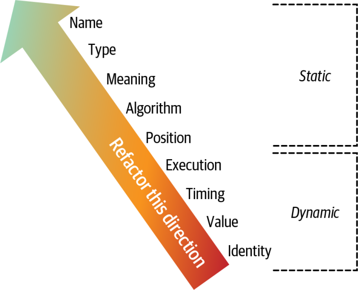

> **شکل ۳-۵.** قدرتِ هم‌بستگی می‌تواند راهنمای خوبی برای بازآرایی باشد.

**محلی‌بودن (Locality):** محلی‌بودنِ هم‌بستگی یک سیستم می‌سنجد که ماژول‌هایش در پایگاه کد تا چه اندازه به یکدیگر نزدیک‌اند. کدهایی که به هم نزدیک‌اند (درون یک ماژول)، معمولاً اشکال قوی‌تر و بیشتری از هم‌بستگی را تاب می‌آورند در مقایسه با کدهایی که از یکدیگر دورند (در ماژول‌ها یا پایگاه‌های کدِ جداگانه). به بیان دیگر، اشکالی از هم‌بستگی که وقتی مؤلفه‌ها از هم دورند نشانهٔ کوپلینگِ نامطلوب‌اند، وقتی مؤلفه‌ها به هم نزدیک‌ترند پذیرفتنی‌اند. برای نمونه، اگر دو کلاس در یک ماژول هم‌بستگی معنا داشته باشند، آسیبِ کمتری به پایگاه کد می‌زند تا وقتی که آن کلاس‌ها در ماژول‌های جداگانه باشند.

وقتی مؤلف نخستین بار این نکته را منتشر کرد، معماران تا حدِ زیادی از اهمیتش بی‌خبر بودند. به زبانِ امروزی، او پیشنهاد می‌کند که معماران دامنهٔ جزئیاتِ پیاده‌سازی (کوپلینگِ بالا) را تا جایی که عملی است محدود کنند؛ همان توصیه‌ای که از ایدهٔ زمینهٔ محدود (bounded context) در طراحیِ حوزه‌محور (Domain-Driven Design — DDD) برمی‌آید. نکتهٔ معماریِ هر دو یکی است: کوپلینگِ پیاده‌سازی را محدود کنید. Page-Jones اصلِ طراحیِ خوبی را توصیف کرد که بعدها از راهِ DDD به‌طورِ کامل‌تری دوباره مطرح شد («زمینهٔ محدودِ طراحیِ حوزه‌محور» را در صفحهٔ ۹۷ از فصل ۷ ببینید).

ایدهٔ خوبی است که قدرت و محلی‌بودن را با هم در نظر بگیریم. اشکالِ قوی‌ترِ هم‌بستگی درونِ یک ماژول، «بوی کد» (code smell) کمتری نسبت به پراکندگیِ همان هم‌بستگی در جاهای دور از هم دارند.

**درجه (Degree):** درجهٔ هم‌بستگی به اندازهٔ اثرِ تغییرِ یک کلاس در ماژولی معین مربوط می‌شود: آیا این تغییر بر تعداد اندکی از کلاس‌ها اثر می‌گذارد یا بر تعداد زیادی از آن‌ها؟ درجه‌های پایین‌ترِ هم‌بستگی به تغییراتِ کمتری در کلاس‌ها و ماژول‌های دیگر نیاز دارند و از این رو آسیبِ کمتری به پایگاه‌های کد می‌زنند. به بیان دیگر، اگر معمار فقط چند ماژول داشته باشد، هم‌بستگی پویای بالا فاجعه نیست. اما پایگاه‌های کد رو به رشدند و مشکلی کوچک را، از نظرِ دامنهٔ تغییر، به همان نسبت بزرگ‌تر می‌کنند.

Page-Jones در What Every Programmer Should Know about Object-Oriented Design سه رهنمود برای بهره‌گیری از هم‌بستگی در بهبودِ ماژولاریتیِ سیستم پیش می‌نهد:

- هم‌بستگی کلی را با شکستنِ سیستم به عناصرِ کپسوله‌شده به حداقل برسانید.

- هر هم‌بستگی باقی‌مانده‌ای را که از مرزهای کپسوله‌سازی عبور می‌کند به حداقل برسانید.

- هم‌بستگی را درونِ مرزهای کپسوله‌سازی به حداکثر برسانید.

Jim Weirich، نوآورِ افسانه‌ایِ معماری نرم‌افزار که مفهومِ هم‌بستگی را دوباره بر سرِ زبان‌ها انداخت، در سخنرانی‌اش با عنوانِ «Connescence Examined» در کنفرانسِ Emerging Technologies for the Enterprise در سالِ ۲۰۱۲، دو قاعدهٔ عالی ارائه می‌کند:

> قاعدهٔ درجه: اشکالِ قویِ هم‌بستگی را به اشکالِ ضعیف‌ترِ هم‌بستگی تبدیل کنید.
>
> قاعدهٔ محلی‌بودن: هرچه فاصلهٔ میانِ عناصرِ نرم‌افزار بیشتر می‌شود، از اشکالِ ضعیف‌ترِ هم‌بستگی استفاده کنید.

یادگیریِ هم‌بستگی به همان دلیلی برای معماران سودمند است که یادگیریِ الگوهای طراحی: هم‌بستگی زبانی دقیق‌تر برای توصیفِ انواعِ گوناگونِ کوپلینگ فراهم می‌کند. برای نمونه، معمار می‌تواند به کسی بگوید: «به سرویسی نیاز داریم که فقط یک نمونه از آن وجود داشته باشد»، یا می‌تواند بگوید: «به یک سرویسِ Singleton نیاز داریم.» الگوی طراحیِ Singleton بافت و راه‌حلِ یک مسئلهٔ رایج را به‌خوبی در نامی ساده کپسوله می‌کند.

به همین ترتیب، هنگامِ بازبینی کد، معمار می‌تواند به توسعه‌دهنده‌ای بگوید: «یک ثابتِ رشته‌ایِ جادویی را وسطِ اعلانِ متد نگذار؛ به‌جایش آن را به‌صورتِ یک ثابت بیرون بکش.» یا می‌تواند بگوید: «این کد هم‌بستگی معنا دارد؛ آن را به هم‌بستگی نام بازآرایی کن.»

---

## از ماژول‌ها تا مؤلفه‌ها

ما در سراسرِ این کتاب واژهٔ ماژول را به‌عنوانِ نامی کلی برای بسته‌های کدِ مرتبط به کار می‌بریم. با این حال، بیشترِ معماران از ماژول‌ها با عنوانِ مؤلفه‌ها (components) یاد می‌کنند: بلوک‌های سازندهٔ کلیدیِ معماری نرم‌افزار. این مفهومِ مؤلفه، و تحلیلِ متناظرش دربارهٔ جداییِ منطقی یا فیزیکی، از نخستین روزهای علومِ رایانه وجود داشته است، اما توسعه‌دهندگان و معماران هنوز برای رسیدن به نتایجِ خوب دست‌وپنجه نرم می‌کنند.

در فصل ۸ دربارهٔ استخراجِ مؤلفه‌ها از حوزه‌های مسئله بحث خواهیم کرد، اما پیش از آن باید به جنبهٔ بنیادینِ دیگری از معماری نرم‌افزار بپردازیم: ویژگی‌های معماری و دامنهٔ آن‌ها.

---

## واژه‌نامهٔ اختصاصی این فصل

| واژهٔ انگلیسی | معادل مصوب/به‌کاررفته در این فصل |
|---|---|
| Modularity | ماژولاریتی |
| Module | ماژول |
| Granularity | دانه‌بندی |
| Spaghetti Architecture | معماری اسپاگتی |
| Distributed Monolith | تک‌پارچهٔ توزیع‌شده |
| Big Ball of Distributed Mud | توپِ بزرگِ گِلِ توزیع‌شده |
| Coupling | کوپلینگ |
| Object-Oriented | شی‌گرا |
| Package | بسته |
| Namespace | فضای نام |
| Backward Compatibility | سازگاری رو به عقب |
| Structured Programming | برنامه‌نویسی ساخت‌یافته |
| Encapsulation | کپسوله‌سازی |
| Meta-Object Protocol | پروتکل فراشیء |
| Implicit Architecture Characteristic | ویژگی نامشهود معماری |
| Cohesion | انسجام |
| Connascence | هم‌بستگی |
| Functional Cohesion | انسجام کارکردی |
| Sequential Cohesion | انسجام ترتیبی |
| Communicational Cohesion | انسجام ارتباطی |
| Procedural Cohesion | انسجام رویه‌ای |
| Temporal Cohesion | انسجام زمانی |
| Logical Cohesion | انسجام منطقی |
| Coincidental Cohesion | انسجام اتفاقی |
| Lack of Cohesion | فقدان انسجام |
| Lack of Cohesion in Methods (LCOM) | فقدان انسجام در متدها (LCOM) |
| Cyclomatic Complexity | پیچیدگی چرخه‌ای |
| Call Graph | گراف فراخوانی |
| Afferent Coupling | کوپلینگ ورودی |
| Efferent Coupling | کوپلینگ خروجی |
| Incidental Coupling | کوپلینگ ناخواسته |
| Metric | معیار |
| Derived Metric | معیار مشتق |
| Abstractness | میزان انتزاع |
| Abstract Class | کلاس انتزاعی |
| Interface | واسط |
| Concrete Artifact | مصنوع عینی |
| Instability | ناپایداری |
| Volatility | نوسان‌پذیری |
| Distance from the Main Sequence | فاصله از دنبالهٔ اصلی |
| Main Sequence | دنبالهٔ اصلی |
| Zone of Uselessness | منطقهٔ بی‌فایدگی |
| Zone of Pain | منطقهٔ درد |
| Essential Complexity | پیچیدگی ذاتی |
| Accidental Complexity | پیچیدگی عارضی |
| Baseline | خط مبنا |
| Governance | حاکمیت |
| Connascent | هم‌بسته |
| Static Connascence | هم‌بستگی ایستا |
| Dynamic Connascence | هم‌بستگی پویا |
| Connascence of Name | هم‌بستگی نام |
| Connascence of Type | هم‌بستگی نوع |
| Connascence of Meaning | هم‌بستگی معنا |
| Connascence of Convention | هم‌بستگی قرارداد |
| Connascence of Position | هم‌بستگی موقعیت |
| Connascence of Algorithm | هم‌بستگی الگوریتم |
| Connascence of Execution | هم‌بستگی اجرا |
| Connascence of Timing | هم‌بستگی زمان‌بندی |
| Connascence of Values | هم‌بستگی مقادیر |
| Connascence of Identity | هم‌بستگی هویت |
| Strength (of Connascence) | قدرت (هم‌بستگی) |
| Locality (of Connascence) | محلی‌بودن (هم‌بستگی) |
| Degree (of Connascence) | درجه (هم‌بستگی) |
| Statically Typed | دارای نوع‌دهی ایستا |
| Dynamically Typed | دارای نوع‌دهی پویا |
| Hardcoded | سخت‌کدشده |
| Handshake | دست‌دهی |
| Race Condition | شرایط رقابتی |
| Thread | ریسمان |
| Magic Value | مقدار جادویی |
| Bounded Context | زمینهٔ محدود |
| Domain-Driven Design (DDD) | طراحی حوزه‌محور (DDD) |
| Code Smell | بوی کد |
| Component | مؤلفه |

---

<a id="chapter-04"></a>

# فصل ۴: تعریف ویژگی‌های معماری

اکنون به جزئیاتِ طراحی ساختاری (structural design) می‌پردازیم که یکی از نقش‌های کلیدیِ معمارانِ نرم‌افزار است. این کار عمدتاً از دو فعالیت تشکیل می‌شود: تحلیلِ ویژگی‌های معماری، که در این فصل به آن می‌پردازیم، و طراحیِ مؤلفه‌های منطقی، که در فصل ۸ بررسی می‌شود. معماران می‌توانند این دو فعالیت را به هر ترتیبی (یا حتی به‌موازات هم) انجام دهند، اما این دو در یک نقطهٔ اتصال (join point) حیاتی به هم می‌رسند.

وقتی شرکتی تصمیم می‌گیرد مسئلهٔ معینی را با نرم‌افزار حل کند، فهرستی از الزاماتِ آن سیستم گرد می‌آورد (برای استخراجِ این الزامات فنونِ بسیاری وجود دارد که در فصل ۸ به آن‌ها پرداخته‌ایم). در سراسرِ کتاب، از این الزامات با عنوانِ حوزهٔ مسئله (problem domain) —یا فقط «حوزه»— یاد می‌کنیم. در فصل ۱ دیدید که ویژگی‌های معماری آن جنبه‌های مهمی از سیستم‌اند که از حوزهٔ مسئله مستقل‌اند و برای موفقیتِ سیستم اهمیت دارند. در این فصل، تعریفِ این اصطلاح و نیز ویژگی‌های معماریِ مشخص را عمیق‌تر بررسی می‌کنیم.

معماران اغلب در تعریفِ حوزه همکاری می‌کنند، اما همچنین باید همهٔ کارهایی را که نرم‌افزار باید انجام دهد و مستقیماً به کارکردهای حوزه مربوط نیست، تعریف، کشف و به هر شکلِ دیگر تحلیل کنند: همان ویژگی‌های معماری. نقشِ معماران در تعریفِ ویژگی‌های معماری بخشی از چیزی است که معماری نرم‌افزار را از کدنویسی و طراحی متمایز می‌کند. آنان همچنین باید هنگامِ طراحیِ یک راهکارِ نرم‌افزاری عواملِ بسیارِ دیگری را در نظر بگیرند، همان‌طور که در شکل ۴-۱ نشان داده شده است.

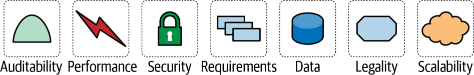

> **شکل ۴-۱.** یک راهکارِ نرم‌افزاری هم از الزاماتِ حوزه تشکیل می‌شود و هم از ویژگی‌های معماری.

> **ماندگاریِ اصطلاحِ «الزاماتِ غیرکارکردی»**
>
> بسیاری از سازمان‌ها ویژگی‌های معماری را با اصطلاحاتِ گوناگونی توصیف می‌کنند، از جمله الزاماتِ غیرکارکردی (non-functional requirements)؛ اصطلاحی که برای تمایزِ ویژگی‌های معماری از الزاماتِ کارکردی (functional requirements) ساخته شد. ما این اصطلاح را نمی‌پسندیم، چون بار معنایی منفی دارد و اهمیت موضوع را دست‌کم می‌گیرد: چگونه می‌توان تیم‌ها را قانع کرد که به چیزی «غیرکارکردی» به‌اندازهٔ کافی توجه کنند؟ اصطلاحِ رایجِ دیگر صفاتِ کیفی (quality attributes) است که آن را هم نمی‌پسندیم، چون بیشتر ارزیابیِ کیفیت پس از وقوع را القا می‌کند تا طراحی را.
>
> ما اصطلاحِ ویژگی‌های معماری را ترجیح می‌دهیم، چون دغدغه‌هایی را توصیف می‌کند که برای موفقیتِ معماری —و در نتیجه کلِ سیستم— حیاتی‌اند، بی‌آنکه از اهمیتِ این دغدغه‌ها بکاهد. در کتابِ Head First Software Architecture (O’Reilly، ۲۰۲۴)، از ویژگی‌های معماری با عنوانِ قابلیت‌های (capabilities) سیستم یاد می‌کنیم؛ در مقابل، حوزه نمایانگرِ رفتارِ (behavior) سیستم است.
>
> گاهی اصطلاحات «گیر می‌کنند»، و الزاماتِ غیرکارکردی ظاهراً در میانِ معمارانِ نرم‌افزار از آن اصطلاحاتِ بسیار چسبنده است. این اصطلاح هنوز در بسیاری از سازمان‌ها رایج است. نخستین بار در اواخرِ دههٔ ۱۹۷۰ در ادبیاتِ مهندسیِ نرم‌افزار پیدا شد، تقریباً هم‌زمان با تحلیلِ نقاطِ کارکردی (function point analysis): فنی برای برآورد که الزاماتِ سیستم را به «نقاطِ کارکردی» تجزیه می‌کند و هر نقطه نمایانگرِ واحدی از کار است. از لحاظِ نظری، تیم‌ها می‌توانستند در پایانِ فرایندِ تحلیل همهٔ نقاطِ کارکردی را جمع بزنند و دیدی نسبت به پروژه به دست آورند. متأسفانه این روش فقط لایه‌ای ظاهری از قطعیت فراهم می‌کرد، اما مانندِ بسیاری از طرح‌های برآورد گرفتارِ ذهنی‌گرایی بود و دیگر به کار نمی‌رود.
>
> با این حال، یک بینش از آن دوران با ما مانده است: بخشِ بزرگی از تلاشی که برای ساختنِ یک سیستم صرف می‌شود، به قابلیت‌های آن سیستم مربوط است و نه به الزاماتش. آنان این تلاش‌ها را نقاطِ غیرکارکردی (non-function points) نامیدند و همین باعث شد اصطلاحِ الزاماتِ غیرکارکردی رواج یابد.

---

## ویژگی‌های معماری و طراحیِ سیستم

یک الزام برای آنکه ویژگیِ معماری به شمار آید، باید سه ملاک را برآورده کند: باید یک ملاحظهٔ طراحیِ غیرحوزه‌ای (nondomain) را مشخص سازد، بر جنبه‌ای ساختاری از طراحی اثر بگذارد، و برای موفقیتِ برنامه حیاتی یا مهم باشد. این اجزای درهم‌تنیدهٔ تعریفِ ما در شکل ۴-۲ نشان داده شده‌اند که از همین سه جزء و چند قیدِ تکمیلی تشکیل شده است.

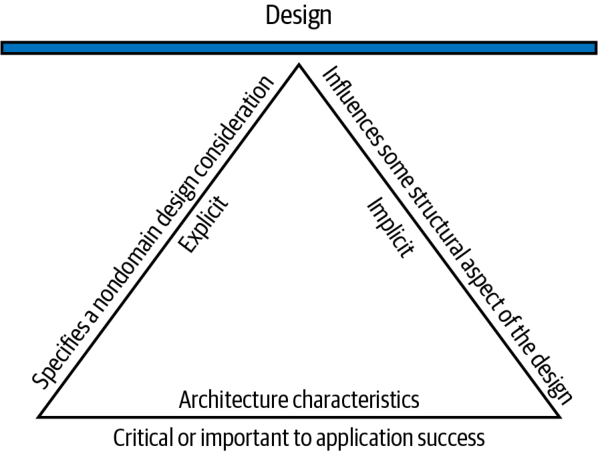

> **شکل ۴-۲.** ویژگی‌های متمایزکنندهٔ ویژگی‌های معماری

بیایید این اجزا را دقیق‌تر بررسی کنیم:

**ویژگیِ معماری، یک ملاحظهٔ طراحیِ غیرحوزه‌ای را مشخص می‌کند.**

طراحیِ ساختاری در معماری نرم‌افزار از دو فعالیتِ معمار تشکیل می‌شود: درکِ حوزهٔ مسئله و کشفِ اینکه سیستم برای موفقیت به پشتیبانی از چه نوع قابلیت‌هایی نیاز دارد. ملاحظاتِ طراحیِ حوزه رفتارِ سیستم را پوشش می‌دهند و ویژگی‌های معماری قابلیت‌ها را تعریف می‌کنند. این دو فعالیت در کنار یکدیگر، شالودهٔ طراحیِ ساختاری را شکل می‌دهند.

در حالی که الزاماتِ طراحی مشخص می‌کنند برنامه چه کاری باید انجام دهد، ویژگی‌های معماری مشخص می‌کنند الزامات چگونه پیاده‌سازی شوند و چرا انتخاب‌های معینی صورت گرفته است؛ خلاصه آنکه، ملاک‌های عملیاتی و طراحی برای موفقیتِ پروژه را تعیین می‌کنند.

برای نمونه، سطوحِ مشخصی از کارایی اغلب ویژگیِ معماریِ مهمی است، اما اغلب در اسنادِ الزامات نمی‌آید. نکتهٔ مرتبط‌تر اینکه هیچ سندِ الزاماتی عملاً نمی‌گوید طراحی باید «از بدهی فنی جلوگیری کند»، اما این یک ملاحظهٔ طراحیِ رایج است. این تمایزِ میانِ ویژگی‌های صریح و نامشهود را در «استخراجِ ویژگی‌های معماری از دغدغه‌های حوزه» (صفحهٔ ۶۷) به‌تفصیل بررسی می‌کنیم.

**ویژگیِ معماری بر جنبه‌ای ساختاری از طراحی اثر می‌گذارد.**

دلیلِ اصلیِ اینکه معماران می‌کوشند ویژگی‌های معماریِ پروژه‌ها را توصیف کنند، بیرون‌کشیدنِ ملاحظاتِ مهمِ طراحی است. آیا معمار می‌تواند آن را از راهِ طراحی پیاده کند، یا این ویژگیِ معماری برای موفقیت به ملاحظهٔ ساختاریِ ویژه‌ای نیاز دارد؟

برای نمونه، امنیت (security) تقریباً در هر پروژه‌ای دغدغه است و همهٔ سیستم‌ها باید در طراحی و کدنویسی برخی احتیاط‌های پایه را رعایت کنند. با این حال، امنیت زمانی به سطحِ یک ویژگیِ معماری می‌رسد که معمار تشخیص دهد معماری برای پشتیبانی از آن به ساختارِ ویژه‌ای نیاز دارد.

دو ویژگیِ معماریِ رایج را در نظر بگیرید: امنیت و مقیاس‌پذیری. معماران می‌توانند در یک سیستمِ تک‌پارچه با رعایتِ بهداشتِ خوبِ کدنویسی (coding hygiene)، از جمله فنونِ شناخته‌شده‌ای مانندِ رمزنگاری (encryption)، درهم‌سازی (hashing) و نمک‌زنی (salting)، امنیت را تأمین کنند. (توابع برازشِ معماری، که آن‌ها نیز زیرِ همین چتر قرار می‌گیرند، در فصل ۶ بررسی می‌شوند.) در مقابل، در یک معماریِ توزیع‌شده (distributed architecture) مانندِ میکروسرویس‌ها، معمار سرویسی مقاوم‌تر با پروتکل‌های دسترسیِ سخت‌گیرانه‌تر می‌سازد: رویکردی ساختاری. بنابراین، معماران می‌توانند امنیت را یا از راهِ طراحی تأمین کنند یا از راهِ ساختار. از سوی دیگر، مقیاس‌پذیری را در نظر بگیرید: هیچ اندازه از طراحیِ هوشمندانه نمی‌تواند به یک معماریِ تک‌پارچه امکان دهد از نقطه‌ای معین فراتر مقیاس‌پذیر شود. فراتر از آن نقطه، سیستم باید به سبکِ معماریِ توزیع‌شده تغییر یابد.

معماران به ویژگی‌های عملیاتیِ معماری (operational architectural characteristics) توجهِ ویژه‌ای دارند (که در «ویژگی‌های عملیاتیِ معماری» در صفحهٔ ۵۹ بررسی می‌شوند)، چون این‌ها ویژگی‌هایی هستند که بیش از همه به پشتیبانیِ ساختاریِ ویژه نیاز دارند.

**ویژگیِ معماری باید برای موفقیتِ برنامه حیاتی یا مهم باشد.**

برنامه‌ها می‌توانند از شمارِ عظیمی از ویژگی‌های معماری پشتیبانی کنند… اما نباید چنین کنند. هر ویژگیِ معماری‌ای که سیستم از آن پشتیبانی می‌کند، بر پیچیدگیِ طراحی‌اش می‌افزاید. به همین دلیل معماران باید بکوشند کمترین شمارِ ممکن از ویژگی‌های معماری را برگزینند، نه بیشترین را.

ما ویژگی‌های معماری را به ویژگی‌های نامشهود و صریح (explicit) تقسیم می‌کنیم. ویژگی‌های نامشهود به‌ندرت در الزامات می‌آیند، اما برای موفقیتِ پروژه ضروری‌اند. در دسترس‌بودن، قابلیتِ اطمینان (reliability) و امنیت زیربنای تقریباً همهٔ برنامه‌ها هستند، اما به‌ندرت در اسنادِ طراحی تصریح می‌شوند. معماران باید از دانشِ خود دربارهٔ حوزهٔ مسئله بهره بگیرند تا این ویژگی‌های معماری را در مرحلهٔ تحلیل کشف کنند. برای نمونه، یک شرکتِ معاملاتِ پربسامد (high-frequency trading) شاید نیازی نداشته باشد تأخیرِ (latency) پایین را در تک‌تکِ سیستم‌ها تصریح کند، چون معمارانِ آن حوزهٔ مسئله از پیش می‌دانند این ویژگی چقدر حیاتی است. ویژگی‌های صریحِ معماری در اسنادِ الزامات یا دیگر دستورالعمل‌های مشخص می‌آیند.

در شکل ۴-۲، انتخابِ مثلث عامدانه است: هر یک از اجزای تعریف از بقیه پشتیبانی می‌کند و آن‌ها نیز به نوبهٔ خود از طراحیِ کلیِ سیستم پشتیبانی می‌کنند. تکیه‌گاهی که مثلث پدید می‌آورد نشان می‌دهد این ویژگی‌های معماری اغلب چگونه بر یکدیگر اثر می‌گذارند. به همین دلیل است که معماران این‌قدر از اصطلاحِ مصالحه استفاده می‌کنند.

---

## ویژگی‌های معماری (فهرستی ناقص)

ویژگی‌های معماری در طیفی گسترده از پیچیدگی قرار می‌گیرند؛ از ویژگی‌های سطحِ پایینِ کد (مانند ماژولاریتی) تا دغدغه‌های عملیاتیِ پیچیده (مانند مقیاس‌پذیری و کشسانی). هیچ استانداردِ جهان‌شمولِ واقعی‌ای وجود ندارد، هرچند کسانی کوشیده‌اند آن را مدون کنند. در عوض، هر سازمان این اصطلاحات را به شیوهٔ خود تفسیر می‌کند. افزون بر این، چون زیست‌بومِ نرم‌افزار بسیار سریع تغییر می‌کند، مفاهیم، اصطلاحات، سنجه‌ها و روش‌های راستی‌آزماییِ تازه پیوسته پدید می‌آیند و فرصت‌های تازه‌ای برای تعریفِ ویژگی‌های معماری فراهم می‌کنند.

با اینکه حجم و گسترهٔ عظیمِ ویژگی‌های معماری کمّی‌کردنِ آن‌ها را دشوار می‌کند، معماران آن‌ها را دسته‌بندی می‌کنند. بخش‌های پیش رو چند دستهٔ کلیِ این‌چنینی را توصیف می‌کنند و نمونه‌هایی به دست می‌دهند.

### ویژگی‌های عملیاتیِ معماری

ویژگی‌های عملیاتیِ معماری قابلیت‌هایی مانند کارایی، مقیاس‌پذیری، کشسانی، در دسترس‌بودن و قابلیتِ اطمینان را پوشش می‌دهند. جدول ۴-۱ برخی از ویژگی‌های عملیاتیِ معماری را فهرست می‌کند.

**جدول ۴-۱.** ویژگی‌های عملیاتیِ رایجِ معماری

| اصطلاح | تعریف |
|---|---|
| در دسترس‌بودن (Availability) | سیستم چه مدت از زمان باید در دسترس باشد؛ اگر شبانه‌روزی و همیشگی (24/7) باشد، باید تدابیری در کار باشد تا سیستم در صورتِ هر خرابی به‌سرعت دوباره راه بیفتد و کار کند. |
| تداوم (Continuity) | قابلیتِ بازیابیِ سیستم پس از فاجعه. |
| کارایی (Performance) | سیستم چقدر خوب عمل می‌کند؛ راه‌های سنجشِ آن شاملِ آزمونِ فشار، تحلیلِ اوج، تحلیلِ بسامدِ کارکردهای مورد استفاده و زمان‌های پاسخ است. |
| بازیابی‌پذیری (Recoverability) | الزاماتِ تداومِ کسب‌وکار: در صورتِ وقوعِ فاجعه، سیستم با چه سرعتی باید دوباره برخط شود. این شاملِ راهبردهای پشتیبان‌گیری و الزاماتِ سخت‌افزارِ تکراری است. |
| قابلیتِ اطمینان/ایمنی (Reliability/safety) | آیا سیستم باید ایمن در برابرِ خرابی (fail-safe) باشد، یا به گونه‌ای حیاتی است که بر جانِ انسان‌ها اثر می‌گذارد؟ اگر از کار بیفتد، آیا هزینهٔ هنگفتی برای شرکت در پی دارد؟ این اغلب یک طیف است، نه یک دوگانهٔ صفر و یک. |
| استواری (Robustness) | توانِ سیستم در مدیریتِ خطاها و شرایطِ مرزی در حینِ اجرا؛ برای نمونه، اگر اتصالِ اینترنت یا برق قطع شود. |
| مقیاس‌پذیری (Scalability) | توانِ سیستم در اجرا و عملکرد با افزایشِ شمارِ کاربران یا درخواست‌ها. |

ویژگی‌های عملیاتیِ معماری همپوشانیِ زیادی با دغدغه‌های عملیات و DevOps دارند.

### ویژگی‌های ساختاریِ معماری

معماران مسئولِ ساختارِ درستِ کدند. در بسیاری از موارد، معمار مسئولیتِ انحصاری یا مشترکِ کیفیتِ کد را بر عهده دارد، از جمله ماژولاریتیِ آن، خوانایی‌اش، میزانِ مهارِ کوپلینگ میانِ مؤلفه‌ها، تمیزیِ کد و انبوهی از ارزیابی‌های کیفیِ درونیِ دیگر. جدول ۴-۲ چند ویژگیِ ساختاریِ معماری (structural architectural characteristics) را فهرست می‌کند.

**جدول ۴-۲.** ویژگی‌های ساختاریِ معماری

| اصطلاح | تعریف |
|---|---|
| پیکربندی‌پذیری (Configurability) | کاربرانِ نهایی تا چه اندازه آسان می‌توانند جنبه‌هایی از پیکربندیِ نرم‌افزار را از راهِ رابط‌ها تغییر دهند. |
| گسترش‌پذیری (Extensibility) | معماری تا چه اندازه تغییراتی را که کارکردِ موجودش را گسترش می‌دهند در خود جای می‌دهد. |
| نصب‌پذیری (Installability) | نصبِ سیستم روی همهٔ پلتفرم‌های لازم چقدر آسان است. |
| بهره‌گیریِ مجدد/بازاستفاده (Leverageability/reuse) | میزانی که می‌توان از مؤلفه‌های مشترکِ سیستم در چندین محصول بهره گرفت. |
| بومی‌سازی (Localization) | پشتیبانی از چند زبان در صفحه‌های ورود/پرس‌وجو و در فیلدهای داده. |
| قابلیتِ نگهداری (Maintainability) | اعمالِ تغییرات و بهبودِ سیستم چقدر آسان است. |
| قابلیتِ حمل (Portability) | توانِ سیستم در اجرا روی بیش از یک پلتفرم (مانند Oracle و SAP DB). |
| ارتقاپذیری (Upgradeability) | ارتقا به نسخهٔ جدیدتر روی سرورها و کلاینت‌ها چقدر آسان و سریع است. |

### ویژگی‌های ابری

زیست‌بومِ توسعهٔ نرم‌افزار پیوسته تغییر می‌کند و تکامل می‌یابد؛ تازه‌ترین و بارزترین نمونه‌اش ورودِ ابر است. هنگامِ انتشارِ ویراستِ نخست، رایانشِ ابری وجود داشت اما فراگیر نبود. اکنون بیشترِ سیستم‌ها دست‌کم در حدی با سیستم‌های مبتنی بر ابر تعامل دارند. چند مورد از این ملاحظات در جدول ۴-۳ آمده است.

**جدول ۴-۳.** ویژگی‌های معماریِ مرتبط با ارائه‌دهندهٔ ابر

| اصطلاح | تعریف |
|---|---|
| مقیاس‌پذیریِ بر حسبِ تقاضا (On-demand scalability) | توانِ ارائه‌دهندهٔ ابر در افزایشِ پویای منابع بر پایهٔ تقاضا. |
| کشسانیِ بر حسبِ تقاضا (On-demand elasticity) | انعطاف‌پذیریِ ارائه‌دهندهٔ ابر هنگامِ جهشِ ناگهانیِ تقاضا برای منابع؛ مشابهِ مقیاس‌پذیری. |
| در دسترس‌بودنِ مبتنی بر ناحیه (Zone-based availability) | توانِ ارائه‌دهندهٔ ابر در جداسازیِ منابع بر حسبِ ناحیه‌های محاسباتی برای ساختنِ سیستم‌های تاب‌آورتر. |
| حریمِ خصوصی و امنیتِ مبتنی بر منطقه (Region-based privacy and security) | توانِ قانونیِ ارائه‌دهندهٔ ابر برای ذخیره‌سازیِ داده‌های کشورها و مناطقِ گوناگون. بسیاری از کشورها قوانینی دارند که تعیین می‌کند داده‌های شهروندانشان کجا می‌تواند نگهداری شود (و اغلب ذخیره‌سازی بیرون از منطقهٔ خود را محدود می‌کنند). |

در ویراستِ دومِ این کتاب، به هر یک از فصل‌های سبک‌های معماری بخشی افزوده‌ایم که توصیف می‌کند آن سبک چگونه ملاحظاتِ ابری را در خود جای می‌دهد و تسهیل می‌کند.

### ویژگی‌های میان‌بُرشیِ معماری

با اینکه بسیاری از ویژگی‌های معماری در دسته‌هایی به‌آسانی قابلِ شناسایی جای می‌گیرند، برخی دیگر بیرون از این دسته‌ها قرار می‌گیرند یا به دسته‌بندی تن نمی‌دهند، اما همچنان قیدها و ملاحظاتِ طراحیِ مهمی پدید می‌آورند. جدول ۴-۴ چند مورد از این ویژگی‌های میان‌بُرشی (cross-cutting) را توصیف می‌کند.

**جدول ۴-۴.** ویژگی‌های میان‌بُرشیِ معماری

| اصطلاح | تعریف |
|---|---|
| دسترس‌پذیری (Accessibility) | همهٔ کاربران، از جمله افرادِ دارای معلولیت‌هایی مانندِ کوررنگی یا کم‌شنوایی، تا چه اندازه آسان می‌توانند به سیستم دسترسی داشته باشند. |
| بایگانی‌پذیری (Archivability) | قیدهای سیستم دربارهٔ بایگانی یا حذفِ داده‌ها پس از گذشتِ دوره‌ای معین. |
| احرازِ هویت (Authentication) | الزاماتِ امنیتی برای اطمینان از اینکه کاربران همان کسی هستند که ادعا می‌کنند. |
| مجوزدهی (Authorization) | الزاماتِ امنیتی برای اطمینان از اینکه کاربران فقط به کارکردهای معینی در برنامه دسترسی دارند (بر حسبِ مورد کاربرد، زیرسیستم، صفحهٔ وب، قاعدهٔ کسب‌وکار، سطحِ فیلد و مانند آن). |
| الزاماتِ حقوقی (Legal) | قیدهای قانونی‌ای که سیستم در چارچوبِ آن‌ها کار می‌کند؛ مانندِ قوانینِ حفاظت از داده همچون GDPR، یا قوانینِ سوابقِ مالی همچون Sarbanes-Oxley در ایالات متحده، یا هر مقرراتی دربارهٔ شیوهٔ ساخت یا استقرارِ برنامه. این شاملِ حقوقِ محفوظی است که شرکت لازم می‌داند. |
| حریمِ خصوصی (Privacy) | توانِ سیستم در رمزگذاری و پنهان‌کردنِ تراکنش‌ها از کارکنانِ داخلیِ شرکت، حتی مدیرانِ پایگاه‌داده (DBA) و معمارانِ شبکه. |
| امنیت (Security) | قواعد و قیدهای مربوط به رمزگذاری در پایگاه‌داده یا در ارتباطاتِ شبکه‌ای میانِ سیستم‌های داخلی؛ احرازِ هویت برای دسترسیِ کاربرانِ راه دور، و دیگر تدابیرِ امنیتی. |
| پشتیبانی‌پذیری (Supportability) | سطحِ پشتیبانیِ فنی‌ای که برنامه نیاز دارد؛ اینکه تا چه حد ثبتِ وقایع (logging) و امکاناتِ دیگر برای اشکال‌زداییِ خطاهای سیستم لازم است. |
| کاربردپذیری/دستیابی‌پذیری (Usability/achievability) | سطحِ آموزشی که کاربران برای دستیابی به اهدافشان با برنامه/راهکار نیاز دارند. |

هر فهرستی از ویژگی‌های معماری ناگزیر ناقص خواهد بود؛ هر پروژهٔ نرم‌افزاری ممکن است بر پایهٔ عواملِ خاصِ خود ویژگی‌های معماریِ تازه‌ای ابداع کند. بسیاری از اصطلاحاتی که برشمردیم نادقیق و مبهم‌اند، گاهی به سببِ ظرافت‌های معنایی و گاهی به سببِ نبودِ تعریف‌های عینی. برای نمونه، همکنش‌پذیری (interoperability) و سازگاری (compatibility) ممکن است هم‌ارز به نظر برسند و در برخی سیستم‌ها چنین هم باشد. با این حال، این دو با هم فرق دارند، چون همکنش‌پذیری بر سهولتِ یکپارچه‌شدن با سیستم‌های دیگر دلالت دارد که خود مستلزمِ API‌های منتشرشده و مستند است. در مقابل، سازگاری بیشتر به استانداردهای صنعت و حوزه مربوط است. نمونهٔ دیگر یادگیری‌پذیری (learnability) است: یک تعریف آن را «اینکه کاربران چقدر آسان می‌توانند استفاده از نرم‌افزار را یاد بگیرند» می‌داند و تعریفی دیگر «سطحی که سیستم می‌تواند به‌طورِ خودکار دربارهٔ محیطش یاد بگیرد تا با بهره‌گیری از الگوریتم‌های یادگیری ماشین، خودپیکربند یا خودبهینه‌ساز شود».

بسیاری از تعریف‌ها با هم همپوشانی دارند؛ برای نمونه، در دسترس‌بودن و قابلیتِ اطمینان. پروتکلِ اینترنت (IP) را در نظر بگیرید که زیربنای TCP است. IP در دسترس است اما قابلِ اطمینان نیست: بسته‌ها ممکن است نامرتب برسند و گیرنده ممکن است ناچار شود بسته‌های گم‌شده را دوباره درخواست کند.

هیچ فهرستِ کاملی از استانداردها برای تعریفِ این دسته‌ها وجود ندارد. International Organization for Standards (ISO) فهرستی منتشر می‌کند که بر پایهٔ قابلیت‌ها سازمان یافته و با فهرستِ ما همپوشانی دارد، اما عمدتاً فهرستی ناقص از دسته‌ها را پایه می‌گذارد. در ادامه برخی از تعریف‌های ISO آمده است که برای به‌روزکردنِ اصطلاحات و افزودنِ دسته‌هایی هم‌راستا با دغدغه‌های مدرن، بازنویسی شده‌اند:

**کارایی و بهره‌وری (Performance efficiency):** سنجشِ کارایی نسبت به میزانِ منابعِ مصرف‌شده در شرایطِ معلوم. این شاملِ رفتارِ زمانی (time behavior)، یعنی سنجشِ زمان‌های پاسخ و پردازش و/یا نرخِ توانِ عملیاتی؛ بهره‌برداری از منابع (resource utilization)، یعنی میزان و نوعِ منابعِ مصرف‌شده؛ و ظرفیت (capacity)، یعنی میزانِ فراتررفتن از حدودِ بیشینهٔ تعیین‌شده، است.

**سازگاری:** میزانی که یک محصول، سیستم یا مؤلفه می‌تواند با محصولات، سیستم‌ها یا مؤلفه‌های دیگر اطلاعات مبادله کند و/یا کارکردهای لازمش را در حالی انجام دهد که همان محیطِ سخت‌افزاری یا نرم‌افزاری را با دیگران به اشتراک گذاشته است. این شاملِ همزیستی (coexistence)، یعنی توانِ انجامِ کارآمدِ کارکردهای لازم در حالِ اشتراکِ محیط و منابع با محصولاتِ دیگر؛ و همکنش‌پذیری، یعنی میزانی که دو یا چند سیستم می‌توانند اطلاعات را مبادله و از آن استفاده کنند، است.

**کاربردپذیری (Usability):** کاربران می‌توانند سیستم را به‌شکلی اثربخش، کارآمد و رضایت‌بخش برای هدفِ مورد نظرش به کار گیرند. این شاملِ تشخیص‌پذیریِ تناسب (appropriateness recognizability)، یعنی کاربران بتوانند تشخیص دهند که نرم‌افزار برای نیازهایشان مناسب است یا نه؛ یادگیری‌پذیری، یعنی کاربران چقدر آسان می‌توانند استفاده از نرم‌افزار را یاد بگیرند؛ محافظت در برابرِ خطای کاربر (user error protection)؛ و دسترس‌پذیری، یعنی در دسترس قراردادنِ نرم‌افزار برای افرادی با گسترده‌ترین طیفِ ویژگی‌ها و توانایی‌ها، است.

**قابلیتِ اطمینان:** میزانی که سیستم در شرایطِ مشخص و برای دوره‌ای مشخص کار می‌کند. این ویژگی زیردسته‌هایی مانندِ این‌ها را در بر می‌گیرد: بلوغ (maturity)، یعنی آیا نرم‌افزار در کارکردِ عادی نیازهای قابلیتِ اطمینان را برآورده می‌کند؛ در دسترس‌بودن، یعنی نرم‌افزار عملیاتی و قابلِ دسترسی است؛ تحملِ خطا، یعنی آیا نرم‌افزار به‌رغمِ خطاهای سخت‌افزاری یا نرم‌افزاری همان‌طور که باید کار می‌کند؛ و بازیابی‌پذیری، یعنی آیا نرم‌افزار می‌تواند با بازیابیِ داده‌های آسیب‌دیده از خرابی بازیابی شود و وضعیتِ مطلوبِ سیستم را دوباره برقرار کند.

**امنیت:** میزانی که نرم‌افزار از اطلاعات و داده‌ها محافظت می‌کند، به‌طوری که افراد یا محصولات یا سیستم‌های دیگر سطحی از دسترسی به داده داشته باشند که با نوع و سطحِ مجوزشان متناسب است. این خانواده از ویژگی‌ها شاملِ محرمانگی (confidentiality)، یعنی داده فقط برای کسانی قابلِ دسترسی است که مجوزِ دسترسی دارند؛ یکپارچگی (integrity)، یعنی نرم‌افزار از دسترسی یا تغییرِ غیرمجاز در نرم‌افزار یا داده جلوگیری می‌کند؛ انکارناپذیری (nonrepudiation)، یعنی آیا می‌توان ثابت کرد که کنش‌ها یا رویدادها رخ داده‌اند؛ پاسخ‌گویی‌پذیری (accountability)، یعنی آیا می‌توان کنش‌های یک کاربر را ردیابی کرد؛ و اصالت (authenticity)، یعنی اثباتِ هویتِ کاربر، است.

**قابلیتِ نگهداری:** نمایانگرِ میزانِ اثربخشی و کارآمدی‌ای است که توسعه‌دهندگان با آن می‌توانند نرم‌افزار را برای بهبود، اصلاح یا انطباق با تغییراتِ محیط و/یا الزامات تغییر دهند. این ویژگی شاملِ ماژولاریتی، یعنی میزانی که نرم‌افزار از مؤلفه‌های مجزا تشکیل شده است؛ بازاستفاده‌پذیری (reusability)، یعنی میزانی که توسعه‌دهندگان می‌توانند یک دارایی را در بیش از یک سیستم یا در ساختِ دارایی‌های دیگر به کار گیرند؛ تحلیل‌پذیری (analyzability)، یعنی توسعه‌دهندگان چقدر آسان می‌توانند معیارهای عینی دربارهٔ نرم‌افزار گرد آورند؛ اصلاح‌پذیری (modifiability)، یعنی میزانی که توسعه‌دهندگان می‌توانند نرم‌افزار را بدونِ ایجادِ نقص یا کاهشِ کیفیتِ محصولِ موجود تغییر دهند؛ و آزمون‌پذیری (testability)، یعنی توسعه‌دهندگان و دیگران چقدر آسان می‌توانند نرم‌افزار را بیازمایند، است.

**قابلیتِ حمل:** میزانی که توسعه‌دهندگان می‌توانند یک سیستم، محصول یا مؤلفه را از یک محیطِ سخت‌افزاری، نرم‌افزاری یا محیطِ عملیاتی یا کاربریِ دیگر به محیطی دیگر منتقل کنند. این ویژگی زیرویژگی‌های انطباق‌پذیری (adaptability)، یعنی آیا توسعه‌دهندگان می‌توانند نرم‌افزار را به‌شکلی اثربخش و کارآمد برای محیط‌های سخت‌افزاری، نرم‌افزاری یا عملیاتی و کاربریِ متفاوت یا در حالِ تحول انطباق دهند؛ نصب‌پذیری، یعنی آیا نرم‌افزار را می‌توان در محیطی مشخص نصب و/یا حذف کرد؛ و جایگزین‌پذیری (replaceability)، یعنی توسعه‌دهندگان چقدر آسان می‌توانند کارکرد را با نرم‌افزاری دیگر جایگزین کنند، را در بر می‌گیرد.

آخرین موردِ فهرستِ ISO به جنبه‌های کارکردیِ نرم‌افزار می‌پردازد:

**تناسبِ کارکردی (Functional suitability):** این ویژگی نمایانگرِ میزانی است که یک محصول یا سیستم، هنگامِ استفاده در شرایطِ مشخص، کارکردهایی فراهم می‌کند که نیازهای تصریح‌شده و ضمنی را برآورده می‌کنند. این ویژگی از زیرویژگی‌های زیر تشکیل شده است:

- **کامل‌بودنِ کارکردی (Functional completeness):** میزانی که مجموعهٔ کارکردها همهٔ وظایف و اهدافِ مشخص‌شدهٔ کاربر را پوشش می‌دهد.
- **درستیِ کارکردی (Functional correctness):** میزانی که یک محصول یا سیستم نتایجِ درست را با درجهٔ دقتِ لازم فراهم می‌کند.
- **مناسب‌بودنِ کارکردی (Functional appropriateness):** میزانی که کارکردها انجامِ وظایف و اهدافِ مشخص را تسهیل می‌کنند.

با این حال، ما باور نداریم که تناسبِ کارکردی به این فهرست تعلق داشته باشد. این مورد، ویژگی‌های معماری را توصیف نمی‌کند، بلکه الزاماتِ انگیزه‌بخش برای ساختنِ نرم‌افزار را بیان می‌دارد. این نشان می‌دهد که اندیشیدن دربارهٔ رابطهٔ میانِ ویژگی‌های معماری و حوزهٔ مسئله چگونه تکامل یافته است. این تکامل را در فصل ۷ بررسی می‌کنیم.

> **ابهام‌های فراوان در معماری نرم‌افزار**
>
> یکی از منابعِ همیشگیِ دلسردیِ معماران، نبودِ تعریف‌های روشن برای این‌همه چیزِ حیاتی است، از جمله خودِ فعالیتِ معماری نرم‌افزار! نبودِ استاندارد باعث می‌شود شرکت‌ها برای چیزهای رایج اصطلاحاتِ خاصِ خود را تعریف کنند. این امر اغلب به سردرگمی در سراسرِ صنعت می‌انجامد، چون معماران یا اصطلاحاتِ نامفهوم به کار می‌برند یا، بدتر از آن، اصطلاحاتِ یکسان را برای معانیِ به‌کلی متفاوت.
>
> هر قدر هم که بخواهیم، نمی‌توانیم واژگانِ استانداردی را بر دنیای توسعهٔ نرم‌افزار تحمیل کنیم. با این حال، طراحیِ حوزه‌محور برای کمک به پرهیز از سوءتفاهم‌های ناشی از اصطلاحات، به سازمان‌ها توصیه می‌کند زبانی فراگیر (ubiquitous language) میانِ کارکنان برقرار کنند و به کار گیرند. ما نیز از این توصیه پیروی می‌کنیم و آن را توصیه می‌کنیم.

---

## مصالحه‌ها و کم‌بدترین معماری

پیش‌تر گفتیم که معماران باید فقط از آن ویژگی‌های معماری پشتیبانی کنند که برای موفقیتِ سیستم حیاتی یا مهم‌اند. سیستم‌ها به دلایلِ گوناگون تنها می‌توانند از چندتایی از ویژگی‌های معماری‌ای که برشمردیم پشتیبانی کنند. نخست، پشتیبانی از یک ویژگیِ معماری به‌ندرت بدون هزینه است. هر ویژگیِ پشتیبانی‌شده به تلاشِ طراحی از سوی معمار، تلاشِ توسعه‌دهندگان برای پیاده‌سازی و نگهداری‌اش، و شاید پشتیبانیِ ساختاری نیاز دارد.

دوم، ویژگی‌های معماری با یکدیگر و با حوزهٔ مسئله هم‌افزا (synergistic) هستند. هر قدر هم که چیزِ دیگری را ترجیح دهیم، هر عنصرِ طراحی با همهٔ عناصرِ دیگر برهم‌کنش دارد. برای نمونه، برداشتنِ گام‌هایی برای بهبودِ امنیت تقریباً به‌یقین بر کارایی اثرِ منفی می‌گذارد: برنامه باید رمزگذاریِ درجا، غیرمستقیم‌سازی (indirection، برای پنهان‌کردنِ اسرار) و فعالیت‌های دیگری انجام دهد که می‌توانند کارایی را کاهش دهند. خلبانانِ هواپیما اغلب هنگامِ یادگیریِ هدایتِ بالگرد دچار چالش می‌شوند، چرا که بالگرد برای هر دست و هر پا یک کنترلرِ جداگانه دارد. تغییرِ یک کنترل بر همهٔ کنترل‌های دیگر اثر می‌گذارد، چون آن‌ها هم‌افزا هستند. هدایتِ بالگرد تمرینی مداوم در برقراریِ توازن است و این تمثیل به‌خوبی فرایندِ مصالحه در انتخابِ ویژگی‌های معماری را توصیف می‌کند؛ این ویژگی‌ها نیز به همین شکل هم با دیگر ویژگی‌های معماری و هم با طراحیِ حوزه هم‌افزا هستند: تغییرِ یکی اغلب تغییرِ دیگری را در پی دارد. معماران نیز، درست مانندِ خلبانِ بالگرد، باید بیاموزند که این اجزای درهم‌تنیده را هم‌زمان مدیریت کنند.

سوم، همان‌طور که پیش‌تر گفتیم، نبودِ تعریف‌های استاندارد برای ویژگی‌های معماری باعث می‌شود سازمان‌ها با ابهام دست‌وپنجه نرم کنند. هرچند صنعت هرگز نخواهد توانست فهرستی تغییرناپذیر از ویژگی‌های معماری بسازد (چون ویژگی‌های تازه پیوسته پدید می‌آیند)، هر سازمان می‌تواند فهرستِ خود (یا زبانِ فراگیرِ خود) را با تعریف‌های عینی بسازد.

سرانجام، نه‌تنها شمارِ ویژگی‌های معماری پیوسته رو به افزایش است، بلکه شمارِ دسته‌ها نیز در دههٔ گذشته افزایش یافته است. برای نمونه، چند دهه پیش، معماران چندان به دغدغه‌های عملیاتی اهمیت نمی‌دادند و آن‌ها را «جعبهٔ سیاهی» جداگانه می‌دانستند. با این حال، با محبوبیتِ روزافزونِ معماری‌هایی مانندِ میکروسرویس‌ها، معماران و تیم‌های عملیات باید فشرده‌تر و پرتکرارتر همکاری کنند. هرچه معماری نرم‌افزار پیچیده‌تر می‌شود، پیوندِ نزدیک‌تری با بخش‌های دیگرِ سازمان برقرار می‌کند.

بنابراین، بسیار به‌ندرت پیش می‌آید که معماران بتوانند سیستمی طراحی کنند و تک‌تکِ ویژگی‌های معماری را به حداکثر برسانند. بیشتر اوقات، تصمیم‌ها به مصالحه میانِ چند دغدغهٔ رقیب ختم می‌شوند.

> **نکته:** هرگز برای بهترین معماری تلاش نکنید؛ کم‌بدترین معماری (least worst architecture) را هدف بگیرید.

تلاش برای پشتیبانی از ویژگی‌های معماریِ بیش از اندازه، به راهکارهای عمومی‌ای می‌انجامد که می‌کوشند همهٔ مسائلِ کسب‌وکار را حل کنند. چنین طراحی‌ای به‌سرعت دست‌وپاگیر می‌شود و از همین رو این معماری‌ها به‌ندرت کار می‌کنند.

بکوشید معماری‌ای طراحی کنید که تا جای ممکن تکاملی و تکرارپذیر باشد. هرچه تغییرِ معماری آسان‌تر باشد، نگرانی از بابتِ دستیابی به گزینه‌ای بی‌نقص در همان گامِ نخست کمتر خواهد بود. یکی از مهم‌ترین درس‌های توسعهٔ نرم‌افزارِ چابک (Agile) ارزشِ تکرار است؛ این اصل در همهٔ سطوحِ توسعهٔ نرم‌افزار، از جمله معماری، صادق است.

---

## واژه‌نامهٔ اختصاصی این فصل

| واژهٔ انگلیسی | معادل مصوب/به‌کاررفته در این فصل |
|---|---|
| Structural Design | طراحی ساختاری |
| Join Point | نقطهٔ اتصال |
| Problem Domain | حوزهٔ مسئله |
| Non-Functional Requirements | الزامات غیرکارکردی |
| Functional Requirements | الزامات کارکردی |
| Quality Attributes | صفات کیفی |
| Capabilities | قابلیت‌ها |
| Behavior | رفتار |
| Function Point Analysis | تحلیل نقاط کارکردی |
| Non-Function Points | نقاط غیرکارکردی |
| Nondomain | غیرحوزه‌ای |
| Security | امنیت |
| Coding Hygiene | بهداشت کدنویسی |
| Encryption | رمزنگاری |
| Hashing | درهم‌سازی |
| Salting | نمک‌زنی |
| Distributed Architecture | معماری توزیع‌شده |
| Operational Architectural Characteristics | ویژگی‌های عملیاتی معماری |
| Explicit Architecture Characteristic | ویژگی صریح معماری |
| Reliability | قابلیت اطمینان |
| High-Frequency Trading | معاملات پربسامد |
| Latency | تأخیر |
| Structural Architectural Characteristics | ویژگی‌های ساختاری معماری |
| Continuity | تداوم |
| Recoverability | بازیابی‌پذیری |
| Reliability/Safety | قابلیت اطمینان/ایمنی |
| Fail-safe | ایمن در برابر خرابی |
| Robustness | استواری |
| Configurability | پیکربندی‌پذیری |
| Extensibility | گسترش‌پذیری |
| Installability | نصب‌پذیری |
| Leverageability/Reuse | بهره‌گیری مجدد/بازاستفاده |
| Localization | بومی‌سازی |
| Portability | قابلیت حمل |
| Upgradeability | ارتقاپذیری |
| On-demand Scalability | مقیاس‌پذیری بر حسب تقاضا |
| On-demand Elasticity | کشسانی بر حسب تقاضا |
| Zone-based Availability | در دسترس‌بودن مبتنی بر ناحیه |
| Region-based Privacy and Security | حریم خصوصی و امنیت مبتنی بر منطقه |
| Cross-Cutting Architectural Characteristics | ویژگی‌های میان‌بُرشی معماری |
| Accessibility | دسترس‌پذیری |
| Archivability | بایگانی‌پذیری |
| Authentication | احراز هویت |
| Authorization | مجوزدهی |
| Legal | الزامات حقوقی |
| Privacy | حریم خصوصی |
| Supportability | پشتیبانی‌پذیری |
| Usability/Achievability | کاربردپذیری/دستیابی‌پذیری |
| Logging | ثبت وقایع |
| Interoperability | همکنش‌پذیری |
| Compatibility | سازگاری |
| Learnability | یادگیری‌پذیری |
| Performance Efficiency | کارایی و بهره‌وری |
| Time Behavior | رفتار زمانی |
| Resource Utilization | بهره‌برداری از منابع |
| Capacity | ظرفیت |
| Coexistence | همزیستی |
| Usability | کاربردپذیری |
| Appropriateness Recognizability | تشخیص‌پذیری تناسب |
| User Error Protection | محافظت در برابر خطای کاربر |
| Maturity | بلوغ |
| Confidentiality | محرمانگی |
| Integrity | یکپارچگی |
| Nonrepudiation | انکارناپذیری |
| Accountability | پاسخ‌گویی‌پذیری |
| Authenticity | اصالت |
| Reusability | بازاستفاده‌پذیری |
| Analyzability | تحلیل‌پذیری |
| Modifiability | اصلاح‌پذیری |
| Testability | آزمون‌پذیری |
| Adaptability | انطباق‌پذیری |
| Replaceability | جایگزین‌پذیری |
| Functional Suitability | تناسب کارکردی |
| Functional Completeness | کامل‌بودن کارکردی |
| Functional Correctness | درستی کارکردی |
| Functional Appropriateness | مناسب‌بودن کارکردی |
| Ubiquitous Language | زبان فراگیر |
| Synergistic | هم‌افزا |
| Indirection | غیرمستقیم‌سازی |
| Least Worst Architecture | کم‌بدترین معماری |
| Agile | چابک |

---

<a id="chapter-05"></a>

# فصل ۵: شناسایی ویژگی‌های معماری

برای خلقِ یک معماری یا سنجیدنِ اعتبارِ معماریِ موجود، معماران باید دو چیز را تحلیل کنند: ویژگی‌های معماری و حوزه. همان‌طور که در فصل ۴ دیدید، شناساییِ ویژگی‌های معماریِ درست (همان ویژگی‌های موسوم به «-ilities») برای یک مسئله یا برنامهٔ معین فقط به درکِ مسئلهٔ حوزه محدود نمی‌شود؛ معمار باید با ذی‌نفعان نیز همکاری کند تا روشن شود چه چیزی از منظرِ حوزه به‌راستی اهمیت دارد.

دست‌کم سه منبع برای کشفِ ویژگی‌های معماریِ موردنیازِ یک پروژه وجود دارد: دغدغه‌های حوزه (domain concerns)، الزاماتِ پروژه و دانشِ ضمنیِ شما از حوزه (implicit domain knowledge). پیش‌تر اشاره کردیم که افزون بر ویژگی‌های نامشهودِ عمومی، مانند امنیت و ماژولاریتی، برخی حوزه‌ها ویژگی‌های نامشهودِ خاصِ خود را نیز دارند. برای نمونه، معمارِ یک نرم‌افزارِ پزشکی که داده‌ها را از تجهیزاتِ تشخیصی می‌خواند، باید از پیش به اهمیتِ یکپارچگیِ داده (data integrity) و پیامدهای ناگوارِ ازدست‌رفتنِ پیام‌ها واقف باشد. معمارانی که در این حوزه کار می‌کنند یکپارچگیِ داده را درونی کرده‌اند، چنان‌که این ویژگی به‌طور ضمنی در تک‌تکِ راهکارهای طراحی‌شدهٔ آنان حضور دارد.

---

## استخراجِ ویژگی‌های معماری از دغدغه‌های حوزه

بیشترِ ویژگی‌های معماری از گوش‌سپردن به ذی‌نفعانِ کلیدیِ حوزه و همکاری با آنان به دست می‌آیند تا مشخص شود چه چیزی از منظرِ کسب‌وکار اهمیت دارد. شاید این کار ساده به نظر برسد، اما مشکل اینجاست که معماران و ذی‌نفعانِ حوزه به زبان‌های متفاوتی سخن می‌گویند. معماران از مقیاس‌پذیری، همکنش‌پذیری، تحمل خطا، یادگیری‌پذیری و در دسترس‌بودن حرف می‌زنند؛ ذی‌نفعانِ حوزه از ادغام و تملک (mergers and acquisitions)، رضایتِ کاربر (user satisfaction)، زمانِ عرضه به بازار (time to market) و مزیتِ رقابتی (competitive advantage). نتیجه، چالشی از جنسِ «گم‌شدن در ترجمه» (عدم درکِ متقابل) است: معمار و ذی‌نفعِ حوزه زبانِ یکدیگر را به‌درستی درک نمی‌کنند. معماران نمی‌دانند چگونه معماری‌ای بسازند که از رضایتِ کاربر پشتیبانی کند، و ذی‌نفعانِ حوزه نمی‌فهمند چرا معماران این‌قدر بر در دسترس‌بودن، همکنش‌پذیری، یادگیری‌پذیری و تحمل خطای برنامه پافشاری می‌کنند.

خوشبختانه می‌توان دغدغه‌های حوزه را به زبانِ ویژگی‌های معماری «ترجمه» کرد. جدول ۵-۱ برخی از رایج‌ترین دغدغه‌های حوزه را همراه با «-ilities» پشتیبانِ هر یک نشان می‌دهد. درکِ اهدافِ کلیدیِ حوزه به معمار امکان می‌دهد آن دغدغه‌ها را به «-ilities» ترجمه کند و همین ترجمه پایهٔ تصمیم‌های معماریِ درست و موجه می‌شود. برای نمونه، آیا دغدغهٔ زمانِ عرضه به بازار از مقیاس‌پذیری مهم‌تر است، یا معمار باید بر تحمل خطا، امنیت یا کارایی تمرکز کند؟ شاید هم سیستم به ترکیبی از همهٔ این ویژگی‌ها نیاز داشته باشد.

**جدول ۵-۱.** ترجمهٔ دغدغه‌های حوزه به ویژگی‌های معماری

| دغدغهٔ حوزه | ویژگی‌های معماری |
|---|---|
| ادغام و تملک (Mergers and acquisitions) | همکنش‌پذیری (Interoperability)، مقیاس‌پذیری (Scalability)، انطباق‌پذیری (Adaptability)، گسترش‌پذیری (Extensibility) |
| زمانِ عرضه به بازار (Time to market) | چابکی (Agility)، آزمون‌پذیری (Testability)، استقرارپذیری (Deployability) |
| رضایتِ کاربر (User satisfaction) | کارایی (Performance)، در دسترس‌بودن (Availability)، تحمل خطا (Fault tolerance)، آزمون‌پذیری (Testability)، استقرارپذیری (Deployability)، چابکی (Agility)، امنیت (Security) |
| مزیتِ رقابتی (Competitive advantage) | چابکی (Agility)، آزمون‌پذیری (Testability)، استقرارپذیری (Deployability)، مقیاس‌پذیری (Scalability)، در دسترس‌بودن (Availability)، تحمل خطا (Fault tolerance) |
| زمان و بودجه (Time and budget) | سادگی (Simplicity)، امکان‌پذیری (Feasibility) |

---

## ویژگی‌های معماریِ مرکب

هنگامِ ترجمهٔ دغدغه‌های حوزه به ویژگی‌های معماری، یکی از دام‌های رایج برقراریِ هم‌ارزی‌های نادرست (false equivalences) است؛ مثلاً یکی‌دانستنِ چابکی فقط با زمانِ عرضه به بازار. چابکی نمونه‌ای از ویژگی معماریِ مرکب (composite architectural characteristic) است: ویژگی‌ای که هیچ تعریفِ عینیِ واحدی ندارد و از چیزهای سنجش‌پذیرِ دیگری تشکیل شده است. هیچ معیاری برای سنجشِ مستقیمِ چابکی وجود ندارد، پس معماران باید بپرسند: چابکی از چه اجزایی ساخته شده است؟ این اجزا چیزهایی مانند استقرارپذیری (deployability)، ماژولاریتی و آزمون‌پذیری‌اند که همگی سنجش‌پذیرند.

ضدالگویی رایج زمانی پدید می‌آید که معماران، اغلب از سرِ راحتی، تنها بر یک جزء از ویژگیِ مرکب تمرکز می‌کنند. این کار به فراموش‌کردنِ آرد در خمیرِ کیک می‌ماند. برای نمونه، یک ذی‌نفعِ حوزه ممکن است چنین بگوید: «به دلیلِ الزاماتِ قانونی، مطلقاً ضروری است که قیمت‌گذاریِ پایانِ روزِ صندوق‌ها (end-of-day fund pricing) را به‌موقع به پایان برسانیم.»

معمارِ ناکارآمد ممکن است فقط بر کارایی تمرکز کند، چون به نظر می‌رسد کانونِ اصلیِ این دغدغهٔ حوزه همین است. اما این رویکرد به دلایلِ بسیاری شکست می‌خورد:

- اگر سیستم هنگامِ نیاز در دسترس نباشد، سرعتش هیچ اهمیتی ندارد.
- با گسترشِ کسب‌وکار و راه‌اندازیِ صندوق‌های بیشتر، سیستم باید توانِ مقیاس‌پذیری داشته باشد تا پردازشِ پایانِ روز را به‌موقع به پایان برساند.
- سیستم نه‌تنها باید در دسترس باشد، بلکه باید قابلِ اطمینان هم باشد تا هنگامِ محاسبهٔ قیمت‌های پایانِ روزِ صندوق‌ها از کار نیفتد.
- اگر سیستم درست وقتی از کار بیفتد که قیمت‌گذاریِ پایانِ روز ۸۵٪ پیش رفته است، چه می‌شود؟ سیستم باید بتواند بازیابی شود و قیمت‌گذاری را از همان نقطه‌ای که متوقف شده بود از سر بگیرد.
- و سرانجام، سیستم شاید سریع باشد، اما آیا قیمتِ صندوق‌ها درست محاسبه می‌شود؟

بنابراین این معمار، افزون بر کارایی، باید به همان اندازه بر در دسترس‌بودن، مقیاس‌پذیری، قابلیت اطمینان، بازیابی‌پذیری و ممیزی‌پذیری (auditability) تمرکز کند.

بسیاری از اهدافِ کسب‌وکار در آغاز به شکلِ ویژگی‌های معماریِ مرکب پدیدار می‌شوند. تجزیهٔ آن‌ها و دادنِ تعریف‌های عینی به ویژگی‌های حاصل، بخشی از کارِ معماران است. (اهمیتِ این موضوع را در فصل ۶ خواهیم دید.)

---

## استخراجِ ویژگی‌های معماری

بیشترِ ویژگی‌های معماری از گزاره‌های صریح در نوعی سندِ الزامات (requirements document) به دست می‌آیند. برای نمونه، فهرستِ دغدغه‌های حوزه معمولاً شمارِ صریحِ کاربرانِ موردانتظار و مقیاسِ سیستم را در بر دارد. ویژگی‌های دیگر از دانشِ ذاتیِ معماران دربارهٔ حوزه سرچشمه می‌گیرند (و این یکی از دلایلِ فراوانی است که هر معماری باید حوزهٔ کارِ خود را بشناسد).

برای نمونه، فرض کنید معمارِ برنامه‌ای هستید که ثبت‌نامِ کلاس‌های دانشجویانِ دانشگاه را مدیریت می‌کند. برای سادگیِ محاسبه، فرض کنید دانشگاه ۱٬۰۰۰ دانشجو و ۱۰ ساعت زمان برای ثبت‌نام دارد. آیا باید این فرضِ ضمنی را بپذیرید که دانشجویان به‌طور یکنواخت در این ۱۰ ساعت پخش می‌شوند و سیستم را برای مقیاسی ثابت طراحی کنید؟ یا باید، با تکیه بر شناختِ خود از عادت‌ها و گرایش‌های دانشجویان، سیستمی طراحی کنید که از پسِ تلاشِ هر ۱٬۰۰۰ دانشجو برای ثبت‌نام در ۱۰ دقیقهٔ پایانی برآید؟

هر کسی که بداند دانشجویان، به همان شکلِ کلیشه‌ایِ معروف، تا چه حد کارها را به لحظهٔ آخر می‌سپارند، پاسخِ این پرسش را می‌داند! جزئیاتی از این دست به‌ندرت در اسنادِ الزامات می‌آیند، اما همین جزئیات به تصمیم‌های طراحی شکل می‌دهند.

> **خاستگاهِ کاتاهای معماری**
>
> بیش از یک دهه پیش، Ted Neward، معمارِ سرشناس، کاتاهای معماری (architecture katas) را ابداع کرد: روشی هوشمندانه که به معمارانِ نوپا امکان می‌دهد استخراجِ ویژگی‌های معماری از توصیف‌های حوزه‌محور را تمرین کنند. واژهٔ کاتا (kata) ریشه‌ای ژاپنی دارد و در آن زبان به تمرینی انفرادی در آموزشِ هنرهای رزمی گفته می‌شود که بر فرم و تکنیکِ درست تأکید دارد.
>
> > طراحانِ بزرگ چگونه پرورش می‌یابند؟ طراحانِ بزرگ، البته، طراحی می‌کنند.
> >
> > — Fred Brooks
>
> پروژه‌های بزرگِ معماری زمان‌برند و معماران در طولِ دورانِ حرفه‌ایِ خود شاید تنها نیم‌دوجین سیستم طراحی کنند. پس چگونه باید معمارانِ بزرگ پرورش دهیم؟ کلید این است که به معمارانِ مشتاق فرصت دهیم حرفهٔ خود را تمرین کنند. Ted برای فراهم‌کردنِ یک برنامهٔ آموزشی، نخستین وب‌سایتِ کاتاهای معماری را راه انداخت؛ همان که نویسندگانِ این کتاب، Neal و Mark، آن را در وب‌سایتِ همراهِ کتاب به نشانیِ fundamentalsofsoftwarearchitecture.com بازنگری و به‌روز کرده‌اند. کاتاهای معماری، وفادار به هدفِ نخستینِ خود، آزمایشگاهی سودمند برای معمارانِ مشتاق فراهم می‌کنند.

### کار با کاتاها

فرضِ پایه این است که هر تمرینِ کاتا سه چیز در اختیار می‌گذارد: مسئله‌ای که با اصطلاحاتِ حوزه بیان شده است، مجموعه‌ای از الزامات، و مقداری زمینهٔ تکمیلی (چیزهایی که شاید در الزامات نیایند اما بر طراحی اثر بگذارند). تیم‌های کوچک در مدتی معین روی یک طراحی (شاملِ تحلیلِ ویژگی‌های معماری و نمودارها) کار می‌کنند. سپس گروه‌ها نتایجِ خود را به اشتراک می‌گذارند و رأی می‌دهند که بهترین معماری از آنِ کدام گروه است.

هر کاتا بخش‌های ازپیش‌تعیین‌شده‌ای دارد:

**توصیف (Description):** مسئلهٔ کلیِ حوزه که سیستم می‌کوشد آن را حل کند.

**کاربران (Users):** شمار و/یا انواعِ موردانتظارِ کاربرانِ سیستم.

**الزامات (Requirements):** الزاماتِ حوزه (آن‌گونه که کاربران و کارشناسانِ حوزه انتظار دارند).

**زمینهٔ تکمیلی (Additional context):** نویسندگان قالبِ کاتا را در وب‌سایتِ یادشده با بخشی به نامِ زمینهٔ تکمیلی به‌روز کردند که ملاحظاتِ مهمی را در بر دارد و تمرین‌ها را واقع‌بینانه‌تر می‌کند.

خوانندگان را تشویق می‌کنیم که از این وب‌سایت برای انجامِ تمرین‌های کاتای خود استفاده کنند. هر کسی می‌تواند یک جلسهٔ ناهارِ آموزشی (brown-bag lunch) برگزار کند تا تیمی از معمارانِ مشتاق با هم مسئله‌ای را حل کنند.

یک معمارِ باتجربه می‌تواند طراحی و تحلیلِ مصالحه‌ها را ارزیابی کند و مصالحه‌های نادیده‌مانده و طراحی‌های جایگزین را در همان لحظه یا پس از آن به بحث بگذارد. طراحی‌ها مفصل نخواهند بود، چون زمانِ تمرین محدود و ازپیش‌تعیین‌شده (timeboxed) است.

در ادامه، با یک کاتای معماری نشان می‌دهیم که معماران چگونه ویژگی‌های معماری را از الزامات استخراج می‌کنند. به کاتای Silicon Sandwiches خوش آمدید.

---

## کاتا: Silicon Sandwiches

**توصیف:** یک زنجیرهٔ سراسریِ ساندویچ‌فروشی می‌خواهد افزون بر خدماتِ فعلیِ سفارشِ تلفنی، امکانِ سفارشِ آنلاین را هم فراهم کند.

**کاربران:** هزاران نفر، و شاید روزی میلیون‌ها نفر.

**الزامات:**

- کاربران بتوانند سفارش ثبت کنند و، اگر فروشگاه خدماتِ ارسال ارائه می‌دهد، تحویلِ حضوری یا ارسال را برگزینند.
- به مشتریانی که سفارش را حضوری تحویل می‌گیرند، زمانِ تحویل و مسیرِ رسیدن به فروشگاه اعلام شود (این بخش باید با چند سرویسِ نقشهٔ خارجی که اطلاعاتِ ترافیک را هم در بر دارند یکپارچه شود).
- در خدماتِ ارسال، پیک همراه با سفارش به سوی کاربر اعزام شود.
- دسترسی از طریقِ دستگاه‌های موبایل فراهم شود.
- تخفیف‌ها و پیشنهادهای ویژهٔ روزانهٔ سراسری ارائه شود.
- تخفیف‌ها و پیشنهادهای ویژهٔ روزانهٔ محلی ارائه شود.
- پرداخت به‌صورتِ آنلاین، در فروشگاه یا هنگامِ تحویل پذیرفته شود.

**زمینهٔ تکمیلی:**

- ساندویچ‌فروشی‌ها به‌صورتِ فرانچایز اداره می‌شوند و هر کدام مالکِ متفاوتی دارد.
- شرکتِ مادر برنامه دارد در آینده‌ای نزدیک به خارج از کشور گسترش یابد.
- هدفِ شرکت به‌کارگیریِ نیروی کارِ کم‌هزینه برای بیشینه‌کردنِ سود است.

با این سناریو، چگونه ویژگی‌های معماری را استخراج می‌کنید؟ هر بخش از الزامات ممکن است در یک یا چند جنبه از معماری نقش داشته باشد (و بسیاری از بخش‌ها هم نقشی ندارند). معمار در اینجا کلِ سیستم را طراحی نمی‌کند؛ هنوز باید بخشِ عمده‌ای از تلاش‌ها صرفِ کدنویسی برای حلِ مسائلِ حوزه شود (موضوعی که در فصل ۸ به آن می‌پردازیم). در عوض، به دنبالِ چیزهایی بگردید که بر طراحی، به‌ویژه بر ساختار، اثر می‌گذارند.

نخست، ویژگی‌های معماریِ نامزد را به دو دستهٔ صریح و نامشهود تقسیم کنید.

### ویژگی‌های صریح

ویژگی‌های صریحِ معماری در مشخصاتِ الزامات (requirements specification) و به‌عنوانِ بخشی از طراحیِ لازم می‌آیند. برای نمونه، یک وب‌سایتِ خرید ممکن است بخواهد از شمارِ معینی کاربرِ هم‌زمان (concurrent users) پشتیبانی کند و تحلیلگرانِ حوزه (domain analysts) این عدد را در الزامات مشخص می‌کنند. هر بخش از الزامات را بررسی کنید تا ببینید آیا به یک ویژگی معماری می‌انجامد یا نه. اما پیش از آن، پیش‌بینی‌های سطحِ حوزه دربارهٔ معیارهای موردانتظار را در نظر بگیرید؛ همان چیزی که در بخشِ «کاربران» در کاتا آمده است.

یکی از نخستین جزئیاتی که باید توجه‌تان را جلب کند، شمارِ کاربران است: در حالِ حاضر هزاران نفر، و شاید روزی میلیون‌ها نفر (این ساندویچ‌فروشی بسیار جاه‌طلب است!). بنابراین مقیاس‌پذیری، یعنی توانِ پاسخ‌گویی به شمارِ زیادی کاربرِ هم‌زمان بدونِ افتِ چشمگیرِ کارایی، یکی از مهم‌ترین ویژگی‌های معماری است. توجه کنید که صورتِ مسئله به‌صراحت مقیاس‌پذیری را نخواسته، بلکه این الزام را در قالبِ شمارِ موردانتظارِ کاربران بیان کرده است. معماران اغلب باید زبانِ حوزه را رمزگشایی کنند و به معادل‌های مهندسیِ آن برسند.

احتمالاً به کشسانی هم نیاز خواهید داشت، یعنی توانِ پاسخ‌گویی به جهش‌های ناگهانیِ درخواست‌ها. این دو ویژگی اغلب یکی گرفته می‌شوند، اما محدودیت‌های متفاوتی دارند. مقیاس‌پذیری به نموداری شبیه است که در شکل ۵-۱ می‌بینید.

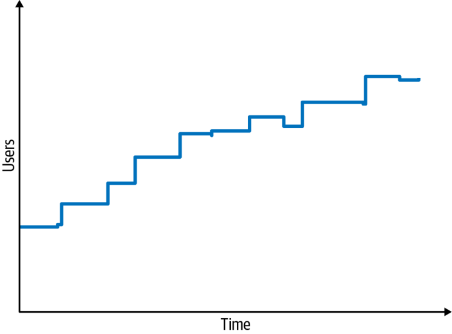

> **شکل ۵-۱.** مقیاس‌پذیری معیاری برای افزایشِ شمارِ کاربران در گذرِ زمان است.

در مقابل، کشسانی جهش‌های ترافیک را می‌سنجد، همان‌طور که در شکل ۵-۲ نشان داده شده است.

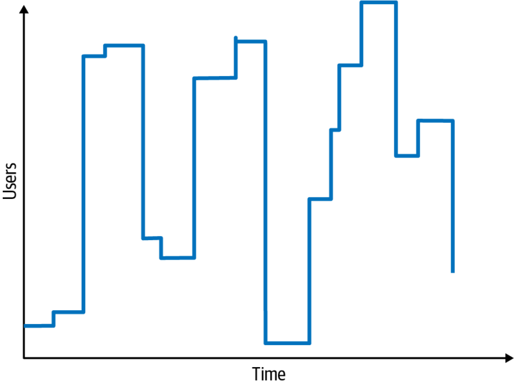

> **شکل ۵-۲.** سیستم‌های کشسان باید در برابرِ جهش‌های ناگهانیِ کاربران تاب بیاورند.

برخی سیستم‌ها مقیاس‌پذیرند اما کشسان نیستند. برای نمونه، شمارِ کاربرانِ یک سیستمِ رزروِ هتل، اگر فروشِ ویژه یا رویدادی در کار نباشد، احتمالاً الگویی فصلی و پیش‌بینی‌پذیر دارد. در مقابل، سیستمِ رزروِ بلیتِ کنسرت را در نظر بگیرید. با آغازِ فروشِ بلیت‌های جدید، هواداران پرشور به سایت هجوم می‌آورند و سیستم به درجهٔ بالایی از کشسانی نیاز پیدا می‌کند. سیستم‌های کشسان اغلب به مقیاس‌پذیری هم نیاز دارند: توانِ پاسخ‌گویی هم به جهش‌ها و هم به شمارِ بالای کاربرانِ هم‌زمان.

کشسانی در الزاماتِ Silicon Sandwiches نیامده است، اما همچنان باید آن را ملاحظه‌ای مهم بشناسید. الزامات گاهی ویژگی‌های معماری را آشکارا بیان می‌کنند، اما برخی دیگر در دلِ حوزهٔ مسئله پنهان مانده‌اند. آیا ترافیکِ یک ساندویچ‌فروشی در سراسرِ روز یکنواخت است یا در حوالیِ وعده‌های غذایی جهش پیدا می‌کند؟ تقریباً بی‌گمان دومی؛ پس این ویژگی معماریِ بالقوه را شناسایی کنید.

سپس هر یک از این الزاماتِ کسب‌وکار را به نوبت بررسی کنید تا ببینید آیا ویژگی معماری‌ای را ایجاب می‌کند یا نه:

**کاربران سفارش ثبت می‌کنند و، اگر فروشگاه خدماتِ ارسال ارائه می‌دهد، تحویلِ حضوری یا ارسال را برمی‌گزینند.**

به نظر نمی‌رسد پشتیبانی از این الزام به ویژگی معماریِ خاصی نیاز داشته باشد.

**به مشتریانِ تحویلِ حضوری زمانِ تحویلِ ساندویچ و مسیرِ رسیدن به فروشگاه اعلام می‌شود (این بخش باید امکانِ یکپارچه‌شدن با سرویس‌های نقشهٔ خارجی را که اطلاعاتِ ترافیک را هم در بر دارند فراهم کند).**

سرویس‌های نقشهٔ خارجی به معنای وجودِ نقاطِ یکپارچه‌سازی (integration points) هستند که ممکن است بر جنبه‌هایی مانند قابلیت اطمینان اثر بگذارند. برای نمونه، فرض کنید توسعه‌دهنده‌ای سیستمی می‌سازد که به سیستمی شخصِ ثالث (third-party) وابسته است. اگر فراخوانی‌های آن سیستم شکست بخورند، قابلیت اطمینانِ سیستمِ فراخوان آسیب می‌بیند. از سوی دیگر، از تعیینِ بیش‌ازحدِ ویژگی‌های معماری (overspecifying) بپرهیزید. اگر سرویسِ خارجیِ ترافیک از کار بیفتد چه می‌شود؟ آیا سایتِ Silicon Sandwiches باید از کار بیفتد، یا فقط بدونِ اطلاعاتِ ترافیک و با کارآمدیِ اندکی کمتر به کارش ادامه دهد؟ معماران همیشه باید مراقب باشند که شکنندگی (brittleness) یا آسیب‌پذیریِ غیرضروری در طراحی‌ها پدید نیاورند.

**در خدماتِ ارسال، پیک همراه با سفارش به سوی کاربر اعزام شود.**

به نظر نمی‌رسد پشتیبانی از این الزام به ویژگی معماریِ خاصی نیاز داشته باشد.

**دسترسی از طریقِ دستگاه‌های موبایل فراهم شود.**

این الزام عمدتاً بر طراحیِ تجربهٔ کاربریِ (user experience, UX) برنامه اثر می‌گذارد و به ساختِ یک برنامهٔ وبِ قابل‌حمل یا چند برنامهٔ وبِ بومی (native) اشاره دارد. با توجه به محدودیت‌های بودجه و سادگیِ برنامه، ساختنِ چند برنامهٔ جداگانه احتمالاً زیاده‌روی است؛ از این رو طراحی به سوی یک برنامهٔ وبِ بهینه‌شده برای موبایل می‌رود. بنابراین شاید بخواهید چند ویژگی معماریِ مشخصِ مرتبط با کارایی تعریف کنید تا زمانِ بارگذاریِ صفحه و دیگر ویژگی‌های حساس در موبایل بهینه شوند.

در چنین موقعیت‌هایی نباید تنها تصمیم بگیرید. با طراحانِ تجربهٔ کاربری، ذی‌نفعانِ حوزه و دیگر طرف‌های ذی‌علاقه همکاری کنید تا این تصمیم‌ها را بسنجید. برای نمونه، ممکن است کسب‌وکار رفتاری را لازم بداند که فقط با ساختنِ برنامه‌های بومی امکان‌پذیر است.

**تخفیف‌ها و پیشنهادهای ویژهٔ روزانهٔ سراسری ارائه شود؛ تخفیف‌ها و پیشنهادهای ویژهٔ روزانهٔ محلی ارائه شود.**

هر دوی این الزامات سفارشی‌سازی را هم در تخفیف‌ها و هم در پیشنهادهای ویژه مشخص می‌کنند. الزامِ مربوط به مسیریابی نیز اطلاعاتِ ترافیکِ سفارشی‌شده بر پایهٔ نشانیِ کاربر را ایجاب می‌کند. بر پایهٔ این دو الزام، شاید سفارشی‌پذیری (customizability) را یک ویژگی معماری در نظر بگیرید. برای نمونه، سبکِ معماریِ میکروکرنل (microkernel architectural style)، که در فصل ۱۳ به آن می‌پردازیم، با تعریفِ یک معماریِ افزونه‌ای (plug-in architecture) از رفتارِ سفارشی‌شده به‌خوبی پشتیبانی می‌کند. در این حالت، رفتارِ پیش‌فرض در هسته (core) قرار می‌گیرد و توسعه‌دهندگان بخش‌های سفارشیِ اختیاری و وابسته به مکان را در قالبِ افزونه‌ها (plug-ins) می‌نویسند. با این حال، یک طراحیِ سنتی هم می‌تواند از راهِ الگوهای طراحی (مانند Template Method) این الزام را برآورده کند. چنین دوراهی‌ای در معماری رایج است و معماران را وامی‌دارد پیوسته مصالحه‌های میانِ گزینه‌های رقیب را بسنجند. برخی مصالحه‌های مشخص را در «طراحی در برابر معماری و مصالحه‌ها» در صفحهٔ ۷۶ با جزئیاتِ بیشتر بررسی می‌کنیم.

**پرداخت به‌صورتِ آنلاین، در فروشگاه یا هنگامِ تحویل پذیرفته شود.**

پرداختِ آنلاین نیاز به امنیت را نشان می‌دهد، اما هیچ چیز در این الزام سطحِ امنیتیِ بالاتری از آنچه به‌طور نامشهود انتظار می‌رود را القا نمی‌کند. معماران می‌توانند امنیت را یا با طراحی یا با معماری تأمین کنند؛ از این رو امنیت در این برنامه دغدغه‌ای حداقلی در میانِ ویژگی‌های معماری است.

**ساندویچ‌فروشی‌ها به‌صورتِ فرانچایز اداره می‌شوند و هر کدام مالکِ متفاوتی دارد.**

این الزام ممکن است محدودیت‌های هزینه‌ای بر معماری تحمیل کند. امکان‌پذیری را با اعمالِ محدودیت‌هایی مانند هزینه، زمان و مجموعه‌مهارت‌های کارکنان بسنجید تا ببینید آیا یک معماریِ ساده یا معماریِ قربانی‌شدنی (sacrificial architecture) توجیه‌پذیر است یا نه.

**شرکتِ مادر برنامه دارد در آینده‌ای نزدیک به خارج از کشور گسترش یابد.**

این الزام بین‌المللی‌سازی (internationalization) را ایجاب می‌کند که اغلب به‌اختصار «i18n» نوشته می‌شود. تکنیک‌های طراحیِ فراوانی برای برآوردنِ این الزام وجود دارد و نیازی به ساختارِ ویژه‌ای برای پشتیبانی از آن نیست. با این حال، این الزام بی‌گمان تصمیم‌های تجربهٔ کاربری را جهت خواهد داد.

**هدفِ شرکت به‌کارگیریِ نیروی کارِ کم‌هزینه برای بیشینه‌کردنِ سود است.**

این الزام نشان می‌دهد که کاربردپذیری اهمیت خواهد داشت، اما این الزام هم بیشتر به طراحی مربوط است تا به ویژگی‌های معماری.

سومین ویژگی معماری‌ای که می‌توانیم از الزاماتِ بالا استخراج کنیم کارایی است: هیچ‌کس دوست ندارد از ساندویچ‌فروشی‌ای خرید کند که کارایی ضعیفی دارد، به‌ویژه در ساعت‌های اوج. با این حال، کارایی مفهومی ظریف و چندلایه است. برای چه نوعی از کارایی باید طراحی کنید؟ (ظرافت‌های گوناگونِ کارایی را در فصل ۶ بررسی می‌کنیم.)

همچنین مهم است که اعدادِ کارایی را همراه با اعدادِ مقیاس‌پذیری تعریف کنید. به بیانِ دیگر، یک خط مبنا برای کارایی، مستقل از مقیاسی خاص، تعیین کنید و سپس مشخص کنید که با شمارِ معینی از کاربران چه سطحی از کارایی پذیرفتنی است. ویژگی‌های معماری پیوسته با یکدیگر برهم‌کنش دارند و معماران را ناگزیر می‌سازند که آن‌ها را در ارتباط با یکدیگر بسنجند و تعریف کنند.

### ویژگی‌های نامشهود

بسیاری از ویژگی‌های معماری در اسنادِ الزامات مشخص نمی‌شوند، اما جنبه‌های مهمی از طراحی را می‌سازند. یکی از ویژگی‌های نامشهودی که سیستم ممکن است بخواهد از آن پشتیبانی کند، در دسترس‌بودن است: اطمینان از اینکه کاربران می‌توانند به سایت دسترسی داشته باشند. ویژگی‌ای که پیوندِ نزدیکی با در دسترس‌بودن دارد پایداری (stability) است: اطمینان از اینکه سایت در طولِ تعامل‌ها برقرار می‌ماند. هیچ‌کس دوست ندارد از سایتی خرید کند که اتصال را قطع می‌کند و او را ناچار به ورودِ دوباره می‌سازد.

امنیت در هر سیستمی به‌عنوانِ یک ویژگی نامشهود حضور دارد: هیچ‌کس نمی‌خواهد نرم‌افزارِ ناامن بسازد. با این حال، بسته به اینکه امنیت تا چه حد حیاتی باشد، ممکن است اولویتِ متفاوتی به آن بدهید؛ و همین نکته ماهیتِ درهم‌تنیدهٔ تعریفِ ما را نشان می‌دهد. امنیت را زمانی می‌توانید یک ویژگی معماری به شمار آورید که بر جنبه‌ای ساختاری از طراحی اثر بگذارد و برای برنامه حیاتی یا مهم باشد.

در مورد Silicon Sandwiches، می‌توانید فرض کنید که پرداخت‌ها را یک شخصِ ثالث انجام می‌دهد. بنابراین تا زمانی که توسعه‌دهندگان اصولِ کلیِ بهداشتِ امنیتی (security hygiene) را رعایت کنند (شمارهٔ کارتِ اعتباری را به‌صورتِ متنِ ساده جابه‌جا نکنند، اطلاعاتِ بیش از اندازه ذخیره نکنند و مانندِ این‌ها)، طراحیِ خوبِ برنامه کفایت می‌کند و برای تأمینِ امنیت به طراحیِ ساختاریِ ویژه‌ای نیاز نخواهید داشت. به یاد داشته باشید که ویژگی‌های معماری هم‌افزا هستند: هر ویژگی معماری با دیگر ویژگی‌ها برهم‌کنش دارد. به همین دلیل است که تعیینِ بیش‌ازحدِ ویژگی‌های معماری دامی چنین رایج است. تعیینِ بیش‌ازحد به همان اندازهٔ تعیینِ کمتر از حدِ ویژگی‌ها (underspecifying) زیان‌بار است، چون طراحیِ سیستم را بیش از اندازه پیچیده می‌کند.

آخرین ویژگی معماریِ مهمی که Silicon Sandwiches باید از آن پشتیبانی کند، یعنی سفارشی‌پذیری، از چند نکتهٔ مشخص در الزامات نشئت می‌گیرد. چند بخش از حوزهٔ مسئله رفتارِ سفارشی دارند: دستورهای پخت، فروش‌های محلی و مسیرهایی که ممکن است به‌صورتِ محلی بازنویسی شوند. بنابراین معماری باید از رفتارِ سفارشی پشتیبانی کند. معمولاً چنین چیزی در قلمروِ طراحیِ برنامه قرار می‌گیرد. اما همان‌طور که تعریفِ ما مشخص می‌کند، وقتی بخشی از حوزهٔ مسئله برای پشتیبانی به ساختارِ سفارشی تکیه دارد، به قلمروِ ویژگی‌های معماری وارد می‌شود. با این حال، این عنصرِ طراحی برای موفقیتِ برنامه حیاتی نیست. به یاد داشته باشید که در انتخابِ ویژگی‌های معماری هیچ پاسخِ مطلقی وجود ندارد و همه‌چیز به مصالحه‌ها بازمی‌گردد؛ یا به بیانِ دیگر:

> **در معماری پاسخِ غلط وجود ندارد؛ فقط پاسخ‌های پرهزینه وجود دارد.**
>
> — یکی از نقل‌قول‌های مشهورِ Mark

> **طراحی در برابر معماری و مصالحه‌ها**
>
> در کاتای Silicon Sandwiches احتمالاً سفارشی‌پذیری را بخشی از سیستم می‌شناسید، اما آنگاه این پرسش پیش می‌آید: معماری یا طراحی؟ معماری مستلزمِ نوعی مؤلفهٔ ساختاری است، در حالی که طراحی درونِ معماری جای دارد. برای Silicon Sandwiches می‌توانید سبکی معماری مانند میکروکرنل را برگزینید و برای سفارشی‌سازی پشتیبانیِ ساختاری بسازید. اما اگر به دلیلِ دغدغه‌های رقیب سبکِ دیگری را انتخاب کنید، توسعه‌دهندگان می‌توانند سفارشی‌سازی را با الگوی طراحیِ Template Method پیاده کنند؛ الگویی که به کلاس‌های والد امکان می‌دهد گردش‌کارهایی تعریف کنند که در کلاس‌های فرزند قابلِ بازنویسی‌اند. کدام گزینه بهتر است؟
>
> مانندِ همه‌چیز در معماری، بستگی دارد. نخست، آیا دلایلِ خوبی برای پیاده‌نکردنِ معماریِ میکروکرنل وجود دارد (مانند کارایی و کوپلینگ)؟ دوم، آیا تحققِ دیگر ویژگی‌های معماریِ مطلوب در یکی از این دو طراحی دشوارتر از دیگری است؟ سوم، پشتیبانی از همهٔ ویژگی‌های معماری در معماری، در مقایسه با پشتیبانی از آن‌ها در طراحی، چه هزینه‌ای دارد؟ این نوع تحلیلِ مصالحه بخشِ مهمی از نقشِ معمار است.
>
> مهم‌تر از همه، همکاری با توسعه‌دهندگان، مدیرِ پروژه، تیمِ عملیات و دیگر هم‌سازندگانِ (co-constructors) سیستمِ نرم‌افزاری حیاتی است. هیچ تصمیمِ معماری‌ای نباید جدا از تیمِ پیاده‌سازی گرفته شود (کاری که به ضدالگوی هراس‌انگیزِ معماریِ برج عاج (Ivory Tower architecture antipattern) می‌انجامد). در مورد Silicon Sandwiches، معمار، سرپرستِ فنی (tech lead)، توسعه‌دهندگان و تحلیلگرانِ حوزه باید با هم همکاری کنند تا تصمیم بگیرند سفارشی‌پذیری به بهترین شکل چگونه پیاده شود.

لازم نیست برای کشفِ مجموعهٔ دقیقاً درستِ ویژگی‌های معماری بیش از حد نگران باشید. توسعه‌دهندگان می‌توانند کارکردها را به شیوه‌های گوناگون پیاده کنند. با این حال، شناساییِ درستِ عناصرِ ساختاریِ مهم ممکن است طراحیِ ساده‌تر یا ظریف‌تری را ممکن کند. می‌توانید معماری‌ای طراحی کنید که سفارشی‌پذیری را به‌صورتِ ساختاری در خود جای ندهد و در عوض پشتیبانی از این رفتار را بر عهدهٔ طراحیِ خودِ برنامه بگذارد (نگاه کنید به «طراحی در برابر معماری و مصالحه‌ها» در صفحهٔ ۷۶). به یاد داشته باشید: در معماری بهترین طراحی وجود ندارد، فقط مجموعه‌ای کم‌بدترین از مصالحه‌ها وجود دارد.

هنگامِ جست‌وجوی ساده‌ترین مجموعه‌های لازم، این ویژگی‌های معماری را اولویت‌بندی کنید. وقتی تیم نخستین دورِ شناساییِ ویژگی‌های معماری را پشتِ سر گذاشت، تمرینِ سودمند این است که بکوشد کم‌اهمیت‌ترین ویژگی را پیدا کند. اگر ناچار بودید یکی را حذف کنید، کدام را حذف می‌کردید؟ معمولاً معماران بیشتر ویژگی‌های صریح را کنار می‌گذارند، چون بسیاری از ویژگی‌های نامشهود پشتوانهٔ موفقیتِ کلیِ سیستم‌اند. شیوه‌ای که با آن «حیاتی یا مهم برای موفقیت» را تعریف می‌کنیم، کمک می‌کند تشخیص دهیم آیا برنامه به‌راستی به هر یک از ویژگی‌های معماری نیاز دارد یا نه. تلاش برای یافتنِ کم‌اهمیت‌ترین ویژگی می‌تواند به شما کمک کند ضرورتِ حیاتیِ هر ویژگی را تشخیص دهید.

در مورد Silicon Sandwiches، کدام‌یک از ویژگی‌های معماریِ شناسایی‌شده کم‌اهمیت‌ترین است؟ باز هم پاسخِ مطلقاً درستی وجود ندارد. با این حال، در این مورد راهکار می‌تواند یا سفارشی‌پذیری را از دست بدهد یا کارایی را. می‌توانیم سفارشی‌پذیری را از فهرستِ ویژگی‌های معماری حذف کنیم و برنامه بریزیم که این رفتار را به‌عنوانِ بخشی از طراحیِ برنامه پیاده کنیم. در میانِ ویژگی‌های عملیاتیِ معماری، کارایی احتمالاً کم‌اهمیت‌ترین ویژگی برای موفقیت است. البته این به آن معنا نیست که توسعه‌دهندگان قصد دارند برنامه‌ای با کاراییِ افتضاح بسازند؛ فقط به این معناست که این طراحی کارایی را بر ویژگی‌های دیگری مانند مقیاس‌پذیری یا در دسترس‌بودن مقدم نمی‌داند.

---

## محدودکردن و اولویت‌بندیِ ویژگی‌های معماری

یک توصیه برای هنگامی که با ذی‌نفعانِ حوزه همکاری می‌کنید تا ویژگی‌های معماریِ پیشران (driving architectural characteristics) را تعریف کنید: سخت بکوشید فهرستِ نهایی تا حدِ ممکن کوتاه بماند. ضدالگویی رایج، تلاش برای طراحیِ یک معماریِ عام (generic architecture) است: معماری‌ای که از همهٔ ویژگی‌های معماری پشتیبانی کند. هر ویژگی‌ای که معماری از آن پشتیبانی می‌کند طراحیِ کلیِ سیستم را پیچیده‌تر می‌کند، پس پشتیبانی از ویژگی‌های معماریِ بیش از اندازه به پیچیدگیِ روزافزون می‌انجامد. و این تازه پیش از آن است که معمار و توسعه‌دهندگان حتی به حوزهٔ مسئله، یعنی انگیزهٔ اصلیِ نوشتنِ نرم‌افزار، پرداخته باشند. وسواسِ شمارِ ویژگی‌ها را نداشته باشید، اما انگیزه را به یاد بسپارید: ساده نگه‌داشتنِ طراحی.

> **مطالعهٔ موردی: Vasa**
>
> داستانِ اصیلِ تعیینِ بیش‌ازحدِ ویژگی‌های معماری تا آنجا که سرانجام پروژه را نابود کند، بی‌گمان داستانِ Vasa است. Vasa یک کشتیِ جنگیِ سوئدی بود که میانِ سال‌های ۱۶۲۶ و ۱۶۲۸ به فرمانِ پادشاهی ساخته شد که باشکوه‌ترین کشتیِ تاریخ را می‌خواست. تا آن زمان کشتی‌ها یا ترابرِ نیرو بودند یا کشتیِ توپ‌دار؛ Vasa قرار بود هر دو باشد. بیشترِ کشتی‌ها یک عرشه داشتند؛ Vasa دو عرشه داشت! همهٔ توپ‌هایش دو برابرِ توپ‌های کشتی‌های مشابه بودند. کشتی‌سازانِ خبره، با وجودِ نگرانی‌هایی، نتوانستند به پادشاه Adolphus «نه» بگویند.
>
> Vasa برای جشن‌گرفتنِ پایانِ ساخت به بندرِ استکهلم رفت و از یک سمت توپِ ادای احترام شلیک کرد. متأسفانه، چون بخشِ بالاییِ کشتی بیش از حد سنگین بود، کشتی واژگون شد و به قعرِ آب فرو رفت. در سالِ ۱۹۶۱ نجات‌گران کشتی را بیرون کشیدند و اکنون در موزه‌ای در استکهلم نگهداری می‌شود.

همکاریِ معمار و ذی‌نفعانِ کسب‌وکار در طولِ تحلیلِ ویژگی‌های معماری حیاتی است. اما اگر معمار فهرستِ مفصلی از ویژگی‌های معماریِ ممکن ارائه دهد و از ذی‌نفعانِ کسب‌وکار بپرسد می‌خواهند معماری از کدام‌یک پشتیبانی کند، پاسخ هر بار چه خواهد بود؟ «همه‌شان!»

بنابراین معماران به تکنیکی نیاز دارند تا تعیین کنند کدام ویژگی‌های معماری تصمیم‌های ساختاری را پیش می‌برند و برای موفقیت حیاتی‌اند. نویسندگان چند تکنیک برای تسهیلِ این کار پرورانده‌اند، از جمله یک «کاربرگِ» ویژگی‌های معماری (architectural characteristics worksheet) که در شکل ۵-۳ نشان داده شده است (و از نشانیِ https://developertoarchitect.com/resources.html قابلِ دریافت است).

این کاربرگ برای استفاده در یک جلسهٔ تعاملی طراحی شده است که معمار آن را اداره می‌کند و در آن نظرِ ذی‌نفعان را دربارهٔ شمار و جزئیاتِ ویژگی‌های معماریِ لازم جویا می‌شود. در سمتِ چپ، هفت جای خالی برای فهرست‌کردنِ ویژگی‌های معماریِ موردنظر می‌بینید.

چرا هفت؟ چرا که نه؟ جدی‌تر بگوییم، معمار باید فهرست را به عددی معقول محدود کند؛ شش یا هشت هم جواب می‌دهد (هرچند پشتِ عددِ هفت پشتوانهٔ روان‌شناختیِ جالبی نهفته است). ستونِ دوم چند ویژگی نامشهودِ معماری را در بر دارد؛ این ویژگی‌ها در بیشترِ سیستم‌ها حضور دارند، اما گاهی معماران آن‌ها را به‌عنوانِ دغدغه‌های پیشرانِ برنامه که طراحی و توجهِ ویژه می‌طلبند در اولویت قرار می‌دهند. در چنین مواردی، معمار ویژگی‌های نامشهود را به ستونِ نخست «می‌کشد». اگر ستونِ نخست پر شود و موردِ بهتری پیدا شود که جای یکی از موارد را بگیرد، معمار موردِ کنارگذاشته را به دستهٔ «موارد بررسی‌شدهٔ دیگر» (Others Considered) منتقل می‌کند.

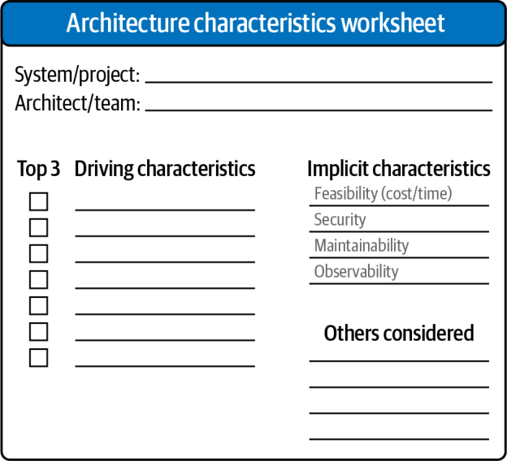

> **شکل ۵-۳.** کاربرگِ ویژگی‌های معماری.

گامِ آخر این است که سه ویژگی معماری با بالاترین اولویت، بدونِ ترتیبِ خاصی، به‌صورتِ جمعی برگزیده شوند (کادرِ کنارِ هر یک را علامت بزنید). این تمرین به معماران امکان می‌دهد فهرستی کوتاه‌شده و اولویت‌بندی‌شده از نیروهای پیشران به دست آورند و از آن برای هدایتِ تصمیم‌های طراحی و تحلیلِ مصالحه‌ها استفاده کنند.

بسیاری از معماران و ذی‌نفعانِ حوزه می‌خواهند به فهرستی نهایی و اولویت‌بندی‌شده از ویژگی‌های معماری‌ای برسند که برنامه یا سیستم باید از آن‌ها پشتیبانی کند. هرچند چنین نتیجه‌ای بی‌گمان مطلوب است، در بیشترِ موارد تلاشی بیهوده است که نه‌تنها زمان را هدر می‌دهد، بلکه سرخوردگی و اختلافِ نظرِ غیرضروریِ فراوانی با ذی‌نفعانِ کلیدی به بار می‌آورد. به‌ندرت پیش می‌آید که همهٔ ذی‌نفعان بر اولویتِ تک‌تکِ ویژگی‌ها توافق کنند. رویکردِ بهتر این است که ذی‌نفعانِ حوزه سه ویژگیِ مهم‌تر را، بدونِ ترتیبِ خاصی، از فهرستِ نهایی برگزینند. این کار رسیدن به اجماع را بسیار آسان‌تر می‌کند و بحث دربارهٔ مهم‌ترین موارد را برمی‌انگیزد. همهٔ این‌ها به معمار کمک می‌کند هنگامِ گرفتنِ تصمیم‌های حیاتیِ معماری، مصالحه‌ها را تحلیل کند.

---

## واژه‌نامهٔ اختصاصی این فصل

| واژهٔ انگلیسی | معادل مصوب/به‌کاررفته در این فصل |
|---|---|
| Domain Concern | دغدغهٔ حوزه |
| Implicit Domain Knowledge | دانش ضمنی حوزه |
| Data Integrity | یکپارچگی داده |
| Mergers and Acquisitions | ادغام و تملک |
| User Satisfaction | رضایت کاربر |
| Time to Market | زمان عرضه به بازار |
| Competitive Advantage | مزیت رقابتی |
| Deployability | استقرارپذیری |
| Simplicity | سادگی |
| Feasibility | امکان‌پذیری |
| Time and Budget | زمان و بودجه |
| False Equivalence | هم‌ارزی نادرست |
| Composite Architectural Characteristic | ویژگی معماری مرکب |
| End-of-Day Fund Pricing | قیمت‌گذاری پایان روز صندوق‌ها |
| Auditability | ممیزی‌پذیری |
| Requirements Document | سند الزامات |
| Architecture Kata | کاتای معماری |
| Kata | کاتا |
| Description (kata section) | توصیف |
| Users (kata section) | کاربران |
| Additional Context | زمینهٔ تکمیلی |
| Brown-Bag Lunch | جلسهٔ ناهار آموزشی |
| Timeboxed | با زمان محدود و ازپیش‌تعیین‌شده |
| Requirements Specification | مشخصات الزامات |
| Concurrent Users | کاربران هم‌زمان |
| Domain Analyst | تحلیلگر حوزه |
| Integration Point | نقطهٔ یکپارچه‌سازی |
| Third-Party | شخص ثالث |
| Overspecifying (Architectural Characteristics) | تعیین بیش‌ازحد (ویژگی‌های معماری) |
| Brittleness | شکنندگی |
| User Experience (UX) | تجربهٔ کاربری (UX) |
| Native Application | برنامهٔ بومی |
| Customizability | سفارشی‌پذیری |
| Microkernel Architectural Style | سبک معماری میکروکرنل |
| Plug-in Architecture | معماری افزونه‌ای |
| Core (microkernel) | هسته |
| Plug-in | افزونه |
| Sacrificial Architecture | معماری قربانی‌شدنی |
| Internationalization (i18n) | بین‌المللی‌سازی (i18n) |
| Stability | پایداری |
| Security Hygiene | بهداشت امنیتی |
| Underspecifying (Architectural Characteristics) | تعیین کمتر از حد (ویژگی‌های معماری) |
| Co-constructors (of a software system) | هم‌سازندگان (سیستم نرم‌افزاری) |
| Ivory Tower Architecture Antipattern | ضدالگوی معماری برج عاج |
| Tech Lead | سرپرست فنی |
| Driving Architectural Characteristics | ویژگی‌های معماری پیشران |
| Generic Architecture | معماری عام |
| Architectural Characteristics Worksheet | کاربرگ ویژگی‌های معماری |
| Others Considered (worksheet category) | موارد بررسی‌شدهٔ دیگر |

---

<a id="chapter-06"></a>

# فصل ۶: سنجش و حاکمیت بر ویژگی‌های معماری

معماران باید با طیفِ بسیار گسترده‌ای از ویژگی‌های معماری در همهٔ جنبه‌های پروژه‌های نرم‌افزاری سروکار داشته باشند. جنبه‌های عملیاتی مانند کارایی، کشسانی و مقیاس‌پذیری با دغدغه‌های ساختاری مانند ماژولاریتی و استقرارپذیری درمی‌آمیزند. برای معماران سودمند است که بدانند چگونه ویژگی‌های معماری را بسنجند و بر آن‌ها حاکمیت داشته باشند، به‌جای آنکه در اصطلاحاتِ مبهم و تعریف‌های کلی غرق شوند. این فصل بر تعریفِ مشخصِ برخی از رایج‌ترین ویژگی‌های معماری تمرکز می‌کند و شیوهٔ ساختنِ سازوکارهای حاکمیت برای آن‌ها را بررسی می‌کند.

---

## سنجشِ ویژگی‌های معماری

معماران به چند دلیل در تعریفِ ویژگی‌های معماری با دشواری روبه‌رو می‌شوند:

**فیزیک نیستند:** بسیاری از ویژگی‌های معماریِ رایج معناهای مبهمی دارند. برای نمونه، معمار چگونه برای چابکی یا استقرارپذیری طراحی می‌کند؟ یا برای «کاراییِ برق‌آسا»؟ افراد در سراسرِ صنعت دیدگاه‌های بسیار متفاوتی دربارهٔ اصطلاحاتِ رایج دارند؛ این تفاوت‌ها گاهی از زمینه‌های متفاوت و موجه سرچشمه می‌گیرند و گاهی سلیقه‌ای و دل‌بخواهی‌اند.

**تعریف‌های بسیار گوناگون:** حتی درونِ یک سازمان هم ممکن است بخش‌های مختلف بر سرِ تعریفِ ویژگی‌های حیاتی‌ای مانند کارایی هم‌نظر نباشند. تا زمانی که توسعه‌دهندگان، معماران، تیمِ عملیات و دیگران بر یک تعریفِ مشترک توافق نکنند، چگونه می‌توانند گفت‌وگوی درستی داشته باشند؟

**بیش از حد مرکب:** بسیاری از ویژگی‌های معماریِ مطلوب در واقع مجموعه‌ای از ویژگی‌های دیگر در مقیاسی کوچک‌ترند؛ همان‌طور که شاید از بحثِ ما دربارهٔ ویژگی‌های معماریِ مرکب در فصل ۵ به یاد داشته باشید. برای نمونه، چابکی به ویژگی‌هایی مانند ماژولاریتی، استقرارپذیری و آزمون‌پذیری تجزیه می‌شود.

تجزیهٔ ویژگی‌های معماریِ مرکب به اجزای سازنده‌شان بخشِ مهمی از ایجادِ تعریف‌های عینی برای ویژگی‌های معماری است و هر سه مشکلِ بالا را حل می‌کند.

وقتی سازمانی توافق می‌کند که همه از تعریف‌های استاندارد و مشخص برای ویژگی‌های معماری استفاده کنند، یک زبانِ فراگیر پیرامونِ معماری پدید می‌آورد. این استانداردسازی به آن‌ها امکان می‌دهد ویژگی‌های مرکب را باز کنند و به خصیصه‌هایی برسند که به‌طورِ عینی سنجش‌پذیرند.

### سنجه‌های عملیاتی

بسیاری از ویژگی‌های معماری، مانند کارایی یا مقیاس‌پذیری، سنجه‌های مستقیم و آشکاری دارند. با این حال، حتی همین‌ها هم بسته به اهدافِ تیم تفسیرهای ظریفِ فراوانی می‌پذیرند. برای نمونه، شاید تیمِ شما میانگینِ زمانِ پاسخ (average response time) را برای برخی درخواست‌ها بسنجد؛ نمونه‌ای خوب از سنجه‌ای برای یک ویژگی عملیاتیِ معماری. اما اگر تیمِ شما فقط میانگین را بسنجد، چه می‌شود اگر یک شرطِ مرزی (boundary condition) باعث شود ۱٪ از درخواست‌ها ۱۰ برابرِ بقیه طول بکشند؟ اگر سایت ترافیکِ کافی داشته باشد، این داده‌های پرت (outliers) شاید اصلاً دیده نشوند. برای شناساییِ داده‌های پرت، شاید بخواهید بیشینهٔ زمانِ پاسخ را هم بسنجید.

تیم‌های پیشرفته فقط اعدادِ سفت‌وسختی برای کارایی تعیین نمی‌کنند؛ آن‌ها تعریف‌هایشان را بر تحلیلِ آماری بنا می‌کنند. برای نمونه، فرض کنید یک سرویسِ پخشِ ویدئو می‌خواهد مقیاس‌پذیری را پایش کند. مهندسان به‌جای تعیینِ عددی دلبخواهی به‌عنوانِ هدف، مقیاس را در گذرِ زمان می‌سنجند و مدل‌های آماری می‌سازند، سپس اگر سنجه‌های بی‌درنگ از مدل‌های پیش‌بین انحراف پیدا کنند، هشدار می‌دهند. اگر چنین شود، این ناهمخوانی می‌تواند دو معنا داشته باشد: یا مدل نادرست است (که تیم‌ها دوست دارند بدانند) یا مشکلی در کار است (که تیم‌ها این را هم دوست دارند بدانند).

انواعِ ویژگی‌هایی که تیم‌ها می‌سنجند، هم‌پای ابزارها، اهداف، دستگاه‌ها و قابلیت‌ها، به‌سرعت تحول می‌یابند. برای نمونه، اخیراً بسیاری از تیم‌ها بر بودجه‌های کارایی (performance budgets) برای معیارهایی مانند نخستین رنگ‌آمیزیِ محتوایی (first contentful paint) و نخستین بیکاریِ CPU (first CPU idle) تمرکز کرده‌اند؛ هر دو معیار گویای بسیاری از مشکلاتِ کارایی برای کاربرانی‌اند که با دستگاه‌های موبایل صفحه‌های وب را باز می‌کنند. با تغییرِ این موارد و متغیرهای بی‌شمارِ دیگر، تیم‌ها موضوعاتِ تازه‌ای برای سنجش و راه‌های نوینی برای سنجشِ آن‌ها خواهند یافت.

> **چهره‌های گوناگونِ کارایی**
>
> بسیاری از ویژگی‌های معماری که توصیف می‌کنیم چند تعریف دارند. کارایی نمونهٔ بسیار خوبی است. بسیاری از پروژه‌ها به کاراییِ کلی نگاه می‌کنند: برای نمونه، اینکه چرخه‌های درخواست و پاسخ در یک برنامهٔ وب چقدر طول می‌کشند. اما معماران و مهندسانِ DevOps در بسیاری از سازمان‌ها، با کارِ بسیار زیاد، بودجه‌های کاراییِ مشخصی برای بخش‌های مشخصی از برنامه تعیین کرده‌اند. برای نمونه، بسیاری از سازمان‌ها رفتارِ کاربران را بررسی کرده و دریافته‌اند که زمانِ بهینه برای نخستین رندرِ صفحه (first-page render)، یعنی نخستین نشانهٔ دیدنیِ پیشرفتِ بارگذاریِ یک صفحهٔ وب در مرورگر یا دستگاهِ موبایل، کسری از یک ثانیه است. بیشترِ برنامه‌ها در این معیار در محدودهٔ دو رقمی قرار می‌گیرند. اما برای سایت‌های مدرنی که می‌کوشند هرچه بیشتر کاربر جذب کنند، این معیار مهمی برای پیگیری است و سازمان‌های پشتِ این سایت‌ها سنجه‌های بسیار ظریفی ساخته‌اند.
>
> برخی از این معیارها پیامدهای دیگری هم برای طراحیِ برنامه دارند. بسیاری از سازمان‌های آینده‌نگر برای بارگذاریِ صفحه‌ها بودجهٔ وزنِ کیلوبایتی (K-weight budget) تعیین می‌کنند؛ یعنی سقفِ مجازی (بر حسب بایت) برای حجمِ کتابخانه‌ها و چارچوب‌هایی که می‌توانند در یک صفحه بارگذاری شوند معین می‌کنند. منطقِ آن‌ها از محدودیت‌های فیزیکی نشئت می‌گیرد: در هر لحظه فقط شمارِ محدودی بایت می‌تواند از شبکه عبور کند، به‌ویژه برای دستگاه‌های موبایل در مناطقی با پهنای باندِ محدود.

### سنجه‌های ساختاری

برخی سنجه‌های عینی به اندازهٔ کارایی آشکار نیستند. ویژگی‌های ساختاریِ درونی، مانند ماژولاریتیِ خوش‌تعریف، چطور؟ این نمونهٔ خوبی از یک ویژگی نامشهودِ معماری است: معماران مسئولِ تعریفِ مؤلفه‌ها و تعامل‌هایشان هستند و می‌خواهند ساختاری پایدار برای کیفیتِ بالای کلی بسازند. متأسفانه هنوز هیچ معیارِ جامعی برای ارزیابیِ کیفیتِ یک معماری وجود ندارد. با این حال، معیارها و ابزارهای رایجی هست که به معماران امکان می‌دهد به برخی جنبه‌های حیاتیِ ساختارِ کد بپردازند، هرچند در ابعادی محدود.

یکی از جنبه‌های سنجش‌پذیرِ کد پیچیدگی است که معیارِ پیچیدگی چرخه‌ای آن را تعریف می‌کند.

> **پیچیدگی چرخه‌ای**
>
> پیچیدگی چرخه‌ای (CC) معیاری در سطحِ کد است که Thomas McCabe Sr. در سالِ ۱۹۷۶ طراحی کرد تا سنجه‌ای عینی برای پیچیدگیِ کد در سطحِ تابع/متد، کلاس یا برنامه فراهم کند. این معیار با به‌کارگیریِ نظریهٔ گراف (graph theory) روی کد محاسبه می‌شود؛ به‌طورِ مشخص، روی نقاطِ تصمیم (decision points) که مسیرهای اجرای متفاوتی پدید می‌آورند. برای نمونه، اگر تابعی هیچ دستورِ تصمیمی (مانند دستورهای `if`) نداشته باشد، آنگاه `CC = 1` است. اگر تابع یک دستورِ شرطی داشته باشد، آنگاه `CC = 2` است، چون دو مسیرِ اجرای ممکن وجود دارد.
>
> فرمولِ محاسبهٔ CC برای یک تابع یا متد `$CC = E - N + 2$` است که در آن N نمایندهٔ گره‌ها (nodes) یا همان خطوطِ کد، و E نمایندهٔ یال‌ها (edges) یا همان تصمیم‌های ممکن است. کدِ C-مانندِ مثالِ ۶-۱ را در نظر بگیرید.
>
> **مثال ۶-۱.** نمونه‌کدی برای ارزیابیِ پیچیدگی چرخه‌ای
>
> ```java
> public void decision(int c1, int c2) {
>     if (c1 < 100)
>         return 0;
>     else if (c1 + c2 > 500)
>        return 1;
>     else
>       return -1;
> }
> ```
>
> پیچیدگی چرخه‌ایِ مثالِ ۶-۱ برابر با ۳ است (`$3 - 2 + 2$`)، همان‌طور که در شکل ۶-۱ نشان داده شده است.
>
> 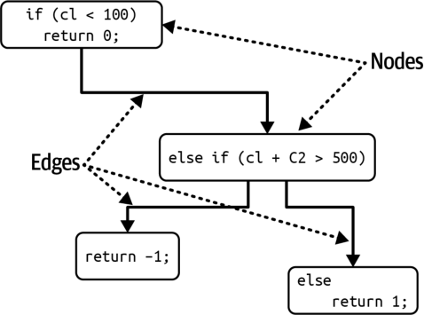
>
> **شکل ۶-۱.** گرافِ پیچیدگی چرخه‌ای برای تابعِ `decision`.
>
> عددِ ۲ در فرمولِ پیچیدگی چرخه‌ای ساده‌سازی‌ای برای یک تابع/متدِ منفرد است. برای فراخوانی‌های انشعابی به متدهای دیگر (fan-out calls)، که در نظریهٔ گراف مؤلفه‌های همبند (connected components) نامیده می‌شوند، فرمولِ کلی‌تر `$CC = E - N + 2P$` است که در آن P نمایندهٔ شمارِ مؤلفه‌های همبند است.

معماران و توسعه‌دهندگان همگی بر این توافق دارند که کدِ بیش از حد پیچیده نوعی «بوی کد» است؛ چیزی در کد که آن‌قدر بد است که گویی بویی خیالی از آن برمی‌خیزد. چنین کدی تقریباً به همهٔ ویژگی‌های مطلوبِ پایگاه‌های کد آسیب می‌زند: ماژولاریتی، آزمون‌پذیری، استقرارپذیری و مانندِ این‌ها. اگر تیم‌ها پیچیدگیِ رو به رشد را به‌تدریج زیرِ نظر نگیرند، این پیچیدگی سرانجام بر پایگاهِ کد چیره می‌شود.

پیچیدگی چرخه‌ای نمونهٔ خوبی از ابزارهای زمخت و تقریبی‌ای است که در اختیارِ معماران قرار دارد. این معیار با اینکه پیچیدگیِ کد را می‌سنجد، نمی‌تواند تشخیص دهد که این پیچیدگی ذاتی است (چون مسئله‌ای پیچیده را حل می‌کنیم) یا عارضی (چون طراحیِ ضعیفی پیاده کرده‌ایم). معیارهایی مانند CC برای ارزیابیِ کد، چه توسعه‌دهندگان آن را نوشته باشند و چه هوش مصنوعی مولد، بسیار سودمندند. هوش مصنوعی مولد معمولاً مسائل را با زورِ خام (brute force) حل می‌کند و اغلب به پیچیدگی عارضی می‌انجامد.

> **مقدارِ خوب برای پیچیدگی چرخه‌ای چیست؟**
>
> پرسشی که نویسندگان هنگامِ صحبت دربارهٔ این موضوع بارها می‌شنوند این است: مقدارِ آستانهٔ (threshold) خوب برای CC چیست؟ البته، مانندِ همهٔ پرسش‌ها در معماری نرم‌افزار، پاسخ این است: بستگی دارد! به‌طورِ مشخص، بستگی به پیچیدگیِ حوزهٔ مسئله دارد. برای نمونه، اگر مسئله‌ای از نظرِ الگوریتمی پیچیده داشته باشید، راه‌حل توابعِ پیچیده‌ای به بار می‌آورد. برخی از جنبه‌های کلیدیِ CC که معماران باید پایش کنند: آیا توابع به دلیلِ حوزهٔ مسئله پیچیده‌اند یا به دلیلِ کدنویسیِ ضعیف؟ یا شاید کد به‌شکلِ نامناسبی بخش‌بندی شده است؟ به بیانِ دیگر، آیا می‌توان یک متدِ بزرگ را به تکه‌های منطقیِ کوچک‌تر شکست و کار (و پیچیدگی) را میانِ متدهای خوش‌تجزیه‌تر (well-factored) توزیع کرد؟
>
> به‌طورِ کلی، آستانه‌های رایج در صنعت برای CC نشان می‌دهند که مقدارِ کمتر از ۱۰ پذیرفتنی است، مگر ملاحظاتِ دیگری مانند حوزه‌های پیچیده در کار باشد. ما این آستانه را بسیار بالا می‌دانیم و ترجیح می‌دهیم مقدارِ CC کمتر از پنج باشد که نشانهٔ کدی منسجم و خوش‌تجزیه است. ابزاری برای معیارها در دنیای Java به نامِ Crap4J می‌کوشد با ارزیابیِ ترکیبی از CC و پوششِ کد (code coverage) تعیین کند کدِ شما تا چه حد ضعیف (یا به تعبیرِ خودشان «crappy») است؛ اگر CC از ۵۰ بیشتر شود، هیچ میزانی از پوششِ کد آن کد را از بی‌کیفیتی نجات نمی‌دهد. وحشتناک‌ترین مصنوعِ نرم‌افزاری‌ای که Neal تا کنون در پروژه‌های حرفه‌ای با آن روبه‌رو شده، یک تابعِ منفردِ C بود که قلبِ یک بستهٔ نرم‌افزاریِ تجاری به شمار می‌رفت و CC آن بیش از ۸۰۰ بود! این یک تابعِ واحد با بیش از ۴٬۰۰۰ خط کد بود که دستورهای `GOTO` را بی‌دریغ به کار می‌برد (تا از حلقه‌های تودرتو با عمقی باورنکردنی بگریزد).
>
> رویه‌های مهندسی‌ای مانند توسعهٔ آزمون‌محور (test-driven development, TDD) این اثرِ جانبیِ سودمند را دارند که برای یک حوزهٔ مسئلهٔ معین، به‌طورِ میانگین متدهایی کوچک‌تر و با پیچیدگیِ کمتر پدید می‌آورند. توسعه‌دهندگان در TDD می‌کوشند آزمونی ساده بنویسند و سپس کمترین مقدارِ کدِ لازم برای قبولی در آن آزمون را بنویسند. این تمرکز بر رفتارِ مجزا و مرزهای خوبِ آزمون، متدهایی خوش‌تجزیه و بسیار منسجم با CC پایین را تشویق می‌کند.

### سنجه‌های فرایندی

برخی ویژگی‌های معماری با فرایندهای توسعهٔ نرم‌افزار هم‌پوشانی دارند. برای نمونه، چابکی اغلب به‌عنوانِ خصیصه‌ای مطلوب مطرح می‌شود. اما چابکی یک ویژگی معماریِ مرکب است که از خصیصه‌هایی مانند آزمون‌پذیری و استقرارپذیری تشکیل شده است.

آزمون‌پذیری را می‌توان با ابزارهای پوشش کد سنجید؛ ابزارهایی که تقریباً برای همهٔ سکوها وجود دارند و گزارش می‌دهند آزمون‌ها چند درصد از کد را اجرا می‌کنند. اما این ابزارها، مانندِ همهٔ بررسی‌های نرم‌افزاری، نمی‌توانند جای اندیشه و نیت را بگیرند. برای نمونه، یک پایگاه کد می‌تواند ۱۰۰٪ پوشش کد داشته باشد، اما از ادعاهای (assertions) ضعیفی استفاده کند که در واقع هیچ اطمینانی به درستیِ کد نمی‌دهند.

آزمون‌پذیری ویژگی‌ای است که به‌طورِ عینی سنجش‌پذیر است و استقرارپذیری نیز همین‌طور. معیارهای استقرارپذیری شاملِ درصدِ استقرارهای موفق، مدت‌زمانِ استقرارها، و مشکلات و باگ‌هایی است که استقرارها پدید می‌آورند. هر تیم باید به مجموعهٔ خوبی از سنجه‌ها برسد که داده‌های کیفی و کمّیِ سودمند را متناسب با اولویت‌ها و اهدافِ سازمان و تیمِ خود ثبت کند.

هرچند چابکی و اجزای وابسته به آن آشکارا با فرایندِ توسعهٔ نرم‌افزار مرتبط‌اند، این فرایند ممکن است بر ساختارِ معماری اثر بگذارد. برای نمونه، اگر سهولتِ استقرار و آزمون‌پذیری اولویت‌های بالایی باشند، معمار بر ماژولاریتی و جداسازیِ خوب در سطحِ معماری تأکید می‌کند؛ نمونه‌ای از ویژگی معماری‌ای که یک تصمیمِ ساختاری را پیش می‌برد. تقریباً هر چیزی در دامنهٔ یک پروژهٔ نرم‌افزاری می‌تواند به سطحِ یک ویژگی معماری برسد، به شرطِ آنکه سه ملاکِ ما را برآورده کند و معمار را ناگزیر سازد برای در نظر گرفتنِ آن تصمیم‌های مهمی بگیرد.

---

## حاکمیت و توابع برازش

وقتی معماران ویژگی‌های معماری را تعیین و اولویت‌بندی کردند، چگونه می‌توانند مطمئن شوند که توسعه‌دهندگان، صرف‌نظر از فشارِ زمان‌بندی، به این اولویت‌ها پایبند می‌مانند و طراحی‌هایشان را درست و اصولی پیاده می‌کنند؟ در بسیاری از پروژه‌های نرم‌افزاری فوریت حرفِ اول را می‌زند، اما معماران همچنان به ابزارها و تکنیک‌هایی برای اعمالِ حاکمیتِ معماری نیاز دارند. ماژولاریتی نمونهٔ بسیار خوبی از جنبه‌ای از معماری است که مهم است اما فوری نیست.

### حاکمیت بر ویژگی‌های معماری

حاکمیت، که از واژهٔ یونانیِ kubernan (به معنای «هدایت‌کردن») گرفته شده، یکی از مسئولیت‌های مهمِ نقشِ معمار است. همان‌طور که از نامش پیداست، دامنهٔ آن هر جنبه‌ای از فرایندِ توسعهٔ نرم‌افزار را در بر می‌گیرد که معماران می‌خواهند بر آن اثر بگذارند. برای نمونه، تضمینِ کیفیتِ نرم‌افزار در قلمروِ حاکمیتِ معماری قرار می‌گیرد، چون غفلت از آن می‌تواند به مشکلاتِ کیفیِ فاجعه‌باری بینجامد.

خوشبختانه معماران راه‌حل‌های روزبه‌روز پیشرفته‌تری برای این مسئله در اختیار دارند؛ نمونه‌ای خوب از رشدِ تدریجیِ قابلیت‌های اکوسیستمِ توسعهٔ نرم‌افزار. حرکت به سوی خودکارسازی که Extreme Programming آغازگرش بود، یکپارچه‌سازی مداوم (continuous integration, CI) را پدید آورد. CI به خودکارسازیِ بیشتر در عملیات انجامید که امروز آن را DevOps می‌نامیم، و این زنجیره تا حاکمیتِ معماری ادامه می‌یابد. کتابِ Building Evolutionary Architectures (O’Reilly، ۲۰۲۲) نوشتهٔ Neal Ford و همکاران، خانواده‌ای از تکنیک‌ها به نامِ توابع برازش (fitness functions) را توصیف می‌کند که برای خودکارسازیِ بسیاری از جنبه‌های حاکمیتِ معماری به کار می‌روند. بقیهٔ این فصل را به بررسیِ توابع برازش اختصاص می‌دهیم.

### توابع برازش

واژهٔ «evolutionary» (تکاملی) در عنوانِ کتابِ Building Evolutionary Architectures بیشتر از محاسباتِ تکاملی (evolutionary computing) می‌آید تا از زیست‌شناسی. یکی از نویسندگانِ آن کتاب، Dr. Rebecca Parsons، مدتی در حوزهٔ محاسباتِ تکاملی فعالیت کرده و با ابزارهایی مانند الگوریتم‌های ژنتیک (genetic algorithms) کار کرده است. وقتی توسعه‌دهنده‌ای الگوریتمی ژنتیک طراحی می‌کند تا نتیجهٔ سودمندی به دست آورد، اغلب می‌خواهد با فراهم‌کردنِ سنجه‌ای عینی از کیفیتِ خروجیِ الگوریتم، آن را هدایت کند. این سازوکارِ هدایت تابع برازش نامیده می‌شود: تابعِ هدفی (objective function) که برای ارزیابیِ میزانِ نزدیکیِ خروجی به هدفش به کار می‌رود.

برای نمونه، فرض کنید باید مسئلهٔ فروشندهٔ دوره‌گرد (traveling salesperson problem) را حل کنید؛ مسئله‌ای مشهور که پایهٔ یادگیری ماشین قرار گرفته است. با داشتنِ یک فروشنده، فهرستی از شهرهایی که باید به آن‌ها سر بزند و فاصله‌های میانِ این شهرها، بهینه‌ترین مسیرِ ممکن، با کمینه‌کردنِ مسافت، زمان و هزینه، کدام است؟ اگر برای حلِ این مسئله الگوریتمی ژنتیک طراحی کنید، ممکن است از یک تابع برازش برای ارزیابیِ طولِ مسیر و از تابعی دیگر برای ارزیابیِ هزینهٔ کلیِ مسیر استفاده کنید. تابعِ دیگری هم ممکن است مدت‌زمانی را که فروشندهٔ دوره‌گرد دور از خانه است ارزیابی کند.

رویه‌های معماری تکامل‌پذیر (evolutionary architecture) این مفهوم را وام می‌گیرند تا تابع برازشِ معماری (architectural fitness function) را بسازند: هر سازوکاری که ارزیابیِ عینیِ یکپارچگیِ یک ویژگی معماری یا ترکیبی از ویژگی‌های معماری را فراهم کند.

توابع برازش چارچوبِ تازه‌ای نیستند که معماران آن را دانلود کنند؛ بلکه دیدگاهِ تازه‌ای نسبت به بسیاری از ابزارهای موجود عرضه می‌کنند. به عبارتِ «هر سازوکاری» در این تعریف توجه کنید: تکنیک‌های وارسیِ ویژگی‌های معماری به اندازهٔ خودِ ویژگی‌ها گوناگون‌اند. توابع برازش، بسته به شیوهٔ استفاده، با بسیاری از سازوکارهای وارسیِ موجود هم‌پوشانی دارند: در مهندسی آشوب (chaos engineering)، یا در قالبِ معیارها، پایشگرها (monitors) یا کتابخانه‌های آزمونِ واحد (unit testing libraries) (نگاه کنید به شکل ۶-۲).

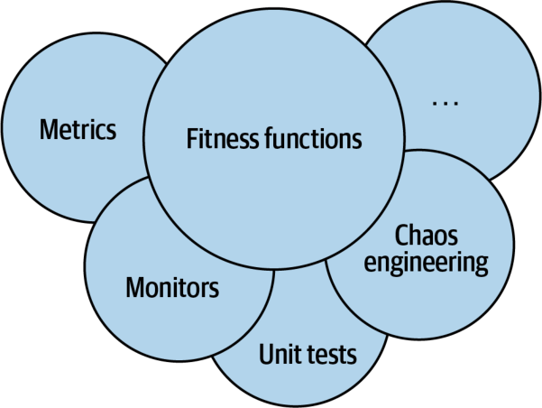

> **شکل ۶-۲.** سازوکارهای توابع برازش.

بسته به ویژگی‌های معماری، ابزارهای بسیار متفاوتی می‌توانند برای پیاده‌سازیِ توابع برازش به کار روند. بیایید به چند نمونه از توابع برازش نگاهی بیندازیم که جنبه‌های گوناگونِ ماژولاریتی را می‌آزمایند.

#### وابستگی‌های چرخه‌ای

ماژولاریتی یک ویژگی نامشهودِ معماری است که بیشترِ معماران به آن اهمیت می‌دهند. چون تضعیفِ ماژولاریتی به ساختارِ پایگاه کد آسیب می‌زند، معماران معمولاً اولویتِ بالایی برای حفظِ ساختارِ ماژولار قائل می‌شوند. با این حال، در بسیاری از سکوها نیروهایی در برابرِ این نیت‌های خوب عمل می‌کنند. برای نمونه، هنگامِ کدنویسی در هر محیطِ توسعهٔ محبوبِ Java یا .NET، به محضِ آنکه توسعه‌دهنده به کلاسی ارجاع دهد که هنوز درون‌بُرد (import) نشده است، IDE با مهربانی پنجره‌ای نشان می‌دهد و می‌پرسد آیا می‌خواهد آن ارجاع به‌طورِ خودکار درون‌بُرد شود. این اتفاق آن‌قدر زیاد می‌افتد که بیشترِ برنامه‌نویسان بر حسبِ عادت (حافظهٔ حرکتی) و بدونِ فکر آن را تأیید و رد می‌کنند. اما درون‌بُردِ بی‌محابای کلاس‌ها میانِ مؤلفه‌ها می‌تواند برای ماژولاریتی فاجعه‌بار باشد. برای نمونه، شکل ۶-۳ وابستگی‌های چرخه‌ای (Cyclic Dependencies) را نشان می‌دهد؛ ضدالگویی به‌ویژه زیان‌بار که معماران آرزو دارند از آن دوری کنند.

در شکل ۶-۳، هر مؤلفه به چیزی در مؤلفه‌های دیگر ارجاع می‌دهد. وجودِ چنین شبکه‌ای به ماژولاریتی آسیب می‌زند، چون نمی‌توان یک مؤلفهٔ منفرد را بدونِ همراه آوردنِ بقیه دوباره به کار برد. و اگر آن مؤلفه‌های دیگر هم به مؤلفه‌های دیگری کوپل شده باشند چه؟ معماری بیش‌ازپیش به سوی ضدالگوی توپِ بزرگِ گِل (Big Ball of Mud) می‌رود. معماران چگونه می‌توانند بی‌آنکه پیوسته بالای سرِ توسعه‌دهندگان بایستند، بر این رفتار حاکمیت داشته باشند؟ بازبینی کد کمک می‌کند، اما در چرخهٔ توسعه بسیار دیر انجام می‌شود و نمی‌تواند به‌طورِ کامل اثربخش باشد. اگر تیمِ توسعه یک هفته تا زمانِ بازبینی کد بی‌محابا در سراسرِ پایگاه کد درون‌بُرد کند، تا آن زمان آسیبِ جدی به پایگاه کد زده است.

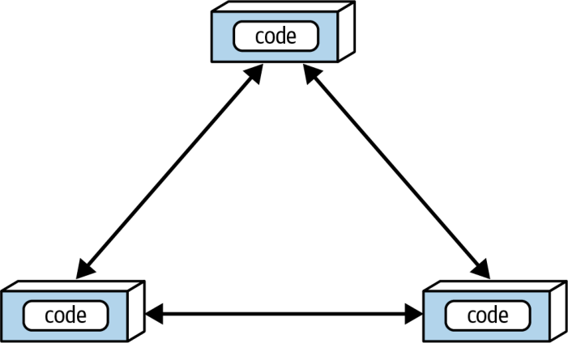

> **شکل ۶-۳.** وابستگی‌های چرخه‌ای میانِ مؤلفه‌ها.

راه‌حلِ این مسئله نوشتنِ یک تابع برازش برای مراقبت از چرخه‌هاست، همان‌طور که در مثالِ ۶-۲ نشان داده شده است.

**مثال ۶-۲.** تابع برازش برای تشخیصِ چرخه‌های میانِ مؤلفه‌ها

```java
public class CycleTest {
    private JDepend jdepend;
    @BeforeEach
    void init() {
      jdepend = new JDepend();
      jdepend.addDirectory("/path/to/project/persistence/classes");
      jdepend.addDirectory("/path/to/project/web/classes");
      jdepend.addDirectory("/path/to/project/thirdpartyjars");
    }
    @Test
    void testAllPackages() {
      Collection packages = jdepend.analyze();
      assertEquals("Cycles exist", false, jdepend.containsCycles());
    }
}
```

این کد از ابزارِ معیارسنجیِ JDepend برای بررسیِ وابستگی‌های میانِ بسته‌ها استفاده می‌کند. این ابزار ساختارِ بسته‌های Java را می‌شناسد و اگر هر چرخه‌ای پیدا کند، آزمون را ناموفق اعلام می‌کند. معمار می‌تواند این آزمون را در ساختِ مداومِ (continuous build) پروژه بگنجاند و دیگر نگرانِ این نباشد که توسعه‌دهندگانِ عجول به‌طورِ تصادفی چرخه‌ای پدید آورند. این نمونهٔ بسیار خوبی از تابع برازشی است که از رویه‌های مهم، و نه فوریِ، توسعهٔ نرم‌افزار پاسداری می‌کند: دغدغه‌ای مهم برای معماران است، اما اثرِ چندانی بر کدنویسیِ روزمره ندارد.

#### تابع برازشِ فاصله از دنبالهٔ اصلی

در «کوپلینگ» در صفحهٔ ۴۴، معیارِ رازآلودترِ فاصله از دنبالهٔ اصلی را معرفی کردیم که آن را هم می‌توان با توابع برازش وارسی کرد، همان‌طور که در مثالِ ۶-۳ نشان داده شده است.

**مثال ۶-۳.** تابع برازشِ فاصله از دنبالهٔ اصلی

```java
@Test
void AllPackages() {
    double ideal = 0.0;
    double tolerance = 0.5; // project-dependent
    Collection packages = jdepend.analyze();
    Iterator iter = packages.iterator();
    while (iter.hasNext()) {
      JavaPackage p = (JavaPackage)iter.next();
      assertEquals("Distance exceeded: " + p.getName(),
        ideal, p.distance(), tolerance);
    }
}
```

این کد با JDepend آستانه‌ای برای مقادیرِ پذیرفتنی تعیین می‌کند و اگر کلاسی بیرون از این بازه قرار گیرد، آزمون را ناموفق اعلام می‌کند. (ابزارِ ArchUnit، که در بخشِ بعد به آن می‌پردازیم، به معماران امکان می‌دهد توابع برازشِ مشابهی بسازند.) این نمونه از سنجه‌ای عینی برای یک ویژگی معماری اهمیتِ همکاریِ توسعه‌دهندگان و معماران را در طراحی و پیاده‌سازیِ توابع برازش نشان می‌دهد. هدف این نیست که گروهی از معماران در برجِ عاج بنشینند و توابع برازشِ پیچیده‌ای بسازند که توسعه‌دهندگان از درکِ آن‌ها ناتوان باشند؛ بلکه هدف، پیاده‌سازیِ قواعدِ حاکمیتِ خودکاری است که کیفیتِ پایگاهِ کد را تضمین کنند.

> **نکته:** معماران باید پیش از تحمیلِ یک تابع برازش بر توسعه‌دهندگان، مطمئن شوند که آنان هدفِ آن را درک می‌کنند.

پیچیدگیِ ابزارهای توابع برازش در چند سالِ اخیر افزایش یافته است، به‌ویژه با پیدایشِ برخی ابزارهای ویژه‌منظوره. یکی از این ابزارها ArchUnit است، یک چارچوبِ آزمونِ Java که از چند بخش از اکوسیستمِ JUnit الهام گرفته و از آن‌ها استفاده می‌کند. ArchUnit مجموعه‌ای از قواعدِ حاکمیتیِ ازپیش‌تعریف‌شده را در قالبِ آزمون‌های واحد فراهم می‌کند و به معماران امکان می‌دهد آزمون‌های مشخصی برای پرداختن به ماژولاریتی بنویسند. معماری لایه‌ای نشان‌داده‌شده در شکل ۶-۴ را در نظر بگیرید.

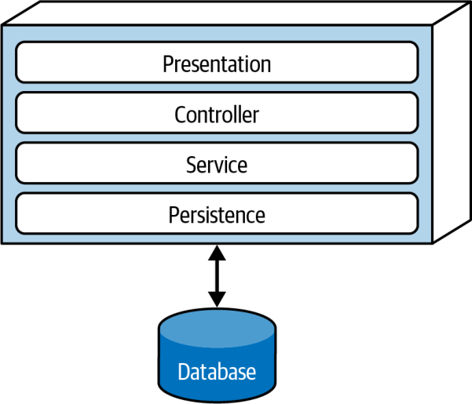

> **شکل ۶-۴.** معماری لایه‌ای.

هنگامِ طراحیِ یک تک‌پارچهٔ لایه‌ای (layered monolith) مانندِ آنچه در شکل ۶-۴ آمده است، معمار لایه‌ها را به دلایلِ خوبی تعریف می‌کند (این انگیزه‌ها، مصالحه‌ها و دیگر جنبه‌ها را در فصل ۱۰ شرح می‌دهیم). با این حال، برخی توسعه‌دهندگان ممکن است اهمیتِ این الگوها را درک نکنند و برخی دیگر، به خاطرِ دغدغه‌ای محلی و غالب مانندِ کارایی، نگرشِ «عذرخواهی بهتر از اجازه‌گرفتن است» را در پیش بگیرند. اما اگر اجازه دهیم فلسفهٔ وجودیِ معماری این‌گونه فرسوده و کم‌رنگ شود، سلامتِ بلندمدتِ معماری آسیب می‌بیند.

ArchUnit به معماران امکان می‌دهد این مسئله را با یک تابع برازش حل کنند، همان‌طور که در مثالِ ۶-۴ نشان داده شده است.

**مثال ۶-۴.** تابع برازشِ ArchUnit برای حاکمیت بر لایه‌ها

```java
layeredArchitecture()
    .layer("Controller").definedBy("..controller..")
    .layer("Service").definedBy("..service..")
    .layer("Persistence").definedBy("..persistence..")

    .whereLayer("Controller").mayNotBeAccessedByAnyLayer()
    .whereLayer("Service").mayOnlyBeAccessedByLayers("Controller")
    .whereLayer("Persistence").mayOnlyBeAccessedByLayers("Service")
```

در مثالِ ۶-۴، معمار رابطهٔ مطلوبِ میانِ لایه‌ها را تعریف می‌کند و یک تابع برازشِ وارسی برای حاکمیت بر آن می‌نویسد.

ابزارِ مشابهی به نامِ NetArchTest در دنیای .NET وجود دارد. مثالِ ۶-۵ یک وارسیِ لایه‌ها را در C# نشان می‌دهد.

**مثال ۶-۵.** NetArchTest برای وابستگی‌های میانِ لایه‌ها

```csharp
// Classes in the presentation should not directly reference repositories
var result = Types.InCurrentDomain()
    .That()
    .ResideInNamespace("NetArchTest.SampleLibrary.Presentation")
    .ShouldNot()
    .HaveDependencyOn("NetArchTest.SampleLibrary.Data")
    .GetResult()
    .IsSuccessful;
```

بحثِ ما دربارهٔ آزمون‌پذیری مشکلی را برجسته می‌کند که در هر معیار یا سنجه‌ای وجود دارد: این احتمال که توسعه‌دهندگان بکوشند سیستم را دور بزنند (game the system). وقتی بفهمند معماران انطباق را چگونه می‌سنجند، ممکن است به‌جای ساختنِ چیزِ درست، برای خودِ معیار کد بنویسند. برای نمونه، یکی از مواردِ رایجِ ناکامی در آزمون‌پذیری زمانی رخ می‌دهد که توسعه‌دهندگانِ اهلِ میان‌بُر، آزمون‌های واحد را بدونِ هیچ ادعایی (assertion) می‌نویسند. «لمس‌کردنِ» کد بدونِ وارسیِ صحتِ عملکردِ آن، چیزی جز تقلب در سنجهٔ پوششِ کد نیست. نوشتنِ کدِ حاکمیتی با ابزارهایی مانند ArchUnit به معماران کمک می‌کند با تضمینِ اینکه هر آزمونِ واحد دست‌کم یک ادعا دارد، جلوی این رفتار را بگیرند. البته قانون‌شکنانِ سرسخت همیشه راهی پیدا می‌کنند، اما توابع برازشی از این دست از لغزش‌های تصادفی جلوگیری می‌کنند.

نمونهٔ دیگری از توابع برازش «Chaos Monkey» در Netflix و Simian Army همراهِ آن است. وقتی Netflix تصمیم گرفت عملیاتِ خود را به ابرِ Amazon منتقل کند، معماران دیگر کنترلی بر عملیات نداشتند و این نگرانشان می‌کرد: اگر در محیطِ عملیاتی نقصی پدیدار شود چه خواهد شد؟ آن‌ها برای حلِ این مسئله رشتهٔ مهندسی آشوب را بنیان نهادند. Chaos Monkey در اصل نقشِ یک تابع برازشِ محیطِ تولید (production fitness function) را بازی می‌کند و آشوبِ عمومی را شبیه‌سازی می‌کند تا ببیند سیستم تا چه اندازه می‌تواند آن را تاب بیاورد. تأخیر در برخی نمونه‌های (instances) AWS مشکل‌ساز بود، پس Chaos Monkey تأخیرِ بالا را شبیه‌سازی می‌کرد. (در واقع، این مشکل آن‌قدر جدی بود که سرانجام یک Latency Monkey ویژه ساختند.) این تجربه به ساختِ ابزارهای دیگری انجامید: برای نمونه، Chaos Kong که از کار افتادنِ کاملِ یک مرکزدادهٔ Amazon را شبیه‌سازی می‌کند، به Netflix کمک کرده است هنگامِ رخ‌دادنِ واقعیِ چنین قطعی‌هایی از آن‌ها در امان بماند.

به‌طورِ ویژه، «میمون‌های» Conformity، Security و Janitor (که توابع برازش‌اند) نمونه‌های روشنی از رویکردِ حاکمیتِ خودکار (automated governance) هستند. Conformity Monkey به معمارانِ Netflix امکان می‌دهد قواعدِ حاکمیتی‌ای تعریف کنند که این میمون در محیطِ تولید اعمال می‌کند. برای نمونه، اگر تصمیم بگیرند هر سرویس باید به همهٔ درخواست‌ها بدونِ خطا پاسخ دهد، این بررسی را در Conformity Monkey می‌گنجانند. Security Monkey هر سرویس را از نظرِ نقص‌های امنیتیِ شناخته‌شده، مانندِ درگاه‌هایی که نباید فعال باشند و خطاهای پیکربندی، بررسی می‌کند.

و سرانجام، Janitor Monkey به دنبالِ نمونه‌هایی می‌گردد که دیگر هیچ سرویسی به آن‌ها مسیریابی نمی‌کند. Netflix معماریِ تکامل‌پذیر دارد، پس توسعه‌دهندگان به‌طورِ معمول به سرویس‌های جدیدتر مهاجرت می‌کنند و سرویس‌های قدیمی را بدونِ آنکه هیچ فراخواننده‌ای داشته باشند در حالِ اجرا رها می‌کنند. چون اجرای سرویس‌ها در ابر هزینه دارد، Janitor Monkey سرویس‌های یتیم (orphan services) را می‌یابد و آن‌ها را از محیطِ تولید برمی‌چیند.

مهندسی آشوب دیدگاهِ تازه و جالبی به معماری عرضه می‌کند: پرسش این نیست که آیا چیزی سرانجام از کار می‌افتد، بلکه این است که کِی. پیش‌بینیِ این خرابی‌ها و آزمودنِ سیستم برای پیشگیری از آن‌ها، سیستم‌ها را بسیار استوارتر می‌کند. کتابی از دو تن از نوآورانِ Netflix، Casey Rosenthal و Nora Jones، با عنوانِ Chaos Engineering (O’Reilly، ۲۰۲۰) این رویکرد را برجسته می‌کند.

کتابِ اثرگذارِ Atul Gawande با عنوانِ The Checklist Manifesto (Metropolitan، ۲۰۰۹) شرح می‌دهد که حرفه‌ای‌هایی مانندِ خلبانانِ هواپیما و جراحان چگونه از فهرست‌های وارسی (checklists) استفاده می‌کنند. (گاهی حتی قانون آن‌ها را به این کار ملزم می‌کند.) این از آن رو نیست که این حرفه‌ای‌ها کارشان را بلد نیستند یا فراموش‌کارند. بلکه وقتی حرفه‌ای‌ها کاری بسیار پرجزئیات را بارها و بارها انجام می‌دهند، به‌آسانی جزئیاتی از دستشان درمی‌رود؛ یک فهرستِ وارسیِ موجز یادآورِ اثربخشی است.

این همان دیدگاهِ درست به توابع برازش است: آن‌ها سازوکارِ حاکمیتیِ سنگین‌وزنی نیستند، بلکه سازوکاری‌اند که معماران با آن اصولِ مهمِ معماری را بیان و به‌طورِ خودکار وارسی می‌کنند. توسعه‌دهندگان می‌دانند که نباید کدِ ناامن منتشر کنند، اما این دغدغه با ده‌ها یا صدها اولویتِ دیگر رقابت می‌کند. ابزارهایی مانند Security Monkey، و به‌طورِ کلی توابع برازش، به معماران امکان می‌دهند بررسی‌های حاکمیتیِ مهم را در بسترِ (substrate) خودِ معماری بگنجانند.

---

## واژه‌نامهٔ اختصاصی این فصل

| واژهٔ انگلیسی | معادل مصوب/به‌کاررفته در این فصل |
|---|---|
| Measure | سنجه |
| Operational Measures | سنجه‌های عملیاتی |
| Structural Measures | سنجه‌های ساختاری |
| Average Response Time | میانگین زمان پاسخ |
| Boundary Condition | شرط مرزی |
| Outlier | دادهٔ پرت |
| Performance Budget | بودجهٔ کارایی |
| First Contentful Paint | نخستین رنگ‌آمیزی محتوایی |
| First CPU Idle | نخستین بیکاری CPU |
| First-Page Render | نخستین رندر صفحه |
| K-weight Budget | بودجهٔ وزن کیلوبایتی |
| Graph Theory | نظریهٔ گراف |
| Decision Point | نقطهٔ تصمیم |
| Node (graph) | گره |
| Edge (graph) | یال |
| Fan-out Call | فراخوانی انشعابی |
| Connected Components | مؤلفه‌های همبند |
| Brute Force | زور خام |
| Threshold | آستانه |
| Well-factored | خوش‌تجزیه |
| Code Coverage | پوشش کد |
| Test-Driven Development (TDD) | توسعهٔ آزمون‌محور (TDD) |
| Process Measures | سنجه‌های فرایندی |
| Assertion (testing) | ادعا |
| Fitness Function | تابع برازش |
| Architectural Fitness Function | تابع برازش معماری |
| Continuous Integration (CI) | یکپارچه‌سازی مداوم (CI) |
| Evolutionary Computing | محاسبات تکاملی |
| Genetic Algorithm | الگوریتم ژنتیک |
| Object (Objective) Function | تابع هدف |
| Traveling Salesperson Problem | مسئلهٔ فروشندهٔ دوره‌گرد |
| Evolutionary Architecture | معماری تکامل‌پذیر |
| Chaos Engineering | مهندسی آشوب |
| Monitor | پایشگر |
| Unit Testing Library | کتابخانهٔ آزمون واحد |
| Cyclic Dependencies (antipattern) | وابستگی‌های چرخه‌ای |
| Import / Auto-import | درون‌بُرد / درون‌بُرد خودکار |
| Big Ball of Mud (antipattern) | توپِ بزرگِ گِل |
| Continuous Build | ساخت مداوم |
| Layered Monolith | تک‌پارچهٔ لایه‌ای |
| Game the System | دور زدن سیستم |
| Production Fitness Function | تابع برازش محیط تولید |
| Instance (cloud) | نمونه |
| Automated Governance | حاکمیت خودکار |
| Orphan Service | سرویس یتیم |
| Checklist | فهرست وارسی |
| Substrate (of the architecture) | بستر (معماری) |

---

<a id="chapter-07"></a>

# فصل ۷: دامنهٔ ویژگی‌های معماری

تفکرِ معمارانِ نرم‌افزار باید هم‌پای اکوسیستمِ ما تکامل یابد و این ضرورت در هیچ جا آشکارتر از تعیینِ دامنهٔ (scope) ویژگی‌های معماری نیست. بسیاری از چارچوب‌های منسوخ برای تعیینِ ویژگی‌های معماری نقصی مهلک داشتند: فرض می‌کردند که کلِ سیستم تنها یک مجموعه ویژگی معماری دارد. هرچند این فرض گاهی هنوز درست است، بسیاری از معماری‌های مدرن، مانند میکروسرویس‌ها، در سطحِ سرویس و در سطحِ سیستم ویژگی‌های معماریِ متفاوتی دارند.

دامنهٔ ویژگی‌های معماری سنجه‌ای سودمند برای معماران است، به‌ویژه برای تعیینِ مناسب‌ترین سبکِ معماری به‌عنوانِ نقطهٔ آغازِ پیاده‌سازی. هنگامِ نوشتنِ کتابِ Building Evolutionary Architectures، به تکنیکی نیاز داشتیم تا تکامل‌پذیریِ ساختاریِ (structural evolvability) سبک‌های معماریِ مشخص را بسنجیم. هیچ‌یک از سنجه‌های موجود سطحِ جزئیاتِ درستی نداشت. بخشِ «سنجه‌های ساختاری» در صفحهٔ ۸۳ به معیارهای گوناگونی در سطحِ کد می‌پردازد که به معماران امکان می‌دهند جنبه‌های ساختاریِ یک معماری را تحلیل کنند؛ اما هیچ‌یک از این معیارها دامنه را بازتاب نمی‌دهد. این معیارها جزئیاتِ سطحِ پایینِ کد را آشکار می‌کنند، اما نمی‌توانند مؤلفه‌های وابسته‌ای را که بیرون از پایگاه کد قرار دارند (مانند پایگاه‌های داده) و بر بسیاری از ویژگی‌های معماری، به‌ویژه ویژگی‌های عملیاتی، اثر می‌گذارند ارزیابی کنند. معمار هر قدر هم برای طراحیِ پایگاه کدی با کارایی بالا یا کشسان تلاش کند، اگر پایگاه‌دادهٔ سیستم با این ویژگی‌ها هماهنگ نباشد، تلاشش به نتیجه نمی‌رسد.

چون سنجهٔ خوبی برای دامنه نیافتیم، خودمان سنجه‌ای ساختیم. نامش را کوانتوم معماری (architecture quantum) گذاشته‌ایم.

---

## کوانتوم‌های معماری و دانه‌بندی

کوپلینگ در سطحِ مؤلفه تنها چیزی نیست که اجزای نرم‌افزار را به هم پیوند می‌دهد. بسیاری از مفاهیمِ کسب‌وکار بخش‌هایی از سیستم را از نظرِ معنایی به هم پیوند می‌دهند و انسجام کارکردی پدید می‌آورند. معماران و توسعه‌دهندگان برای طراحی، تحلیل و تکاملِ موفقِ نرم‌افزار باید همهٔ نقاط کوپلینگ (coupling points) را که ممکن است دچار شکست شوند در نظر بگیرند.

> **جمعِ اصطلاحاتِ فنیِ لاتینی‌تبار**
>
> واژهٔ quantum ریشهٔ لاتینی دارد و از این رو صورتِ جمعِ آن به a ختم می‌شود. اگر بیش از یک quantum داشته باشید، quanta دارید؛ درست مانندِ واژهٔ رایج‌ترِ data که آن هم لاتینی‌تبار است. معماران به‌ندرت از یک datum به‌تنهایی سخن می‌گویند. راهنمای کاربردِ زبانِ Chicago Manual of Style می‌گوید: «اگرچه این واژه در اصل جمعِ datum بود، امروزه معمولاً اسمِ غیرشمارش‌پذیر (mass noun) به شمار می‌آید و با فعلِ مفرد به کار می‌رود» (ویراستِ هجدهم، ۲۰۲۴، ص. ۳۳۶). (در این ترجمه، صورتِ جمعِ فارسیِ «کوانتوم‌ها» را به کار می‌بریم.)

بسیاری از معمارانِ آشنا با علم مفهومِ کوانتوم را از فیزیک می‌شناسند؛ جایی که به کوچک‌ترین مقدارِ ممکن از چیزی، معمولاً انرژی، اشاره دارد. واژهٔ quantum از لاتین می‌آید و به معنای «چه اندازه بزرگ» یا «چه مقدار» است. این واژه در کاربردِ عمومی معمولاً به معنای «چیزی کوچک و بخش‌ناپذیر (تجزیه‌ناپذیر)» است و ما کوانتوم معماری را نیز به همین معنا تعریف می‌کنیم. تعریفِ غیررسمیِ رایجِ دیگری از کوانتوم معماری این است: «کوچک‌ترین بخشِ سیستم که به‌طورِ مستقل اجرا می‌شود.» برای نمونه، میکروسرویس‌ها اغلب کوانتوم‌های معماری را تشکیل می‌دهند و این موضوع به‌خوبی همین تعریف را نشان می‌دهد: یک سرویس می‌تواند، همراه با داده‌ها و دیگر وابستگی‌های خودش، به‌طورِ مستقل درونِ معماری اجرا شود.

کوانتوم معماری دامنهٔ مجموعه‌ای از ویژگی‌های معماری را تعیین می‌کند. ویژگی‌های آن عبارت‌اند از:

- استقرارِ مستقل از دیگر بخش‌های معماری
- انسجام کارکردیِ بالا
- کوپلینگِ ایستای پیاده‌سازیِ بیرونیِ پایین
- ارتباطِ هم‌گام (synchronous communication) با دیگر کوانتوم‌ها

این تعریف چند بخش دارد. بیایید آن‌ها را یکی‌یکی باز کنیم:

**دامنهٔ مجموعه‌ای از ویژگی‌های معماری را تعیین می‌کند:** معماران کوانتوم معماری را به‌عنوانِ مرزی به کار می‌برند که مجموعه‌ای از ویژگی‌های معماری، به‌ویژه ویژگی‌های عملیاتی، را مشخص می‌کند. کوانتوم معماری چون به‌طورِ مستقل استقرارپذیر است و انسجام کارکردیِ بالایی دارد (که در ادامه به آن می‌پردازیم)، سنجهٔ سودمندی برای ماژولاریتیِ معماری فراهم می‌کند.

**به‌طورِ مستقل استقرارپذیر (independently deployable):** کوانتوم معماری همهٔ مؤلفه‌های لازم برای کارکردِ مستقل از دیگر بخش‌های معماری را در بر دارد. برای نمونه، اگر برنامه‌ای از یک پایگاه‌داده استفاده کند، آن پایگاه‌داده بخشی از کوانتوم است، چون سیستم بدونِ آن کار نمی‌کند. این الزام به آن معناست که تقریباً همهٔ سیستم‌های میراثی (legacy systems) که با یک پایگاه‌دادهٔ واحد مستقر می‌شوند، بنا به تعریف، یک کوانتوم واحد تشکیل می‌دهند. اما در سبکِ معماریِ میکروسرویس‌ها، هر سرویس پایگاه‌دادهٔ خودش را دارد (که بخشی از فلسفهٔ هدایت‌گرِ زمینهٔ محدود است و در فصل ۱۸ به‌تفصیل شرح داده می‌شود). این امر چندین کوانتوم درونِ آن معماری پدید می‌آورد، چون هر سرویس دامنهٔ ویژگی‌های معماریِ خودش را دارد.

**انسجام کارکردیِ بالا:** انسجام در طراحیِ مؤلفه به این اشاره دارد که کدِ درونِ آن تا چه اندازه در هدفش یکپارچه است. برای نمونه، مؤلفهٔ `Customer` که همهٔ ویژگی‌ها و متدهایش به موجودیتِ Customer مربوط‌اند، انسجامِ بالایی دارد. مؤلفهٔ `Utility` با مجموعه‌ای تصادفی از متدهای متفرقه چنین انسجامی ندارد. انسجام کارکردیِ بالا یعنی کوانتوم معماری کاری هدفمند انجام می‌دهد. این تمایز در برنامه‌های تک‌پارچهٔ سنتی با یک پایگاه‌دادهٔ واحد، که انسجام در عمل کلِ سیستم را در بر می‌گیرد، اهمیتِ چندانی ندارد. اما در معماری‌های توزیع‌شده‌ای مانند معماری‌های رویدادمحور (event-driven) یا میکروسرویس‌ها، معماران بیشتر هر سرویس را چنان طراحی می‌کنند که با یک گردش‌کارِ واحد (یک زمینهٔ محدود، آن‌گونه که در «زمینهٔ محدود در طراحی حوزه‌محور» شرح داده شده) مطابقت داشته باشد؛ در نتیجه آن سرویس انسجام کارکردیِ بالایی خواهد داشت.

> **زمینهٔ محدود در طراحی حوزه‌محور**
>
> کتابِ Domain-Driven Design نوشتهٔ Eric Evans (Addison-Wesley Professional، ۲۰۰۳) اثرِ ژرفی بر تفکرِ معماریِ مدرن گذاشته است. طراحی حوزه‌محور (DDD) یک تکنیکِ مدل‌سازی است که به معماران امکان می‌دهد حوزه‌های مسئلهٔ پیچیده را به‌شکلی سازمان‌یافته تجزیه کنند. DDD مفهومِ زمینهٔ محدود را تعریف می‌کند: محدوده‌ای که در آن هر چیزی مربوط به بخشی از حوزه، از درون قابل مشاهده و شفاف است، اما از دیدِ دیگر زمینه‌های محدود مات و پنهان می‌ماند.
>
> پیش از DDD، معماران می‌کوشیدند کد را به‌طورِ یکپارچه میانِ موجودیت‌های مشترک در سراسرِ سازمان بازاستفاده کنند. اما دریافتند که ساختنِ مصنوعاتِ مشترک انبوهی از مشکلات پدید می‌آورد؛ مانندِ کوپلینگِ تنگاتنگ، هماهنگیِ دشوارتر و پیچیدگیِ بیشتر. مفهومِ زمینهٔ محدود می‌پذیرد که هر موجودیت در یک زمینهٔ محلی بهترین کارکرد را دارد. از این رو، به‌جای ساختنِ یک کلاسِ `Customer` یکپارچه در سراسرِ سازمان، هر حوزهٔ مسئله می‌تواند کلاسِ `Customer` خودش را بسازد و تفاوت‌ها را در نقاط ارتباطی با دیگر حوزه‌ها تطبیق دهد و حل‌وفصل کند.

برای روشن‌شدنِ بخش‌های بعدیِ تعریف، باید میانِ انواعِ کوپلینگ تمایزهای دقیق‌تری بگذاریم:

**کوپلینگِ معنایی (semantic coupling):** کوپلینگِ معنایی کوپلینگِ طبیعیِ مسئله‌ای را توصیف می‌کند که معمار برایش راه‌حل می‌سازد. برای نمونه، کوپلینگِ ذاتیِ یک برنامهٔ پردازشِ سفارش چیزهایی مانند موجودیِ انبار، کاتالوگ‌ها، سبدهای خرید، مشتریان و فروش را در بر می‌گیرد. ماهیتِ مسئله‌ای که انگیزهٔ ساختِ یک راه‌حلِ نرم‌افزاری است، این کوپلینگ را تعریف می‌کند. معماران تکنیک‌های اندکی دارند که جلوی موج‌وار گسترش‌یافتنِ تغییراتِ حوزه در سراسرِ سیستم را بگیرد: تغییر در حوزه (و در نتیجه در معنا) یعنی الزاماتِ سیستم را تغییر می‌دهیم. هرچند معماران می‌توانند خود را با این وضع سازگار کنند، هیچ الگوی معماریِ جادویی‌ای نمی‌تواند مانع شود که تغییرِ مسئلهٔ اصلی بر معماری اثر بگذارد.

**کوپلینگِ پیاده‌سازی (implementation coupling):** کوپلینگِ پیاده‌سازی توصیف می‌کند که معمار و تیم چگونه تصمیم می‌گیرند وابستگی‌های مشخصی را پیاده کنند. در یک برنامهٔ پردازشِ سفارش، تیم باید برای تعیینِ مرزهای حوزه محدودیت‌های گوناگونی را در نظر بگیرد. برای نمونه، آیا همهٔ داده‌ها باید در یک پایگاه‌دادهٔ واحد قرار گیرند، یا بخشی از آن‌ها برای مقیاس‌پذیری یا در دسترس‌بودنِ بهتر جدا شوند؟ آیا باید یک سیستمِ تک‌پارچه بسازیم یا یک معماری توزیع‌شده؟ پاسخ به این پرسش‌ها اثرِ اندکی بر کوپلینگِ معناییِ سیستم دارد، اما بر تصمیمات معماری اثرِ زیادی می‌گذارد.

**کوپلینگِ ایستا (static coupling):** کوپلینگِ ایستا به «سیم‌کشیِ» یک معماری اشاره دارد؛ یعنی اینکه سرویس‌ها چگونه به یکدیگر وابسته‌اند. دو سرویس اگر هر دو به یک نقطهٔ کوپلینگِ یکسان وابسته باشند، بخشی از یک کوانتوم معماریِ واحدند. برای نمونه، فرض کنید دو میکروسرویس، `Catalog` و `Shipping`، باید اطلاعاتِ نشانی را با هم به اشتراک بگذارند و از این رو هر دو به یک مؤلفهٔ مشترک وابستگی پیدا می‌کنند. چون هر دو سرویس به آن وابستگی کوپل شده‌اند، بخشی از یک کوانتوم معماریِ واحدند.

راهی ساده برای اندیشیدن به کوپلینگ در معماری نرم‌افزار این است: دو چیز با هم کوپل‌اند اگر تغییرِ یکی ممکن است دیگری را بشکند. کوپلینگِ ایستا دامنهٔ وابستگی‌ها را در یک معماری تعریف می‌کند. برای نمونه، اگر چند سرویس از یک پایگاه‌دادهٔ رابطه‌ایِ یکسان استفاده کنند، بخشی از یک کوانتوم‌اند.

**کوپلینگِ پویا (dynamic coupling):** کوپلینگِ پویا نیروهایی را توصیف می‌کند که وقتی کوانتوم‌های معماری باید با یکدیگر ارتباط برقرار کنند، در کارند. برای نمونه، وقتی دو سرویس در حالِ اجرا هستند، باید با هم ارتباط برقرار کنند تا گردش‌کارها را شکل دهند و وظایفی را درونِ سیستم انجام دهند. معماران هنگامِ برقراریِ ارتباط میانِ سرویس‌ها در یک معماری توزیع‌شده باید مصالحه‌ها را در نظر بگیرند؛ موضوعی که در فصل ۱۵ به‌تفصیل بررسی می‌شود.

با در دست داشتنِ این تعریف‌ها، می‌توانیم تعریفِ کوانتوم معماری را کامل کنیم:

**کوپلینگِ ایستای پیاده‌سازیِ بیرونیِ پایین:** سطحِ کوپلینگِ پیاده‌سازی میانِ کوانتوم‌های معماری باید پایین باشد. این ویژگی نیز از فلسفهٔ DDD دربارهٔ کوپلینگِ پایین میانِ زمینه‌های محدود سرچشمه می‌گیرد. کوانتوم‌ها بلوک‌های سازندهٔ عملیاتیِ معماری‌اند که یک سطحِ انتزاع بالاتر از مؤلفه‌ها قرار دارند. این کوانتوم‌ها اغلب با مرزهای سرویس‌ها هم‌پوشانی دارند. این هدف ترجیحِ کلیِ معماران به کوپلینگِ سست (loose coupling) میانِ بخش‌های مختلفِ معماری را بازتاب می‌دهد.

به‌طورِ کلی، کوپلینگِ تنگاتنگ (tight coupling) زمانی مطلوب است که انسجامِ بالا لازم باشد، مانندِ درونِ یک سرویس یا زیرسیستم. معماری‌ای را «شکننده» می‌نامیم که یک تغییرِ واحد در پیاده‌سازی بتواند در آن اثراتِ جانبیِ موج‌وار و غیرمنتظره‌ای پدید آورد که بسیاری از بخش‌های دیگر را (که ظاهراً بی‌ربط‌اند) دچار شکست کند. هرچه دامنهٔ کوپلینگِ سیستم گسترده‌تر باشد، کوپلینگِ سست بیشتر کمک می‌کند معماری کمتر شکننده باشد. برای نمونه، معمار ممکن است نامِ یک فیلد را در فراخوانیِ یک سرویس از `State` به `StateCode` تغییر دهد، به گمانِ آنکه فقط یک فراخواننده را تحتِ تأثیر قرار می‌دهد؛ اما ناگهان کشف کند که وابستگی‌های بسیارِ دیگری به‌طورِ غیرمنتظره شکسته‌اند.

> **نکته:** در دامنه‌های محدودتر کوپلینگِ بالاتر مجاز است؛ هرچه دامنه گسترده‌تر باشد، کوپلینگ باید سست‌تر باشد.

---

## ارتباط هم‌گام

ارتباط به کوپلینگ پویا اشاره دارد؛ یعنی زمانی که کوانتوم‌های معماری یکدیگر را فراخوانی می‌کنند، که در معماری‌های توزیع‌شده رایج است. این موضوع به‌ویژه به خانوادهٔ ویژگی‌های عملیاتیِ معماری مربوط است که در بخشِ «ویژگی‌های عملیاتیِ معماری» در صفحهٔ ۵۹ شرح داده شدند، زیرا این ویژگی‌ها اغلب زمان‌بندی و مسدودشدن‌های مهم را در معماری‌های توزیع‌شده تعیین می‌کنند.

برای نمونه، یک معماری میکروسرویس‌ها را با یک سرویسِ Payment و یک سرویسِ Auction در نظر بگیرید. وقتی یک حراج به پایان می‌رسد، سرویسِ Auction اطلاعاتِ پرداخت را به‌طورِ هم‌گام برای سرویسِ Payment می‌فرستد. اما فرض کنید سرویسِ Payment فقط می‌تواند هر ۵۰۰ میلی‌ثانیه یک پرداخت را پردازش کند. وقتی شمارِ زیادی از حراج‌ها هم‌زمان پایان یابند، چه رخ می‌دهد؟ این دو سرویس ویژگی‌های عملیاتیِ معماریِ متفاوتی دارند. نخستین فراخوانی موفق خواهد بود، اما پس از آن فراخوانی‌ها یکی پس از دیگری شکست می‌خورند، چون سرویسِ Payment از پسِ این شمار درخواست برنمی‌آید؛ مقیاس‌پذیریِ آن به اندازهٔ سرویسِ Auction نیست.

اینجا به‌طورِ خاص ارتباطِ هم‌گام را برجسته می‌کنیم، زیرا ارتباطِ ناهم‌گام (asynchronous communication) اثرِ بالقوهٔ کمتری دارد. برای نمونه، اگر سرویسِ Auction سرویسِ Payment را به‌طورِ ناهم‌گام و با استفاده از یک صفِ پیام (message queue) فراخوانی کند، صف می‌تواند نقشِ میانگیر (buffer) را بازی کند و به هر دو سیستم امکانِ کار بدهد. البته اگر سرویسِ Auction پیوسته بیش از ظرفیتِ Payment پیام بفرستد، سرانجام صفِ پیام سرریز می‌شود. اما وقتی سیلِ پیام‌ها به‌صورتِ رگباری و مقطعی سرازیر می‌شود، صف می‌تواند پیام‌های معوق را تا زمانی که گیرنده آماده شود نگه دارد. ارتباطِ هم‌گام در معماری‌های توزیع‌شده بسیار انعطاف‌ناپذیر و کم‌تحمل (بی‌گذشت) است، به‌ویژه اگر بخش‌های مختلفِ معماری ویژگی‌های معماریِ متفاوتی داشته باشند. فصل ۱۵ انواعِ ارتباط در معماری‌های رویدادمحور را به‌طورِ کامل بررسی می‌کند.

مفهومِ کوانتوم معماری شیوهٔ تازه‌ای برای اندیشیدن به دامنه فراهم می‌کند. در سیستم‌های مدرن، معماران ویژگی‌های معماری را به‌جای سطحِ سیستم در سطحِ کوانتوم تعریف می‌کنند. این رویکرد هنگامِ تحلیلِ یک حوزهٔ مسئلهٔ جدید اطلاعاتِ مهمی به دست می‌دهد.

---

## اثرِ دامنه‌گذاری (Scoping)

معماران می‌توانند از دامنهٔ ویژگی‌های معماری برای تعیینِ مرزهای مناسبِ سرویس‌ها کمک بگیرند. تصویرِ کلیِ این فرایند در درختِ تصمیمِ (decision tree) شکل ۷-۱ آمده و در گام‌های بعدی با جزئیاتِ بیشتر شرح داده می‌شود.

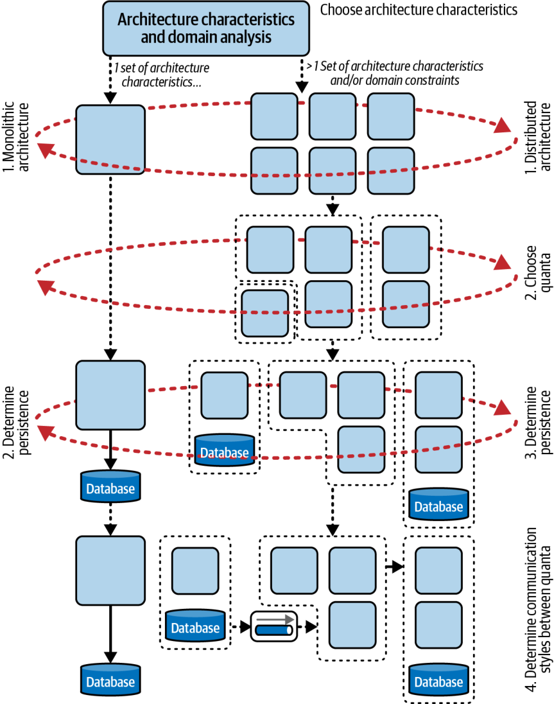

> **شکل ۷-۱.** درخت تصمیمی که از دامنهٔ ویژگی‌های معماری برای کمک به تعیینِ سبکِ معماری استفاده می‌کند

### دامنه‌گذاری و سبکِ معماری

تعیینِ مرزهای کوانتومیِ حوزهٔ مسئله به انتخابِ سبکِ معماری کمک می‌کند: آیا معماری تک‌پارچه مناسب‌تر است یا معماری توزیع‌شده؟ بخشِ نخستِ نمودارِ تصمیمِ نشان‌داده‌شده در شکل ۷-۲ را در نظر بگیرید.

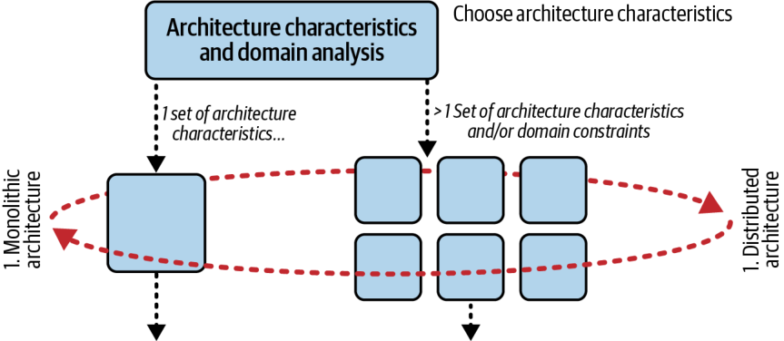

> **شکل ۷-۲.** انتخابِ سبکِ معماریِ مناسب بر پایهٔ ویژگی‌های معماری

همان‌گونه که در فصل ۴ گفتیم، معماران باید ویژگی‌های معماری و حوزه را تحلیل کنند تا مناسب‌ترین سبکِ معماری را تعیین کنند. بخشی از این تحلیل به این پرسش مربوط است که آیا راه‌حل به چند گروه ویژگی معماری نیاز دارد یا نه. در گامِ نخستِ شکل ۷-۲، معمار تعیین می‌کند که آیا سیستم می‌تواند با یک مجموعهٔ واحد از ویژگی‌های معماری موفق شود یا به بیش از یک گروه نیاز است (برای یک نمونه، بخشِ «کاتا: Going Green» در صفحهٔ ۱۰۳ را ببینید).

اگر معمار به این نتیجه برسد که یک مجموعهٔ واحد از ویژگی‌های معماری کافی است، می‌تواند معماری تک‌پارچه را برگزیند و از شمارِ انتخاب‌های بعدی بکاهد. اگر معماری توزیع‌شده را برگزیند، گامِ بعدی تعیینِ مرزهای کوانتومیِ آن است؛ چنان‌که در شکل ۷-۳ نشان داده شده است.

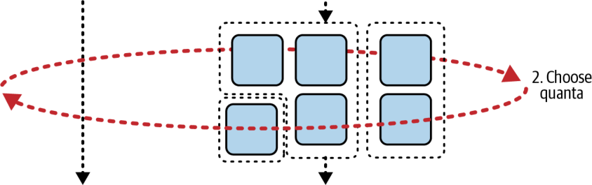

> **شکل ۷-۳.** در معماری‌های توزیع‌شده، معماران باید مرزهای کوانتومیِ مناسب را برگزینند

در فصل ۱۸ رهنمودهایی برای تعیینِ دانه‌بندی ارائه می‌کنیم. گامِ بعدی انتخابِ سازوکارِ ماندگاری (persistence mechanism) است که به هر دو خانوادهٔ معماری مربوط می‌شود و در شکل ۷-۴ نشان داده شده است.

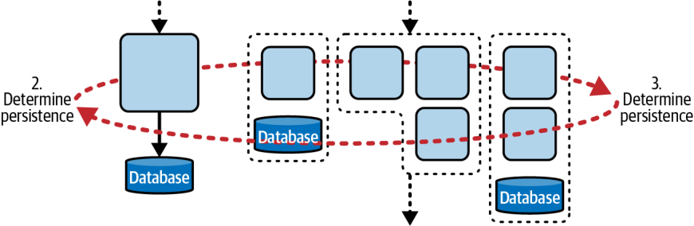

> **شکل ۷-۴.** هر دو سبکِ معماری عموماً به نوعی ماندگاری نیاز دارند

برای معماری‌های تک‌پارچه، یک پایگاه‌دادهٔ تک‌پارچهٔ واحد عموماً مناسب است. معماری و پایگاه‌داده هم‌گام و پابه‌پای هم توسعه و استقرار می‌یابند. فرایند در همین‌جا کامل می‌شود و معمار می‌تواند به انتخابِ مناسب‌ترین سبکِ تک‌پارچه بپردازد.

در مقابل، معماری‌های توزیع‌شده می‌توانند از یک پایگاه‌دادهٔ واحد استفاده کنند (که در معماری‌های رویدادمحور رایج است) یا داده‌ها را در امتدادِ مرزهای دانه‌بندیِ سرویس‌ها افراز کنند (مانندِ معماری‌های میکروسرویس‌ها). یک گامِ دیگر باقی می‌ماند: تعیینِ اینکه میانِ کوانتوم‌ها از چه نوع ارتباطی، هم‌گام یا ناهم‌گام، استفاده شود. (این پرسش را در فصل ۱۵ به‌تفصیل بررسی می‌کنیم.) به یاد داشته باشید که در برخی سیستم‌ها، انتخابِ ارتباطِ هم‌گام می‌تواند مرزهای کوانتومی‌ای را که کوپلینگ ایستا تعیین کرده است تغییر دهد؛ این دو نوع کوپلینگ پیوسته بر یکدیگر اثر می‌گذارند.

### کاتا: Going Green

بیایید با به‌کارگیریِ کوانتوم معماری به‌عنوانِ دامنهٔ ویژگی‌های معماری، مسئله‌ای را تحلیل کنیم. این مسئله، با نامِ Going Green، در شکل ۷-۵ نشان داده شده است.

شما با Going Green (GG) کار می‌کنید؛ کسب‌وکاری که لوازمِ الکترونیکیِ کهنه، مانند تلفن‌های همراه، را بازیافت می‌کند و دوباره می‌فروشد. سیستمِ آن هم از کیوسک‌های (kiosks) عمومی و هم از یک وب‌سایت استفاده می‌کند که همگی سیستمِ واحدی را اجرا می‌کنند. کاربر می‌تواند شمارهٔ مدل و وضعیتِ دستگاهش را وارد کند و GG برای آن قیمت پیشنهاد می‌دهد. اگر کاربر پیشنهاد را بپذیرد، می‌تواند دستگاه را در کیوسک تحویل دهد؛ یا اگر از راهِ وب‌سایت اقدام کند، GG جعبه‌ای برایش می‌فرستد تا دستگاه را با پست ارسال کند. GG پس از دریافتِ دستگاه، آن را ارزیابی می‌کند و مبلغ را به کاربر می‌پردازد. سپس ارزشِ دستگاه را برآورد می‌کند و آن را یا بازیافت می‌کند یا دوباره می‌فروشد. سیستمِ GG افزون بر این، گزارش‌ها و دیگر تحلیل‌ها را نیز تولید می‌کند.

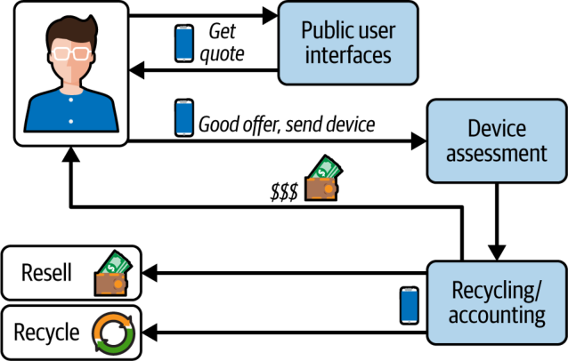

> **شکل ۷-۵.** نمای کلیِ الزاماتِ Going Green

هنگامِ انجامِ تحلیلِ ویژگی‌های معماری، متوجه می‌شوید که سه خوشهٔ متمایز شکل می‌گیرد؛ چنان‌که در شکل ۷-۶ نشان داده شده است.

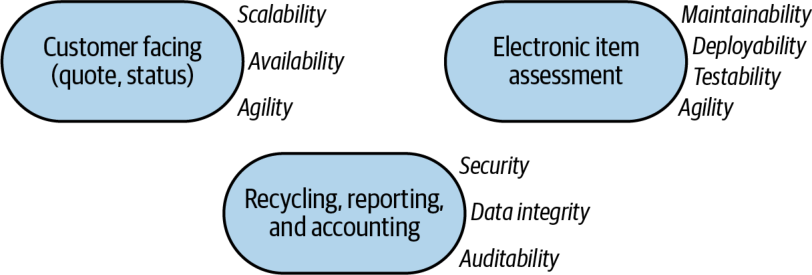

> **شکل ۷-۶.** تحلیلِ ویژگی‌های معماریِ GG به سه خوشه از قابلیت‌ها می‌رسد

بخش‌های روبه‌عمومِ (public-facing) برنامه به مقیاس‌پذیری، در دسترس‌بودن و چابکی نیاز دارند؛ کارکردهای پشتیبانیِ اداری (back-office) به امنیت، یکپارچگی داده و ممیزی‌پذیری نیاز دارند؛ و بخشِ ارزیابی به قابلیت نگهداری، استقرارپذیری و آزمون‌پذیری نیاز دارد (که روی هم ویژگی معماری مرکبِ چابکی را می‌سازند). چرا بخشِ ارزیابی به مجموعهٔ جداگانه‌ای از ویژگی‌های معماری نیاز دارد؟ این نمونهٔ خوبی است از اینکه محرک‌های کسب‌وکار چگونه با دغدغه‌های معماری تلاقی می‌کنند. مدلِ کسب‌وکارِ GG بر فروشِ دوبارهٔ پرارزش‌ترین لوازمِ الکترونیکیِ دست‌دوم تکیه دارد و مدل‌های جدید پیوسته به بازار می‌آیند. هرچه GG بتواند ارزیابی‌های دستگاه‌هایش را سریع‌تر به‌روز کند، دستگاه‌های جدیدتر (و در نتیجه باارزش‌تری) برای فروشِ دوباره به دست می‌آورد.

آیا می‌توانید سیستمی طراحی کنید که همهٔ این ملاک‌ها را برآورده کند: مقیاس‌پذیری، در دسترس‌بودن، امنیت، یکپارچگی داده، ممیزی‌پذیری، قابلیت نگهداری، استقرارپذیری و آزمون‌پذیری؟ ممکن است… اما دشوار خواهد بود. این ویژگی‌های معماری اغلب اثرِ یکدیگر را خنثی می‌کنند: برای نمونه، دستیابی به استقرارپذیریِ سریع وقتی هم‌زمان دغدغه‌های پشتیبانیِ اداری مانندِ ممیزی‌پذیری را در اولویت گذاشته‌اید دشوارتر است. رابط کاربری نیز به سطحی از مقیاس‌پذیری نیاز دارد که با دیگر بخش‌های سیستم تفاوتِ چشمگیری دارد.

به‌جای آنکه بکوشید همه‌چیز را با هم به دست آورید، می‌توانید خوشه‌های ویژگی‌های معماری را راهنمای جداسازیِ کوانتوم‌ها قرار دهید. در شکل ۷-۷، خط‌چین‌ها هر کوانتوم معماری را نشان می‌دهند. به‌کارگیریِ دامنهٔ ویژگی‌ها به‌عنوانِ راهنمای دانه‌بندیِ سرویس‌ها گامِ نخستِ خوبی در تعیینِ سودمندترین مجموعهٔ مصالحه‌هاست. (این موضوع را در فصل ۱۸ بیشتر بررسی می‌کنیم.)

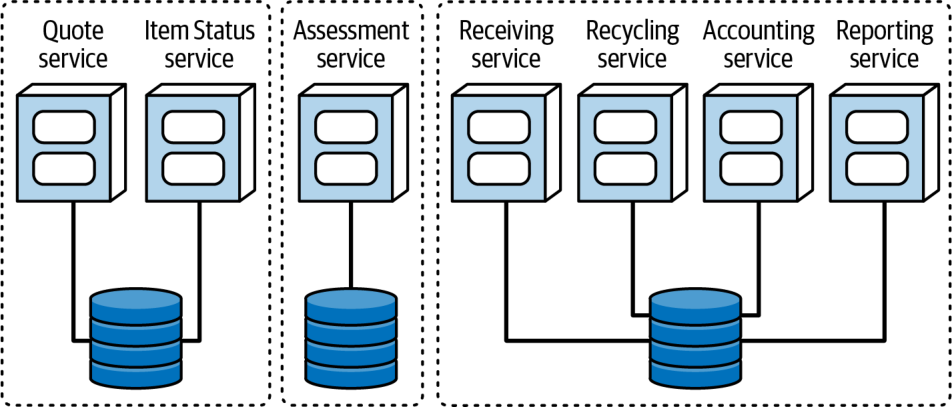

> **شکل ۷-۷.** این معماریِ GG هر مجموعه از ویژگی‌های معماری را در قالبِ یک مرزِ معماری جای می‌دهد

---

## دامنه‌گذاری و ابر

منابعِ مبتنی بر ابر تصویر را پیچیده‌تر می‌کنند، زیرا بسیاری از ویژگی‌های عملیاتیِ معماریِ سیستم را در خود کپسوله می‌کنند. معماران هنگامِ استفاده از منابعِ مبتنی بر ابر برای تمام یا بخشی از یک برنامه، بسته به مدلِ استقرار، دست‌کم باید دو سناریو را در نظر بگیرند:

**استفاده از ابر برای میزبانیِ کانتینرها (containers):** بسیاری از تیم‌های توسعه ابر را به‌عنوانِ مرکزدادهٔ جایگزین به کار می‌برند و کانتینرهای سرورها را در آن اجرا (و ارکستراسیون) می‌کنند. در چنین وضعیت‌هایی، معماران باید ویژگی‌های معماریِ کانتینرها و محدودیت‌هایی را که ابزارِ ارکستراسیون (برای نمونه، Kubernetes) تحمیل می‌کند در نظر بگیرند.

**استفاده از منابعِ ارائه‌دهندهٔ ابر (cloud provider) به‌عنوانِ مؤلفه‌های سیستم:** گونهٔ دیگری از سیستم‌های مبتنی بر ابر برنامه‌ها را با کنار هم گذاشتنِ بلوک‌های سازندهٔ ارائه‌دهندهٔ ابر، مانندِ توابعِ رویدادانگیخته (triggered functions)، پایگاه‌های داده و مانندِ آن، سرهم می‌کند. در این حالت، معماران باید قابلیت‌هایی را که ارائه‌دهنده اعلام می‌کند (و امیدواریم پایبندشان بماند) بررسی کنند تا دریابند چگونه قابلیت‌های مناسبی برای آن زمینهٔ خاص بسازند.

بسیاری از قابلیت‌هایی که امروز آن‌ها را تنظیماتِ پیکربندیِ ارائه‌دهندگانِ ابر می‌شناسیم، مانند کشسانی، با تلاش و مرارتِ فراوان توسطِ نسلِ پیشینِ معمارانی به دست آمده‌اند که روی سیستم‌های فیزیکی کار می‌کردند. دغدغه‌های اصلیِ آنان اکنون آسان‌تر شده است؛ اما ما مجموعهٔ مصالحه‌های مدرنِ خودمان را داریم، مانندِ در دسترس‌بودنِ ارائه‌دهنده و دغدغه‌های امنیتیِ فزاینده. جزئیاتِ معماری نرم‌افزار بسیار تغییر می‌کند، اما کارِ تحلیلِ مصالحه‌ها همواره ثابت می‌ماند.

---

## واژه‌نامهٔ اختصاصی این فصل

| واژهٔ انگلیسی | معادل مصوب/به‌کاررفته در این فصل |
|---|---|
| Scope (of Architectural Characteristics) | دامنه (ویژگی‌های معماری) |
| Structural Evolvability | تکامل‌پذیری ساختاری |
| Architecture Quantum (pl. Quanta) | کوانتوم معماری (ج. کوانتوم‌ها) |
| Coupling Point | نقطهٔ کوپلینگ |
| Independently Deployable | به‌طور مستقل استقرارپذیر |
| Legacy System | سیستم میراثی |
| Event-Driven Architecture | معماری رویدادمحور |
| Semantic Coupling | کوپلینگ معنایی |
| Implementation Coupling | کوپلینگ پیاده‌سازی |
| Static Coupling | کوپلینگ ایستا |
| Dynamic Coupling | کوپلینگ پویا |
| Loose Coupling | کوپلینگ سست |
| Tight Coupling | کوپلینگ تنگاتنگ |
| Low External Implementation Static Coupling | کوپلینگ ایستای پیاده‌سازی بیرونی پایین |
| Synchronous Communication | ارتباط هم‌گام |
| Mass Noun | اسم غیرشمارش‌پذیر |
| Asynchronous Communication | ارتباط ناهم‌گام |
| Message Queue | صف پیام |
| Buffer | میانگیر |
| Scoping | دامنه‌گذاری |
| Decision Tree | درخت تصمیم |
| Persistence Mechanism | سازوکار ماندگاری |
| Kiosk | کیوسک |
| Public-Facing | روبه‌عموم |
| Back-Office | پشتیبانی اداری |
| Composite Architectural Characteristic | ویژگی معماری مرکب |
| Container | کانتینر |
| Orchestration | ارکستراسیون |
| Cloud Provider | ارائه‌دهندهٔ ابر |
| Triggered Function | تابع رویدادانگیخته |

---

<a id="chapter-08"></a>

# فصل ۸: تفکر مؤلفه‌محور

در فصل ۳ مفهومِ ماژول را به‌عنوانِ مجموعه‌ای از کدهای مرتبط معرفی کردیم. در این فصل بسیار عمیق‌تر به این مفهوم می‌پردازیم و بر جنبهٔ معماریِ ماژولاریتی در قالبِ مؤلفه‌های منطقی، یعنی بلوک‌های سازندهٔ یک سیستم، تمرکز می‌کنیم.

شناسایی و مدیریتِ مؤلفه‌های منطقی بخشی از تفکر معماری است (فصل ۲ را ببینید)؛ آن‌قدر که این فعالیت را تفکر مؤلفه‌محور (component-based thinking) می‌نامیم. تفکر مؤلفه‌محور یعنی ساختارِ سیستم را مجموعه‌ای از مؤلفه‌های منطقی ببینیم که همگی برای انجامِ کارکردهای کسب‌وکاریِ مشخصی با هم تعامل دارند. معمار سیستم را در همین سطح (و نه در سطحِ کلاس) «می‌بیند».

در این فصل، مؤلفه‌های منطقی را در معماری نرم‌افزار تعریف می‌کنیم و نشان می‌دهیم چگونه می‌توان آن‌ها را شناسایی کرد و با تحلیلِ مفهومی به نامِ انسجام، به سطحِ مناسبی از دانه‌بندی رسید (معنای انسجام را کمی بعدتر در همین فصل شرح می‌دهیم). همچنین دربارهٔ کوپلینگ میانِ مؤلفه‌ها بحث می‌کنیم و اینکه چگونه و چرا باید سیستم‌هایی با کوپلینگ سست ساخت.

---

## تعریفِ مؤلفه‌های منطقی

نقشهٔ طبقهٔ (floor plan) یک خانهٔ معمولیِ غربی را، چنان‌که در شکل ۸-۱ نشان داده شده، در نظر بگیرید. می‌بینید که این نقشه از اتاق‌های گوناگونی (مانندِ آشپزخانه، اتاق‌خواب‌ها، حمام‌ها، اتاق نشیمن، اتاق کار و جز آن) تشکیل شده که هر یک کاربردِ متفاوتی دارد. این اتاق‌ها بلوک‌های سازنده، یعنی مؤلفه‌های خانه را نشان می‌دهند.

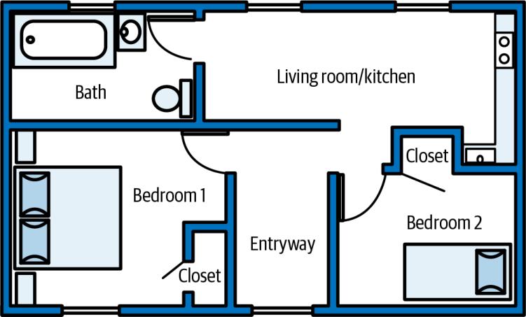

> **شکل ۸-۱.** اتاق‌های مختلف، مؤلفه‌های خانه را نشان می‌دهند

به همین ترتیب، کارکردهای اصلی‌ای که یک سیستم انجام می‌دهد، مؤلفه‌های آن سیستم را نشان می‌دهند؛ چنان‌که در شکل ۸-۲ می‌بینید. هر مؤلفه، مانندِ اتاق‌های یک خانه، کارکردِ مشخصی انجام می‌دهد؛ مانندِ مدیریتِ موجودیِ انبار، ارسالِ سفارش‌ها یا پردازشِ پرداخت‌ها. این مؤلفه‌ها روی هم سیستم را می‌سازند. هر مؤلفه کدِ منبعی را در بر دارد که آن کارکردِ کسب‌وکاریِ خاص را پیاده می‌کند.

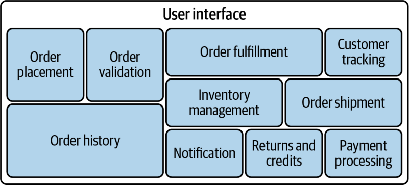

> **شکل ۸-۲.** کارکردهای اصلیِ مختلف، مؤلفه‌های سیستم را نشان می‌دهند

مؤلفه‌های منطقی در معماری نرم‌افزار معمولاً از راهِ یک فضای نام یا ساختارِ دایرکتوری‌ای نمود می‌یابند که کدِ منبعِ پیاده‌کنندهٔ آن کارکردِ خاص را در بر دارد. به‌طورِ معمول، گره‌های برگِ (leaf nodes) ساختارِ دایرکتوری یا فضای نامی که کدِ منبع را در بر دارد، مؤلفه‌های منطقیِ معماری را نشان می‌دهند و دایرکتوری‌ها یا گره‌های فضای نامِ سطحِ بالاتر، حوزه‌ها و زیرحوزه‌های (subdomains) سیستم را. در ساختارِ دایرکتوریِ نشان‌داده‌شده در شکل ۸-۳، مسیرِ دایرکتوریِ `order_entry/ordering/payment` مؤلفهٔ `Payment Processing` را نشان می‌دهد و مسیرِ `order_entry/processing/fulfillment` مؤلفهٔ `Order Fulfillment` را. کدِ منبعِ زیرِ این دایرکتوری‌ها این مؤلفه‌های منطقی را پیاده می‌کند.

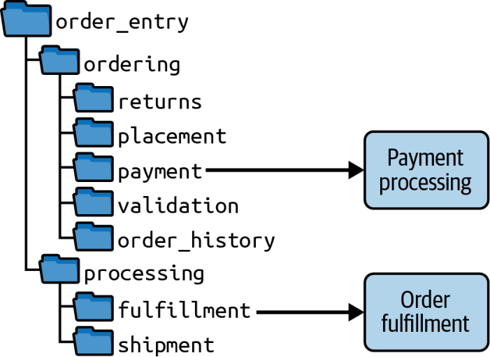

> **شکل ۸-۳.** گره‌های برگِ دایرکتوری، مؤلفه‌های سیستم را نشان می‌دهند

معمار می‌تواند ساختارهای دایرکتوری یا فضاهای نامِ یک سیستمِ نرم‌افزاری را تحلیل کند تا ساختارِ درونیِ آن، یا به بیانِ دیگر معماری منطقیِ (logical architecture) آن، را بفهمد. تفاوت‌های معماری منطقی و معماری فیزیکی را در بخشِ بعد شرح می‌دهیم.

---

## معماری منطقی در برابرِ معماری فیزیکی

معماری منطقی از مؤلفه‌های منطقیِ (بلوک‌های سازندهٔ) سیستم و شیوهٔ تعاملِ آن‌ها با یکدیگر تشکیل می‌شود. این معماری معمولاً تعاملِ مؤلفه‌ها با کنشگرانِ (actors) گوناگون (کاربرانی که با سیستم تعامل دارند) را نیز نشان می‌دهد و ممکن است برای روشن‌کردنِ اینکه داده‌ها کجا به کار می‌روند یا میانِ مؤلفه‌ها جابه‌جا می‌شوند، یک مخزن (repository)، و نه پایگاه‌داده، را هم نمایش دهد. شکل ۸-۴ نمونه‌ای از معماری منطقی را نشان می‌دهد.

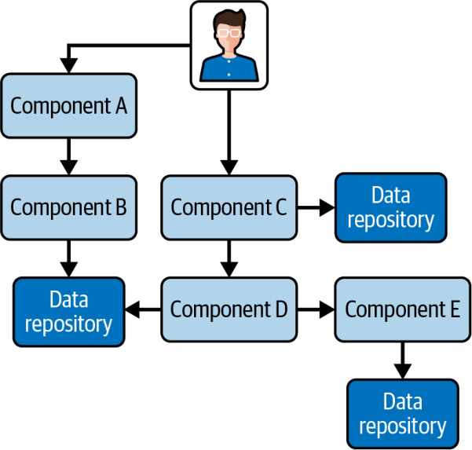

> **شکل ۸-۴.** نمودارِ یک معماری منطقی

نمودارِ معماری منطقی معمولاً رابط کاربری، پایگاه‌های داده، سرویس‌ها یا دیگر مصنوعاتِ فیزیکی (physical artifacts) را نشان نمی‌دهد. در عوض، مؤلفه‌های منطقی و شیوهٔ تعاملِ آن‌ها را نشان می‌دهد؛ شیوه‌ای که باید با ساختارهای دایرکتوری و فضاهای نامی که کد را سازمان می‌دهند مطابقت داشته باشد.

در مقابل، معماری فیزیکی (physical architecture) مصنوعاتِ فیزیکی‌ای مانندِ سرویس‌ها، رابط‌های کاربری، پایگاه‌های داده و مانندِ آن را در بر می‌گیرد. شکل ۸-۵ نمونه‌ای از نمودارِ معماری فیزیکی است.

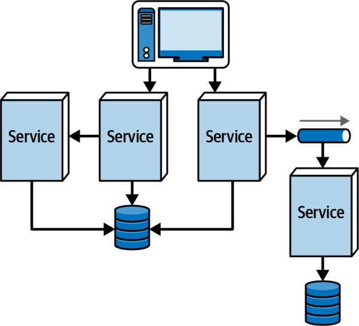

> **شکل ۸-۵.** نمودارِ یک معماری فیزیکی

معماری فیزیکیِ سیستم باید به‌دقت بازتاب‌دهندهٔ یک (یا چند) سبک از سبک‌های معماریِ متعددی باشد که در بخشِ دوم این کتاب شرح داده شده‌اند: میکروسرویس‌ها، معماری لایه‌ای، معماری رویدادمحور و جز آن.

بسیاری از معماران از ساختنِ معماری منطقی چشم می‌پوشند و مستقیماً با معماری فیزیکی آغاز می‌کنند. اما ما این شیوه را توصیه نمی‌کنیم، زیرا معماری فیزیکی همیشه نشان نمی‌دهد کارکردهای سیستم کجا قرار دارند و چگونه در کنارِ هم جای می‌گیرند. برای نمونه، در یک معماری فیزیکی، کارکردِ پردازشِ پرداخت ممکن است در چندین سرویس پخش شده باشد و دیدنِ نحوهٔ تعاملِ آن با دیگر بخش‌های سیستم را دشوار کند. افزون بر این، معماری فیزیکی هیچ راهنمایی‌ای به تیم‌های توسعه نمی‌دهد که چگونه یک سیستمِ تک‌پارچه یا توزیع‌شده بسازند یا کدِ آن را سازمان دهند؛ نتیجه، عمدتاً معماری‌هایی بی‌ساختار است که نگهداری، آزمون و استقرارشان دشوار است.

به‌طورِ کلی، معماری منطقیِ سیستم مستقل از معماری فیزیکیِ آن است. به بیانِ دیگر، هنگامِ ساختنِ معماری منطقی، تمرکز بیشتر بر این است که سیستم چه می‌کند، مرزِ آن کارکردها چگونه تعیین می‌شود و بخش‌های کارکردیِ سیستم چگونه با هم تعامل دارند؛ نه بر ساختارِ فیزیکیِ آن. برای نمونه، معماری که در حالِ طراحیِ یک معماری منطقی مانندِ شکل ۸-۴ است، ممکن است هنوز تصمیم نگرفته باشد که آیا همهٔ آن مؤلفه‌ها در یک معماری تک‌پارچه، یعنی یک واحد استقرار (deployment unit)، قرار می‌گیرند یا به‌صورتِ سرویس‌ها، یعنی واحدهای استقرارِ جداگانه، مستقر می‌شوند؛ و لزوماً هم تعیین نکرده باشد که چه نوع سبکِ معماری‌ای مناسب‌تر است.

---

## ساختنِ معماری منطقی

ساختنِ معماری منطقی مستلزمِ شناسایی و بازساختاردهیِ پیوستهٔ مؤلفه‌های منطقی است. شناسایی مؤلفه‌ها (component identification) به‌صورتِ فرایندی تکرارشونده بهترین نتیجه را می‌دهد. این فرایند شاملِ تولیدِ مؤلفه‌های نامزد (candidate components) و سپس پالایشِ آن‌ها از راهِ یک حلقهٔ بازخورد (feedback loop) است؛ چنان‌که در شکل ۸-۶ نشان داده شده است.

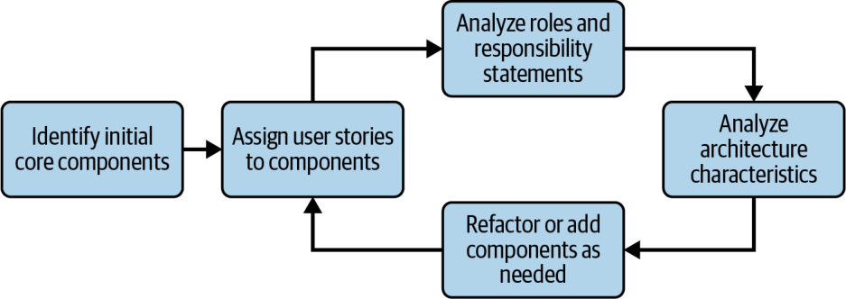

> **شکل ۸-۶.** چرخهٔ شناسایی و بازآرایی مؤلفه‌ها

نخستین فعالیتِ معمار در توسعهٔ معماری منطقی، شناساییِ مؤلفه‌های اصلیِ (core components) اولیه و سپس تخصیصِ داستان‌های کاربری یا الزامات به آن‌هاست. پس از آن، نقش‌ها و مسئولیت‌های هر مؤلفه را تحلیل می‌کند تا مطمئن شود داستان‌های کاربری یا الزاماتی که به آن تخصیص یافته‌اند معنادارند. سپس معمار به ویژگی‌های معماری‌ای که سیستم باید پشتیبانی کند می‌نگرد و تعیین می‌کند که آیا بر پایهٔ این ویژگی‌ها به بازآرایی (refactoring) نیاز است تا مؤلفه‌ای تفکیک شود یا با مؤلفهٔ دیگری ترکیب گردد. سرانجام، معمار در صورتِ لزوم مؤلفه‌ها را بر پایهٔ این تحلیل پالایش می‌کند. این فرایند حلقهٔ بازخوردی است که اساساً هرگز متوقف نمی‌شود.

گردش‌کارِ شکل ۸-۶ را می‌توان برای سیستم‌های نوساخت (greenfield) یا هر زمان که قابلیتی به سیستم افزوده یا در آن تغییر داده می‌شود به کار برد. برای نمونه، فرض کنید باید یک سیستمِ ثبتِ سفارش را طوری تغییر دهید که کاربران بتوانند اقلام را به‌جای ارسال به خانه، از فروشگاه تحویل بگیرند. این کار مستلزمِ افزودنِ کدِ زمان‌بندی و نیز تغییرِ فرایندِ سفارش‌دهیِ موجود است. این تغییر ممکن است به مؤلفه‌های جدید، تغییر در مؤلفه‌های موجود، یا هر دو نیاز داشته باشد. با تغییرِ مؤلفه‌ها، نقش‌ها و مسئولیت‌هایشان نیز ممکن است تغییر کند و شما را به بازساختاردهیِ کد یا ساختنِ مؤلفه‌های جدید برای آن وادارد.

هر یک از این گام‌ها را در بخش‌های بعدی به‌تفصیل شرح می‌دهیم.

### شناساییِ مؤلفه‌های اصلی

چالشِ آغازِ یک معماری منطقیِ جدید (یا اعمالِ تغییراتِ عمده در معماریِ موجود) این است که تعیین کنیم مؤلفه‌های اصلیِ اولیه چه باید باشند. یکی از اشتباه‌هایی که بسیاری از معماران نرم‌افزار مرتکب می‌شوند، صرفِ تلاشِ بیش از اندازه برای بی‌نقص‌کردنِ مؤلفه‌های منطقیِ اولیه در همان نخستین بار است. رویکردِ بهتر این است که بر پایهٔ کارکردهای اصلیِ سیستم «بهترین حدس» را دربارهٔ شکلِ احتمالیِ مؤلفه‌های اصلیِ اولیه بزنیم و آن‌ها را با گام‌های گردش‌کارِ ترسیم‌شده در شکل ۸-۶ پالایش کنیم. به بیانِ دیگر، بهتر است همان‌طور که دربارهٔ سیستم بیشتر می‌آموزید، مؤلفه‌های منطقی را به‌صورتِ تکرارشونده بهبود دهید؛ نه آنکه بکوشید همه‌چیز را در نخستین بار، یعنی زمانی که کمترین شناخت را از سیستم و الزاماتِ خاصِ آن دارید، بی‌نقص کنید.

در بیشترِ موارد، معمار برای آغازِ ساختنِ مؤلفه‌های منطقی نیازی ندارد همهٔ الزامات و مشخصاتِ سیستم (یا گاهی هیچ‌یک از آن‌ها) را بداند. به‌طورِ معمول، مؤلفه‌های اصلیِ اولیه بر پایهٔ کنش‌های عمده‌ای که کاربران ممکن است انجام دهند یا گردش‌کارهای پردازشیِ عمدهٔ سیستم شکل می‌گیرند.

دوست داریم مؤلفه‌های اصلیِ اولیه را سطل‌هایی خالی تصور کنیم. سطل تا زمانی که معمار شروع به «پرکردنِ» آن، یعنی تخصیصِ داستان‌های کاربری یا الزامات به آن مؤلفه، نکند کاری انجام نمی‌دهد. چنان‌که در شکل ۸-۷ نشان داده شده، نامِ مؤلفه باید نقش و مسئولیتِ پیشنهادیِ آن را بازتاب دهد. اما تا زمانی که معمار داستان‌های کاربری را به آن تخصیص ندهد (گامِ بعدیِ گردش‌کار)، مؤلفه در اصل یک جانگهدار (placeholder) است؛ بهترین حدس دربارهٔ یک بلوکِ سازندهٔ کارکردی.

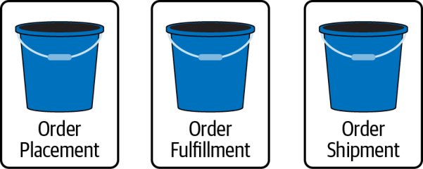

> **شکل ۸-۷.** در آغاز، مؤلفه‌های اولیه مانندِ سطل‌هایی خالی‌اند

در ادامه سه رویکردِ رایج برای ساختنِ مؤلفه‌های اصلیِ اولیه آمده است. دو رویکردِ نخست، یعنی رویکردِ گردش‌کار (Workflow) و رویکردِ کنشگر/کنش (Actor/Action)، را سودمند می‌دانیم؛ اما سومی، یعنی تلهٔ موجودیت (Entity Trap)، ضدالگویی است که از آن برحذر می‌داریم.

#### رویکردِ گردش‌کار

یکی از رویکردهای رایجی که معماران برای شناساییِ مؤلفه‌های اصلیِ اولیهٔ یک معماری منطقی به کار می‌برند، رویکرد گردش‌کار است. همان‌طور که از نامش پیداست، این رویکرد از گردش‌کارهای اصلیِ مسیرِ موفق (happy path)، یعنی گردش‌کارهای بدونِ خطایی که کاربر ممکن است در سیستم طی کند (یا گردش‌کارِ اصلیِ پردازشِ درخواست‌ها)، بهره می‌گیرد. اگر معمار تصوری کلی از این جریان داشته باشد، می‌تواند مؤلفه‌ها را بر پایهٔ گام‌های آن بسازد.

برای نمونه، فرض کنید در حالِ ساختنِ یک سیستمِ ثبتِ سفارشِ جدید برای شرکتتان هستید. هنوز الزامات و مشخصاتِ دقیق را نمی‌دانید، اما دست‌کم گردش‌کارِ کلیِ پردازشِ یک سفارشِ جدید را می‌شناسید. بنابراین می‌توانید به هر گامِ گردش‌کار یک مؤلفه تخصیص دهید:

۱. کاربر کاتالوگِ اقلام را مرور می‌کند ← `Item Browser`

۲. کاربر سفارش ثبت می‌کند ← `Order Placement`

۳. کاربر هزینهٔ سفارش را می‌پردازد ← `Order Payment`

۴. ایمیلی حاویِ جزئیاتِ سفارش برای کاربر ارسال می‌شود ← `Customer Notification`

۵. سفارش آماده می‌شود ← `Order Fulfillment`

۶. سفارش ارسال می‌شود ← `Order Shipment`

۷. به مشتری ایمیل زده می‌شود که سفارش ارسال شده است ← `Customer Notification`

۸. محموله ردیابی می‌شود ← `Order Tracking`

در رویکرد گردش‌کار، هر گامِ گردش‌کارِ اصلی لزوماً مؤلفهٔ جدیدی پدید نمی‌آورد. در گردش‌کارِ بالا، گام‌های ۴ و ۷ هر دو از مؤلفهٔ `Customer Notification` استفاده می‌کنند. معمار هر تعداد گردش‌کارِ اصلی یا سفرِ کاربری (user journey) را که بتواند برای سیستم مدل می‌کند و مؤلفه‌های متناظر را از گام‌های آن‌ها شناسایی می‌کند.

این نیز، باز هم، تنها «بهترین حدس» دربارهٔ شکلِ احتمالیِ معماری منطقی است. این مؤلفه‌ها سطل‌هایی خالی‌اند و هنوز مسئولیتی ندارند؛ بنابراین به احتمالِ زیاد در طولِ تکاملشان تغییر خواهند کرد (چنان‌که در شکل ۸-۶ نشان داده شد). این کاملاً طبیعی و بخشی از ماهیتِ تکرارشوندهٔ معماری نرم‌افزار است. نگرانِ مدل‌کردنِ همهٔ گردش‌کارهای سیستمتان نباشید. در عوض، بر گردش‌کارهای اصلی تمرکز کنید. بقیه همان‌طور که دربارهٔ سیستم بیشتر می‌آموزید و گردآوریِ داستان‌های کاربری و الزامات را آغاز می‌کنید، شکل می‌گیرند.

#### رویکردِ کنشگر/کنش

راهِ دیگری که معماران برای شناساییِ مؤلفه‌های اصلیِ اولیه به کار می‌برند، رویکرد کنشگر/کنش است. این رویکرد به‌ویژه زمانی سودمند است که سیستم چندین کنشگر داشته باشد. در این رویکرد، معمار کنش‌های اصلی‌ای را که کاربر می‌تواند در سیستم انجام دهد (مانندِ ثبتِ سفارش) شناسایی می‌کند. خودِ سیستم نیز همیشه یک کنشگر است که کارکردهای خودکاری مانندِ صدورِ صورت‌حساب و تأمینِ دوبارهٔ موجودیِ انبار را انجام می‌دهد.

در مثالِ سیستمِ ثبتِ سفارشِ ما، معمار ممکن است سه کنشگر را شناسایی کند: مشتری، بسته‌بندِ سفارش (order packer) (کسی که جعبه را بسته‌بندی می‌کند و برای ارسال می‌فرستد) و سیستم. سپس معمار کنش‌های اصلیِ هر یک از این کنشگران را شناسایی می‌کند و به آن کنش‌ها مؤلفه تخصیص می‌دهد:

**کنشگرِ مشتری:**

- جست‌وجوی اقلام ← `Item Search`
- مشاهدهٔ جزئیاتِ یک قلم کالا ← `Item Details`
- ثبتِ سفارش ← `Order Placement`
- لغوِ سفارش ← `Order Cancel`
- ثبت‌نام به‌عنوانِ مشتریِ جدید ← `Customer Registration`
- به‌روزرسانیِ اطلاعاتِ مشتری ← `Customer Profile`

**کنشگرِ بسته‌بندِ سفارش:**

- انتخابِ اندازهٔ جعبه ← `Order Fulfillment`
- علامت‌گذاریِ سفارش به‌عنوانِ آمادهٔ ارسال ← `Order Fulfillment`
- ارسالِ سفارش برای مشتری ← `Order Shipment`

**کنشگرِ سیستم:**

- تنظیمِ موجودیِ انبار ← `Inventory Management`
- سفارشِ موجودیِ بیشتر از تأمین‌کننده ← `Supplier Ordering`
- اعمالِ پرداخت ← `Order Payment`

همانند رویکرد گردش‌کار، هر کنش لزوماً مؤلفهٔ خودش را ندارد. برای نمونه، انتخابِ اندازهٔ جعبه برای سفارش و علامت‌گذاریِ آن به‌عنوانِ آمادهٔ ارسال، هر دو را مؤلفهٔ `Order Fulfillment` انجام می‌دهد.

به‌طورِ کلی، رویکرد کنشگر/کنش، بسته به اینکه معمار چند گردش‌کارِ اصلی را برای مدل‌سازی برگزیند، مؤلفه‌های بیشتری از رویکرد گردش‌کار تولید می‌کند. با این حال، در هر دو رویکرد، معمار می‌تواند مؤلفه‌های اصلیِ اولیه و شیوهٔ ارتباطِ آن‌ها را حتی پیش از دریافتِ الزامات یا مشخصاتِ تفصیلی شناسایی کند.

#### تلهٔ موجودیت

وسوسهٔ بسیار زیادی برای معمار وجود دارد که شناساییِ مؤلفه‌ها را با تمرکز بر موجودیت‌های درگیر در سیستم آغاز کند و سپس مؤلفه‌ها را از آن موجودیت‌ها استخراج کند. برای نمونه، در یک سیستمِ ثبتِ سفارشِ معمولی، ممکن است `Customer`، `Item` و `Order` را موجودیت‌های اصلیِ سیستم تشخیص دهید و به تناظرِ آن‌ها مؤلفه‌های `Customer Manager`، `Item Manager` و `Order Manager` را بسازید. به دلایلِ زیر قویاً از این رویکرد برحذر می‌داریم.

نخست، نام‌های این مؤلفه‌های منطقی مبهم‌اند و نقشِ مؤلفه را توصیف نمی‌کنند. برای نمونه، اگر فقط با نگاه به نامِ مؤلفهٔ `Order Manager` بپرسیم چه کاری انجام می‌دهد، پاسخِ بی‌فایدهٔ «سفارش‌ها را مدیریت می‌کند» به دست می‌آید که هیچ چیزی دربارهٔ نقش یا مسئولیتِ مشخصِ آن در سیستم نمی‌گوید. این را با نامِ مؤلفه‌ای مانندِ `Validate Order` مقایسه کنید تا اهمیتِ نامِ خوب و توصیفیِ مؤلفه روشن شود. اگر نامِ مؤلفه‌ای پسوندی مانندِ `Manager`، `Supervisor`، `Controller`، `Handler`، `Engine` یا `Processor` داشته باشد، نشانهٔ خوبی است که معمار ممکن است در دامِ ضدالگوی تلهٔ موجودیت افتاده باشد.

دوم، مؤلفه‌ها به انبارِ درهمی (dumping ground) برای کارکردهای مرتبط با حوزه تبدیل می‌شوند. نامِ مؤلفه‌ای موجودیت‌محور مانندِ `Order Manager` را در نظر بگیرید که در شکل ۸-۸ نشان داده شده است. تمامی کارکردهای خرد و کلانِ مربوط به سفارش در همین یک مؤلفه انباشته می‌شود: اعتبارسنجیِ سفارش، ثبتِ سفارش، تاریخچهٔ سفارش، آماده‌سازیِ سفارش، ارسالِ سفارش، ردیابیِ سفارش و جز آن. این مؤلفه در اصل به آن کلاس‌های کمکیِ «همه‌چیزدار» (kitchen sink) شبیه می‌شود که هر توسعه‌دهنده‌ای دست‌کم یک بار در دورهٔ کاری‌اش نوشته است؛ کلاس‌هایی با ده‌ها متد که دست‌کاریِ رشته‌ها، دست‌کاریِ داده‌ها، محاسباتِ زمانی و هر چیزِ دیگری را که توسعه‌دهنده بتواند در آن بگنجاند انجام می‌دهند.

سوم، وقتی مؤلفه‌ها بیش از حد درشت‌دانه (coarse-grained) شوند، وظایفِ بیش از اندازه‌ای بر عهده می‌گیرند و هدفِ مشخصِ خود را از دست می‌دهند. مؤلفه‌ها به‌جای آنکه ریزدانه (fine-grained) و تک‌منظوره باشند (مانندِ مثالِ مؤلفهٔ `Validate Order`)، ممکن است بیش از حد بزرگ شوند. نگهداری، آزمون و استقرارِ چنین مؤلفه‌هایی دشوار است و از این رو چندان قابل اعتماد نیستند.

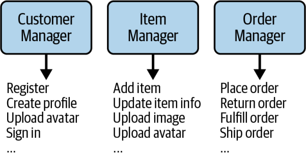

> **شکل ۸-۸.** به‌کارگیریِ ضدالگوی تلهٔ موجودیت مؤلفه‌هایی با مسئولیتِ بیش از اندازه پدید می‌آورد

اگر معمار سیستمی می‌سازد که واقعاً موجودیت‌محور است و فقط عملیاتِ مبتنی بر CRUD (ایجاد، خواندن، به‌روزرسانی و حذف) را روی آن موجودیت‌ها انجام می‌دهد، آن سیستم به معماری نیاز ندارد؛ بلکه به یک چارچوب، ابزار یا محیطِ بدون‌کد/کم‌کد (no-code/low-code) مبتنی بر CRUD نیاز دارد که به توسعه‌دهندگان امکان دهد بیشترِ کدِ منبعی را که روی آن موجودیت‌ها عمل می‌کند تولید کنند.

### تخصیصِ داستان‌های کاربری به مؤلفه‌ها

گامِ بعدی در ساختنِ معماری منطقی، تخصیصِ داستان‌های کاربری یا الزامات به مؤلفه‌های منطقی است. این فرایندی تکرارشونده است، زیرا بیشترِ داستان‌های کاربری یا الزامات از پیش به‌طورِ کامل شناخته‌شده نیستند؛ آن‌ها همراه با تکاملِ سیستم تکامل می‌یابند. هدفِ این گام آغازِ پرکردنِ آن سطل‌های خالی و دادنِ نقش‌ها و مسئولیت‌های مشخص به مؤلفه‌هاست؛ چنان‌که در شکل ۸-۹ نشان داده شده است.

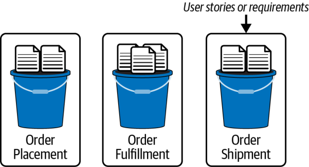

> **شکل ۸-۹.** پرکردنِ سطل‌های خالی (مؤلفه‌ها) با داستان‌های کاربری یا الزامات

برای اینکه ببینید مؤلفه‌های منطقی چگونه تکامل می‌یابند، داستان‌های کاربریِ زیر را در نظر بگیرید:

**مشتریِ شمارهٔ ۱:** به‌عنوانِ مشتری، می‌خواهم سفارشم اعتبارسنجی شود تا مطمئن شوم همه‌چیز را کامل و درست وارد کرده‌ام.

**آماده‌کنندهٔ سفارش:** به‌عنوانِ کسی که سفارش را آماده می‌کند، می‌خواهم بدانم برای سفارش از چه اندازه جعبه‌ای استفاده کنم تا بتوانم آن را به بهینه‌ترین شکلِ ممکن بسته‌بندی کنم.

**مشتریِ شمارهٔ ۲:** به‌عنوانِ مشتری، می‌خواهم هر بار که وضعیتِ سفارش تغییر می‌کند ایمیلی دریافت کنم تا همیشه از وضعیتِ سفارشم آگاه باشم.

فرض کنید معمار تاکنون مؤلفه‌های منطقیِ زیر را شناسایی کرده است:

- `Order Placement`
- `Order Fulfillment`
- `Order Shipment`
- `Inventory Management`

منطقی است که نخستین داستانِ کاربری را به مؤلفهٔ `Order Placement` تخصیص دهیم، زیرا کاربر برای ثبتِ سفارش با همین مؤلفه تعامل دارد:

> اعتبارسنجیِ سفارش (داستانِ کاربریِ مشتریِ شمارهٔ ۱) ← `Order Placement`

تعیینِ اندازهٔ جعبه را احتمالاً باید مؤلفهٔ `Order Fulfillment` بر عهده بگیرد، زیرا این مؤلفه مسئولِ همهٔ منطقِ سیستم برای آماده‌سازی و بسته‌بندیِ سفارش در جعبه است:

> تعیینِ اندازهٔ جعبه (داستانِ کاربریِ آماده‌کنندهٔ سفارش) ← `Order Fulfillment`

اما داستانِ کاربریِ سوم چه؟ کدام‌یک از چهار مؤلفهٔ فهرست‌شده باید هنگامِ ثبتِ سفارش، آماده‌شدنِ آن برای ارسال و ارسالِ آن، به مشتری ایمیل بفرستد؟ پاسخ ممکن است مؤلفه‌های `Order Placement`، `Order Fulfillment` و `Order Shipment` باشد. اما به یاد داشته باشید که داستانِ کاربری از راهِ کدِ منبع پیاده می‌شود و این کد باید در دایرکتوری یا فضای نامِ مشخصی قرار گیرد. از آنجا که تکثیرِ این کد در سه مؤلفه ایدهٔ خوبی نیست، معمار باید مؤلفهٔ جدیدی برای رسیدگی به این داستانِ کاربری تعریف کند:

> ایمیل به مشتری (داستانِ کاربریِ مشتریِ شمارهٔ ۲) ← `Customer Notification` (جدید)

مؤلفه‌های `Order Placement`، `Order Fulfillment` و `Order Shipment` باید با این مؤلفهٔ جدید ارتباط برقرار کنند تا به آن اطلاع دهند که ایمیلی بفرستد. با این افزوده، معماری منطقی اکنون مانندِ شکل ۸-۱۰ است.

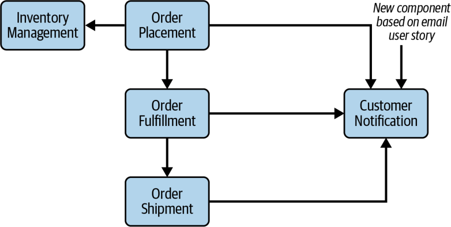

> **شکل ۸-۱۰.** تکاملِ مؤلفه‌ها بر پایهٔ داستان‌های کاربریِ جدید

### تحلیلِ نقش‌ها و مسئولیت‌ها

گامِ بعدی در پالایشِ مؤلفه‌های منطقی، تحلیلِ نقش‌ها و مسئولیت‌های هر مؤلفه است. معمار از این راه اطمینان می‌یابد که الزامات یا داستان‌های کاربریِ تخصیص‌یافته به آن مؤلفه‌ها واقعاً به آن‌ها تعلق دارند و مؤلفه‌ها کارِ بیش از اندازه انجام نمی‌دهند. دغدغهٔ معمار در این گام انسجام است: اینکه عملیاتِ یک مؤلفه چگونه و تا چه اندازه با هم مرتبط‌اند. با گذشتِ زمان، مؤلفه‌ها ممکن است بیش از حد بزرگ شوند، حتی اگر همهٔ عملیاتشان با هم مرتبط باشند.

برای نشان‌دادنِ کارکردِ این گام، فرض کنید معمار الزاماتِ زیر را به مؤلفهٔ `Order Placement` تخصیص داده است:

- اعتبارسنجیِ سفارش برای اطمینان از اینکه همهٔ فیلدها وارد شده‌اند و درست‌اند.
- نمایشِ سبدِ خرید (shopping cart) همراه با توضیحات، تعداد و قیمتِ اقلام.
- تعیینِ نشانیِ درستِ ارسال.
- گردآوریِ اطلاعاتِ پرداخت.
- تولیدِ یک شناسهٔ سفارشِ یکتا.
- اعمالِ پرداختِ سفارش.
- تنظیمِ موجودیِ انبار برای اقلامِ سفارش‌داده‌شده.
- ارسالِ خلاصهٔ سفارش برای مشتری با ایمیل.

اگر معمار بخواهد بیانیهٔ نقش و مسئولیتِ (role and responsibility statement) این مؤلفه را بنویسد، چنین خواهد بود:

> این مؤلفه مسئولِ اعتبارسنجیِ سفارش و نمایشِ سبدِ خریدِ معتبر، همراه با تصویر، توضیحات، تعداد و قیمتِ اقلام است. این مؤلفه همچنین مسئولِ تعیینِ نشانیِ درستِ ارسالِ سفارش و نیز گردآوریِ همهٔ اطلاعاتِ پرداخت از مشتری است. افزون بر این، اعمالِ پرداخت، تنظیمِ موجودیِ انبار و ارسالِ خلاصهٔ سفارش برای مشتری با ایمیل نیز بر عهدهٔ آن است.

هرچند همهٔ این عملیات به ثبتِ سفارش مربوط‌اند، مؤلفهٔ `Order Placement` آشکارا مسئولیتِ بیش از اندازه‌ای بر عهده گرفته است؛ به‌ویژه در زمینهٔ اعمالِ پرداخت، تنظیمِ موجودیِ انبار و ایمیل‌زدن به مشتری. یکی از راه‌های تشخیصِ اینکه آیا مؤلفه‌ای مسئولیتِ بیش از اندازه بر عهده گرفته است، جست‌وجوی عبارت‌های ربطی (conjunctive phrases) مانندِ «و»، «همچنین»، «افزون بر این» یا «و نیز» و استفادهٔ افراطی از ویرگول است.

از بخش‌های پیشینِ این فصل به یاد دارید که هر مؤلفهٔ منطقی با یک فضای نام یا دایرکتوری در مخزنِ کد نمایش داده می‌شود. در موردِ مؤلفهٔ `Order Placement`، همهٔ کدِ منبعِ این مؤلفه در یک دایرکتوری یا فضای نامِ واحد، مانندِ `com/app/order/placement` یا `com.app.order.placement`، قرار می‌گیرد. این حجمِ زیادی از کارکرد است؛ احتمالاً کدی بیش از اندازه برای یک دایرکتوریِ واحد. بنابراین منطقی است که فایل‌های کلاسِ مربوط به پردازشِ پرداخت، مدیریتِ موجودیِ انبار و ارتباطاتِ ایمیلی را در دایرکتوری‌های جداگانه‌ای قرار دهیم که نمایانگرِ همان کارکردها باشند. جداسازیِ مؤلفه‌های منطقی دقیقاً همین است.

اگر معمار مسئولیت‌های اعمالِ پرداخت، تنظیمِ موجودیِ انبار و ارسالِ ایمیل به مشتری را به مؤلفه‌های جداگانه منتقل کند، می‌تواند بارِ مسئولیتِ مؤلفهٔ `Order Placement` را کاهش دهد و نگهداری، آزمون و استقرارِ آن را آسان‌تر کند. مؤلفه‌های حاصل چنین خواهند بود:

`Order Placement`

- اعتبارسنجیِ سفارش برای اطمینان از اینکه همهٔ فیلدها وارد شده‌اند و درست‌اند.
- نمایشِ سبدِ خرید همراه با توضیحات، تعداد و قیمتِ اقلام.
- تعیینِ نشانیِ درستِ ارسال.
- گردآوریِ اطلاعاتِ پرداخت.
- تولیدِ یک شناسهٔ سفارشِ یکتا.

`Payment Processing`

- اعمالِ پرداخت.

`Inventory Management`

- تنظیمِ موجودیِ انبار برای اقلامِ سفارش‌داده‌شده.

`Customer Notification`

- ارسالِ خلاصهٔ سفارش برای مشتری با ایمیل.

اکنون هر مؤلفه نقش و مسئولیتِ روشن‌تر و متمایزتری دارد.

### تحلیلِ ویژگی‌های معماری

گامِ پایانیِ تحلیل، در نظر گرفتنِ ویژگی‌های معماری‌ای است که سیستم به آن‌ها نیاز خواهد داشت. برخی ویژگی‌های معماری، مانندِ مقیاس‌پذیری، قابلیت اطمینان، در دسترس‌بودن، تحمل خطا، کشسانی و چابکی (توانِ پاسخ‌گوییِ سریع به تغییر)، ممکن است بر اندازهٔ یک مؤلفهٔ منطقی اثر بگذارند.

برای نمونه، شکستنِ یک مؤلفهٔ بزرگ‌تر (مؤلفه‌ای با مسئولیت‌های فراوان) به مؤلفه‌های کوچک‌تر، نگهداری و آزمونِ هر یک را آسان‌تر می‌کند (این همان چابکی است) و مقیاس‌پذیری، کشسانی و تحمل خطای بهتری فراهم می‌آورد. نمونهٔ خوبِ دیگر جایی است که دو بخش از سیستم با ورودیِ کاربر سروکار دارند: اگر یک بخش با صدها کاربرِ هم‌زمان سروکار داشته باشد و دیگری فقط باید از چند کاربر در هر لحظه پشتیبانی کند، این دو به ویژگی‌های معماریِ متفاوتی نیاز خواهند داشت. بنابراین، هرچند نگاهِ صرفاً کارکردی به طراحیِ مؤلفه ممکن است معمار را به تخصیصِ یک مؤلفهٔ واحد برای رسیدگی به تعامل با کاربر سوق دهد، تحلیلِ مؤلفه‌ها از منظرِ ویژگی‌های معماری ممکن است به تقسیمِ آن بینجامد.

از آنجا که معمار باید پیش از ساختنِ معماری منطقی ویژگی‌های معماری را بشناسد، این تحلیل معمولاً پس از تعیینِ مهم‌ترین ویژگی‌های معماریِ سیستم انجام می‌شود.

### بازساختاردهیِ مؤلفه‌ها

بازخورد در طراحیِ نرم‌افزار حیاتی است. معماران باید همواره و در همکاری با توسعه‌دهندگان، طراحیِ مؤلفه‌هایشان را به‌صورتِ تکرارشونده بهبود دهند. طراحیِ نرم‌افزار انواعِ دشواری‌های پیش‌بینی‌نشده را پیش می‌آورد. از این رو، رویکردِ تکرارشونده در طراحیِ مؤلفه‌ها کلیدی است. نخست، تقریباً ناممکن است همهٔ کشف‌های گوناگون و حالت‌های مرزی (edge cases) را که پیش خواهند آمد و هر یک می‌تواند انگیزهٔ بازطراحی شود، از پیش در نظر گرفت. دوم، هرچه معماران و توسعه‌دهندگان در ساختنِ برنامه عمیق‌تر شوند، درکِ دقیق‌تری از اینکه رفتارها و نقش‌های برنامه باید در کجا قرار گیرند به دست می‌آورند.

معماران باید انتظار داشته باشند که در سراسرِ چرخهٔ عمرِ (lifecycle) یک سیستم یا محصول، مؤلفه‌ها را بارها بازساختاردهی کنند؛ نه فقط در سیستم‌های نوساخت، بلکه در هر سیستمی که نگهداریِ مکرر دارد.

---

## کوپلینگِ مؤلفه‌ها

وقتی مؤلفه‌ها با یکدیگر ارتباط برقرار می‌کنند، یا وقتی تغییر در یک مؤلفه ممکن است بر مؤلفه‌های دیگر اثر بگذارد، می‌گوییم آن مؤلفه‌ها با هم کوپل شده‌اند. هرچه مؤلفه‌های یک سیستم کوپلینگِ بیشتری داشته باشند، نگهداری و آزمونِ سیستم دشوارتر است (شکل ۸-۱۱ را ببینید). از این رو، توجهِ دقیق به کوپلینگ اهمیت دارد.

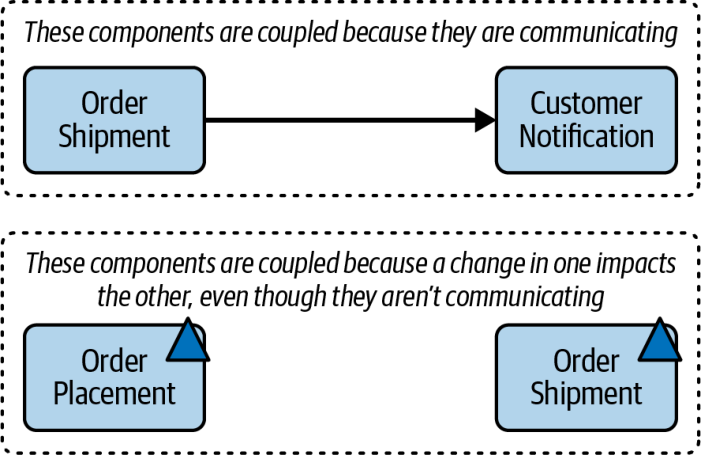

> **شکل ۸-۱۱.** مؤلفه‌ها می‌توانند حتی بدونِ ارتباطِ مستقیم با هم کوپل باشند

### کوپلینگِ ایستا

کوپلینگ ایستا زمانی رخ می‌دهد که مؤلفه‌ها به‌طورِ هم‌گام با یکدیگر ارتباط برقرار کنند. معماران باید به دو نوع کوپلینگ توجه کنند: ورودی و خروجی.

کوپلینگ ورودی (که کوپلینگِ درون‌سو (incoming) یا هم‌گرا (fan-in) نیز نامیده می‌شود) میزانِ وابستگیِ مؤلفه‌های دیگر به یک مؤلفهٔ هدف است. برای نمونه، مؤلفهٔ `Customer Notification` را در مثالِ ثبتِ سفارشِ ما در شکل ۸-۱۲ در نظر بگیرید. برای ایمیل‌زدن به مشتری، هر دو مؤلفهٔ `Order Placement` و `Order Shipment` باید با مؤلفهٔ `Customer Notification` ارتباط برقرار کنند. این یعنی مؤلفهٔ `Customer Notification` با مؤلفه‌های `Order Placement` و `Order Shipment` کوپلینگِ ورودی دارد و سطحِ کوپلینگِ ورودیِ آن ۲ است (شمارِ وابستگی‌های ورودی). کوپلینگ ورودی معمولاً با `CA` نشان داده می‌شود.

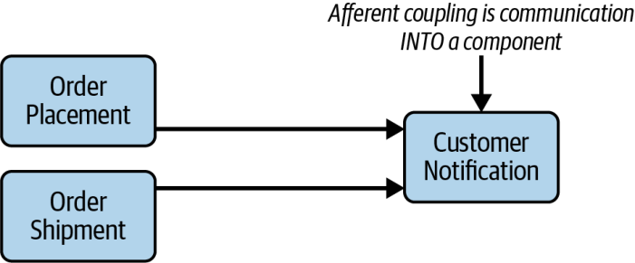

> **شکل ۸-۱۲.** مؤلفهٔ `Customer Notification` با مؤلفه‌های دیگر کوپلینگِ ورودی دارد

کوپلینگ خروجی (که کوپلینگِ برون‌سو (outgoing) یا انشعابی (fan-out) نیز نامیده می‌شود) میزانِ وابستگیِ یک مؤلفهٔ هدف به مؤلفه‌های دیگر است. برای نمونه، چنان‌که در شکل ۸-۱۳ نشان داده شده، مؤلفهٔ `Order Placement` به مؤلفهٔ `Order Fulfillment` وابسته است؛ بنابراین با آن کوپلینگِ خروجی دارد و سطحِ کوپلینگِ خروجیِ آن ۱ است (شمارِ وابستگی‌های خروجی). کوپلینگ خروجی معمولاً با `CE` نشان داده می‌شود.

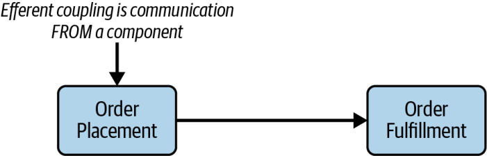

> **شکل ۸-۱۳.** مؤلفهٔ `Order Placement` با مؤلفهٔ `Order Fulfillment` کوپلینگِ خروجی دارد

### کوپلینگِ زمانی

کوپلینگ زمانی (temporal coupling) وابستگی‌های غیرایستا را توصیف می‌کند؛ معمولاً وابستگی‌هایی که بر پایهٔ زمان‌بندی یا تراکنش‌ها (transactions)، یعنی واحدهای کارِ منفرد، شکل می‌گیرند. برای نمونه، وقتی سیستم سفارشی را پردازش می‌کند، کارکردِ مؤلفهٔ `Order Placement` باید پیش از کارکردِ مؤلفهٔ `Order Shipment` فراخوانی شود. از این رو می‌گوییم این مؤلفه‌ها کوپلینگِ زمانی دارند.

مشکلِ کوپلینگ زمانی این است که تشخیصِ آن با ابزارهای خودکارِ موجود دشوار است. در بیشترِ موارد، این نوع کوپلینگ از راهِ اسنادِ طراحی شناسایی می‌شود یا هنگامِ بروزِ وضعیت‌های خطا خود را نشان می‌دهد.

### قانونِ Demeter

به بیشترِ معماران توصیه می‌شود که در طراحیِ سیستم برای کوپلینگ سست بکوشند. کوپلینگِ کمتر میانِ مؤلفه‌ها یا سرویس‌ها، نگهداریِ سیستم را آسان‌تر، آزمونش را ساده‌تر و استقرارش را کم‌خطرتر می‌کند. همچنین قابلیت اطمینانِ کلیِ سیستم را افزایش می‌دهد، زیرا تغییرات بر مؤلفه‌های کمتری اثر می‌گذارند و فرصت‌های کمتری برای خطا پدید می‌آید.

یکی از تکنیک‌های ساختنِ سیستم‌های با کوپلینگِ سست، قانونِ Demeter (Law of Demeter) نام دارد که اصلِ کمترین دانش (principle of least knowledge) نیز خوانده می‌شود. در اسطوره‌های یونانی، الههٔ Demeter همهٔ غلهٔ جهان را تولید می‌کرد، اما هیچ نمی‌دانست مردم با آن چه می‌کنند (به دام‌ها می‌خورانند، نان می‌پزند و جز آن). Demeter در عمل از بقیهٔ جهان جدا (decoupled) بود.

قانونِ Demeter می‌گوید: یک مؤلفه یا سرویس باید دانشِ محدودی از مؤلفه‌ها یا سرویس‌های دیگر داشته باشد. هرچند این گفته ممکن است ساده‌انگارانه و بدیهی به نظر برسد، چنین نیست. بگذارید منظورمان را نشان دهیم.

مؤلفه‌ها و ارتباط‌های متناظرشان را که در شکل ۸-۱۴ نشان داده شده‌اند در نظر بگیرید. پس از پذیرشِ سفارشِ مشتری، مؤلفهٔ `Order Placement` باید به مؤلفهٔ `Inventory Management` بگوید که موجودیِ انبار را کاهش دهد. اگر موجودی بیش از حد پایین بیاید، مؤلفهٔ `Order Placement` باید دو کار انجام دهد: به مؤلفهٔ `Supplier Ordering` بگوید موجودیِ بیشتری از تأمین‌کننده سفارش دهد و به مؤلفهٔ `Item Pricing` بگوید قیمت را بر پایهٔ عرضهٔ محدودِ موجود تنظیم کند. سرانجام، وقتی همهٔ این کارها انجام شد، مؤلفهٔ `Order Placement` به مؤلفهٔ `Email Notification` می‌گوید جزئیاتِ سفارش را برای مشتری ایمیل کند.

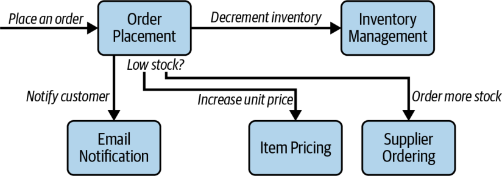

> **شکل ۸-۱۴.** مؤلفهٔ `Order Placement` با بقیهٔ سیستم کوپلینگِ بالایی دارد، زیرا دانشِ بیش از اندازه‌ای دارد

دقت کنید که در این معماری، مؤلفهٔ `Order Placement` با مؤلفه‌های دیگر کوپلینگِ بالایی دارد. هرچند مسئولیتِ انجامِ آن کنش‌ها را ندارد، از این دانش برخوردار است که این کنش‌ها باید رخ دهند؛ و دانشِ بیشتر یعنی کوپلینگِ تنگاتنگ‌تر.

ایدهٔ پشتِ قانونِ Demeter محدودکردنِ دانشِ هر مؤلفه دربارهٔ بقیهٔ سیستم است. در شکل ۸-۱۴، مؤلفهٔ `Order Placement` می‌داند که موجودی باید کاهش یابد، شاید لازم باشد موجودیِ بیشتری سفارش داده شود، شاید قیمتِ کالا باید تنظیم شود و ایمیلی باید برای مشتری فرستاده شود. (این دانشِ زیادی است!) اما اگر بتوان این دانش را میانِ مؤلفه‌های دیگر توزیع کرد چه؟ در آن صورت، معمار می‌تواند آن مؤلفه را عملاً از بقیهٔ سیستم جدا کند.

برای اینکه ببینید قانونِ Demeter چگونه می‌تواند برای کاهشِ کوپلینگِ مؤلفه‌ها به کار رود، به سیستمِ شکل ۸-۱۴ برگردید. اگر معمار مؤلفهٔ دیگری میانِ `Order Placement` و `Inventory Management` می‌افزود تا دانشِ لزومِ کاهشِ موجودی را به آن واگذارد، مؤلفهٔ `Order Placement` همچنان همان سطحِ کوپلینگ خروجی (برون‌سو) را داشت. بنابراین آن نقطهٔ کوپلینگ باید همان‌گونه که هست باقی بماند.

اما دانشِ اینکه اگر عرضه بیش از حد پایین بیاید، سیستم باید موجودیِ بیشتری سفارش دهد و قیمتِ کالا را تنظیم کند چه می‌شود؟ هر دوِ این دانسته‌ها را می‌توان به مؤلفهٔ `Inventory Management` واگذار کرد و از این راه سطحِ کوپلینگِ مؤلفهٔ `Order Placement` را کاهش داد. شکل ۸-۱۵ معماریِ حاصل از به‌کارگیریِ قانونِ Demeter را نشان می‌دهد. حذفِ دانشِ لزومِ رخ‌دادنِ برخی کارکردها، کوپلینگِ مؤلفهٔ `Order Placement` با بقیهٔ سیستم را کاهش می‌دهد.

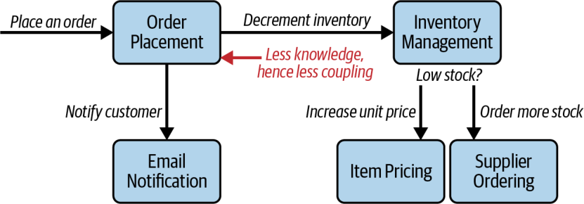

> **شکل ۸-۱۵.** مؤلفهٔ `Order Placement` وقتی دانشِ کمتری داشته باشد، کوپلینگِ کمتری با سیستم دارد

خوانندهٔ تیزبین درمی‌یابد که هرچند به‌کارگیریِ قانونِ Demeter سطحِ کوپلینگِ مؤلفهٔ `Order Placement` را کاهش داد، سطحِ کوپلینگِ مؤلفهٔ `Inventory Management` را افزایش داد. به‌کارگیریِ قانونِ Demeter لزوماً سطحِ کوپلینگ را در کلِ سیستم کاهش نمی‌دهد؛ بلکه معمولاً آن کوپلینگ را میانِ بخش‌های مختلفِ سیستم بازتوزیع می‌کند.

---

## مطالعهٔ موردی: Going, Going, Gone — کشفِ مؤلفه‌ها

اگر تیمی محدودیتِ خاصی نداشته باشد و به دنبالِ یک تجزیهٔ مؤلفه‌ای (component decomposition) خوب و همه‌منظوره باشد، رویکرد کنشگر/کنش به‌عنوانِ راه‌حلی عمومی به‌خوبی جواب می‌دهد.

اگر معمار رویکرد کنشگر/کنش را بر Going, Going, Gone (GGG) اعمال کند، درمی‌یابد که این سیستم سه نقشِ اصلی دارد: پیشنهاددهنده (bidder)، حراج‌گردان (auctioneer) و سیستم؛ که این آخری در این تکنیکِ مدل‌سازی مشارکت‌کننده‌ای همیشگی برای کنش‌های درونی است. این نقش‌ها با کنش‌های اصلیِ زیر با سیستم تعامل دارند:

`Bidder`

- مشاهدهٔ جریانِ زندهٔ ویدئو.
- مشاهدهٔ جریانِ زندهٔ پیشنهادها.
- ثبتِ پیشنهاد.

`Auctioneer`

- واردکردنِ پیشنهادهای حضوری به سیستم.
- دریافتِ پیشنهادهای برخط.
- علامت‌گذاریِ قلم کالا به‌عنوانِ فروخته‌شده.

`System`

- آغازِ حراج.
- انجامِ پرداخت.
- ردیابیِ فعالیتِ پیشنهاددهندگان.

با در دست داشتنِ این کنش‌ها، معمار می‌تواند مجموعه‌ای از مؤلفه‌های آغازین برای GGG بسازد و سپس آن را به‌صورتِ تکرارشونده بهبود دهد. یکی از این راه‌حل‌ها در شکل ۸-۱۶ آمده است.


> **شکل ۸-۱۶.** مجموعهٔ اولیهٔ مؤلفه‌ها برای Going, Going, Gone

در شکل ۸-۱۶، هر نقش و کنش به یک مؤلفه نگاشت می‌شود. مؤلفه‌ها ممکن است برای اشتراکِ اطلاعات به همکاری نیاز داشته باشند. مؤلفه‌هایی که برای این راه‌حل شناسایی کردیم عبارت‌اند از:

**`Video Streamer`:** حراجِ زنده را به‌صورتِ جریانی برای کاربران پخش می‌کند.

**`Bid Streamer`:** پیشنهادها را هم‌زمان با ثبتشان به‌صورتِ جریانی برای کاربران پخش می‌کند. `Video Streamer` و `Bid Streamer` هر دو نمایی فقط‌خواندنی (read-only) از حراج در اختیارِ پیشنهاددهندگان می‌گذارند.

**`Bid Capture`:** این مؤلفه پیشنهادها را از حراج‌گردان و پیشنهاددهندگان دریافت و ثبت می‌کند.

**`Bid Tracker`:** پیشنهادها را ردیابی می‌کند و نقشِ سیستمِ مرجع (system of record) را دارد.

**`Auction Session`:** حراج را آغاز می‌کند. وقتی پیشنهاددهنده برنده می‌شود و حراجِ آن قلم کالا پایان می‌یابد، این مؤلفه گام‌های پرداخت و تسویه را به راه می‌اندازد؛ از جمله اطلاع‌دادن به پیشنهاددهندگان دربارهٔ قلمِ بعدیِ حراج.

**`Payment`:** پردازشگرِ پرداختِ شخص ثالث برای پرداخت با کارت اعتباری.

پس از دورِ نخستِ شناسایی مؤلفه‌ها (شکل ۸-۶ را ببینید)، معمار ویژگی‌های معماری‌ای را که پیش‌تر شناسایی شده بودند تحلیل می‌کند تا دریابد آیا هیچ‌یک از آن‌ها طراحیِ مؤلفه را تغییر می‌دهد یا نه. برای نمونه، طراحیِ کنونی مؤلفهٔ `Bid Capture` را برای دریافتِ پیشنهادها هم از پیشنهاددهندگان و هم از حراج‌گردان در نظر گرفته است. این از نظرِ کارکردی منطقی است: پیشنهادِ هر کسی را می‌توان به یک شیوه دریافت و پردازش کرد. اما دریافتِ پیشنهادها به کدام‌یک از ویژگی‌های معماریِ شناسایی‌شده نیاز دارد؟ حراج‌گردان به همان سطحِ مقیاس‌پذیری یا کشسانیِ پیشنهاددهندگان نیاز ندارد که شمارشان ممکن است به هزاران نفر برسد.

به همین ترتیب، حراج‌گردان ممکن است به برخی ویژگی‌های معماریِ شناسایی‌شده بیش از دیگر بخش‌های سیستم نیاز داشته باشد؛ مانندِ قابلیت اطمینان (اطمینان از اینکه اتصال‌ها قطع نمی‌شوند) و در دسترس‌بودن (اطمینان از اینکه سیستم بالا و فعال می‌ماند). برای نمونه، هرچند برای کسب‌وکار بد است که پیشنهاددهنده‌ای نتواند وارد سایت شود یا اتصالش قطع شود، اگر یکی از این دو برای حراج‌گردان رخ دهد فاجعه‌بار خواهد بود.

معمار برای پشتیبانی از سطوحِ متفاوتِ نیازِ پیشنهاددهندگان و حراج‌گردان به ویژگی‌های معماریِ یکسان، تصمیم می‌گیرد مؤلفهٔ `Bid Capture` را به دو مؤلفه تقسیم کند: `Bid Capture` و `Auctioneer Capture`. طراحیِ به‌روزشده در شکل ۸-۱۷ آمده است.

معمار مؤلفهٔ جدیدی برای `Auctioneer Capture` می‌سازد. او همچنین پیوندهای اطلاعاتی را از `Auctioneer Capture` به `Bid Streamer` (برای نمایشِ پیشنهادهای حضوری به پیشنهاددهندگانِ برخط) و به `Bid Tracker` (برای مدیریتِ جریان‌های پیشنهاد) به‌روز می‌کند. اکنون `Bid Tracker` مؤلفه‌ای است که دو جریانِ اطلاعاتیِ بسیار متفاوت را یکپارچه می‌کند: جریانِ واحدِ اطلاعاتِ حراج‌گردان و جریان‌های متعددِ پیشنهاددهندگان.


> **شکل ۸-۱۷.** مؤلفه‌های بازنگری‌شدهٔ مطالعهٔ موردیِ GGG

بعید است طراحیِ نشان‌داده‌شده در شکل ۸-۱۷ طراحیِ نهایی باشد. الزاماتِ بیشتری باید کشف شوند: اینکه افراد چگونه حسابِ کاربریِ جدید ثبت خواهند کرد، کارکردهای پرداخت چگونه اداره خواهند شد و جز آن. با این حال، این طراحی نقطهٔ آغازِ خوبی برای تکرارهای بعدی فراهم می‌کند.

این یکی از مجموعه‌های ممکنِ مؤلفه‌ها برای حلِ مسئلهٔ GGG است؛ اما لزوماً نه بهترینِ آن‌هاست و نه تنها راه‌حل. سیستم‌های نرم‌افزاریِ اندکی هستند که فقط به یک شیوه پیاده‌سازی‌شدنی باشند. هر طراحی مجموعه‌های متفاوتی از مصالحه‌ها دارد. به‌عنوانِ معمار، درگیرِ وسواسِ یافتنِ «یگانه طراحیِ درست» نشوید، زیرا طراحی‌های بسیاری کفایت می‌کنند. بکوشید مصالحه‌های میانِ تصمیم‌های طراحیِ گوناگون را تا جای ممکن به‌شکلی عینی ارزیابی کنید و طراحی‌ای را برگزینید که «کم‌بدترین» (least worst) مجموعهٔ مصالحه‌ها را به همراه دارد.

---

## واژه‌نامهٔ اختصاصی این فصل

| واژهٔ انگلیسی | معادل مصوب/به‌کاررفته در این فصل |
|---|---|
| Component-Based Thinking | تفکر مؤلفه‌محور |
| Logical Component | مؤلفهٔ منطقی |
| Building Block | بلوک سازنده |
| Floor Plan | نقشهٔ طبقه |
| Leaf Node | گرهٔ برگ |
| Subdomain | زیرحوزه |
| Logical Architecture | معماری منطقی |
| Physical Architecture | معماری فیزیکی |
| Actor | کنشگر |
| Repository | مخزن |
| Physical Artifact | مصنوع فیزیکی |
| Deployment Unit | واحد استقرار |
| Component Identification | شناسایی مؤلفه‌ها |
| Candidate Component | مؤلفهٔ نامزد |
| Feedback Loop | حلقهٔ بازخورد |
| Core Component | مؤلفهٔ اصلی |
| Refactoring | بازآرایی |
| Greenfield System | سیستم نوساخت |
| Placeholder | جانگهدار |
| Workflow Approach | رویکرد گردش‌کار |
| Actor/Action Approach | رویکرد کنشگر/کنش |
| Entity Trap | تلهٔ موجودیت |
| Happy Path | مسیر موفق |
| User Journey | سفر کاربری |
| Order Packer | بسته‌بند سفارش |
| Dumping Ground | انبار درهم |
| Kitchen Sink (Utility Class) | کلاس کمکی همه‌چیزدار |
| Coarse-Grained | درشت‌دانه |
| Fine-Grained | ریزدانه |
| CRUD (Create, Read, Update, Delete) | CRUD (ایجاد، خواندن، به‌روزرسانی، حذف) |
| No-Code/Low-Code | بدون‌کد/کم‌کد |
| User Story | داستان کاربری |
| Role and Responsibility Statement | بیانیهٔ نقش و مسئولیت |
| Conjunctive Phrase | عبارت ربطی |
| Shopping Cart | سبد خرید |
| Fault Tolerance | تحمل خطا |
| Concurrent Users | کاربران هم‌زمان |
| Restructuring (Components) | بازساختاردهی (مؤلفه‌ها) |
| Edge Case | حالت مرزی |
| Lifecycle | چرخهٔ عمر |
| Component Coupling | کوپلینگ مؤلفه‌ها |
| Afferent Coupling | کوپلینگ ورودی |
| Incoming (Fan-in) Coupling | کوپلینگ درون‌سو (هم‌گرا) |
| Efferent Coupling | کوپلینگ خروجی |
| Outgoing (Fan-out) Coupling | کوپلینگ برون‌سو (انشعابی) |
| Temporal Coupling | کوپلینگ زمانی |
| Transaction | تراکنش |
| Law of Demeter | قانون Demeter |
| Principle of Least Knowledge | اصل کمترین دانش |
| Decoupled | جدا (فاقد کوپلینگ) |
| Component Decomposition | تجزیهٔ مؤلفه‌ای |
| Bidder | پیشنهاددهنده |
| Auctioneer | حراج‌گردان |
| Read-Only | فقط‌خواندنی |
| System of Record | سیستم مرجع |
| Third-Party | شخص ثالث |
| Least Worst (Trade-offs) | کم‌بدترین (مجموعهٔ مصالحه‌ها) |

---

<a id="chapter-09"></a>

# فصل ۹: مبانی

> **بخش دوم: سبک‌های معماری**
>
> تفاوتِ میانِ سبک معماری و الگوی معماری (architecture pattern) ممکن است گیج‌کننده باشد؛ در همین فصلِ ۹ پیشِ رو، به بررسی و تعریفِ این تفاوت می‌پردازیم.
>
> شناختِ سبک‌های معماری بخشِ بزرگی از وقت و توانِ معمارانِ تازه‌کار را به خود اختصاص می‌دهد، زیرا سبک‌ها هم مهم‌اند و هم فراوان. معماران برای گرفتنِ تصمیم‌های اثربخش باید سبک‌های گوناگون و مصالحه‌های نهفته در هر یک را بشناسند؛ هر سبک معماری مجموعه‌ای شناخته‌شده از مصالحه‌ها را در خود دارد که به معماران کمک می‌کند برای یک مسئلهٔ کسب‌وکاریِ مشخص انتخابِ درستی داشته باشند.

می‌دانیم مشتاقید هرچه زودتر به جزئیاتِ سبک‌ها و الگوهای معماری برسید؛ اما نخست باید برخی مطالبِ بنیادین و تعریفی را پوشش دهیم تا بافتارِ مناسب برای فصل‌های بعدی فراهم شود.

---

## سبک‌ها در برابرِ الگوها

نخست باید میانِ سبک‌های معماری و الگوها در معماری تمایز بگذاریم، زیرا به‌آسانی با هم اشتباه گرفته می‌شوند.

سبکِ یک معماری چندین ویژگیِ متفاوتِ آن معماری را توصیف می‌کند، از جمله:

**توپولوژیِ مؤلفه‌ها (component topology):** سبک معماری تعیین می‌کند که مؤلفه‌ها و وابستگی‌هایشان چگونه سازمان‌دهی شوند. برای نمونه، معماری لایه‌ای لایه‌های مؤلفه‌ها را بر پایهٔ قابلیت‌های فنی‌شان سازمان می‌دهد، در حالی که تک‌پارچهٔ ماژولار (modular monolith) مؤلفه‌هایش را حولِ حوزه‌ها سازمان می‌دهد (دربارهٔ این تفاوت در بخشِ «افرازِ معماری» در صفحهٔ ۱۳۷ بیشتر می‌گوییم).

**معماری فیزیکی:** سبک اغلب نوعِ معماری فیزیکی را تعیین می‌کند: یا تک‌پارچه یا توزیع‌شده. برای نمونه، تک‌پارچهٔ ماژولار عموماً معماری‌ای تک‌پارچه با یک پایگاه‌دادهٔ واحد است، در حالی که معماری رویدادمحور همیشه توزیع‌شده است.

**استقرار:** دانه‌بندیِ سیستم و بسامدِ استقرارِ (deployment frequency) آن اغلب با سبک معماریِ آن پیوند دارد. تیم‌ها معماری‌های تک‌پارچه را عموماً در قالبِ یک استقرارِ واحد همراه با یک پایگاه‌دادهٔ رابطه‌ایِ واحد مستقر می‌کنند. در مقابل، معماری‌های توزیع‌شدهٔ بسیار چابک، مانندِ میکروسرویس‌ها، از یکپارچه‌سازیِ خودکار، تأمینِ خودکارِ منابع (automated provisioning) و گاهی استقرارهای خودکار بهره می‌برند؛ این معماری‌ها عموماً تکه‌تکه و با آهنگی (cadence) بسیار سریع‌تر مستقر می‌شوند.

**سبک ارتباطی (communication style):** سبک معماری همچنین تعیین می‌کند که مؤلفه‌ها چگونه با یکدیگر ارتباط برقرار کنند. معماری‌های تک‌پارچه می‌توانند درونِ همان تک‌پارچه فراخوانیِ متد انجام دهند، در حالی که معماری‌های توزیع‌شده از راهِ پروتکل‌های شبکه (network protocols)، مانندِ REST یا صف‌های پیام، ارتباط برقرار می‌کنند.

**توپولوژیِ داده (data topology):** توپولوژیِ دادهٔ سیستم نیز، درست مانندِ توپولوژیِ مؤلفه‌ها، اغلب از سبک معماریِ آن پیروی می‌کند. معماری‌های تک‌پارچه معمولاً پایگاه‌داده‌ای تک‌پارچه دارند، در حالی که معماری‌های توزیع‌شده، بسته به فلسفهٔ سبک معماری، گاهی داده‌ها را از هم جدا می‌کنند.

نام‌گذاریِ یک سبک راهی موجز برای توصیفِ این مجموعهٔ پیچیده از عوامل فراهم می‌کند. هر نام انبوهی از جزئیاتِ شناخته‌شده را در خود جای می‌دهد؛ این یکی از هدف‌های الگوهای طراحی است. اما در حالی که یک الگو راه‌حلی بافتارمند را در خود ثبت می‌کند، سبک ویژهٔ معماری است و جنبه‌های برشمرده در بالا را توصیف می‌کند. سبک معماری توپولوژیِ معماری و ویژگی‌های مفروض و پیش‌فرضِ آن، چه سودمند و چه زیان‌بار، را توصیف می‌کند. چند الگوی معماریِ رایج و مدرن را در فصل ۲۰ بررسی می‌کنیم. معماران باید با چند سبکِ بنیادین که بلوک‌های سازندهٔ رایجِ سیستم‌ها هستند آشنا باشند.

> **سبک‌های معماری از کجا می‌آیند؟**
>
> برخلافِ باورِ رایج، هیچ محفلِ رسمیِ معماری‌ای وجود ندارد که در برجی عاج گرد هم آید و تصمیم بگیرد سبک‌های معماریِ بعدی چه باشند. بلکه سبک‌های جدید از دلِ اکوسیستم‌هایی که معماران در آن‌ها کار می‌کنند و پیوسته در حالِ تکامل‌اند سر بر می‌آورند.
>
> برای نمونه، فرض کنید معماری زیرک متوجه می‌شود که قابلیتی نوظهور در اکوسیستم، مسئلهٔ آزاردهندهٔ خاصی را حل می‌کند. او تصمیم می‌گیرد آن را با چند مؤلفهٔ دیگر، چه نو و چه کهنه، ترکیب کند. معمارانِ دیگر این راه‌حلِ هوشمندانه را می‌بینند و از آن الگوبرداری می‌کنند. این راه‌حل چندان رواج می‌یابد که نام‌گذاری‌اش گفت‌وگو دربارهٔ آن را آسان‌تر می‌کند.
>
> سبکِ معماری میکروسرویس‌ها نمونهٔ عالی‌ای از این پدیده است. پیدایشِ قابلیت‌های تازهٔ DevOps، سیستم‌عامل‌های آزادِ قابل اعتماد و فلسفهٔ طراحی حوزه‌محور به معماران امکان داد سیستم‌ها را به شیوه‌های تازه‌ای بسازند تا مسائلی مانندِ مقیاس‌پذیری را حل کنند. نامِ microservices واکنشی بود به سبک‌های معماریِ رایجِ آن زمان که سرویس‌های بزرگ و ارکستراسیونِ گسترده داشتند. «میکروسرویس‌ها» یک برچسب است، نه یک توصیف. این نام فرمانی برای تیم‌ها نیست که کوچک‌ترین سرویس‌های ممکن را بسازند، بلکه راهی برای اشاره به این سبک معماری است.

---

## الگوهای بنیادین

چندین الگوی بنیادین (fundamental patterns) بارها و بارها در طولِ تاریخِ معماری نرم‌افزار پدیدار شده‌اند؛ عموماً به این دلیل که دیدگاهی سودمند برای سازمان‌دهیِ کد، استقرارها یا دیگر جنبه‌های معماری فراهم می‌کنند. برای نمونه، مفهومِ لایه‌هایی که دغدغه‌های گوناگون را بر پایهٔ کارکرد از هم جدا می‌کنند، به قدمتِ خودِ نرم‌افزار است. با این همه، لایه‌ها (هم در سبک‌ها و هم در الگوها) همچنان در اشکال و قالب‌های گوناگون نمود می‌یابند؛ از جمله گونه‌های مدرنی که در فصل ۱۰ بررسی می‌کنیم.

افسوس که ضدالگوی رایجِ دیگری نیز وجود دارد که از نبودِ معماری سرچشمه می‌گیرد: توپِ بزرگِ گِل.

### توپِ بزرگِ گِل

معماران نبودِ هرگونه ساختارِ معماریِ تشخیص‌پذیر را توپِ بزرگِ گِل می‌نامند؛ نامی برگرفته از ضدالگویی که Brian Foote و Joseph Yoder در مقاله‌ای تعریف کردند که در سال ۱۹۹۷ در کنفرانسِ Pattern Languages of Programs ارائه شد.

> توپِ بزرگِ گِل جنگلی از کدِ اسپاگتی (spaghetti code) است: بی‌ساختار، پراکنده، شلخته و سرهم‌بندی‌شده با چسب‌نواری و سیم‌مفتول. این سیستم‌ها نشانه‌های انکارناپذیرِ رشدِ بی‌قاعده و تعمیرهای مکرر و سرسری را در خود دارند. اطلاعات بی‌حساب‌وکتاب میانِ اجزای دوردستِ سیستم به اشتراک گذاشته می‌شود؛ اغلب تا جایی که تقریباً همهٔ اطلاعاتِ مهم سراسری یا تکراری می‌شوند.
>
> ساختارِ کلیِ سیستم شاید هرگز به‌خوبی تعریف نشده باشد.
>
> و اگر هم پیش‌تر ساختاری داشته، شاید چنان فرسوده شده باشد که دیگر بازشناختنی نیست. برنامه‌نویسانی که ذره‌ای حسِ معماری دارند از این باتلاق‌ها دوری می‌کنند. تنها کسانی که دغدغهٔ معماری ندارند و شاید به رخوتِ کارِ روزمرهٔ وصله‌کردنِ سوراخ‌های این سدهای فروریزنده خو گرفته‌اند، به کار روی چنین سیستم‌هایی خرسندند.

امروزه توپِ بزرگِ گِل ممکن است برنامه‌ای اسکریپتیِ ساده و بدونِ ساختارِ درونیِ واقعی را توصیف کند که گرداننده‌های رویدادِ (event handlers) آن مستقیماً به فراخوانی‌های پایگاه‌داده متصل شده‌اند. بسیاری از برنامه‌های پیش‌پاافتاده این‌گونه آغاز می‌شوند و با رشدشان دست‌وپاگیر می‌شوند.

به‌طورِ کلی، به هر قیمتی از این نوع معماری بپرهیزید. نبودِ ساختار در آن تغییر را روزبه‌روز دشوارتر می‌کند. چنین معماری‌هایی همچنین با مشکلاتی در استقرار، آزمون‌پذیری، مقیاس‌پذیری و کارایی دست‌به‌گریبان‌اند. هرچه این سیستم‌ها بزرگ‌تر شوند، دردِ ناشی از نبودِ معماری در آن‌ها شدیدتر می‌شود.

متأسفانه این ضدالگو در دنیای واقعی بسیار رخ می‌دهد. معمارانِ اندکی قصدِ آفریدنِ چنین آشفتگی‌ای را دارند، اما بسیاری از پروژه‌ها ناخواسته به آن می‌رسند؛ معمولاً به دلیلِ نبودِ حاکمیت بر کیفیت و ساختارِ کد. برای نمونه، Neal روی پروژهٔ یکی از مشتریان کار کرد که ساختارش در شکل ۹-۱ آمده است.

این مشتری (که نامش به دلایلِ روشن فاش نمی‌شود) طیِ چند سال یک برنامهٔ وبِ مبتنی بر Java را با بیشترین شتابِ ممکن ساخته بود. مصورسازیِ فنیِ شکل ۹-۱ کوپلینگِ آن را نشان می‌دهد: هر نقطه روی محیطِ دایره نمایانگرِ یک کلاس است و هر خط نمایانگرِ اتصالی میانِ کلاس‌ها؛ خط‌های پررنگ‌تر اتصال‌های قوی‌تر را نشان می‌دهند. در این پایگاه کد، هر نوع تغییر در یک کلاس پیش‌بینیِ اثرش بر کلاس‌های دیگر را دشوار می‌کند و تغییر را به کاری هراس‌آور بدل می‌سازد.


> **شکل ۹-۱.** معماری توپِ بزرگِ گِل، مصورشده از یک پایگاه کدِ واقعی. (ساخته‌شده با ابزاری بازنشسته به نامِ XRay، یک افزونهٔ Eclipse.)

مشکلِ معماری‌های توپِ بزرگِ گِل فقط نبودِ ساختار نیست. چون همه‌چیز به همه‌چیز کوپل شده است، تغییرات اثراتِ جانبیِ موج‌وار و پیش‌بینی‌ناپذیری دارند. این مشکل می‌تواند به نقطهٔ بحرانی‌ای برسد که توسعه‌دهندگان همهٔ وقتشان را به‌جای کار روی قابلیت‌های جدید، صرفِ تعقیبِ باگ‌ها و اثراتِ جانبیِ آن‌ها کنند.

### معماری یکتا (Unitary Architecture)

در آغاز تنها رایانه بود و نرم‌افزار روی آن اجرا می‌شد. این دو در آغاز موجودیتی واحد بودند و سپس، همزمان با تکاملشان و رشدِ نیاز به قابلیت‌های پیچیده‌تر، از هم جدا شدند. برای نمونه، رایانه‌های بزرگ (mainframes) نخست سیستم‌هایی یکپارچه و منفرد بودند و سپس به‌تدریج داده را در نوعِ جداگانه‌ای از سیستم جای دادند. به همین ترتیب، وقتی رایانه‌های شخصی (PCs) نخستین بار به‌صورتِ تجاری توسعه یافتند، تمرکز عمدتاً بر ماشین‌های منفرد بود. با رایج‌شدنِ شبکه‌کردنِ رایانه‌های شخصی، سیستم‌های توزیع‌شده (مانندِ کلاینت/سرور) پدیدار شدند.

### کلاینت/سرور

بیرون از سیستم‌های تعبیه‌شده (embedded systems) و دیگر محیط‌های به‌شدت محدود، معماری‌های یکتای اندکی وجود دارند. سیستم‌های نرم‌افزاری عموماً با گذشتِ زمان کارکردهای بیشتری می‌یابند و جداسازیِ دغدغه‌ها برای حفظِ ویژگی‌های معماریِ عملیاتیِ آن‌ها، مانندِ کارایی و مقیاس، ضروری می‌شود.

بسیاری از سبک‌های معماری به این می‌پردازند که چگونه بخش‌های سیستم را به‌شکلی کارآمد از هم جدا کنیم. یکی از سبک‌های بنیادین در معماری، کارکردهای فنی را میانِ سمت کاربر و سمتِ سرور (backend) جدا می‌کند: این سبک معماری دولایه (two-tier) یا کلاینت/سرور (client/server) نام دارد. این سبک بسته به دوره و توانِ محاسباتیِ سیستم، گونه‌های مختلفی دارد.

#### رومیزی و سرورِ پایگاه‌داده

یکی از معماری‌های اولیهٔ رایانه‌های شخصی توسعه‌دهندگان را به نوشتنِ برنامه‌های رومیزیِ (desktop) غنی در رابط‌های کاربری‌ای مانندِ Windows ترغیب می‌کرد و داده‌ها را در یک سرور پایگاه‌دادهٔ جداگانه قرار می‌داد. این معماری هم‌زمان با پیدایشِ سرورهای پایگاه‌دادهٔ مستقلی بود که می‌توانستند از راهِ پروتکل‌های شبکهٔ استاندارد متصل شوند. این امر اجازه می‌داد منطقِ ارائه (presentation logic) روی رایانهٔ رومیزی بماند، در حالی که کنش‌های محاسباتیِ سنگین‌تر (هم از نظرِ حجم و هم از نظرِ پیچیدگی) روی سرورهای پایگاه‌دادهٔ نیرومندتر انجام شوند.

#### مرورگر و وب‌سرور

با ظهورِ توسعهٔ وبِ مدرن، رایج شد که معماری‌ها را به یک مرورگرِ وب متصل به یک وب‌سرور (که خود به یک سرور پایگاه‌داده متصل بود) تقسیم کنند. این تفکیکِ مسئولیت‌ها به گونهٔ رومیزی شبیه بود، اما مرورگرها کلاینت‌هایی حتی نازک‌تر (thinner clients) بودند و امکانِ توزیعِ گسترده‌تری را هم درون و هم بیرون از دیوارهای آتش (firewalls) فراهم می‌کردند. با اینکه پایگاه‌داده از وب‌سرور جداست، بسیاری از معماران همچنان این را معماری دولایه می‌دانند، زیرا وب‌سرور و سرور پایگاه‌داده روی یک ردهٔ ماشین در مرکزِ عملیات اجرا می‌شوند، در حالی که رابط کاربری در مرورگرِ کاربر اجرا می‌شود.

#### برنامه‌های تک‌صفحه‌ایِ JavaScript (Single-Page JavaScript Applications)

با بهبودِ پاسخ‌گوییِ وب، پیاده‌سازی‌های JavaScript در مرورگرها نیز بهتر شدند. خانواده‌ای از برنامه‌ها با سبکِ کلاینت/سرور پدید آمد که به گونهٔ رومیزیِ اولیه شباهت دارد، با این تفاوت که کلاینتِ غنی (rich client) به‌جای یک برنامهٔ رومیزی، با JavaScript و در مرورگر نوشته می‌شود.

چنان‌که این بخش نشان می‌دهد، همیشه لایه‌هایی برای جداسازیِ بخش‌های مختلفِ معماری وجود خواهند داشت که به نیازهای برنامه و توانایی‌های پلتفرم بستگی دارند.

#### سه‌لایه

معماری سه‌لایه (three-tier architecture)، که لایه‌های تفکیکِ بیشتری فراهم می‌کرد، در اواخرِ دههٔ ۱۹۹۰ رواج یافت. با برجسته‌شدنِ ابزارهایی مانندِ سرورهای برنامهٔ کاربردی در Java و .NET، شرکت‌ها شروع به افزودنِ لایه‌های بیشتر به توپولوژی‌هایشان کردند. یک سیستم ممکن بود یک لایهٔ پایگاه‌داده با سرور پایگاه‌دادهٔ صنعتی و پرتوان، یک لایهٔ برنامهٔ کاربردی که یک سرور برنامهٔ کاربردی آن را مدیریت می‌کرد، و یک سمت کاربرِ نوشته‌شده با HTMLِ تولیدشده و، به‌طورِ فزاینده، JavaScript (همزمان با گسترشِ توانایی‌هایش) داشته باشد.

معماری سه‌لایه با پروتکل‌هایی در سطحِ شبکه، مانندِ Common Object Request Broker Architecture (CORBA) و Distributed Component Object Model (DCOM)، همراه بود که ساختنِ معماری‌های توزیع‌شده را آسان می‌کردند.

همان‌طور که توسعه‌دهندگانِ امروز نگرانِ چگونگیِ کارِ پروتکل‌های شبکه‌ای مانندِ TCP/IP نیستند (چون این پروتکل‌ها به‌سادگی کار می‌کنند)، بیشترِ معماران نیز لازم نیست نگرانِ این سطح از لوله‌کشیِ زیرساختی (plumbing) در معماری‌های توزیع‌شده باشند. قابلیت‌هایی که ابزارهای آن دوره ارائه می‌کردند، امروز یا به‌صورتِ ابزار (مانندِ صف‌های پیام) یا به‌صورتِ الگوهای معماری (مانندِ معماری رویدادمحور که در فصل ۱۵ بررسی می‌شود) وجود دارند.

> **معماری‌های سه‌لایه، طراحیِ زبان و پیامدهای بلندمدت**
>
> در دههٔ ۱۹۹۰، هنگامی که زبانِ Java طراحی می‌شد، محاسباتِ سه‌لایه بسیار پرطرفدار بود. همه گمان می‌کردند که در آینده همهٔ سیستم‌ها معماری سه‌لایه خواهند داشت. یکی از دردسرهای رایجِ زبان‌های موجودِ آن زمان، مانندِ C++، این بود که جابه‌جاکردنِ اشیا روی شبکه به شیوه‌ای سازگار میانِ سیستم‌ها چقدر دشوار و پرزحمت بود. از این رو، طراحانِ Java تصمیم گرفتند این قابلیت را در هستهٔ زبان بگنجانند و از سازوکاری به نامِ سریال‌سازی (serialization) بهره گرفتند.
>
> هر شیءِ Java رابطی را پیاده می‌کند که آن را ملزم به پشتیبانی از سریال‌سازی می‌کند. طراحان چنین می‌اندیشیدند که چون معماری سه‌لایه برای همیشه خواهد ماند، گنجاندنش در زبان سهولتِ زیادی به همراه خواهد داشت. البته آن سبکِ معماری آمد و رفت؛ اما بقایایش تا امروز در Java دیده می‌شود. با اینکه تقریباً هیچ‌کس دیگر از سریال‌سازی استفاده نمی‌کند، قابلیت‌های جدیدِ Java برای سازگاری رو به عقب باید از آن پشتیبانی کنند و این مایهٔ سرخوردگیِ شدیدِ طراحانِ زبان است.
>
> درکِ پیامدهای بلندمدتِ تصمیم‌های طراحی همواره از دسترسِ ما دور بوده است؛ چه در نرم‌افزار و چه در دیگر رشته‌های مهندسی. توصیهٔ همیشگی به ترجیحِ طراحی‌های ساده، از بسیاری جهات راهبردی برای آینده‌نگری و مصون‌سازی در برابرِ آینده (future-proofing) است.

---

## افرازِ معماری (Architecture Partitioning)

قانون اول معماری نرم‌افزار می‌گوید که همه‌چیز در نرم‌افزار مصالحه است؛ و این شاملِ شیوهٔ افرازِ مؤلفه‌ها در معماری به دستِ معماران نیز می‌شود. از آنجا که مؤلفه‌ها نمایانگرِ سازوکاری عمومی برای دربرگیری (containment) هستند، معماران می‌توانند آن‌ها را به هر شکلی که بخواهند افراز کنند. چندین سبکِ رایج با مجموعه‌های متفاوتی از مصالحه‌ها وجود دارد. یک نوعِ خاص از چیدمانِ مؤلفه‌ها اثرِ بسیار بزرگی دارد: افرازِ سطحِ بالا (top-level partitioning).

از دو سبکِ معماریِ نشان‌داده‌شده در شکل ۹-۲، یکی برای بسیاری آشناست: تک‌پارچهٔ لایه‌ای (که در فصل ۱۰ به‌تفصیل بررسی می‌شود). دیگری، به نامِ تک‌پارچهٔ ماژولار، سبکی معماری است که Simon Brown آن را رواج داد. این سبک از یک واحد استقرارِ منفرد تشکیل شده که با یک پایگاه‌داده همراه است و به‌جای قابلیت‌های فنی حولِ حوزه‌ها افراز شده است (در فصل ۱۱ بررسی می‌شود). این دو سبک نمایانگرِ دو روشِ متفاوتِ افرازِ سطحِ بالا هستند. توجه کنید که در هر دو گونه، هر لایه یا مؤلفهٔ سطحِ بالا احتمالاً مؤلفه‌های دیگری را در درونِ خود جای داده است. افرازِ سطحِ بالا برای معماران اهمیتِ ویژه‌ای دارد، زیرا یک سبکِ معماریِ بنیادین و شیوهٔ افرازِ کد را تعریف می‌کند.


> **شکل ۹-۲.** دو نوع افرازِ سطحِ بالا: فنی (مانندِ معماری لایه‌ای) و حوزه‌ای (مانندِ تک‌پارچهٔ ماژولار)

سازمان‌دهیِ معماری بر پایهٔ قابلیت‌های فنی، آن‌گونه که سبکِ تک‌پارچهٔ لایه‌ای انجام می‌دهد، نمایانگرِ افرازِ فنیِ سطحِ بالا (technical top-level partitioning) است.

نسخهٔ رایجی از این نوع افراز در شکل ۹-۳ آمده است؛ جایی که معمار کارکردهای سیستم را به قابلیت‌های فنی افراز کرده است: ارائه، قواعدِ کسب‌وکار، سرویس‌ها، ماندگاری و جز آن. این شیوهٔ سازمان‌دهیِ پایگاه کد بی‌گمان منطقی است. همهٔ کدِ ماندگاری در یک لایه قرار دارد و یافتنِ کدهای مرتبط با ماندگاری را برای توسعه‌دهندگان آسان می‌کند. با اینکه مفهومِ پایه‌ایِ معماری لایه‌ای ده‌ها سال قدیمی‌تر از الگوی طراحیِ Model-View-Controller است، این الگو (یکی از الگوهای بنیادینِ کتابِ Head First Design Patterns نوشتهٔ Eric Freeman و Elisabeth Robson (O’Reilly، ۲۰۲۰)) با این الگوی معماری هم‌خوان است و فهمِ آن را برای توسعه‌دهندگان آسان می‌کند. از این رو، در بسیاری از سازمان‌ها این معماری پیش‌فرض است.


> **شکل ۹-۳.** دو نوع افرازِ سطحِ بالا در معماری

یکی از اثراتِ جانبیِ جالبِ چیرگیِ معماری لایه‌ای به این مربوط است که شرکت‌ها اغلب چیدمان و استقرارِ فیزیکیِ افراد در دفاتر را بر پایهٔ نقش‌های مختلفِ پروژه سامان می‌دادند. به دلیلِ قانونِ Conway (Conway’s Law)، هنگامِ استفاده از معماری لایه‌ای تا اندازه‌ای منطقی است که همهٔ توسعه‌دهندگانِ سمتِ سرور در یک دپارتمان کنارِ هم بنشینند، مدیرانِ پایگاه‌داده در دپارتمانی دیگر، تیمِ ارائه در دپارتمانی دیگر و همین‌طور الی آخر.

گونهٔ دیگرِ معماری در شکل ۹-۳ افرازِ حوزه‌ای (domain partitioning) است؛ تکنیکی برای مدل‌سازی و تجزیهٔ سیستم‌های نرم‌افزاریِ پیچیده که مؤلفه‌ها را به‌جای قابلیت‌های فنی بر پایهٔ حوزه سازمان می‌دهد. افرازِ حوزه‌ای از کتابِ Domain-Driven Design نوشتهٔ Eric Evans الهام گرفته است. در DDD، معمار حوزه‌ها یا گردش‌کارهایی را شناسایی می‌کند که از یکدیگر مستقل و جدا هستند. سبکِ معماری میکروسرویس‌ها بر همین فلسفه استوار است.

معماری تک‌پارچهٔ ماژولار به‌جای قابلیت‌های فنی، حولِ حوزه‌ها یا گردش‌کارها افراز می‌شود. چون مؤلفه‌ها اغلب درونِ یکدیگر جای می‌گیرند، هر مؤلفه در معماریِ حوزه‌محورِ شکل ۹-۳ (برای نمونه، `CatalogCheckout`) ممکن است از یک کتابخانهٔ ماندگاری استفاده کند و لایهٔ جداگانه‌ای برای قواعدِ کسب‌وکار داشته باشد؛ اما افرازِ سطحِ بالا همچنان حولِ حوزه‌ها خواهد بود.

> **قانونِ Conway**
>
> در اواخرِ دههٔ ۱۹۶۰، Melvin Conway مشاهده‌ای کرد که به قانونِ Conway شهرت یافته است:
>
> > سازمان‌هایی که سیستم طراحی می‌کنند… ناگزیرند طراحی‌هایی پدید آورند که رونوشتی از ساختارهای ارتباطیِ همین سازمان‌هاست.
>
> به بیانِ دیگر، این قانون می‌گوید وقتی گروهی از افراد مصنوعی فنی را طراحی می‌کنند، ساختارهای طراحی‌شان بازتابِ شیوهٔ ارتباطِ همین افراد خواهد بود. افراد در همهٔ سطوحِ سازمان این قانون را در عمل می‌بینند و گاهی تصمیم‌هایشان را بر آن بنا می‌کنند. برای نمونه، با اینکه سازمان‌ها معمولاً کارکنان را بر پایهٔ قابلیت‌های فنی تقسیم می‌کنند، این تقسیم جداسازیِ مصنوعیِ دغدغه‌های مشترک است که می‌تواند مانعِ همکاری شود.
>
> مشاهدهٔ مرتبطی که Jonny Leroy از Thoughtworks مطرح کرد، مانورِ معکوسِ Conway (Inverse Conway Maneuver) است؛ این مانور پیشنهاد می‌کند ساختارهای تیم‌ها و سازمان‌ها را هم‌پای هم تکامل دهیم تا معماریِ مطلوب تقویت شود. این ملاحظه از آن پس با نامِ توپولوژی‌های تیم (team topologies) در همه‌جا شناخته شده است.
>
> سازمان‌ها دریافته‌اند که توپولوژی‌های تیم می‌توانند اثرِ چشمگیری بر بسیاری از جنبه‌های مهمِ کسب‌وکارشان، از جمله معماری نرم‌افزار، داشته باشند. در فصل‌های پیشِ رو که بر سبک‌ها تمرکز دارند، اثرِ هر سبکِ معماری بر این انواعِ تیم را بررسی می‌کنیم.

یکی از تمایزهای بنیادینِ میانِ الگوهای معماری این است که هر یک از چه نوع افرازِ سطحِ بالایی پشتیبانی می‌کند. در فصل‌های بعدی که به سبک‌های خاص می‌پردازند، این تمایز را برای تک‌تکِ الگوها بررسی می‌کنیم. افرازِ سطحِ بالا همچنین اثرِ بزرگی بر این تصمیمِ معمار دارد که مؤلفه‌ها را در آغاز بر پایهٔ معیارهای فنی شناسایی کند یا بر پایهٔ حوزه.

معمارانی که از افرازِ فنی استفاده می‌کنند، مؤلفه‌های سیستم را بر پایهٔ قابلیت‌های فنی‌شان سازمان می‌دهند: ارائه، قواعدِ کسب‌وکار، ماندگاری و جز آن. یکی از اصولِ سازمان‌دهندهٔ معماری لایه‌ای جداسازیِ دغدغه‌های فنی (separation of technical concerns) است که سطوحِ سودمندی از جداسازی پدید می‌آورد. برای نمونه، اگر لایهٔ Service فقط به لایهٔ Persistence در پایین و لایهٔ Business Rules در بالا متصل باشد، تغییرات در ماندگاری احتمالاً فقط بر همین لایه‌ها اثر می‌گذارند. این جداسازی احتمالِ اثراتِ جانبیِ موج‌وار بر مؤلفه‌های وابسته را کاهش می‌دهد.

سازمان‌دهیِ سیستم‌ها با افرازِ فنی بی‌گمان منطقی است؛ اما مانندِ همهٔ چیزها در معماری نرم‌افزار، مصالحه‌هایی دارد. جداسازی‌ای که افرازِ فنی تحمیل می‌کند به توسعه‌دهندگان امکان می‌دهد دسته‌های مشخصی از پایگاه کد را سریع پیدا کنند، چون پایگاه کد بر پایهٔ قابلیت‌ها سازمان یافته است؛ اما بیشترِ سیستم‌های نرم‌افزاریِ واقعی به گردش‌کارهایی نیاز دارند که از میانِ قابلیت‌های فنی می‌گذرند.

در معماریِ افرازشدهٔ فنیِ شکل ۹-۴، گردش‌کارِ رایجِ کسب‌وکاریِ `CatalogCheckout` را در نظر بگیرید. کدِ رسیدگی به `CatalogCheckout` در این معماری در همهٔ لایه‌ها پراکنده است. به بیانِ دیگر، حوزه در سراسرِ لایه‌های فنی پخش شده است.


> **شکل ۹-۴.** جایگاهِ حوزه‌ها/گردش‌کارها در معماری‌های افرازشدهٔ فنی و افرازشدهٔ حوزه‌ای

این را با معماریِ افرازشدهٔ حوزه‌ایِ شکل ۹-۴ مقایسه کنید که در آن معماران مؤلفه‌های سطحِ بالا را حولِ گردش‌کارها و حوزه‌ها ساخته‌اند. هر مؤلفه ممکن است زیرمؤلفه‌هایی، از جمله لایه‌ها، داشته باشد؛ اما افرازِ سطحِ بالا بر حوزه‌ها تمرکز دارد که انواعِ تغییراتی را که بیشتر در پروژه‌ها رخ می‌دهند بهتر بازتاب می‌دهد.

هیچ‌یک از این دو سبک درست‌تر از دیگری نیست. (به قانون اول معماری نرم‌افزار رجوع کنید.) با این حال، در چند سالِ گذشته گرایشِ آشکاری در صنعت به سوی افرازِ حوزه‌ای، هم در معماری‌های تک‌پارچه و هم در معماری‌های توزیع‌شده (مانندِ میکروسرویس‌ها)، مشاهده کرده‌ایم. همان‌طور که گفتیم، این یکی از نخستین تصمیم‌هایی است که معمار باید بگیرد.

### کاتا: Silicon Sandwiches — افراز

یکی از کاتاهای نمونهٔ خودمان، «کاتا: Silicon Sandwiches» در صفحهٔ ۷۱، را در نظر بگیرید. بیایید با نخستین گزینه از دو گزینهٔ ممکن برای Silicon Sandwiches آغاز کنیم: افرازِ حوزه‌ای، که در شکل ۹-۵ نشان داده شده است.


> **شکل ۹-۵.** طراحیِ افرازشدهٔ حوزه‌ای برای Silicon Sandwiches

در شکل ۹-۵، معمار طراحی را حولِ حوزه‌ها (گردش‌کارها) انجام داده و مؤلفه‌های مجزایی برای `Purchase`، `Promotion`، `MakeOrder`، `ManageInventory`، `Recipes`، `Delivery` و `Location` ساخته است. درونِ بسیاری از این مؤلفه‌ها زیرمؤلفه‌هایی قرار دارند که هر دو نوعِ سفارشی‌سازی (customization)، مشترک و محلی، را مدیریت می‌کنند.


> **شکل ۹-۶.** طراحیِ افرازشدهٔ فنی برای Silicon Sandwiches

طراحیِ جایگزین، چنان‌که در شکل ۹-۶ نشان داده شده، بخش‌های مشترک و محلی را در افرازهای مخصوصِ خودشان جدا می‌کند. `Common` و `Local` نمایانگرِ مؤلفه‌های سطحِ بالا هستند، در حالی که `Purchase` و `Delivery` برای رسیدگی به گردش‌کار باقی می‌مانند.

کدام بهتر است؟ بستگی دارد! هر نوع افراز مزایا و معایبِ متفاوتی دارد.

#### افرازِ حوزه‌ای

معماری‌های افرازشدهٔ حوزه‌ای مؤلفه‌های سطحِ بالا را بر پایهٔ گردش‌کارها و/یا حوزه‌ها از هم جدا می‌کنند.

**مزایا:**

- بیشتر بر پایهٔ شیوهٔ کارکردِ کسب‌وکار مدل می‌شود تا بر پایهٔ جزئیاتِ پیاده‌سازی
- ساختنِ تیم‌های چندتخصصی (cross-functional teams) حولِ حوزه‌ها آسان‌تر است
- با سبک‌های معماری تک‌پارچهٔ ماژولار و میکروسرویس‌ها هم‌خوانیِ بیشتری دارد
- جریانِ پیام‌ها با حوزهٔ مسئله مطابقت دارد
- مهاجرتِ داده‌ها و مؤلفه‌ها به معماری توزیع‌شده آسان است

**عیب:**

- کدِ سفارشی‌سازی در جاهای مختلف پراکنده است

#### افرازِ فنی

معماری‌های افرازشدهٔ فنی مؤلفه‌های سطحِ بالا را به‌جای گردش‌کارهای مجزا، بر پایهٔ قابلیت‌های فنی از هم جدا می‌کنند. این امر ممکن است به‌صورتِ لایه‌هایی الهام‌گرفته از تفکیکِ Model-View-Controller یا نوعی افرازِ فنیِ موردیِ دیگر نمود یابد. معماریِ نشان‌داده‌شده در شکل ۹-۶ مؤلفه‌هایش را بر پایهٔ سفارشی‌سازی جدا می‌کند.

**مزایا:**

- کدِ سفارشی‌سازی را به‌روشنی جدا می‌کند.
- با الگوی معماری لایه‌ای هم‌خوانیِ بیشتری دارد.

**معایب:**

- درجهٔ بالاتری از کوپلینگِ سراسری (global coupling). تغییر در مؤلفهٔ `Common` یا `Local` احتمالاً بر همهٔ مؤلفه‌های دیگر اثر می‌گذارد.
- توسعه‌دهندگان ممکن است مجبور شوند مفاهیمِ حوزه را هم در لایهٔ Common و هم در لایهٔ Local تکرار کنند.
- معمولاً کوپلینگِ بالاتر در سطحِ داده. در سیستمی مانندِ این، معمارانِ برنامه و معمارانِ داده (data architects) احتمالاً با همکاریِ هم یک پایگاه‌دادهٔ واحد، شاملِ سفارشی‌سازی و حوزه‌ها، می‌سازند. این کار در ادامه، اگر معماران سرانجام بخواهند این معماری را به یک سیستمِ توزیع‌شده مهاجرت دهند، بازکردنِ گرهِ روابطِ داده‌ها را دشوار می‌کند. عواملِ بسیارِ دیگری نیز در انتخابِ سبک معماری نقش دارند که در بخشِ دوم به آن‌ها می‌پردازیم.

---

## معماری‌های تک‌پارچه در برابرِ توزیع‌شده

همان‌طور که در بخشِ اول آموختید، سبک‌های معماری را می‌توان در دو نوعِ اصلی دسته‌بندی کرد: تک‌پارچه (یک واحد استقرارِ واحد برای همهٔ کد) و توزیع‌شده (چند واحد استقرار که از راهِ پروتکل‌های دسترسی دور به هم متصل‌اند). هرچند هیچ طرحِ دسته‌بندی‌ای بی‌نقص نیست، همهٔ معماری‌های توزیع‌شده مجموعهٔ مشترکی از چالش‌ها و مسائل دارند که در سبک‌های معماری تک‌پارچه دیده نمی‌شوند؛ همین امر این طرحِ دسته‌بندی را به معیارِ خوبی برای تفکیکِ سبک‌های معماریِ گوناگون بدل می‌کند.

در بخشِ دومِ این کتاب، سبک‌های معماریِ زیر را به‌تفصیل شرح می‌دهیم:

**تک‌پارچه:**

- معماری لایه‌ای (فصل ۱۰)
- معماری خط لوله (pipeline architecture) (فصل ۱۲)
- معماری میکروکرنل (فصل ۱۳)

**توزیع‌شده:**

- معماری مبتنی بر سرویس (service-based architecture) (فصل ۱۴)
- معماری رویدادمحور (فصل ۱۵)
- معماری مبتنی بر فضا (space-based architecture) (فصل ۱۶)
- معماری سرویس‌گرا (service-oriented architecture) (فصل ۱۷)
- معماری میکروسرویس‌ها (فصل ۱۸)

سبک‌های معماری توزیع‌شده، هرچند از نظرِ کارایی، مقیاس‌پذیری و در دسترس‌بودن بسیار نیرومندتر از سبک‌های تک‌پارچه‌اند، مصالحه‌های چشمگیری دارند. نخستین گروه از مسائلی که همهٔ معماری‌های توزیع‌شده با آن روبه‌رو هستند، در «مغالطه‌های محاسبات توزیع‌شده» (fallacies of distributed computing) توصیف شده‌اند که نخستین بار L. Peter Deutsch و دیگر همکارانش در Sun Microsystems در سال ۱۹۹۴ فهرست کردند. مغالطه چیزی نادرست است که کسی آن را درست می‌پندارد یا درست فرض می‌کند. هر هشت مغالطهٔ محاسبات توزیع‌شده امروز نیز در موردِ معماری‌های توزیع‌شده صدق می‌کنند. بخش‌های بعدی هر مغالطه را شرح می‌دهند.

### مغالطهٔ شمارهٔ ۱: شبکه قابل اعتماد است


> **شکل ۹-۷.** شبکه قابل اعتماد نیست

توسعه‌دهندگان و معماران هر دو فرض می‌کنند که شبکه قابل اعتماد است، اما چنین نیست. هرچند شبکه‌ها با گذشتِ زمان قابل اعتمادتر شده‌اند، واقعیت این است که شبکه‌ها همچنان عموماً غیرقابل اعتمادند. این موضوع برای همهٔ سبک‌های معماری توزیع‌شده اهمیت دارد، زیرا این سبک‌ها برای ارتباط با سرویس‌ها و میانِ آن‌ها به شبکه متکی‌اند. چنان‌که در شکل ۹-۷ نشان داده شده، `Service B` ممکن است کاملاً سالم باشد، اما `Service A` به دلیلِ مشکلی در شبکه نتواند به آن دسترسی پیدا کند. بدتر آنکه `Service A` ممکن است از `Service B` بخواهد داده‌هایی را پردازش کند، اما به دلیلِ مشکلِ شبکه هیچ پاسخی دریافت نکند. به همین دلیل است که سازوکارهایی مانندِ مهلت‌های زمانی (timeouts) و قطع‌کننده‌های مدار (circuit breakers) میانِ سرویس‌ها وجود دارند. هرچه سیستم بیشتر به شبکه متکی باشد (چنان‌که معماری‌های میکروسرویس‌ها به‌طورِ چشمگیری چنین‌اند)، احتمالِ غیرقابل اعتماد شدنش بیشتر است.

### مغالطهٔ شمارهٔ ۲: تأخیر صفر است


> **شکل ۹-۸.** تأخیر صفر نیست

چنان‌که شکل ۹-۸ نشان می‌دهد، وقتی فراخوانیِ محلی‌ای از راهِ یک متد یا تابع به مؤلفه‌ای دیگر انجام می‌شود، زمانِ دسترسی به آن مؤلفه (`t_local`) بر حسبِ نانوثانیه یا میکروثانیه سنجیده می‌شود. اما وقتی همان فراخوانی از راهِ یک پروتکل دسترسی دور (مانندِ REST، پیام‌رسانی یا RPC) انجام شود، زمان (`t_remote`) بر حسبِ میلی‌ثانیه سنجیده می‌شود و بنابراین همیشه بیشتر از `t_local` خواهد بود. تأخیر در هیچ معماری توزیع‌شده‌ای صفر نیست؛ با این حال بیشترِ معماران این مغالطه را نادیده می‌گیرند و پافشاری می‌کنند که شبکه‌های سریعی دارند. از خودتان بپرسید: آیا می‌دانید میانگینِ تأخیرِ رفت‌وبرگشت (round-trip latency) برای یک فراخوانیِ RESTful در محیطِ تولیدِ شما چقدر است؟ ۶۰ میلی‌ثانیه؟ ۵۰۰ میلی‌ثانیه؟

معماران هنگامِ بررسیِ به‌کارگیریِ هر معماری توزیع‌شده‌ای، به‌ویژه میکروسرویس‌ها، باید این میانگینِ تأخیر را بدانند. با توجه به ماهیتِ ریزدانهٔ سرویس‌ها و حجمِ ارتباطِ میانِ آن‌ها، این تنها راهِ تعیینِ امکان‌پذیر بودنِ یک معماری توزیع‌شده است.

برای نمونه، فرض کنید میانگینِ تأخیرِ هر درخواست ۱۰۰ میلی‌ثانیه است. زنجیره‌کردنِ فراخوانی‌های سرویس برای انجامِ یک کارکردِ کسب‌وکاریِ خاص ۱٬۰۰۰ میلی‌ثانیه به درخواست می‌افزاید! دانستنِ میانگینِ تأخیر مهم است، اما دانستنِ تأخیر در صدکِ (percentile) ۹۵ تا ۹۹ حتی مهم‌تر است. ممکن است میانگینِ تأخیرِ سیستم فقط ۶۰ میلی‌ثانیه باشد (که خوب است)، اما صدکِ ۹۵ برابرِ ۴۰۰ میلی‌ثانیه باشد! معمولاً همین تأخیرِ «دنبالهٔ بلند» (long tail) است که کارایی را در معماری توزیع‌شده نابود می‌کند. در بیشترِ موارد، مدیرِ شبکه (network administrator) می‌تواند مقادیرِ تأخیر را در اختیارتان بگذارد (بخشِ «مغالطهٔ شمارهٔ ۶: تنها یک مدیر وجود دارد» در صفحهٔ ۱۴۸ را ببینید).

### مغالطهٔ شمارهٔ ۳: پهنای باند نامحدود است


> **شکل ۹-۹.** پهنای باند نامحدود نیست

پهنای باند (bandwidth) معمولاً در معماری‌های تک‌پارچه دغدغه نیست، زیرا وقتی یک درخواستِ کسب‌وکاری واردِ تک‌پارچه می‌شود، برای پردازشِ آن پهنای باندِ اندکی لازم است یا اصلاً لازم نیست. اما چنان‌که در شکل ۹-۹ نشان داده شده، وقتی سیستمی در یک معماری توزیع‌شده، مانندِ میکروسرویس‌ها، به واحدهای استقرارِ کوچک‌تر (سرویس‌ها) شکسته می‌شود، ارتباط با این سرویس‌ها و میانِ آن‌ها پهنای باندِ چشمگیری مصرف می‌کند. این امر شبکه را کُند می‌کند و بر تأخیر (مغالطهٔ ۲) و قابلیت اطمینان (مغالطهٔ ۱) اثر می‌گذارد.

برای نشان‌دادنِ اهمیتِ این مغالطه، دو سرویسِ نشان‌داده‌شده در شکل ۹-۹ را در نظر بگیرید. فرض کنید `Service A` اقلامِ فهرستِ علاقه‌مندی‌های (wish list) وب‌سایت را مدیریت می‌کند و `Service B` نمایه‌های مشتریان را. هر بار که درخواستی برای فهرستِ علاقه‌مندی‌ها به `Service A` می‌رسد، `Service A` برای قراردادِ پاسخِ (response contract) فهرستِ علاقه‌مندی‌ها به نامِ مشتری نیاز دارد. برای گرفتنِ این نام، باید یک فراخوانیِ میان‌سرویسی (interservice call) به `Service B` انجام دهد. `Service B` چهل‌وپنج ویژگی، در مجموع ۵۰۰ کیلوبایت، به `Service A` برمی‌گرداند؛ در حالی که `Service A` فقط به نام (۲۰۰ بایت) نیاز دارد. شاید این چندان مهم به نظر نرسد، اما درخواست‌ها برای اقلامِ فهرستِ علاقه‌مندی‌ها حدودِ ۲٬۰۰۰ بار در ثانیه رخ می‌دهند. یعنی `Service A` در هر ثانیه ۲٬۰۰۰ بار `Service B` را فراخوانی می‌کند. با ۵۰۰ کیلوبایت برای هر درخواست، این فراخوانی‌های میان‌سرویسی ۱ گیگابایت بر ثانیه پهنای باند مصرف می‌کنند!

این شکل از کوپلینگ، که کوپلینگِ مُهری (stamp coupling) نام دارد، حجمِ چشمگیری از پهنای باند را در معماری‌های توزیع‌شده مصرف می‌کند. اگر `Service B` فقط همان ۲۰۰ بایت داده‌ای را که `Service A` نیاز دارد برمی‌گرداند، در مجموع فقط ۴۰۰ کیلوبیت بر ثانیه مصرف می‌کرد.

کوپلینگ مُهری را می‌توان با این روش‌ها برطرف کرد:

- ساختنِ نقاطِ پایانیِ (endpoints) خصوصیِ RESTful API
- به‌کارگیریِ انتخاب‌گرهای فیلد (field selectors) در قراردادها
- به‌کارگیریِ GraphQL برای جداسازیِ قراردادها
- به‌کارگیریِ قراردادهای ارزش‌محور (value-driven contracts) همراه با قراردادهای مصرف‌کننده‌محور (consumer-driven contracts)
- به‌کارگیریِ نقاطِ پایانیِ پیام‌رسانیِ داخلی

صرف‌نظر از تکنیکِ به‌کاررفته، بهترین راهِ رویارویی با این مغالطه در یک معماری توزیع‌شده این است که اطمینان یابیم سرویس‌ها یا سیستم‌ها فقط داده‌های لازم را منتقل می‌کنند.

### مغالطهٔ شمارهٔ ۴: شبکه امن است


> **شکل ۹-۱۰.** شبکه امن نیست

بیشترِ معماران و توسعه‌دهندگان چنان به استفاده از شبکه‌های خصوصیِ مجازی (VPNs)، شبکه‌های مورد اعتماد (trusted networks) و دیوارهای آتش خو می‌گیرند که این مغالطهٔ محاسبات توزیع‌شده را فراموش می‌کنند؛ اما شبکه امن نیست. چنان‌که در شکل ۹-۱۰ نشان داده شده، تک‌تکِ نقاطِ پایانیِ هر واحد استقرارِ توزیع‌شده باید در برابرِ درخواست‌های ناشناخته یا مخرب ایمن شوند. با گذار از معماری تک‌پارچه به توزیع‌شده، سطحِ تهدیدها و حمله‌ها (attack surface) چندین مرتبهٔ بزرگی افزایش می‌یابد و امنیت را بسیار چالش‌برانگیزتر می‌کند. ایمن‌سازیِ تک‌تکِ نقاطِ پایانی، حتی در ارتباطِ میان‌سرویسی، یکی دیگر از دلایلی است که کارایی در سبک‌های معماریِ هم‌گام و به‌شدت توزیع‌شده، مانندِ میکروسرویس‌ها و معماری‌های مبتنی بر سرویس، معمولاً کُندتر است.

### مغالطهٔ شمارهٔ ۵: توپولوژی هرگز تغییر نمی‌کند


> **شکل ۹-۱۱.** توپولوژیِ شبکه همیشه تغییر می‌کند

مغالطهٔ شمارهٔ ۵، چنان‌که در شکل ۹-۱۱ نشان داده شده، به توپولوژیِ کلیِ شبکه (network topology) اشاره دارد؛ از جمله همهٔ مسیریاب‌ها (routers)، هاب‌ها، سوئیچ‌ها، دیوارهای آتش، شبکه‌ها و تجهیزاتِ آن. معماران فرض می‌کنند که توپولوژی ثابت است و هرگز تغییر نمی‌کند. البته که تغییر می‌کند؛ همیشه تغییر می‌کند. اهمیتِ این مغالطه چیست؟

فرض کنید صبحِ دوشنبه سرِ کار می‌آیید و همه سراسیمه این‌سو و آن‌سو می‌دوند، چون مهلتِ زمانیِ سرویس‌ها در محیطِ تولید پیاپی به پایان می‌رسد. با تیم‌ها کار می‌کنید و دیوانه‌وار می‌کوشید بفهمید چرا این اتفاق می‌افتد. هیچ سرویسِ جدیدی در آخرِ هفته مستقر نشده است. علت چه می‌تواند باشد؟ پس از چند ساعت کشف می‌کنید که یک ارتقای شبکهٔ به‌ظاهر «جزئی» در ساعتِ دوِ بامدادِ همان روز همهٔ فرض‌های سیستم دربارهٔ تأخیر را باطل کرده و مهلت‌های زمانی و قطع‌کننده‌های مدار را به کار انداخته است.

معماران باید با مدیرانِ عملیات و شبکه پیوسته در ارتباط باشند تا بدانند چه چیزی و چه زمانی تغییر می‌کند و بتوانند برای پرهیز از چنین غافلگیری‌هایی تنظیم‌های لازم را انجام دهند. این شاید بدیهی و آسان به نظر برسد، اما نه بدیهی است و نه آسان. در واقع، این مغالطه مستقیماً به مغالطهٔ بعدی می‌انجامد.

### مغالطهٔ شمارهٔ ۶: تنها یک مدیر وجود دارد


> **شکل ۹-۱۲.** مدیرانِ شبکهٔ بسیاری وجود دارند، نه فقط یکی

معماران همیشه در دامِ این مغالطه می‌افتند: فرض می‌کنند فقط باید با یک مدیر همکاری و ارتباط داشته باشند. چنان‌که شکل ۹-۱۲ نشان می‌دهد، در یک شرکتِ بزرگِ معمولی ده‌ها مدیرِ شبکه وجود دارد. معمار باید دربارهٔ تأخیر یا تغییراتِ توپولوژی با چه کسی صحبت کند؟ این مغالطه به پیچیدگیِ معماری توزیع‌شده و حجمِ هماهنگی‌ای اشاره دارد که برای درست کار کردنِ همه‌چیز لازم است. برنامهٔ تک‌پارچه، با واحد استقرارِ منفردش، به این سطح از ارتباط و همکاری نیاز ندارد.

### مغالطهٔ شمارهٔ ۷: هزینهٔ انتقال صفر است


> **شکل ۹-۱۳.** دسترسیِ دور هزینه دارد

بسیاری از معماران نرم‌افزار این مغالطه را، که در شکل ۹-۱۳ نشان داده شده، با مغالطهٔ شمارهٔ ۲ (تأخیر صفر است) اشتباه می‌گیرند. هزینهٔ انتقال (transport cost) در اینجا نه به تأخیر، بلکه به هزینهٔ پولیِ واقعیِ انجامِ یک «فراخوانیِ سادهٔ RESTful» اشاره دارد. معماران به‌نادرست فرض می‌کنند که زیرساختِ لازم و کافی برای انجامِ یک فراخوانیِ سادهٔ RESTful یا شکستنِ یک برنامهٔ تک‌پارچه از پیش فراهم است. معمولاً چنین نیست. معماری‌های توزیع‌شده به‌طورِ چشمگیری پرهزینه‌تر از معماری‌های تک‌پارچه‌اند؛ عمدتاً به دلیلِ نیازِ بیشتر به سخت‌افزار، سرورها، دروازه‌ها (gateways)، دیوارهای آتش، زیرشبکه‌های (subnets) جدید، پراکسی‌ها و جز آن.

به معمارانی که پا در راهِ معماری توزیع‌شده می‌گذارند توصیه می‌کنیم توپولوژیِ کنونیِ سرورها و شبکه‌شان را از نظرِ ظرفیت، پهنای باند، تأخیر و نواحیِ امنیتی (security zones) تحلیل کنند تا از این مغالطه غافلگیر نشوند.

### مغالطهٔ شمارهٔ ۸: شبکه همگن است


> **شکل ۹-۱۴.** شبکه همگن نیست

بیشترِ معماران و توسعه‌دهندگان فرض می‌کنند که شبکه همگن (homogeneous) است، چنان‌که در شکل ۹-۱۴ نشان داده شده؛ یعنی فقط از سخت‌افزارِ شبکهٔ یک فروشنده تشکیل شده است. اما این تصور کاملاً خلافِ واقعیت است. زیرساختِ بیشترِ شرکت‌ها از سخت‌افزارِ چند فروشندهٔ تجهیزاتِ شبکه بهره می‌برد.

اما این مسئله چه اهمیتی دارد؟ اهمیتِ این مغالطه در این است که همهٔ این سخت‌افزارهای ناهمگنِ تولیدکنندگانِ گوناگون به‌خوبی با هم کار نمی‌کنند. آیا سخت‌افزارِ Juniper Networks بی‌دردسر با سخت‌افزارِ Cisco Systems یکپارچه می‌شود؟ در بیشترِ موارد بله، کار می‌کند و استانداردهای شبکه در طولِ سال‌ها تکامل یافته‌اند تا این مشکل را به حداقل برسانند. اما همهٔ وضعیت‌ها، بارها و شرایط به‌طورِ کامل آزموده نشده‌اند؛ از این رو، بسته‌های شبکه (network packets) گاه‌به‌گاه گم می‌شوند. این امر به نوبهٔ خود بر قابلیت اطمینانِ شبکه و بر فرض‌ها و ادعاها دربارهٔ تأخیر و پهنای باند اثر می‌گذارد. به بیانِ دیگر، این مغالطه به همهٔ مغالطه‌های دیگر گره می‌خورد و هنگامِ کار با شبکه‌ها (که در استفاده از معماری‌های توزیع‌شده گریزناپذیر است) چرخه‌ای بی‌پایان از سردرگمی و سرخوردگی پدید می‌آورد.

### مغالطه‌های دیگر

هشت مغالطه‌ای که پیش‌تر برشمردیم مجموعه‌ای مشهور از مشاهده‌ها را تشکیل می‌دهند؛ هر معماری آن‌ها را یا از فهرستِ Deutsch می‌آموزد یا از راهِ تجربه‌های دشوار، یکی‌یکی و در طولِ سال‌های کاری‌اش. نویسندگان نیز درس‌های دردناک و تقریباً همگانیِ دیگری آموخته‌اند که آن‌ها را به‌عنوانِ افزوده‌ای بر آن فهرستِ مشهور پیشنهاد می‌کنیم.

#### مغالطهٔ شمارهٔ ۹. نسخه‌بندی آسان است

وقتی دو سرویس باید با هم ارتباط برقرار کنند، اطلاعات را در قالبِ یک قرارداد (contract) منتقل می‌کنند که اطلاعاتِ لازم برای آن ارتباط را در بر دارد. اغلب، پیاده‌سازیِ درونیِ سرویس با گذشتِ زمان تکامل می‌یابد و فیلدهایی را که سرویس می‌پذیرد و به سرویس‌های دیگر می‌فرستد تغییر می‌دهد. یکی از راه‌های حلِ این مسئله نسخه‌بندیِ (versioning) قرارداد است؛ یعنی ساختنِ نسخه‌های متفاوت برای قراردادهای قدیمی و جدید که مجموعه‌های متفاوتی از اطلاعات را در بر دارند. اما این تصمیمِ به‌ظاهر ساده انبوهی از مصالحه‌ها را به دنبال دارد:

- آیا تیم باید در سطحِ تک‌تکِ سرویس‌ها نسخه‌بندی کند یا برای کلِ سیستم؟
- نسخه‌بندی تا کجا باید گسترش یابد؟ چه بخشی از معماری باید از آن پشتیبانی کند؟
- تیم در هر لحظه باید از چند نسخه پشتیبانی کند؟ (برخی تیم‌ها ناخواسته درمی‌یابند که برای مقاصدِ گوناگون به ده‌ها نسخهٔ مختلف پایبندند.)
- آیا تیم باید نسخه‌های قدیمی‌تر را در سطحِ سیستم منسوخ (deprecate) کند یا سرویس‌به‌سرویس؟

هرچند نسخه‌بندی رویکردی معقول برای تکاملِ ارتباطِ میانِ سرویس‌هاست، انبوهی از مصالحه‌ها دارد که معماران باید پیش‌بینی‌شان کنند.

#### مغالطهٔ شمارهٔ ۱۰. به‌روزرسانی‌های جبرانی همیشه کار می‌کنند

به‌روزرسانی‌های جبرانی (compensating updates) الگویی معماری است که در آن سازوکاری (مانندِ یک سرویسِ `Orchestrator`) اطمینان می‌دهد که چند سرویسِ مرتبط همگی با هم به‌روز شوند. اگر چنین نشود، هماهنگ‌کننده (orchestrator) به‌روزرسانی را برمی‌گرداند. به‌روزرسانیِ جبرانی را هماهنگ‌کننده انجام می‌دهد؛ این هماهنگ‌کننده عملیاتی معکوس صادر می‌کند تا وضعیت را به حالتِ پیش از به‌روزرسانی بازگرداند.

این الگویی رایج است که بیشترِ معماران با خیالِ آسوده فرض می‌کنند همیشه کار می‌کند… اما چنین نیست. اگر به‌روزرسانیِ جبرانی شکست بخورد چه می‌شود؟ وقتی معماران نشان می‌دهند تعامل‌های پیچیده در معماری‌های توزیع‌شده‌ای مانندِ میکروسرویس‌ها چگونه کار می‌کنند، باید نشان دهند به‌روزرسانی‌های جبرانی چگونه کار می‌کنند. بنابراین، معمارانی که گردش‌کارهای تراکنشی را در میکروسرویس‌ها طراحی می‌کنند باید گردش‌کارِ جبرانیِ «عادی» را در نظر بگیرند، اما همچنین باید بیندیشند که اگر هم به‌روزرسانی و هم به‌روزرسانیِ جبرانی (یا بخشی از آن) شکست بخورند، چگونه باید سیستم را بازیابی کرد.

#### مغالطهٔ شمارهٔ ۱۱. مشاهده‌پذیری اختیاری است (برای معماری‌های توزیع‌شده)

یکی از ویژگی‌های معماریِ رایجی که معماران در معماری‌های توزیع‌شده در اولویت قرار می‌دهند، مشاهده‌پذیری (observability) است: توانِ مشاهدهٔ تعامل‌های هر سرویس با سرویس‌های دیگر و با اکوسیستم، آن‌گونه که پایشگرها یا لاگ‌ها ثبت می‌کنند. هرچند ثبت وقایع در معماری‌های تک‌پارچه سودمند است، در معماری‌های توزیع‌شده حیاتی است؛ زیرا این معماری‌ها حالت‌های شکستِ (failure modes) ارتباطیِ فراوانی دارند که اشکال‌زدایی‌شان بدونِ لاگ‌های جامعِ تعامل‌ها دشوار است.

---

## توپولوژی‌های تیم و معماری

معماران و تیم‌ها، فراتر از پیامدهای افراز معماری که پیش‌تر بررسی کردیم، پژوهش‌های بسیاری دربارهٔ نقطهٔ تلاقیِ معماری و توپولوژی‌های تیم انجام داده‌اند. کتابِ بسیار اثرگذارِ Team Topologies نوشتهٔ Matthew Skelton و Manuel Pais (IT Revolution Press، ۲۰۱۹) چند نوع تیم را تعریف می‌کند که با معماری نرم‌افزار تلاقی دارند:

**تیم‌های هم‌راستا با جریان (stream-aligned teams):** در اصطلاح‌شناسیِ توپولوژی‌های تیم، جریان (stream) جریانی از کار است که دامنه‌اش به یک حوزه یا قابلیتِ کسب‌وکاریِ مشخص محدود می‌شود. تیم‌های هم‌راستا با جریان به‌طورِ اختصاصی بر یک خطِ کاریِ واحد، مانندِ یک محصول، یک سرویس یا مجموعهٔ مشخصی از قابلیت‌ها، تمرکز می‌کنند.

هدفِ تیم‌های هم‌راستا با جریان این است که تا جای ممکن سریع حرکت کنند، زیرا ارزشی مجزا به سازمان تحویل می‌دهند. در نتیجه، انواعِ دیگرِ تیم‌ها طوری طراحی می‌شوند که هر اصطکاکی را که ممکن است مانعِ تیم‌های هم‌راستا با جریان شود کاهش دهند.

**تیم‌های توانمندساز (enabling teams):** تیمِ توانمندساز شکافی را در یک قابلیت پر می‌کند و جایی برای پژوهش، یادگیری و دیگر کارهای لازمی فراهم می‌آورد که مهم‌اند اما فوری نیستند. این تیم‌ها دانش و منابعی از حوزه‌های تخصصی فراهم می‌کنند تا از تیم‌های هم‌راستا با جریان پشتیبانی کنند. تیم‌های توانمندسازِ خوب به‌شدت همکاری‌محور و پیش‌دستانه‌اند.

**تیم‌های زیرسیستمِ پیچیده (complicated-subsystem teams):** بسیاری از سیستم‌ها شاملِ سیستم‌ها یا بخش‌های بسیار تخصصی‌ای هستند که به مهارت‌هایی به همان اندازه تخصصی نیاز دارند. اعضای تیم‌های زیرسیستمِ پیچیده یک زیرسیستم یا حوزهٔ پیچیده را به‌طورِ کامل می‌شناسند و می‌توانند به تیمِ هم‌راستا با جریان در به‌کارگیریِ آن کمک کنند. هدفشان کاهشِ بارِ شناختیِ (cognitive load) تیم‌های دیگر است.

**تیم‌های پلتفرم (platform teams):** تیمِ پلتفرم سرویس‌های داخلی و بلوک‌های سازنده برای راه‌حل‌ها فراهم می‌کند. بنا به تعریفِ Evan Botcher، پلتفرم عبارت است از:

> بنیانی از API‌های سلف‌سرویس، ابزارها، سرویس‌ها، دانش و پشتیبانی که در قالبِ یک محصولِ داخلیِ جذاب سامان یافته‌اند. تیم‌های تحویلِ خودمختار می‌توانند از این پلتفرم استفاده کنند تا قابلیت‌های محصول را با آهنگی سریع‌تر و با هماهنگیِ کمتر تحویل دهند.

تیم‌های پلتفرم از دیگر تیم‌ها پشتیبانی می‌کنند و می‌کوشند اصطکاک‌های غیرضروری را از میان بردارند، در حالی که حاکمیتِ لازم را بر دغدغه‌هایی مانندِ کیفیت و امنیت فراهم می‌کنند.

---

## به سوی سبک‌های مشخص

معماران پیش از آنکه بتوانند تحلیل مصالحه‌ها را انجام دهند، باید شماری از سبک‌های معماریِ متفاوت را بشناسند. هر سبک از مجموعهٔ متفاوتی از ویژگی‌های معماری پشتیبانی می‌کند؛ هر یک «نقطهٔ مطلوبی» (sweet spot) دارد که در آن بهترین عملکرد را دارد. معمار با آموختنِ سبک‌های گوناگون و فلسفه‌های زیربنایی‌شان، بهتر درمی‌یابد که هر یک کِی بهترین (یا دست‌کم کم‌بدترین) عملکرد را دارد.

---

## واژه‌نامهٔ اختصاصی این فصل

| واژهٔ انگلیسی | معادل مصوب/به‌کاررفته در این فصل |
|---|---|
| Architecture Style | سبک معماری |
| Architecture Pattern | الگوی معماری |
| Component Topology | توپولوژی مؤلفه‌ها |
| Modular Monolith | تک‌پارچهٔ ماژولار |
| Automated Provisioning | تأمین خودکار منابع |
| Deployment Cadence | آهنگ استقرار |
| Deployment Frequency | بسامد استقرار |
| Communication Style | سبک ارتباطی |
| Network Protocol | پروتکل شبکه |
| Data Topology | توپولوژی داده |
| Fundamental Patterns | الگوهای بنیادین |
| Spaghetti Code | کد اسپاگتی |
| Event Handler | گردانندهٔ رویداد |
| Unitary Architecture | معماری یکتا |
| Mainframe | رایانهٔ بزرگ |
| Personal Computer (PC) | رایانهٔ شخصی |
| Embedded Systems | سیستم‌های تعبیه‌شده |
| Frontend / Backend | سمت کاربر / سمت سرور |
| Two-Tier Architecture | معماری دولایه |
| Client/Server | کلاینت/سرور |
| Desktop Application | برنامهٔ رومیزی |
| Presentation Logic | منطق ارائه |
| Thin Client | کلاینت نازک |
| Rich Client | کلاینت غنی |
| Firewall | دیوار آتش |
| Single-Page Application | برنامهٔ تک‌صفحه‌ای |
| Three-Tier Architecture | معماری سه‌لایه |
| Application Server | سرور برنامهٔ کاربردی |
| Plumbing | لوله‌کشی زیرساختی |
| Serialization | سریال‌سازی |
| Backward Compatibility | سازگاری رو به عقب |
| Future-Proofing | آینده‌نگری و مصون‌سازی در برابر آینده |
| Architecture Partitioning | افراز معماری |
| Containment Mechanism | سازوکار دربرگیری |
| Top-Level Partitioning | افراز سطح بالا |
| Technical Top-Level Partitioning | افراز فنی سطح بالا |
| Model-View-Controller (MVC) | Model-View-Controller (بدون ترجمه) |
| Conway’s Law | قانون Conway |
| Domain Partitioning | افراز حوزه‌ای |
| Inverse Conway Maneuver | مانور معکوس Conway |
| Team Topologies | توپولوژی‌های تیم |
| Separation of Technical Concerns | جداسازی دغدغه‌های فنی |
| Customization | سفارشی‌سازی |
| Cross-Functional Team | تیم چندتخصصی |
| Global Coupling | کوپلینگ سراسری |
| Data Architect | معمار داده |
| Remote Access | دسترسی دور |
| Pipeline Architecture | معماری خط لوله |
| Microkernel Architectural Style | سبک معماری میکروکرنل |
| Service-Based Architecture | معماری مبتنی بر سرویس |
| Space-Based Architecture | معماری مبتنی بر فضا |
| Service-Oriented Architecture | معماری سرویس‌گرا |
| Fallacies of Distributed Computing | مغالطه‌های محاسبات توزیع‌شده |
| Timeout | مهلت زمانی |
| Circuit Breaker | قطع‌کنندهٔ مدار |
| Round-Trip Latency | تأخیر رفت‌وبرگشت |
| Percentile | صدک |
| Long-Tail Latency | تأخیر دنبالهٔ بلند |
| Network Administrator | مدیر شبکه |
| Bandwidth | پهنای باند |
| Wish List | فهرست علاقه‌مندی‌ها |
| Response Contract | قرارداد پاسخ |
| Interservice Call | فراخوانی میان‌سرویسی |
| Stamp Coupling | کوپلینگ مُهری |
| Endpoint | نقطهٔ پایانی |
| Field Selector | انتخاب‌گر فیلد |
| Value-Driven Contract | قرارداد ارزش‌محور |
| Consumer-Driven Contract | قرارداد مصرف‌کننده‌محور |
| Virtual Private Network (VPN) | شبکهٔ خصوصی مجازی |
| Trusted Network | شبکهٔ مورد اعتماد |
| Attack Surface | سطح حمله |
| Network Topology | توپولوژی شبکه |
| Router | مسیریاب |
| Transport Cost | هزینهٔ انتقال |
| Gateway | دروازه |
| Subnet | زیرشبکه |
| Security Zone | ناحیهٔ امنیتی |
| Homogeneous Network | شبکهٔ همگن |
| Network Packet | بستهٔ شبکه |
| Contract | قرارداد |
| Versioning | نسخه‌بندی |
| Deprecate | منسوخ کردن |
| Compensating Update | به‌روزرسانی جبرانی |
| Orchestrator | هماهنگ‌کننده |
| Observability | مشاهده‌پذیری |
| Failure Mode | حالت شکست |
| Stream-Aligned Team | تیم هم‌راستا با جریان |
| Enabling Team | تیم توانمندساز |
| Complicated-Subsystem Team | تیم زیرسیستم پیچیده |
| Cognitive Load | بار شناختی |
| Platform Team | تیم پلتفرم |
| Sweet Spot | نقطهٔ مطلوب |

---

<a id="chapter-10"></a>

# فصل ۱۰: سبک معماری لایه‌ای

سبک معماری لایه‌ای، که معماری چندلایه (n-tiered) نیز نامیده می‌شود، یکی از رایج‌ترین سبک‌های معماری است. این سبک به دلیلِ سادگی، آشنایی و هزینهٔ پایینش، استانداردِ عملیِ بسیاری از برنامه‌های میراثی است.

سبک معماری لایه‌ای ممکن است به دامِ چند ضدالگوی معماری بیفتد، از جمله ضدالگوهای معماری ضمنی (Architecture by Implication) و معماری اتفاقی (Accidental Architecture). وقتی توسعه‌دهندگان یا معماران «فقط شروع به کدنویسی می‌کنند» و مطمئن نیستند از کدام سبک معماری استفاده می‌کنند، احتمالِ زیادی هست که در حالِ پیاده‌سازیِ سبک معماری لایه‌ای باشند.

---

## توپولوژی

مؤلفه‌ها در سبک معماری لایه‌ای در لایه‌های افقیِ منطقی سازمان‌دهی می‌شوند، چنان‌که در شکل ۱۰-۱ نشان داده شده است؛ هر لایه نقشِ مشخصی در برنامه انجام می‌دهد (مانندِ منطق ارائه یا منطقِ کسب‌وکار). هرچند هیچ محدودیتِ مشخصی از نظرِ شمار و نوعِ لایه‌هایی که باید وجود داشته باشند در کار نیست، بیشترِ معماری‌های لایه‌ای از چهار لایهٔ استاندارد تشکیل می‌شوند: Presentation، Business، Persistence و Database. برخی معماری‌ها لایه‌های Business و Persistence را ترکیب می‌کنند؛ به‌ویژه زمانی که منطقِ ماندگاری (مانندِ SQL یا HSQL) درونِ مؤلفه‌های لایهٔ Business تعبیه شده باشد. برنامه‌های کوچک‌تر ممکن است فقط سه لایه داشته باشند، در حالی که برنامه‌های کسب‌وکاریِ بزرگ‌تر و پیچیده‌تر ممکن است پنج لایه یا بیشتر داشته باشند.


> **شکل ۱۰-۱.** لایه‌های منطقیِ استاندارد در سبک معماری لایه‌ای

شکل ۱۰-۲ گونه‌های توپولوژی را از منظرِ لایه‌بندیِ فیزیکی (physical layering) (استقرار) نشان می‌دهد. گونهٔ نخست لایه‌های Presentation، Business و Persistence را در یک واحد استقرارِ واحد ترکیب می‌کند و لایهٔ Database معمولاً به‌صورتِ یک پایگاه‌دادهٔ فیزیکیِ بیرونیِ جداگانه (یا سیستم فایل (filesystem)) نمایش داده می‌شود. گونهٔ دوم لایهٔ Presentation را به‌طورِ فیزیکی در واحد استقرارِ خودش جدا می‌کند و لایه‌های Business و Persistence را در واحد استقرارِ دومی ترکیب می‌کند. در این گونه نیز لایهٔ Database معمولاً از راهِ یک پایگاه‌داده یا سیستم فایلِ بیرونی به‌طورِ فیزیکی جدا می‌شود. گونهٔ سوم هر چهار لایهٔ استاندارد، از جمله لایهٔ Database، را در یک استقرارِ واحد ترکیب می‌کند. این گونه ممکن است برای برنامه‌های کوچک‌تری که پایگاه‌دادهٔ تعبیه‌شدهٔ درونی یا پایگاه‌دادهٔ درون‌حافظه‌ای (in-memory database) دارند، مانندِ برنامه‌های دستگاه‌های همراه، سودمند باشد. بسیاری از محصولاتِ درون‌سازمانی (on-premises یا on-prem) با همین گونهٔ سوم ساخته و به مشتریان تحویل داده می‌شوند.


> **شکل ۱۰-۲.** گونه‌های توپولوژیِ فیزیکی (استقرار)

هر لایه نقش و مسئولیتِ مشخصی دارد و پیرامونِ کاری که برای برآوردنِ یک درخواستِ کسب‌وکاریِ خاص باید انجام شود، انتزاعی پدید می‌آورد. برای نمونه، لایهٔ Presentation مسئولِ رسیدگی به همهٔ منطقِ رابط کاربری و ارتباط با مرورگر است، در حالی که لایهٔ Business مسئولِ اجرای قواعدِ کسب‌وکاریِ مشخصِ مرتبط با درخواست است. لایهٔ Presentation لازم نیست بداند یا نگرانِ این باشد که داده‌های مشتری را چگونه به دست آورد؛ فقط باید آن اطلاعات را با قالبی مشخص روی صفحه نمایش دهد. به همین ترتیب، لایهٔ Business لازم نیست نگرانِ این باشد که داده‌های مشتری را برای نمایش روی صفحه چگونه قالب‌بندی کند یا حتی آن داده‌ها از کجا می‌آیند؛ فقط باید داده‌ها را از لایهٔ Persistence بگیرد، منطقِ کسب‌وکار را روی آن‌ها اجرا کند (مانندِ محاسبهٔ مقادیر یا تجمیعِ داده‌ها) و آن اطلاعات را به لایهٔ Presentation بفرستد.

این جداسازیِ دغدغه‌ها (separation of concerns) در سبک معماری لایه‌ای ساختنِ مدل‌های اثربخشِ نقش و مسئولیت را آسان می‌کند. دامنهٔ مؤلفه‌های درونِ هر لایه محدود است و فقط با منطقِ مربوط به همان لایه سروکار دارند. برای نمونه، مؤلفه‌های لایهٔ Presentation فقط منطق ارائه را مدیریت می‌کنند، در حالی که مؤلفه‌های لایهٔ Business فقط منطقِ کسب‌وکار را. این امر به توسعه‌دهندگان امکان می‌دهد از تخصصِ فنیِ خاصِ خود بهره بگیرند و بر جنبه‌های فنیِ حوزه (مانندِ منطق ارائه یا منطقِ ماندگاری) تمرکز کنند. اما بهای این مزیت، نبودِ چابکیِ کل‌نگر (holistic agility) است؛ یعنی توانِ کلِ سیستم برای پاسخ‌گوییِ سریع به تغییر.

معماری لایه‌ای معماری‌ای افرازشدهٔ فنی است (در برابرِ معماریِ افرازشدهٔ حوزه‌ای). این یعنی، چنان‌که در فصل ۹ آموختید، مؤلفه‌ها بر پایهٔ نقشِ فنی‌شان در معماری (مانندِ ارائه یا کسب‌وکار) از هم جدا می‌شوند، نه بر پایهٔ حوزه (مانندِ مشتری). در نتیجه، هر حوزهٔ کسب‌وکاریِ مشخص در سراسرِ لایه‌های معماری پخش می‌شود. برای نمونه، حوزهٔ «مشتری» در لایه‌های Presentation، Business، Rules، Services و Database جای دارد و همین اعمالِ تغییرات در این حوزه را دشوار می‌کند. در نتیجه، رویکرد DDD با سبک معماری لایه‌ای چندان سازگار نیست.

---

## ویژگی‌های خاصِ سبک

لایه‌ها در این سبک معماری حوزه‌های مشخصی از مسئولیتِ فنی را در خود کپسوله می‌کنند، اما خودِ لایه‌ها ممکن است ویژگی‌های دیگری نیز از خود نشان دهند.

### لایه‌های جداسازی

هر لایه می‌تواند بسته یا باز باشد. اگر لایه‌ای بسته (closed) باشد، درخواستی که از لایهٔ بالایی به سوی لایهٔ پایینی حرکت می‌کند نمی‌تواند از هیچ لایه‌ای بگذرد؛ باید از لایهٔ بلافاصله زیرین عبور کند تا به لایهٔ بعدی برسد (شکل ۱۰-۳ را ببینید). برای نمونه، در معماری‌ای که همهٔ لایه‌هایش بسته‌اند، درخواستی که از لایهٔ Presentation آغاز می‌شود باید نخست از لایهٔ Business و سپس از لایهٔ Persistence بگذرد تا سرانجام به لایهٔ Database برسد.


> **شکل ۱۰-۳.** لایه‌های بسته در یک معماری لایه‌ای

توجه کنید که در شکل ۱۰-۳، برای درخواست‌های بازیابیِ ساده بسیار سریع‌تر و آسان‌تر بود که لایهٔ Presentation مستقیماً به پایگاه‌داده دسترسی داشته باشد و از لایه‌های غیرضروری بگذرد (چیزی که در اوایلِ دههٔ ۲۰۰۰ به الگوی Fast-Lane Reader شهرت داشت). برای اینکه چنین شود، لایه‌های Business و Persistence باید باز (open) باشند تا درخواست‌ها بتوانند از لایه‌های دیگر بگذرند. کدام بهتر است، لایه‌های باز یا لایه‌های بسته؟ پاسخِ این پرسش در مفهومی کلیدی به نامِ لایه‌های جداسازی (layers of isolation) نهفته است.

مفهومِ لایه‌های جداسازی یعنی تغییراتی که در یک لایه از معماری اعمال می‌شوند، به‌طورِ کلی بر مؤلفه‌های لایه‌های دیگر اثر نمی‌گذارند؛ به شرطِ آنکه قراردادهای میانِ آن لایه‌ها بدونِ تغییر بمانند. هر لایه از لایه‌های دیگر مستقل است و از سازوکارِ درونیِ آن‌ها شناختِ اندکی دارد یا هیچ شناختی ندارد. اما برای پشتیبانی از لایه‌های جداسازی، لایه‌هایی که در جریانِ اصلیِ یک درخواست درگیرند باید بسته باشند. اگر لایهٔ Presentation بتواند مستقیماً به لایهٔ Persistence دسترسی داشته باشد، تغییرات در لایهٔ Persistence هم بر لایهٔ Business و هم بر لایهٔ Presentation اثر می‌گذارد و برنامه‌ای با کوپلینگ بسیار تنگاتنگ و وابستگی‌های متقابلِ لایه‌ای میانِ مؤلفه‌ها پدید می‌آورد. این امر معماری لایه‌ای را بسیار شکننده و تغییرش را دشوار و پرهزینه می‌کند.

به‌کارگیریِ لایه‌های جداسازی همچنین امکان می‌دهد هر لایه‌ای از معماری را بدونِ اثرگذاری بر لایه‌های دیگر جایگزین کرد (باز هم با فرضِ قراردادهای خوش‌تعریف و به‌کارگیریِ الگوی Business Delegate) [پانویس ۱]. برای نمونه، می‌توانید با بهره‌گیری از لایه‌های جداسازی، چارچوبِ رابط کاربریِ قدیمی‌تان را با چارچوبی جدیدتر جایگزین کنید و همهٔ این کار را درونِ لایهٔ Presentation انجام دهید.

> پانویس ۱ — Business Delegate الگویی است که برای کاهشِ کوپلینگ میانِ سرویس‌های کسب‌وکاری و رابط کاربری طراحی شده است. Business Delegate‌ها نقشِ مبدل (adapter) را دارند و اشیای کسب‌وکاری را از لایهٔ ارائه فراخوانی می‌کنند.

### افزودنِ لایه‌ها

هرچند لایه‌های بسته لایه‌های جداسازی را ممکن می‌کنند و از این راه به مهارِ تغییر کمک می‌کنند، گاهی منطقی است که برخی لایه‌ها باز باشند. برای نمونه، فرض کنید لایهٔ Business در معماری لایه‌ای شما اشیای مشترکی (shared objects) دارد که کارکردهای مشترکِ مؤلفه‌های کسب‌وکاری را در خود جای داده‌اند (مانندِ کلاس‌های کمکیِ تاریخ و رشته، کلاس‌های ممیزی، کلاس‌های ثبت وقایع و مانندِ آن‌ها). شما تصمیمی معماری می‌گیرید که استفادهٔ لایهٔ Presentation از این اشیای کسب‌وکاریِ مشترک را محدود می‌کند. این قید در شکل ۱۰-۴ با خطِ نقطه‌چینی نشان داده شده است که از یک مؤلفهٔ ارائه به یک شیء کسب‌وکاریِ مشترک در لایهٔ Business می‌رود. حاکمیت بر این سناریو و کنترلِ آن دشوار است، زیرا از نظرِ معماری، لایهٔ Presentation به لایهٔ Business و در نتیجه به اشیای مشترکِ درونِ آن لایه دسترسی دارد.


> **شکل ۱۰-۴.** اشیای مشترک در لایهٔ Business

یکی از راه‌های تحمیلِ معماریِ این محدودیت، افزودنِ یک لایهٔ Services جدید است که همهٔ اشیای کسب‌وکاریِ مشترک را در خود جای دهد (شکل ۱۰-۵ را ببینید). افزودنِ این لایهٔ جدید، از نظرِ معماری، دسترسیِ لایهٔ Presentation به اشیای کسب‌وکاریِ مشترک را محدود می‌کند، زیرا لایهٔ Business بسته است. اما باید لایهٔ Services جدید را باز علامت‌گذاری کنید؛ در غیرِ این صورت، لایهٔ Business ناچار می‌شود برای دسترسی به لایهٔ Persistence از لایهٔ Services بگذرد. باز علامت‌گذاشتنِ لایهٔ Services به لایهٔ Business امکان می‌دهد یا به آن لایه دسترسی پیدا کند (چنان‌که پیکانِ توپُر نشان می‌دهد) یا از آن بگذرد و به لایهٔ زیرینِ بعدی برود (چنان‌که پیکانِ نقطه‌چین نشان می‌دهد).


> **شکل ۱۰-۵.** افزودنِ یک لایهٔ Services جدید به معماری

بهره‌گیری از مفهومِ لایه‌های باز و بسته به تعریفِ رابطهٔ میانِ لایه‌های معماری و جریان‌های درخواست (request flows) کمک می‌کند. این مفهوم همچنین اطلاعات و راهنماییِ لازم را در اختیارِ توسعه‌دهندگان می‌گذارد تا محدودیت‌های دسترسی به لایه‌ها را در معماری درک کنند. مستندنکردن یا انتقالِ نادرستِ اینکه کدام لایه‌های معماری باز و کدام بسته‌اند (و چرا)، معمولاً به معماری‌هایی شکننده با کوپلینگ تنگاتنگ می‌انجامد که آزمودن، نگه‌داری و استقرارشان بسیار دشوار است.

---

## توپولوژی‌های داده

معماری‌های لایه‌ای به‌طورِ سنتی سیستمی تک‌پارچه را در کنارِ یک پایگاه‌دادهٔ واحد و تک‌پارچه شکل می‌دهند. لایهٔ Persistence مشترک اغلب برای نگاشتِ سلسله‌مراتبِ اشیا میانِ زبان‌های شیءگرای محبوب و قلمروِ مجموعه‌محورِ پایگاه‌داده‌های رابطه‌ای به کار می‌رود.

---

## ملاحظات ابری

از آنجا که معماری‌های لایه‌ای معمولاً تک‌پارچه‌اند و به لایه‌ها افراز شده‌اند، گزینه‌های ابری به استقرارِ یک یا چند لایه از راهِ یک ارائه‌دهندهٔ ابر محدود می‌شود. افرازِ فنیِ ذاتیِ این معماری برای استقرارهای جداگانه از راهِ ابر بسیار مناسب است. اما تأخیرِ ارتباط میانِ سرورهای درون‌سازمانی و ابر ممکن است مشکل‌ساز شود، زیرا گردش‌کارها در این معماری معمولاً از بیشترِ لایه‌ها می‌گذرند.

---

## ریسک‌های رایج

معماری‌های لایه‌ای، به دلیلِ استقرارهای تک‌پارچه و نبودِ ماژولاریتیِ معماری، از تحمل خطا پشتیبانی نمی‌کنند. اگر بخشِ کوچکی از یک معماری لایه‌ای وضعیتِ کمبودِ حافظه (out-of-memory) پدید آورد، کلِ واحدِ برنامه از کار می‌افتد. در دسترس‌بودنِ کلی نیز به دلیلِ میانگین زمانِ بازیابی (mean time to recover یا MTTR) بالای بیشترِ برنامه‌های تک‌پارچه آسیب می‌بیند: زمانِ راه‌اندازی از ۲ دقیقه برای برنامه‌های کوچک‌تر تا ۱۵ دقیقه یا بیشتر برای بیشترِ برنامه‌های بزرگ متغیر است.

---

## حاکمیت

خبرِ حاکمیت برای این سبک معماری عالی است: از آنجا که این سبک بسیار رایج است، معمارانی که برخی از نخستین ابزارهای آزمونِ ساختاری (structural testing tools) را ساختند، این معماری را در نظر داشتند. در واقع، تابع برازشِ نمونه در شکل ۶-۴ برای معماری لایه‌ای ساخته شده بود (مثال ۱۰-۱ را ببینید).

**مثال ۱۰-۱.** تابع برازشِ ArchUnit برای حاکمیت بر لایه‌ها

```java
layeredArchitecture()
.layer("Controller").definedBy("..controller..")
.layer("Service").definedBy("..service..")
.layer("Persistence").definedBy("..persistence..")

.whereLayer("Controller").mayNotBeAccessedByAnyLayer()
.whereLayer("Service").mayOnlyBeAccessedByLayers("Controller")
.whereLayer("Persistence").mayOnlyBeAccessedByLayers("Service")
```

در مثال ۱۰-۱، معمار لایه‌های معماری را تعریف می‌کند و نام‌هایی گویا، مانندِ `Controller`، برای مؤلفه‌ای که با نامِ بسته بازنمایی می‌شود، تعیین می‌کند. (در نحوِ ArchUnit، دو نقطه `..` در دو سوی نامِ یک بسته نشان‌دهندهٔ مالکیتِ آن است.) سپس معمار ارتباطِ مجاز میانِ لایه‌ها را تعریف می‌کند و بدین ترتیب بر لایه‌های باز و بستهٔ آن‌ها حاکمیت می‌کند.

کتابخانه‌های توابع برازش از سبک معماری لایه‌ای به‌خوبی پشتیبانی می‌کنند و به معماران امکان می‌دهند حاکمیت بر روابطی را که میانِ لایه‌ها طراحی کرده‌اند، در طولِ پیاده‌سازی خودکار کنند.

هر معماری لایه‌ای دست‌کم چند سناریو دارد که در دامِ ضدالگوی چاهکِ معماری (Architecture Sinkhole) می‌افتند. این ضدالگو زمانی رخ می‌دهد که درخواست‌ها بدونِ اجرای هیچ منطقِ کسب‌وکاری صرفاً از لایه‌ای به لایهٔ دیگر دست‌به‌دست شوند. برای نمونه، فرض کنید لایهٔ Presentation به درخواستِ سادهٔ کاربری برای بازیابیِ داده‌های پایه‌ای مشتری (مانندِ نام و نشانی) پاسخ می‌دهد. لایهٔ Presentation درخواست را به لایهٔ Business می‌دهد، که کاری جز سپردنِ آن به لایهٔ Rules نمی‌کند؛ لایهٔ Rules نیز کاری جز سپردنِ آن به لایهٔ Persistence نمی‌کند و لایهٔ Persistence سپس با یک فراخوانیِ سادهٔ SQL داده‌های مشتری را از لایهٔ Database بازیابی می‌کند. آنگاه داده‌ها بی‌هیچ پردازش یا منطقِ افزوده‌ای برای تجمیع، محاسبه، اعمالِ قواعد یا تبدیل، تمامِ مسیرِ پشته را به بالا بازمی‌گردند. نتیجه، نمونه‌سازی و پردازشِ غیرضروریِ اشیاست که هم حافظه را می‌بلعد و هم کارایی را تحلیل می‌برد.

کلیدِ تشخیصِ اینکه آیا این ضدالگو در کار است یا نه، تحلیلِ درصدِ درخواست‌هایی است که در این دسته قرار می‌گیرند. قاعدهٔ ۸۰-۲۰ (80-20 rule) معمولاً رویهٔ خوبی برای پیروی است. برای نمونه، اگر فقط ۲۰٪ درخواست‌ها چاهک باشند، پذیرفتنی است؛ اما اگر این رقم ۸۰٪ باشد، نشانهٔ خوبی است که معماری لایه‌ای سبک معماریِ درستی برای حوزهٔ مسئله نیست. رویکردِ دیگر برای حلِ ضدالگوی چاهکِ معماری، باز کردنِ همهٔ لایه‌های معماری است؛ البته با آگاهی از اینکه بهای این کار، دشوارترشدنِ مدیریتِ تغییر است.

---

## ملاحظاتِ توپولوژی تیم

برخلافِ برخی از سبک‌های معماریِ شرح‌داده‌شده در این کتاب، سبک معماری لایه‌ای به‌طورِ کلی مستقل از توپولوژی‌های تیم است و با هر پیکربندیِ تیمی کار می‌کند:

**تیم‌های هم‌راستا با جریان:** از آنجا که معماری لایه‌ای معمولاً کوچک و خودبسنده است و یک سفر یا جریانِ واحد را در سیستم بازنمایی می‌کند، با تیم‌های هم‌راستا با جریان به‌خوبی کار می‌کند. در این توپولوژیِ تیم، تیم‌ها معمولاً مالکِ جریان در سیستم، از آغاز تا پایان و در گذر از هر لایه، هستند و گردش‌کارها را به‌عنوانِ بخشی از راه‌حل‌هایشان می‌سازند.

**تیم‌های توانمندساز:** از آنجا که معماری لایه‌ای بسیار ماژولار است و بر پایهٔ دغدغه‌های فنی جدا شده است، به‌خوبی با توپولوژی‌های تیمِ توانمندساز جفت می‌شود. متخصصان و اعضای میان‌بُرشیِ تیم (cross-cutting team members) می‌توانند با یک یا چند لایه تعامل کنند تا پیشنهادهایی بدهند و آزمایش‌هایی انجام دهند، بی‌آنکه بر بقیهٔ جریان اثر بگذارند. برای نمونه، تیم می‌تواند با افزودنِ رفتارهای جدید به لایهٔ Presentation، یک کتابخانهٔ رابط کاربریِ جدید را بیازماید و هم‌زمان لایه‌های دیگر را از این تغییرات دور نگه دارد.

**تیم‌های زیرسیستم پیچیده:** از آنجا که هر لایه کارِ بسیار مشخصی انجام می‌دهد، این سبک با توپولوژیِ تیمِ زیرسیستم پیچیده به‌خوبی کار می‌کند. برای نمونه، لایهٔ Persistence نقطهٔ اتصالِ بی‌نقصی برای تیمی فراهم می‌کند که برای اهدافِ تحلیلی به داده‌های عملیاتی (operational data) دسترسی نیاز دارد. اگر به تیمِ زیرسیستم پیچیده اجازهٔ دسترسی در سطحِ لایهٔ Persistence داده شود، این تیم می‌تواند بی‌آنکه بر لایه‌های دیگری که همچنان در مالکیتِ تیم‌های هم‌راستا با جریان‌اند اثر بگذارد، کار کند.

**تیم‌های پلتفرم:** تیم‌های پلتفرمی که روی یک معماری لایه‌ای کار می‌کنند، می‌توانند با به‌کارگیریِ ابزارهای فراوانی که برای آن در دسترس است، از درجهٔ بالای ماژولاریتیِ آن بهره ببرند.

بزرگ‌ترین چالشِ معماری‌های لایه‌ای برای بیشترِ تیم‌های پلتفرم همان مشکلِ کلیِ تک‌پارچه‌هاست: هرچه بزرگ‌تر می‌شوند، دست‌وپاگیرتر می‌شوند. اگر تیم‌ها پیوسته قابلیت‌های تازه به یک تک‌پارچه بیفزایند، هر اندازه هم که خوب افراز شده باشد و حاکمیت بر آن به‌خوبی اعمال شود، سرانجام زیرِ فشارِ برخی قیود قرار می‌گیرد: اتصال‌های پایگاه‌داده، حافظه، کارایی، کاربران هم‌زمان یا انبوهی از مشکلاتِ قریب‌الوقوعِ دیگر. عملیاتی نگه‌داشتنِ سیستم، تیمِ پلتفرم را به انجامِ کارهایی روزبه‌روز دشوارتر وادار خواهد کرد.

---

## ویژگی‌های سبک

در جدول رتبه‌بندیِ ویژگی‌ها (characteristics ratings) که در شکل ۱۰-۶ آمده است، رتبهٔ یک‌ستاره یعنی آن ویژگی معماریِ مشخص در این معماری به‌خوبی پشتیبانی نمی‌شود، در حالی که رتبهٔ پنج‌ستاره یعنی آن ویژگی معماری یکی از قوی‌ترین جنبه‌های این سبک معماری است. تعریفِ هر یک از ویژگی‌هایی که در این کارنامه (scorecard) آمده‌اند در فصل ۴ یافت می‌شود.


> **شکل ۱۰-۶.** رتبه‌بندیِ ویژگی‌های معماری لایه‌ای

هزینهٔ کلی (overall cost) و سادگی نقاطِ قوتِ اصلیِ سبک معماری لایه‌ای‌اند. معماری‌های لایه‌ای، از آنجا که تک‌پارچه‌اند، به پیچیدگیِ سبک‌های معماری توزیع‌شده نیستند؛ ساده‌ترند، فهمشان آسان‌تر است و ساخت و نگه‌داری‌شان نسبتاً کم‌هزینه است. اما احتیاط کنید، زیرا این رتبه‌ها با بزرگ‌ترشدنِ معماری لایه‌ایِ تک‌پارچه، و در نتیجه پیچیده‌ترشدنِ آن، به‌سرعت افت می‌کنند.

نه استقرارپذیری و نه آزمون‌پذیری در این سبک معماری رتبهٔ خوبی ندارند. استقرارپذیری پایین است، زیرا استقرارها پرریسک و کم‌تکرارند و تشریفات (ceremony) و تلاشِ فراوانی می‌طلبند. برای نمونه، برای اعمالِ یک تغییرِ سادهٔ سه‌خطی در یک فایلِ کلاس، باید کلِ واحد استقرار دوباره مستقر شود؛ و همین احتمالِ آن را پدید می‌آورد که تغییراتی در پایگاه‌داده، پیکربندی یا جنبه‌های دیگرِ کد نیز در کنارِ تغییرِ اصلی پنهانی راه یابند. افزون بر این، همین تغییرِ سادهٔ سه‌خطی معمولاً با ده‌ها تغییرِ دیگر یک‌جا بسته‌بندی می‌شود و هر یک از آن‌ها ریسک و بسامدِ استقرارها را باز هم افزایش می‌دهد. رتبهٔ پایینِ آزمون‌پذیری نیز بازتابِ همین سناریوست: بیشترِ توسعه‌دهندگان برای یک تغییرِ سادهٔ سه‌خطی ساعت‌ها وقت صرفِ اجرای کلِ مجموعهٔ آزمونِ رگرسیون (regression test suite) نمی‌کنند (با این فرض که اصلاً چنین مجموعه‌آزمونی داشته باشند). ما به آزمون‌پذیری رتبهٔ دوستاره (و نه یک‌ستاره) می‌دهیم، زیرا این سبک امکانِ ماک کردن (mock) یا استاب کردن (stub) مؤلفه‌ها یا حتی یک لایهٔ کامل را فراهم می‌کند و همین تلاشِ کلیِ آزمون را آسان‌تر می‌کند.

ویژگی‌های مهندسی (engineering characteristics) سبک معماری لایه‌ای بازتابِ همان پویایی‌ای است که در بالا گفته شد: همه در آغاز خوب‌اند، اما با رشدِ اندازهٔ پایگاه کد افت می‌کنند.

کشسانی و مقیاس‌پذیری در معماری لایه‌ای رتبهٔ بسیار پایینی (یک‌ستاره) دارند که دلیلِ اصلی‌اش استقرارهای تک‌پارچه و نبودِ ماژولاریتیِ معماری است. هرچند می‌توان برخی کارکردهای درونِ یک تک‌پارچه را بیش از کارکردهای دیگر مقیاس‌پذیر کرد، این تلاش معمولاً به فنونِ طراحیِ بسیار پیچیده‌ای نیاز دارد که این معماری برایشان مناسب نیست؛ مانندِ چندریسمانی (multithreading)، پیام‌رسانیِ داخلی (internal messaging) و دیگر رویه‌های پردازش موازی (parallel processing). با این حال، از آنجا که کوانتوم معماریِ یک سیستمِ لایه‌ای همیشه ۱ است (به دلیلِ رابط کاربری و پایگاه‌دادهٔ تک‌پارچه و پردازشِ سمتِ سرورش)، برنامه‌ها فقط تا حدِ معینی مقیاس‌پذیرند.

معماران می‌توانند با طراحیِ دقیق در معماری لایه‌ای به پاسخ‌گوییِ (responsiveness) بالایی دست یابند و با فنونی مانندِ کش‌گذاری و چندریسمانی آن را بیشتر هم کنند. ما در مجموع به این سبک سه ستاره می‌دهیم، زیرا از نبودِ پردازش موازیِ ذاتی، و همچنین از لایه‌بندیِ بسته و ضدالگوی چاهک معماری، آسیب می‌بیند.

### چه زمانی استفاده کنیم

سبک معماری لایه‌ای گزینهٔ خوبی برای برنامه‌ها یا وب‌سایت‌های کوچک و ساده است. این سبک همچنین نقطهٔ شروعِ خوبی برای موقعیت‌هایی با قیودِ بسیار تنگِ بودجه و زمان است. این سبک، به دلیلِ سادگی و آشنا بودنش برای توسعه‌دهندگان و معماران، شاید یکی از کم‌هزینه‌ترین سبک‌ها باشد و توسعهٔ برنامه‌های کوچک‌تر را آسان می‌کند. سبک معماری لایه‌ای همچنین گزینهٔ خوبی است وقتی معماران هنوز در حالِ سنجشِ این‌اند که آیا معماری‌های پیچیده‌تر مناسب‌ترند یا نه، اما باید توسعه را آغاز کنند.

هنگامِ به‌کارگیریِ این روش، بازاستفادهٔ کد را در کمترین حد و سلسله‌مراتبِ اشیا، یعنی عمقِ درختِ وراثت (inheritance tree)، را نسبتاً کم‌عمق نگه دارید تا سطحِ خوبی از ماژولاریتی حفظ شود. این کار مهاجرت به سبک معماریِ دیگری را در آینده آسان‌تر می‌کند.

### چه زمانی استفاده نکنیم

چنان‌که نشان دادیم، ویژگی‌هایی مانندِ قابلیت نگهداری، چابکی، آزمون‌پذیری و استقرارپذیری با رشدِ برنامه‌هایی که از سبک معماری لایه‌ای استفاده می‌کنند، آسیب می‌بینند. به همین دلیل، برای برنامه‌ها و سیستم‌های بزرگ شاید بهتر باشد از سبک‌های معماریِ دیگر و ماژولارتر استفاده شود.

---

## نمونه‌ها و موارد کاربرد

معماری لایه‌ای یکی از رایج‌ترین سبک‌های معماری است و در زمینه‌های فراوانی پدیدار می‌شود.

طراحانِ سیستم‌عامل‌ها (مانندِ Linux یا Windows) به همان دلیلی از لایه‌ها استفاده می‌کنند که معمارانِ برنامه‌ها: جداسازی دغدغه‌ها. لایه‌های رایج در سیستم‌عامل‌ها عبارت‌اند از:

**لایهٔ سخت‌افزار (Hardware layer):** سخت‌افزارِ فیزیکی، مانندِ CPU، حافظه و دستگاه‌های ورودی/خروجی (I/O)، را در بر می‌گیرد.

**لایهٔ کرنل (Kernel layer):** انتزاعِ سخت‌افزار، مدیریتِ حافظه و زمان‌بندیِ فرایندها را فراهم می‌کند.

**لایهٔ واسطِ فراخوانیِ سیستمی (System Call Interface layer):** با کرنل تعامل می‌کند تا سرویس‌های سیستمی را فراهم کند.

**لایهٔ کاربر (User layer):** برنامه‌ها و ابزارهای کاربردی‌ای را در بر می‌گیرد که کاربران با آن‌ها تعامل دارند.

مدلِ شبکه‌ایِ اتصالِ متقابلِ سیستم‌های باز (Open Systems Interconnection یا OSI) چگونگیِ مرزبندیِ مسئولیت در شبکه‌ها را ترسیم می‌کند. برای نمونه، پروتکلِ پایهٔ اینترنت، TCP/IP، لایه‌های زیر را در بر می‌گیرد:

**لایهٔ فیزیکی (Physical layer):** داده‌ها را به‌طورِ فیزیکی انتقال می‌دهد.

**لایهٔ پیوند داده (Data Link layer):** از تشخیصِ خطا و همگام‌سازیِ قاب (frame synchronization) بهره می‌گیرد.

**لایهٔ شبکه (Network layer):** مسیریابی (routing) را انجام می‌دهد (مانندِ IP).

**لایهٔ انتقال (Transport layer):** انتقالِ مطمئنِ داده‌ها را تضمین می‌کند (مانندِ TCP).

**لایهٔ کاربرد (Application layer):** سرویس‌هایی مانندِ ایمیل (SMTP)، انتقالِ فایل (FTP) و مرورِ وب (HTTP) را فراهم می‌کند.

معماری لایه‌ای جداسازی دغدغه‌ها را ترویج می‌کند، قابلیت نگهداری را بهبود می‌دهد و امکانِ توسعهٔ مستقلِ هر لایه را فراهم می‌کند؛ بنابراین هر معماری‌ای که برای این ویژگی‌ها ارزش قائل است، از آن سود خواهد برد.

معماری لایه‌ای همچنین برای تیم‌هایی که می‌کوشند به ویژگی معماریِ امکان‌پذیری دست یابند بسیار رایج است: آیا واقعاً می‌توانیم دامنهٔ اعلام‌شده را در زمانِ تعیین‌شده و با منابعِ در دسترس تحویل دهیم؟ برای نمونه، اگر سازمانی با سرمایهٔ سرمایه‌گذاران پیش می‌رود و باید هرچه سریع‌تر چیزی تحویل دهد، سادگیِ معماری لایه‌ای اغلب آن را به گزینهٔ خوبی تبدیل می‌کند؛ حتی اگر بعدها لازم باشد بخش‌هایی از آن برای دستیابی به قابلیت‌های دیگر بازنویسی شوند.

---

## واژه‌نامهٔ اختصاصی این فصل

| واژهٔ انگلیسی | معادل مصوب/به‌کاررفته در این فصل |
|---|---|
| Layered Architecture | معماری لایه‌ای |
| N-Tiered Architecture | معماری چندلایه |
| Architecture by Implication (antipattern) | معماری ضمنی |
| Accidental Architecture (antipattern) | معماری اتفاقی |
| Physical Layering | لایه‌بندی فیزیکی |
| Filesystem | سیستم فایل |
| In-Memory Database | پایگاه‌دادهٔ درون‌حافظه‌ای |
| On-Premises (On-Prem) | درون‌سازمانی |
| Separation of Concerns | جداسازی دغدغه‌ها |
| Holistic Agility | چابکی کل‌نگر |
| Closed Layer | لایهٔ بسته |
| Open Layer | لایهٔ باز |
| Layers of Isolation | لایه‌های جداسازی |
| Fast-Lane Reader (pattern) | الگوی Fast-Lane Reader (بدون ترجمه) |
| Business Delegate (pattern) | الگوی Business Delegate (بدون ترجمه) |
| Adapter | مبدل |
| Shared Object | شیء مشترک |
| Request Flow | جریان درخواست |
| Out-of-Memory | کمبود حافظه |
| Mean Time to Recover (MTTR) | میانگین زمانِ بازیابی |
| Structural Testing Tools | ابزارهای آزمون ساختاری |
| Architecture Sinkhole (antipattern) | چاهک معماری |
| 80-20 Rule | قاعدهٔ ۸۰-۲۰ |
| Cross-Cutting Team Members | اعضای میان‌بُرشی تیم |
| Operational Data | دادهٔ عملیاتی |
| Fault Tolerance | تحمل خطا |
| Availability | در دسترس‌بودن |
| Concurrent Users | کاربران هم‌زمان |
| Characteristics Ratings | رتبه‌بندی ویژگی‌ها |
| Scorecard | کارنامه |
| Overall Cost | هزینهٔ کلی |
| Ceremony (deployment) | تشریفات |
| Regression Test Suite | مجموعهٔ آزمون رگرسیون |
| Mock | ماک |
| Stub | استاب |
| Engineering Characteristics | ویژگی‌های مهندسی |
| Multithreading | چندریسمانی |
| Internal Messaging | پیام‌رسانی داخلی |
| Parallel Processing | پردازش موازی |
| Responsiveness | پاسخ‌گویی |
| Inheritance Tree | درخت وراثت |
| Hardware Layer | لایهٔ سخت‌افزار |
| Kernel Layer | لایهٔ کرنل |
| System Call Interface Layer | لایهٔ واسط فراخوانی سیستمی |
| User Layer | لایهٔ کاربر |
| Open Systems Interconnection (OSI) Model | مدل اتصال متقابل سیستم‌های باز (OSI) |
| Physical Layer | لایهٔ فیزیکی |
| Data Link Layer | لایهٔ پیوند داده |
| Network Layer | لایهٔ شبکه |
| Transport Layer | لایهٔ انتقال |
| Application Layer | لایهٔ کاربرد |
| Frame Synchronization | همگام‌سازی قاب |
| Routing | مسیریابی |

---

<a id="chapter-11"></a>

# فصل ۱۱: سبک معماری تک‌پارچهٔ ماژولار

به لطفِ پذیرشِ گستردهٔ طراحی حوزه‌محور (DDD) و نیز توجهِ روزافزون به افراز حوزه‌ای، سبک معماری تک‌پارچهٔ ماژولار از زمانی که ویراست نخستِ این کتاب را در سالِ ۲۰۲۰ نوشتیم چنان محبوبیتی یافته است که تصمیم گرفتیم فصلی را در ویراست دوم به شرح (و رتبه‌بندیِ) آن اختصاص دهیم.

---

## توپولوژی

چنان‌که از نامش پیداست، سبک معماری تک‌پارچهٔ ماژولار یک معماری تک‌پارچه است. از این رو، به‌صورتِ تنها یک واحدِ نرم‌افزاری مستقر می‌شود: یک فایلِ آرشیو وب (web archive یا WAR)، یک اسمبلی (assembly) واحد در .NET، یک فایلِ آرشیو سازمانی (enterprise archive یا EAR) در پلتفرم Java و مانندِ آن‌ها. از آنجا که تک‌پارچهٔ ماژولار معماری‌ای افرازشدهٔ حوزه‌ای به شمار می‌آید (یعنی معماری‌ای که بر پایهٔ حوزه‌های کسب‌وکار سازمان یافته است، نه قابلیت‌های فنی)، شکلِ هم‌ریخت (isomorphic shape) آن به‌صورتِ یک واحد استقرارِ واحد تعریف می‌شود که کارکردهایش بر پایهٔ ناحیهٔ حوزه گروه‌بندی شده‌اند. شکل ۱۱-۱ توپولوژیِ معمولِ تک‌پارچهٔ ماژولار را نشان می‌دهد.

برای اینکه ماهیتِ حوزه‌محوریِ تک‌پارچهٔ ماژولار را بهتر دریابید، معماری لایه‌ایِ سنتی (که در فصل ۱۰ شرح داده شد) را در نظر بگیرید. مؤلفه‌های آن بر پایهٔ قابلیت‌های فنی‌شان تعریف و سازمان‌دهی می‌شوند: لایه‌های Presentation، Business، Persistence و مانندِ آن‌ها. برای نمونه، منطقِ ارائه برای نگه‌داریِ اطلاعاتِ نمایهٔ مشتری ممکن است با مؤلفه‌ای با فضای نامِ `com.app.presentation.customer.profile` بازنمایی شود. گرهٔ سوم در این فضای نام نشان‌دهندهٔ دغدغهٔ فنیِ لایه است (در این مورد، لایهٔ Presentation).


> **شکل ۱۱-۱.** در سبک معماری تک‌پارچهٔ ماژولار، کارکردها بر پایهٔ ناحیهٔ حوزه گروه‌بندی می‌شوند

در مقابل، مؤلفه‌های تک‌پارچهٔ ماژولار در درجهٔ نخست بر پایهٔ حوزه سازمان‌دهی می‌شوند. از این رو، در معماری تک‌پارچهٔ ماژولار، همان مؤلفهٔ نگه‌داریِ نمایهٔ مشتری با فضای نامِ `com.app.customer.profile` بازنمایی می‌شود. در اینجا گرهٔ سومِ فضای نام به یک دغدغهٔ حوزه‌ای اشاره دارد، نه یک دغدغهٔ فنی. بسته به پیچیدگیِ مؤلفه، فضای نام ممکن است پس از دغدغهٔ حوزه‌ای بر پایهٔ دغدغهٔ فنی نیز تقسیم شود؛ مانندِ `com.app.customer.profile.presentation` یا `com.app.customer.profile.business`.

---

## ویژگی‌های خاصِ سبک

در این سبک معماری، حوزه‌ها (یا در برخی موارد زیرحوزه‌ها) ماژول نامیده می‌شوند. ماژول‌ها را می‌توان به یکی از دو شیوه سازمان‌دهی کرد. ساده‌ترین معماری ساختارِ تک‌پارچه (monolithic structure) است که در آن همهٔ ماژول‌ها و مؤلفه‌های منطقیِ متناظرشان در یک پایگاه کدِ واحد جای دارند و با فضای نام یا ساختارِ دایرکتوری‌ای که در آن قرار گرفته‌اند از هم مرزبندی می‌شوند. گزینهٔ اندکی پیچیده‌تر ساختارِ ماژولار (modular structure) است که در آن هر ماژول به‌صورتِ یک مصنوعِ مستقل و خودبسنده (self-contained artifact)، مانندِ یک فایلِ JAR یا DLL، بازنمایی می‌شود و ماژول‌ها در هنگامِ استقرار در یک واحدِ نرم‌افزاریِ تک‌پارچه ترکیب می‌شوند.

مانندِ همه‌چیز در معماری نرم‌افزار، انتخاب میانِ این دو گزینهٔ ساختاری به عوامل و مصالحه‌های فراوانی بستگی دارد. بخش‌های زیر هر دو گزینه را معرفی می‌کنند و مصالحه‌های متناظرشان را بررسی می‌کنند.

### ساختارِ تک‌پارچه

در ساختارِ تک‌پارچه، همهٔ ماژول‌هایی که سیستم را بازنمایی می‌کنند در یک مخزن کد منبعِ واحد جای دارند. همهٔ کدِ مرتبط با هر ماژول، هنگامِ تحویل یا انتشارِ نرم‌افزار، یک‌جا و به‌صورتِ یک واحد مستقر می‌شود. این گزینهٔ ساختاری در شکل ۱۱-۲ نشان داده شده است. هر ماژول با یک دایرکتوریِ سطح‌بالای جداگانه بازنمایی می‌شود که مؤلفه‌ها و هر زیرحوزه‌ای را که آن ماژول را می‌سازد در بر می‌گیرد.


> **شکل ۱۱-۲.** نمونه‌ای از گزینهٔ ساختارِ تک‌پارچه

فضاهای نامِ زیر نشان می‌دهند که یک تک‌پارچهٔ ماژولار برای معماریِ نشان‌داده‌شده در شکل ۱۱-۲ ممکن است چه شکلی داشته باشد:

```text
com.orderentry.orderplacement
com.orderentry.inventorymanagement
com.orderentry.paymentprocessing
com.orderentry.notification
com.orderentry.fulfillment
com.orderentry.shipping
```

این ساده‌ترین گزینه برای تک‌پارچهٔ ماژولار است: همهٔ کدِ منبعِ سیستم در یک جا قرار دارد و از این رو نگه‌داری، آزمون و استقرارش آسان‌تر است. اما برای حفظِ مرزهای هر ماژول به حاکمیتی سخت‌گیرانه نیاز است (بخش «حاکمیت» را در صفحهٔ ۱۷۲ ببینید). هرچند این گزینهٔ ساختاری ساده است، توسعه‌دهندگان گرایش دارند کدِ بیش از حدی را میانِ ماژول‌ها بازاستفاده کنند و نیز اجازهٔ ارتباطِ بیش از حد میانِ ماژول‌ها را بدهند (بخش «ارتباطِ میانِ ماژول‌ها» را در صفحهٔ ۱۶۸ ببینید). این رویه‌ها می‌توانند یک تک‌پارچهٔ ماژولارِ خوش‌معماری را به یک توپِ بزرگِ گِلِ بی‌ساختار تبدیل کنند.

### ساختارِ ماژولار

در ساختارِ ماژولار، ماژول‌ها به‌صورتِ مصنوع‌های خودبسنده (مانندِ فایل‌های JAR و DLL) بازنمایی می‌شوند و سپس در هنگامِ استقرار در یک واحد استقرارِ واحد کنارِ هم قرار می‌گیرند. شکل ۱۱-۳ این گزینه را با استفاده از فایل‌های JAR در پلتفرم Java نشان می‌دهد.


> **شکل ۱۱-۳.** نمونه‌ای از گزینهٔ ساختارِ ماژولار با استفاده از فایل‌های JAR

مزیتِ این ساختار آن است که هر ماژول خودبسنده است و به تیم‌ها امکان می‌دهد روی ماژول‌های جداگانه کار کنند (بخش «ملاحظاتِ توپولوژی تیم» را در صفحهٔ ۱۷۴ ببینید)؛ بسیاری از اوقات حتی در مخزن کد منبعِ اختصاصیِ خودِ تیم برای آن ماژول‌ها. این گزینه زمانی خوب کار می‌کند که ماژول‌ها تا حدِ زیادی از ماژول‌های دیگر مستقل باشند. همچنین برای سیستم‌های بزرگ‌تر و پیچیده‌تری که هر ماژولشان به نوعِ متفاوتی از تخصص یا دانشِ کسب‌وکار نیاز دارد، به‌خوبی کار می‌کند. در گزینهٔ ساختارِ ماژولار، توسعه‌دهندگان کمتر به بازاستفادهٔ بیش از حدِ کد یا ارتباطِ بیش از حدِ ماژول‌ها با یکدیگر گرایش دارند (بخش «ارتباطِ میانِ ماژول‌ها» را در صفحهٔ ۱۶۸ ببینید). این گزینه همچنین معمولاً مرزهای تمیزتری میانِ ماژول‌ها و جداسازی دغدغه‌های کلیِ بهتری پدید می‌آورد.

اما این گزینهٔ ساختاری زمانی اثربخشی‌اش را از دست می‌دهد که ماژول‌های وابسته به یکدیگر نیاز به ارتباط داشته باشند. در چنین وضعیتی، رویکردِ ساختارِ تک‌پارچه اثربخش‌تر است.

### ارتباطِ میانِ ماژول‌ها

ارتباط میانِ ماژول‌ها در این سبک معماری هرگز چیزِ خوبی نیست، اما می‌پذیریم که در بسیاری از موارد ضروری است. برای نمونه، در معماریِ نشان‌داده‌شده در شکل ۱۱-۲، ماژولِ `OrderPlacement` باید با ماژولِ `InventoryManagement` ارتباط برقرار کند تا موجودیِ کالای سفارش‌داده‌شده را تنظیم کند و هر پردازشِ افزودهٔ دیگری را انجام دهد (برای نمونه، اگر موجودی بیش از حد کم باشد، سفارشِ کالای بیشتری بدهد). این ماژول همچنین باید با ماژولِ `PaymentProcessing` ارتباط برقرار کند تا پرداختِ یک سفارش را اعمال کند. دو گزینهٔ اصلی برای ارتباط میانِ ماژول‌ها وجود دارد که در بخش‌های زیر شرح می‌دهیم.

#### رویکردِ همتابه‌همتا

سرراست‌ترین راه‌حل، ارتباطِ سادهٔ همتابه‌همتا (peer-to-peer) میانِ ماژول‌هاست. در این رویکرد، یک فایلِ کلاس در یک ماژول، کلاسی را در ماژولی دیگر نمونه‌سازی می‌کند و متد یا متدهای لازمِ آن کلاس را برای انجامِ عملیات فرامی‌خواند (شکل ۱۱-۴ را ببینید).


> **شکل ۱۱-۴.** ارتباطِ همتابه‌همتا میانِ ماژول‌ها

یکی از مشکلاتِ رویکردِ تک‌پارچه آن است که نمونه‌سازیِ هر کلاسی از ماژولی دیگر برای توسعه‌دهندگان بیش از حد آسان است. همین امر لغزیدن از یک معماریِ خوش‌ساختار به ضدالگوی توپِ بزرگِ گِل را آسان می‌کند (شکل ۹-۱ را ببینید).

اما در ساختارِ ماژولار، کلاس‌های ماژولی دیگر ممکن است به جای یک دایرکتوریِ جداگانه در مخزن کد منبع، در مصنوع‌های بیرونیِ جداگانه (فایل‌های JAR یا DLL) قرار داشته باشند. ماژولی که با ماژول‌های دیگر ارتباط دارد، بدونِ ارجاع به کلاس‌ها کامپایل نمی‌شود؛ یعنی توسعه‌دهنده باید میانِ آن ماژول‌ها یک وابستگیِ زمانِ کامپایل (compile-time dependency) پدید آورد. پاسخِ معمول به این مشکل ساختنِ یک کلاسِ واسطِ مشترک (shared interface class) میانِ آن ماژول‌هاست (در یک فایلِ JAR یا DLL مشترکِ جداگانه)، تا هر ماژول بتواند مستقل از ماژول‌های دیگر کامپایل شود. در هر حال، ارتباطِ بیش از حد میانِ ماژول‌ها در رویکردِ ساختارِ ماژولار به ضدالگوی جهنمِ DLL (DLL Hell) می‌انجامد (یا در پلتفرم Java، به ضدالگوی جهنمِ JAR (JAR Hell)).

#### رویکردِ میانجی

رویکردِ میانجی (mediator) با به‌کارگیریِ یک مؤلفهٔ میانجی که لایهٔ انتزاعی (abstraction layer) میانِ ماژول‌ها پدید می‌آورد، ماژول‌ها را از هم جدا می‌کند. میانجی نقشِ هماهنگ‌کننده را دارد: درخواست‌ها را می‌پذیرد و آن‌ها را به ماژول‌های مناسب می‌رساند. شکل ۱۱-۵ این رویکرد را نشان می‌دهد.


> **شکل ۱۱-۵.** میانجی ماژول‌ها را از هم جدا می‌کند تا ناچار به ارتباط با یکدیگر نباشند

خوانندهٔ تیزبین درمی‌یابد که هرچند رویکردِ میانجی ماژول‌ها را از هم جدا می‌کند، هر ماژول در عمل به میانجی کوپل شده است. این رویکرد همهٔ کوپلینگ و وابستگی‌ها را از میان نمی‌برد، اما معماری را ساده می‌کند و ماژول‌ها را از یکدیگر مستقل نگه می‌دارد. توجه کنید که این میانجی است، نه ماژول‌های وابسته، که برای فراخوانیِ کارکردهای ماژول‌های دیگر به نوعی API یا واسط نیاز دارد.

---

## توپولوژی‌های داده

از آنجا که معماری تک‌پارچهٔ ماژولار معمولاً به‌صورتِ تنها یک واحدِ نرم‌افزاری مستقر می‌شود، به‌طورِ معمول بر توپولوژیِ پایگاه‌دادهٔ تک‌پارچه (monolithic database topology) تکیه دارد. به‌کارگیریِ یک پایگاه‌دادهٔ واحد به کاهشِ ارتباط میانِ ماژول‌ها کمک می‌کند، زیرا داده‌ها مشترک‌اند. اما اگر ماژول‌ها از یکدیگر مستقل باشند و کارکردهای مشخصی انجام دهند، می‌توانند پایگاه‌داده‌های خودشان را نیز داشته باشند که دادهٔ زمینه‌ایِ (contextual data) مشخصی را در خود جای می‌دهند؛ حتی با اینکه خودِ معماری تک‌پارچه است. شکل ۱۱-۶ این دو گزینهٔ توپولوژیِ پایگاه‌داده را نشان می‌دهد.


> **شکل ۱۱-۶.** داده‌ها می‌توانند تک‌پارچه باشند یا هر ماژول می‌تواند پایگاه‌دادهٔ خودش را داشته باشد

---

## ملاحظات ابری

هرچند معماری‌های تک‌پارچهٔ ماژولار را می‌توان در محیط‌های ابری مستقر کرد (به‌ویژه اگر سیستم کوچک باشد)، این معماری‌ها به‌طورِ کلی برای استقرار در ابر چندان مناسب نیستند: ماهیتِ تک‌پارچه‌شان احتمالِ بهره‌گیری از تأمینِ منابع بر حسبِ تقاضا (on-demand provisioning) را که محیط‌های ابری عرضه می‌کنند، کاهش می‌دهد. با این حال، سیستم‌های کوچک‌تری که با این سبک معماری پیاده‌سازی شده‌اند، همچنان می‌توانند از بسیاری از سرویس‌های ابری، مانندِ ذخیره‌سازیِ فایل، پایگاه‌داده و پیام‌رسانی، بهره ببرند.

---

## ریسک‌های رایج

مانندِ هر سیستمِ تک‌پارچهٔ دیگری، ریسکِ اصلیِ سبک معماری تک‌پارچهٔ ماژولار آن است که ممکن است چنان بزرگ شود که نتوان آن را به‌درستی نگه‌داری، آزمون و مستقر کرد. معماری‌های تک‌پارچه به‌خودیِ خود بد نیستند؛ مشکلات زمانی آغاز می‌شوند که بیش از حد بزرگ شوند. معنای «بیش از حد بزرگ» از سیستمی به سیستمِ دیگر فرق می‌کند، اما برخی از نشانه‌های هشداردهنده‌ای که از بزرگیِ بیش از حدِ سیستم خبر می‌دهند از این قرارند:

- اعمالِ تغییرات بیش از حد طول می‌کشد.
- وقتی بخشی از سیستم تغییر می‌کند، بخش‌های دیگر به‌طورِ غیرمنتظره از کار می‌افتند.
- اعضای تیم هنگامِ اعمالِ تغییرات سرِ راهِ یکدیگر قرار می‌گیرند.
- راه‌اندازیِ سیستم بیش از حد طول می‌کشد.

ریسکِ دیگر، زیاده‌روی در بازاستفادهٔ کد است. بازاستفاده و اشتراکِ کد بخشی ضروری از توسعهٔ نرم‌افزار است، اما در این سبک معماری، بازاستفادهٔ بیش از حدِ کد مرزهای ماژول‌ها را محو می‌کند و معماری را به قلمروِ پرخطرِ تک‌پارچهٔ بی‌ساختار (unstructured monolith) می‌کشاند: معماری‌ای تک‌پارچه با کدی چنان درهم‌تنیده که دیگر نمی‌توان گره‌اش را گشود.

ارتباطِ میان‌ماژولیِ (intermodule communication) بیش از حد ریسکِ دیگری در این سبک معماری است. در حالتِ آرمانی، ماژول‌ها باید مستقل و خودبسنده باشند. چنان‌که اشاره کردیم، ارتباطِ برخی ماژول‌ها با ماژول‌های دیگر، به‌ویژه در یک گردش‌کارِ پیچیده، عادی (و گاهی ضروری) است. اما اگر ارتباطِ متقابلِ میانِ ماژول‌ها بیش از حد باشد، نشانهٔ خوبی است که حوزه‌ها احتمالاً از همان ابتدا به‌درستی تعریف نشده‌اند. در چنین مواردی، ارزش دارد اندیشهٔ بیشتری صرفِ بازتعریفِ حوزه‌ها کنید تا گردش‌کارهای پیچیده و وابستگی‌های متقابل را در خود جای دهند.

---

## حاکمیت

مصنوعِ اصلی در سبک تک‌پارچهٔ ماژولار، ماژول است؛ ماژول نمایانگرِ یک حوزه یا زیرحوزهٔ مشخص است و معمولاً با ساختارِ دایرکتوری یا فضای نام (یا ساختارِ بسته‌ها (package structure) در پلتفرم Java) بازنمایی می‌شود. بنابراین، یکی از نخستین شکل‌های حاکمیت خودکار که معماران می‌توانند به کار گیرند، تعریفِ ماژول‌های به‌کاررفته در معماری و تضمینِ انطباق با آن‌هاست.

معماران برای نوشتنِ وارسی‌های حاکمیتِ خودکار از انبوهی از ابزارها بهره می‌گیرند، از جمله ArchUnit برای پلتفرم Java، ArchUnitNet و NetArchTest برای پلتفرم .NET، PyTestArch برای Python و TSArch برای TypeScript و JavaScript. شبه‌کدِ (pseudocode) مثال ۱۱-۱ تضمین می‌کند که همهٔ کدِ منبعِ بازنمایی‌شده در نمونهٔ معماریِ شکل ۱۱-۲ زیرِ یکی از فضاهای نامِ فهرست‌شده قرار گیرد؛ فضاهای نامی که هر یک نمایانگرِ یکی از ماژول‌های تعریف‌شدهٔ سیستم‌اند.

**مثال ۱۱-۱.** شبه‌کد برای تضمینِ پیرویِ کد از ماژول‌های تعریف‌شدهٔ سیستم

```text
# The following namespaces represent the modules in the system
LIST module_list = {
   com.orderentry.orderplacement,
   com.orderentry.inventorymanagement,
   com.orderentry.paymentprocessing,
   com.orderentry.notification,
   com.orderentry.fulfillment,
   com.orderentry.shipping
   }

# Get the list of namespaces in the system
LIST namespace_list = get_all_namespaces(root_directory)

# Make sure all the namespaces start with one of the listed modules
FOREACH namespace IN namespace_list {
   IF NOT namespace.starts_with(module_list) {
      send_alert(namespace)
   }
}
```

اگر توسعه‌دهنده‌ای هر فضای نام یا دایرکتوریِ سطح‌بالای دیگری بیرون از ماژول‌های تعریف‌شده و فضاهای نام (یا دایرکتوری‌های) متناظرشان بسازد، هشداری دریافت می‌کند که نشان می‌دهد کدِ منبع با معماری منطبق نیست.

این شکل از حاکمیت با گزینهٔ ساختارِ تک‌پارچهٔ این سبک معماری به‌خوبی کار می‌کند (بخش «ساختارِ تک‌پارچه» را در صفحهٔ ۱۶۷ ببینید)، اما با گزینهٔ ساختارِ ماژولار (بخش «ساختارِ ماژولار» را در صفحهٔ ۱۶۸ ببینید) چالش‌برانگیز است، زیرا ممکن است کد در یک مخزن کد منبعِ تک‌پارچهٔ واحد قرار نداشته باشد. در گزینهٔ ساختارِ ماژولار، هر ماژول باید جداگانه آزموده شود؛ چنان‌که در مثال ۱۱-۲ نشان داده شده است.

**مثال ۱۱-۲.** شبه‌کد برای اعتبارسنجیِ ماژولِ `InventoryManagement`

```text
# Get the list of namespaces in the system
LIST namespace_list = get_all_namespaces(root_directory)

# Make sure all the namespaces start with com.orderentry.inventorymanagement
FOREACH namespace IN namespace_list {
   IF NOT namepace.starts_with("com.orderentry.inventorymanagement") {
      send_alert(namespace)
   }
}
```

راهِ دیگرِ حاکمیت بر معماری تک‌پارچهٔ ماژولار، کنترلِ میزانِ ارتباط میانِ ماژول‌هاست. تعریفِ ارتباطِ «بیش از حد» بسیار ذهنی است و از سیستمی به سیستمِ دیگر فرق می‌کند، اما در بیشترِ موارد معماران باید بکوشند شمارِ وابستگی‌های متقابلِ میانِ ماژول‌ها را به کمترین حد برسانند. مثال ۱۱-۳ شبه‌کدی را نشان می‌دهد که تضمین می‌کند بیشینهٔ کلِ وابستگی‌های متقابل از حدِ پنج نقطهٔ ارتباط (یا نقطهٔ کوپلینگ) فراتر نرود.

**مثال ۱۱-۳.** شبه‌کد برای محدود کردنِ شمارِ کلِ وابستگی‌های هر ماژول

```text
# Walk the directory structure, gathering modules and the source code files
# contained within those modules
LIST module_list = {
   com.orderentry.orderplacement,
   com.orderentry.inventorymanagement,
   com.orderentry.paymentprocessing,
   com.orderentry.notification,
   com.orderentry.fulfillment,
   com.orderentry.shipping
   }
MAP module_source_file_map
FOREACH module IN module_list {
  LIST source_file_list = get_source_files(module)
  ADD module, source_file_list TO module_source_file_map
}

# Determine how many references exist for each source file and send an alert if
# the system's total dependency count is greater than 5
FOREACH module, source_file_list IN module_source_file_map {
  FOREACH source_file IN source_file_list {
    incoming count = used_by_other_module(source_file, module_source_file_map) {
    outgoing_count = uses_other_module(source_file) {
    total_count = incoming count + outgoing count
  }
  IF total_count > 5 {
    send_alert(module, total_count)
  }
}
```

آخرین شکلِ حاکمیتِ خودکار، تضمینِ استقلالِ ماژول‌ها از یکدیگر با منعِ ارتباطِ یک ماژولِ مشخص با ماژولی دیگر است. برای نمونه، در شکل ۱۱-۲، ماژولِ `OrderPlacement` نباید با ماژولِ `Shipping` ارتباط برقرار کند. مثال ۱۱-۴ کدِ ArchUnit به زبانِ Java را برای حاکمیت بر این وابستگی نشان می‌دهد.

**مثال ۱۱-۴.** کدِ ArchUnit برای حاکمیت بر محدودیت‌های وابستگی میانِ ماژول‌های مشخص

```java
public void order_placement_cannot_access_shipping() {
   noClasses().that()
   .resideInAPackage("..com.orderentry.orderplacement..")
   .should().accessClassesThat()
   .resideInAPackage("..com.orderentry.shipping..")
   .check(myClasses);
}
```

---

## ملاحظاتِ توپولوژی تیم

از آنجا که تک‌پارچهٔ ماژولار معماری‌ای افرازشدهٔ حوزه‌ای به شمار می‌آید، بهترین کارکرد را زمانی دارد که تیم‌ها نیز بر پایهٔ ناحیهٔ حوزه هم‌راستا شده باشند (مانندِ تیم‌های چندتخصصی با تخصص‌یابی). وقتی نیازمندی‌ای حوزه‌محور از راه می‌رسد، یک تیمِ چندتخصصیِ متمرکز بر حوزه می‌تواند با هم روی آن قابلیت کار کند؛ از منطقِ ارائه گرفته تا پایگاه‌داده. در مقابل، تیم‌هایی که بر پایهٔ دسته‌بندی‌های فنی سازمان یافته‌اند (مانندِ تیم‌های رابط کاربری، تیم‌های سمت سرور، تیم‌های پایگاه‌داده و مانندِ آن‌ها)، عمدتاً به دلیلِ افراز حوزه‌ایِ این سبک معماری، با آن به‌خوبی کار نمی‌کنند. سپردنِ نیازمندی‌های حوزه‌محور به تیم‌هایی که بر پایهٔ فن سازمان یافته‌اند، ارتباط و همکاریِ فراوانی می‌طلبد که اغلب دشوار از آب درمی‌آید.

در ادامه چند ملاحظه برای هم‌راستاسازیِ توپولوژی‌های تیمِ مشخصی که در بخش «توپولوژی‌های تیم و معماری» در صفحهٔ ۱۵۱ معرفی شدند، با سبک تک‌پارچهٔ ماژولار آمده است:

**تیم‌های هم‌راستا با جریان:** تیم‌های هم‌راستا با جریان معمولاً مالکِ جریان در سیستم از آغاز تا پایان‌اند و این با شکلِ تک‌پارچه و به‌طورِ کلی خودبسندهٔ تک‌پارچهٔ ماژولار به‌خوبی جور درمی‌آید.

**تیم‌های توانمندساز:** به دلیلِ سطحِ بالای ماژولاریتی و جداسازی دغدغه‌ها در این سبک، توپولوژی‌های تیمِ توانمندساز نیز به‌خوبی کار می‌کنند. متخصصان و اعضای میان‌بُرشی تیم می‌توانند با افزودنِ ماژول‌های تازه به سیستم، پیشنهادهایی بدهند و آزمایش‌هایی انجام دهند، با کمترین اثر بر ماژول‌های موجودِ دیگر.

**تیم‌های زیرسیستم پیچیده:** هر ماژول در معماری تک‌پارچهٔ ماژولار معمولاً بر پایهٔ حوزه یا زیرحوزه‌اش نقشِ مشخصی انجام می‌دهد (مانندِ `PaymentProcessing`). این ویژگی با توپولوژیِ تیمِ زیرسیستم پیچیده به‌خوبی کار می‌کند، زیرا اعضای مختلفِ تیم می‌توانند مستقل از دیگر اعضای تیم (و دیگر ماژول‌ها) بر پردازشِ پیچیدهٔ یک حوزه یا زیرحوزه تمرکز کنند.

**تیم‌های پلتفرم:** توسعه‌دهندگان می‌توانند با به‌کارگیریِ ابزارها، سرویس‌ها، API‌ها و کارهای مشترک از مزایای توپولوژیِ تیم‌های پلتفرم بهره ببرند؛ این امر عمدتاً به لطفِ درجهٔ بالای ماژولاریتی در این سبک معماری ممکن است.

---

## ویژگی‌های سبک

در جدول رتبه‌بندی ویژگی‌ها (شکل ۱۱-۷)، رتبهٔ یک‌ستاره یعنی آن ویژگی معماریِ مشخص در این معماری به‌خوبی پشتیبانی نمی‌شود، در حالی که رتبهٔ پنج‌ستاره یعنی آن ویژگی معماری یکی از قوی‌ترین جنبه‌های این سبک معماری است. ویژگی‌هایی که در این کارنامه آمده‌اند در فصل ۴ شرح و تعریف شده‌اند.

سبک معماری تک‌پارچهٔ ماژولار معماری‌ای افرازشدهٔ حوزه‌ای است، زیرا منطقِ برنامه در آن به ماژول‌ها افراز می‌شود. از آنجا که این سبک معمولاً به‌صورتِ استقرارِ تک‌پارچه پیاده‌سازی می‌شود، کوانتوم معماری‌اش به‌طورِ معمول ۱ است.

هزینهٔ کلی، سادگی و ماژولاریتی نقاطِ قوتِ اصلیِ سبک معماری تک‌پارچهٔ ماژولارند. این معماری‌ها، از آنجا که ذاتاً تک‌پارچه‌اند، پیچیدگی‌های سبک‌های معماری توزیع‌شده را ندارند. ساده‌تر و فهمشان آسان‌تر است و ساخت و نگه‌داری‌شان نسبتاً کم‌هزینه است. ماژولاریتیِ معماری از راهِ جداسازی دغدغه‌ها میانِ ماژول‌های گوناگون، که نمایانگرِ حوزه‌ها و زیرحوزه‌ها هستند، به دست می‌آید.

استقرارپذیری و آزمون‌پذیری، هرچند فقط دوستاره‌اند، به دلیلِ سطحِ ماژولاریتیِ تک‌پارچهٔ ماژولار، اندکی بالاتر از معماری لایه‌ای رتبه می‌گیرند. با این حال، این سبک معماری همچنان یک تک‌پارچه است: از این رو، تشریفات، ریسک، بسامدِ استقرار و کامل‌بودنِ آزمون بر این امتیازها اثرِ منفی می‌گذارند.

کشسانی و مقیاس‌پذیری در معماری تک‌پارچهٔ ماژولار رتبهٔ بسیار پایینی (یک‌ستاره) دارند که دلیلِ اصلی‌اش استقرارهای تک‌پارچه است. هرچند می‌توان برخی کارکردهای درونِ یک تک‌پارچه را بیش از کارکردهای دیگر مقیاس‌پذیر کرد، این تلاش معمولاً به فنونِ طراحیِ بسیار پیچیده‌ای نیاز دارد (مانندِ چندریسمانی، پیام‌رسانی داخلی و دیگر رویه‌های پردازش موازی) که این معماری برایشان مناسب نیست.


> **شکل ۱۱-۷.** رتبه‌بندیِ ستاره‌ایِ ویژگی‌های معماری برای تک‌پارچهٔ ماژولار

استقرارهای تک‌پارچهٔ معماری تک‌پارچهٔ ماژولار از تحمل خطا پشتیبانی نمی‌کنند. اگر بخشِ کوچکی از معماری وضعیتِ کمبود حافظه پدید آورد، کلِ واحدِ برنامه از کار می‌افتد. افزون بر این، مانندِ بیشترِ برنامه‌های تک‌پارچه، در دسترس‌بودنِ کلی از میانگین زمانِ بازیابیِ بالا آسیب می‌بیند؛ زمانِ راه‌اندازی معمولاً با دقیقه سنجیده می‌شود.

### چه زمانی استفاده کنیم

سبک معماری تک‌پارچهٔ ماژولار، به دلیلِ سادگی و هزینهٔ پایینش، گزینهٔ خوبی برای رویارویی با قیودِ تنگِ بودجه و زمان است. این سبک همچنین گزینهٔ خوبی برای آغازِ کار با یک سیستمِ جدید است. اگر جهت‌گیریِ معماریِ (architectural direction) سیستم هنوز روشن نیست، اغلب اثربخش‌تر است که با یک تک‌پارچهٔ ماژولار آغاز کنید و بعدها به سبک معماریِ توزیع‌شدهٔ پیچیده‌تر و پرهزینه‌تری، مانندِ معماری مبتنی بر سرویس (فصل ۱۴ را ببینید) یا میکروسرویس‌ها (فصل ۱۸ را ببینید)، کوچ کنید؛ تا اینکه یکراست به سراغِ معماری توزیع‌شده بروید.

تک‌پارچهٔ ماژولار همچنین گزینهٔ خوبی برای تیم‌های حوزه‌محور (domain-focused teams)، مانندِ تیم‌های چندتخصصی با تخصص‌یابی، است. این امر به هر تیم امکان می‌دهد از آغاز تا پایان بر ماژولِ مشخصی در معماری تمرکز کند و کمترین هماهنگی را با دیگر تیم‌های حوزه‌ای داشته باشد. این سبک معماری همچنین برای موقعیت‌هایی که بیشترِ تغییرات در سیستم حوزه‌محورند (مانندِ افزودنِ تاریخِ انقضا به اقلامِ فهرستِ علاقه‌مندی‌های (wishlist) یک مشتری) بسیار مناسب است.

سرانجام، از آنجا که تک‌پارچهٔ ماژولار معماری‌ای افرازشدهٔ حوزه‌ای است، برای تیم‌هایی که DDD را به کار می‌بندند بسیار مناسب است.

### چه زمانی استفاده نکنیم

دلیلِ اصلیِ استفاده نکردن از این سبک معماری، زمانی است که سیستم‌ها یا محصولات به سطوحِ بالایی از برخی ویژگی‌های عملیاتی، مانندِ مقیاس‌پذیری، کشسانی، در دسترس‌بودن، تحمل خطا، پاسخ‌گویی و کارایی، نیاز دارند. مانندِ بیشترِ معماری‌های تک‌پارچه، تک‌پارچهٔ ماژولار برای این دغدغه‌های معماری مناسب نیست.

وقتی بیشترِ تغییرات ماهیتِ فنی دارند، مانندِ جایگزینیِ پیوستهٔ رابط کاربری یا فناوریِ پایگاه‌داده، از به‌کارگیریِ تک‌پارچهٔ ماژولار پرهیز کنید. از آنجا که این معماری به‌صورتِ حوزه‌ای افراز شده است، چنین تغییراتی بر همهٔ ماژول‌ها اثر می‌گذارند و معمولاً به ارتباط و هماهنگیِ چشمگیری میانِ تیم‌های حوزه‌ای نیاز دارند. در این موقعیت‌ها، سبک معماری لایه‌ای (فصل ۱۰ را ببینید) گزینهٔ بسیار بهتری است.

---

## نمونه‌ها و موارد کاربرد

EasyMeals رستورانِ محلیِ تازه‌کاری است که غذا را تحویلِ درِ منزل می‌دهد و مشتریانش افرادِ شاغلی‌اند که پس از یک روزِ پرمشغله، همیشه وقتِ پختنِ غذا در خانه را ندارند. مشتریانِ گرسنه می‌توانند یک شامِ خوب را برخط سفارش دهند و آن را ظرفِ یک ساعت درِ خانه‌شان تحویل بگیرند.

این رستوران، به‌عنوانِ یک رستورانِ کوچک و محلی، نیازِ چندانی به مقیاس‌پذیری یا پاسخ‌گوییِ بالا ندارد. و چون بودجه‌اش محدود است، نمی‌خواهد پولِ زیادی صرفِ یک سیستمِ نرم‌افزاریِ پرزرق‌وبرق کند. شکلِ این مسئلهٔ کسب‌وکاری، تک‌پارچهٔ ماژولار را به گزینهٔ خوبی برای EasyMeals تبدیل می‌کند.

شکل ۱۱-۸ نشان می‌دهد که سیستمِ سادهٔ مدیریتِ رستورانِ EasyMeals با سبک معماری تک‌پارچهٔ ماژولار ممکن است چه شکلی داشته باشد.


> **شکل ۱۱-۸.** یک سیستمِ کوچکِ سفارش‌گیری و مدیریتِ رستوران با سبک تک‌پارچهٔ ماژولار

مشتریان از راهِ یک رابط کاربریِ اختصاصی و متفاوت به ماژول‌های `PlaceOrder` و `PaymentProcessing` دسترسی دارند. فضاهای نامِ زیر نمایانگرِ هر یک از ماژول‌های این سیستم‌اند:

```text
com.easymeals.placeorder
com.easymeals.payment
com.easymeals.prepareorder
com.easymeals.delivery
com.easymeals.recipes
com.easymeals.inventory
```

ماژولِ `PlaceOrder` به هر مشتری امکان می‌دهد منو را ببیند، اقلامی را برگزیند، نام، نشانی و اطلاعاتِ پرداختش را وارد کند و سفارش را ثبت کند. مؤلفه‌های این ماژول را می‌توان با فضاهای نامِ زیر بازنمایی کرد که کدِ منبعِ پیاده‌سازِ هر یک از این کارکردهای اصلی را در بر می‌گیرند:

```text
com.easymeals.placeorder.menu
com.easymeals.placeorder.shoppingcart
com.easymeals.placeorder.customerdata
com.easymeals.placeorder.paymentdata
com.easymeals.placeorder.checkout
```

این نمونه نشان می‌دهد که هر ماژول در تک‌پارچهٔ ماژولار از یک یا چند مؤلفه تشکیل می‌شود (فصل ۸ را ببینید).

ماژولِ `PaymentProcessing` مسئولِ اعمالِ پرداخت است. EasyMeals کارت‌های اعتباری، کارت‌های نقدی و PayPal را می‌پذیرد؛ ماژولاریتیِ این معماری افزودنِ نوعِ پرداختِ دیگری (مانندِ امتیازهای وفاداری (loyalty points)) را آسان می‌کند. مشتریان این اطلاعات را در ماژولِ `PlaceOrder` وارد می‌کنند و این ماژول آن را به ماژولِ `PaymentProcessing` می‌فرستد. مؤلفه‌های این ماژول را می‌توان با فضاهای نامِ زیر بازنمایی کرد:

```text
com.easymeals.payment.creditcard
com.easymeals.payment.debitcard
com.easymeals.payment.paypal
```

پس از پرداختِ سفارش، ماژولِ `PlaceOrder` با ماژولِ `PrepareOrder` ارتباط برقرار می‌کند و این ماژول کلِ سفارش را به کارکنانِ آشپزخانه نمایش می‌دهد. کارکنانِ آشپزخانه پس از پختن، سفارش را آمادهٔ ارسال علامت می‌زنند و سپس سفارش به ماژولِ `Delivery` فرستاده می‌شود. فضاهای نامِ زیر نمایانگرِ مؤلفه‌های درونِ ماژولِ `PrepareOrder` هستند:

```text
com.easymeals.prepareorder.displayorder
com.easymeals.prepareorder.ready
```

ماژولِ `Delivery` یک پیک را به سفارش اختصاص می‌دهد و نشانیِ تحویل را مشخص می‌کند. این ماژول به پیک امکان می‌دهد سفارش را «تحویل‌شده» علامت بزند، که چرخهٔ عمرِ آن سفارشِ مشخص را به پایان می‌رساند، و هر مشکلی را (مانندِ یک سگِ پرخاشگر پشتِ درِ ورودی یا مشتری‌ای که در خانه نیست) ثبت کند. فضاهای نامِ زیر نمایانگرِ مؤلفه‌های درونِ ماژولِ `Delivery` هستند:

```text
com.easymeals.delivery.assign
com.easymeals.delivery.issues
com.easymeals.delivery.complete
```

ماژولِ `Recipes` به آشپزها و کارکنانِ مدیریت امکان می‌دهد اقلامی به منو بیفزایند و فهرستِ مواد و مقادیرِ هر قلمِ منو را نگه‌داری کنند. فضاهای نامِ زیر نمایانگرِ مؤلفه‌های درونِ ماژولِ `Recipes` هستند:

```text
com.easymeals.recipes.view
com.easymeals.recipes.maintenance
```

سرانجام، ماژولِ `IngredientsInventory` اطمینان می‌دهد که برای دستورهای پختِ منو موادِ اولیهٔ کافی در دسترس باشد. این ماژول اندکی پیچیده‌تر از ماژول‌های دیگر است: یک مؤلفهٔ هوش مصنوعیِ پیشرفته دارد که حجمِ فروش را پیش‌بینی می‌کند تا فرایندِ تهیهٔ موادِ اولیهٔ هفته را خودکار کند.

فضاهای نامِ زیر نمایانگرِ مؤلفه‌های درونِ ماژولِ `IngredientsInventory` هستند:

```text
com.easymeals.inventory.maintenance
com.easymeals.inventory.forecasting
com.easymeals.inventory.ordering
com.easymeals.inventory.suppliers
com.easymeals.inventory.invoices
```

و تمام! سادگی و سطحِ ماژولاریتیِ تک‌پارچهٔ ماژولار، یافتن و نگه‌داریِ کد برای رفعِ یک اشکال یا افزودنِ یک قابلیتِ تازه را نسبتاً آسان می‌کند. این نمونه قدرتِ این سبک معماریِ ساده و سرراست را نشان می‌دهد.

---

## واژه‌نامهٔ اختصاصی این فصل

| واژهٔ انگلیسی | معادل مصوب/به‌کاررفته در این فصل |
|---|---|
| Modular Monolith | تک‌پارچهٔ ماژولار |
| Web Archive (WAR) | آرشیو وب |
| Assembly (.NET) | اسمبلی |
| Enterprise Archive (EAR) | آرشیو سازمانی |
| Isomorphic Shape | شکل هم‌ریخت |
| Namespace | فضای نام |
| Module | ماژول |
| Monolithic Structure | ساختار تک‌پارچه |
| Modular Structure | ساختار ماژولار |
| Self-Contained Artifact | مصنوع خودبسنده |
| Peer-to-Peer | همتابه‌همتا |
| Compile-Time Dependency | وابستگی زمان کامپایل |
| Shared Interface Class | کلاس واسط مشترک |
| DLL Hell (antipattern) | جهنم DLL |
| JAR Hell (antipattern) | جهنم JAR |
| Mediator | میانجی |
| Abstraction Layer | لایهٔ انتزاعی |
| Monolithic Database Topology | توپولوژی پایگاه‌دادهٔ تک‌پارچه |
| Contextual Data | دادهٔ زمینه‌ای |
| On-Demand Provisioning | تأمین منابع بر حسب تقاضا |
| Unstructured Monolith | تک‌پارچهٔ بی‌ساختار |
| Intermodule Communication | ارتباط میان‌ماژولی |
| Package Structure | ساختار بسته‌ها |
| Automated Governance | حاکمیت خودکار |
| Pseudocode | شبه‌کد |
| Cross-Functional Team | تیم چندتخصصی |
| Architectural Direction | جهت‌گیری معماری |
| Domain-Focused Team | تیم حوزه‌محور |
| Wishlist | فهرست علاقه‌مندی‌ها |
| Loyalty Points | امتیازهای وفاداری |
| Service-Based Architecture | معماری مبتنی بر سرویس |
| Microservices | میکروسرویس |
| Lifecycle | چرخهٔ عمر |

---

<a id="chapter-12"></a>

# فصل ۱۲: سبک معماری خط لوله

یکی از سبک‌های بنیادین در معماری نرم‌افزار، معماری خط لوله است، که معماری لوله‌ها و فیلترها (pipes and filters) نیز نامیده می‌شود. از همان زمانی که توسعه‌دهندگان و معماران تصمیم گرفتند کارکردها را به بخش‌های مجزا تقسیم کنند، این سبک معماری نیز پدید آمد. بیشترِ توسعه‌دهندگان این معماری را به‌عنوانِ اصلِ زیربناییِ زبان‌های پوستهٔ (shell) ترمینالِ Unix، مانندِ Bash و Zsh، می‌شناسند.

توسعه‌دهندگانی که با بسیاری از زبان‌های برنامه‌نویسی تابعی (functional programming) کار می‌کنند، شباهت‌هایی میانِ سازه‌های زبانی و عناصرِ این معماری خواهند دید. در واقع، بسیاری از ابزارهایی که از مدلِ برنامه‌نویسیِ MapReduce بهره می‌گیرند، از همین توپولوژیِ پایه پیروی می‌کنند. هرچند نمونه‌های این فصل پیاده‌سازی‌های سطح‌پایینِ سبک معماری خط لوله را نشان می‌دهند، این سبک را می‌توان برای برنامه‌های کسب‌وکاریِ سطح‌بالاتر نیز به کار برد.

---

## توپولوژی

توپولوژیِ معماری خط لوله از دو نوعِ اصلیِ مؤلفه تشکیل می‌شود: لوله‌ها (pipes) و فیلترها (filters). فیلترها کارکردهای سیستم را در خود جای می‌دهند و کارکردِ کسب‌وکاریِ مشخصی را انجام می‌دهند، و لوله‌ها داده‌ها را به فیلترِ (یا فیلترهای) بعدی در زنجیره منتقل می‌کنند. این دو به شیوه‌ای مشخص با هم هماهنگ می‌شوند: لوله‌ها ارتباطی یک‌سویه و معمولاً نقطه‌به‌نقطه میانِ فیلترها پدید می‌آورند، چنان‌که در شکل ۱۲-۱ نشان داده شده است.


> **شکل ۱۲-۱.** توپولوژیِ پایهٔ معماری خط لوله

بدین ترتیب، «شکلِ» هم‌ریختِ معماری خط لوله یک واحد استقرارِ واحد است که کارکردهایش درونِ فیلترهایی جای دارند که با لوله‌های یک‌سویه (unidirectional) به هم متصل‌اند.

---

## ویژگی‌های خاصِ سبک

هرچند بیشترِ پیاده‌سازی‌های معماری خط لوله تک‌پارچه‌اند، می‌توان هر فیلتر (یا مجموعه‌ای از فیلترها) را به‌صورتِ یک سرویس مستقر کرد و معماری‌ای توزیع‌شده با فراخوانی‌های دورِ هم‌گام یا ناهم‌گام به هر سرویس پدید آورد. توپولوژیِ استقرار هر چه باشد، این معماری فقط از دو مؤلفهٔ معماری تشکیل می‌شود، فیلترها و لوله‌ها، که در بخش‌های زیر به‌تفصیل شرح می‌دهیم.

### فیلترها

فیلترها تکه‌هایی خودبسنده از کارکردند که از فیلترهای دیگر مستقل‌اند. فیلترها معمولاً بی‌حالت (stateless) هستند و باید فقط یک کار انجام دهند. کارهای مرکب معمولاً با دنباله‌ای از فیلترها انجام می‌شوند، نه با یک فیلترِ واحد.

از آنجا که فیلترها را می‌توان با بیش از یک فایلِ کلاس پیاده‌سازی کرد، مؤلفه‌های معماری به شمار می‌آیند (فصل ۸ را ببینید). حتی اگر فیلتری ساده باشد و فقط با یک فایلِ کلاسِ واحد پیاده‌سازی شده باشد، باز هم یک مؤلفه است.

در سبک معماری خط لوله چهار نوع فیلتر وجود دارد:

**تولیدکننده (Producer):** نقطهٔ آغازِ یک فرایند است و فیلترهای تولیدکننده فقط خروجی دارند. گاهی به آن‌ها منبع (source) نیز می‌گویند. یک رابط کاربری و یک درخواستِ بیرونی به سیستم، هر دو نمونه‌هایی از فیلترهای تولیدکننده‌اند.

**تبدیل‌گر (Transformer):** فیلترهای تبدیل‌گر ورودی را می‌پذیرند، در صورتِ نیاز روی بخشی از داده‌ها یا همهٔ آن‌ها تبدیلی انجام می‌دهند و سپس داده‌ها را به لولهٔ خروجی می‌فرستند. هواداران برنامه‌نویسی تابعی این ویژگی را با نامِ `map` می‌شناسند. فیلترهای تبدیل‌گر ممکن است، برای نمونه، داده‌ها را غنی کنند، داده‌ها را تبدیل کنند یا نوعی محاسبه انجام دهند.

**آزماینده (Tester):** فیلترهای آزماینده ورودی را می‌پذیرند، آن را بر پایهٔ یک یا چند معیار می‌آزمایند و سپس، در صورتِ نیاز، بر پایهٔ نتیجهٔ آزمون خروجی تولید می‌کنند. برنامه‌نویسانِ تابعی این را مشابهِ `reduce` می‌شناسند. یک فیلترِ آزماینده ممکن است بررسی کند که همهٔ داده‌ها معتبرند و درست وارد شده‌اند، یا مانندِ یک کلید عمل کند تا تعیین کند پردازش باید ادامه یابد یا نه (برای نمونه، «اگر مبلغِ سفارش کمتر از پنج دلار است، داده‌ها را به فیلترِ بعدی نفرست»).

**مصرف‌کننده (Consumer):** نقطهٔ پایانِ جریانِ خط لوله است؛ فیلترهای مصرف‌کننده گاهی نتیجهٔ نهاییِ فرایندِ خط لوله را در یک پایگاه‌داده ماندگار می‌کنند یا نتایجِ نهایی را روی صفحهٔ رابط کاربری نمایش می‌دهند.

ماهیتِ یک‌سویه و سادگیِ لوله‌ها و فیلترها، بازاستفادهٔ ترکیبی (compositional reuse) را تشویق می‌کند. بسیاری از توسعه‌دهندگان این توانایی را با کار با پوسته‌ها کشف کرده‌اند. داستانِ مشهوری از وبلاگِ «More Shell, Less Egg» نشان می‌دهد که این انتزاع‌ها تا چه اندازه قدرتمندند. از Donald Knuth خواسته شد برنامه‌ای برای حلِ این مسئلهٔ پردازشِ متن بنویسد: یک فایلِ متنی را بخوان، `n` واژهٔ پرکاربردتر را تعیین کن و فهرستی از آن واژه‌ها را به ترتیبِ بسامد چاپ کن. او برنامه‌ای بیش از ۱۰ صفحه به زبانِ Pascal نوشت و در این میان الگوریتمِ تازه‌ای طراحی (و مستند) کرد. سپس Doug McIlroy یک اسکریپتِ پوسته (shell script) را نشان داد که آن‌قدر کوچک بود که به‌راحتی در یک پستِ شبکه‌های اجتماعی جا می‌شد و مسئله را به شکلی زیبا حل می‌کرد:

```bash
tr -cs A-Za-z '\n' |
tr A-Z a-z |
sort |
uniq -c |
sort -rn |
sed ${1}q
```

حتی طراحانِ پوسته‌های Unix نیز اغلب از کاربردهای خلاقانه‌ای که توسعه‌دهندگان برای انتزاع‌های ترکیبیِ ساده اما قدرتمندِ آن‌ها می‌یابند، شگفت‌زده می‌شوند.

### لوله‌ها

لوله‌ها در این معماری کانالِ ارتباطی میانِ فیلترها را تشکیل می‌دهند. هر لوله معمولاً یک‌سویه و نقطه‌به‌نقطه است: ورودی را از یک منبع می‌پذیرد و خروجی را به مقصدی دیگر هدایت می‌کند. محمولهٔ (payload) لوله‌ها می‌تواند هر قالبِ داده‌ای باشد، اما معماران معمولاً حجمِ کمترِ داده را ترجیح می‌دهند تا کاراییِ بالا ممکن شود.

اگر یک فیلتر (یا گروهی از فیلترها) به‌صورتِ یک سرویسِ جداگانه و به شیوهٔ توزیع‌شده مستقر شود، لوله‌ها با استفاده از REST، پیام‌رسانی، جریان‌سازیِ داده (streaming) یا پروتکلِ ارتباطِ دورِ دیگری، یک فراخوانیِ دورِ یک‌سویه انجام می‌دهند. توپولوژیِ استقرارشان چه تک‌پارچه باشد چه توزیع‌شده، لوله‌ها می‌توانند هم‌گام یا ناهم‌گام باشند. در استقرارهای تک‌پارچه، معماران برای ارتباطِ ناهم‌گام با یک فیلتر از ریسمان‌ها یا پیام‌رسانیِ تعبیه‌شده (embedded messaging) استفاده می‌کنند.

---

## توپولوژی‌های داده

از آنجا که بیشترِ معماری‌های خط لوله به‌صورتِ تک‌پارچه مستقر می‌شوند، با یک پایگاه‌دادهٔ تک‌پارچهٔ واحد همراه‌اند. اما همیشه چنین نیست. توپولوژیِ پایگاه‌داده در این سبک معماری ممکن است تفاوتِ چشمگیری داشته باشد: از یک پایگاه‌دادهٔ واحد تا یک پایگاه‌داده برای هر فیلتر.

نمونهٔ شکل ۱۲-۲ معماری خط لوله‌ای را برای یک تابع برازشِ مداومِ (continuous fitness function) متداول (یعنی یک آزمونِ معماری) نشان می‌دهد که در محیطِ تولید اجرا می‌شود و یک ویژگی عملیاتیِ مشخص (مانندِ پاسخ‌گویی یا مقیاس‌پذیری) را تحلیل می‌کند. توجه کنید که فیلترِ Capture Raw Data یک پایگاه‌دادهٔ جداگانه را که داده‌های خام را در خود دارد، بارگذاری می‌کند. این فیلتر داده‌های خام را از راهِ یک لوله به فیلترِ Time Series Selector می‌فرستد که اطلاعاتِ پیکربندی (مانندِ بازهٔ زمانیِ تحت تحلیل) را از پایگاه‌داده‌ای جداگانه می‌خواند. داده‌های تبدیل‌شده سپس از راهِ لولهٔ دیگری به فیلترِ Trend Analyzer فرستاده می‌شوند که داده‌ها را تحلیل می‌کند و نتایجِ تحلیل را در پایگاه‌داده‌ای جداگانه ذخیره می‌کند. این فیلتر سپس داده‌های تحلیلی را از راهِ آخرین لوله به فیلترِ Graphing Tool می‌فرستد که با تولیدِ گزارشی نموداری از داده‌ها، خط لوله را به پایان می‌رساند.


> **شکل ۱۲-۲.** معماری‌های خط لوله می‌توانند یک پایگاه‌داده یا چندین پایگاه‌داده داشته باشند

---

## ملاحظات ابری

سبک معماری خط لوله، به دلیلِ سطحِ بالای ماژولاریتی و انواعِ جداگانهٔ فیلترهایش، برای استقرارهای مبتنی بر ابر بسیار مناسب است. از آنجا که بیشترِ معماری‌های خط لوله چندان پیچیده و گسترده نیستند، به‌خوبی به‌صورتِ معماری‌های تک‌پارچه مستقر می‌شوند؛ یعنی همهٔ فیلترها در یک واحد استقرار مستقر می‌شوند.

اما فیلترها در محیط‌های ابری به‌صورتِ توابعِ توزیع‌شده نیز به‌خوبی کار می‌کنند. در AWS، معماری خط لوله را می‌توان به‌صورتِ AWS Step Functions مستقر کرد که در آن هر فیلتر به‌صورتِ یک lambda جداگانه در گردش‌کار مستقر می‌شود. AWS Step Functions دو گردش‌کار عرضه می‌کند: Standard، که در آن هر گام دقیقاً یک بار اجرا می‌شود، و Express، که در آن هر گام ممکن است بیش از یک بار اجرا شود. سبک معماری خط لوله با هر دو کار می‌کند. کدِ زیر نمونهٔ تابع برازشِ مداومِ شکل ۱۲-۲ را به‌عنوانِ یک استقرارِ ابریِ متداول برای معماری خط لوله نشان می‌دهد که به‌صورتِ یک AWS Step Function پیاده‌سازی شده است:

```json
{
  "Comment": "Measure and analyze scalability trends.",
  "StartAt": "Capture Raw Data",
  "States": {
    "Capture Raw Data": {
    "Type": "Task",
    "Resource": "arn:aws:lambda:region:account_id:function:raw_data_capture",
    "Next": "Time Series Selector"
   },
    "Time Series Selector": {
    "Type": "Task",
    "Resource": "arn:aws:lambda:region:account_id:function:time_series_selector",
    "Next": "Trend Analyzer"
   },
    "Trend Analyzer": {
    "Type": "Task",
    "Resource": "arn:aws:lambda:region:account_id:function:trend_analyzer",
    "Next": "Graphing Tool"
    },
    "Graphing Tool": {
    "Type": "Task",
    "Resource": "arn:aws:lambda:region:account_id:function:graphing_tool",
    "End": true
    }
  }
}
```

این نمونه تنها راهِ به‌کارگیریِ معماری خط لوله در محیط‌های ابری نیست. فیلترها را می‌توان به‌صورتِ توابعِ بدون سرور (serverless functions)، توابعِ کانتینری (containerized functions) یا حتی یک سرویسِ واحد که هر چهار مؤلفهٔ فیلتر را در یک استقرارِ تک‌پارچه در بر می‌گیرد نیز مستقر کرد.

---

## ریسک‌های رایج

هدفِ اصلیِ معماری خط لوله جداسازیِ کارکردها در قالبِ فیلترهای تک‌منظوره (single-purpose filters) است؛ فیلترهایی که هر یک عملِ مشخصی روی داده‌ها انجام می‌دهند و سپس آن‌ها را برای پردازشِ بیشتر به فیلترِ دیگری تحویل می‌دهند. از این رو، یکی از رایج‌ترین ریسک‌های این معماری، بارکردنِ مسئولیتِ بیش از حد بر دوشِ فیلترهاست. حاکمیتِ خوب، که در بخشِ بعد به آن می‌پردازیم، با شناساییِ هدفِ هر مؤلفهٔ فیلتر به تیم‌ها کمک می‌کند این ریسک را کاهش دهند.

ریسکِ رایجِ دیگر در این سبک معماری، واردکردنِ ارتباطِ دوسویه (bidirectional communication) میانِ فیلترهاست. لوله‌ها قرار است فقط یک‌سویه باشند تا جداسازیِ روشنی از دغدغه‌ها میانِ فیلترها فراهم کنند و از همکاریِ میانِ آن‌ها جلوگیری شود. اگر معلوم شود ارتباطِ دوسویه ضروری است، این نشانهٔ خوبی است که معماری خط لوله احتمالاً سبکِ درستی برای استفاده نیست، یا فیلترها بیش از حد پیچیده‌اند و کارکردها به‌درستی مرزبندی نشده‌اند.

رسیدگی به وضعیت‌های خطا (error conditions) پیچیدگیِ دیگری است که می‌تواند ریسکِ چشمگیری در این سبک معماری پدید آورد. اگر خطایی درونِ یک خط لوله رخ دهد، تعیینِ اینکه چگونه باید به‌درستی از خط لوله خارج شد و پس از آغازِ آن بازیابی کرد، اغلب دشوار است. به همین دلیل، مهم است که معماران پیش از تعریفِ معماری، همهٔ وضعیت‌های خطای مهلکِ (fatal error) ممکن درونِ خط لوله را مشخص کنند.

آخرین حوزهٔ ریسک، مدیریتِ قراردادهای میانِ فیلترهاست. هر لوله قراردادی دارد که نمایانگرِ داده‌هایی (و احتمالاً نوع‌های متناظرشان) است که به فیلترِ بعدی می‌فرستد. تغییرِ یک قرارداد میانِ فیلترها به حاکمیت و آزمونِ سخت‌گیرانه نیاز دارد تا اطمینان حاصل شود فیلترهای دیگری که این قرارداد را دریافت می‌کنند، از کار نمی‌افتند.

---

## حاکمیت

حاکمیت بر ویژگی‌های عملیاتیِ عمومی، مانندِ پاسخ‌گویی، مقیاس‌پذیری، در دسترس‌بودن و مانندِ آن‌ها، به هر موردِ کاربردِ مشخص وابسته است و ممکن است تفاوتِ بسیاری داشته باشد. اما از منظرِ ساختاری، معماران برای حاکمیت بر معماری‌های خط لوله از نقش و مسئولیتِ هر نوعِ فیلتر بهره می‌گیرند.

هر یک از چهار نوعِ پایه‌ایِ فیلتر (تولیدکننده، تبدیل‌گر، آزماینده و مصرف‌کننده) نقشِ مشخصی انجام می‌دهد. اما برای توسعه‌دهندگان بسیار آسان است که مسئولیتِ بیش از حدی بر دوشِ فیلترها بگذارند و معماری خط لوله را به یک تک‌پارچهٔ بی‌ساختار تبدیل کنند.

نوشتنِ یک تابع برازشِ خودکار برای حاکمیت بر این موضوع دشوار است که آیا یک فیلترِ تولیدکننده واقعاً نقطهٔ آغازِ خط لوله است، یا آیا یک فیلترِ آزماینده واقعاً یک وارسیِ شرطی برای تعیینِ ادامه یا پایانِ جریان انجام می‌دهد. فنونِ حاکمیت به معماران کمک می‌کنند تیمِ توسعه را در پایبندی به نقشِ هر نوعِ فیلتر و مسئولیتِ آن راهنمایی کنند.

یکی از این فنون، بهره‌گیری از برچسب‌ها (tags) است. (در زبانِ Java برچسب‌ها به‌صورتِ حاشیه‌نویسی‌ها (annotations) و در C# به‌صورتِ صفت‌های سفارشی (custom attributes) پیاده‌سازی می‌شوند.) برچسب‌ها در واقع هیچ کارکردی انجام نمی‌دهند؛ آن‌ها به شیوه‌ای برنامه‌نویسانه فراداده‌ای (metadata) دربارهٔ مؤلفه یا سرویس فراهم می‌کنند. به‌کارگیریِ برچسب‌ها در کلاسِ آغازینِ مؤلفهٔ فیلتر به توسعه‌دهندگان می‌گوید چه نوع فیلتری را می‌سازند یا تغییر می‌دهند و کمک می‌کند از سپردنِ مسئولیتِ بیش از حد به آن فیلتر یا انجامِ کارکردی که به نوعِ آن مربوط نیست، پرهیز کنند.

برای نشان دادنِ این فن، کدِ منبعِ زیر را در نظر بگیرید که برچسب‌هایی را برای چهار نوعِ پایه‌ایِ فیلتر تعریف می‌کند. این تعریفِ حاشیه‌نویسیِ برچسب در Java است:

```java
@Retention(RetentionPolicy.RUNTIME)
@Target(ElementType.TYPE)
public @interface Filter {
   public FilterType[] value();
   public enum FilterType {
      PRODUCER,
      TESTER,
      TRANSFORMER,
      CONSUMER
   }
}
```

و این تعریفِ صفتِ سفارشیِ برچسب در C# است:

```csharp
[System.AttributeUsage(System.AttributeTargets.Class)]
class Filter : System.Attribute {
   public FilterType[] filterType;
   public enum FilterType {
      PRODUCER,
      TESTER,
      TRANSFORMER,
      CONSUMER
   };
}
```

از آنجا که فیلترها در اصل مؤلفه‌ای معماری‌اند، می‌توان آن‌ها را با چندین فایلِ کلاس پیاده‌سازی کرد. برای نمونه، در مثالِ تابع برازشِ مداوم در شکل ۱۲-۲، فیلترِ Trend Analyzer نسبتاً پیچیده است و ممکن است چندین فایلِ کلاس داشته باشد. به همین دلیل، یک برچسبِ دیگر تعریف می‌کنیم تا کلاسی را که نقطهٔ ورودِ (entry point) فیلتر را بازنمایی می‌کند شناسایی کنیم و بتوانیم برچسب‌های دیگر را به آن پیوست کنیم.

این تعریفِ برچسبِ نقطهٔ ورود در Java است:

```java
@Retention(RetentionPolicy.RUNTIME)
@Target(ElementType.TYPE)
public @interface FilterEntrypoint {}
```

و این تعریفِ برچسبِ نقطهٔ ورود در C#:

```csharp
[System.AttributeUsage(System.AttributeTargets.Class)]
class FilterEntrypoint : System.Attribute {}
```

اکنون توسعه‌دهندگان می‌توانند برچسبِ `FilterType` را به کلاسِ `Entrypoint` بیفزایند و نوعِ آن و نقشِ متناظرش در معماری را مشخص کنند. برای نمونه، حاشیه‌نویسی‌های زیر نوع و نقشِ فیلترِ تبدیل‌گرِ Trend Analyzer را مشخص می‌کنند. در Java:

```java
@FilterEntrypoint
@Filter(FilterType.TRANSFORMER)
public class TrendAnalyzerFilter {
   ...
}
```

و در C#:

```csharp
[FilterEntrypoint]
[Filter(FilterType.TRANSFORMER)]
class TrendAnalyzerFilter {
   ...
}
```

هرچند این فن ممکن است نتواند جلوی همهٔ توسعه‌دهندگان را بگیرد که یک فیلترِ از نوعِ تبدیل‌گر را به اجرای منطقِ آزمون (کاری که باید فیلترِ آزماینده انجام دهد) وادار کنند، دست‌کم زمینهٔ بیشتری فراهم می‌کند.

---

## ملاحظاتِ توپولوژی تیم

برخلافِ برخی از سبک‌های معماریِ شرح‌داده‌شده در این کتاب، سبک معماری خط لوله به‌طورِ کلی مستقل از توپولوژی‌های تیم است و با هر پیکربندیِ تیمی کار می‌کند:

**تیم‌های هم‌راستا با جریان:** از آنجا که معماری خط لوله معمولاً کوچک و خودبسنده است و یک سفر یا جریانِ واحد را در سیستم بازنمایی می‌کند، با تیم‌های هم‌راستا با جریان به‌خوبی کار می‌کند. در این توپولوژیِ تیم، تیم‌ها معمولاً مالکِ جریان در سیستم از آغاز تا پایان‌اند و این با شکلِ معماری خط لوله به‌خوبی جور درمی‌آید.

**تیم‌های توانمندساز:** از آنجا که معماری خط لوله بسیار ماژولار است و بر پایهٔ دغدغه‌های فنی جدا شده است، به‌خوبی با توپولوژی‌های تیمِ توانمندساز جفت می‌شود. متخصصان و اعضای میان‌بُرشی تیم می‌توانند با افزودنِ فیلترهای تازه درونِ خط لوله، بی‌آنکه بر بقیهٔ جریان اثر بگذارند، پیشنهادهایی بدهند و آزمایش‌هایی انجام دهند. برای نمونه، در مثالِ تابع برازشِ مداوم، یک تیمِ توانمندساز ممکن است پس از فیلترِ Time Series Selector یک فیلترِ تبدیل‌گر بیفزاید تا تحلیلِ روندِ جایگزینی انجام دهد. این فیلترِ تازه از همان داده‌های فیلترِ موجودِ Trend Analyzer استفاده می‌کند، بی‌آنکه جریانِ عادیِ خط لوله را مختل کند.

**تیم‌های زیرسیستم پیچیده:** از آنجا که هر فیلتر کارِ بسیار مشخصی انجام می‌دهد، معماری خط لوله با توپولوژیِ تیمِ زیرسیستم پیچیده به‌خوبی کار می‌کند. اعضای مختلفِ تیم می‌توانند مستقل از یکدیگر (و از فیلترهای دیگر) بر پردازشِ پیچیدهٔ فیلترها تمرکز کنند. تحویل‌های یک‌سویه در این سبک معماری به اعضای تیم‌های زیرسیستم پیچیده امکان می‌دهد با تمرکزی دقیق به پیچیدگیِ درونِ پردازشِ فیلترِ مشخصِ خود بپردازند.

**تیم‌های پلتفرم:** تیم‌های پلتفرمی که روی یک معماری خط لوله کار می‌کنند، می‌توانند با به‌کارگیریِ ابزارها، سرویس‌ها، API‌ها و کارهای مشترک، از درجهٔ بالای ماژولاریتیِ آن بهره ببرند.

---

## ویژگی‌های سبک

در جدول رتبه‌بندی ویژگی‌ها (شکل ۱۲-۳)، رتبهٔ یک‌ستاره یعنی آن ویژگی معماریِ مشخص در این معماری به‌خوبی پشتیبانی نمی‌شود، در حالی که رتبهٔ پنج‌ستاره یعنی آن ویژگی معماری یکی از قوی‌ترین جنبه‌های این سبک معماری است. ویژگی‌هایی که در این کارنامه آمده‌اند در فصل ۴ شرح و تعریف شده‌اند.

سبک معماری خط لوله معماری‌ای افرازشدهٔ فنی است، زیرا منطقِ برنامه در آن بر پایهٔ انواعِ فیلتر جدا می‌شود. همچنین، از آنجا که معماری خط لوله معمولاً به‌صورتِ استقرارِ تک‌پارچه پیاده‌سازی می‌شود، کوانتوم معماری‌اش همیشه ۱ است.


> **شکل ۱۲-۳.** رتبه‌بندیِ ویژگی‌های معماری خط لوله

هزینهٔ کلی، سادگی و ماژولاریتی نقاطِ قوتِ اصلیِ سبک معماری خط لوله‌اند. معماری‌های خط لوله، از آنجا که تک‌پارچه‌اند، پیچیدگی‌های سبک‌های معماری توزیع‌شده را ندارند: ساده‌اند، فهمشان آسان است و ساخت و نگه‌داری‌شان نسبتاً کم‌هزینه است. ماژولاریتیِ معماری از راهِ جداسازی دغدغه‌ها میانِ انواعِ گوناگونِ فیلتر و تبدیل‌گرها به دست می‌آید: هر فیلتری را می‌توان بدونِ اثرگذاری بر فیلترهای دیگر تغییر داد یا جایگزین کرد. برای نمونه، در مثالِ Kafka که در شکل ۱۲-۴ نشان داده شده است، می‌توان `Duration Calculator` را برای تغییرِ شیوهٔ محاسبهٔ مدت‌زمان اصلاح کرد، بی‌آنکه فیلترِ دیگری تغییر کند.

استقرارپذیری و آزمون‌پذیری، هرچند فقط در حدِ متوسط‌اند، به دلیلِ سطحِ ماژولاریتی‌ای که فیلترها می‌توانند به آن برسند، اندکی بالاتر از معماری لایه‌ای رتبه می‌گیرند. اما معماری‌های خط لوله همچنان معمولاً تک‌پارچه‌اند؛ بنابراین کاستی‌هایشان شاملِ تشریفات، ریسک، بسامدِ استقرار و کامل‌بودنِ آزمون است.

کشسانی و مقیاس‌پذیری در معماری خط لوله رتبهٔ بسیار پایینی (یک‌ستاره) دارند که دلیلِ اصلی‌اش استقرارهای تک‌پارچه است. پیاده‌سازیِ این سبک معماری به‌صورتِ یک معماری توزیع‌شده با ارتباطِ ناهم‌گام می‌تواند این ویژگی‌ها را به‌طورِ چشمگیری بهبود دهد، اما بهای آن ضربه‌ای به هزینهٔ کلی و سادگی است.

معماری‌های خط لوله از تحمل خطا پشتیبانی نمی‌کنند، زیرا معمولاً به‌صورتِ سیستم‌های تک‌پارچه مستقر می‌شوند. اگر بخشِ کوچکی از یک معماری خط لوله وضعیتِ کمبود حافظه پدید آورد، کلِ واحدِ برنامه آسیب می‌بیند و از کار می‌افتد. افزون بر این، در دسترس‌بودنِ کلی از میانگین زمانِ بازیابیِ بالا، که در بیشترِ برنامه‌های تک‌پارچه رایج است، آسیب می‌بیند؛ زمانِ راه‌اندازی با دقیقه سنجیده می‌شود. همانند کشسانی و مقیاس‌پذیری، پیاده‌سازیِ این سبک معماری به‌صورتِ یک معماری توزیع‌شده با ارتباطِ ناهم‌گام می‌تواند تحمل خطا را به‌طورِ چشمگیری بهبود دهد؛ باز هم با پرداختِ بهای آن در هزینه و پیچیدگی.

چنان‌که گفتیم، بیشترِ ویژگی‌های عملیاتیِ کم‌امتیاز را می‌توان با تبدیلِ این معماری به یک معماری توزیع‌شده با ارتباطِ ناهم‌گام ارتقا داد؛ معماری‌ای که در آن هر فیلتر یک واحد استقرارِ جداگانه است و لوله‌ها فراخوانی‌های دورند. اما این کار بر ویژگی‌های دیگری، مانندِ سادگی و هزینه، اثرِ منفی می‌گذارد و یکی از مصالحه‌های کلاسیکِ معماری نرم‌افزار را به نمایش می‌گذارد.

### چه زمانی استفاده کنیم

معماری خط لوله برای سیستم‌هایی با هر میزان پیچیدگی که گام‌های پردازشیِ متمایز، مرتب، قطعی (deterministic) و یک‌سویه دارند، مناسب است. سادگیِ این سبک آن را برای موقعیت‌هایی با بازه‌های زمانیِ تنگ و قیودِ بودجه نیز بسیار مناسب می‌کند.

### چه زمانی استفاده نکنیم

این سبک معماری، به دلیلِ ماهیتِ تک‌پارچه‌اش، برای سیستم‌هایی که به مقیاس‌پذیری، کشسانی و تحمل خطای بالا نیاز دارند مناسب نیست. اما به‌کارگیریِ رویکردِ معماری توزیع‌شده به کاهشِ این نگرانی‌ها کمک می‌کند.

سبک معماری خط لوله همچنین برای سناریوهایی که شاملِ ارتباطِ رفت‌وبرگشتی (back-and-forth communication) میانِ فیلترها هستند مناسب نیست، زیرا لوله‌ها قرار است فقط یک‌سویه باشند. هرچند می‌توان با به‌کارگیریِ شمارِ زیادی فیلترِ آزماینده در سراسرِ خط لوله، از این سبک معماری برای گردش‌کارهای غیرقطعی (nondeterministic workflows) استفاده کرد، چنین کاری را توصیه نمی‌کنیم. این کار این سبک معماریِ نسبتاً ساده را بیش از حد پیچیده می‌کند و ممکن است بر قابلیت نگهداری، آزمون‌پذیری، استقرارپذیری و در نتیجه بر قابلیت اطمینانِ کلی اثرِ منفی بگذارد. معماری رویدادمحور (فصل ۱۵ را ببینید) برای موقعیت‌هایی که شاملِ گردش‌کارهای غیرقطعی‌اند بسیار مناسب‌تر است.

سبک معماری خط لوله در برنامه‌های گوناگونی پدیدار می‌شود، به‌ویژه در کارهایی که پردازشِ ساده و یک‌سویه را تسهیل می‌کنند. برای نمونه، بسیاری از ابزارهای تبادلِ الکترونیکیِ داده (electronic data interchange یا EDI) از این الگو استفاده می‌کنند و با لوله‌ها و فیلترها تبدیل‌هایی از یک نوعِ سند به نوعی دیگر می‌سازند. ابزارهای استخراج، تبدیل و بارگذاریِ (extract, transform, and load یا ETL) پایگاه‌داده از معماری‌های خط لوله بهره می‌گیرند تا داده‌ها را تغییر دهند و از یک پایگاه‌داده یا منبعِ داده به دیگری روان کنند. هماهنگ‌کننده‌ها و میانجی‌هایی مانندِ Apache Camel از معماری خط لوله برای انتقالِ اطلاعات از یک گام به گامِ دیگر در یک فرایندِ کسب‌وکاری استفاده می‌کنند.

---

## نمونه‌ها و موارد کاربرد

برای نشان دادنِ چگونگیِ به‌کارگیریِ معماری خط لوله، نمونهٔ زیر را در نظر بگیرید که در آن اطلاعاتِ تله‌متریِ (telemetry) سرویس‌ها از راهِ جریان‌سازی داده از سرویس‌ها به Apache Kafka فرستاده می‌شود (شکل ۱۲-۴).


> **شکل ۱۲-۴.** نمونه‌ای از معماری خط لوله

سیستمِ نشان‌داده‌شده در شکل ۱۲-۴ از سبک معماری خط لوله برای پردازشِ انواعِ گوناگونِ داده‌هایی که به Kafka جریان می‌یابند استفاده می‌کند. فیلترِ Service Info Capture (فیلترِ تولیدکننده) مشترکِ موضوعِ Kafka می‌شود و اطلاعاتِ سرویس را دریافت می‌کند. سپس این داده‌های گردآوری‌شده را به یک فیلترِ آزماینده به نامِ فیلترِ Duration می‌فرستد تا تعیین کند آیا این داده‌ها به مدت‌زمانِ (بر حسبِ میلی‌ثانیه) درخواستِ سرویس مربوط‌اند یا نه.

به جداسازی دغدغه‌ها میانِ فیلترها توجه کنید: فیلترِ Service Info Capture فقط به این می‌پردازد که چگونه به یک موضوعِ Kafka متصل شود و داده‌های جریانی را دریافت کند، در حالی که فیلترِ Duration فقط به ارزیابیِ داده‌ها و تعیینِ اینکه آیا آن‌ها را به لولهٔ بعدی بفرستد یا نه، می‌پردازد. اگر داده‌ها به مدت‌زمانِ درخواستِ سرویس مربوط باشند، به فیلترِ تبدیل‌گرِ Duration Calculator فرستاده می‌شوند؛ در غیرِ این صورت، داده‌ها به فیلترِ آزمایندهٔ Uptime فرستاده می‌شوند تا بررسی شود آیا به معیارهای زمانِ فعالیت (uptime) مربوط‌اند یا نه. اگر نباشند، خط لوله پایان می‌یابد؛ این داده‌ها برای این جریانِ پردازشیِ خاص اهمیتی ندارند. اگر به معیارهای زمانِ فعالیت مربوط باشند، فیلترِ آزمایندهٔ Uptime آن‌ها را به `Uptime Calculator` می‌فرستد که از آن‌ها برای محاسبهٔ معیارهای زمانِ فعالیت استفاده می‌کند. `Uptime Calculator` سپس داده‌های تغییریافته را به مصرف‌کنندهٔ Database Output می‌فرستد که آن‌ها را در یک پایگاه‌دادهٔ MongoDB ماندگار می‌کند.

این نمونه نشان می‌دهد معماری خط لوله تا چه اندازه گسترش‌پذیر است. برای نمونه، در شکل ۱۲-۴، به‌آسانی می‌توان پس از فیلترِ Uptime یک فیلترِ آزمایندهٔ تازه افزود تا داده‌ها را برای استفاده در یک معیارِ جدید، مانندِ زمانِ انتظارِ اتصال به پایگاه‌داده، بفرستد.

سبک معماری خط لوله، هرچند معمولاً معماری‌ای تک‌پارچه است، به لطفِ به‌کارگیریِ فیلترهای افرازشدهٔ فنی سطحِ خوبی از ماژولاریتی را نشان می‌دهد. این سبک برای موقعیت‌هایی که شاملِ رویکردی گام‌به‌گام و مبتنی بر گردش‌کار برای پردازشِ داده‌ها درونِ یک سیستم‌اند بسیار مناسب است.

پیش از آنکه به سراغِ معماری‌های توزیع‌شدهٔ پیچیده‌تر برویم، یک معماری تک‌پارچهٔ دیگر برای شرح در فصلِ بعد داریم که آن هم با به‌کارگیریِ مؤلفه‌های افزونه سطحِ خوبی از ماژولاریتی را پشتیبانی می‌کند: معماری میکروکرنل.

---

## واژه‌نامهٔ اختصاصی این فصل

| واژهٔ انگلیسی | معادل مصوب/به‌کاررفته در این فصل |
|---|---|
| Pipeline Architecture | معماری خط لوله |
| Pipes and Filters Architecture | معماری لوله‌ها و فیلترها |
| Pipe | لوله |
| Filter | فیلتر |
| Shell | پوسته |
| Shell Script | اسکریپت پوسته |
| Functional Programming | برنامه‌نویسی تابعی |
| Unidirectional | یک‌سویه |
| Stateless | بی‌حالت |
| Producer (filter) | تولیدکننده |
| Source (filter) | منبع |
| Transformer (filter) | تبدیل‌گر |
| Tester (filter) | آزماینده |
| Consumer (filter) | مصرف‌کننده |
| Compositional Reuse | بازاستفادهٔ ترکیبی |
| Payload | محموله |
| Streaming | جریان‌سازی داده |
| Embedded Messaging | پیام‌رسانی تعبیه‌شده |
| Continuous Fitness Function | تابع برازش مداوم |
| Serverless Function | تابع بدون سرور |
| Containerized Function | تابع کانتینری |
| Single-Purpose Filter | فیلتر تک‌منظوره |
| Bidirectional Communication | ارتباط دوسویه |
| Error Condition | وضعیت خطا |
| Fatal Error | خطای مهلک |
| Tag | برچسب |
| Annotation (Java) | حاشیه‌نویسی |
| Custom Attribute (C#) | صفت سفارشی |
| Metadata | فراداده |
| Entry Point | نقطهٔ ورود |
| Unstructured Monolith | تک‌پارچهٔ بی‌ساختار |
| Contract | قرارداد |
| Deterministic | قطعی |
| Back-and-Forth Communication | ارتباط رفت‌وبرگشتی |
| Nondeterministic Workflow | گردش‌کار غیرقطعی |
| Electronic Data Interchange (EDI) | تبادل الکترونیکی داده |
| Extract, Transform, Load (ETL) | استخراج، تبدیل و بارگذاری |
| Telemetry | تله‌متری |
| Uptime | زمان فعالیت |
| Topic (Kafka) | موضوع |
| Event-Driven Architecture | معماری رویدادمحور |
| Plug-in | افزونه |
| Microkernel Architectural Style | سبک معماری میکروکرنل |

---

<a id="chapter-13"></a>

# فصل ۱۳: سبک معماری میکروکرنل

سبک معماری میکروکرنل، که معماری افزونه‌ای نیز نامیده می‌شود، چند دهه پیش ابداع شد و امروز نیز به‌طورِ گسترده به کار می‌رود. این سبک معماری برای برنامه‌های محصول‌محور (product-based applications) انتخابی طبیعی است؛ یعنی برنامه‌هایی که به‌صورتِ یک استقرارِ واحد و تک‌پارچه بسته‌بندی و برای بارگیری و نصب عرضه می‌شوند و معمولاً به‌عنوانِ یک محصولِ شخص ثالث در محلِ مشتری نصب می‌شوند. اما این سبک در برنامه‌های کسب‌وکاریِ سفارشیِ غیرمحصولی نیز به‌طورِ گسترده به کار می‌رود، به‌ویژه در حوزه‌های مسئله‌ای که به سفارشی‌سازی نیاز دارند. برای نمونه، یک شرکتِ بیمه در ایالات متحده که برای هر ایالت قواعدِ منحصربه‌فردی دارد، یا یک شرکتِ حمل‌ونقلِ بین‌المللی که باید از تفاوت‌های حقوقی و لجستیکیِ گوناگون پیروی کند، هر دو از این سبک سود می‌برند.

---

## توپولوژی

سبک میکروکرنل معماری تک‌پارچهٔ نسبتاً ساده‌ای است که از دو مؤلفه تشکیل می‌شود: یک سیستمِ هسته (core system) و افزونه‌ها. منطقِ برنامه میانِ مؤلفه‌های افزونهٔ مستقل و سیستمِ هستهٔ پایه تقسیم می‌شود؛ این تقسیم قابلیت‌های برنامه را از هم جدا می‌کند و گسترش‌پذیری، انطباق‌پذیری و منطقِ پردازشِ سفارشی را فراهم می‌کند. شکل ۱۳-۱ توپولوژیِ پایهٔ سبک معماری میکروکرنل را نشان می‌دهد.


> **شکل ۱۳-۱.** مؤلفه‌های پایهٔ سبک معماری میکروکرنل

---

## ویژگی‌های خاصِ سبک

جوهرِ معماری میکروکرنل از دو نوع مؤلفه تشکیل می‌شود: سیستمِ هسته و افزونه‌ها.

### سیستمِ هسته

سیستمِ هسته به‌طورِ رسمی به‌عنوانِ کمینهٔ کارکردِ لازم برای اجرای سیستم تعریف می‌شود. برای نمونه‌ای خوب از این تعریف، نگاهی به محیط توسعهٔ یکپارچهٔ (IDE) Eclipse بیندازیم. سیستمِ هستهٔ Eclipse فقط یک ویرایشگرِ متنِ ساده است: فایلی را باز کنید، متنی را تغییر دهید و فایل را ذخیره کنید. تا افزونه‌ها را نیفزایید، Eclipse به محصولی کاربردی تبدیل نمی‌شود.

اما تعریفِ دیگرِ سیستمِ هسته، مسیر موفق است: یک جریانِ پردازشیِ عمومی در برنامه که پردازشِ سفارشیِ اندکی دارد یا اصلاً ندارد. معماری میکروکرنل پیچیدگی چرخه‌ایِ برنامه را برمی‌دارد، آن را از سیستمِ هسته بیرون می‌برد و در مؤلفه‌های افزونهٔ جداگانه جای می‌دهد. این کار گسترش‌پذیری و قابلیت نگهداریِ بهتر و نیز آزمون‌پذیریِ بیشتری فراهم می‌کند.

برای کاویدنِ عمیق‌تر، به Going Green بازمی‌گردیم؛ برنامهٔ بازیافتِ دستگاه‌های الکترونیکی که در فصل ۷ معرفی کردیم. فرض کنید روی برنامهٔ Going Green کار می‌کنید که باید هر دستگاهِ الکترونیکیِ دریافتی را بر پایهٔ قواعدِ ارزیابیِ مشخص و سفارشی ارزیابی کند. کدِ Java برای چنین پردازشی ممکن است به این شکل باشد:

```java
public void assessDevice(String deviceID) {
   if (deviceID.equals("iPhone6s")) {
      assessiPhone6s();
   } else if (deviceID.equals("iPad1"))
      assessiPad1();
   } else if (deviceID.equals("Galaxy5"))
      assessGalaxy5();
   } else ...
      ...
   }
}
```

به جای قراردادنِ همهٔ این سفارشی‌سازی‌های ویژهٔ مشتری، که پیچیدگی چرخه‌ایِ فراوانی دارند، در سیستمِ هسته، می‌توانید برای هر دستگاهِ الکترونیکیِ تحتِ ارزیابی یک مؤلفهٔ افزونهٔ جداگانه بسازید. مؤلفه‌های افزونهٔ ویژهٔ مشتری نه‌تنها منطقِ مستقلِ هر دستگاه را از بقیهٔ جریانِ پردازش جدا می‌کنند، بلکه امکانِ گسترش را نیز فراهم می‌کنند: افزودنِ دستگاهی تازه برای ارزیابی فقط به افزودنِ یک مؤلفهٔ افزونهٔ تازه و به‌روزرسانیِ رجیستری (registry) نیاز دارد. در سبک معماری میکروکرنل، ارزیابیِ یک دستگاهِ الکترونیکی فقط مستلزمِ آن است که سیستمِ هسته افزونه‌های دستگاهِ متناظر را بیابد و فراخوانی کند، چنان‌که در این کدِ منبعِ بازنگری‌شده نشان داده شده است:

```java
public void assessDevice(String deviceID) {
   String plugin = pluginRegistry.get(deviceID);
   Class<?> theClass = Class.forName(plugin);
   Constructor<?> constructor = theClass.getConstructor();
   DevicePlugin devicePlugin =
      (DevicePlugin)constructor.newInstance();
   devicePlugin.assess();
}
```

در این نمونه، همهٔ قواعد و دستورالعمل‌های پیچیده برای ارزیابیِ یک دستگاهِ الکترونیکیِ مشخص در یک مؤلفهٔ افزونهٔ خودایستا و مستقل جای دارند که می‌توان آن را به شیوه‌ای عمومی از سیستمِ هسته اجرا کرد.

بسته به اندازه و پیچیدگیِ سیستمِ هسته، می‌توانید آن را به‌صورتِ یک معماری لایه‌ای یا یک تک‌پارچهٔ ماژولار پیاده‌سازی کنید (چنان‌که در شکل ۱۳-۲ نشان داده شده است). در برخی موارد، حتی ممکن است سیستمِ هسته را به سرویس‌های حوزه‌ای (domain services) با استقرارِ جداگانه تقسیم کنید، به‌طوری که هر سرویسِ حوزه‌ای مؤلفه‌های افزونهٔ ویژهٔ همان حوزه را در بر داشته باشد. برای این نمونه، فرض می‌کنیم که آن را برای Going Green به‌صورتِ یک معماری لایه‌ای پیاده‌سازی می‌کنید.

فرض کنید `Payment Processing` سرویسِ حوزه‌ای‌ای است که سیستمِ هسته را بازنمایی می‌کند. هر روشِ پرداخت (کارت اعتباری، PayPal، اعتبارِ فروشگاه، کارتِ هدیه و سفارشِ خرید) یک مؤلفهٔ افزونهٔ جداگانهٔ ویژهٔ آن حوزهٔ پرداخت خواهد داشت.


> **شکل ۱۳-۲.** گونه‌های سیستمِ هستهٔ معماری میکروکرنل

لایهٔ Presentation سیستمِ هسته را می‌توان درونِ سیستمِ هسته تعبیه کرد یا به‌صورتِ یک رابط کاربریِ جداگانه پیاده‌سازی کرد، به‌طوری که سیستمِ هسته سرویس‌های سمت سرور را فراهم کند. در واقع، می‌توانید یک رابط کاربریِ جداگانه را نیز با سبک معماری میکروکرنل پیاده‌سازی کنید. شکل ۱۳-۳ این گونه‌های لایهٔ Presentation را در نسبت با سیستمِ هسته نشان می‌دهد.


> **شکل ۱۳-۳.** گونه‌های رابط کاربری

### مؤلفه‌های افزونه

مؤلفه‌های افزونه مؤلفه‌هایی خودایستا و مستقل‌اند که پردازش‌های تخصصی، قابلیت‌های افزوده و کدِ سفارشی‌ای را در خود جای می‌دهند که برای بهبود یا گسترشِ سیستمِ هسته طراحی شده است. افزون بر این، این مؤلفه‌ها کدِ بسیار پرنوسان (volatile) را جدا می‌کنند و قابلیت نگهداری و آزمون‌پذیریِ بهتری در برنامه پدید می‌آورند. در حالتِ آرمانی، مؤلفه‌های افزونه نباید هیچ وابستگی‌ای به یکدیگر داشته باشند.

ارتباط میانِ مؤلفه‌های افزونه و سیستمِ هسته معمولاً نقطه‌به‌نقطه است؛ یعنی «لوله‌ای» که افزونه را به سیستمِ هسته متصل می‌کند، معمولاً یک فراخوانیِ متد یا تابع به کلاسِ نقطهٔ ورودِ مؤلفهٔ افزونه است. افزون بر این، مؤلفهٔ افزونه می‌تواند مبتنی بر کامپایل (compile based) یا مبتنی بر زمانِ اجرا (runtime based) باشد. مؤلفه‌های افزونهٔ زمانِ اجرا را می‌توان بدونِ استقرارِ دوبارهٔ سیستمِ هسته یا افزونه‌های دیگر، در زمانِ اجرا افزود یا حذف کرد و معمولاً با چارچوب‌هایی مانندِ Open Service Gateway Initiative (OSGi) برای Java، Penrose (Java)، Jigsaw (Java) یا Prism (.NET) مدیریت می‌شوند. مدیریتِ مؤلفه‌های افزونهٔ مبتنی بر کامپایل بسیار ساده‌تر است، اما تغییر، حذف یا افزودنِ آن‌ها مستلزمِ استقرارِ دوبارهٔ کلِ برنامهٔ تک‌پارچه است.

مؤلفه‌های افزونهٔ نقطه‌به‌نقطه را می‌توان به‌صورتِ کتابخانه‌های مشترک (shared libraries)، مانندِ JAR، DLL یا Gem، نام‌های بسته در Java یا فضاهای نام در C# پیاده‌سازی کرد. در برنامهٔ Going Green، هر افزونهٔ دستگاهِ الکترونیکی را می‌توان به‌صورتِ یک JAR، DLL یا Ruby Gem (یا هر کتابخانهٔ مشترکِ دیگری) نوشت و پیاده‌سازی کرد، به‌طوری که نامِ دستگاه با نامِ کتابخانهٔ مشترکِ مستقل یکی باشد، چنان‌که در شکل ۱۳-۴ نشان داده شده است.


> **شکل ۱۳-۴.** پیاده‌سازیِ افزونه با کتابخانهٔ مشترک

رویکردی آسان‌تر، که در شکل ۱۳-۵ نشان داده شده است، پیاده‌سازیِ هر مؤلفهٔ افزونه به‌صورتِ یک فضای نام یا نامِ بستهٔ جداگانه درونِ همان پایگاه کد یا پروژهٔ IDE است. هنگامِ ساختنِ فضای نام، معناشناسیِ زیر را توصیه می‌کنیم: `app.plug-in.<domain>.<context>`. برای نمونه، فضای نامِ `app.plug-in.assessment.iphone6s` را در نظر بگیرید. گرهٔ دوم (`plug-in`) روشن می‌کند که این مؤلفه یک افزونه است و بنابراین باید به‌طورِ سخت‌گیرانه از قواعدِ پایه پیروی کند (یعنی باید خودبسنده و از افزونه‌های دیگر جدا باشد). گرهٔ سوم حوزه را توصیف می‌کند (در این مورد، `assessment`) و امکان می‌دهد مؤلفه‌های افزونه بر پایهٔ هدفی مشترک سازمان‌دهی و گروه‌بندی شوند. گرهٔ چهارم (`iphone6s`) زمینهٔ مشخصِ افزونه را توصیف می‌کند و یافتنِ افزونهٔ دستگاه را برای تغییر یا آزمون آسان می‌کند.


> **شکل ۱۳-۵.** پیاده‌سازیِ افزونه با بسته یا فضای نام

مؤلفه‌های افزونه همیشه ناچار نیستند با سیستمِ هسته ارتباطِ نقطه‌به‌نقطه داشته باشند. گزینه‌های جایگزین شاملِ به‌کارگیریِ REST یا پیام‌رسانی برای فراخوانیِ کارکردِ افزونه‌اند، به‌طوری که هر افزونه یک سرویسِ خودایستا باشد (یا شاید حتی یک میکروسرویس که با یک کانتینر پیاده‌سازی شده است). هرچند این ممکن است راهِ خوبی برای افزایشِ مقیاس‌پذیریِ کلی به نظر برسد، توجه کنید که این توپولوژی (که در شکل ۱۳-۶ نشان داده شده است)، به دلیلِ سیستمِ هستهٔ تک‌پارچه، همچنان فقط یک کوانتوم معماری است. هر درخواست باید نخست از سیستمِ هسته بگذرد تا به سرویسِ افزونه برسد.

مزیت‌های رویکردِ دسترسی دور به مؤلفه‌های افزونه‌ای که به‌صورتِ سرویس‌های مجزا پیاده‌سازی شده‌اند آن است که جداسازیِ کلیِ بهتری میانِ مؤلفه‌ها، مقیاس‌پذیری و توان عملیاتیِ (throughput) بهتر، و تغییرات در زمانِ اجرا را بدونِ هیچ چارچوبِ ویژه‌ای (مانندِ OSGi، Jigsaw یا Prism) ممکن می‌کند. این رویکرد همچنین ارتباطِ ناهم‌گام با افزونه‌ها را ممکن می‌کند که بسته به سناریو می‌تواند پاسخ‌گوییِ کلی به کاربر را به‌طورِ چشمگیری بهبود دهد. در نمونهٔ Going Green، سیستمِ هسته به جای اینکه منتظرِ اجرای ارزیابیِ دستگاهِ الکترونیکی بماند، می‌تواند درخواستی ناهم‌گام برای آغازِ ارزیابیِ یک دستگاهِ مشخص بفرستد. وقتی ارزیابی کامل شد، افزونه می‌تواند از راهِ یک کانالِ پیام‌رسانیِ ناهم‌گامِ دیگر به سیستمِ هسته اطلاع دهد و سیستمِ هسته نیز به نوبهٔ خود به کاربر اطلاع می‌دهد که ارزیابی کامل شده است.


> **شکل ۱۳-۶.** دسترسیِ دور به افزونه با استفاده از REST

این مزیت‌ها با مصالحه‌هایی همراه‌اند. دسترسیِ دور به افزونه‌ها معماری میکروکرنل را به جای یک معماری تک‌پارچه به یک معماری توزیع‌شده تبدیل می‌کند و پیاده‌سازی و استقرارِ آن را برای بیشترِ محصولاتِ درون‌سازمانیِ شخص ثالث دشوار می‌سازد. افزون بر این، پیچیدگی و هزینهٔ کلیِ بیشتری پدید می‌آورد و توپولوژیِ کلیِ استقرار را پیچیده می‌کند. اگر افزونه‌ای از پاسخ‌گویی بازبماند یا از کار بیفتد، به‌ویژه اگر سیستم از REST استفاده کند، درخواست نمی‌تواند کامل شود. در یک استقرارِ تک‌پارچه چنین نبود. انتخاب میانِ ارتباطِ نقطه‌به‌نقطه و ارتباطِ دور باید بر پایهٔ نیازمندی‌های مشخصِ پروژه و تحلیل مصالحه‌هایی دقیق انجام شود.

### طیفِ «میکروکرنل‌بودن»

همهٔ سیستم‌هایی که از افزونه پشتیبانی می‌کنند میکروکرنل نیستند، اما همهٔ میکروکرنل‌ها از افزونه پشتیبانی می‌کنند. میزانِ «میکروکرنل‌بودنِ» (microkern-ality) یک سیستم، به تعبیرِ ما، به این بستگی دارد که چه مقدار کارکردِ خودایستا در سیستمِ هسته وجود دارد. این موضوع در طیفی که در شکل ۱۳-۷ نشان داده شده است بازتاب می‌یابد.


> **شکل ۱۳-۷.** طیفِ «میکروکرنل‌بودن»

در شکل ۱۳-۷، معماری‌های میکروکرنلِ «ناب» (مانندِ IDE Eclipse که پیش‌تر گفتیم یا ابزارهای لینتر (linter)) کارکردِ هستهٔ بسیار اندکی دارند. برای نمونه، یک لینتر کدِ منبع را تجزیه می‌کند و درخت نحوِ انتزاعی (abstract syntax tree) را تحویل می‌دهد تا توسعه‌دهنده بتواند قواعدی دربارهٔ کاربردِ زبان بنویسد. هسته کد را تجزیه می‌کند، اما تا کسی افزونه‌ای برای بهره‌گیری از آن ننویسد، فایدهٔ چندانی ندارد. این را با یک مرورگرِ وب مقایسه کنید که از افزونه‌ها پشتیبانی می‌کند اما بدونِ آن‌ها نیز کاملاً کارآمد است؛ مرورگرها در سمتِ راستِ این طیف قرار می‌گیرند.

تعیینِ نوسان‌پذیریِ هسته کمکِ بزرگی به معماران می‌کند تا میانِ سیستمی که فقط از افزونه‌ها پشتیبانی می‌کند و یک میکروکرنلِ «ناب‌تر» تصمیم بگیرند.

### رجیستری

سیستمِ هسته باید بداند کدام ماژول‌های افزونه در دسترس‌اند و چگونه به آن‌ها دست یابد. یکی از راه‌های رایجِ پیاده‌سازیِ این امر، رجیستریِ افزونه‌ها (plug-in registry) است. این رجیستری اطلاعاتی دربارهٔ هر ماژولِ افزونه در بر دارد، از جمله مواردی مانندِ نام، قرارداد داده و جزئیاتِ پروتکلِ دسترسی دور (بسته به اینکه افزونه چگونه به سیستمِ هسته متصل است). برای نمونه، افزونه‌ای برای نرم‌افزارِ مالیاتی که اقلامِ پرخطر از نظرِ حسابرسیِ مالیاتی را علامت‌گذاری می‌کند، ممکن است مدخلی در رجیستری داشته باشد که نامِ سرویس (AuditChecker)، قرارداد داده (داده‌های ورودی و خروجی) و قالبِ قرارداد (XML) را در بر دارد.

رجیستری می‌تواند به سادگیِ یک ساختارِ نگاشتِ (map) داخلی در مالکیتِ سیستمِ هسته باشد که یک کلید و ارجاع به مؤلفهٔ افزونه را در خود دارد، یا به پیچیدگیِ یک ابزارِ رجیستری و کشف (discovery) که درونِ سیستمِ هسته تعبیه شده یا بیرون از آن مستقر شده است (مانندِ Apache ZooKeeper یا Consul). در نمونهٔ بازیافتِ دستگاه‌های الکترونیکی، کدِ Java زیر یک رجیستریِ ساده را درونِ سیستمِ هسته پیاده‌سازی می‌کند و نمونه‌هایی از یک مدخلِ نقطه‌به‌نقطه، یک مدخلِ پیام‌رسانی و یک مدخلِ RESTful را برای ارزیابیِ دستگاهِ iPhone 6S نشان می‌دهد:

```java
Map<String, String> registry = new HashMap<String, String>();
static {
  //point-to-point access example
  registry.put("iPhone6s", "Iphone6sPlugin");

  //messaging example
  registry.put("iPhone6s", "iphone6s.queue");

  //restful example
  registry.put("iPhone6s", "https://atlas:443/assess/iphone6s");
}
```

### قراردادها

قراردادهای میانِ مؤلفه‌های افزونه و سیستمِ هسته معمولاً در سراسرِ یک حوزه از مؤلفه‌های افزونه استاندارد هستند و رفتار، داده‌های ورودی و داده‌های خروجیِ بازگشتی از مؤلفهٔ افزونه را در بر می‌گیرند. قراردادهای سفارشی (custom contracts) معمولاً در موقعیت‌هایی به کار می‌روند که مؤلفه‌های افزونه را شخص ثالثی توسعه می‌دهد و از این رو معمار هیچ کنترلی بر قراردادی که افزونه به کار می‌برد ندارد. در چنین مواردی، رایج است که میانِ قراردادِ افزونه و قراردادِ استانداردِ خودتان یک مبدل بسازید تا سیستمِ هسته برای هر افزونه به کدِ ویژه نیاز نداشته باشد.

قراردادهای افزونه را می‌توان با XML، با JSON یا حتی با اشیایی که میانِ افزونه و سیستمِ هسته رفت‌وآمد می‌کنند پیاده‌سازی کرد. در برنامهٔ بازیافتِ دستگاه‌های الکترونیکی، قراردادِ زیر (که به‌صورتِ یک واسطِ استانداردِ Java به نامِ `AssessmentPlugin` پیاده‌سازی شده است) رفتارِ کلی (`assess()`، `register()` و `deregister()`) را همراه با داده‌های خروجیِ متناظری که از مؤلفهٔ افزونه انتظار می‌رود (`AssessmentOutput`) تعریف می‌کند:

```java
public interface AssessmentPlugin {
   public AssessmentOutput assess();
   public String register();
   public String deregister();
}
```

```java
public class AssessmentOutput {
   public String assessmentReport;
   public Boolean resell;
   public Double value;
   public Double resellPrice;
}
```

در این نمونهٔ قرارداد، از افزونهٔ ارزیابیِ دستگاه انتظار می‌رود گزارشِ ارزیابی را با این موارد بازگرداند:

- یک رشتهٔ قالب‌بندی‌شده
- یک پرچمِ فروشِ مجدد (true یا false) که نشان می‌دهد آیا این دستگاه را می‌توان در بازارِ شخص ثالث دوباره فروخت یا باید به‌شکلی ایمن دور انداخت
- اگر کالا قابلِ فروشِ مجدد باشد، ارزشِ محاسبه‌شده و قیمتِ پیشنهادیِ فروشِ مجددِ آن

به مدلِ نقش و مسئولیت میانِ سیستمِ هسته و مؤلفهٔ افزونه در این نمونه، به‌ویژه در فیلدِ `assessmentReport`، توجه کنید. قالب‌بندی و درکِ جزئیاتِ گزارشِ ارزیابی مسئولیتِ سیستمِ هسته نیست؛ مسئولیتِ آن فقط چاپ یا نمایشِ گزارش به کاربر است.

---

## توپولوژی‌های داده

تیم‌ها معماری‌های میکروکرنل را عموماً به‌صورتِ معماری‌های تک‌پارچه و با یک پایگاه‌دادهٔ واحد (معمولاً رابطه‌ای) پیاده‌سازی می‌کنند.

اتصالِ مستقیمِ مؤلفه‌های افزونه به یک پایگاه‌دادهٔ مشترکِ مرکزی رویه‌ای نامعمول است. در عوض، سیستمِ هسته این مسئولیت را بر عهده می‌گیرد و هر داده‌ای را که هر افزونه نیاز دارد به آن می‌رساند. دلیلِ اصلیِ این رویه، جداسازی است: یک تغییر در پایگاه‌داده باید فقط بر سیستمِ هسته اثر بگذارد، نه بر مؤلفه‌های افزونه. با این حال، افزونه‌ها می‌توانند مخزن‌های دادهٔ (data stores) جداگانه‌ای داشته باشند که فقط برای همان افزونه در دسترس‌اند. برای نمونه، هر افزونهٔ ارزیابیِ دستگاه در سیستمِ Going Green می‌تواند پایگاه‌دادهٔ سادهٔ خود یا موتورِ قواعدی (rules engine) داشته باشد که همهٔ قواعدِ ارزیابیِ ویژهٔ آن محصول را در خود دارد. مخزنِ داده‌ای که در مالکیتِ مؤلفهٔ افزونه است، می‌تواند بیرونی باشد (چنان‌که در شکل ۱۳-۸ نشان داده شده است) یا به‌عنوانِ بخشی از مؤلفهٔ افزونه یا استقرارِ تک‌پارچه تعبیه شود (مانندِ پایگاه‌دادهٔ درون‌حافظه‌ای یا تعبیه‌شده).


> **شکل ۱۳-۸.** هر مؤلفهٔ افزونه می‌تواند مالکِ مخزنِ دادهٔ خودش باشد

---

## ملاحظات ابری

از آنجا که معماری‌های میکروکرنل معمولاً تک‌پارچه‌اند، ابر چند گزینهٔ درشت‌دانه پیش رو می‌گذارد. گزینهٔ نخست، استقرارِ کلِ برنامه در ابر با بهره‌گیری از امکاناتِ ابری یا کانتینرهاست. گزینهٔ دوم، قراردادنِ فقط داده‌ها در ابر و پیاده‌سازیِ میکروکرنل به‌صورتِ یک سیستمِ درون‌سازمانی است. گزینهٔ سوم، سیستمِ هسته را درون‌سازمانی نگه می‌دارد و افزونه‌ها را در ابر قرار می‌دهد. هرچند این گزینه ممکن است از منظرِ ماژولاریتی گزینهٔ خوبی به نظر برسد، پیامدهای چالش‌برانگیزی برای پاسخ‌گویی دارد. به‌طورِ کلی، در معماری میکروکرنل، فراخوانیِ افزونه‌ها به‌کرات رخ می‌دهد و هر فراخوانی مقدارِ قابل‌توجهی اطلاعات منتقل می‌کند، زیرا تیم‌ها گردش‌کارهای کلیدی را با افزونه‌ها پیاده‌سازی می‌کنند. تأخیری که جداسازیِ هسته و افزونه‌ها پدید می‌آورد، ممکن است به سربارِ نامطلوبی بینجامد.

---

## ریسک‌های رایج

ریسک‌های رایجِ این معماری عمدتاً از به‌کارگیریِ نادرستِ آن ناشی می‌شوند.

### هستهٔ پرنوسان

هسته در معماری میکروکرنل قرار است پس از توسعهٔ اولیه تا حدِ ممکن پایدار باشد؛ بخشی از مزیتِ این سبک آن است که تغییرات را در افزونه‌ها محصور می‌کند. ساختنِ هسته‌ای که پیوسته در حالِ تغییر است فلسفهٔ این معماری را تضعیف می‌کند، اما اشتباهی رایج است. این امر اغلب نتیجهٔ ارزیابیِ نادرستِ معماران از نوسان‌پذیریِ هسته است؛ آنگاه ناچارند این نوسان‌پذیری را با بازآرایی برطرف کنند.

### وابستگی‌های افزونه‌ها

میکروکرنل‌ها زمانی بهترین کارکرد را دارند که افزونه‌ها فقط با سیستمِ هسته ارتباط داشته باشند، نه با یکدیگر. بیشترِ سیستم‌هایی که از افزونه استفاده می‌کنند اما میکروکرنل نیستند، افزونه‌های بی‌وابستگی (dependency-free plug-ins) به کار می‌برند؛ یعنی افزونه‌هایی که جز هسته هیچ وابستگی‌ای ندارند. به بیانِ دیگر، افزونه‌ها با یکدیگر ارتباط ندارند و از این رو وابستگی‌های مشترکی که هسته باید حل کند ندارند. اما کاربردهای پیچیدهٔ معماری میکروکرنل، مانندِ IDE Eclipse، گاهی میانِ مؤلفه‌ها وابستگی پدید می‌آورند و هسته را به حلِ تعارض‌های وابستگیِ گذرا (transitive dependency) میانِ آن‌ها وادار می‌کنند.

بنابراین هرچند داشتنِ وابستگی ممکن است، این وابستگی‌ها پیچیدگی‌های بی‌شماری در مدیریتِ وابستگی‌های گذرا پدید می‌آورند. اگر دو افزونه به نسخه‌های متفاوتی از یک کتابخانهٔ هسته وابسته باشند چه می‌شود؟ هسته باید آن وابستگی‌ها را حل کند و ارتباط میانِ نسخه‌های گوناگونِ افزونه‌ها را تسهیل کند. هر کسی که برای افزودنِ افزونه‌ها در محیطی که وابستگی‌های گذرا در آن نقش دارند دست‌وپنجه نرم کرده باشد، دردسرِ بازکردنِ گرهِ نسخه‌های متعارض را می‌شناسد. بهتر است تا جای ممکن از وابستگی میانِ افزونه‌ها پرهیز کنید.

---

## حاکمیت

حاکمیت در معماری میکروکرنل حولِ این می‌چرخد که معماران تا چه اندازه به فلسفهٔ آن پایبندند.

وارسی‌های رایجِ حاکمیت عبارت‌اند از:

- وارسی‌های نوسان‌پذیریِ هسته؛ یعنی توابع برازشی که به جای یک وارسیِ مشخصِ کد، برای سنجشِ حجمِ تغییرات (churn) در کنترلِ نسخه (version control) تنظیم شده‌اند
- نرخِ تغییر در هسته
- آزمون‌های قرارداد (contract tests)، به‌ویژه اگر برخی افزونه‌ها به دلیلِ تکاملِ تدریجی از نسخه‌هایی متفاوت با دیگران پشتیبانی کنند
- دیگر راستی‌آزمایی‌های ساختاری برای توپولوژی

---

## ملاحظاتِ توپولوژی تیم

تقسیمِ آشکارِ تیم‌ها در این معماری، میانِ هسته و افزونه‌هاست و توپولوژیِ آن را بازتاب می‌دهد:

**تیم‌های هم‌راستا با جریان:** هسته نقطهٔ مطلوبِ آشکاری برای تیم‌های هم‌راستا با جریان است که کارکردِ هسته‌ایِ سیستم را می‌سازند. بسته به نوعِ برنامه، افزونه‌ها نیز ممکن است بر عهدهٔ همین تیم باشند.

**تیم‌های توانمندساز:** معماری میکروکرنل برای تیم‌های توانمندساز بسیار مناسب است، زیرا برخی رفتارها را در افزونه‌ها جدا می‌کند تا آزمون A/B (A/B testing) و آزمایش‌های دیگر ممکن شود.

**تیم‌های زیرسیستم پیچیده:** میکروکرنل‌ها برای تیم‌های زیرسیستم پیچیده نیز بسیار مناسب‌اند، زیرا رفتارهای تخصصی را به افزونه‌ها واگذار می‌کنند. برای نمونه، پردازش‌های تخصصی مانندِ تحلیلِ داده ممکن است در افزونه‌ها جدا شوند تا تیمِ هم‌راستا با جریان بتواند روی رفتارِ هسته کار کند و برای رفتارهای تخصصی، افزونه‌های پیشرفته را فرابخواند.

**تیم‌های پلتفرم:** تیم‌های پلتفرم، مانندِ دیگر معماری‌های تک‌پارچه، در این معماری عمدتاً به جزئیاتِ عملیاتی می‌پردازند.

---

## رتبه‌بندیِ ویژگی‌های معماری

در رتبه‌بندیِ ویژگی‌ها در شکل ۱۳-۹، رتبهٔ یک‌ستاره یعنی آن ویژگی معماریِ مشخص در این معماری به‌خوبی پشتیبانی نمی‌شود، در حالی که رتبهٔ پنج‌ستاره یعنی آن ویژگی معماری یکی از قوی‌ترین جنبه‌های این سبک معماری است. تعریفِ هر یک از ویژگی‌هایی که در این کارنامه آمده‌اند در فصل ۴ یافت می‌شود.

در سبک معماری میکروکرنل، همانند سبک لایه‌ای، سادگی و هزینهٔ کلی نقاطِ قوتِ اصلی‌اند و مقیاس‌پذیری، تحمل خطا و کشسانی نقاطِ ضعفِ اصلی. این نقاطِ ضعف ناشی از استقرارهای تک‌پارچهٔ متداول در معماری میکروکرنل‌اند. همچنین، باز هم همانند سبک معماری لایه‌ای، شمارِ کوانتوم‌های معماری همیشه یکی (۱) است، زیرا همهٔ درخواست‌ها باید برای رسیدن به مؤلفه‌های افزونهٔ مستقل از سیستمِ هسته بگذرند. شباهت‌ها همین‌جا به پایان می‌رسند.

میکروکرنل از این نظر یگانه است که تنها سبک معماری‌ای است که می‌تواند هم افرازشدهٔ حوزه‌ای و هم افرازشدهٔ فنی باشد. هرچند بیشترِ معماری‌های میکروکرنل افرازشدهٔ فنی‌اند، جنبهٔ افراز حوزه‌ای عمدتاً از راهِ هم‌ریختیِ قویِ حوزه و معماری (domain-to-architecture isomorphism) پدید می‌آید. برای نمونه، مسائلی که برای هر مکان یا مشتری به پیکربندی‌های متفاوتی نیاز دارند، با این سبک معماری بسیار خوب جور درمی‌آیند. محصولات یا برنامه‌هایی که بر سفارشی‌سازی توسط کاربر و گسترش‌پذیریِ قابلیت‌ها تأکید دارند (مانندِ Jira یا IDE‌ای مانندِ Eclipse) نیز چنین‌اند.


> **شکل ۱۳-۹.** رتبه‌بندیِ ویژگی‌های معماری میکروکرنل

آزمون‌پذیری، استقرارپذیری و قابلیت اطمینان اندکی بالاتر از حدِ متوسط (سه‌ستاره) رتبه می‌گیرند، عمدتاً به این دلیل که کارکردها را می‌توان در مؤلفه‌های افزونهٔ مستقل جدا کرد. اگر این کار به‌درستی انجام شود، دامنهٔ کلیِ آزمونِ تغییرات و نیز ریسکِ کلیِ استقرار کاهش می‌یابد، به‌ویژه اگر استقرارِ مؤلفه‌های افزونه مبتنی بر زمانِ اجرا باشد.

ماژولاریتی و تکامل‌پذیری (evolvability) نیز اندکی بالاتر از حدِ متوسط (سه‌ستاره) رتبه می‌گیرند. در سبک معماری میکروکرنل، می‌توان قابلیت‌های افزوده را از راهِ مؤلفه‌های افزونهٔ مستقل و خودبسنده افزود، حذف کرد و تغییر داد؛ این امر گسترش و بهبودِ برنامه‌ها را نسبتاً آسان می‌کند و به تیم‌ها امکان می‌دهد بسیار سریع‌تر به تغییرات پاسخ دهند. نمونهٔ نرم‌افزارِ تهیهٔ اظهارنامهٔ مالیاتی از بخشِ پیشین را در نظر بگیرید. اگر قانونِ مالیاتیِ ایالات متحده تغییر کند (که همیشه تغییر می‌کند) و فرمِ مالیاتیِ تازه‌ای لازم شود، آن فرمِ تازه را می‌توان به‌صورتِ یک مؤلفهٔ افزونه ساخت و بدونِ زحمتِ چندانی به برنامه افزود. به همین ترتیب، اگر یک فرم یا کاربرگِ مالیاتی دیگر لازم نباشد، می‌توان آن افزونه را به‌سادگی از برنامه حذف کرد.

پاسخ‌گویی همیشه ویژگی‌ای جالب برای رتبه‌بندی در سبک معماری میکروکرنل است. ما به آن سه ستاره (اندکی بالاتر از متوسط) دادیم، عمدتاً به این دلیل که برنامه‌های میکروکرنل معمولاً کوچک‌اند و به اندازهٔ بیشترِ معماری‌های لایه‌ای بزرگ نمی‌شوند. همچنین، به اندازهٔ آن‌ها از ضدالگوی چاهک معماری که در فصل ۱۰ بررسی کردیم آسیب نمی‌بینند. سرانجام، معماری‌های میکروکرنل را می‌توان با جداکردنِ کارکردهای غیرضروری چابک‌تر کرد تا برنامه سریع‌تر اجرا شود. نمونهٔ خوبِ این امر WildFly (که پیش‌تر JBoss Application Server نام داشت) است. جداکردنِ کارکردهای غیرضروری مانندِ خوشه‌بندی (clustering)، کش‌گذاری و پیام‌رسانی، سرورِ برنامه را بسیار سریع‌تر از زمانی می‌کند که این قابلیت‌ها در آن حضور دارند.

---

## نمونه‌ها و موارد کاربرد

بیشترِ ابزارهای توسعه و انتشارِ نرم‌افزار با معماری میکروکرنل پیاده‌سازی شده‌اند. از جملهٔ آن‌ها می‌توان به IDE Eclipse، PMD، Jira و Jenkins اشاره کرد. مرورگرهای وب، مانندِ Chrome و Firefox، نیز معمولاً از معماری میکروکرنل استفاده می‌کنند: نمایشگرها و افزونه‌های دیگر قابلیت‌هایی می‌افزایند که در مرورگرِ پایه (سیستمِ هسته) یافت نمی‌شوند. می‌توانیم نمونه‌های بی‌پایانی از نرم‌افزارهای محصول‌محور برشماریم، اما برنامه‌های کسب‌وکاریِ بزرگ چه؟ معماری میکروکرنل در این موقعیت‌ها نیز کاربرد دارد.

برای روشن‌کردنِ این نکته، نمونهٔ پیشینِ نرم‌افزارِ تهیهٔ اظهارنامهٔ مالیاتی را در نظر بگیرید. سازمانِ مالیاتیِ ایالات متحده، یعنی Internal Revenue Service، یک فرمِ مالیاتیِ پایهٔ دوصفحه‌ای به نامِ فرمِ ۱۰۴۰ دارد که خلاصه‌ای از همهٔ اطلاعاتِ لازم برای محاسبهٔ بدهیِ مالیاتیِ یک فرد را در بر می‌گیرد. هر سطر در فرمِ مالیاتیِ ۱۰۴۰ یک عددِ واحد دارد، مانندِ درآمدِ ناخالص، و رسیدن به هر یک از این اعداد مستلزمِ بسیاری فرم‌ها و کاربرگ‌های دیگر است. هر فرم و کاربرگِ افزوده را می‌توان به‌صورتِ یک مؤلفهٔ افزونه پیاده‌سازی کرد و فرمِ مالیاتیِ خلاصهٔ ۱۰۴۰ را سیستمِ هسته (یا همان محرک) در نظر گرفت. بدین ترتیب، تغییرات در قانونِ مالیاتی را می‌توان در یک مؤلفهٔ افزونهٔ مستقل محصور کرد و تغییرات را آسان‌تر و کم‌خطرتر ساخت.

نمونهٔ دیگری از یک برنامهٔ کسب‌وکاریِ بزرگ و پیچیده که می‌تواند از معماری میکروکرنل بهره ببرد، رسیدگی به خسارت‌های بیمه (insurance claims processing) است. رسیدگی به خسارت فرایندی بسیار پیچیده است. هر حوزهٔ قضایی (jurisdiction) قواعد و مقرراتِ متفاوتی دربارهٔ آنچه در یک ادعای خسارتِ بیمه مجاز است یا نیست دارد. برای نمونه، برخی حوزه‌های قضایی (مانندِ برخی ایالت‌های آمریکا) به شرکت‌های بیمه اجازه می‌دهند اگر شیشهٔ جلوی خودروی شما بر اثرِ برخوردِ سنگ آسیب ببیند، آن را رایگان تعویض کنند؛ برخی دیگر چنین اجازه‌ای نمی‌دهند. این امر مجموعه‌ای تقریباً بی‌پایان از شرایط را برای یک فرایندِ استانداردِ رسیدگی به خسارت پدید می‌آورد.

بیشترِ برنامه‌های رسیدگی به خسارت‌های بیمه برای مدیریتِ بخشِ بزرگی از این پیچیدگی از موتورهای قواعدِ بزرگ و پیچیده بهره می‌گیرند. موتورِ قواعد چارچوب یا کتابخانه‌ای است که به توسعه‌دهندگان (یا کاربرانِ نهایی) امکان می‌دهد مجموعه‌ای از قواعد یا گام‌ها را برای تعریفِ اعلانیِ (declarative) یک گردش‌کار، با ابزارهای دیداری یا یک زبانِ ویژهٔ حوزه (domain-specific language)، تعریف کنند. اما این موتورهای قواعد ممکن است به ضدالگوی توپِ بزرگِ گِل تبدیل شوند؛ وضعیتی که در آن یک تغییرِ سادهٔ قاعده به لشکری از تحلیلگران، توسعه‌دهندگان و آزمونگران نیاز دارد تا مطمئن شوند چیزی از کار نمی‌افتد. به‌کارگیریِ الگوی معماری میکروکرنل می‌تواند بسیاری از این مشکلات را حل کند.

قواعدِ خسارتِ هر حوزهٔ قضایی را می‌توان در مؤلفه‌های افزونهٔ جداگانه و خودایستا جای داد که به‌صورتِ کدِ منبع یا به‌صورتِ نمونهٔ مشخصی از موتورِ قواعد که مؤلفهٔ افزونه به آن دسترسی دارد، پیاده‌سازی می‌شوند. بدین ترتیب، می‌توان قواعدِ یک حوزهٔ قضاییِ مشخص را بدونِ اثرگذاری بر هیچ بخشِ دیگری از سیستم افزود، حذف یا تغییر داد. افزون بر این، می‌توان حوزه‌های قضاییِ تازه را بدونِ اثرگذاری بر دیگر بخش‌های سیستم افزود یا حذف کرد. سیستمِ هسته در این نمونه، فرایندِ استانداردِ ثبت و رسیدگی به یک ادعای خسارت است؛ چیزی که اغلب تغییر نمی‌کند.

سبک معماری میکروکرنل بسیار رایج است؛ همین که یک بار آن را ببینید، همه‌جا متوجهش می‌شوید. این موردی است که در آن یک ساختارِ معماری (هسته + افزونه‌ها) با مسئلهٔ رایجِ حوزه‌ای، یعنی سفارشی‌سازی، جور درمی‌آید؛ و معلوم می‌شود که سفارشی‌سازی در نرم‌افزار بسیار پیش می‌آید.

---

## واژه‌نامهٔ اختصاصی این فصل

| واژهٔ انگلیسی | معادل مصوب/به‌کاررفته در این فصل |
|---|---|
| Microkernel Architectural Style | سبک معماری میکروکرنل |
| Plug-in Architecture | معماری افزونه‌ای |
| Product-Based Application | برنامهٔ محصول‌محور |
| Core System | سیستم هسته |
| Integrated Development Environment (IDE) | محیط توسعهٔ یکپارچه |
| Happy Path | مسیر موفق |
| Cyclomatic Complexity | پیچیدگی چرخه‌ای |
| Registry | رجیستری |
| Domain Service | سرویس حوزه‌ای |
| Volatile (code) | پرنوسان |
| Compile-Based Plug-in | افزونهٔ مبتنی بر کامپایل |
| Runtime-Based Plug-in | افزونهٔ مبتنی بر زمان اجرا |
| Shared Library | کتابخانهٔ مشترک |
| Throughput | توان عملیاتی |
| Microkern-ality | میکروکرنل‌بودن |
| Linter | لینتر |
| Abstract Syntax Tree | درخت نحو انتزاعی |
| Plug-in Registry | رجیستری افزونه‌ها |
| Discovery (tool) | کشف |
| Custom Contract | قرارداد سفارشی |
| Data Store | مخزن داده |
| Rules Engine | موتور قواعد |
| Dependency-Free Plug-in | افزونهٔ بی‌وابستگی |
| Transitive Dependency | وابستگی گذرا |
| Churn (version control) | حجم تغییرات |
| Version Control | کنترل نسخه |
| Contract Test | آزمون قرارداد |
| Data Contract | قرارداد داده |
| Adapter | مبدل |
| A/B Testing | آزمون A/B |
| Domain-to-Architecture Isomorphism | هم‌ریختی حوزه و معماری |
| Evolvability | تکامل‌پذیری |
| Clustering | خوشه‌بندی |
| Insurance Claims Processing | رسیدگی به خسارت‌های بیمه |
| Jurisdiction | حوزهٔ قضایی |
| Declarative | اعلانی |
| Domain-Specific Language (DSL) | زبان ویژهٔ حوزه |
| Architecture Sinkhole (antipattern) | چاهک معماری |

---

<a id="chapter-14"></a>

# فصل ۱۴: سبک معماری مبتنی بر سرویس

معماری مبتنی بر سرویس گونه‌ای ترکیبی از سبک معماری میکروسرویس‌هاست و، عمدتاً به دلیلِ انعطاف‌پذیری‌اش، یکی از عمل‌گراترین سبک‌های موجود به شمار می‌آید. هرچند معماری مبتنی بر سرویس توزیع‌شده است، سطحِ پیچیدگی و هزینهٔ دیگر معماری‌های توزیع‌شده (مانندِ میکروسرویس‌ها یا معماری رویدادمحور) را ندارد و همین آن را به گزینه‌ای محبوب برای برنامه‌های کسب‌وکاری تبدیل کرده است.

---

## توپولوژی

توپولوژیِ پایهٔ معماری مبتنی بر سرویس از ساختاری توزیع‌شده و کلان‌لایه‌ای (macro-layered) پیروی می‌کند که از یک رابط کاربریِ جداگانه‌مستقرشده، سرویس‌های درشت‌دانه و دورِ جداگانه‌مستقرشده و، به‌صورتِ اختیاری، یک پایگاه‌دادهٔ تک‌پارچه تشکیل می‌شود.

هرچند شکل ۱۴-۱ توپولوژیِ پایهٔ این سبک را نشان می‌دهد، این توپولوژی ممکن است تفاوت‌های بسیاری داشته باشد، از جمله به‌کارگیریِ رابط‌های کاربریِ جداگانه و پایگاه‌داده‌های جداگانه. این فصل این گونه‌های توپولوژی را به‌تفصیل شرح می‌دهد.

سرویس‌ها در این سبک معماری معمولاً نمایانگرِ یک حوزه یا زیرحوزهٔ مشخص در سیستم‌اند و از این رو سرویس‌های حوزه‌ای نامیده می‌شوند. سرویس‌های حوزه‌ای عموماً درشت‌دانه‌اند و بخشی از کارکردِ سیستم را بازنمایی می‌کنند (مانندِ انجامِ سفارش یا ارسالِ سفارش). این سرویس‌ها معمولاً از یکدیگر مستقل‌اند و جداگانه مستقر می‌شوند. سرویس‌ها معمولاً به همان شیوه‌ای مستقر می‌شوند که هر برنامهٔ تک‌پارچه‌ای مستقر می‌شود، بنابراین به کانتینرسازی (containerization) نیازی ندارند (هرچند استقرارِ یک سرویسِ حوزه‌ای در کانتینری مانندِ Docker یا Kubernetes قطعاً یک گزینه است). هنگامِ به‌کارگیریِ یک پایگاه‌دادهٔ تک‌پارچهٔ واحد، معمار باید بکوشد شمارِ سرویس‌های حوزه‌ای را به کمترین حد برساند (ما توصیه می‌کنیم بیش از ۱۲ نباشد) تا از مشکلاتِ کنترلِ تغییر (change control)، مقیاس‌پذیری و تحمل خطا پرهیز شود.


> **شکل ۱۴-۱.** توپولوژیِ پایهٔ سبک معماری مبتنی بر سرویس

معمولاً هر سرویسِ حوزه‌ای به‌صورتِ یک نمونهٔ واحد مستقر می‌شود. اما معماران گاهی، بر پایهٔ نیازهای سیستم به مقیاس‌پذیری، تحمل خطا و توان عملیاتی، چندین نمونه از یک سرویسِ حوزه‌ای می‌سازند. این کار معمولاً به نوعی قابلیتِ توازن‌بار میانِ رابط کاربری و سرویسِ حوزه‌ای نیاز دارد تا رابط کاربری به یک نمونهٔ سالم و در دسترس از سرویس هدایت شود.

رابط کاربری از راهِ یک پروتکلِ دسترسی دور، که معمولاً REST است، به سرویس‌ها دسترسی دارد. گزینه‌های دیگر عبارت‌اند از پیام‌رسانی، فراخوانیِ رویهٔ دور (remote procedure call یا RPC)، یک لایهٔ API با پراکسی (proxy) یا دروازه، یا حتی SOAP. اما در بیشترِ موارد، رابط کاربری الگوی service locator را در خود تعبیه کرده است تا بتواند مستقیماً به سرویس‌ها دسترسی داشته باشد؛ الگوی service locator را می‌توان درونِ یک دروازهٔ API (API Gateway) یا پراکسی نیز تعبیه کرد.

معماری مبتنی بر سرویس معمولاً از یک پایگاه‌دادهٔ تک‌پارچهٔ مشترکِ مرکزی استفاده می‌کند. این امر به سرویس‌ها امکان می‌دهد درست مانندِ یک معماری لایه‌ایِ تک‌پارچهٔ سنتی، از پرس‌وجوها و پیوندهای (joins) SQL بهره بگیرند. به دلیلِ شمارِ اندکِ سرویس‌های حوزه‌ای که معمولاً در این سبک معماری یافت می‌شوند، تمام‌شدنِ اتصال‌های پایگاه‌دادهٔ در دسترس به‌ندرت مشکل‌ساز می‌شود. اما مدیریتِ تغییرات در پایگاه‌داده می‌تواند چالش‌برانگیز باشد. بخش «توپولوژی‌های داده» در صفحهٔ ۲۱۵ فنونی را برای پرداختن به تغییرات پایگاه‌داده و مدیریتِ آن‌ها در معماری مبتنی بر سرویس شرح می‌دهد.

---

## ویژگی‌های خاصِ سبک

از آنجا که سرویس‌های حوزه‌ای در معماری مبتنی بر سرویس عموماً درشت‌دانه‌اند، هر سرویسِ حوزه‌ای معمولاً با سبک معماری لایه‌ای طراحی می‌شود که از یک لایهٔ API Facade، یک لایهٔ Business و یک لایهٔ Persistence تشکیل شده است. رویکردِ طراحیِ محبوبِ دیگر، افرازِ هر سرویسِ حوزه‌ای به زیرحوزه‌هاست، مشابهِ سبک معماری تک‌پارچهٔ ماژولار (فصل ۱۱ را ببینید). هر دو رویکرد در شکل ۱۴-۲ نشان داده شده‌اند.


> **شکل ۱۴-۲.** گونه‌های طراحیِ سرویسِ حوزه‌ای

طراحیِ سرویسِ حوزه‌ای هر چه باشد، باید نوعی نمای دسترسیِ API (API access facade) داشته باشد که رابط کاربری برای اجرای کارکردی کسب‌وکاری با آن تعامل کند. نمای دسترسیِ API معمولاً مسئولیتِ ارکستراسیونِ درخواستِ کسب‌وکاریِ رسیده از رابط کاربری را بر عهده می‌گیرد.

نمونه‌ای از یک سایتِ تجارت الکترونیک با معماری مبتنی بر سرویس را در نظر بگیرید. یک درخواستِ کسب‌وکاری از رابط کاربری می‌رسد: مشتری‌ای در حالِ سفارشِ چند کالاست. این درخواستِ واحد را نمای دسترسیِ API درونِ سرویسِ حوزه‌ایِ `OrderService` دریافت می‌کند. نمای دسترسیِ API همهٔ کارهایی را که برای انجامِ این درخواست باید رخ دهند، به‌طورِ درونی ارکستره می‌کند: ثبتِ سفارش، تولیدِ شناسهٔ سفارش، اعمالِ پرداخت و به‌روزرسانیِ موجودیِ هر محصولِ سفارش‌داده‌شده. در معماری میکروسرویس‌ها، انجامِ این درخواست احتمالاً مستلزمِ ارکستراسیونِ شمارِ زیادی سرویسِ دور، تک‌منظوره و جداگانه‌مستقرشده است. این تفاوت در دانه‌بندی، یعنی ارکستراسیونِ درونی در سطحِ کلاس در معماری مبتنی بر سرویس در برابرِ ارکستراسیونِ بیرونیِ سرویس‌ها در میکروسرویس‌ها، به یکی از تفاوت‌های مهمِ فراوانِ میانِ این دو سبک اشاره دارد.

از آنجا که سرویس‌های حوزه‌ای درشت‌دانه‌اند، تراکنش‌های معمولِ پایگاه‌دادهٔ ACID (اتمی‌بودن، سازگاری، انزوا، ماندگاری) با ثبت (commit) و بازگردانی‌های (rollback) استانداردِ پایگاه‌داده می‌توانند یکپارچگیِ پایگاه‌داده را درونِ یک سرویسِ حوزه‌ایِ واحد تضمین کنند. این را با سرویس‌های ریزدانه و تک‌منظورهٔ معماری‌های به‌شدت توزیع‌شده مانندِ میکروسرویس‌ها مقایسه کنید که از فنِ تراکنشِ توزیع‌شده‌ای به نامِ تراکنش‌های BASE (دسترس‌پذیریِ پایه، حالتِ نرم، سازگاریِ نهایی) استفاده می‌کنند. چنین سرویس‌های ریزدانه‌ای از همان سطحِ یکپارچگیِ پایگاه‌داده‌ای که تراکنش‌های ACID در معماری مبتنی بر سرویس فراهم می‌کنند، پشتیبانی نمی‌کنند.

برای روشن‌شدنِ این نکته، فرایندِ تسویه‌حسابِ سفارش را در نمونهٔ سایتِ تجارت الکترونیکِ مبتنی بر سرویسِ خود در نظر بگیرید. فرض کنید مشتری سفارشی ثبت می‌کند، اما کارت اعتباری‌ای که برای پرداخت به کار می‌برد منقضی شده است. از آنجا که این پرداخت یک تراکنشِ اتمی درونِ همان سرویس است، سرویس می‌تواند با یک بازگردانیِ استانداردِ تراکنش، هر آنچه را تا این لحظه به پایگاه‌داده افزوده شده است حذف کند. سرویس به مشتری اطلاع می‌دهد که پرداخت اعمال‌شدنی نیست.

اکنون همین فرایند را در معماری میکروسرویس‌ها، با سرویس‌های کوچک‌تر و ریزدانه‌اش، در نظر بگیرید. نخست، سرویسِ `OrderPlacement` درخواست را می‌پذیرد، سفارش را می‌سازد، شناسهٔ سفارش را تولید می‌کند و سفارش را در جدول‌های سفارش درج می‌کند. پس از این کار، سرویسِ `OrderPlacement` یک فراخوانیِ دور به `PaymentService` انجام می‌دهد که می‌کوشد پرداخت را اعمال کند. اگر پرداخت به دلیلِ منقضی‌شدنِ کارت اعتباری اعمال نشود، سفارش نمی‌تواند ثبت شود. اکنون داده‌ها در وضعیتی ناسازگار قرار دارند: اطلاعاتِ سفارش پیش‌تر درج شده، اما تأیید نشده است. برای بازگرداندنِ داده‌ها به وضعیتی سازگار، باید اقدامِ جداگانه‌ای به نامِ به‌روزرسانی جبرانی (که در فصل ۹ بررسی شد) روی سرویسِ `OrderPlacement` اعمال شود.

### طراحی و دانه‌بندیِ سرویس

از آنجا که سرویس‌های حوزه‌ای درشت‌دانه‌اند، یکپارچگی و سازگاریِ بهتری برای داده‌ها فراهم می‌کنند، اما یک مصالحهٔ بزرگ در کار است. در معماری مبتنی بر سرویس، تغییرِ کارکردِ ثبتِ سفارش در `OrderService` تیم را ناچار می‌کند همهٔ کارکردهای سرویس، از جمله پردازشِ پرداخت، را دوباره بیازماید و مستقر کند. اما در معماری میکروسرویس‌ها، همین تغییر فقط بر سرویسِ کوچک‌تر و ریزدانهٔ `OrderPlacement` اثر می‌گذارد و هیچ آزمون یا استقراری برای `PaymentService` لازم نیست. افزون بر این، از آنجا که یک سرویسِ حوزه‌ای کارکردهای بیشتری را مستقر می‌کند، ریسکِ اینکه چیزِ دیگری (از جمله پردازشِ پرداخت) از کار بیفتد بیشتر است. در میکروسرویس‌ها، هر سرویس مسئولیتِ واحدی دارد، بنابراین هنگامِ اعمالِ تغییرات احتمالِ ازکارافتادنِ کارکردهای دیگر کمتر است.

### گزینه‌های رابط کاربری

سبک معماری مبتنی بر سرویس گونه‌های فراوانی از رابط کاربری را در بر می‌گیرد و همین آن را بسیار انعطاف‌پذیر می‌کند. برای نمونه، معمار می‌تواند رابط کاربریِ تک‌پارچهٔ واحدی را که در شکل ۱۴-۱ نشان داده شده است، به رابط‌های کاربریِ جداگانه بشکند، حتی تا جایی که هر رابط کاربری با یک سرویسِ حوزه‌ای متناظر باشد. این کار مقیاس‌پذیری، تحمل خطا و چابکیِ کلیِ سیستم را افزایش می‌دهد. این گونه‌های رابط کاربری در شکل ۱۴-۳ نشان داده شده‌اند.


> **شکل ۱۴-۳.** سه گونهٔ رابط کاربری در معماری مبتنی بر سرویس

برای نمونه، یک سیستمِ سفارش‌گیریِ متداول می‌تواند یک رابط کاربری برای ثبتِ سفارش توسط مشتریان داشته باشد و رابط‌های کاربریِ داخلیِ جداگانه‌ای برای بسته‌بندانِ سفارش، تا کالاهایی را که باید بسته‌بندی شوند ببینند، و برای پشتیبانیِ مشتریان.

### گزینه‌های دروازهٔ API

به لطفِ انعطاف‌پذیریِ این سبک معماری، می‌توان میانِ رابط کاربری و سرویس‌ها یک لایهٔ API، متشکل از یک پراکسیِ معکوس (reverse proxy) یا دروازهٔ API، افزود؛ چنان‌که در شکل ۱۴-۴ نشان داده شده است. این کار برای چند منظور سودمند است: در معرضِ دیدِ سیستم‌های بیرونی قراردادنِ کارکردِ سرویس‌های حوزه‌ای؛ یکپارچه‌کردنِ دغدغه‌های میان‌بُرشیِ (cross-cutting concerns) مشترک (مانندِ معیارها، امنیت، نیازمندی‌های ممیزی و کشفِ سرویس (service discovery)) و انتقالِ آن‌ها به دروازهٔ API؛ و توازن‌بار برای سرویس‌های حوزه‌ای که چندین نمونه دارند.


> **شکل ۱۴-۴.** افزودنِ یک لایهٔ API میانِ رابط کاربری و سرویس‌های حوزه‌ای

---

## توپولوژی‌های داده

معماری مبتنی بر سرویس گزینه‌های بسیاری برای توپولوژی پایگاه‌داده (database topology) پیش روی معماران می‌گذارد و این خود گواه دیگری بر انعطاف‌پذیری آن است. این سبک از این نظر یگانه است که معماری‌ای توزیع‌شده است و در عین حال می‌تواند به‌خوبی از یک پایگاه‌دادهٔ تک‌پارچه پشتیبانی کند. با این حال، می‌توان همان پایگاه‌دادهٔ تک‌پارچهٔ واحد را به پایگاه‌داده‌های جداگانه شکست و حتی تا جایی پیش رفت که برای هر سرویس حوزه‌ای یک پایگاه‌دادهٔ هم‌دامنه با حوزه (domain-scoped database) ساخت (همانند میکروسرویس‌ها). اگر معمار از چند پایگاه‌دادهٔ جداگانه استفاده کند، باید مطمئن شود که هیچ سرویس حوزه‌ای دیگری به داده‌های هر یک از این پایگاه‌داده‌ها نیاز ندارد؛ چنین نیازی ممکن است ارتباط میان‌سرویسی (interservice communication) میان سرویس‌های حوزه‌ای را به دنبال داشته باشد. در این سبک معماری، معمولاً به اشتراک‌گذاشتنِ داده بر فراخوانیِ یک سرویس حوزه‌ای دیگر ترجیح دارد. این گونه‌های پایگاه‌داده در شکل ۱۴-۵ نشان داده شده‌اند.


> **شکل ۱۴-۵.** توپولوژی‌های پایگاه‌داده در معماری مبتنی بر سرویس

هرچند این سبک معماری از پایگاه‌دادهٔ تک‌پارچه پشتیبانی می‌کند، تغییر در طرح‌وارهٔ جدول‌های پایگاه‌داده، اگر درست انجام نشود، می‌تواند بر همهٔ سرویس‌های حوزه‌ای اثر بگذارد. همین امر تغییر پایگاه‌داده را به کاری بسیار پرهزینه و پرخطر بدل می‌کند که تلاش و هماهنگی فراوان و قابلیت اطمینانِ کلیِ بالایی می‌طلبد.

در معماری مبتنی بر سرویس، فایل‌های کلاسِ مشترکی که طرح‌وارهٔ جدول‌های پایگاه‌داده را بازنمایی می‌کنند (و اشیای موجودیت (entity objects) نامیده می‌شوند) معمولاً در یک کتابخانهٔ مشترکِ سفارشی قرار دارند که همهٔ سرویس‌های حوزه‌ای از آن استفاده می‌کنند؛ مانند یک فایل JAR یا DLL. این کتابخانه‌های مشترک ممکن است کد SQL نیز در خود داشته باشند. ساختنِ یک کتابخانهٔ مشترکِ واحد برای همهٔ اشیای موجودیت، کم‌اثرترین شیوهٔ پیاده‌سازیِ معماری مبتنی بر سرویس است. هر تغییری در ساختار جدول‌های پایگاه‌داده، تغییرِ آن کتابخانهٔ اشیای موجودیتِ متناظر را نیز لازم می‌کند؛ یعنی باید همهٔ سرویس‌ها را تغییر داد و دوباره مستقر کرد، فارغ از اینکه واقعاً به جدولِ تغییریافته دسترسی دارند یا نه. نسخه‌بندیِ کتابخانهٔ مشترک می‌تواند به حل این مسئله کمک کند، اما بدون تحلیل دستیِ دقیق همچنان دشوار است بدانیم تغییرِ جدول بر کدام سرویس‌ها اثر می‌گذارد. این سناریو، که در معماری مبتنی بر سرویس ضدالگو به شمار می‌آید، در شکل ۱۴-۶ نشان داده شده است.


> **شکل ۱۴-۶.** استفاده از یک کتابخانهٔ مشترکِ واحد برای اشیای موجودیتِ پایگاه‌داده باعث می‌شود هر تغییر بر همهٔ سرویس‌ها اثر بگذارد و در معماری مبتنی بر سرویس ضدالگو به شمار می‌آید

یکی از راه‌های کاستن از اثر و ریسکِ تغییرات پایگاه‌داده این است که پایگاه‌داده را به‌صورت منطقی افراز کنیم و این افراز منطقی (logical partitioning) را با کتابخانه‌های مشترکِ جداگانه بازنمایی کنیم. توجه کنید که در شکل ۱۴-۷ پایگاه‌داده به‌صورت منطقی به پنج حوزهٔ جداگانه افراز شده است: common، customer، invoicing، order و tracking. سرویس‌های حوزه‌ای از پنج کتابخانهٔ مشترکِ متناظر استفاده می‌کنند که با افرازهای منطقیِ پایگاه‌داده هم‌خوان‌اند. با این فن، هر تغییری که معمار در جدولی از یک حوزهٔ منطقیِ مشخص (در این مثال، `Invoicing`) ایجاد کند، تنها با کتابخانهٔ مشترکِ متناظری هم‌خوان می‌شود که اشیای موجودیت (و احتمالاً کد SQL) آن حوزه را در بر دارد. تنها سرویس‌هایی تحت تأثیر قرار می‌گیرند که از آن کتابخانهٔ مشترک استفاده می‌کنند. این تغییر بر هیچ سرویس دیگری اثر نمی‌گذارد، پس نیازی به آزمون و استقرار دوبارهٔ آن‌ها نیست.


> **شکل ۱۴-۷.** استفاده از چند کتابخانهٔ مشترک برای اشیای موجودیتِ پایگاه‌داده

در شکل ۱۴-۷، پایگاه‌داده یک حوزهٔ `Common` و کتابخانهٔ مشترکِ متناظرِ آن، `common_entities_lib`، را در بر دارد که همهٔ سرویس‌ها از آن استفاده می‌کنند. چنین وضعی نسبتاً رایج است.

> **نکته:** برای مهار بهترِ تغییرات پایگاه‌داده در معماری مبتنی بر سرویس، افراز منطقیِ پایگاه‌داده را تا حد امکان ریزدانه کنید، اما همچنان حوزه‌های دادهٔ خوش‌تعریف را حفظ کنید.

از آنجا که این جدول‌ها میان همهٔ سرویس‌ها مشترک‌اند، تغییرشان مستلزم هماهنگ‌کردنِ همهٔ سرویس‌هایی است که به پایگاه‌دادهٔ مشترک دسترسی دارند. یکی از راه‌های کاستن از اثرات جانبیِ موجی (rippling side effects) احتمالیِ تغییر در این جدول‌ها (و در اشیای موجودیت و سرویس‌های حوزه‌ایِ متناظرشان) این است که اشیای موجودیتِ مشترک را در سیستم کنترل نسخه (در صورت وجود) قفل کنیم و تنها به تیم پایگاه‌داده اجازهٔ تغییرشان را بدهیم. این کار به کنترل تغییر کمک می‌کند و بر اهمیتِ تغییر در جدول‌های مشترکی که همهٔ سرویس‌ها به کار می‌برند تأکید می‌گذارد.

---

## ملاحظات ابری

سبک مبتنی بر سرویس، چون معماری‌ای توزیع‌شده است، در محیط‌های ابری به‌خوبی کار می‌کند، هرچند سرویس‌های حوزه‌ای‌اش معمولاً درشت‌دانه‌اند. سرویس‌های حوزه‌ای به دلیل گسترهٔ بزرگشان معمولاً به‌صورت سرویس‌های کانتینری پیاده‌سازی می‌شوند، نه به‌صورت توابع بدون سرور، و می‌توانند به‌آسانی از ذخیره‌سازی فایل، پایگاه‌داده و سرویس‌های پیام‌رسانیِ ابری بهره بگیرند.

---

## ریسک‌های رایج

ارتباط میان‌سرویسی در میکروسرویس‌ها امری عادی است، اما معماران در سبک معماری مبتنی بر سرویس می‌کوشند از آن پرهیز کنند. در حالت آرمانی، حوزه‌ها باید تا حد امکان مستقل باشند و کوپلینگ فقط در سطح پایگاه‌داده متمرکز باشد. ارتباطِ بیش از حد میان سرویس‌های حوزه‌ای نشانهٔ خوبی است از اینکه یا معمار حوزه‌ها را درست افراز نکرده است، یا این سبک معماری برای مسئله‌ای که در پی حلِ آن است مناسب نیست.

ریسک رایج دیگر، ساختنِ سرویس‌های حوزه‌ایِ بیش از اندازه است. سقفِ عملی حدود ۱۲ سرویس است. هر تعدادی بیش از این احتمالاً در آزمون، استقرار، پایش و نیز اتصال‌ها و تغییرات پایگاه‌داده مشکل‌ساز می‌شود.

---

## حاکمیت

معماران افزون بر فنون رایجِ حاکمیت ساختاری و عملیاتیِ معماری که در سراسر این کتاب بررسی شده‌اند، مانند پیچیدگی چرخه‌ای، مقیاس‌پذیری، پاسخ‌گویی و جز آن، می‌توانند آزمون‌های حاکمیتیِ ویژه‌ای را نیز به کار گیرند تا از یکپارچگی ساختاری (structural integrity) معماری مبتنی بر سرویس اطمینان یابند.

از آنجا که سرویس‌های حوزه‌ای باید تا حد امکان مستقل باشند، نخستین جنبهٔ حاکمیت بر این سبک، اطمینان از این است که تغییرات در چند سرویس حوزه‌ای پخش نشوند. اگر چنین شود، نشانهٔ خوبی است از اینکه مرزهای حوزه (domain boundaries) به‌درستی تعریف نشده‌اند، یا اینکه سبک مبتنی بر سرویس مناسب‌ترین سبک معماری برای آن مسئله نیست.

هنگامی که ارتباط میان‌سرویسی در دسترس نیست، معماران می‌توانند میزان ارتباط میان سرویس‌های حوزه‌ای را نیز تحت حاکمیت درآورند. بی‌گمان موقعیت‌ها و گردش‌کارهایی وجود دارد که در آن‌ها یک سرویس حوزه‌ای باید با سرویس دیگری ارتباط برقرار کند؛ برای نمونه، حوزهٔ `OrderProcessing` ممکن است لازم باشد با حوزهٔ `Customer Notification` ارتباط برقرار کند تا اطلاعات وضعیت سفارش را برای مشتری ایمیل کند. با این همه، سرویس‌های حوزه‌ای در بیشتر موارد باید تا حد زیادی از یکدیگر مستقل باشند و ارکستراسیون در سطح رابط کاربری یا دروازهٔ API انجام شود.

---

## ملاحظاتِ توپولوژی تیم

از آنجا که معماری‌های مبتنی بر سرویس به‌صورت حوزه‌ای افراز می‌شوند، زمانی بهترین کارایی را دارند که تیم‌ها نیز بر پایهٔ حوزه سازمان یافته باشند (مانند تیم‌های چندتخصصی با تخصص‌های گوناگون). هنگامی که نیازمندی‌ای مبتنی بر حوزه از راه می‌رسد، یک تیم چندتخصصیِ حوزه‌محور می‌تواند بی‌آنکه در کار تیم‌ها یا سرویس‌های دیگر مداخله کند، درونِ یک سرویس حوزه‌ایِ مشخص روی آن قابلیت کار کند. در مقابل، تیم‌هایی که به‌صورت فنی افراز شده‌اند (technically partitioned teams)، مانند تیم‌های رابط کاربری، تیم‌های بک‌اند، تیم‌های پایگاه‌داده و مانند آن، به دلیل افراز حوزه‌ایِ این سبک معماری با آن سازگاری خوبی ندارند. سپردنِ نیازمندی‌های حوزه‌محور به تیمی که به‌صورت فنی سازمان یافته است، سطحی از ارتباط و همکاریِ میان‌تیمی (interteam communication) را می‌طلبد که در بیشتر سازمان‌ها دشوار از آب درمی‌آید.

در ادامه چند ملاحظه برای معماران دربارهٔ هم‌راستاسازیِ معماری مبتنی بر سرویس با توپولوژی‌های تیمِ مشخصی آمده است که در بخش «توپولوژی‌های تیم و معماری» در صفحهٔ ۱۵۱ معرفی شدند:

**تیم‌های هم‌راستا با جریان:** اگر مرزهای حوزه به‌درستی هم‌راستا شده باشند، تیم‌های هم‌راستا با جریان با این سبک معماری به‌خوبی کار می‌کنند، به‌ویژه وقتی جریان‌هایشان بر یک حوزهٔ مشخص متمرکز باشد. اما هنگامی که جریان‌ها از مرزهایی که سرویس‌های حوزه‌ای تعریف کرده‌اند عبور کنند، معماری مبتنی بر سرویس چالش‌برانگیزتر می‌شود. در این حالت، معمار باید مرزها و دانه‌بندیِ سرویس‌های حوزه‌ای را تحلیل کند و یا آن‌ها را با جریان‌ها هم‌راستا کند یا سبک معماری دیگری برگزیند.

**تیم‌های توانمندساز:** معماری مبتنی بر سرویس، به دلیل ماهیت درشت‌دانهٔ سرویس‌های حوزه‌ای‌اش، در کنار توپولوژی تیم توانمندساز به اندازهٔ دیگر معماری‌های توزیع‌شده اثربخش نیست. با این حال، معمار می‌تواند با شناسایی و ساختنِ سنجیدهٔ مؤلفه‌های مناسب درون هر سرویس حوزه‌ای، ماژولاریتیِ این سبک را افزایش دهد. آنگاه متخصصان و اعضای میان‌بُرشی تیم می‌توانند بر پایهٔ همین مؤلفه‌ها پیشنهاد دهند و آزمایش انجام دهند.

**تیم‌های زیرسیستم پیچیده:** تیم‌های زیرسیستم پیچیده می‌توانند از ماژولاریتیِ این سبک معماری در سطح حوزه و زیرحوزه بهره بگیرند تا مستقل از دیگر اعضای تیم (و دیگر سرویس‌ها) بر پردازش‌های پیچیدهٔ حوزه یا زیرحوزه تمرکز کنند.

**تیم‌های پلتفرم:** درجهٔ بالای ماژولاریتی در معماری مبتنی بر سرویس به تیم‌ها کمک می‌کند با به‌کارگیریِ ابزارها، سرویس‌ها، API‌ها و وظایف مشترک، از مزایای توپولوژی تیم پلتفرم بهره ببرند.

---

## ویژگی‌های سبک

در جدول رتبه‌بندیِ ویژگی‌ها در شکل ۱۴-۸، رتبهٔ یک‌ستاره یعنی آن ویژگی معماریِ مشخص در این معماری به‌خوبی پشتیبانی نمی‌شود، در حالی که رتبهٔ پنج‌ستاره یعنی آن ویژگی معماری یکی از قوی‌ترین جنبه‌های این سبک معماری است. تعریفِ هر یک از ویژگی‌هایی که در این کارنامه آمده‌اند در فصل ۴ یافت می‌شود.


> **شکل ۱۴-۸.** رتبه‌بندیِ ویژگی‌های معماری مبتنی بر سرویس

معماری مبتنی بر سرویس معماری‌ای با افراز حوزه‌ای است؛ یعنی ساختارش را حوزه‌ها شکل می‌دهند، نه ملاحظات فنی (مانند منطق ارائه یا منطق ماندگاری (persistence logic)).

نمونهٔ برنامهٔ بازیافت لوازم الکترونیکیِ Going Green را در نظر بگیرید که آن را در فصل ۷ معرفی کردیم و در فصل ۱۳ دوباره به سراغش رفتیم. در این فصل، فرض کنیم Going Green از سبک معماری مبتنی بر سرویس استفاده می‌کند. هر سرویس، که واحدی نرم‌افزاری با استقرار جداگانه است، به یک حوزهٔ مشخص (مانند ارزیابیِ اقلام) محدود می‌شود. تغییراتی که درون این حوزه ایجاد شوند، فقط بر همان سرویس و رابط کاربری و پایگاه‌دادهٔ متناظرش اثر می‌گذارند. برای پشتیبانی از یک تغییرِ مشخص در ارزیابی، لازم نیست هیچ چیز دیگری تغییر کند.

در یک معماری توزیع‌شده، تعداد کوانتوم‌ها می‌تواند بزرگ‌تر از یک یا برابر با یک باشد. برای نمونه، اگر همهٔ سرویس‌های Going Green پایگاه‌داده یا رابط کاربریِ یکسانی را به اشتراک بگذارند، کل سیستم تنها یک کوانتوم خواهد بود. اما همان‌طور که در بخش «ویژگی‌های خاصِ سبک» در صفحهٔ ۲۱۱ گفته شد، هم رابط کاربری و هم پایگاه‌داده را می‌توان فدراتیو (federated) کرد، یعنی از هم شکست، و در نتیجه چندین کوانتوم درون کل سیستم پدید آورد. در شکل ۱۴-۹، سیستم Going Green دو کوانتوم دارد. یکی به بخشِ مشتری‌محورِ برنامه مربوط است و رابط کاربری، پایگاه‌داده و مجموعه‌سرویس‌های (`Quoting` و `Item Status`) جداگانهٔ مشتری را در بر دارد. دیگری به عملیات داخلیِ دریافت، ارزیابی و بازیافت دستگاه‌های الکترونیکی می‌پردازد. هرچند کوانتومِ عملیات داخلی سرویس‌هایی با استقرار جداگانه و دو رابط کاربریِ جدا دارد، همهٔ آن‌ها پایگاه‌دادهٔ یکسانی را به اشتراک می‌گذارند و همین امر بخشِ عملیات داخلیِ برنامه را به یک کوانتومِ واحد بدل می‌کند.


> **شکل ۱۴-۹.** کوانتوم‌های جداگانه در معماری مبتنی بر سرویس

هرچند به معماری مبتنی بر سرویس هیچ رتبهٔ پنج‌ستاره‌ای ندادیم، این معماری در بسیاری از حوزه‌های حیاتی رتبهٔ بالایی (چهارستاره) می‌گیرد. شکستنِ یک برنامه به سرویس‌های حوزه‌ایِ جداگانه‌مستقرشونده با این سبک معماری، تغییرِ سریع‌تر (چابکی)، پوشش آزمونِ (test coverage) بهتر به لطف ماژولاریتیِ مبتنی بر محدودهٔ حوزه (آزمون‌پذیری) و امکانِ استقرارِ پرتکرارتر با ریسکی کمتر از معماری تک‌پارچه (استقرارپذیری) را فراهم می‌کند. این سه ویژگی به زمان عرضه به بازارِ بهتری می‌انجامند و به سازمان‌ها امکان می‌دهند قابلیت‌های تازه را عرضه کنند و باگ‌ها را نسبتاً سریع برطرف سازند.

تحمل خطا و در دسترس‌بودنِ کلیِ برنامه نیز در معماری مبتنی بر سرویس رتبهٔ بالایی می‌گیرند. با اینکه سرویس‌های حوزه‌ای معمولاً درشت‌دانه‌اند، رتبهٔ چهارستاره از این واقعیت سرچشمه می‌گیرد که سرویس‌ها در این سبک معماری معمولاً خودبسنده‌اند و، به لطف اشتراکِ کد و پایگاه‌داده، معمولاً از ارتباط میان‌سرویسی استفاده نمی‌کنند. در نتیجه، اگر یک سرویس حوزه‌ای از کار بیفتد (برای نمونه، سرویس `Receiving` در Going Green)، بر هیچ‌یک از شش سرویس دیگر اثری نمی‌گذارد.

مقیاس‌پذیری به دلیل ماهیت درشت‌دانهٔ سرویس‌ها تنها سه ستاره می‌گیرد و به همین ترتیب، کشسانی تنها دو ستاره. هرچند مقیاس‌پذیری و کشسانیِ برنامه‌ای (programmatic) در این سبک معماری بی‌گمان ممکن است، این سبک در مقایسه با سبک‌های معماری‌ای که سرویس‌های ریزدانه‌تری دارند (مانند میکروسرویس‌ها) کارکردهای بیشتری را تکثیر می‌کند و از این رو از نظر منابع ماشین، کم‌صرفه‌تر و کم‌کاراتر است. معماری‌های مبتنی بر سرویس معمولاً از هر سرویس تنها یک نمونه به کار می‌برند، مگر آنکه به توان عملیاتیِ بیشتر یا جابه‌جایی هنگام خرابی (failover) نیاز باشد. نمونهٔ خوبِ این وضع، که در شکل ۱۴-۹ نشان داده شده، Going Green است: تنها سرویس‌های `Quoting` و `Item Status` آن باید برای پشتیبانی از حجم بالای مشتریان مقیاس‌پذیر باشند. سرویس‌های عملیاتیِ دیگر تنها به یک نمونه نیاز دارند و همین امر پشتیبانی از چیزهایی مانند کش‌گذاری درون‌حافظه‌ایِ واحد و تجمیع اتصال‌های پایگاه‌داده (database-connection pooling) را آسان‌تر می‌کند.

سادگی و هزینهٔ کلی دو محرک دیگرند که این سبک معماری را از دیگر معماری‌های توزیع‌شدهٔ پرهزینه‌تر و پیچیده‌تر، مانند میکروسرویس‌ها، معماری رویدادمحور یا حتی معماری مبتنی بر فضا، متمایز می‌کنند. همین امر سبک مبتنی بر سرویس را به یکی از ساده‌ترین و مقرون‌به‌صرفه‌ترین معماری‌های توزیع‌شده برای پیاده‌سازی بدل می‌کند. هرچند این پیشنهادی جذاب است، مانند همیشه مصالحه‌ای در کار است: هرچه هزینه و پیچیدگی بیشتر باشد، این ویژگی‌های چهارستاره (مانند مقیاس‌پذیری، کشسانی و تحمل خطا) بهتر می‌شوند.

انعطاف‌پذیریِ معماری مبتنی بر سرویس، در کنار ویژگی‌های معماریِ سه‌ستاره و چهارستارهٔ فراوانش، آن را به یکی از عمل‌گراترین سبک‌های موجود بدل می‌کند. هرچند سبک‌های معماری توزیع‌شدهٔ بسیار قدرتمندتری وجود دارد، بسیاری از شرکت‌ها درمی‌یابند که این قدرت بهایی بیش از اندازه گزاف دارد. برخی دیگر درمی‌یابند که اصلاً به این همه قدرت نیازی ندارند. این کار مانند خریدنِ یک Ferrari است که فقط برای رفت‌وآمد به محل کار در ترافیکِ ساعت اوج از آن استفاده کنید؛ البته که ظاهرش جذاب است، اما چه هدررفتی از قدرت، سرعت و چابکی!

معماری مبتنی بر سرویس با طراحی حوزه‌محور نیز به‌طور طبیعی سازگار است. از آنجا که سرویس‌ها درشت‌دانه و محدود به حوزه‌اند، هر حوزه به‌خوبی در یک سرویسِ جداگانه‌مستقرشونده جای می‌گیرد که همان حوزهٔ مشخص را در بر دارد. جای‌دادنِ آن کارکرد در یک واحد نرم‌افزاریِ واحد، اعمالِ تغییرات در آن حوزه را آسان‌تر می‌کند.

حفظ و هماهنگ‌سازیِ تراکنش‌های پایگاه‌داده همواره در معماری‌های توزیع‌شده مسئله‌ساز است؛ این معماری‌ها معمولاً به‌جای تراکنش‌های ACID سنتی (یعنی به‌روزرسانی‌های پایگاه‌داده به‌صورت هماهنگ و با هم در یک واحد کار (unit of work) انجام می‌شوند) بر سازگاری نهایی (eventual consistency) تکیه می‌کنند (یعنی به‌روزرسانی‌های مستقلِ پایگاه‌داده سرانجام با یکدیگر همگام می‌شوند). معماری مبتنی بر سرویس، چون سرویس‌های حوزه‌ای‌اش درشت‌دانه‌اند، بهتر از هر سبک معماری توزیع‌شدهٔ دیگری از تراکنش‌های ACID بهره می‌برد. یعنی دامنهٔ تراکنش به یک سرویس حوزه‌ایِ مشخص محدود می‌شود و همین امر کارکرد سنتیِ ثبت و بازگردانیِ تراکنش را، که در بیشتر برنامه‌های تک‌پارچه یافت می‌شود، ممکن می‌سازد.

سرانجام، معماری مبتنی بر سرویس برای معمارانی گزینهٔ خوبی است که می‌خواهند به سطح خوبی از ماژولاریتی برسند، بی‌آنکه در پیچیدگی‌های دانه‌بندی و هماهنگ‌سازیِ سرویس‌ها گرفتار شوند (بخش «کرئوگرافی و ارکستراسیون» در صفحهٔ ۳۴۱ در فصل ۱۸ را ببینید).

---

## نمونه‌ها و موارد کاربرد

برای نشان‌دادنِ انعطاف‌پذیری و توانِ سبک معماری مبتنی بر سرویس، دوباره به نمونهٔ Going Green بازمی‌گردیم؛ سیستمی که برای بازیافت دستگاه‌های الکترونیکیِ کهنه (مانند گوشی همراه iPhone یا Galaxy) به کار می‌رود.

جریان پردازشِ Going Green به این شرح است:

۱. مشتری (از راه وب‌سایت یا کیوسک) از Going Green می‌پرسد که برای یک دستگاه الکترونیکیِ کهنه چه مبلغی می‌پردازد — حوزهٔ قیمت‌دهی (quoting).

۲. اگر مشتری از قیمت پیشنهادی راضی باشد، دستگاه را برای شرکت بازیافت می‌فرستد — حوزهٔ دریافت (receiving).

۳. Going Green وضعیت دستگاه را ارزیابی می‌کند — حوزهٔ ارزیابی (assessment).

۴. اگر دستگاه سالم و کارا باشد، Going Green بهای آن را به مشتری می‌پردازد — حوزهٔ حسابداری (accounting). در طول این فرایند، مشتری می‌تواند هر زمان به وب‌سایت برود و وضعیت قلمِ خود را بررسی کند — حوزهٔ وضعیت قلم (item status).

۵. Going Green بر پایهٔ نتیجهٔ ارزیابی، یا دستگاه را به‌طور ایمن نابود می‌کند و قطعاتش را بازیافت می‌کند، یا آن را در یک پلتفرم فروشِ شخص ثالث، مانند Facebook Marketplace یا eBay، دوباره می‌فروشد — حوزهٔ بازیافت (recycling).

۶. Going Green به‌طور دوره‌ای گزارش‌های مالی و عملیاتی دربارهٔ فعالیت بازیافتِ خود تهیه می‌کند — حوزهٔ گزارش‌دهی (reporting).

شکل ۱۴-۱۰ این سیستم را در قالب پیاده‌سازی با معماری مبتنی بر سرویس نشان می‌دهد. هر یک از حوزه‌هایی که برشمردیم به‌صورت یک سرویس حوزه‌ایِ مستقل با استقرار جداگانه پیاده‌سازی شده است. سرویس‌هایی که باید مقیاس‌پذیر باشند (و از این رو به چند نمونه از سرویس نیاز دارند) همان‌هایی‌اند که توان عملیاتیِ بالاتری می‌طلبند (در این مثال، سرویس‌های مشتری‌محورِ `Quoting` و `ItemStatus`). سرویس‌های دیگر نیازی به مقیاس‌پذیری ندارند و از این رو تنها به یک نمونه از سرویس نیاز دارند.


> **شکل ۱۴-۱۰.** برنامهٔ بازیافت لوازم الکترونیکیِ Going Green با استفاده از معماری مبتنی بر سرویس

در این نمونه، برنامه‌های رابط کاربری بر پایهٔ حوزه از هم جدا شده‌اند: «مشتری‌محور» (Customer Facing)، «دریافت» (Receiving) و «بازیافت و حسابداری» (Recycling and Accounting). این جداسازی در سطح رابط کاربری تحمل خطای خوب، مقیاس‌پذیریِ خوب و امنیتِ مناسب فراهم می‌کند (زیرا مشتریان بیرونی هیچ مسیر شبکه‌ای برای دسترسی به کارکردهای داخلی ندارند). همچنین توجه کنید که دو پایگاه‌دادهٔ فیزیکیِ جداگانه وجود دارد: یکی برای عملیات بیرونیِ مشتری‌محور و دیگری برای عملیات داخلی. این آرایش به داده‌ها و عملیات داخلی امکان می‌دهد در ناحیهٔ شبکه‌ای (network zone) جدا از عملیات بیرونی قرار گیرند (که با خط افقی نشان داده شده است). این آرایش محدودیت‌های دسترسیِ امنیتی و حفاظت از داده (data protection) را نیز بسیار بهتر می‌کند و یک کوانتوم معماریِ جداگانه پدید می‌آورد. دسترسیِ یک‌طرفه (one-way access) از میان دیوار آتش به سرویس‌های داخلی امکان می‌دهد اطلاعات مشتری‌محور را بخوانند و به‌روز کنند، اما عکسِ آن ممکن نیست. به‌عنوان راه دیگر، بسته به نوع پایگاه‌داده، تیم‌ها می‌توانند از آینه‌سازیِ داخلیِ جدول‌ها (internal table mirroring) و همگام‌سازیِ بیرونیِ جدول‌ها (external table synchronization) نیز برای همگام‌کردنِ داده‌ها میان دو پایگاه‌داده استفاده کنند.

افزون بر این، سرویس `Assessment` با رسیدنِ محصولات تازه یا عرضهٔ آن‌ها به بازار، پیوسته تغییر می‌کند. در معماری مبتنی بر سرویس، این تغییرات پرتکرار در یک سرویس حوزه‌ایِ واحد محصور می‌شوند و چابکی، آزمون‌پذیری و استقرارپذیری را فراهم می‌کنند.

معماری مبتنی بر سرویس سبک معماریِ بسیار منعطفی است که افراز حوزه‌ای و سطح خوبی از مقیاس‌پذیری، چابکی، تحمل خطا، در دسترس‌بودن و پاسخ‌گویی را، در مقایسه با دیگر معماری‌های توزیع‌شده، با بهایی نسبتاً اندک عرضه می‌کند. همین عوامل آن را به گزینه‌ای پرطرفدار بدل کرده‌اند.

معماری‌های مبتنی بر سرویس مقصدهای مهاجرتِ (migration targets) خوبی نیز در نقش «پله‌ای میانی» (stepping stone) برای دیگر معماری‌های توزیع‌شده‌اند؛ خواه سازمان در حال مهاجرت به سبک معماری توزیع‌شدهٔ دیگری باشد، خواه یک سیستم توزیع‌شدهٔ تازه را از صفر بسازد. این ما را به نکتهٔ اصلی‌مان می‌رساند:

> **لازم نیست هر بخشی از یک برنامه میکروسرویس باشد.**
>
> — Mark Richards

اینکه تیم‌ها نخست به معماری مبتنی بر سرویس مهاجرت کنند یا آن را بسازند، به‌عنوان «پله‌ای میانی» پیش از مهاجرت به سبک معماریِ هدف، به آن‌ها امکان می‌دهد حوزه‌ها را تحلیل کنند و تصمیم بگیرند کدام بخش‌های معماری باید میکروسرویس باشند. برای نمونه، در مثال Going Green، سرویس‌های `Recycling` و `Accounting` نیازی به تجزیهٔ بیشتر ندارند و احتمالاً باید سرویس حوزه‌ای باقی بمانند. اما سرویس `Assessment` پیوسته تغییر می‌کند و به سطح بالایی از چابکی نیاز دارد؛ از این رو باید به سرویس‌های جداگانه تجزیه شود، یکی برای هر نوع دستگاه الکترونیکی. اگر تیم Going Green از این گام چشم می‌پوشید و مستقیم به معماری میکروسرویس می‌رفت، احتمالاً هر تکه از کارکردها سرانجام به یک میکروسرویس بدل می‌شد، حتی اگر نیازی به آن نبود.

این‌ها چند دلیل از دلایل فراوانی‌اند که معماری‌های مبتنی بر سرویس را محبوبِ معماران کرده‌اند. با این حال، این سبک تنها یکی از سبک‌های معماری توزیع‌شدهٔ فراوان است و شناختِ همهٔ آن‌ها برای تعیینِ گزینهٔ مناسب برای یک مسئلهٔ کسب‌وکاریِ مشخص سودمند است. به همین منظور، در ادامه به چند معماری توزیع‌شدهٔ دیگر می‌پردازیم.

---

## واژه‌نامهٔ اختصاصی این فصل

| واژهٔ انگلیسی | معادل مصوب/به‌کاررفته در این فصل |
|---|---|
| Service-Based Architecture | معماری مبتنی بر سرویس |
| Macro-Layered (structure) | کلان‌لایه‌ای |
| Domain Service | سرویس حوزه‌ای |
| Containerization | کانتینرسازی |
| Change Control | کنترل تغییر |
| Remote Procedure Call (RPC) | فراخوانی رویهٔ دور |
| Proxy | پراکسی |
| Service Locator (pattern) | الگوی service locator (بدون ترجمه) |
| API Gateway | دروازهٔ API |
| SQL Join | پیوند SQL |
| API Access Facade | نمای دسترسی API |
| ACID Transactions | تراکنش‌های ACID (اتمی‌بودن، سازگاری، انزوا، ماندگاری) |
| BASE Transactions | تراکنش‌های BASE (دسترس‌پذیری پایه، حالت نرم، سازگاری نهایی) |
| Commit / Rollback | ثبت / بازگردانی |
| Reverse Proxy | پراکسی معکوس |
| Cross-Cutting Concerns | دغدغه‌های میان‌بُرشی |
| Service Discovery | کشف سرویس |
| Database Topology | توپولوژی پایگاه‌داده |
| Domain-Scoped Database | پایگاه‌دادهٔ هم‌دامنه با حوزه |
| Interservice Communication | ارتباط میان‌سرویسی |
| Database Schema | طرح‌وارهٔ پایگاه‌داده |
| Entity Objects | اشیای موجودیت |
| Shared Library | کتابخانهٔ مشترک |
| Logical Partitioning | افراز منطقی |
| Rippling Side Effects | اثرات جانبیِ موجی |
| Containerized Service | سرویس کانتینری |
| Structural Integrity | یکپارچگی ساختاری |
| Domain Boundaries | مرزهای حوزه |
| Technically Partitioned Teams | تیم‌های افرازشده به‌صورت فنی |
| Interteam Communication | ارتباط میان‌تیمی |
| Stream-Aligned Team | تیم هم‌راستا با جریان |
| Enabling Team | تیم توانمندساز |
| Complicated-Subsystem Team | تیم زیرسیستم پیچیده |
| Platform Team | تیم پلتفرم |
| Scorecard | کارنامه |
| Domain Partitioning | افراز حوزه‌ای |
| Presentation Logic | منطق ارائه |
| Persistence Logic | منطق ماندگاری |
| Architecture Quantum (pl. Quanta) | کوانتوم معماری (ج. کوانتوم‌ها) |
| Federated (UI/Database) | فدراتیو |
| Test Coverage | پوشش آزمون |
| Time to Market | زمان عرضه به بازار |
| Self-Contained (service) | خودبسنده |
| Programmatic Scalability/Elasticity | مقیاس‌پذیری/کشسانیِ برنامه‌ای |
| Failover | جابه‌جایی هنگام خرابی |
| In-Memory Caching | کش‌گذاری درون‌حافظه‌ای |
| Database-Connection Pooling | تجمیع اتصال‌های پایگاه‌داده |
| Overall Cost | هزینهٔ کلی |
| Domain-Driven Design (DDD) | طراحی حوزه‌محور (DDD) |
| Unit of Work | واحد کار |
| Eventual Consistency | سازگاری نهایی |
| Choreography / Orchestration | کرئوگرافی / ارکستراسیون |
| Quoting (domain) | قیمت‌دهی |
| Receiving (domain) | دریافت |
| Assessment (domain) | ارزیابی |
| Accounting (domain) | حسابداری |
| Item Status (domain) | وضعیت قلم |
| Recycling (domain) | بازیافت |
| Reporting (domain) | گزارش‌دهی |
| Third-Party | شخص ثالث |
| Network Zone | ناحیهٔ شبکه‌ای |
| Data Protection | حفاظت از داده |
| One-Way Access | دسترسیِ یک‌طرفه |
| Firewall | دیوار آتش |
| Internal Table Mirroring | آینه‌سازیِ داخلیِ جدول‌ها |
| External Table Synchronization | همگام‌سازیِ بیرونیِ جدول‌ها |
| Migration Target | مقصد مهاجرت |
| Stepping Stone | پلهٔ میانی |

---

<a id="chapter-15"></a>

# فصل ۱۵: سبک معماری رویدادمحور

سبک معماری رویدادمحور (event-driven architecture یا EDA) سبکی محبوب، توزیع‌شده و ناهم‌گام است که برای ساختن برنامه‌هایی با مقیاس‌پذیری و کارایی بسیار بالا به کار می‌رود. این سبک انطباق‌پذیریِ چشمگیری نیز دارد و هم برای برنامه‌های کوچک و هم برای برنامه‌های بزرگ و پیچیده مناسب است. معماری رویدادمحور از مؤلفه‌های پردازش رویدادِ جدا از هم تشکیل می‌شود که به‌صورت ناهم‌گام رویدادها را برمی‌انگیزند و به آن‌ها پاسخ می‌دهند. می‌توان از آن به‌عنوان یک سبک معماریِ مستقل استفاده کرد یا آن را درون سبک‌های معماری دیگر جای داد (مانند معماری میکروسرویسِ رویدادمحور).

بسیاری از توسعه‌دهندگان و معماران نرم‌افزار EDA را بیشتر یک الگوی معماری می‌دانند تا یک سبک معماری. ما با این دیدگاه موافق نیستیم. نویسندگان این کتاب سیستم‌های کاملی ساخته‌اند که تنها بر EDA تکیه دارند و به همین دلیل بر این باوریم که EDA در درجهٔ نخست یک سبک معماری است. هرچند می‌توان EDA را در سبک‌های معماری دیگر، مانند میکروسرویس‌ها و معماری مبتنی بر فضا، به کار برد و معماری‌های ترکیبی (hybrid architectures) پدید آورد، EDA در هستهٔ خود همچنان شیوه‌ای برای طراحی سیستم‌های پیچیده است.

بیشتر برنامه‌ها از چیزی پیروی می‌کنند که مدل درخواست‌محور (request-based model) نامیده می‌شود؛ چنان‌که در شکل ۱۵-۱ نشان داده شده است. برای نمونه، وقتی مشتری تاریخچهٔ سفارش‌های شش ماه گذشتهٔ خود را درخواست می‌کند، این درخواست نخست به دست یک هماهنگ‌کنندهٔ درخواست (request orchestrator) می‌رسد. هماهنگ‌کنندهٔ درخواست معمولاً یک رابط کاربری است، اما می‌توان آن را از راه یک لایهٔ API، سرویس‌های ارکستراسیون، هاب‌های رویداد (event hubs)، یک گذرگاه رویداد (event bus) یا یک هاب یکپارچه‌سازی (integration hub) نیز پیاده‌سازی کرد. نقش آن این است که درخواست را به‌صورت قطعی و هم‌گام به پردازنده‌های درخواستِ (request processors) گوناگون هدایت کند. این پردازنده‌ها درخواست را با بازیابی و به‌روزرسانیِ اطلاعات مشتری در پایگاه‌داده پردازش می‌کنند. بازیابیِ اطلاعات تاریخچهٔ سفارش، درخواستی داده‌محور و قطعی است که در بافتی مشخص به سیستم فرستاده می‌شود، نه رویدادی که سیستم باید به آن واکنش نشان دهد؛ به همین دلیل، این یک مدل درخواست‌محور است.

در مقابل، مدل رویدادمحور (event-based model) با انجام‌دادنِ کنشی به یک رویداد مشخص واکنش نشان می‌دهد. برای نمونه، ثبت پیشنهاد قیمت در یک حراج آنلاین برای یک کالای مشخص را در نظر بگیرید. پیشنهاددهنده‌ای که پیشنهاد خود را ثبت می‌کند، درخواستی به سیستم نمی‌فرستد، بلکه رویدادی را آغاز می‌کند که پس از اعلام قیمت درخواستیِ فعلی رخ می‌دهد. سیستم باید با مقایسهٔ این پیشنهاد با پیشنهادهای دیگری که هم‌زمان رسیده‌اند و تعیین بالاترین پیشنهاددهندهٔ فعلی، به آن رویداد پاسخ دهد.


> **شکل ۱۵-۱.** مدل درخواست‌محور

---

## توپولوژی

معماری رویدادمحور از ارتباط ناهم‌گامِ بفرست‌وفراموش‌کن (fire-and-forget) بهره می‌گیرد که در آن، سرویس‌ها رویدادهایی را برمی‌انگیزند و سرویس‌های دیگر به آن رویدادها پاسخ می‌دهند. چهار مؤلفهٔ اصلیِ معماری در توپولوژی این سبک عبارت‌اند از: رویداد آغازگر (initiating event)، کارگزار رویداد (event broker)، پردازندهٔ رویداد (event processor) که معمولاً صرفاً سرویس نامیده می‌شود، و رویداد مشتق (derived event).

رویداد آغازگر رویدادی است که کل جریان رویداد را به راه می‌اندازد. این رویداد ممکن است ساده باشد، مانند ثبت پیشنهاد قیمت در یک حراج آنلاین، یا پیچیده‌تر، مانند اعمال به‌روزرسانی‌ها در سیستم مزایای درمانی هنگامی که کارمندی ازدواج می‌کند. رویداد آغازگر برای پردازش به یک کانال رویداد (event channel) در کارگزار رویداد فرستاده می‌شود. یک پردازندهٔ رویدادِ واحد، رویداد آغازگر را از کارگزار رویداد می‌پذیرد و پردازش آن را آغاز می‌کند.

پردازندهٔ رویدادی که رویداد آغازگر را پذیرفته است، وظیفهٔ مشخصی را که به پردازش آن رویداد مربوط است انجام می‌دهد (مانند ثبت پیشنهاد قیمت برای یک کالای حراجی)، سپس با برانگیختنِ چیزی که رویداد مشتق نامیده می‌شود و فرستادنش به یک کارگزار رویداد، کاری را که انجام داده است به‌صورت ناهم‌گام به آگاهیِ بقیهٔ سیستم می‌رساند. پردازنده‌های رویدادِ دیگر به رویداد مشتق پاسخ می‌دهند، بر پایهٔ آن پردازش مشخصی انجام می‌دهند و سپس کاری را که کرده‌اند از راه رویدادهای مشتقِ تازه اعلام می‌کنند. این فرایند تا زمانی ادامه می‌یابد که همهٔ پردازنده‌های رویداد بیکار شوند و همهٔ رویدادهای مشتق پردازش شده باشند. شکل ۱۵-۲ این جریان پردازش رویداد را نشان می‌دهد.


> **شکل ۱۵-۲.** توپولوژیِ پایهٔ معماری رویدادمحور

مؤلفهٔ کارگزار رویداد معمولاً فدراتیو است (یعنی چندین نمونهٔ خوشه‌بندی‌شدهٔ مبتنی بر حوزه دارد). هر کارگزارِ فدراتیو همهٔ کانال‌های رویداد (مانند صف‌ها و موضوع‌ها) را در بر دارد که در جریان رویدادِ (یعنی کل گردش‌کارِ پردازش رویداد) آن حوزهٔ مشخص به کار می‌روند. به دلیل ماهیتِ جدا از هم، ناهم‌گام و پخشیِ بفرست‌وفراموش‌کنِ این سبک معماری، توپولوژی کارگزار از موضوع‌ها، مبادله‌گرهای موضوعی (topic exchanges) (در مورد پروتکل پیام‌رسانی پیشرفتهٔ پیام (AMQP)) یا جریان‌ها (streams) همراه با مدل پیام‌رسانیِ انتشار-اشتراک استفاده می‌کند.

برای نشان‌دادنِ شیوهٔ کلیِ پردازش در EDA، گردش‌کارِ یک سیستم معمولیِ ثبت سفارش خرده‌فروشی را در نظر بگیرید که در شکل ۱۵-۳ نشان داده شده است؛ سیستمی که مشتریان در آن می‌توانند اقلامی (مثلاً کتابی مانند همین کتاب) را سفارش دهند. در این مثال، پردازندهٔ رویداد `Order Placement` رویداد آغازگر (`place order`) را دریافت می‌کند، سفارش را در یک جدول پایگاه‌داده درج می‌کند و شناسهٔ سفارش را به مشتری بازمی‌گرداند. سپس از راه رویداد مشتقِ `order placed` به بقیهٔ سیستم اعلام می‌کند که سفارشی ایجاد کرده است. توجه کنید که سه پردازندهٔ رویداد به این رویداد مشتق علاقه‌مندند: پردازندهٔ رویداد `Notification`، پردازندهٔ رویداد `Payment` و پردازندهٔ رویداد `Inventory`، که همگی وظایفشان را به‌صورت موازی انجام می‌دهند.


> **شکل ۱۵-۳.** نمونه‌ای از توپولوژی معماری رویدادمحور

پردازندهٔ رویداد `Notification` رویداد مشتقِ `order placed` را دریافت می‌کند و جزئیات سفارش را برای مشتری ایمیل می‌کند. از آنجا که پردازندهٔ رویداد `Notification` کنشی انجام داده است، سپس رویداد مشتقِ `email sent` را تولید می‌کند. اما در شکل ۱۵-۳ توجه کنید که هیچ پردازندهٔ رویدادِ دیگری به این رویداد مشتق گوش نمی‌دهد. این وضع در EDA معمول است و گسترش‌پذیریِ معماریِ این سبک را نشان می‌دهد؛ یعنی توانایی پردازنده‌های رویدادِ آینده برای پاسخ به رویداد مشتق، بی‌آنکه هیچ تغییری در سیستم موجود لازم باشد (بخش «برانگیختن رویدادهای گسترش‌پذیر» در صفحهٔ ۲۳۵ را ببینید).

پردازندهٔ رویداد `Inventory` نیز به رویداد مشتقِ `order placed` گوش می‌دهد و موجودیِ متناظرِ آن کتاب را تنظیم می‌کند. سپس این کنش را با برانگیختنِ رویداد مشتقِ `inventory updated` اعلام می‌کند که به نوبهٔ خود پاسخی از پردازندهٔ رویداد `Warehouse` برمی‌انگیزد. این پردازنده به آن پاسخ می‌دهد و موجودیِ متناظر را میان انبارها مدیریت می‌کند و اگر موجودی بیش از حد کاهش یابد، اقلام را دوباره سفارش می‌دهد. هنگامی که موجودی تأمین شد، پردازندهٔ رویداد `Warehouse` رویداد مشتقِ `stock replenished` را برمی‌انگیزد و پردازندهٔ رویداد `Inventory` با تنظیم موجودیِ فعلی به آن پاسخ می‌دهد.

در این حالت، پردازندهٔ رویداد `Inventory` رویداد متناظرِ `inventory adjusted` را برنمی‌انگیزد. اگر چنین می‌کرد، به چیزی می‌انجامید که رویداد سمی (poison event) نامیده می‌شود؛ رویدادی که بی‌پایان در یک حلقه تکرار می‌شود.

> **نکته:** رویداد سمی زمانی رخ می‌دهد که یک رویداد مشتق در حلقه‌ای پیوسته میان سرویس‌ها پیاپی برانگیخته شود و به آن پاسخ داده شود. این وضع در معماری رویدادمحور بارها پیش می‌آید، پس مراقب باشید از آن پرهیز کنید.

پردازندهٔ رویداد `Payment` نیز به رویداد مشتقِ `order placed` پاسخ می‌دهد. پاسخ آن، کسر مبلغ از کارت اعتباری مشتری است. شکل ۱۵-۳ نشان می‌دهد که در نتیجهٔ کنشِ پردازندهٔ رویداد `Payment`، یکی از دو رویداد مشتقِ ممکن تولید می‌شود: یکی برای آگاه‌کردنِ بقیهٔ سیستم از اینکه پرداخت اعمال شده است (`payment applied`) و دیگری برای آگاه‌کردنِ سیستم از اینکه پرداخت رد شده است (`payment denied`). پردازندهٔ رویداد `Notification` به رویداد مشتقِ `payment denied` علاقه‌مند است، زیرا اگر چنین رویدادی رخ دهد، باید به مشتری ایمیل بزند و به او اطلاع دهد که باید اطلاعات کارت اعتباری خود را به‌روز کند یا روش پرداخت دیگری برگزیند.

پردازندهٔ رویداد `Order Fulfillment` به رویداد مشتقِ `payment applied` گوش می‌دهد و کارکردهای خودکارِ گوناگونی را در فرایند برداشت و بسته‌بندیِ سفارش انجام می‌دهد؛ مانند اینکه به کارگر بگوید کالا را کجا پیدا کند و چه اندازه جعبه‌ای برای سفارش لازم است. پس از اتمام این کار، رویداد مشتقِ `order fulfilled` را برمی‌انگیزد و به بقیهٔ سیستم اعلام می‌کند که سفارش را آماده کرده است. هر دو پردازندهٔ رویداد `Notification` و `Shipping` به این رویداد مشتق گوش می‌دهند. هم‌زمان، پردازندهٔ رویداد `Notification` به مشتری اطلاع می‌دهد که سفارش آماده و برای ارسال مهیاست، و پردازندهٔ رویداد `Shipping` روش ارسالی را برمی‌گزیند، سفارش را ارسال می‌کند و رویداد مشتقِ `order shipped` را می‌فرستد. پردازندهٔ رویداد `Notification` به رویداد مشتقِ `order shipped` نیز گوش می‌دهد و به مشتری اطلاع می‌دهد که سفارش در راه است.

همهٔ پردازنده‌های رویداد به‌شدت از یکدیگر جدا و مستقل‌اند. یکی از راه‌های فهم این گردش‌کارِ پردازش ناهم‌گام، این است که آن را مانند یک مسابقهٔ دوی امدادی (relay race) در نظر بگیریم. در دوی امدادی، دونده‌ها چوب امدادی (یک چوب باریک) را در دست می‌گیرند و مسافت مشخصی (مثلاً ۱٫۵ کیلومتر) را می‌دوند، سپس چوب را به دوندهٔ بعدی می‌سپارند و او هم همین کار را تکرار می‌کند و این زنجیره ادامه می‌یابد تا آخرین دونده از خط پایان بگذرد. دونده همین که چوب را سپرد، کارش در مسابقه تمام است و می‌تواند به کارهای دیگر بپردازد. این وضع دربارهٔ پردازنده‌های رویداد نیز صادق است: پردازندهٔ رویداد همین که رویدادی را تحویل داد، دیگر در پردازش آن رویدادِ مشخص دخالتی ندارد و آماده است تا به رویدادهای آغازگر یا مشتقِ دیگر واکنش نشان دهد. افزون بر این، هر پردازندهٔ رویداد می‌تواند به‌طور مستقل مقیاس‌پذیر شود تا شرایط بارِ متغیر یا انباشت‌ها (backups) را مدیریت کند.

---

## ویژگی‌های خاصِ سبک

بخش‌های پیش رو EDA را با جزئیات بیشتری شرح می‌دهند و به برخی ملاحظات، الگوها و گونه‌های ترکیبیِ این سبک معماریِ پیچیده می‌پردازند.

### رویداد در برابر پیام

معماری رویدادمحور برای انتقال و پردازش اطلاعات از رویدادها بهره می‌گیرد. اما آیا رویداد واقعاً با پیام (message) چندان فرقی دارد؟ معلوم می‌شود که آری، واقعاً فرق دارد.

رویداد به پردازنده‌های رویدادِ دیگر اعلام می‌کند که چیزی از پیش رخ داده است: «همین الان سفارشی ثبت کردم.» اما پیام بیشتر یک فرمان (command) یا پرس‌وجو (query) است، مانند «پرداختِ این سفارش را اعمال کن» یا «گزینه‌های ارسالِ این سفارش را بده». این تفاوتی ظریف و کم‌اهمیت نیست. وقتی از پردازش رویداد سخن می‌گوییم، منظورمان واکنش به چیزی است که از پیش رخ داده است، در حالی که پیام چیزی را توصیف می‌کند که باید انجام شود. در مثال ما، روشن است که «همین الان سفارشی ثبت کردم» یک رویداد است، زیرا برخلاف پیام توصیف نمی‌کند که چه پردازشی باید انجام شود. این نکته ماهیتِ جدا از همِ EDA را نشان می‌دهد.

دومین تفاوت اصلی میان رویداد و پیام این است که رویداد معمولاً پاسخی از گیرنده نمی‌طلبد، در حالی که پیام معمولاً پاسخ می‌خواهد. این امر رفت‌وبرگشتِ ارتباط میان پردازنده‌های رویداد را کاهش می‌دهد و آن‌ها را باز هم بیشتر از یکدیگر جدا می‌کند.

تفاوت عمدهٔ دیگر میان رویداد و پیام این است که رویداد معمولاً برای چندین پردازندهٔ رویداد پخش می‌شود، در حالی که پیام تقریباً همیشه به یک پردازندهٔ رویداد فرستاده می‌شود. در مثالِ سادهٔ پردازش سفارشِ ما، چندین پردازندهٔ رویداد به رویداد `order created` علاقه‌مندند و به آن پاسخ می‌دهند، در حالی که تنها یک پردازندهٔ رویداد به پیامِ `apply payment` پاسخ می‌دهد. رویدادها معمولاً از شکل ارتباطیِ انتشار-اشتراک (یک‌به‌چند) استفاده می‌کنند، در حالی که پیام‌ها معمولاً از شکل ارتباطیِ نقطه‌به‌نقطه (یک‌به‌یک) بهره می‌برند.

آخرین تفاوت میان رویداد و پیام، مصنوع فیزیکی‌ای است که کانال ارتباطی را بازنمایی می‌کند. رویدادها از یک موضوع، جریان یا سرویس اعلان (notification service) استفاده می‌کنند تا چندین پردازندهٔ رویداد بتوانند مشترکِ کانال شوند و به رویداد گوش دهند. پیام‌رسانی معمولاً از یک صف یا سرویس پیام‌رسانی استفاده می‌کند تا تضمین کند که تنها یک نوع پردازندهٔ رویداد آن پیام را دریافت می‌کند.

معماری رویدادمحور بیشتر از رویدادها استفاده می‌کند (و نامش نیز از همین‌جاست)، اما گاهی می‌تواند از پیام نیز استفاده کند؛ مانند درخواست داده از یک پردازندهٔ رویدادِ دیگر (بخش‌های «توپولوژی‌های داده» در صفحهٔ ۲۶۸ و «پردازش درخواست-پاسخ» در صفحهٔ ۲۵۶ را ببینید). در ادامهٔ این فصل، معماری رویدادمحورِ میانجی‌دار (mediated event-driven architecture) را نشان خواهیم داد (بخش «معماری رویدادمحورِ میانجی‌دار» در صفحهٔ ۲۵۸ را ببینید) که از پیام‌ها برای کنترل ترتیب پردازش رویدادها استفاده می‌کند.

آیا می‌توانید تشخیص دهید کدام‌یک از گزینه‌های زیر رویداد است و کدام پیام؟

- «پرواز ۶۵۵۷ Adventurous Air، به چپ بپیچید، جهت ۲۳۰ درجه.»

- «و اما خبرهای دیگر: یک جبههٔ هوای سرد وارد منطقه شده است.»

- «خب بچه‌ها، کتاب‌های کارتان را باز کنید، صفحهٔ ۱۴۵.»

- «سلام به همه! ببخشید که دیر به جلسه رسیدم.»

بیایید یکی‌یکی بررسی‌شان کنیم:

**«پرواز ۶۵۵۷ Adventurous Air، به چپ بپیچید، جهت ۲۳۰ درجه.»**

این یک پیام است، زیرا فرمان است (چیزی که باید انجام شود) و نیز به یک هدفِ واحد، یعنی خلبان، فرستاده می‌شود، هرچند ممکن است چند خلبان دیگر هم پیام را بشنوند.

**«و اما خبرهای دیگر: یک جبههٔ هوای سرد وارد منطقه شده است.»**

این یک رویداد است: برای چندین نفر پخش می‌شود، چیزی را توصیف می‌کند که از پیش رخ داده است، و گویندهٔ خبر انتظار پاسخی ندارد. (البته برخی پیام‌ها نیز پاسخی نمی‌طلبند.)

**«خب بچه‌ها، کتاب‌های کارتان را باز کنید، صفحهٔ ۱۴۵.»**

این یکی کمی فریبنده است. معلوم می‌شود که این یک پیام است، هرچند برای چندین دانش‌آموز پخش می‌شود. این فرمانی برای انجام کاری است، نه چیزی که از پیش رخ داده باشد (که در آن صورت رویداد می‌بود). این مثال نکتهٔ مهمی را دربارهٔ تفاوت رویداد و پیام نشان می‌دهد: پخش‌کردنِ یک فرمان (مانند بازکردنِ کتاب کار در صفحهٔ ۱۴۵) از راه یک کانال انتشار-اشتراک، آن را به رویداد بدل نمی‌کند.

**«سلام به همه! ببخشید که دیر به جلسه رسیدم.»**

این یک رویداد است، زیرا دیر رسیدنِ این شخص به جلسه از پیش رخ داده است. همچنین برای چندین نفر پخش می‌شود و پاسخی هم انتظار نمی‌رود.

### رویدادهای مشتق

رویدادهای مشتق بخشی حیاتی و ضروری از EDA هستند. پردازنده‌های رویداد پس از دریافت رویداد آغازگر، آن‌ها را می‌سازند و برمی‌انگیزند. یک پردازندهٔ رویداد بسته به پردازشی که انجام می‌دهد، می‌تواند بیش از یک رویداد مشتق را برانگیزد.

رویدادهای مشتقی را در نظر بگیرید که وقتی پردازندهٔ رویداد `Payment` در شکل ۱۵-۳ مبلغ خرید را از کارت اعتباری مشتری کسر می‌کند، برانگیخته می‌شوند. چنان‌که در شکل ۱۵-۴ نشان داده شده، کسر مبلغ از کارت اعتباری شامل بررسیِ تقلب احتمالی (که پردازندهٔ رویداد `Fraud Detection` آن را پردازش می‌کند) و بررسی موجودی کارت اعتباری (که پردازندهٔ رویداد `Credit Limit` آن را پردازش می‌کند) است. EDA می‌تواند از یک رویدادِ واحد (`creditcard charged`) بهره بگیرد تا هر دو کار را هم‌زمان انجام دهد.


> **شکل ۱۵-۴.** رویدادهای مشتق در پاسخ به رویداد آغازگر تولید می‌شوند

توجه کنید که همین یک کنش چه تعداد رویداد مشتق تولید می‌کند. پردازندهٔ رویداد `Fraud Detection` دو رویداد مشتقِ ممکن را برمی‌انگیزد: یکی اگر پردازنده تقلبی تشخیص دهد و دیگری اگر تقلبی تشخیص داده نشود. هر دوی این رویدادهای مشتق ضروری‌اند، زیرا پردازنده‌های رویدادِ گوناگون ممکن است بسته به نتیجهٔ تشخیص تقلب (fraud detection) کنش‌های بیشتری انجام دهند.

اکنون به رویدادهای مشتقِ پردازندهٔ رویداد `Credit Limit` نگاه کنید. نخست، رویداد مشتقِ `limit okay` به بقیهٔ سیستم نشان می‌دهد که این خرید هیچ ریسکی ندارد و مشتری اعتبار کافی در اختیار دارد. در واقع، این رویدادِ مشخص می‌تواند مقدار اعتبار باقی‌ماندهٔ مشتری را نیز در محمولهٔ رویداد (event payload) خود ذخیره کند؛ اطلاعاتی که ممکن است برای پردازنده‌های رویدادِ پایین‌دستی (downstream) جالب باشد. دوم، رویداد مشتقِ `limit warning`، که هشدار می‌دهد موجودی کارت به سقف اعتبار نزدیک شده است، ممکن است برای پردازنده‌های رویدادِ پایین‌دستیِ دیگری جالب باشد؛ برای نمونه، پردازندهٔ رویداد `Notification` که می‌تواند به مشتری اطلاع دهد به سقف اعتبارش نزدیک شده است. سرانجام، رویداد مشتقِ بحرانیِ `limit exceeded` برای چندین پردازندهٔ رویداد جالب است، از جمله `Notification`، `Decline Purchase` و شاید یک پردازندهٔ رویدادِ بازاریابی‌محورِ `Extend Credit Limit` که سقف اعتبار مشتری را به‌طور خودکار افزایش می‌دهد تا خرید ممکن شود.

این مثال نشان می‌دهد که یک پردازندهٔ رویداد می‌تواند بیش از یک رویداد مشتق را برانگیزد. با این حال، مراقب باشید در دام ضدالگوی دستهٔ پشه‌ها (Swarm of Gnats antipattern) نیفتید؛ ضدالگویی که در آن یک واحد پردازشی رویدادهای ریزدانهٔ بیش از اندازه‌ای می‌فرستد (بخش «ضدالگوی دستهٔ پشه‌ها» در صفحهٔ ۲۴۶ را ببینید).

### برانگیختن رویدادهای گسترش‌پذیر

در EDA، معمولاً رویهٔ خوبی است که هر پردازندهٔ رویداد کاری را که انجام داده است به بقیهٔ سیستم اعلام کند، فارغ از اینکه پردازندهٔ رویدادِ دیگری به آن کنش اهمیت می‌دهد یا نه.

هنگامی که هیچ پردازندهٔ رویدادی به رویداد اهمیت نمی‌دهد یا به آن پاسخ نمی‌دهد، آن را رویداد مشتقِ گسترش‌پذیر (extensible derived event) می‌نامیم، زیرا با این حال از گسترش‌پذیریِ معماری پشتیبانی می‌کند و یک «قلاب» (hook) درونی فراهم می‌آورد، برای وقتی که پردازش آن رویداد به کارکرد افزوده‌ای نیاز پیدا کند. برای نمونه، فرض کنید در بخشی از یک فرایند رویدادِ پیچیده (چنان‌که در شکل ۱۵-۵ نشان داده شده است)، پردازندهٔ رویداد `Notification` ایمیلی تولید می‌کند و برای مشتری می‌فرستد تا او را از یک کنشِ مشخص آگاه کند. سپس از راه یک رویداد مشتقِ تازه (`email sent`) به بقیهٔ سیستم اعلام می‌کند که ایمیل را فرستاده است. از آنجا که در حال حاضر هیچ پردازندهٔ رویدادِ دیگری به آن رویداد گوش نمی‌دهد یا پاسخ نمی‌دهد، پیام به‌سادگی ناپدید می‌شود (یا در مورد جریان‌سازی رویداد (event streaming) نادیده گرفته می‌شود). شاید این کار هدردادنِ منابع به نظر برسد، اما چنین نیست. فرض کنید کسب‌وکار تصمیم بگیرد همهٔ ایمیل‌هایی را که برای مشتریان فرستاده شده‌اند تحلیل کند. تیم می‌تواند با کمترین تلاش و بی‌هیچ تغییری در پردازنده‌های رویدادِ دیگر، یک پردازندهٔ رویدادِ تازهٔ `Email Analyzer` به کل سیستم بیفزاید، زیرا اطلاعات ایمیل از پیش از راه رویداد مشتقِ `email sent` در دسترس است.


> **شکل ۱۵-۵.** رویدادِ `Notification` فرستاده می‌شود، اما نادیده گرفته می‌شود و استفاده‌ای از آن نمی‌شود

### قابلیت‌های ناهم‌گام

سبک معماری رویدادمحور ویژگی یگانه‌ای دارد: هم برای پردازش بفرست‌وفراموش‌کن (که پاسخی لازم ندارد) و هم برای پردازش درخواست/پاسخ (وقتی پاسخی از مصرف‌کنندهٔ رویداد (event consumer) لازم است؛ بخش «پردازش درخواست-پاسخ» در صفحهٔ ۲۵۶ را ببینید) عمدتاً بر ارتباط ناهم‌گام تکیه می‌کند. ارتباط ناهم‌گام می‌تواند فنی قدرتمند برای افزایش پاسخ‌گوییِ کلیِ سیستم باشد.

در شکل ۱۵-۶، کاربری در حال ثبت نقدی دربارهٔ یک محصول در یک وب‌سایت است. سرویس نظر (comment service) در این مثال ۳٬۰۰۰ میلی‌ثانیه زمان می‌برد تا آن نظر را اعتبارسنجی و منتشر کند. نظر باید از چندین موتور تجزیه (parsing engines) بگذرد: بررسی واژه‌های ناپذیرفتنی، بررسی اینکه نظر حاوی متن توهین‌آمیز (مانند «کندذهن» یا «ناتوان از درست فکرکردن») نباشد، و سرانجام بررسی بافتار برای اطمینان از اینکه نظر واقعاً دربارهٔ محصول است (و مثلاً صرفاً یک سخنرانی سیاسیِ پرخاشگرانه نیست).

مسیر بالایی در شکل ۱۵-۶ نظر را با یک فراخوانی RESTful هم‌گام منتشر می‌کند. یعنی ۵۰ میلی‌ثانیه تأخیر شبکه (network latency) تا سرویس نظر را دریافت کند، ۳٬۰۰۰ میلی‌ثانیه برای اعتبارسنجی و انتشار نظر، و ۵۰ میلی‌ثانیه تأخیر برای اینکه به کاربر گفته شود نظرش منتشر شده است. بنابراین کل زمان انتشار نظر از دید کاربر ۳٬۱۰۰ میلی‌ثانیه است. اکنون به مسیر پایینی نگاه کنید که از پیام‌رسانی ناهم‌گام استفاده می‌کند. در این مسیر، کل زمان انتشار از دید کاربر تنها ۲۵ میلی‌ثانیه است، در برابر ۳٬۱۰۰ میلی‌ثانیه. سیستم همچنان ۲۵ میلی‌ثانیه برای دریافت نظر و ۳٬۰۰۰ میلی‌ثانیه برای انتشار آن زمان صرف می‌کند که روی هم ۳٬۰۲۵ میلی‌ثانیه می‌شود؛ اما از دید کاربر نهایی، تنها ۲۵ میلی‌ثانیه می‌گذرد تا سیستم پاسخ دهد که نظر را پذیرفته است (هرچند هنوز واقعاً منتشر نشده است).


> **شکل ۱۵-۶.** ارتباط هم‌گام در برابر ارتباط ناهم‌گام

تفاوت زمان پاسخ میان ۳٬۱۰۰ و ۲۵ میلی‌ثانیه خیره‌کننده است. اما یک نکتهٔ احتیاطی وجود دارد: در مسیر هم‌گامِ بالایی، کاربر نهایی تضمین می‌گیرد که نظرش منتشر شده است. اما در مسیر ناهم‌گامِ پایینی، تنها دریافتِ نظر تأیید می‌شود، با این وعده که سرانجام در آینده منتشر خواهد شد. اگر نظر کاربر حاوی ناسزا باشد و سیستم آن را رد کند، چه پیش می‌آید؟ هیچ راهی برای آگاه‌کردنِ کاربر نهایی وجود ندارد؛ یا شاید وجود دارد؟ اگر کاربر برای ثبت نظر ناچار باشد در وب‌سایت نام‌نویسی کند، سیستم می‌تواند پیامی برایش بفرستد که از مشکلِ نظر خبر دهد و راه اصلاحش را پیشنهاد کند.

این مثال تفاوت میان پاسخ‌گویی (زمانی که طول می‌کشد تا اطلاعات به کاربر بازگردد) و کارایی (زمانی که طول می‌کشد تا نظر در پایگاه‌داده درج شود) را نشان می‌دهد. وقتی کاربر به هیچ اطلاعاتی (جز یک تأیید دریافت یا پیام سپاس) نیاز ندارد، چرا باید منتظرش گذاشت؟ پاسخ‌گویی یعنی آگاه‌کردنِ کاربر از اینکه کنش پذیرفته شده است و به‌زودی پردازش خواهد شد، در حالی که کارایی به سریع‌ترکردنِ فرایندِ سرتاسری (end-to-end) مربوط است. در مسیر ناهم‌گامِ پایینی، معمار هیچ کاری برای بهینه‌سازیِ شیوهٔ پردازش نظر در سرویس نظر انجام نداد (این یعنی پرداختن به پاسخ‌گویی). اگر معمار وقت می‌گذاشت تا سرویس نظر را بهینه کند، مثلاً با اجرای موازیِ همهٔ موتورهای تجزیهٔ متن و دستور زبان و بهره‌گیری از کش‌گذاری و فنون مشابه، اما همچنان از ارتباط هم‌گام استفاده می‌کرد، در آن صورت به کارایی کلی می‌پرداخت.

این یک مثال ساده بود. مثال پیچیده‌تر چه؟ این بار، معاملهٔ آنلاینِ سهام را در نظر بگیرید که در آن کاربری به‌صورت ناهم‌گام مقداری سهام می‌خرد. اگر هیچ راهی برای آگاه‌کردنِ کاربر از یک خطا نباشد چه؟

هرچند ارتباط ناهم‌گام پاسخ‌گویی را به‌طور چشمگیری بهبود می‌دهد، مدیریت خطا مسئلهٔ بزرگی است. دشواریِ رسیدگی به شرایط خطا بر پیچیدگیِ این سبک معماری می‌افزاید. بخش «مدیریت خطا» در صفحهٔ ۲۴۹ الگویی از معماری واکنش‌گرا (reactive architecture) را برای رویارویی با چالش‌های مدیریت خطا شرح می‌دهد: الگوی رویداد گردش‌کار (Workflow Event pattern).

ارتباط ناهم‌گام افزون بر پاسخ‌گویی، سطح خوبی از جداسازیِ پویا (dynamic decoupling) نیز فراهم می‌کند و از یک ضدالگو پرهیز می‌کند: درهم‌تنیدگی کوانتومیِ پویا (Dynamic Quantum Entanglement)، که هنگامی رخ می‌دهد که دو کوانتوم معماری از راه ارتباط هم‌گام با هم ارتباط برقرار کنند. (احتمالاً از فصل ۷ به یاد دارید که کوانتوم معماری بخشی از سیستم است که می‌توان آن را مستقل از بقیهٔ سیستم مستقر کرد و از راه کوپلینگ پویای هم‌گام به هم پیوند می‌خورد، و ویژگی‌های معماری در سطح کوانتوم وجود دارند.) از آنجا که این دو کوانتوم معماری اکنون به یکدیگر وابسته‌اند، در اصل درهم‌تنیده می‌شوند. این وابستگی آن‌ها را به یک کوانتوم معماریِ واحد بدل می‌کند. ارتباط ناهم‌گام می‌تواند به گشودنِ گرهِ کوانتوم‌های معماری کمک کند، زیرا آن وابستگیِ پویا را از میان برمی‌دارد.

برای روشن‌شدنِ این نکتهٔ مهم، دو سیستم شکل ۱۵-۷ را در نظر بگیرید. در این مثال، سیستم `Portfolio Management` یک سفارش معامله برای خرید مقداری سهام ایجاد می‌کند. این سیستم سفارش معامله را به‌صورت هم‌گام به سیستم `Trade Order` می‌فرستد که بررسی‌های انطباق (compliance checks) را انجام می‌دهد و سفارش معامله را ایجاد می‌کند. از آنجا که ارتباط میان این دو سیستم هم‌گام است، سیستم `Portfolio Management` ناگزیر باید مسدود بماند و منتظر شمارهٔ تأیید معامله از سیستم `Trade Order` باشد. این دو سیستم درهم‌تنیده شده‌اند و اکنون یک کوانتوم معماریِ واحد را تشکیل می‌دهند.


> **شکل ۱۵-۷.** این سیستم‌ها به دلیل کوپلینگ پویای هم‌گام، یک کوانتوم معماریِ واحد را تشکیل می‌دهند

اهمیت این درهم‌تنیدگی در این است که ویژگی‌های معماری اکنون میان این دو سیستم مشترک‌اند. اگر سیستم `Trade Order` از دسترس خارج شود یا پاسخ ندهد، سیستم `Portfolio Management` نمی‌تواند سفارش معامله را ثبت کند. این امر پاسخ‌گویی را نیز کاهش می‌دهد: اگر سیستم `Trade Order` کند باشد، سیستم `Portfolio Management` نیز کند خواهد بود. مقیاس‌پذیری نیز آسیب می‌بیند، زیرا اگر سیستم `Portfolio Management` نیاز به مقیاس‌پذیری داشته باشد، سیستم `Trade Order` نیز باید مقیاس‌پذیر شود. اگر چنین نشود یا نتواند بشود، سیستم `Portfolio Management` نمی‌تواند به اندازهٔ لازم مقیاس‌پذیر شود.

معمار می‌تواند با جایگزین‌کردنِ فراخوانی هم‌گام با یک فراخوانی ناهم‌گام میان دو سیستم، گرهِ این کوانتوم‌های معماری را بگشاید؛ چنان‌که در شکل ۱۵-۸ نشان داده شده است.


> **شکل ۱۵-۸.** این سیستم‌ها به دلیل کوپلینگ پویای ناهم‌گامشان، کوانتوم‌های معماریِ جداگانه‌ای را تشکیل می‌دهند

با استفاده از ارتباط ناهم‌گام، سیستم `Portfolio Management` می‌تواند سفارش معامله را از راه یک صف یا سازوکار ناهم‌گامِ دیگری بفرستد، پس لازم نیست منتظر بماند تا سیستم `Trade Order` سفارش معامله را ایجاد کند. هنگامی که سیستم `Trade Order` بررسی‌های انطباق را انجام داد و سفارش معامله را ایجاد کرد، می‌تواند شمارهٔ تأیید را از راه یک کانال ناهم‌گامِ جداگانه برای سیستم `Portfolio Management` بفرستد. حذف این وابستگی از کوپلینگ پویای دو سیستم به آن‌ها امکان می‌دهد دو کوانتوم معماریِ جداگانه تشکیل دهند. اگر سیستم `Trade Order` از دسترس خارج شود یا پاسخ ندهد، سیستم `Portfolio Management` همچنان می‌تواند سفارش‌های معامله صادر کند، با این اطمینان که در زمانی این سفارش‌ها ایجاد خواهند شد و شماره‌های تأیید بازگردانده می‌شوند.

### قابلیت‌های پخش

یکی دیگر از ویژگی‌های یگانهٔ EDA، توانایی‌اش در پخش رویدادهاست، بی‌آنکه بداند کدام واحدهای پردازشیِ دیگر (اگر اصلاً واحدی باشد) آن رویدادها را دریافت می‌کنند یا در پاسخ چه پردازشی انجام می‌دهند. چنان‌که شکل ۱۵-۹ نشان می‌دهد، این ویژگی پردازنده‌های رویداد را به‌صورت پویا از یکدیگر جدا می‌کند.


> **شکل ۱۵-۹.** پخش رویدادها برای پردازنده‌های رویدادِ دیگر

قابلیت‌های پخش بخشی اساسی از بسیاری الگوهاست، از جمله سازگاری نهایی و پردازش رویداد پیچیده (complex event processing یا CEP). برای نمونه، قیمت ابزارهای مالی‌ای که در بازار سهام معامله می‌شوند پیوسته تغییر می‌کند. هر بار که قیمت لحظه‌ایِ تازه‌ای (ticker price، یعنی قیمت فعلیِ یک سهم مشخص) منتشر می‌شود، ممکن است پردازنده‌های رویدادِ بسیاری به قیمت تازه پاسخ دهند (مانند تحلیل معاملات، یا خرید یا فروش سهام). اما پردازندهٔ رویدادی که آخرین قیمت را منتشر می‌کند، تنها آن را پخش می‌کند و هیچ نمی‌داند این اطلاعات چگونه به کار خواهد رفت. این را جداسازی معنایی (semantic decoupling) می‌نامند، از این نظر که یک پردازندهٔ رویداد هیچ دانشی دربارهٔ کنش‌های پردازنده‌های رویدادِ دیگر ندارد (و به آن‌ها وابسته نیست).

### محمولهٔ رویداد

اطلاعاتی که یک رویداد در بر دارد، محمولهٔ آن نامیده می‌شود. محموله‌ها می‌توانند تفاوت چشمگیری با هم داشته باشند: محمولهٔ رویداد ممکن است یک جفت کلید-مقدار (key-value pair) ساده باشد، یا همهٔ اطلاعاتی که برای پردازش پایین‌دستی لازم است. دو نوع پایه، محمولهٔ رویدادِ مبتنی بر داده و محمولهٔ رویدادِ مبتنی بر کلید هستند. معماران باید با تحلیل دقیق مصالحه‌ها تعیین کنند کدام‌یک از این گزینه‌ها برای هر نوع رویدادی که در سیستم برانگیخته می‌شود مناسب است. در این بخش، این دو نوع محموله و مصالحه‌های متناظرشان را شرح می‌دهیم.

#### محموله‌های رویدادِ مبتنی بر داده

محمولهٔ رویدادِ مبتنی بر داده (data-based event payload) محموله‌ای است که همهٔ اطلاعات لازم برای پردازش را می‌فرستد. در مثالی که در شکل ۱۵-۱۰ نشان داده شده، مشتری سفارشی ثبت می‌کند. نخست، پردازندهٔ رویداد `Order Placement` کل سفارش را در پایگاه‌داده (سیستم مرجع) درج می‌کند. سپس رویدادی به نام `order_placed` را پخش می‌کند که همهٔ جزئیات سفارش را در بر دارد (در این مثال، ۴۵ صفت که روی هم ۵۰۰ کیلوبایت حافظه می‌گیرند). پردازندهٔ رویداد `Payment` با بیرون‌کشیدنِ اطلاعات از محمولهٔ رویداد، یعنی شناسهٔ سفارش، اطلاعات مشتری و هزینهٔ کل سفارش، و به‌کاربردنِ آن‌ها برای اعمال پرداخت، به این رویداد پاسخ می‌دهد. هم‌زمان، پردازندهٔ رویداد `Inventory Management` از شناسهٔ کالا و تعداد کالا در محمولهٔ رویداد استفاده می‌کند تا موجودیِ فعلیِ کالای خریداری‌شده را تنظیم کند.


> **شکل ۱۵-۱۰.** محموله‌های رویدادِ مبتنی بر داده همهٔ داده‌های لازم برای پردازش را در بر دارند

پردازنده‌های رویداد `Payment` و `Inventory Management` برای به دست آوردنِ اطلاعات سفارش ناچار نبودند از پایگاه‌داده پرس‌وجو کنند، زیرا داده‌ها از پیش در محمولهٔ رویداد بودند. این یکی از بزرگ‌ترین مزیت‌های استفاده از محموله‌های رویدادِ مبتنی بر داده است. هرچه یک پردازندهٔ رویداد کمتر از پایگاه‌داده پرس‌وجو کند، کارایی، پاسخ‌گویی و مقیاس‌پذیری‌اش بهتر خواهد بود. افزون بر این، با توجه به ماهیتِ جدا از هم و به‌شدت پویای EDA، پردازندهٔ رویداد `Order Placement` ممکن است نداند کدام پردازنده‌های رویدادِ دیگر به رویداد پاسخ می‌دهند یا برای پردازش به چه داده‌هایی نیاز دارند. فرستادنِ همهٔ اطلاعات در محمولهٔ رویداد تضمین می‌کند که هر پردازندهٔ رویدادِ پاسخ‌دهنده اطلاعات لازم برای انجام پردازشش را در اختیار دارد. ممکن است پردازنده‌های رویداد حتی به پایگاه‌داده‌ای که اطلاعات سفارش را در بر دارد دسترسی نداشته باشند، به‌ویژه در توپولوژی‌های داده‌ای با زمینه‌های محدودِ سخت‌گیرانه، یعنی توپولوژیِ مبتنی بر حوزه یا پایگاه‌داده به ازای هر سرویس (database-per-service) (بخش «توپولوژی‌های داده» در صفحهٔ ۲۶۸ را ببینید).

هرچند این مزیت‌ها راه‌هایی برای ساختن سیستم‌هایی پاسخ‌گوتر، مقیاس‌پذیرتر و منعطف‌تر نشان می‌دهند، محموله‌های مبتنی بر داده چند عیب نیز دارند. نخستین عیب این است که وقتی چند سیستم مرجع دارید، حفظ سازگاری داده (data consistency) و یکپارچگی داده دشوارتر است. از آنجا که همهٔ اطلاعات سفارش هم در پایگاه‌داده و هم در رویدادهایی که در سیستم برانگیخته می‌شوند وجود دارد، اطلاعات سفارش به‌آسانی ممکن است ناهمگام شوند؛ به‌ویژه اگر سفارش در حین پردازش به‌روز شود.

برای نمونه، فرض کنید مشتری‌ای صد قلم کالا سفارش می‌دهد، در حالی که قصد داشته فقط یکی سفارش دهد، و بلافاصله پس از ثبت سفارش متوجه اشتباهش می‌شود. یا شاید مشتری درست پس از سفارش‌دادن درمی‌یابد که نشانی ارسالِ نادرستی به کار برده است (این اتفاق بارها برای نویسندگان این کتاب افتاده است). در هر یک از این موقعیت‌ها، مشتری بی‌درنگ سفارش را با اطلاعات درست به‌روز می‌کند. پایگاه‌داده، که تنها سیستم مرجع است، مقادیر اصلاح‌شده را در بر دارد، اما برخی رویدادهایی که مقادیر قدیمی‌تر را در بر دارند ممکن است بی‌درنگ پردازش نشوند. یعنی هر یک از مقادیر قدیمی و نادرستی که هنوز در حال پردازش است، به‌جای مقادیر تازه و درست به کار خواهد رفت. این سناریو از این هم پیچیده‌تر می‌شود: کنترل زمان‌بندیِ رویدادها در EDA بسیار دشوار است، پس ممکن است مقادیر تازه‌تر پیش از مقادیر قدیمی‌تر پردازش شوند. یعنی اگر پردازنده‌های رویدادِ دیگر از مقادیر قدیمی و نادرست استفاده کنند، این مقادیر ممکن است روی مقادیر تازه و درست بازنویسی شوند.

دومین عیب عمدهٔ محمولهٔ رویدادِ مبتنی بر داده به مدیریت قرارداد (contract management) و نسخه‌بندی مربوط است. می‌دانیم که هر سفارش در این سیستم ۴۵ صفت دارد. از آنجا که همهٔ این اطلاعات در محمولهٔ رویداد قرار دارد، رویداد به نوعی قرارداد نیاز دارد؛ یعنی شیوه‌ای برای ساختاردهی به داده‌هایی که فرستاده می‌شوند. اکنون معمار با انبوهی از تصمیم‌ها روبه‌روست: آیا نوع محموله باید یک شیء JSON باشد؟ یک شیء XML؟ آیا قرارداد باید سخت‌گیرانه باشد یا آزاد؟ (قرارداد سخت‌گیرانه (strict contract) قراردادی است که از نوعی طرح‌واره یا تعریف شیء استفاده می‌کند، مانند JSON Schema، مشخصهٔ GraphQL یا تعریف کلاس؛ در حالی که قرارداد آزاد (loose contract) ممکن است از جفت‌های نام-مقدارِ سادهٔ JSON استفاده کند.) هر یک از این تصمیم‌ها مصالحه‌های فراوانی به همراه دارد و هر یک کوپلینگ ایستای محکمی میان پردازنده‌های رویداد پدید می‌آورد.

و سپس نوبت به نسخه‌بندی می‌رسد. در قراردادهای سخت‌گیرانه، معمار یا توسعه‌دهنده ممکن است از یک نوع MIME اختصاصیِ فروشنده (vendor MIME type) در سرآیندهای رویداد (event headers) استفاده کند تا شمارهٔ نسخه را مشخص کند. این کار به چابک‌ترشدنِ سیستم کمک می‌کند و سازگاری رو به عقب را فراهم می‌آورد (تا پردازنده‌های رویدادِ دیگر از کار نیفتند). اما همهٔ پردازنده‌های رویداد باید از منطق نسخه‌بندیِ یکسانی بهره بگیرند و این امر حاکمیت قدرتمندی می‌طلبد. اگر پردازنده‌ای هنگام پاسخ به محمولهٔ یک قرارداد سخت‌گیرانه، نسخهٔ قرارداد را نادیده بگیرد، تغییر آن طرح‌واره احتمالاً باعث از کار افتادنِ آن پردازنده خواهد شد. افزون بر این، پیاده‌سازیِ راهبردهای اطلاع‌رسانیِ نسخه و منسوخ‌سازی (deprecation) در معماری‌ای به‌شدت جدا از هم و ناهم‌گام مانند EDA بسیار دشوار است. همهٔ این‌ها محموله‌های رویدادِ مبتنی بر داده را تا اندازه‌ای شکننده می‌کند.

محموله‌های رویدادِ مبتنی بر داده ممکن است از کوپلینگ مُهری نیز آسیب ببینند؛ شکلی از کوپلینگ ایستا که در آن چندین ماژول (در این مثال، پردازنده‌های رویداد) همگی یک ساختمان دادهٔ مشترک را به اشتراک می‌گذارند، اما تنها از بخش‌هایی از آن استفاده می‌کنند (و در بسیاری موارد، هر یک از بخش‌های متفاوتی). در چنین وضعی، تغییر ساختمان دادهٔ مشترک ممکن است تغییر پردازنده‌های رویدادِ دیگر را لازم کند، حتی پردازنده‌هایی که به آن داده اهمیتی نمی‌دهند.

شکل ۱۵-۱۱ شیوهٔ عملکرد کوپلینگ مُهری و اثر منفی‌اش بر معماری را نشان می‌دهد. در این مثال، پردازندهٔ رویداد `Order Placement` رویداد `order_placed` را می‌فرستد که از ۴۵ صفت تشکیل شده است، همهٔ اطلاعات سفارش را در بر دارد و ۵۰۰ کیلوبایت حجم دارد. پردازندهٔ رویداد `Inventory` به رویداد `order_created` پاسخ می‌دهد، اما تنها به دو صفت، یعنی `item_id` و `quantity`، نیاز دارد که روی هم تنها ۳۰ بایت‌اند. در این مثال، تغییر محموله، مثلاً حذف صفتِ یک سطر نشانی، بر پردازندهٔ رویداد `Inventory` اثر می‌گذارد، هرچند این پردازنده به آن فیلد اهمیتی نمی‌دهد.


> **شکل ۱۵-۱۱.** نمونه‌ای از کوپلینگ مُهری که در آن سرویسی دیگر تنها به بخشی از داده‌های فرستاده‌شده نیاز دارد

در این مثال، استفاده از نسخه‌بندی قرارداد همراه با قراردادهای سخت‌گیرانه به کاهش ریسکِ از کار افتادنِ پردازندهٔ رویداد `Inventory` کمک می‌کند، اما سرانجام در زمانی، یعنی وقتی نسخهٔ قرارداد منسوخ شود یا تغییرِ شکنندهٔ قرارداد (breaking contract change) رخ دهد، توسعه‌دهنده ناچار خواهد بود آن پردازنده را دوباره بیازماید و دوباره مستقر کند.

یکی از مشکلاتِ کوپلینگ مُهری که معمولاً نادیده گرفته می‌شود، مصرف پهنای باند است. سومین مغالطهٔ محاسبات توزیع‌شده این است که «پهنای باند نامحدود است». البته که نیست. در واقع، در بیشتر محیط‌های مبتنی بر ابر، همین پهنای باند است که هزینهٔ زیادی دارد. به مثالمان در شکل ۱۵-۱۱ بازگردیم: با محمولهٔ مبتنی بر داده، اگر مشتریان در هر ثانیه ۵۰۰ سفارش ثبت کنند، فرستادنِ یک رویداد ۵۰۰ کیلوبایتی به پردازندهٔ رویداد `Inventory` در هر ثانیه ۲۵۰٬۰۰۰ کیلوبایت پهنای باند مصرف می‌کند. اما اگر سیستم تنها همان ۳۰ بایت داده‌ای را بفرستد که واقعاً لازم است، رویداد در هر ثانیه تنها ۱۵ کیلوبایت پهنای باند مصرف خواهد کرد. این تفاوتی خیره‌کننده است که هنگام استفاده از محموله‌های رویدادِ مبتنی بر داده ارزش بررسی دارد.

یکی از دلایلی که معماران گاهی کوپلینگ مُهری را محدود می‌کنند، بهره‌گیری از قراردادهای مصرف‌کننده‌محور است که در آن‌ها هر مصرف‌کنندهٔ پیام قرارداد خاص خود را دارد که تنها داده‌های لازم برای پردازشِ آن مصرف‌کننده را در بر می‌گیرد. اما به دلیل قابلیت‌های پخشِ EDA، و از آنجا که سیستم همیشه نمی‌تواند بداند کدام پردازنده‌های رویداد به یک رویداد پاسخ خواهند داد، بهره‌گیری از قراردادهای مصرف‌کننده‌محور برای رویدادها در معماری رویدادمحور دشوار است. به همین دلیل (و برای رویارویی با دیگر عیب‌های محموله‌های رویدادِ مبتنی بر داده)، بسیاری از معماران به محموله‌های رویدادِ مبتنی بر کلید روی می‌آورند.

#### محمولهٔ رویدادِ مبتنی بر کلید

محمولهٔ رویدادِ مبتنی بر کلید (key-based event payload) محموله‌ای است که تنها کلیدی را در بر دارد که بافتارِ رویداد را مشخص می‌کند (مانند شناسهٔ سفارش یا شناسهٔ مشتری). با محموله‌های رویدادِ مبتنی بر کلید، پردازنده‌های رویدادی که به رویداد پاسخ می‌دهند باید از پایگاه‌داده پرس‌وجو کنند تا اطلاعات لازم برای پردازش رویداد را بازیابی کنند.

هنگامی که مشتری سفارشی ثبت می‌کند، پردازندهٔ رویداد `Order Placement` سفارش را در پایگاه‌داده درج می‌کند و رویدادی مبتنی بر کلید به نام `order_placed` را برمی‌انگیزد. این رویداد تنها یک مقدار کلیدی را در قالب JSON ساده در بر دارد که شناسهٔ سفارش است:

```json
{ "order_id": "123" }
```

یکی از عیب‌های اصلی محموله‌های رویدادِ مبتنی بر کلید این است که هر پردازندهٔ رویدادی که به رویداد پاسخ می‌دهد، باید از پایگاه‌داده پرس‌وجو کند تا اطلاعات لازم برای پردازش سفارش را به دست آورد. برای نمونه، وقتی پردازندهٔ رویداد `Payment` به رویداد پاسخ می‌دهد، باید اطلاعات سفارشی را که برای پردازش پرداخت لازم دارد از پایگاه‌داده پرس‌وجو کند. پردازندهٔ رویداد `Inventory` نیز هم‌زمان به رویداد پاسخ می‌دهد، پس آن هم باید از پایگاه‌داده پرس‌وجو کند تا شناسه و تعداد کالا را بازیابی کند. این امر می‌تواند از پاسخ‌گویی، کارایی و مقیاس‌پذیری بکاهد و پایگاه‌داده را زیر بار ببرد، به‌ویژه در معماری‌ای به‌شدت موازی و ناهم‌گام مانند معماری رویدادمحور. (برای راه‌های کاستن از این ریسک، بخش «توپولوژی‌های داده» در صفحهٔ ۲۶۸ را ببینید.) محموله‌های رویدادِ مبتنی بر کلید همچنین وقتی داده‌های لازم به‌آسانی در دسترس نباشند (مثلاً اگر درون زمینهٔ محدودِ پردازندهٔ رویدادِ دیگری قرار داشته باشند) چالش‌برانگیز می‌شوند. شکل ۱۵-۱۲ این فن را نشان می‌دهد.


> **شکل ۱۵-۱۲.** در محموله‌های رویدادِ مبتنی بر کلید، تنها کلیدِ بافتار در رویداد قرار دارد

با این حال، استفاده از محموله‌های رویدادِ مبتنی بر کلید مزیت‌های فراوانی دارد که برخی از آن‌ها ممکن است بر مسائل کارایی و مقیاس‌پذیری بچربند. نخستین مزیت اصلی، سازگاری و یکپارچگیِ کلیِ بهتر داده‌هاست، به لطف داشتنِ یک سیستم مرجعِ واحد. از آنجا که داده‌های مربوط به رویداد تنها در یک جا (پایگاه‌داده) قرار دارند، محموله‌های رویدادِ مبتنی بر کلید می‌توانند تغییرات داده در حین پردازش رویداد را بسیار آسان‌تر از محموله‌های رویدادِ مبتنی بر داده مدیریت کنند.

دومین مزیت اصلی این است که چون قرارداد در محموله‌های رویدادِ مبتنی بر کلید بسیار ساده است و به‌ندرت تغییر می‌کند، معماران معمولاً آن را با JSON یا XML آزاد و بدون طرح‌واره (schema-less) پیاده‌سازی می‌کنند. از این رو، محموله‌های رویدادِ مبتنی بر کلید با مسائلی که محموله‌های رویدادِ مبتنی بر داده معمولاً در مدیریت تغییر قرارداد، نسخه‌بندی، و راهبردهای اطلاع‌رسانی و منسوخ‌سازی دارند، روبه‌رو نیستند.

مزیت دیگر محموله‌های رویدادِ مبتنی بر کلید این است که مسائل کوپلینگ مُهری و پهنای باندِ محموله‌های رویدادِ مبتنی بر داده را ندارند. از آنجا که هیچ دادهٔ مبهمی (opaque data) به رویداد پیوسته نیست، قراردادها ساده و کوچک‌اند و کمترین پهنای باند را مصرف می‌کنند. بنابراین، از دیدگاه شبکه و کارگزار پیام (message broker)، این محموله‌ها معمولاً سریع‌تر از محموله‌های رویدادِ مبتنی بر داده عمل می‌کنند.

#### خلاصهٔ مصالحه‌ها

انتخاب میان محمولهٔ رویدادِ مبتنی بر داده و محمولهٔ مبتنی بر کلید، تحلیل دقیق مصالحه‌ها را می‌طلبد. به یاد داشته باشید که این انتخاب از نوع «همه یا هیچ» نیست: هر نوع رویداد می‌تواند نوع محمولهٔ متفاوتی به کار ببرد. جدول ۱۵-۱ مصالحه‌های مربوط به محموله‌های رویدادِ مبتنی بر داده و مبتنی بر کلید را خلاصه می‌کند.

**جدول ۱۵-۱.** محموله‌های رویدادِ مبتنی بر داده در برابر مبتنی بر کلید

| معیار | محموله‌های مبتنی بر داده | محموله‌های مبتنی بر کلید |
|---|---|---|
| کارایی و مقیاس‌پذیری | خوب | بد |
| مدیریت قرارداد | بد | خوب |
| کوپلینگ مُهری | بد | خوب |
| مصرف پهنای باند | بد | خوب |
| دسترسیِ محدود به پایگاه‌داده | خوب | بد |
| شکنندگیِ کلیِ سیستم | بد | خوب |

توجه کنید که مصالحهٔ کلی میان این دو گزینه در نهایت به مقیاس‌پذیری و کارایی در برابر مدیریت قرارداد و مصرف پهنای باند خلاصه می‌شود. برای هر رویدادِ مشخص بپرسید کدام‌یک مهم‌تر است. برخی پردازش‌های رویداد به سطوح بسیار بالایی از مقیاس و کارایی نیاز دارند که در این صورت محمولهٔ رویدادِ مبتنی بر داده گزینهٔ بهتری است؛ داده‌های برخی پردازش‌های رویداد نیز پیوسته تغییر می‌کنند که در این صورت محمولهٔ رویدادِ مبتنی بر کلید ممکن است مناسب‌تر باشد.

مانند بیشتر مسائل در معماری نرم‌افزار، انتخاب‌های معماران روی یک طیف قرار دارند، نه یک دوگانهٔ ساده. به همین دلیل مهم است که مراقب باشیم چیزی را برنینگیزیم که رویدادهای کم‌خون نامیده می‌شوند.

#### رویدادهای کم‌خون

رویداد کم‌خون (anemic event) رویدادی مشتق است که محموله‌اش اطلاعات کافی برای کمک به پردازندهٔ رویداد در تصمیم‌گیری ندارد و بافتار لازم برای پردازش‌های پایین‌دستیِ بعدی را نیز فاقد است.

شکل ۱۵-۱۳ یک رویداد مشتقِ کم‌خون را نشان می‌دهد. در این مثال، مشتری برخی اطلاعات نمایهٔ کاربری‌اش را به‌روز کرده است. پس از به‌روزرسانیِ این اطلاعات در پایگاه‌داده، پردازندهٔ رویداد `Customer Profile` رویداد `profile_updated` را با یک محمولهٔ رویدادِ مبتنی بر کلید برمی‌انگیزد که تنها شناسهٔ مشتری را به‌عنوان دادهٔ کلیدی منتقل می‌کند.

سه سرویسی که به این رویداد پاسخ می‌دهند، تنها شناسهٔ مشتری و این بافتار را دریافت می‌کنند که نمایهٔ مشتری تغییر کرده است. سرویس نخست (`Service 1`) هیچ نمی‌داند کدام داده در نمایه تغییر کرده است: نام، نشانی، یا اطلاعات حیاتیِ دیگری؟ متأسفانه پرس‌وجو از پایگاه‌داده نمی‌تواند به این پرسش پاسخ دهد، پس `Service 1` هیچ نمی‌داند چگونه پاسخ دهد یا چه کنشی انجام دهد. `Service 2` به رویداد `profile_updated` پاسخ می‌دهد، اما تنها با تکیه بر کلید نمی‌داند که آیا باید پردازش افزوده‌ای انجام دهد یا نه. سرانجام، `Service 3` به همان رویداد پاسخ می‌دهد، اما هیچ نمی‌داند مقادیر پیشین چه بوده‌اند و از این رو نمی‌تواند پردازشش را انجام دهد. هر سه پردازندهٔ رویداد باید به نحوی به به‌روزرسانیِ نمایه از سوی مشتری پاسخ دهند، اما به دلیل کمبود اطلاعات نمی‌توانند. این‌ها رویدادهای کم‌خون‌اند: رویدادهایی که اطلاعات افزوده‌ای برای پردازش بیشترِ رویداد در بر ندارند.


> **شکل ۱۵-۱۳.** رویداد کم‌خون بافتار کافی برای پردازش رویداد ندارد

برای پرهیز از رویدادهای کم‌خونی مانند این، اطلاعات به‌روزشدهٔ مشتری و نیز مقادیر پیشین را در رویداد بگنجانید، زیرا بیشتر پایگاه‌داده‌ها معمولاً این اطلاعات را بازتاب نمی‌دهند.

این نمونه‌ای از طیفِ دانه‌بندیِ محمولهٔ رویداد است. در منتهاالیهِ چپ این طیف، محموله‌های رویدادِ مبتنی بر کلید قرار دارند که در آن‌ها تنها کلید درون رویداد جای دارد. هرچند این روش هنگام ایجاد یا حذف سفارش سودمند است، وقتی مشتری سفارشی را به‌روز می‌کند به‌خوبی کار نمی‌کند. در منتهاالیهِ راست طیف، محمولهٔ رویدادِ مبتنی بر داده قرار دارد که همهٔ داده‌ها را، چه لازم باشند چه نباشند، در بر می‌گیرد. اینجاست که کوپلینگ مُهری چهرهٔ زشتش را نشان می‌دهد. سناریوی به‌روزرسانیِ نمایهٔ مشتری جایی میان این دو سرِ طیف قرار می‌گیرد، زیرا سطح مناسبی از اطلاعات را فراهم می‌کند و بدین ترتیب از مشکلِ رویداد مشتقِ کم‌خون پرهیز می‌کند.

### ضدالگوی دستهٔ پشه‌ها

ضدالگویی که دستهٔ پشه‌ها نام دارد، با رویدادهای کم‌خون خویشاوند است. احتمالاً پشه‌های ریز را می‌شناسید: حشراتِ پرندهٔ بسیار کوچک و آزاردهنده‌ای که دور سرتان وزوز می‌کنند و چنان کلافه‌تان می‌کنند که در یک روز زیبا و آفتابی به خانه برمی‌گردید. در حالی که رویدادهای کم‌خون به دانه‌بندیِ محمولهٔ رویداد مربوط‌اند، ضدالگوی دستهٔ پشه‌ها به دانه‌بندیِ خودِ رویدادهای برانگیخته و به تعداد رویدادهای مشتقی مربوط است که یک پردازندهٔ رویداد برمی‌انگیزد. اگر معمار از یک پردازندهٔ رویدادِ واحد رویدادهای مشتقِ بیش از اندازه‌ای برانگیزد، در خطر گرفتار شدن در ضدالگوی دستهٔ پشه‌ها قرار می‌گیرد.

مثال پرداخت با کارت اعتباری را در شکل ۱۵-۱۴ در نظر بگیرید که در آن مشتری سفارشی ثبت می‌کند و برای پرداختِ آن، مبلغ از کارت اعتباری‌اش کسر می‌شود. هنگامی که مبلغ از کارت کسر می‌شود، پردازندهٔ رویداد `Payment` رویداد `payment applied` را برمی‌انگیزد و (خوشبختانه) پردازندهٔ رویداد `Fraud Detection` به آن گوش می‌دهد. این پردازندهٔ رویداد هر تراکنش را تحلیل می‌کند تا مشخص کند مشروع است یا متقلبانه. نتیجه هرچه باشد، پردازندهٔ رویداد `Fraud Detection` رویداد مشتقِ `fraud_checked` را برمی‌انگیزد که نتیجهٔ بررسی تقلب را در محمولهٔ خود دارد.


> **شکل ۱۵-۱۴.** نمونه‌ای از رویدادی بیش از حد درشت‌دانه

سه پردازندهٔ رویداد به نتیجهٔ بررسی تقلبِ کارت اعتباری علاقه‌مندند:

- اگر تقلب تشخیص داده شود، پردازندهٔ رویداد `Credit Card Locking` کارت اعتباری مشتری را قفل می‌کند تا از کسرهای بعدی جلوگیری شود.

- پردازندهٔ رویداد `Customer Notify` مشتری را از تقلب احتمالی آگاه می‌کند.

- اگر تقلب تشخیص داده نشود، پردازندهٔ رویداد `Purchase Profile` الگوریتم‌هایش را به‌روز می‌کند.

متأسفانه، وقتی یک رویداد مشتقِ واحدِ `fraud_checked` برانگیخته می‌شود، همهٔ این پردازنده‌های رویداد باید به رویداد پاسخ دهند، نتیجه را در محموله بررسی کنند و تصمیم بگیرند که آیا کنشی انجام دهند یا نه. از آنجا که این رویداد مشتق بیش از حد درشت‌دانه است، همهٔ پردازنده‌های رویداد ناچارند پردازش افزوده‌ای انجام دهند: تحلیلِ محمولهٔ همان رویداد مشتقِ واحد برای تصمیم‌گیری دربارهٔ انجام‌دادن یا ندادنِ کنش. اگر تقلبی تشخیص داده نشده باشد، این کار هدردادنِ پهنای باند و توان پردازشی است، زیرا تنها پردازندهٔ رویداد `Purchase Profile` لازم بود کنشی انجام دهد.

رویکرد بسیار کاراتر این است که دو رویداد مشتقِ جداگانه (`fraud_detected` و `no_fraud_detected`) برانگیخته شود؛ چنان‌که در شکل ۱۵-۱۵ نشان داده شده است. در اینجا، رویدادهای مشتقی که پردازندهٔ رویداد `Fraud Detection` برمی‌انگیزد، بافتار را بیرون از محمولهٔ رویداد فراهم می‌کنند و به هر پردازندهٔ رویداد امکان می‌دهند بی‌آنکه محمولهٔ درونیِ رویداد را تحلیل کند، تصمیم بگیرد که پاسخ دهد یا نه.


> **شکل ۱۵-۱۵.** برانگیختنِ چند رویداد، پردازش و تصمیم‌گیریِ کاراتری را ممکن می‌کند

در این مثال، برانگیختنِ چند رویداد مشتق برای هر نتیجه، جریان رویدادِ بهتر، آشفتگیِ کمتر (less churn) و پردازش کاراتری را ممکن می‌سازد. اما برانگیختنِ رویدادهای مشتقِ بیش از اندازه به ضدالگوی دستهٔ پشه‌ها می‌انجامد.

سناریوی شکل ۱۵-۱۶ نشان می‌دهد این ضدالگو چگونه ممکن است رخ دهد. مشتری‌ای به‌تازگی اسباب‌کشی کرده است و باید نمایهٔ کاربری‌اش را در وب‌سایت تغییر دهد تا نشانی صورت‌حساب کارت اعتباری، نشانی ارسال (جایی که سفارش‌ها به آن فرستاده می‌شوند) و شمارهٔ تلفنش را، از تلفن ثابت قدیمی به تلفن همراه، به‌روز کند. وقتی مشتری دکمهٔ Submit را برای این تغییرات نمایه می‌زند، پردازندهٔ رویداد `Customer Profile` درخواست به‌روزرسانی را دریافت می‌کند، پایگاه‌داده را به‌روز می‌کند و برای هر به‌روزرسانی رویدادی جداگانه برمی‌انگیزد که اطلاعات لازم برای هر پردازش بعدی را در بر دارد.


> **شکل ۱۵-۱۶.** برانگیختنِ رویدادهای مشتقِ ریزدانهٔ بیش از اندازه، ضدالگوی دستهٔ پشه‌ها نامیده می‌شود

مشکلِ برانگیختنِ رویدادهای ریزدانه و جزئیِ بیش از اندازه این است که می‌تواند سیستم را با رویدادهای مشتقی که همگی به یک چیز مربوط‌اند، یعنی اینکه مشتری نمایهٔ کاربری‌اش را به‌روز کرده است، اشباع کند و از پا درآورد. این ضدالگو همچنین معمولاً باعث تکثیرِ رویدادهای مشتقِ کوچکِ فراوانی از سوی پردازنده‌های رویدادِ دیگر می‌شود و سرانجام فهم جریان‌های رویدادِ کلیِ سیستم را برای همه دشوار می‌کند.

برای پرهیز از این ضدالگو، معمار می‌تواند هر به‌روزرسانیِ جداگانهٔ نمایه را در قالب یک رویداد مشتقِ واحدِ `profile_updated` برای کل کنش بسته‌بندی کند که داده‌های پیش و پس از تغییرِ همهٔ فیلدهای به‌روزشده را در بر دارد. این رویکرد کاراتر در شکل ۱۵-۱۷ نشان داده شده است.


> **شکل ۱۵-۱۷.** ترکیب تغییرات حالتِ جداگانه در یک رویداد مشتقِ واحد، از ضدالگوی دستهٔ پشه‌ها پرهیز می‌کند

تعیین سطح مناسبِ دانه‌بندی برای رویدادهای مشتق می‌تواند بسیار چالش‌برانگیز باشد. توصیهٔ ما این است که برای پرهیز از ضدالگوی دستهٔ پشه‌ها و ساده‌کردنِ جریان‌های رویداد، بر نتیجهٔ پردازش یا تغییر حالت (state change) تمرکز کنید.

### مدیریت خطا

الگوی رویداد گردش‌کار در معماری واکنش‌گرا یکی از راه‌های رسیدگی به مدیریت خطا (error handling) در یک گردش‌کارِ ناهم‌گام است. این الگو هم تاب‌آوری (resiliency) و هم پاسخ‌گویی را در نظر دارد، زیرا به سیستم امکان می‌دهد خطاهای ناهم‌گام را بی‌آنکه بر پاسخ‌گویی‌اش اثر بگذارد مدیریت کند.

الگوی رویداد گردش‌کار با استفاده از یک نمایندهٔ گردش‌کار (workflow delegate) از واگذاری (delegation)، دربرگیری (containment) و ترمیم (repair) بهره می‌گیرد؛ چنان‌که در شکل ۱۵-۱۸ نشان داده شده است. در این الگو، یک پردازندهٔ رویداد داده‌ها را به‌صورت ناهم‌گام از راه یک کانال پیام (message channel) به مصرف‌کنندهٔ رویداد می‌فرستد. اگر مصرف‌کنندهٔ رویداد در حین پردازش داده‌ها با خطایی روبه‌رو شود، بی‌درنگ آن خطا را به سرویس `Workflow Processor` واگذار می‌کند و به سراغ پیام بعدی در صف رویداد می‌رود. بدین ترتیب، پیام بعدی بی‌درنگ پردازش می‌شود و پاسخ‌گوییِ کلی ثابت می‌ماند. اگر مصرف‌کنندهٔ رویداد وقتش را صرف سردرآوردن از خطا می‌کرد، پیام بعدیِ صف را پردازش نمی‌کرد و نه‌تنها پیام بعدی، بلکه همهٔ پیام‌های دیگری که در صف پردازش منتظرند به تأخیر می‌افتادند.

هنگامی که سرویس `Workflow Processor` خطایی دریافت می‌کند، می‌کوشد بفهمد پیام چه اشکالی دارد. شاید خطایی ایستا و قطعی در کار باشد؟ این سرویس می‌تواند پیام را با برخی الگوریتم‌های یادگیری ماشین یا هوش مصنوعی تحلیل کند تا ناهنجاری‌ای (anomaly) در داده‌ها بیابد. در هر حال، پردازندهٔ گردش‌کار به‌صورت برنامه‌ای (یعنی بدون دخالت انسان) تغییراتی در دادهٔ اصلی ایجاد می‌کند تا آن را ترمیم کند و سپس آن را به صف مبدأ بازمی‌فرستد. مصرف‌کنندهٔ رویداد این پیام به‌روزشده را پیامی تازه می‌بیند و دوباره می‌کوشد پردازشش کند؛ امید است این بار با موفقیت بیشتر.

البته پردازندهٔ گردش‌کار همیشه نمی‌تواند تشخیص دهد پیام چه اشکالی دارد. در این موارد، پیام را به صف دیگری می‌فرستد که سپس در داشبوردی روی میز کار یک فرد آگاه دریافت می‌شود. این فرد پیام را بررسی می‌کند، اصلاحات دستی را اعمال می‌کند و سپس آن را دوباره به صف اصلی می‌فرستد (معمولاً از راه متغیرِ سرآیندِ پیامِ reply-to).


> **شکل ۱۵-۱۸.** الگوی رویداد گردش‌کار در معماری واکنش‌گرا

فرض کنید مشاور معاملاتی‌ای در یک نقطه از کشور، سفارش‌های معامله (دستورهایی دربارهٔ اینکه کدام سهم و چه تعداد از آن خریده شود) را از طرف یک شرکت معاملاتیِ بزرگ در نقطهٔ دیگری از کشور می‌پذیرد. مشاور سفارش‌های معامله را در دسته‌ای که معمولاً سبد (basket) نامیده می‌شود گرد می‌آورد و به‌صورت ناهم‌گام برای کارگزاری در آن سوی کشور می‌فرستد که سپس سهام را می‌خرد. برای ساده‌کردنِ مثال، فرض کنید قرارداد دستورهای معامله باید از قالب زیر پیروی کند:

```text
ACCOUNT(String),SIDE(String),SYMBOL(String),SHARES(Long)
```

فرض کنید شرکت معاملاتیِ بزرگ سبد زیر از سفارش‌های معاملهٔ سهام Apple (AAPL) را از مشاور معاملاتی دریافت می‌کند:

```text
12654A87FR4,BUY,AAPL,1254
87R54E3068U,BUY,AAPL,3122
6R4NB7609JJ,BUY,AAPL,5433
2WE35HF6DHF,BUY,AAPL,8756 SHARES
764980974R2,BUY,AAPL,1211
1533G658HD8,BUY,AAPL,2654
```

چهارمین دستور معامله (`2WE35HF6DHF,BUY,AAPL,8756 SHARES`) پس از تعداد سهام، واژهٔ `SHARES` را نیز دارد. هنگامی که شرکت اصلی این سفارش‌های معاملهٔ ناهم‌گام را بدون هیچ قابلیتی برای مدیریت خطا پردازش می‌کند، خطای زیر در سرویس `TradePlacement` رخ می‌دهد:

```text
Exception in thread "main" java.lang.NumberFormatException:
        For input string: "8756 SHARES"
        at java.lang.NumberFormatException.forInputString
        (NumberFormatException.java:65)
        at java.lang.Long.parseLong(Long.java:589)
        at java.lang.Long.<init>(Long.java:965)
        at trading.TradePlacement.execute(TradePlacement.java:23)
        at trading.TradePlacement.main(TradePlacement.java:29)
```

هنگامی که این استثنا رخ می‌دهد، چون درخواست ناهم‌گام بوده است، هیچ کاربری وجود ندارد که به‌صورت هم‌گام پاسخ دهد و خطا را برطرف کند. سرویس `TradePlacement` هیچ کاری نمی‌تواند بکند، جز اینکه احتمالاً وضعیت خطا را ثبت کند.

به‌کارگیریِ الگوی رویداد گردش‌کار می‌تواند این خطا را به‌صورت برنامه‌ای برطرف کند. از آنجا که شرکت اصلی هیچ کنترلی بر مشاور معاملاتی یا داده‌های سفارش معامله‌ای که او می‌فرستد ندارد، باید خودش واکنش نشان دهد و خطا را برطرف کند (شکل ۱۵-۱۹ را ببینید). وقتی همان خطا (`2WE35HF6DHF,BUY,AAPL,8756 SHARES`) رخ می‌دهد، سرویس `TradePlacement` بی‌درنگ خطا را از راه پیام‌رسانی ناهم‌گام برای مدیریت خطا به سرویس `Trade Placement Error` واگذار می‌کند و اطلاعات خطای مربوط به استثنا را نیز همراه آن می‌فرستد:

```text
Trade Placed: 12654A87FR4,BUY,AAPL,1254
Trade Placed: 87R54E3068U,BUY,AAPL,3122
Trade Placed: 6R4NB7609JJ,BUY,AAPL,5433
Error Placing Trade: "2WE35HF6DHF,BUY,AAPL,8756 SHARES"
Sending to trade error processor <-- delegate the error fixing and move on
Trade Placed: 764980974R2,BUY,AAPL,1211
...
```

سرویس `Trade Placement Error` در نقش نمایندهٔ گردش‌کار، خطا را دریافت می‌کند و استثنا را بررسی می‌کند. سرویس `Trade Placement Error` با دیدن اینکه مشکل از واژهٔ `SHARES` در فیلد Number of Shares است، این واژه را حذف می‌کند و معامله را برای پردازش دوباره بازمی‌فرستد:

```text
Received Trade Order Error: 2WE35HF6DHF,BUY,AAPL,8756 SHARES
Trade fixed: 2WE35HF6DHF,BUY,AAPL,8756
Resubmitting Trade For Re-Processing
```

اکنون سرویس `TradePlacement` می‌تواند معاملهٔ اصلاح‌شده را با موفقیت پردازش کند:

```text
...
trade placed: 1533G658HD8,BUY,AAPL,2654
trade placed: 2WE35HF6DHF,BUY,AAPL,8756 <-- this was the original trade in error
```


> **شکل ۱۵-۱۹.** مدیریت خطا با الگوی رویداد گردش‌کار

یکی از پیامدهای استفاده از الگوی رویداد گردش‌کار این است که پیام‌هایی که به پردازندهٔ گردش‌کار فرستاده و سپس دوباره ارسال می‌شوند، خارج از ترتیب (out of sequence) پردازش می‌شوند. در مثال معاملاتیِ ما، ترتیب پیام‌ها اهمیت دارد، زیرا همهٔ معاملات درون یک حساب مشخص باید به ترتیب پردازش شوند (برای نمونه، درون یک حساب کارگزاریِ واحد، `SELL` برای IBM باید پیش از `BUY` برای AAPL انجام شود). حفظ ترتیب پیام‌ها درون یک بافتار مشخص (در اینجا، شمارهٔ حساب کارگزاری) پیچیده است، هرچند ناممکن نیست. یکی از راه‌های رسیدگی به این مسئله آن است که سرویس `TradePlacement` شمارهٔ حساب کارگزاریِ معاملهٔ خطادار را در صف بگذارد و ذخیره کند. هر معامله‌ای با همان شمارهٔ حساب کارگزاری در یک صف موقت برای پردازش بعدی ذخیره می‌شود (به ترتیبِ «نخست وارد، نخست خارج» یا FIFO). هنگامی که معاملهٔ خطادار اصلاح و پردازش شد، سرویس `TradePlacement` معاملات باقی‌ماندهٔ همان حساب را از صف بیرون می‌آورد و به ترتیب پردازش می‌کند.

### پیشگیری از گم‌شدن داده

معمارانی که با ارتباط‌های ناهم‌گام سروکار دارند، همواره نگران گم‌شدن داده (data loss) هستند؛ یعنی وقتی رویداد یا پیامی از دست می‌رود یا هرگز به مقصد نهایی‌اش نمی‌رسد. خوشبختانه فنون پایه و آماده‌ای برای پیشگیری از گم‌شدن داده وجود دارد.

معماران می‌توانند کانال‌های رویداد را به شیوه‌های گوناگونی پیاده‌سازی کنند. بیشتر معماری‌های رویدادمحور برای برانگیختن رویدادها و پاسخ به آن‌ها از پروتکل پیام‌رسانی پیشرفتهٔ پیام (AMQP) استفاده می‌کنند. از نمونه‌های کارگزارهای AMQP می‌توان به Amazon SNS (Simple Notification Service)، RabbitMQ، Solace و Azure Event Hubs اشاره کرد. در AMQP، رویدادها در یک مبادله‌گر منتشر می‌شوند. مبادله‌گر با استفاده از قواعد اتصالی (binding rules) که پردازنده‌های رویدادِ مصرف‌کننده تعیین کرده‌اند، رویداد را برای هر پردازندهٔ رویدادی که مشترکِ آن رویداد است به یک صف هدایت می‌کند. کارگزارهای AMQP همچنین می‌توانند برای پیشگیری از گم‌شدن داده از چیزی بهره بگیرند که الگوی هدایت رویداد (Event Forwarding pattern) نام دارد؛ فنی که در این بخش شرح می‌دهیم.

یکی دیگر از پیاده‌سازی‌های کانال رویداد، Jakarta Messaging API (که پیش‌تر Java Message Service یا JMS نام داشت) است که به‌جای فرایند هدایت دومرحله‌ای‌ای که صف‌ها به کار می‌برند، از موضوع‌ها استفاده می‌کند. با این حال، Jakarta Messaging نیز می‌تواند برای پیشگیری از گم‌شدن داده از الگوی هدایت رویداد بهره بگیرد، به شرط آنکه پردازنده‌های رویدادی که به رویداد پاسخ می‌دهند به‌صورت مشترکِ بادوام (durable subscriber) پیکربندی شده باشند. مشترک بادوام مشترکی است که دریافت رویداد برایش تضمین شده است. اگر پردازندهٔ رویداد از کار افتاده یا به هر دلیلی در دسترس نباشد، موضوعِ JMS رویداد را نگه می‌دارد تا پردازندهٔ رویدادِ مشترک دوباره در دسترس قرار گیرد.

پیاده‌سازیِ ممکنِ دیگر برای کانال رویداد، جریان‌سازی رویداد با استفاده از Kafka در نقش کارگزار رویداد (محصول نرم‌افزاری‌ای که صف‌ها و موضوع‌ها را در بر دارد) است. فنون پیشگیری از گم‌شدن داده در جریان‌سازی رویداد با فنونی که در الگوی هدایت رویدادِ این بخش به کار می‌روند بسیار متفاوت‌اند. برای اطلاعات بیشتر دربارهٔ پیشگیری از گم‌شدن داده هنگام استفاده از این نوع کارگزار رویدادِ جریانی، به وب‌سایت Kafka مراجعه کنید.

سناریوی معمولی را در نظر بگیرید که در آن پردازندهٔ رویداد `A` رویدادی را به‌صورت ناهم‌گام در یک کارگزار پیام منتشر می‌کند و این رویداد سرانجام به یک صف AMQP یا موضوع JMS می‌رسد. پردازندهٔ رویداد `B` به رویداد پاسخ می‌دهد و داده‌های محموله را در یک پایگاه‌داده درج می‌کند. چنان‌که در شکل ۱۵-۲۰ نشان داده شده، در این سناریو گم‌شدن داده به سه شیوه ممکن است رخ دهد:

۱. پردازندهٔ رویداد `A` در حین انتشار رویداد، پیش از آنکه کارگزار رویداد بتواند تأییدی بفرستد، از کار می‌افتد؛ یا اینکه کارگزار رویداد تأییدی برای پردازندهٔ رویداد `A` می‌فرستد، اما پیش از آنکه پردازندهٔ رویداد دیگری رویداد را بپذیرد، خودش از کار می‌افتد.

۲. پردازندهٔ رویداد `B` رویداد را از صف می‌پذیرد، اما پیش از آنکه بتواند آن را پردازش کند از کار می‌افتد.

۳. پردازندهٔ رویداد `B` به دلیل خطایی در داده‌ها نمی‌تواند پیام را در پایگاه‌داده ماندگار کند.

هر یک از این موقعیت‌های گم‌شدن داده را می‌توان با الگوی هدایت رویداد مهار کرد.


> **شکل ۱۵-۲۰.** جاهایی که گم‌شدن داده ممکن است در معماری رویدادمحور رخ دهد

در مشکل نخست، رویداد هرگز به صف نمی‌رسد یا کارگزار پیش از خوانده‌شدنِ رویداد از کار می‌افتد. برای رسیدگی به این مشکل، از صف‌های پیامِ ماندگار (persistent message queues) همراه با ارسال هم‌گام (synchronous send) استفاده کنید. صف‌های پیامِ ماندگار از تحویل تضمین‌شده (guaranteed delivery) پشتیبانی می‌کنند: هنگامی که کارگزار رویداد، رویداد را دریافت می‌کند، نه‌تنها آن را برای بازیابی سریع در حافظه نگه می‌دارد، بلکه آن را در نوعی مخزن دادهٔ فیزیکی (مانند سیستم فایل یا پایگاه‌داده) نیز ماندگار می‌کند. اگر کارگزار رویداد از کار بیفتد، رویداد به‌طور فیزیکی روی دیسک ذخیره شده است و وقتی کارگزار دوباره راه‌اندازی شود، همچنان برای پردازش در دسترس خواهد بود. ارسال هم‌گام، انتظاری مسدودکننده (blocking wait) در پردازندهٔ رویداد ایجاد می‌کند و تا زمانی که کارگزار تأیید نکند که رویداد را در پایگاه‌داده ماندگار کرده است، آن را از برانگیختنِ رویداد بازمی‌دارد. این دو فن پایه از گم‌شدن داده میان تولیدکنندهٔ رویداد (event producer) و صف پیشگیری می‌کنند، زیرا رویداد یا هنوز نزد تولیدکنندهٔ رویداد است یا درون صف ماندگار شده است.

یک فن پایهٔ پیام‌رسانی به نام حالت تأیید از سوی کلاینت (client acknowledge mode) می‌تواند به مشکل دوم رسیدگی کند؛ یعنی وقتی پردازندهٔ رویداد `B` رویدادِ در دسترسِ بعدی را از صف برمی‌دارد و پیش از آنکه بتواند پردازشش کند از کار می‌افتد. به‌طور پیش‌فرض، وقتی رویدادی از صف خوانده می‌شود، بی‌درنگ از آن صف حذف می‌شود (که حالت تأیید خودکار (auto acknowledge mode) نامیده می‌شود). حالت تأیید از سوی کلاینت رویداد را در صف نگه می‌دارد و شناسهٔ کلاینت را به آن پیوست می‌کند تا هیچ مصرف‌کنندهٔ دیگری نتواند رویداد را بخواند یا پردازش کند. در این حالت، اگر پردازندهٔ رویداد `B` از کار بیفتد، رویداد همچنان در صف حفظ می‌شود و از گم‌شدن پیام پیشگیری می‌شود.

مشکل سوم، یعنی وقتی پردازندهٔ رویداد `B` به دلیل خطایی در داده‌ها نمی‌تواند رویداد را در پایگاه‌داده ماندگار کند، با تراکنش‌های ACID و از راه ثبت در پایگاه‌داده (database commit) قابل رسیدگی است. همین که پردازندهٔ رویداد فرمان ثبت را به پایگاه‌داده صادر کند، ماندگاریِ داده‌ها در پایگاه‌داده تضمین می‌شود. پشتیبانی از آخرین مشارکت‌کننده (last participant support یا LPS) با تأیید اینکه همهٔ پردازش‌ها کامل شده‌اند و رویداد ماندگار شده است، رویداد را از صفِ ماندگار حذف می‌کند. این کار تضمین می‌کند که رویداد در مسیر انتقال از پردازندهٔ رویداد `A` تا پایگاه‌داده گم نشده است. این فنون در شکل ۱۵-۲۱ نشان داده شده‌اند.


> **شکل ۱۵-۲۱.** پیشگیری از گم‌شدن داده در معماری رویدادمحور

### پردازش درخواست-پاسخ

تا اینجای این فصل، با درخواست‌های ناهم‌گامی سروکار داشتیم که به پاسخ فوری از مصرف‌کنندهٔ رویداد نیاز ندارند. اما پردازنده‌های رویدادی که بی‌درنگ به اطلاعاتی از پردازندهٔ رویدادِ دیگری نیاز دارند چه؟ برای نمونه، پردازنده‌ای که پیش از برانگیختنِ یک رویداد باید منتظر نوعی شناسهٔ تأیید یا تصدیق بماند. این سناریو برای کامل‌کردنِ درخواست به ارتباط هم‌گام نیاز دارد.

در EDA، ارتباط هم‌گام معمولاً از راه پیام‌رسانی درخواست-پاسخ (request-reply messaging) انجام می‌شود (که گاهی ارتباط شبه‌هم‌گام (pseudosynchronous) نیز نامیده می‌شود). هر کانال رویداد در پیام‌رسانی درخواست-پاسخ از دو صف تشکیل می‌شود: صف درخواست (request queue) و صف پاسخ (reply queue). تولیدکنندهٔ پیام (message producer) که درخواست اولیهٔ اطلاعات را مطرح می‌کند، داده‌ها را به‌صورت ناهم‌گام به صف درخواست می‌فرستد و سپس کنترل به تولیدکنندهٔ پیام بازمی‌گردد. تولیدکنندهٔ پیام سپس پردازش‌های دیگری انجام می‌دهد و سرانجام روی صف پاسخ منتظر پاسخ می‌ماند. مصرف‌کنندهٔ پیام (message consumer) پیام را دریافت و پردازش می‌کند و سپس پاسخ را به صف پاسخ می‌فرستد. تولیدکنندهٔ رویداد پیامِ حاوی داده‌های پاسخ را دریافت می‌کند. این جریان پایه در شکل ۱۵-۲۲ نشان داده شده است.


> **شکل ۱۵-۲۲.** پردازش پیام درخواست-پاسخ

دو راه اصلی برای پیاده‌سازیِ پیام‌رسانی درخواست-پاسخ وجود دارد. نخستین (و رایج‌ترین) فن این است که یک فیلد شناسهٔ تناظر (correlation ID یا CID) در سرآیندِ پیامِ پاسخ قرار دهیم که معمولاً برابر با شناسهٔ پیامِ درخواستِ اصلی تنظیم می‌شود (که در شکل ۱۵-۲۳ به‌سادگی ID نامیده شده است). شیوهٔ کار آن چنین است:

۱. تولیدکنندهٔ رویداد پیامی به صف درخواست می‌فرستد و شناسهٔ یکتای پیام (ID ۱۲۴) را ثبت می‌کند. توجه کنید که CID در این حالت `null` است.

۲. تولیدکنندهٔ رویداد با یک پالایهٔ پیام (message filter) (که گزینشگر پیام (message selector) نیز نامیده می‌شود) روی صف پاسخ انتظاری مسدودکننده را آغاز می‌کند؛ پالایه‌ای که در آن CID در سرآیند پیام برابر با شناسهٔ پیامِ اصلی (۱۲۴) است. دو پیام در صف پاسخ وجود دارد: ID ۸۵۵ با CID ۱۲۰، و ID ۸۵۶ با CID ۱۲۲. هیچ‌یک از این پیام‌ها برداشته نمی‌شود، زیرا شناسهٔ تناظرِ هیچ‌کدام با آنچه مصرف‌کنندهٔ رویداد در جست‌وجویش است (CID ۱۲۴) مطابقت ندارد.

۳. مصرف‌کنندهٔ رویداد پیام (ID ۱۲۴) را دریافت و درخواست را پردازش می‌کند.

۴. مصرف‌کنندهٔ رویداد پیام پاسخِ حاوی جواب را می‌سازد و CID را در سرآیند پیام برابر با شناسهٔ پیامِ اصلی (۱۲۴) تنظیم می‌کند.

۵. مصرف‌کنندهٔ رویداد شناسهٔ پیامِ تازه (۸۵۷) را به صف پاسخ می‌فرستد.

۶. تولیدکنندهٔ رویداد پیام را دریافت می‌کند، زیرا CID (۱۲۴) با گزینشگر پیامِ گام ۲ مطابقت دارد.


> **شکل ۱۵-۲۳.** پردازش پیام درخواست-پاسخ با استفاده از شناسهٔ تناظر

راه دیگر پیاده‌سازیِ پیام‌رسانی درخواست-پاسخ، استفاده از یک صف موقت (temporary queue) به‌عنوان صف پاسخ است. صف موقت به یک درخواستِ مشخص اختصاص دارد؛ هنگام مطرح‌شدنِ درخواست ساخته و با پایان درخواست حذف می‌شود. این فن، چنان‌که در شکل ۱۵-۲۴ نشان داده شده، به شناسهٔ تناظر نیازی ندارد، زیرا صف موقت صفی اختصاصی است که تنها تولیدکنندهٔ رویداد برای همان درخواستِ مشخص از آن آگاه است. فن صف موقت به این شرح کار می‌کند:

۱. تولیدکنندهٔ رویداد یک صف موقت می‌سازد (یا بسته به کارگزار پیام، این صف به‌طور خودکار ساخته می‌شود) و پیامی به صف درخواست می‌فرستد و نام صف موقت را در سرآیند reply-to (یا صفتِ سفارشیِ توافق‌شدهٔ دیگری در سرآیند پیام) منتقل می‌کند.

۲. تولیدکنندهٔ رویداد روی صف پاسخِ موقت انتظاری مسدودکننده را آغاز می‌کند. هیچ گزینشگر پیامی لازم نیست، زیرا هر پیامی که به این صف فرستاده شود تنها به تولیدکنندهٔ رویدادی تعلق دارد که پیام اصلی را فرستاده است.

۳. مصرف‌کنندهٔ رویداد پیام را دریافت می‌کند، درخواست را پردازش می‌کند و پیام پاسخی را به صف پاسخی می‌فرستد که نامش در سرآیند reply-to آمده است.

۴. پردازندهٔ رویداد پیام را دریافت می‌کند و صف موقت را حذف می‌کند.


> **شکل ۱۵-۲۴.** پردازش پیام درخواست-پاسخ با استفاده از صف موقت

هرچند فن صف موقت بسیار ساده‌تر است، کارگزار پیام باید برای هر درخواست یک صف موقت بسازد و سپس بی‌درنگ آن را حذف کند. این کار می‌تواند کارگزار را به‌طور چشمگیری کند کند و بر کارایی و پاسخ‌گوییِ کلی اثر بگذارد، به‌ویژه در حجم بالای پیام‌ها و هم‌روندیِ (concurrency) زیاد. به همین دلیل، معمولاً استفاده از فن شناسهٔ تناظر را توصیه می‌کنیم.

### معماری رویدادمحورِ میانجی‌دار

تا اینجای این فصل بر EDA کرئوگرافی‌شده (choreographed) تمرکز کرده‌ایم که در آن پردازنده‌های رویداد با قابلیت‌های پخش، رویدادها را برمی‌انگیزند و چندین پردازندهٔ رویداد به رویداد پاسخ می‌دهند. اما گاهی ممکن است معمار بخواهد کنترل بیشتری بر پردازش یک رویداد داشته باشد. در این حالت، معمار می‌تواند از شکل ارکستره‌شده‌ای (orchestrated) از EDA استفاده کند که توپولوژی میانجی (mediator topology) نام دارد.

توپولوژی میانجی برخی از کاستی‌های توپولوژیِ استانداردِ EDA کرئوگرافی‌شده را که تا اینجای این فصل شرح دادیم برطرف می‌کند. محور این توپولوژی یک میانجی رویداد (event mediator) است که گردش‌کارِ رویدادهای آغازگری را که به هماهنگی میان چندین پردازندهٔ رویداد نیاز دارند، مدیریت و کنترل می‌کند. مؤلفه‌های معماریِ تشکیل‌دهندهٔ توپولوژی میانجی عبارت‌اند از: رویداد آغازگر، صف رویداد (event queue)، میانجی رویداد، کانال‌های رویداد و پردازنده‌های رویداد.

نکتهٔ مهم این است که توپولوژی میانجی‌دار معمولاً به‌جای رویدادها از پیام‌ها استفاده می‌کند (بخش «رویداد در برابر پیام» در صفحهٔ ۲۳۲ را ببینید). این پیام‌ها عموماً فرمان‌اند (مانند `ship_order`)، نه رویدادهایی که رخ داده‌اند (مانند `order_shipped`).

مانند توپولوژی کرئوگرافی‌شده، رویداد آغازگر همان چیزی است که کل فرایند را به راه می‌اندازد. اما در توپولوژی میانجی (شکل ۱۵-۲۵)، یک میانجی رویداد رویداد آغازگر را می‌پذیرد. این میانجی تنها گام‌های لازم برای پردازش رویداد را می‌داند، پس پیام‌های مشتقِ متناظر را تولید می‌کند و آن‌ها را به‌صورت نقطه‌به‌نقطه به کانال‌های پیامِ اختصاصی (معمولاً صف‌ها) می‌فرستد. سپس پردازنده‌های رویداد به کانال‌های رویدادِ اختصاصی گوش می‌دهند، پیام‌ها را پردازش می‌کنند و (معمولاً) پس از اتمام کارشان به میانجی پاسخ می‌دهند. پردازنده‌های رویداد در توپولوژی میانجی، کاری را که انجام داده‌اند از راه پیام‌های مشتقِ افزوده به بقیهٔ سیستم اعلام نمی‌کنند.

در بیشتر پیاده‌سازی‌های توپولوژی میانجی، چندین میانجی وجود دارد که هر یک معمولاً به یک حوزه یا گروهی از رویدادها مربوط است. این کار از پیدایش یک نقطهٔ شکست واحد (single point of failure) که در این توپولوژی می‌تواند مسئله‌ساز باشد جلوگیری می‌کند و توان عملیاتی و کاراییِ کلی را افزایش می‌دهد. برای نمونه، یک میانجی مشتری ممکن است همهٔ رویدادهای مربوط به مشتری (مانند نام‌نویسی مشتریان تازه و به‌روزرسانی نمایه) را مدیریت کند، در حالی که یک میانجی سفارش فعالیت‌های مربوط به سفارش (مانند افزودن کالا به سبد خرید و تسویه‌حساب) را بر عهده دارد.

شیوه‌ای که معماران برای پیاده‌سازیِ میانجی رویداد برمی‌گزینند، معمولاً به ماهیت و پیچیدگی پیام‌هایی بستگی دارد که میانجی رویداد پردازش می‌کند. برای نمونه، برای رویدادهایی که به مدیریت خطا و ارکستراسیونِ ساده نیاز دارند، میانجی‌هایی مانند Apache Camel، Mule ESB یا Spring Integration معمولاً کفایت می‌کنند. جریان‌های پیام (message flows) و مسیرهای پیام (message routes) در این نوع میانجی‌ها معمولاً به‌صورت سفارشی با کد برنامه‌نویسی (مانند Java یا C#) نوشته می‌شوند تا گردش‌کارِ پردازش رویداد را کنترل کنند.

اما اگر گردش‌کار رویداد به پردازش‌های شرطیِ فراوان و چندین مسیر پویا با دستورالعمل‌های پیچیدهٔ مدیریت خطا نیاز داشته باشد، میانجی‌ای مانند Apache ODE یا Oracle BPEL Process Manager گزینهٔ مناسب‌تری خواهد بود. این میانجی‌ها بر زبان اجرای فرایند کسب‌وکار (Business Process Execution Language یا BPEL) استوارند؛ ساختاری شبیه به XML که گام‌های لازم برای پردازش یک رویداد را توصیف می‌کند. مصنوعات BPEL همچنین عناصر ساختاریافته‌ای در بر دارند که برای مدیریت خطا، تغییر مسیر (redirection)، چندپخشی (multicasting) و مانند آن به کار می‌روند. BPEL زبانی قدرتمند اما یادگیری‌اش نسبتاً پیچیده است، از این رو معماران معمولاً میانجی‌ها را با ابزارهای گرافیکیِ (GUI) مجموعهٔ موتور BPEL می‌سازند.


> **شکل ۱۵-۲۵.** توپولوژی میانجی

BPEL برای گردش‌کارهای پیچیده و پویا مناسب است، اما برای گردش‌کارهای رویدادی که تراکنش‌های طولانی‌مدت (long-running transactions) با دخالت انسان در سراسر فرایند رویداد دارند، به‌خوبی کار نمی‌کند. برای نمونه، فرض کنید معامله‌ای از راه رویداد آغازگرِ `place_trade` ثبت می‌شود. میانجی رویداد این رویداد را می‌پذیرد، اما در حین پردازش درمی‌یابد که به تأیید دستی نیاز است، زیرا معامله از تعداد مشخصی سهم فراتر رفته است. اکنون میانجی رویداد باید پردازش رویداد را متوقف کند، به یک معامله‌گر ارشد اطلاع دهد تا تأیید دستی را بگیرد، و منتظر آن تأیید بماند. در چنین مواردی، یک موتور مدیریت فرایند کسب‌وکار (Business Process Management یا BPM)، مانند jBPM، مناسب‌تر از به‌کاربردنِ یک میانجی رویداد خواهد بود.

پیش از آنکه نوع میانجی رویدادی را که پیاده‌سازی می‌کنید برگزینید، مهم است بدانید چه نوع رویدادهایی را پردازش خواهد کرد. برای رویدادهای پیچیده و طولانی‌مدتی که تعامل انسانی دارند، استفاده و نگهداریِ Apache Camel بسیار دشوار خواهد بود. به همین قیاس، استفاده از یک موتور BPM برای جریان‌های رویدادِ ساده، ماه‌ها تلاش را صرف کاری می‌کند که Apache Camel می‌توانست در عرض چند روز انجام دهد.

البته به‌ندرت پیش می‌آید که همهٔ رویدادها به‌طور منظم در یک ردهٔ پیچیدگی جای بگیرند. توصیهٔ ما این است که رویدادها را به سه ردهٔ ساده، دشوار یا پیچیده طبقه‌بندی کنید و هر رویداد را از راه یک میانجی ساده، مانند Apache Camel یا Mule، عبور دهید. میانجی ساده می‌تواند خودش رویداد را مدیریت کند یا بر پایهٔ آن طبقه‌بندیِ پیچیدگی، آن را به میانجی رویدادِ پیچیده‌ترِ دیگری هدایت کند. این مدل واگذاری میانجی (mediator delegation model)، که در شکل ۱۵-۲۶ نشان داده شده است، تضمین می‌کند که همهٔ انواع رویدادها به دست همان نوع میانجی‌ای مدیریت شوند که آن‌ها را به کاراترین شکل پردازش می‌کند.


> **شکل ۱۵-۲۶.** واگذاری رویداد به نوع مناسبِ میانجی رویداد

در شکل ۱۵-۲۶ توجه کنید که وقتی گردش‌کار رویداد به اندازه‌ای ساده است که میانجی ساده بتواند به‌تمامی آن را مدیریت کند، `Simple Event Mediator` پیامی مشتق تولید می‌کند و می‌فرستد. اما وقتی رویداد آغازگر در ردهٔ دشوار یا پیچیده طبقه‌بندی شود، `Simple Event Mediator` رویداد آغازگرِ اصلی را به میانجی‌های متناظر (BPEL یا BPM) هدایت می‌کند. `Simple Event Mediator` که رویداد اصلی را رهگیری کرده است، ممکن است همچنان مسئول دانستنِ زمان کامل‌شدنِ آن رویداد باشد، یا ممکن است به‌سادگی کل گردش‌کار (از جمله اطلاع‌رسانی به کلاینت) را به میانجی‌های دیگر واگذار کند.

برای بررسی شیوهٔ کار توپولوژی میانجی، همان سیستم ثبت سفارش خرده‌فروشی را در نظر بگیریم که در بخش توپولوژی کرئوگرافی‌شده شرح دادیم، اما این بار با توپولوژی میانجی. میانجی گام‌های لازم برای پردازش این رویدادِ مشخص را می‌داند. جریان رویدادِ درونیِ مؤلفهٔ میانجی در شکل ۱۵-۲۷ نشان داده شده است.


> **شکل ۱۵-۲۷.** گام‌های میانجی برای ثبت سفارش

همانند مثال پیشین، همان رویداد آغازگر (`place order`) از راه یک صف اختصاصی برای پردازش به میانجی رویداد فرستاده می‌شود. میانجی `Customer` این رویداد آغازگر را برمی‌دارد و بر پایهٔ جریان شکل ۱۵-۲۷ شروع به تولید پیام‌های مشتق می‌کند. رویدادهایی که در گام‌های ۲، ۳ و ۴ نشان داده شده‌اند، درون هر گام به‌صورت هم‌زمان و میان گام‌ها به‌صورت پیاپی انجام می‌شوند. به بیان دیگر، گام ۳ (آماده‌سازی سفارش) باید کامل و تأیید شود تا بتوان در گام ۴ (ارسال سفارش) به مشتری اطلاع داد که سفارش آمادهٔ ارسال است.

میانجی `Customer` همین که رویداد آغازگر را دریافت کند، پیام مشتقِ `create order` را تولید می‌کند و آن را به صف `order placement` می‌فرستد (شکل ۱۵-۲۸ را ببینید). پردازندهٔ رویداد `Order Placement` پیام را می‌پذیرد، سفارش را اعتبارسنجی و ایجاد می‌کند و در پاسخ، تأییدیه و شناسهٔ سفارش را برای میانجی می‌فرستد. در این مرحله، میانجی ممکن است آن شناسهٔ سفارش را برای مشتری بفرستد تا نشان دهد سفارش ثبت شده است، یا ممکن است ناچار باشد تا کامل‌شدنِ همهٔ گام‌ها ادامه دهد (این به قواعد کسب‌وکاریِ مشخص دربارهٔ ثبت سفارش بستگی دارد).


> **شکل ۱۵-۲۸.** گام ۱ از مثال میانجی

اکنون که گام ۱ کامل شده است، میانجی به گام ۲ می‌رود (شکل ۱۵-۲۹ را ببینید) و سه پیام مشتق را هم‌زمان تولید می‌کند: `email customer`، `apply payment` و `adjust inventory`. میانجی هر سه را به صف‌های مربوط به آن‌ها می‌فرستد. هر سه پردازندهٔ رویداد این پیام‌ها را دریافت می‌کنند، وظایف مربوط به خود را انجام می‌دهند و به میانجی اطلاع می‌دهند که پردازششان کامل شده است. میانجی باید پیش از رفتن به گام ۳ منتظر بماند تا از هر سه فرایندِ موازی تأییدیه دریافت کند. اگر در یکی از پردازنده‌های رویدادِ موازی خطایی رخ دهد، میانجی می‌تواند کنش اصلاحی انجام دهد (در ادامهٔ همین بخش بیشتر به آن می‌پردازیم).


> **شکل ۱۵-۲۹.** گام ۲ از مثال میانجی

همین که میانجی از همهٔ پردازنده‌های رویدادِ گام ۲ تأییدیهٔ موفقیت دریافت کند، می‌تواند برای آماده‌سازیِ سفارش به گام ۳ برود (شکل ۱۵-۳۰ را ببینید). باز هم هر دو پیام (`fulfill order` و `order stock`) می‌توانند هم‌زمان رخ دهند. پردازنده‌های رویداد `Order Fulfillment` و `Warehouse` پیام‌ها را می‌پذیرند، کارشان را انجام می‌دهند و تأییدیه‌ای به میانجی بازمی‌گردانند.


> **شکل ۱۵-۳۰.** گام ۳ از مثال میانجی

میانجی برای ارسال سفارش به گام ۴ می‌رود (شکل ۱۵-۳۱ را ببینید). این گام دو پیام مشتق تولید می‌کند: پیام `ship order` و یک پیام `email customer` دیگر با اطلاعاتی مشخص دربارهٔ کاری که باید انجام شود (آگاه‌کردنِ مشتری از اینکه سفارش آمادهٔ ارسال است).


> **شکل ۱۵-۳۱.** گام ۴ از مثال میانجی

سرانجام، میانجی به گام ۵ می‌رود (شکل ۱۵-۳۲ را ببینید) و پیام `email customer` بافتارمندِ دیگری تولید می‌کند تا به مشتری اطلاع دهد که سفارش ارسال شده است. گردش‌کار در اینجا پایان می‌یابد. میانجی جریان رویداد آغازگر را کامل‌شده علامت می‌زند و همهٔ حالت‌های مربوط به رویداد آغازگر را حذف می‌کند.


> **شکل ۱۵-۳۲.** گام ۵ از مثال میانجی

در این توپولوژی، برخلاف توپولوژی کرئوگرافی‌شده، مؤلفهٔ میانجی از گردش‌کار آگاه است و بر آن کنترل دارد. این مؤلفه می‌تواند حالت رویداد را نگه دارد و مدیریت خطا، بازیابی‌پذیری و قابلیت‌های راه‌اندازی دوباره (restart) را بر عهده بگیرد. برای نمونه، فرض کنید در مثال ما پرداخت اعمال نشده است، زیرا کارت اعتباری منقضی شده است. هنگامی که میانجی این وضعیت خطا را دریافت می‌کند، می‌داند که تا پرداخت اعمال نشود، سفارش را نمی‌توان آماده کرد (گام ۳)؛ پس گردش‌کار را متوقف می‌کند و حالت درخواست را در مخزن دادهٔ ماندگارِ (persistent datastore) خود ثبت می‌کند. هنگامی که پرداخت سرانجام اعمال شد، گردش‌کار می‌تواند از همان جایی که متوقف شده بود (در این مثال، آغاز گام ۳) دوباره آغاز شود.

هرچند توپولوژی میانجی مسائل مربوط به توپولوژی کرئوگرافی‌شده را برطرف می‌کند، عیب‌های خاص خود را دارد. نخست اینکه مدل‌سازیِ اعلانیِ پردازش پویایی که درون یک جریان رویدادِ پیچیده رخ می‌دهد بسیار دشوار است. در نتیجه، بسیاری از گردش‌کارها در توپولوژی میانجی تنها پردازش‌های عمومی را مدیریت می‌کنند و برای رسیدگی به ماهیت پویای پردازش رویداد پیچیده، مانند وضعیت‌های کمبود موجودی (out-of-stock) یا دیگر خطاهای غیرمعمول، از مدلی ترکیبی بهره می‌برند که توپولوژی‌های میانجی و کرئوگرافی‌شده را با هم می‌آمیزد. افزون بر این، هرچند پردازنده‌های رویداد می‌توانند به همان شیوهٔ توپولوژی کرئوگرافی‌شده به‌آسانی مقیاس‌پذیر شوند، میانجی نیز باید مقیاس‌پذیر شود؛ چیزی که گاهی در جریان کلیِ پردازش رویداد گلوگاه (bottleneck) پدید می‌آورد. پردازنده‌های رویداد در توپولوژی میانجی به اندازهٔ توپولوژی کرئوگرافی‌شده از هم جدا نیستند. سرانجام، کارایی در این توپولوژی چندان خوب نیست، زیرا میانجی پردازش رویداد را کنترل می‌کند.

مصالحه میان توپولوژی‌های کرئوگرافی‌شده و میانجی در اصل به سنجیدنِ کنترل گردش‌کار و توانایی مدیریت خطا در برابر کارایی و مقیاس‌پذیریِ بالا خلاصه می‌شود. هرچند کارایی و مقیاس‌پذیری در توپولوژی میانجی همچنان خوب است، به بلندیِ توپولوژی کرئوگرافی‌شده نیست.

---

## توپولوژی‌های داده

با این همه گفت‌وگو دربارهٔ رویدادها و پردازش رویداد، به‌آسانی ممکن است جنبهٔ دادهٔ EDA از یاد برود. توپولوژی‌های پایگاه‌داده جنبه‌ای یگانه و جالب از این سبک معماری‌اند. این سبک گزینه‌های فراوانی پیش رو می‌گذارد که هر یک مصالحه‌های چشمگیری دارند و می‌توانند اثر بزرگی بر کل معماری بگذارند. برای شرح توپولوژی‌های پایگاه‌دادهٔ گوناگون در EDA، از نسخهٔ ساده‌شده‌ای از مثالی که در شکل ۱۵-۳ نشان دادیم استفاده می‌کنیم (شکل ۱۵-۳۳ را ببینید).

هنگامی که مشتری سفارشی ثبت می‌کند، پردازندهٔ رویداد `Order Placement` سفارش را ایجاد می‌کند و سپس رویداد `order placed` را برمی‌انگیزد که هر دو پردازندهٔ رویداد `Payment` و `Inventory` به آن پاسخ می‌دهند. پس از اعمال پرداخت، پردازندهٔ رویداد `Order Fulfillment` به بسته‌بندِ سفارش کمک می‌کند سفارش را آماده کند و سپس رویداد `order fulfilled` را برمی‌انگیزد. پردازندهٔ رویداد `Shipping` با ارسال سفارش برای مشتری به رویداد `order fulfilled` پاسخ می‌دهد و بدین ترتیب پردازش را کامل و درخواست مشتری را برآورده می‌کند.


> **شکل ۱۵-۳۳.** نمونهٔ ساده‌شده‌ای از سیستم ثبت سفارشِ مثال با استفاده از EDA

یکی از پیچیدگی‌های EDA این است که پردازندهٔ رویداد `Order Placement` باید دو تکه اطلاعات را بداند: اینکه در حال حاضر چند قلم کالا موجود است، و اینکه بر پایهٔ موقعیت مکانی مشتری چه گزینه‌های ارسالی در دسترس است. شیوهٔ به دست آوردنِ این اطلاعات به نوع توپولوژی پایگاه‌داده‌ای بستگی دارد که معماری به کار می‌برد. بیایید هر یک از گزینه‌های توپولوژی پایگاه‌داده را بررسی کنیم تا مصالحه‌های چشمگیرشان را ببینیم.

### توپولوژی پایگاه‌دادهٔ تک‌پارچه

نخستین، و شاید رایج‌ترین، توپولوژی پایگاه‌داده‌ای که در EDA به کار می‌رود، توپولوژی پایگاه‌دادهٔ تک‌پارچهٔ واحد است. در این توپولوژی، همهٔ داده‌ها از راه یک پایگاه‌دادهٔ مرکزی در دسترس همهٔ پردازنده‌های رویداد قرار دارند.

مزیت اصلی توپولوژی پایگاه‌دادهٔ تک‌پارچه این است که هر پردازندهٔ رویداد می‌تواند داده‌های مورد نیازش را مستقیماً از پایگاه‌داده پرس‌وجو کند، بی‌آنکه ناچار باشد به‌صورت هم‌گام با پردازنده‌های رویدادِ دیگر ارتباط برقرار کند. این مزیتی چشمگیر است، زیرا معماری‌های رویدادمحور بر پردازنده‌های رویدادِ به‌شدت جدا از همی تکیه دارند که از راه ارتباط‌های ناهم‌گام با هم ارتباط می‌گیرند. در شکل ۱۵-۳۴، پردازندهٔ رویداد `Order Placement` می‌تواند به‌سادگی از پایگاه‌دادهٔ تک‌پارچهٔ مرکزی پرس‌وجو کند تا تعداد اقلام موجود و گزینه‌های ارسالِ مشتری را بازیابی کند.


> **شکل ۱۵-۳۴.** در توپولوژی پایگاه‌دادهٔ تک‌پارچه، داده‌ها مستقیماً از پایگاه‌داده در دسترس‌اند

هرچند توپولوژی پایگاه‌دادهٔ تک‌پارچه از جداسازی پشتیبانی می‌کند و ارتباط میان پردازنده‌های رویداد را محدود می‌سازد، عیب‌های دردسرسازی نیز به همراه دارد که نخستینِ آن‌ها تحمل خطاست. اگر پایگاه‌دادهٔ تک‌پارچهٔ مرکزی از کار بیفتد یا برای نگهداری خاموش شود، همهٔ پردازنده‌های رویداد از دسترس خارج می‌شوند.

مسئلهٔ دوم مقیاس‌پذیری است. از آنجا که معماری‌های رویدادمحور از ارتباط ناهم‌گام استفاده می‌کنند، هر پردازندهٔ رویداد می‌تواند مستقل از دیگران مقیاس‌پذیر شود. کانال رویداد در اصل نقش یک نقطهٔ فشار معکوس (backpressure point) را دارد تا پردازنده‌های رویدادِ منفرد بتوانند به اندازهٔ لازم مقیاس‌پذیر شوند، فارغ از اینکه پردازنده‌های رویدادِ دیگر نیز مقیاس‌پذیر شوند یا نه. اما اگر همهٔ پردازنده‌های رویداد هم‌زمان از یک پایگاه‌داده پرس‌وجو کنند و در آن بنویسند، پایگاه‌داده باید برای پاسخ به این تقاضاها مقیاس‌پذیر شود. بسیاری از پایگاه‌داده‌ها در بارهای هم‌روندیِ بالا از پسِ این کار برنمی‌آیند.

مسئلهٔ سوم کنترل تغییر است. هنگامی که ساختار پایگاه‌داده تغییر می‌کند (مانند حذف یک ستون یا صفت)، چندین پردازندهٔ رویداد تحت تأثیر قرار می‌گیرند و باید حتی برای یک تغییرِ واحد در پایگاه‌داده با هم هماهنگ شوند.

سرانجام، توپولوژی پایگاه‌دادهٔ تک‌پارچه به دلیل پایگاه‌دادهٔ تک‌پارچهٔ مشترک، ناگزیر یک کوانتوم معماریِ واحد پدید می‌آورد.

### توپولوژی پایگاه‌دادهٔ حوزه‌ای

یکی دیگر از توپولوژی‌های پایگاه‌دادهٔ ممکن در EDA، توپولوژی پایگاه‌دادهٔ حوزه‌ای (domain database topology) است که پردازنده‌های رویداد را در حوزه‌های گوناگونی گروه‌بندی می‌کند و هر حوزه مالکِ پایگاه‌دادهٔ خودش است (شکل ۱۵-۳۵).


> **شکل ۱۵-۳۵.** توپولوژی پایگاه‌دادهٔ حوزه‌ای برای هر حوزه از پایگاه‌داده‌ای جداگانه استفاده می‌کند

مزیت‌های اصلی توپولوژی پایگاه‌دادهٔ حوزه‌ای نسبت به توپولوژی پایگاه‌دادهٔ تک‌پارچه، که از افراز حوزه‌ای سرچشمه می‌گیرند، تحمل خطا، مقیاس‌پذیری و کنترل تغییرِ بهتر است. در مثالی که در شکل ۱۵-۳۵ نشان داده شده، اگر پایگاه‌دادهٔ حوزهٔ پردازش سفارش (همان پایگاه‌داده‌ای که به پردازنده‌های رویداد `Order Fulfillment` و `Order Shipping` مربوط است) از کار بیفتد یا به دلیل نگهداری در دسترس نباشد، حوزهٔ ثبت سفارش همچنان کاملاً عملیاتی است و می‌تواند به پذیرش سفارش‌ها ادامه دهد. کانال رویدادی که رویداد مشتقِ `payment applied` را در بر دارد، نقش نقطهٔ فشار معکوس را بازی می‌کند و رویدادها را تا زمانی که پایگاه‌دادهٔ پردازش سفارش در دسترس قرار گیرد در صف نگه می‌دارد. همین امر دربارهٔ مقیاس‌پذیری و کنترل تغییر نیز صادق است: هر پایگاه‌دادهٔ حوزه‌ای تنها باید بر پایهٔ پردازنده‌های رویدادِ مشخصِ حوزهٔ خود مقیاس‌پذیر شود، و اگر ساختار پایگاه‌داده تغییر کند، تنها همان پردازنده‌های رویدادِ محدود به آن حوزه باید تغییر کنند.

اما دو تکه اطلاعاتی را در نظر بگیرید که پردازندهٔ رویداد `Order Placement` به آن‌ها نیاز دارد: تعداد کتاب‌هایی که در حال حاضر موجود است و گزینه‌های ارسال. در توپولوژی پایگاه‌دادهٔ حوزه‌ای، پردازندهٔ رویداد `Order Placement` می‌تواند به‌سادگی از پایگاه‌دادهٔ حوزهٔ خود پرس‌وجو کند تا موجودی کتاب را به دست آورد، همانند شیوه‌ای که این اطلاعات را در توپولوژی پایگاه‌دادهٔ تک‌پارچه بازیابی می‌کرد. اما برای بازیابیِ گزینه‌های ارسال باید فراخوانی هم‌گامی به پردازندهٔ رویداد `Order Shipping` انجام دهد و بدین ترتیب این سرویس‌ها را به‌صورت هم‌گام به هم کوپل کند (شکل ۱۵-۳۶ را ببینید).


> **شکل ۱۵-۳۶.** داده‌هایی که پردازندهٔ رویداد Order Placement به آن‌ها نیاز دارد ممکن است ارتباط هم‌گام با یک پردازندهٔ رویداد در حوزه‌ای دیگر را لازم کنند

معماران باید بکوشند در معماری‌ای به‌شدت پویا و جدا از هم مانند EDA از کوپلینگ هم‌گام (synchronous coupling) پرهیز کنند. فراخوانی‌های هم‌گام می‌توانند به تحمل خطا و مقیاس‌پذیری آسیب بزنند و بسیاری از مزیت‌های استفاده از این توپولوژی را از میان ببرند. همیشه بررسی کنید که حوزه‌ها نسبتاً مستقل از یکدیگر باقی بمانند و فراخوانی‌های میان‌سرویسیِ هم‌گام را تا حد امکان کاهش دهید. اگر ارتباط هم‌گامِ بیش از اندازه‌ای میان پردازنده‌های رویداد لازم باشد، مرزهای حوزه را دوباره ارزیابی کنید، حوزه‌ها را در یک حوزهٔ واحد ادغام کنید یا به توپولوژی پایگاه‌دادهٔ تک‌پارچه روی آورید.

### توپولوژی دادهٔ اختصاصی

گزینهٔ کارآمد دیگر در EDA، توپولوژی پایگاه‌دادهٔ اختصاصی (dedicated database topology) است که در دنیای میکروسرویس‌ها معمولاً الگوی پایگاه‌داده به ازای هر سرویس نامیده می‌شود. در این توپولوژی پایگاه‌داده، هر پردازندهٔ رویداد در یک زمینهٔ محدودِ تنگاتنگ، مالکِ پایگاه‌دادهٔ اختصاصیِ خودش است، همانند میکروسرویس‌ها (بخش «توپولوژی‌های داده» در صفحهٔ ۳۴۸ در فصل ۱۸ را ببینید). این توپولوژی در شکل ۱۵-۳۷ نشان داده شده است.


> **شکل ۱۵-۳۷.** توپولوژی پایگاه‌دادهٔ اختصاصیِ EDA برای هر پردازندهٔ رویداد از پایگاه‌داده‌ای جداگانه استفاده می‌کند

جای شگفتی نیست که توپولوژی پایگاه‌دادهٔ اختصاصی در میان همهٔ توپولوژی‌های موجود، بالاترین سطح تحمل خطا، مقیاس‌پذیری و کنترل تغییر را دارد. اگر یک پردازندهٔ رویداد یا پایگاه‌داده از کار بیفتد، این قطعی تنها به همان پردازندهٔ رویداد محدود می‌ماند و همهٔ پردازنده‌های رویدادِ دیگر به‌طور عادی کار می‌کنند. پایگاه‌داده‌ها تنها باید بر پایهٔ همان پردازندهٔ رویدادِ واحدِ درون زمینهٔ محدودشان مقیاس‌پذیر شوند و همین امر این توپولوژی را مقیاس‌پذیرترین توپولوژی از سه توپولوژیِ این بخش می‌کند. سرانجام، تغییرات ساختار پایگاه‌داده تنها بر پردازندهٔ رویدادی اثر می‌گذارند که به آن پایگاه‌داده متصل است.

از جنبهٔ منفی، بسته به پشتهٔ فناوری پایگاه‌داده (database technology stack)، این گزینه ممکن است بسیار پرهزینه باشد. اما شاید بزرگ‌ترین عیب آن، کوپلینگ پویای هم‌گام میان پردازنده‌های رویداد باشد. برای نشان‌دادنِ این عیب، دوباره به دو تکه اطلاعاتی نگاه کنید که پردازندهٔ رویداد `Order Placement` برای پردازشش لازم دارد: موجودی کتاب و گزینه‌های ارسال. در این توپولوژی، پردازندهٔ رویداد `Order Placement` برای به دست آوردنِ اطلاعات لازم ناچار است هم به پردازندهٔ رویداد `Inventory` و هم به پردازندهٔ رویداد `Order Shipment` فراخوانی‌های هم‌گام انجام دهد و بدین ترتیب نقاط کوپلینگ هم‌گامِ محکمی در سراسر معماری پدید می‌آورد (چنان‌که در شکل ۱۵-۳۸ نشان داده شده است). همانند توپولوژی پایگاه‌دادهٔ حوزه‌ای، پیش از برگزیدنِ این گزینهٔ توپولوژی پایگاه‌داده، همهٔ نیازمندی‌های مربوط به دادهٔ هر پردازندهٔ رویداد را شناسایی کنید.


> **شکل ۱۵-۳۸.** داده‌هایی که پردازندهٔ رویداد `Order Placement` به آن‌ها نیاز دارد ممکن است ارتباط هم‌گام با پردازنده‌های رویدادِ دیگر را لازم کنند

توپولوژی پایگاه‌دادهٔ اختصاصی وقتی گزینهٔ خوبی است که پردازنده‌های رویداد عمدتاً خودبسنده باشند و تنها به داده‌های درون زمینهٔ محدود و پایگاه‌دادهٔ متناظرِ خود نیاز داشته باشند. اگر پردازنده‌های رویداد بیش از اندازه با هم ارتباط برقرار کنند (بخش «حاکمیت» در صفحهٔ ۲۷۶ را ببینید)، معمار باید رفتن به توپولوژی پایگاه‌دادهٔ حوزه‌ای یا حتی تک‌پارچه را برای بهبود کارایی و مقیاس‌پذیریِ کلی در نظر بگیرد. اما اگر در موقعیتِ مشخصی تغییرات ساختاریِ پرتکرار در پایگاه‌داده وجود داشته باشد، این امر ممکن است مصالحه‌ای میان این ویژگی‌های عملیاتی را توجیه کند تا تعداد پردازنده‌های رویدادی که تحت تأثیر قرار می‌گیرند به حداقل برسد.

---

## ملاحظات ابری

معماری‌های رویدادمحور، عمدتاً به دلیل ماهیتِ به‌شدت جدا از همشان، با محیط‌ها و پیاده‌سازی‌های مبتنی بر ابر به‌خوبی کار می‌کنند. EDA می‌تواند به‌آسانی از سرویس‌های ناهم‌گامی که فروشندگان ابر (cloud vendors) فراهم می‌کنند بهره بگیرد و ماهیت کشسانِ زیرساخت ابری و سرویس‌های مبتنی بر ابر با شکل آن هم‌خوان است. در اصل، محیط‌های مبتنی بر ابر برای EDA بسیار مناسب‌اند.

---

## ریسک‌های رایج

یکی از ریسک‌های اصلیِ EDA این است که پردازش رویدادِ غیرقطعیِ آن ممکن است اثرات جانبی (side effects) پدید آورد: برای نمونه، پردازنده‌های رویداد به‌طور غیرمنتظره رویدادهای مشتقی را برانگیزند یا وقتی باید به رویدادی پاسخ دهند، پاسخ ندهند. گردش‌کارهای رویداد در یک معماری رویدادمحور ممکن است بسیار پیچیده شوند و بسیاری اوقات دشوار است دقیقاً بدانیم وقتی رویدادی برانگیخته می‌شود چه رخ خواهد داد.

ریسک بزرگ دیگر، کوپلینگ ایستای بیش از اندازه (و در نتیجه شکنندگی) درون معماری رویدادمحور است. هرچند EDA به‌شدت از نظر پویا جدا از هم است، قراردادهای محمولهٔ رویداد (بخش «محمولهٔ رویداد» در صفحهٔ ۲۴۰ را ببینید) نیز می‌توانند کوپلینگ ایستای محکمی پدید آورند. تغییر یک قرارداد ممکن است کاری هراس‌انگیز باشد، زیرا معماران همیشه نمی‌دانند کدام پردازنده‌های رویداد به یک رویدادِ مشخص پاسخ می‌دهند. هنگامی که قرارداد محمولهٔ رویدادی تغییر می‌کند، ممکن است بر چندین پردازندهٔ رویدادِ دیگر اثر منفی بگذارد و بر شکنندگیِ کلیِ این سبک معماری بیفزاید. محموله‌های رویدادِ مبتنی بر کلید به کاهش این ریسک کمک می‌کنند، اما ریسک‌های این رویه شامل مسائل مقیاس‌پذیری و کارایی و احتمال پیدایش رویدادهای کم‌خون است (بخش «محمولهٔ رویداد» در صفحهٔ ۲۴۰ را ببینید).

مراقب ارتباط هم‌گامِ بیش از اندازه میان پردازنده‌های رویداد نیز باشید. معماری رویدادمحور ابرتوانایی‌هایش را از پردازنده‌های رویدادی می‌گیرد که از نظر پویا به‌شدت از هم جدا هستند. اما اگر پردازنده‌های رویداد پیوسته ناچار به ارتباط هم‌گام باشند، نشانهٔ خوبی است که EDA مناسب‌ترین سبک معماری نیست.

سرانجام، مدیریت حالتِ کلی (state management) در EDA هم ریسک است و هم چالش. خوب است بدانیم رویداد آغازگر چه زمانی به‌طور کامل پردازش شده است، اما به دلیل پردازش رویدادِ غیرقطعی، ناهم‌گام و موازیِ EDA، تعیین این امر ممکن است بسیار دشوار باشد. گاهی معمار می‌تواند نقطهٔ پایانیِ نهاییِ پردازش را شناسایی کند و پردازنده‌ای را که رویداد آغازگر را پذیرفته است مشترکِ آن رویدادِ «پایانی» کند، اما در بیشتر موارد تعیین این نقطه دشوار است. در نتیجه، دشوار است بدانیم یک رویداد آغازگر چه زمانی به‌طور کامل پردازش شده است، یا حتی حالت فعلی‌اش چیست.

---

## حاکمیت

بخش عمدهٔ حاکمیتِ مربوط به EDA غیرساختاری (nonstructural) است و به مشاهده‌پذیری در قالب لاگ‌ها، به‌عنوان بخشی از یک شبکهٔ کلیِ حاکمیت (governance mesh)، نیاز دارد. بسته به زیرساخت و محیط، شاید لازم باشد برخی معیارهای حاکمیتیِ مربوط به EDA به‌صورت دستی گردآوری شوند.

دو حوزهٔ اصلیِ حاکمیت در این سبک عبارت‌اند از کوپلینگ ایستا از راه مدیریت قرارداد، و کوپلینگ پویا از راه فراخوانی‌های هم‌گام. هر دوی این جنبه‌ها در EDA فرسایش ساختاری به شمار می‌آیند، پس مهم است که آن‌ها را زیر نظر داشته باشیم.

از منظر کوپلینگ ایستا، معماران می‌توانند حاکمیت را بر مواردی مانند نرخ تغییر (rate of change) قراردادهای محمولهٔ رویداد و کوپلینگ مُهریِ کلی برقرار کنند. تغییر قراردادها در EDA، به دلیل ماهیت جدا از همِ آن، ممکن است بسیار پرریسک باشد. تغییر یک قرارداد رویداد، به‌ویژه قراردادی که طرح‌واره‌ای (schema) به آن وابسته نیست، می‌تواند یک پردازندهٔ رویدادِ پایین‌دستی را از کار بیندازد. این ریسک به‌ویژه در EDA جدی است، زیرا آزمودنِ جریان‌های رویدادِ سرتاسریِ غیرقطعی بسیار دشوار است.

کوپلینگ مُهری (بخش «محمولهٔ رویداد» در صفحهٔ ۲۴۰ را ببینید) را می‌توان با ثبت و مشاهدهٔ پیوستهٔ این امر حاکمیت کرد که کدام فیلدهای یک قرارداد رویداد را پردازنده‌های رویدادی که به آن رویداد پاسخ می‌دهند به کار نمی‌برند. مشاهدهٔ این فیلدهای استفاده‌نشده می‌تواند به کوچک‌کردنِ اندازهٔ قرارداد، کاهش پهنای باند و مدیریت کوپلینگ مُهری و تغییرات غیرضروریِ ناشی از آن در پردازنده‌های رویداد کمک کند.

از منظر کوپلینگ پویا، معماران می‌توانند توابع برازش خودکاری بنویسند تا ارتباط هم‌گام میان پردازنده‌های رویداد را از راه لاگ‌ها و دیگر ابزارهای مشاهده‌پذیر (مانند حاشیه‌نویسی‌های کد منبع یا به‌کارگیریِ کتابخانه‌های استانداردِ شناسهٔ سفارشی برای ارتباط هم‌گام) مشاهده و ردگیری کنند. هر ارتباط هم‌گامی در یک معماری رویدادمحور باید ردگیری و دربارهٔ آن گفت‌وگو شود تا اطمینان حاصل شود که واقعاً لازم است، به‌ویژه اگر از توپولوژی پایگاه‌دادهٔ حوزه‌ای یا اختصاصی استفاده شود.

---

## ملاحظاتِ توپولوژی تیم

EDA، به دلیل مصنوعات (artifacts) فراوانی که هر حوزه را می‌سازند، تا حد زیادی معماری‌ای افرازشدهٔ فنی به شمار می‌آید: چندین پردازندهٔ رویداد، کانال رویداد، کارگزار پیام و، بسته به توپولوژی پایگاه‌داده، احتمالاً چندین پایگاه‌داده. با این حال، وقتی تیم‌ها درون حوزه‌ها سازمان یافته باشند (مانند تیم‌های چندتخصصی با تخصص‌های ویژه)، این سبک می‌تواند به‌خوبی کار کند. با این همه، برخی انواعِ مشخصِ توپولوژی تیم (بخش «توپولوژی‌های تیم و معماری» در صفحهٔ ۱۵۱ را ببینید) ممکن است EDA را چالش‌برانگیز بیابند.

در ادامه چند ملاحظه دربارهٔ هم‌راستاییِ این توپولوژی‌های تیمِ مشخص با EDA آمده است:

**تیم‌های هم‌راستا با جریان:** بسته به اندازهٔ سیستم، تیم‌های هم‌راستا با جریان ممکن است به دلیل ماهیت جدا از همِ پردازنده‌های رویداد، در پیاده‌سازیِ تغییرات حوزه‌محور با دشواری روبه‌رو شوند. از آنجا که حوزه‌ها و زیرحوزه‌ها در EDA معمولاً با چندین پردازندهٔ رویداد و رویداد مشتق پیاده‌سازی می‌شوند، درک همهٔ این اجزای متحرک ممکن است برای تیم‌های هم‌راستا با جریان چالش‌برانگیز باشد. برای نمونه، افزودنِ یک گام به گردش‌کار ثبت سفارش ممکن است مستلزم تغییر چندین پردازندهٔ رویداد و نیز بازسازیِ چگونگی (و زمانِ) برانگیخته‌شدنِ رویدادهای مشتقِ موجود باشد. هرچه معماری رویدادمحور بزرگ‌تر و پیچیده‌تر باشد، تیم‌های هم‌راستا با جریان کم‌اثرتر خواهند بود.

**تیم‌های توانمندساز:** به دلیل یکپارچگیِ لازم میان پردازنده‌های رویداد بر پایهٔ رویدادهای مشتق و قراردادهایشان، تیم‌های توانمندساز در معماری‌های رویدادمحور خوب کار نمی‌کنند. آزمایش‌گری و بهینه‌سازی‌هایی که تیم‌های توانمندساز درون یک جریان انجام می‌دهند می‌تواند درک و مدیریتِ تیم هم‌راستا با جریان را از جریان کلیِ رویداد مختل کند و معمولاً به هماهنگیِ بیش از اندازه میان تیم‌های هم‌راستا با جریان و تیم‌های توانمندساز نیاز دارد.

**تیم‌های زیرسیستم پیچیده:** تیم‌های زیرسیستم پیچیده، به دلیل ماهیت جدا از هم و ناهم‌گامِ EDA، با آن به‌خوبی کار می‌کنند. پردازش‌های پیچیده را می‌توان به‌آسانی در پردازنده‌های رویدادِ جداگانه منزوی کرد تا تیم زیرسیستم پیچیده بر آن‌ها تمرکز کند و پردازش‌های کم‌پیچیدگی‌تر را به تیم‌های هم‌راستا با جریان بسپارد. از آنجا که پردازنده‌های رویداد از نظر پویا به‌شدت از هم جدا هستند، تیم‌های هم‌راستا با جریان تنها برای قراردادهای ایستای محمولهٔ رویداد و رویدادهای مشتق باید با تیم‌های زیرسیستم پیچیده هماهنگ شوند.

**تیم‌های پلتفرم:** در EDA، عمدتاً به دلیل افرازِ فنیِ آن، توسعه‌دهندگان می‌توانند با به‌کارگیریِ ابزارها، سرویس‌ها، API‌ها و وظایف مشترک از مزایای توپولوژی تیم پلتفرم بهره ببرند. این امر به‌ویژه زمانی صادق است که تیم‌ها بخش‌های زیرساختیِ EDA (مانند کارگزاران پیام، هاب‌های رویداد، گذرگاه‌های رویداد و دیگر مصنوعاتِ کانال رویداد) را مرتبط با پلتفرم در نظر بگیرند.

---

## ویژگی‌های سبک

در جدول رتبه‌بندیِ ویژگی‌ها در شکل ۱۵-۳۹، رتبهٔ یک‌ستاره یعنی آن ویژگی معماریِ مشخص در این معماری به‌خوبی پشتیبانی نمی‌شود، در حالی که رتبهٔ پنج‌ستاره یعنی آن ویژگی یکی از قوی‌ترین جنبه‌های این سبک است. تعریفِ هر یک از ویژگی‌هایی که در این کارنامه آمده‌اند در فصل ۴ یافت می‌شود.

معماری رویدادمحور عمدتاً معماری‌ای افرازشدهٔ فنی است، به این معنا که هر حوزهٔ مشخص در میان چندین پردازندهٔ رویداد پخش شده و از راه کارگزاران، قراردادها (محمولهٔ رویداد) و موضوع‌ها به هم پیوند خورده است. تغییر در یک حوزهٔ مشخص معمولاً بر چندین پردازندهٔ رویداد و دیگر مصنوعاتِ پیام‌رسانی اثر می‌گذارد، از این رو EDA معمولاً افرازشدهٔ حوزه‌ای به شمار نمی‌آید.


> **شکل ۱۵-۳۹.** رتبه‌بندیِ ویژگی‌های EDA

تعداد کوانتوم‌ها در EDA، بسته به تعاملات پایگاه‌داده‌ایِ درون هر پردازندهٔ رویداد و اینکه سیستم از پردازش درخواست-پاسخ استفاده می‌کند یا نه، می‌تواند از یک تا چندین کوانتوم متغیر باشد. هرچند ارتباط در EDA به فراخوانی‌های ناهم‌گام متکی است، اگر چندین پردازندهٔ رویداد یک نمونهٔ پایگاه‌دادهٔ واحد را به اشتراک بگذارند، همهٔ آن‌ها درون یک کوانتوم معماریِ واحد جای می‌گیرند. همین امر دربارهٔ پردازش درخواست-پاسخ نیز صادق است: هرچند ارتباط میان پردازنده‌های رویداد همچنان ناهم‌گام است، اگر پاسخی فوری از مصرف‌کنندهٔ رویداد لازم باشد، آن پردازنده‌های رویداد به‌صورت هم‌گام به هم گره می‌خورند و یک کوانتوم واحد را شکل می‌دهند.

برای نمونه، فرض کنید یک پردازندهٔ رویداد برای ثبت سفارش درخواستی به پردازندهٔ رویدادِ دیگری می‌فرستد. پردازندهٔ رویداد نخست برای ادامهٔ کار باید منتظر شناسهٔ سفارش از پردازندهٔ رویدادِ دیگر بماند. اگر پردازندهٔ رویداد دوم (همانی که سفارش را ثبت می‌کند و شناسهٔ سفارش را تولید می‌کند) از کار افتاده باشد، پردازندهٔ رویداد نخست نمی‌تواند ادامه دهد. این یعنی آن دو بخشی از یک کوانتوم معماریِ واحدند و ویژگی‌های معماریِ یکسانی دارند، هرچند هر دو پیام‌های ناهم‌گام می‌فرستند و دریافت می‌کنند.

معماری رویدادمحور در کارایی، مقیاس‌پذیری و تحمل خطا، که نقاط قوت اصلی آن‌اند، رتبهٔ بسیار بالایی (چهار تا پنج ستاره) می‌گیرد. کارایی بالای آن از ترکیب ارتباطات ناهم‌گام با پردازشِ به‌شدت موازی به دست می‌آید. مقیاس‌پذیری بالا از راه توازن‌بارِ برنامه‌ای (programmatic load balancing) پردازنده‌های رویداد محقق می‌شود (که مصرف‌کنندگان رقیب (competing consumers) و گروه‌های مصرف‌کننده (consumer groups) نیز نامیده می‌شود). با افزایش بار درخواست‌ها، می‌توان پردازنده‌های رویدادِ بیشتری را به‌صورت برنامه‌ای افزود تا درخواست‌های اضافی را رسیدگی کنند. دلیل اینکه به آن تنها چهار ستاره (و نه پنج ستاره) دادیم، پایگاه‌داده است (برای نمونه‌ای از رتبهٔ پنج‌ستاره در این ویژگی‌ها، فصل ۱۶ دربارهٔ معماری‌های مبتنی بر فضا را ببینید). EDA تحمل خطا را از راه پردازنده‌های رویدادِ جدا از هم و ناهم‌گامِ خود به دست می‌آورد که سازگاری نهایی و پردازشِ گردش‌کارهای رویداد را فراهم می‌کنند. اگر پردازنده‌های پایین‌دستیِ دیگر در دسترس نباشند، تا زمانی که رابط کاربری یا پردازنده‌ای که درخواستی می‌فرستد به پاسخ فوری نیاز نداشته باشد، سیستم می‌تواند رویداد را در زمانی دیگر پردازش کند.

EDA در سادگی و آزمون‌پذیریِ کلی رتبهٔ نسبتاً پایینی می‌گیرد که بیشتر به دلیل جریان‌های رویدادِ غیرقطعی و پویای آن است. در مدل‌های درخواست‌محور، آزمودنِ جریان‌های قطعی نسبتاً آسان است، زیرا مسیرها و پیامدهایشان معمولاً شناخته‌شده‌اند. در مدل رویدادمحور چنین نیست. گاهی معماران به‌سادگی نمی‌دانند پردازنده‌های رویداد چگونه به رویدادهای پویا واکنش نشان خواهند داد یا چه پیام‌هایی ممکن است تولید کنند. این‌ها گردش‌کارهای غیرقطعی نامیده می‌شوند. «نمودارهای درخت رویداد» (event tree diagrams) در این سیستم‌ها ممکن است بی‌نهایت پیچیده باشند و صدها یا حتی هزاران سناریو پدید آورند و همین امر حاکمیت و آزمون آن‌ها را بسیار دشوار می‌کند.

سرانجام، EDA‌ها به‌شدت تکامل‌پذیرند و از همین رو رتبهٔ پنج‌ستاره می‌گیرند. افزودنِ قابلیت‌های تازه از راه پردازنده‌های رویدادِ موجود یا تازه نسبتاً سرراست است. با فراهم‌کردنِ قلاب‌ها از راه رویدادهای مشتقِ برانگیخته‌شده، رویداد و داده‌های متناظرش از پیش برای پردازش‌های دیگر در دسترس‌اند، پس برای افزودنِ آن کارکرد تازه به هیچ تغییری در زیرساخت یا پردازنده‌های رویدادِ موجود نیازی نیست.

از عیب‌های EDA، دشواریِ کنترل گردش‌کار کلیِ مربوط به یک رویداد آغازگر است. پردازش رویداد به دلیل شرایطِ دگرگون‌شونده بسیار پویاست و دشوار است بدانیم تراکنش کسب‌وکاری (business transaction) که بر پایهٔ رویداد آغازگر شکل گرفته چه زمانی به پایان رسیده است.

مدیریت خطا نیز در EDA چالشی بزرگ است. از آنجا که معمولاً هیچ میانجی‌ای تراکنش کسب‌وکار را پایش یا کنترل نمی‌کند (به‌جز در توپولوژی میانجی)، اگر خرابی‌ای رخ دهد، سرویس‌های دیگر از آن از کار افتادن بی‌خبر خواهند ماند. فرایند کسب‌وکاری که بر پایهٔ آن رویداد آغازگر شکل گرفته گیر می‌کند و بدون نوعی مداخلهٔ خودکار یا دستی نمی‌تواند پیش برود، حتی در حالی که همهٔ فرایندهای دیگر بی‌اعتنا به خطا به راه خود ادامه می‌دهند. برای نمونه، اگر پردازندهٔ رویداد `Payment` در سیستم سفارش‌دهیِ ما از کار بیفتد و وظیفهٔ محوله‌اش را کامل نکند، پردازندهٔ رویداد `Inventory` همچنان موجودی را تعدیل می‌کند و همهٔ پردازنده‌های رویدادِ بعدی چنان واکنش نشان می‌دهند که گویی همه‌چیز رو به راه است.

راه‌اندازی دوبارهٔ یک تراکنش کسب‌وکار (بازیابی‌پذیری) در EDA بسیار دشوار است. از آنجا که در جریان پردازش رویداد آغازگر اقدامات دیگری به‌صورت ناهم‌گام انجام شده‌اند، بسیاری اوقات ارسال دوبارهٔ رویداد آغازگر به‌سادگی امکان‌پذیر نیست.

### انتخاب میان مدل‌های درخواست‌محور و رویدادمحور

مدل درخواست‌محور و مدل رویدادمحور هر دو رویکردهایی کارآمد برای طراحی سیستم‌های نرم‌افزاری‌اند. اما انتخاب مدل درست برای موفقیت ضروری است. پیشنهاد ما این است که برای درخواست‌های خوش‌ساختار و داده‌محور (data-driven) (مانند بازیابیِ داده‌های نمایهٔ مشتری)، هنگامی که اولویت با قطعیت و کنترل بر گردش‌کار است، مدل درخواست‌محور را برگزینید. همچنین پیشنهاد می‌کنیم برای رویدادهای انعطاف‌پذیر و کنش‌محور (action-based) که به سطح بالایی از پاسخ‌گویی و مقیاس نیاز دارند و پردازش کاربریِ پیچیده و پویایی دارند، مدل رویدادمحور را برگزینید.

شناختِ مصالحه‌های مدل رویدادمحور نیز به تعیین بهترین گزینه کمک می‌کند. جدول ۱۵-۲ مزیت‌ها و عیب‌های مدل رویدادمحورِ EDA را فهرست می‌کند.

**جدول ۱۵-۲.** مصالحه‌های مدل رویدادمحور

| مزیت‌ها نسبت به مدل درخواست‌محور | مصالحه‌ها |
|---|---|
| پاسخ بهتر به محتوای پویای کاربر | تنها از سازگاری نهایی پشتیبانی می‌کند |
| مقیاس‌پذیری و کشسانیِ بهتر | کنترل کمتر بر جریان پردازش |
| چابکی و مدیریت تغییر (change management) بهتر | قطعیت کمتر دربارهٔ پیامد جریان رویداد |
| انطباق‌پذیری و گسترش‌پذیریِ بهتر | آزمون و اشکال‌زدایی (debugging) دشوار |
| پاسخ‌گویی و کاراییِ بهتر | |
| تصمیم‌گیریِ بی‌درنگ (real-time decision making) بهتر | |
| واکنش بهتر به آگاهی موقعیتی (situational awareness) | |

---

## نمونه‌ها و موارد کاربرد

هر مسئلهٔ کسب‌وکاری که بر پاسخ‌دادن به رخدادهای درون سیستم (چه درونی و چه بیرونی) متمرکز باشد، نامزد خوبی برای EDA است. نمونهٔ سیستم ثبت سفارش که در سراسر این فصل از آن بهره گرفتیم، مورد کاربرد خوبی برای EDA است، زیرا پردازش موازی و جدا از همِ یک سفارش را ممکن می‌سازد. سیستم‌هایی که به سطح بالایی از پاسخ‌گویی، کارایی، مقیاس‌پذیری، تحمل خطا و کشسانی نیاز دارند نیز نامزدهای بسیار خوبی برای EDA هستند.

مورد کاربرد خوب دیگری که توان و اثربخشیِ EDA را نشان می‌دهد، نمونهٔ همیشگیِ ما یعنی سیستم حراج Going, Going, Gone است که در آن کاربران روی اقلامی که به حراج گذاشته شده‌اند پیشنهاد قیمت می‌دهند تا اینکه آخرین پیشنهاد بی‌رقیب بماند و پیشنهاددهنده برندهٔ آن قلم شود. در این سیستم‌ها تعداد پیشنهاددهندگان معمولاً نامعلوم است و همین امر هم مقیاس‌پذیری و هم کشسانی را لازم می‌کند، به‌ویژه اگر حراج زمان‌دار باشد و پیشنهاددهی به پایان خود نزدیک شود. این سیستم‌ها به سطح بالایی از پاسخ‌گویی نیز نیاز دارند. اما شاید بهترین دلیلِ هم‌خوانیِ سیستم‌های مزایدهٔ برخط (online bidding systems) با EDA این باشد که EDA ثبت یک پیشنهاد را نه درخواستی که به سیستم فرستاده می‌شود، بلکه رویدادی می‌داند که رخ داده است.

چنان‌که شکل ۱۵-۴۰ نشان می‌دهد، هنگامی که پیشنهاددهنده‌ای پیشنهادی ثبت می‌کند، کنش‌های فراوانی در سیستم رخ می‌دهد. همهٔ این کنش‌ها می‌توانند ناهم‌گام باشند و یا هم‌زمان انجام شوند یا بعدتر، به‌صورت پردازش پس‌زمینه‌ای (backend processing) (مانند پردازندهٔ رویداد `Bidder Tracker`). هنگامی که پیشنهاددهنده‌ای پیشنهادی ثبت می‌کند، پردازندهٔ رویداد `Bid Capture` آن رویداد آغازگر را دریافت می‌کند، تعیین می‌کند که آیا از پیشنهاد قبلی بالاتر است یا نه، و رویداد `bid placed` را برمی‌انگیزد. پردازندهٔ رویداد `Auctioneer` به آن رویداد پاسخ می‌دهد و قیمت پیشنهادیِ تازهٔ آن قلم را در وب‌سایت به‌روز می‌کند. هم‌زمان، پردازندهٔ رویداد `Bid Streamer` به همان رویداد پاسخ می‌دهد و پیشنهاد را به‌صورت جریانی به تاریخچهٔ پیشنهادهای وب‌سایت یا حتی به تک‌تکِ پیشنهاددهندگان (بسته به رابط کاربری) می‌فرستد. سرانجام، پردازندهٔ رویداد `Bidder Tracker` به این رویداد پاسخ می‌دهد تا پیشنهاددهنده و پیشنهادش را برای مقاصد ردگیری و ممیزی (auditing) به‌صورت ماندگار ذخیره کند.


> **شکل ۱۵-۴۰.** نمونه‌ای از یک سیستم مزایدهٔ برخط با استفاده از EDA

پردازنده‌های رویدادِ بسیار دیگری در گردش‌کارِ این رویداد آغازگر نقش دارند و رویدادهای مشتقِ بسیار دیگری برانگیخته می‌شوند، اما همین بخش کوچک از سیستم کاربرد خوبی از سبک معماری رویدادمحور را نشان می‌دهد و پاسخ‌گویی، تحمل خطا، مقیاس‌پذیری و کشسانی را به تصویر می‌کشد.

معماری رویدادمحور سبک معماریِ بسیار پیچیده‌ای است، اما در عین حال بسیار قدرتمند است. گردش‌کارها و پردازش‌های لازم برای مسئلهٔ کسب‌وکار را به‌دقت تحلیل کنید تا تعیین کنید آیا با توجه به ابرتوانایی‌های EDA، کنارآمدن با پیچیدگی‌اش ارزشش را دارد یا نه. اگر بخش عمدهٔ پردازش لازم درخواست‌محور است، به‌جای آن سبک معماری میکروسرویس‌ها (که در فصل ۱۸ بررسی می‌شود) را در نظر بگیرید.

---

## واژه‌نامهٔ اختصاصی این فصل

| واژهٔ انگلیسی | معادل مصوب/به‌کاررفته در این فصل |
|---|---|
| Event-Driven Architecture (EDA) | معماری رویدادمحور |
| Hybrid Architecture | معماری ترکیبی |
| Request-Based Model | مدل درخواست‌محور |
| Request Orchestrator | هماهنگ‌کنندهٔ درخواست |
| Event Hub | هاب رویداد |
| Event Bus | گذرگاه رویداد |
| Integration Hub | هاب یکپارچه‌سازی |
| Request Processor | پردازندهٔ درخواست |
| Event-Based Model | مدل رویدادمحور |
| Fire-and-Forget | بفرست‌وفراموش‌کن |
| Initiating Event | رویداد آغازگر |
| Event Broker | کارگزار رویداد |
| Event Processor | پردازندهٔ رویداد |
| Derived Event | رویداد مشتق |
| Event Channel | کانال رویداد |
| Topic Exchange (AMQP) | مبادله‌گر موضوعی |
| Stream (event) | جریان |
| Publish-and-Subscribe | انتشار-اشتراک |
| Architectural Extensibility | گسترش‌پذیریِ معماری |
| Poison Event | رویداد سمی |
| Relay Race | مسابقهٔ دوی امدادی |
| Backup (load) | انباشت |
| Message | پیام |
| Command | فرمان |
| Query | پرس‌وجو |
| Publish-and-Subscribe (one-to-many) | انتشار-اشتراک (یک‌به‌چند) |
| Point-to-Point (one-to-one) | نقطه‌به‌نقطه (یک‌به‌یک) |
| Physical Artifact | مصنوع فیزیکی |
| Notification Service | سرویس اعلان |
| Messaging Service | سرویس پیام‌رسانی |
| Mediated Event-Driven Architecture | معماری رویدادمحورِ میانجی‌دار |
| Request-Reply Processing | پردازش درخواست-پاسخ |
| Fraud Detection | تشخیص تقلب |
| Credit Limit | سقف اعتبار |
| Event Payload | محمولهٔ رویداد |
| Downstream (event processor) | پایین‌دستی |
| Swarm of Gnats Antipattern | ضدالگوی دستهٔ پشه‌ها |
| Extensible Derived Event | رویداد مشتقِ گسترش‌پذیر |
| Hook | قلاب |
| Event Streaming | جریان‌سازی رویداد |
| Request/Reply Processing | پردازش درخواست/پاسخ |
| Event Consumer | مصرف‌کنندهٔ رویداد |
| Comment Service | سرویس نظر |
| Parsing Engine | موتور تجزیه |
| Network Latency | تأخیر شبکه |
| Responsiveness vs. Performance | پاسخ‌گویی در برابر کارایی |
| End-to-End | سرتاسری |
| Reactive Architecture | معماری واکنش‌گرا |
| Workflow Event Pattern | الگوی رویداد گردش‌کار |
| Dynamic Decoupling | جداسازیِ پویا |
| Dynamic Quantum Entanglement (antipattern) | درهم‌تنیدگی کوانتومیِ پویا |
| Dynamic Coupling | کوپلینگ پویا |
| Compliance Check | بررسی انطباق |
| Complex Event Processing (CEP) | پردازش رویداد پیچیده |
| Ticker Price | قیمت لحظه‌ای |
| Semantic Decoupling | جداسازی معنایی |
| Key-Value Pair | جفت کلید-مقدار |
| Data-Based Event Payload | محمولهٔ رویدادِ مبتنی بر داده |
| System of Record | سیستم مرجع |
| Bounded Context | زمینهٔ محدود |
| Database-per-Service | پایگاه‌داده به ازای هر سرویس |
| Data Consistency | سازگاری داده |
| Contract Management | مدیریت قرارداد |
| Strict Contract | قرارداد سخت‌گیرانه |
| Loose Contract | قرارداد آزاد |
| Name-Value Pair | جفت نام-مقدار |
| Vendor MIME Type | نوع MIME اختصاصیِ فروشنده |
| Event Header | سرآیند رویداد |
| Deprecation | منسوخ‌سازی |
| Stamp Coupling | کوپلینگ مُهری |
| Breaking Contract Change | تغییرِ شکنندهٔ قرارداد |
| Bandwidth | پهنای باند |
| Consumer-Driven Contract | قرارداد مصرف‌کننده‌محور |
| Key-Based Event Payload | محمولهٔ رویدادِ مبتنی بر کلید |
| Context Key | کلیدِ بافتار |
| Schema-less | بدون طرح‌واره |
| Contract Change Management | مدیریت تغییر قرارداد |
| Opaque Data | دادهٔ مبهم |
| Message Broker | کارگزار پیام |
| Trade-off Summary | خلاصهٔ مصالحه‌ها |
| All-or-Nothing | همه یا هیچ |
| Restricted Database Access | دسترسیِ محدود به پایگاه‌داده |
| Overall System Fragility | شکنندگیِ کلیِ سیستم |
| Spectrum (vs. Binary) | طیف (در برابر دوگانه) |
| Anemic Event | رویداد کم‌خون |
| User Profile | نمایهٔ کاربری |
| Event Payload Granularity | دانه‌بندیِ محمولهٔ رویداد |
| Coarse-Grained Event | رویداد درشت‌دانه |
| Churn (event flow) | آشفتگی |
| State Change | تغییر حالت |
| Error Handling | مدیریت خطا |
| Resiliency | تاب‌آوری |
| Workflow Delegate | نمایندهٔ گردش‌کار |
| Delegation | واگذاری |
| Containment | دربرگیری |
| Repair | ترمیم |
| Message Channel | کانال پیام |
| Anomaly | ناهنجاری |
| Basket (of trade orders) | سبد |
| Exception | استثنا |
| Out of Sequence | خارج از ترتیب |
| Brokerage Account | حساب کارگزاری |
| First-In, First-Out (FIFO) | نخست وارد، نخست خارج |
| Data Loss | گم‌شدن داده |
| Exchange (AMQP) | مبادله‌گر |
| Binding Rules | قواعد اتصال |
| Event Forwarding Pattern | الگوی هدایت رویداد |
| Durable Subscriber | مشترک بادوام |
| Persistent Message Queue | صف پیامِ ماندگار |
| Synchronous Send | ارسال هم‌گام |
| Guaranteed Delivery | تحویل تضمین‌شده |
| Blocking Wait | انتظار مسدودکننده |
| Event Producer | تولیدکنندهٔ رویداد |
| Client Acknowledge Mode | حالت تأیید از سوی کلاینت |
| Auto Acknowledge Mode | حالت تأیید خودکار |
| Database Commit | ثبت در پایگاه‌داده |
| Last Participant Support (LPS) | پشتیبانی از آخرین مشارکت‌کننده |
| Request-Reply Messaging | پیام‌رسانی درخواست-پاسخ |
| Pseudosynchronous Communication | ارتباط شبه‌هم‌گام |
| Request Queue / Reply Queue | صف درخواست / صف پاسخ |
| Message Producer / Consumer | تولیدکننده / مصرف‌کنندهٔ پیام |
| Correlation ID (CID) | شناسهٔ تناظر |
| Message Filter / Message Selector | پالایهٔ پیام / گزینشگر پیام |
| Temporary Queue | صف موقت |
| Concurrency | هم‌روندی |
| Choreographed (EDA) | کرئوگرافی‌شده |
| Orchestrated (EDA) | ارکستره‌شده |
| Mediator Topology | توپولوژی میانجی |
| Event Mediator | میانجی رویداد |
| Event Queue | صف رویداد |
| Derived Message | پیام مشتق |
| Single Point of Failure | نقطهٔ شکست واحد |
| Message Flow | جریان پیام |
| Message Route | مسیر پیام |
| Business Process Execution Language (BPEL) | زبان اجرای فرایند کسب‌وکار |
| Redirection | تغییر مسیر |
| Multicasting | چندپخشی |
| Long-Running Transaction | تراکنش طولانی‌مدت |
| Business Process Management (BPM) | مدیریت فرایند کسب‌وکار |
| Mediator Delegation Model | مدل واگذاری میانجی |
| Recoverability | بازیابی‌پذیری |
| Restart Capability | قابلیت راه‌اندازی دوباره |
| Persistent Datastore | مخزن دادهٔ ماندگار |
| Declarative Modeling | مدل‌سازیِ اعلانی |
| Out-of-Stock Condition | وضعیت کمبود موجودی |
| Bottleneck | گلوگاه |
| Data Topologies | توپولوژی‌های داده |
| Monolithic Database Topology | توپولوژی پایگاه‌دادهٔ تک‌پارچه |
| Backpressure Point | نقطهٔ فشار معکوس |
| Change Control | کنترل تغییر |
| Architectural Quantum | کوانتوم معماری |
| Domain Database Topology | توپولوژی پایگاه‌دادهٔ حوزه‌ای |
| Synchronous Coupling | کوپلینگ هم‌گام |
| Dedicated Database Topology | توپولوژی پایگاه‌دادهٔ اختصاصی |
| Database-per-Service Pattern | الگوی پایگاه‌داده به ازای هر سرویس |
| Database Technology Stack | پشتهٔ فناوری پایگاه‌داده |
| Cloud Vendor | فروشندهٔ ابر |
| Side Effect | اثر جانبی |
| Brittleness | شکنندگی |
| State Management | مدیریت حالت |
| Endpoint | نقطهٔ پایانی |
| Nonstructural (governance) | غیرساختاری |
| Governance Mesh | شبکهٔ حاکمیت |
| Rate of Change | نرخ تغییر |
| Schema | طرح‌واره |
| Artifact (architecture) | مصنوع |
| Programmatic Load Balancing | توازن‌بارِ برنامه‌ای |
| Competing Consumers | مصرف‌کنندگان رقیب |
| Consumer Group | گروه مصرف‌کننده |
| Event Tree Diagram | نمودار درخت رویداد |
| Business Transaction | تراکنش کسب‌وکار |
| Stream-Aligned Team | تیم هم‌راستا با جریان |
| Scorecard | کارنامه |
| Data-Driven (request) | داده‌محور |
| Action-Based (event) | کنش‌محور |
| Debugging | اشکال‌زدایی |
| Change Management | مدیریت تغییر |
| Real-Time Decision Making | تصمیم‌گیریِ بی‌درنگ |
| Situational Awareness | آگاهی موقعیتی |
| Online Bidding System | سیستم مزایدهٔ برخط |
| Backend Processing | پردازش پس‌زمینه‌ای |
| Auditing | ممیزی |
| Bidder | پیشنهاددهنده |
| Auctioneer | حراج‌گردان |

---

<a id="chapter-16"></a>

# فصل ۱۶: سبک معماری مبتنی بر فضا

بیشتر برنامه‌های کسب‌وکاریِ مبتنی بر وب از جریان درخواست (request flow) کلیِ یکسانی پیروی می‌کنند: درخواستی از مرورگر نخست به سرور وب (web server) می‌رسد، سپس به سرور برنامهٔ کاربردی و سرانجام به سرور پایگاه‌داده (database server). هرچند این جریان درخواستِ متداول برای شمار اندکی از کاربران هم‌زمان کار می‌کند، با افزایش بار کاربران هم‌زمان گلوگاه‌ها پدیدار می‌شوند: نخست در لایهٔ سرور وب، سپس در لایهٔ سرور برنامهٔ کاربردی و سرانجام در لایهٔ سرور پایگاه‌داده.

واکنش معمول هنگامی که افزایش بار کاربران گلوگاه پدید می‌آورد، مقیاس‌دهیِ افقی (scale out) سرورهای وب است. این کار نسبتاً آسان و کم‌هزینه است و گاهی هم جواب می‌دهد. اما در بیشتر موارد بارِ بالای کاربران، مقیاس‌دهیِ افقیِ لایهٔ سرور وب تنها گلوگاه را به سرور برنامهٔ کاربردی منتقل می‌کند. مقیاس‌دهیِ سرورهای برنامهٔ کاربردی ممکن است پیچیده‌تر و پرهزینه‌تر از مقیاس‌دهیِ سرورهای وب باشد و معمولاً تنها گلوگاه را به سرور پایگاه‌داده منتقل می‌کند که مقیاس‌دهی‌اش از آن هم دشوارتر و پرهزینه‌تر است. حتی اگر بتوانید پایگاه‌داده را مقیاس‌پذیر کنید، سرانجام به یک توپولوژیِ مثلثی‌شکل می‌رسید که پهن‌ترین بخش آن سرورهای وب (آسان‌ترین بخش برای مقیاس‌دهی) و باریک‌ترین بخش آن پایگاه‌داده (دشوارترین بخش برای مقیاس‌دهی) است؛ چنان‌که در شکل ۱۶-۱ نشان داده شده است.

در هر برنامهٔ پرحجمی (high-volume application) که بار کاربرانِ هم‌زمانِ زیادی دارد، پایگاه‌داده معمولاً عامل محدودکنندهٔ نهایی در این است که برنامه چند تراکنش را می‌تواند به‌طور هم‌زمان پردازش کند. هرچند فناوری‌های گوناگون کش‌گذاری و محصولات مقیاس‌دهیِ پایگاه‌داده می‌توانند کمک کنند، مقیاس‌دهیِ افقیِ یک برنامهٔ معمولی برای بارهای بسیار سنگین همچنان کاری بسیار دشوار است.


> **شکل ۱۶-۱.** محدودیت‌های مقیاس‌پذیری در یک توپولوژیِ سنتیِ مبتنی بر وب

سبک معماری مبتنی بر فضا (space-based architecture) به‌طور ویژه برای رسیدگی به مسائلی طراحی شده است که با مقیاس‌پذیری، کشسانی و هم‌روندیِ بالا سروکار دارند. این سبک برای برنامه‌هایی که حجم کاربران هم‌زمانشان متغیر و پیش‌بینی‌ناپذیر است نیز سبک معماریِ سودمندی است. اغلب بهتر است مسئلهٔ مقیاس‌پذیریِ بسیار زیاد و متغیر را در سطح معماری حل کنیم، تا اینکه بکوشیم پایگاه‌داده را به‌صورت افقی مقیاس‌پذیر کنیم یا فناوری‌های کش‌گذاری را بعداً به معماری‌ای بیفزاییم که به آن خوبی مقیاس‌پذیر نیست.

---

## توپولوژی

معماری مبتنی بر فضا نامش را از مفهوم فضای تاپل (tuple space) گرفته است؛ یعنی تکنیک استفاده از چندین پردازندهٔ موازی که از راه حافظهٔ مشترک (shared memory) با هم ارتباط برقرار می‌کنند. سیستم‌های مبتنی بر فضا با جایگزین‌کردنِ پایگاه‌دادهٔ مرکزی، که در سیستم نقش یک قید هم‌گام را دارد، با شبکه‌های دادهٔ درون‌حافظه‌ایِ تکثیرشده (replicated in-memory data grids)، به مقیاس‌پذیری، کشسانی و کاراییِ بالا دست می‌یابند.

داده‌های برنامه در حافظه نگه داشته می‌شوند و میان همهٔ واحدهای پردازشِ (processing units) فعال تکثیر می‌شوند. هنگامی که یک واحد پردازش داده‌ای را به‌روز می‌کند، آن داده را از راه یک پمپ داده (data pump)، معمولاً با پیام‌رسانی و صف‌های ماندگار (persistent queues)، به‌صورت ناهم‌گام به پایگاه‌داده می‌فرستد. واحدهای پردازش با افزایش و کاهش بار کاربران به‌صورت پویا راه‌اندازی و خاموش می‌شوند و همین امر به مقیاس‌پذیریِ متغیر پاسخ می‌دهد. از آنجا که هیچ پایگاه‌دادهٔ مرکزی‌ای در پردازش تراکنشیِ استانداردِ برنامه دخالت ندارد، گلوگاه پایگاه‌داده از میان برداشته می‌شود. این امر مقیاس‌پذیریِ تقریباً بی‌پایانی را درون برنامه ممکن می‌سازد.

معماری مبتنی بر فضا سبک معماریِ پیچیده‌ای است که از مصنوعات گوناگونی تشکیل می‌شود که برای پردازش یک درخواست واحد با هم کار می‌کنند. مصنوعات اصلی آن عبارت‌اند از:

**واحدهای پردازش (processing units):** کارکرد برنامه را در بر دارند.

**میان‌افزار مجازی‌شده (virtualized middleware):** مجموعهٔ مصنوعات زیرساختی‌ای که برای مدیریت و هماهنگ‌کردنِ واحدهای پردازش به کار می‌روند.

**شبکهٔ پیام‌رسانی (messaging grid):** برای مدیریت درخواست‌های ورودی و حالت نشست (session state) به کار می‌رود.

**شبکهٔ داده (data grid):** هم‌گام‌سازی و تکثیر داده‌ها میان واحدهای پردازش را مدیریت می‌کند.

**شبکهٔ پردازش (processing grid):** برای مدیریت ارکستراسیونِ درخواست‌ها میان چندین واحد پردازش به کار می‌رود.

**مدیر استقرار (deployment manager):** راه‌اندازی و برچیدنِ نمونه‌های واحد پردازش را با افزایش و کاهش بار مدیریت می‌کند.

**پمپ‌های داده (data pumps):** داده‌های به‌روزشده را به‌صورت ناهم‌گام به پایگاه‌داده می‌فرستند.

**نویسنده‌های داده (data writers):** به‌روزرسانی‌های دریافتی از پمپ‌های داده را انجام می‌دهند.

**خواننده‌های داده (data readers):** داده‌های پایگاه‌داده را می‌خوانند و هنگام راه‌اندازیِ واحدهای پردازش آن‌ها را به این واحدها تحویل می‌دهند.

شکل ۱۶-۲ این مصنوعات اصلی را نشان می‌دهد.


> **شکل ۱۶-۲.** توپولوژی پایه‌ای معماری مبتنی بر فضا

---

## ویژگی‌های خاصِ سبک

بخش‌های پیش رو این مصنوعات اصلی و چگونگیِ کارکردشان را به‌تفصیل شرح می‌دهند.

### واحد پردازش

واحد پردازش (که در شکل ۱۶-۳ نشان داده شده) منطق برنامه (یا بخش‌هایی از آن) را در بر دارد که معمولاً هم مؤلفه‌های مبتنی بر وب و هم منطق کسب‌وکارِ پس‌زمینه‌ای را شامل می‌شود. محتوای واحد پردازش بسته به نوع برنامه متفاوت است. برنامه‌های کوچک‌ترِ مبتنی بر وب معمولاً در یک واحد پردازشِ واحد مستقر می‌شوند، در حالی که برنامه‌های بزرگ‌تر اغلب کارکرد خود را بر پایهٔ حوزه‌های کارکردیِ برنامه در چندین واحد پردازش تقسیم می‌کنند. واحد پردازش همچنین می‌تواند سرویس‌های کوچک و تک‌منظوره (کمابیش مانند میکروسرویس‌ها) را در بر داشته باشد. افزون بر این، واحد پردازش یک شبکهٔ دادهٔ درون‌حافظه‌ای و یک موتور تکثیر (replication engine) نیز دارد که معمولاً با محصولاتی مانند Hazelcast، Apache Ignite و Oracle Coherence پیاده‌سازی می‌شوند (بخش «شبکهٔ داده» در صفحهٔ ۲۸۸ را ببینید).


> **شکل ۱۶-۳.** واحد پردازش کارکرد برنامه را در بر دارد

### میان‌افزار مجازی‌شده

میان‌افزار مجازی‌شده، چنان‌که در شکل ۱۶-۴ نشان داده شده، مصنوعات زیرساختیِ گوناگونی را در بر دارد و برای مدیریت و کنترل واحدهای پردازش به کار می‌رود. این مصنوعِ میان‌افزاری دست‌کم شامل این اجزاست: یک شبکهٔ پیام‌رسانی برای مدیریت درخواست‌های ورودی و حالت نشست کاربر، یک شبکهٔ داده برای مدیریت تکثیر و هم‌گام‌سازیِ داده‌ها، و یک مدیر استقرار برای راه‌اندازی و برچیدنِ نمونه‌های واحد پردازش هر زمان که به آن‌ها نیاز باشد یا نباشد. میان‌افزار مجازی‌شده می‌تواند به‌صورت اختیاری یک شبکهٔ پردازش نیز داشته باشد، برای حالتی که دو یا چند واحد پردازش باید برای یک درخواست کسب‌وکاریِ واحد هماهنگ شوند. معمار می‌تواند هر کارکرد زیرساختیِ دیگری را نیز در صورت نیاز به میان‌افزار مجازی‌شده بیفزاید، مانند کارکردهای امنیتی، گردآوریِ معیارها برای مشاهده‌پذیری و مانند آن.

از آنجا که هیچ محصول واحدی نمی‌تواند همهٔ کارکردهای میان‌افزار مجازی‌شده را انجام دهد، این میان‌افزار معمولاً با محصولات شخص ثالث پیاده‌سازی می‌شود؛ مانند سرورهای وب، ابزارهای کش‌گذاری، توازن‌دهنده‌های بار (load balancers)، هماهنگ‌کننده‌های سرویس (service orchestrators) و مدیران استقرار، تا پایش، راه‌اندازی و برچیدنِ واحدهای پردازش را مدیریت کنند. هر یک از این مصنوعات میان‌افزاری در بخش‌های پیش رو به‌تفصیل شرح داده می‌شوند.

### شبکهٔ پیام‌رسانی

شبکهٔ پیام‌رسانی، که در شکل ۱۶-۴ نشان داده شده، بخشی از میان‌افزار مجازی‌شده است و درخواست‌های ورودی و حالت نشست را مدیریت می‌کند. هنگامی که درخواستی به میان‌افزار مجازی‌شده می‌رسد، مؤلفهٔ شبکهٔ پیام‌رسانی تعیین می‌کند کدام واحدهای پردازشِ فعال برای دریافت آن در دسترس‌اند و سپس درخواست را به یکی از آن واحدهای پردازش هدایت می‌کند.

پیچیدگیِ شبکهٔ پیام‌رسانی می‌تواند متفاوت باشد: از یک الگوریتم نوبت‌گردشیِ (round-robin) ساده تا یک الگوریتم پیچیده‌ترِ «نخستین واحد در دسترس» (next-available) که ردگیری می‌کند کدام واحد پردازش بیشترین آمادگی را دارد. این مؤلفه معمولاً با یک سرور وبِ متداول که قابلیت‌های توازن‌بار دارد (مانند HA Proxy یا Nginx) پیاده‌سازی می‌شود.


> **شکل ۱۶-۴.** شبکهٔ پیام‌رسانی درخواست‌ها و حالت نشست را رسیدگی می‌کند

### شبکهٔ داده

شبکهٔ داده یکی از مؤلفه‌های میان‌افزار مجازی‌شده است، و شاید حیاتی‌ترین مؤلفهٔ آن. در بیشتر پیاده‌سازی‌های مدرن، شبکهٔ داده تنها درون واحدهای پردازش و به‌صورت یک کش تکثیرشدهٔ درون‌حافظه‌ای (in-memory replicated cache) پیاده‌سازی می‌شود (بخش «کش‌گذاری تکثیری و توزیع‌شده» در صفحهٔ ۲۹۱ را ببینید). اما در پیاده‌سازی‌های کش‌گذاری تکثیری که به یک کنترل‌گر بیرونی (external controller) نیاز دارند، یا در پیاده‌سازی‌هایی که از کش توزیع‌شده استفاده می‌کنند، این کارکرد هم در واحدهای پردازش و هم در مؤلفه‌های شبکهٔ دادهٔ میان‌افزار مجازی‌شده جای دارد.

از آنجا که شبکهٔ پیام‌رسانی می‌تواند درخواست را به هر یک از واحدهای پردازشِ در دسترس هدایت کند، ضروری است که شبکهٔ دادهٔ درون‌حافظه‌ایِ هر واحد پردازش دقیقاً همان داده‌ها را در بر داشته باشد. چنان‌که خط‌چین‌ها در شکل ۱۶-۵ نشان می‌دهند، تکثیر داده میان واحدهای پردازش معمولاً به‌صورت ناهم‌گام انجام می‌شود و معمولاً در کمتر از ۱۰۰ میلی‌ثانیه کامل می‌شود.


> **شکل ۱۶-۵.** شبکهٔ داده کش‌های درون‌حافظه‌ای را هم‌گام‌سازی می‌کند

داده‌ها میان واحدهای پردازشی هم‌گام‌سازی می‌شوند که شبکهٔ داده‌ای با نام یکسان دارند. برای نمونه، کد Java زیر با استفاده از Hazelcast یک شبکهٔ دادهٔ تکثیرشدهٔ داخلی برای واحدهای پردازشی می‌سازد که اطلاعات نمایهٔ مشتری را در بر دارند:

```java
HazelcastInstance hz = Hazelcast.newHazelcastInstance();
Map<String, CustomerProfile> profileCache =
        hz.getReplicatedMap("CustomerProfile");
```

همهٔ واحدهای پردازشی که به اطلاعات نمایهٔ مشتری دسترسی لازم دارند باید این کد را داشته باشند. هنگامی که هر واحد پردازشی داده‌های کش `CustomerProfile` را به‌روز می‌کند، شبکهٔ داده آن به‌روزرسانی را در همهٔ واحدهای پردازشِ دیگری که کشی با همان نام `CustomerProfile` دارند تکثیر می‌کند. یک واحد پردازش می‌تواند به هر تعداد کش تکثیرشدهٔ درون‌حافظه‌ای که برای انجام کارش لازم دارد مجهز باشد. راه دیگر این است که یک واحد پردازش برای درخواست داده، فراخوانی دوری (remote call) به واحد پردازشِ دیگری انجام دهد (کرئوگرافی) یا از شبکهٔ پردازش (که در بخش بعد شرح داده می‌شود) برای ارکستراسیونِ درخواست داده بهره بگیرد (برای اطلاعات بیشتر دربارهٔ ارکستراسیون و کرئوگرافی، بخش «ارکستراسیون در برابر کرئوگرافی» در صفحهٔ ۳۷۵ در فصل ۲۰ را ببینید).

استفاده از تکثیر داده درون واحدهای پردازش، به شرط آنکه دست‌کم یک نمونه کشِ تکثیرشدهٔ نام‌دار را در بر داشته باشد، امکان می‌دهد نمونه‌های بیشتری بدون نیاز به خواندن داده از پایگاه‌داده راه‌اندازی شوند. هنگامی که نمونهٔ تازه‌ای از یک واحد پردازش راه‌اندازی می‌شود، از راه ارائه‌دهندهٔ کش (caching provider) (مانند Hazelcast) درخواستی را پخش (broadcast) می‌کند تا به دیگر واحدهای پردازشی که کشی با همان نام دارند بپیوندد. همین که دیگر واحدهای پردازش درخواست پخش‌شده را تأیید کنند و به واحد پردازش تازه متصل شوند، یکی از آن‌ها (معمولاً نخستین واحدی که به واحد پردازش تازه متصل می‌شود) داده‌های کش را برای نمونهٔ تازه می‌فرستد تا با همهٔ نمونه‌های دیگری که کشی با همان نام دارند هم‌گام باشد.

هر نمونه از یک واحد پردازش یک فهرست اعضا (member list) دارد که نشانی‌های IP و درگاه‌های (ports) همهٔ نمونه‌های دیگرِ واحد پردازش را که کشی با همان نام دارند در بر دارد. برای نمونه، فرض کنید تنها یک نمونهٔ واحد پردازش وجود دارد که کارکرد نمایهٔ مشتری و داده‌های کش‌شدهٔ تکثیریِ درون‌حافظه‌ای‌اش را در بر دارد. در این حالت تنها یک نمونه وجود دارد، پس فهرست اعضایش تنها خودش را در بر دارد. این وضعیت در عبارت‌های ثبت وقایعِ زیر که با Hazelcast تولید شده‌اند نشان داده شده است:

```text
Instance 1:
Members {size:1, ver:1} [
        Member [172.19.248.89]:5701 - 04a6f863-dfce-41e5-9d51-9f4e356ef268 this
]
```

هنگامی که واحد پردازشِ دیگری با کشی به همان نام راه‌اندازی می‌شود، فهرست اعضای هر دو سرویس به‌روز می‌شود تا نشانی‌های IP و درگاه‌های هر دو واحد پردازش را بازتاب دهد:

```text
Instance 1:
Members {size:2, ver:2} [
        Member [172.19.248.89]:5701 - 04a6f863-dfce-41e5-9d51-9f4e356ef268 this
        Member [172.19.248.90]:5702 - ea9e4dd5-5cb3-4b27-8fe8-db5cc62c7316
]

Instance 2:
Members {size:2, ver:2} [
        Member [172.19.248.89]:5701 - 04a6f863-dfce-41e5-9d51-9f4e356ef268
        Member [172.19.248.90]:5702 - ea9e4dd5-5cb3-4b27-8fe8-db5cc62c7316 this
]
```

هنگامی که واحد پردازش سوم راه‌اندازی می‌شود، فهرست اعضای نمونهٔ ۱ و نمونهٔ ۲ هر دو به‌روز می‌شوند تا نمونهٔ سومِ تازه را بازتاب دهند:

```text
Instance 1:
Members {size:3, ver:3} [
        Member [172.19.248.89]:5701 - 04a6f863-dfce-41e5-9d51-9f4e356ef268 this
        Member [172.19.248.90]:5702 - ea9e4dd5-5cb3-4b27-8fe8-db5cc62c7316
        Member [172.19.248.91]:5703 - 1623eadf-9cfb-4b83-9983-d80520cef753
]

Instance 2:
Members {size:3, ver:3} [
        Member [172.19.248.89]:5701 - 04a6f863-dfce-41e5-9d51-9f4e356ef268
        Member [172.19.248.90]:5702 - ea9e4dd5-5cb3-4b27-8fe8-db5cc62c7316 this
        Member [172.19.248.91]:5703 - 1623eadf-9cfb-4b83-9983-d80520cef753
]

Instance 3:
Members {size:3, ver:3} [
        Member [172.19.248.89]:5701 - 04a6f863-dfce-41e5-9d51-9f4e356ef268
        Member [172.19.248.90]:5702 - ea9e4dd5-5cb3-4b27-8fe8-db5cc62c7316
        Member [172.19.248.91]:5703 - 1623eadf-9cfb-4b83-9983-d80520cef753 this
]
```

اکنون هر سه نمونه از یکدیگر آگاه‌اند (از جمله از خودشان، که با واژهٔ `this` در انتهای سطر عضو مشخص شده است). فرض کنید نمونهٔ ۱ درخواستی از یک مشتری برای به‌روزرسانیِ نشانیِ صورت‌حسابش دریافت می‌کند. هنگامی که نمونهٔ ۱ کش را با `cache.put()` یا روش مشابهی برای به‌روزرسانی کش به‌روز می‌کند، شبکهٔ داده (مانند Hazelcast) کش‌های تکثیرشدهٔ دیگر را به‌صورت ناهم‌گام با همان به‌روزرسانی به‌روز می‌کند و اطمینان می‌دهد که هر سه کشِ نمایهٔ مشتری نشانیِ صورت‌حسابِ تازه را در بر دارند و بدین ترتیب همواره با داده‌های یکسان با هم هم‌گام می‌مانند.

هنگامی که نمونه‌های واحد پردازش از کار می‌افتند، فهرست اعضای همهٔ واحدهای پردازشِ دیگر به‌طور خودکار به‌روز می‌شود تا این تغییر را بازتاب دهد. برای نمونه، اگر نمونهٔ ۲ از کار بیفتد، محصول کش‌گذاری بی‌درنگ فهرست اعضای نمونه‌های ۱ و ۳ را به‌روز می‌کند تا نمونهٔ ازدست‌رفته را حذف کند:

```text
Instance 1:
Members {size:2, ver:4} [
        Member [172.19.248.89]:5701 - 04a6f863-dfce-41e5-9d51-9f4e356ef268 this
        Member [172.19.248.91]:5703 - 1623eadf-9cfb-4b83-9983-d80520cef753
]

Instance 3:
Members {size:2, ver:4} [
        Member [172.19.248.89]:5701 - 04a6f863-dfce-41e5-9d51-9f4e356ef268
        Member [172.19.248.91]:5703 - 1623eadf-9cfb-4b83-9983-d80520cef753 this
]
```

#### کش‌گذاری تکثیری و توزیع‌شده

معماری مبتنی بر فضا برای پردازش تراکنش‌ها در برنامه‌ها به کش‌گذاری متکی است. این معماری نیاز به خواندن و نوشتنِ مستقیم در پایگاه‌داده را از میان برمی‌دارد و همین است که به آن امکان می‌دهد از مقیاس‌پذیری، کشسانی و کاراییِ بالا پشتیبانی کند. این سبک معماری بیشتر به کش‌گذاری تکثیریِ درون‌حافظه‌ای (in-memory replicated caching) متکی است، هرچند می‌تواند از کش‌گذاری توزیع‌شده (distributed caching) نیز استفاده کند.

در کش‌گذاری تکثیری، چنان‌که در شکل ۱۶-۶ نشان داده شده، هر واحد پردازش شبکهٔ دادهٔ درون‌حافظه‌ایِ خود را دارد که میان همهٔ واحدهای پردازشی که از کشی با همان نام استفاده می‌کنند هم‌گام‌سازی می‌شود. هنگامی که کشی درون هر یک از واحدهای پردازش به‌روز می‌شود، واحدهای پردازشِ دیگر به‌طور خودکار با اطلاعات تازه به‌روز می‌شوند.


> **شکل ۱۶-۶.** کش‌گذاری تکثیری کش‌های درون‌حافظه‌ای را میان واحدهای پردازش هم‌گام‌سازی می‌کند

کش‌گذاری تکثیری نه‌تنها بسیار سریع است، بلکه از سطح بالایی از تحمل خطا نیز پشتیبانی می‌کند. از آنجا که هیچ سرور مرکزی‌ای کش را نگه نمی‌دارد، کش‌گذاری تکثیری نقطهٔ شکست واحد ندارد [پانویس ۱].

> پانویس ۱ — بسته به پیاده‌سازیِ محصول کش‌گذاریِ مورد استفاده، ممکن است استثناهایی بر این قاعده وجود داشته باشد. برخی محصولات کش‌گذاری برای پایش و کنترل تکثیر داده میان واحدهای پردازش به یک کنترل‌گر بیرونی نیاز دارند، اما بیشترشان در حال کنارگذاشتنِ این مدل‌اند.

هرچند کش‌گذاری تکثیری مدل کش‌گذاریِ استانداردِ معماری مبتنی بر فضاست، مواردی وجود دارد که نمی‌توان از آن استفاده کرد. یکی از این موقعیت‌ها زمانی است که سیستم باید حجم بالایی از داده (high data volumes) را رسیدگی کند. هنگامی که کش‌های حافظهٔ داخلی از ۱۰۰ مگابایت بزرگ‌تر می‌شوند، هر واحد پردازش ناچار است چنان حافظهٔ زیادی مصرف کند که ممکن است در کشسانی و مقیاس‌پذیری مشکل پدید آید. واحدهای پردازش معمولاً درون یک ماشین مجازی (virtual machine) یا یک کانتینر (مانند Docker) مستقر می‌شوند که هر یک تنها مقدار مشخصی حافظه برای استفادهٔ کش داخلی در اختیار دارد. این امر تعداد نمونه‌های واحد پردازش را که می‌توان برای پردازش موقعیت‌های پرتوان (high-throughput) راه‌اندازی کرد محدود می‌کند.

موقعیت دیگری که کش‌های دادهٔ تکثیری در آن خوب کار نمی‌کنند، زمانی است که داده‌های کش بسیار پرتکرار به‌روز می‌شوند. چنان‌که در بخش «برخوردهای داده» در صفحهٔ ۳۰۴ نشان داده شده است، اگر نرخ به‌روزرسانیِ داده‌های کش بیش از اندازه بالا باشد، شبکهٔ داده ممکن است نتواند پا‌به‌پای آن پیش برود و این امر می‌تواند به سازگاری داده در همهٔ نمونه‌های واحد پردازش آسیب بزند. هنگامی که چنین موقعیت‌هایی پیش می‌آید، بیشتر معماران استفاده از کش توزیع‌شده را برمی‌گزینند.

کش‌گذاری توزیع‌شده، چنان‌که در شکل ۱۶-۷ نشان داده شده، به یک سرور یا سرویس بیرونیِ اختصاصی برای نگهداریِ یک کش متمرکز نیاز دارد. در این مدل، واحدهای پردازش داده‌ها را در حافظهٔ داخلی ذخیره نمی‌کنند. در عوض، برای دسترسی به داده‌ها در سرور کشِ مرکزی از یک پروتکل اختصاصیِ فروشنده (proprietary protocol) استفاده می‌کنند. کش‌گذاری توزیع‌شده از سطح بالایی از سازگاری داده پشتیبانی می‌کند، زیرا همهٔ داده‌ها در یک جا نگه داشته می‌شوند و نیازی به تکثیر ندارند. اما کاراییِ این مدل به خوبیِ کش‌گذاری تکثیری نیست، زیرا داده‌های کش باید از راه دور خوانده شوند و همین امر بر تأخیر کلیِ سیستم می‌افزاید.


> **شکل ۱۶-۷.** کش‌گذاری توزیع‌شده سازگاری دادهٔ خوبی میان واحدهای پردازش پدید می‌آورد

تحمل خطا نیز در کش‌گذاری توزیع‌شده یک مسئله است. اگر سرور کشی که داده‌ها را در بر دارد از کار بیفتد، هیچ‌یک از واحدهای پردازش نمی‌توانند به داده‌ها دسترسی داشته باشند یا آن‌ها را به‌روز کنند. می‌توان این نقطهٔ شکست واحد را با آینه‌سازی (mirroring) کش توزیع‌شده کاهش داد، اما اگر سرور کش اصلی به‌طور غیرمنتظره از کار بیفتد و داده‌ها به سرور کشِ آینه نرسند، این کار ممکن است مشکلات سازگاری پدید آورد.

هنگامی که اندازهٔ کش نسبتاً کوچک است (زیر ۱۰۰ مگابایت) و نرخ به‌روزرسانیِ کش به اندازه‌ای پایین است که موتور تکثیرِ محصول کش‌گذاری بتواند پا‌به‌پای آن پیش برود، تصمیم‌گیری میان استفاده از کش تکثیری و کش توزیع‌شده به پرسشی دربارهٔ اولویت‌بندیِ سازگاری داده در برابر کارایی و تحمل خطا تبدیل می‌شود. کش توزیع‌شده همواره سازگاری دادهٔ بهتری نسبت به کش تکثیری فراهم می‌کند، زیرا داده‌ها در یک جا قرار دارند و میان چندین واحد پردازش پخش نشده‌اند. اما کارایی و تحمل خطا همواره با کش تکثیری بهتر خواهد بود. بسیاری اوقات، عامل تعیین‌کننده نوع داده‌ای است که در واحدهای پردازش کش می‌شود. اگر نیاز اصلیِ سیستم به داده‌هایی با سازگاری بالا باشد (مانند شمار موجودیِ محصولات در دسترس)، این امر معمولاً استفاده از کش توزیع‌شده را توجیه می‌کند. اگر داده‌ها اغلب تغییر نکنند (مانند دادهٔ مرجع (reference data) از قبیل جفت‌های نام/مقدار، کدهای محصول و توضیحات محصول)، استفاده از کش تکثیری را برای جست‌وجوی سریع در نظر بگیرید. جدول ۱۶-۱ برخی معیارهای انتخاب میان کش توزیع‌شده و کش تکثیری را خلاصه می‌کند.

**جدول ۱۶-۱.** کش‌گذاری توزیع‌شده در برابر کش‌گذاری تکثیری

| معیار تصمیم‌گیری | کش تکثیری | کش توزیع‌شده |
|---|---|---|
| بهینه‌سازی | کارایی | سازگاری |
| اندازهٔ کش | کوچک (کمتر از ۱۰۰ مگابایت) | بزرگ (بیش از ۵۰۰ مگابایت) |
| نوع داده | نسبتاً ایستا | به‌شدت پویا |
| بسامد به‌روزرسانی | نسبتاً پایین | نرخ به‌روزرسانیِ بالا |
| تحمل خطا | بالا | پایین |

هنگام انتخاب مدل کش‌گذاری در معماری مبتنی بر فضا، به یاد داشته باشید که در بیشتر موارد هر دو مدل کاربردپذیرند. به بیان دیگر، نه کش‌گذاری تکثیری و نه کش‌گذاری توزیع‌شده هیچ‌کدام همهٔ مسائل را حل نمی‌کنند. واحدهای پردازشِ گوناگون نیز می‌توانند از مدل‌های گوناگون استفاده کنند. به‌جای آنکه با برگزیدنِ یک مدل کش‌گذاریِ یکسان در سراسر برنامه کوتاه بیایید، از هر مدل برای نقاط قوتش بهره بگیرید. برای نمونه، برای واحد پردازشی که موجودیِ فعلی را نگه می‌دارد، مدل کش‌گذاری توزیع‌شده را به خاطر سازگاری داده برگزینید؛ و برای واحد پردازشی که نمایهٔ مشتری را نگه می‌دارد، کش تکثیری را به خاطر کارایی و تحمل خطا انتخاب کنید.

#### ملاحظات کش نزدیک

کش نزدیک (near-cache) یک مدل کش‌گذاریِ ترکیبی است که شبکه‌های دادهٔ درون‌حافظه‌ای را با یک کش توزیع‌شده پیوند می‌دهد. در این مدل (که در شکل ۱۶-۸ نشان داده شده)، کش توزیع‌شده کش پشتیبانِ کامل (full backing cache) نامیده می‌شود و هر شبکهٔ دادهٔ درون‌حافظه‌ای که درون یک واحد پردازش جای دارد، کش جلویی (front cache) نام دارد. کش جلویی همواره زیرمجموعهٔ کوچک‌تری از کش پشتیبانِ کامل را در بر دارد و از یک سیاست بیرون‌رانی (eviction policy) استفاده می‌کند تا اقلام قدیمی‌تر را حذف کند و جا برای افزودنِ اقلام تازه‌تر باز شود. کش جلویی سه گزینهٔ سیاست بیرون‌رانی دارد: کش «تازه‌ترین استفاده» (most recently used) که اقلامی را در بر دارد که از همه تازه‌تر به کار رفته‌اند؛ کش «پرتکرارترین استفاده» (most frequently used) که اقلامی را در بر دارد که بیش از همه به کار رفته‌اند؛ یا سیاست بیرون‌رانیِ جایگزینیِ تصادفی (random replacement) که هر گاه به فضا نیاز باشد، اقلام را به‌طور تصادفی حذف می‌کند. جایگزینیِ تصادفی سیاست بیرون‌رانیِ خوبی است، هنگامی که هیچ تحلیل روشنی از داده‌ها دلیلی برای نگه‌داشتنِ اقلامِ اخیراً به‌کاررفته یا پرتکرارترین اقلام به دست نمی‌دهد.


> **شکل ۱۶-۸.** مدل کش نزدیک هم از کش جلویی و هم از کش پشتیبان استفاده می‌کند

هرچند کش‌های جلویی همواره با کش پشتیبانِ کامل هم‌گام نگه داشته می‌شوند، کش‌های جلوییِ درون هر واحد پردازش با کش‌های واحدهای پردازشِ دیگری که همان داده‌ها را به اشتراک می‌گذارند هم‌گام‌سازی نمی‌شوند. این یعنی چندین واحد پردازش که بافتار دادهٔ یکسانی (مانند نمایهٔ مشتری) را به اشتراک می‌گذارند، به احتمال زیاد هر کدام داده‌های متفاوتی در کش جلوییِ خود خواهند داشت. این امر میان واحدهای پردازش ناهمسانی‌هایی در کارایی و پاسخ‌گویی پدید می‌آورد، از این رو استفاده از مدل کش نزدیک را در معماری مبتنی بر فضا توصیه نمی‌کنیم.

---

### شبکهٔ پردازش

شبکهٔ پردازش، که در شکل ۱۶-۹ نشان داده شده، مؤلفه‌ای اختیاری درون میان‌افزار مجازی‌شده است که هر گاه چندین واحد پردازش در یک درخواست کسب‌وکاریِ واحد دخالت داشته باشند، پردازش درخواستِ ارکستره‌شده را مدیریت می‌کند. اگر درخواستی به هماهنگی میان بیش از یک نوع واحد پردازش نیاز داشته باشد (مانند یک واحد پردازش سفارش و یک واحد پردازش پرداخت)، شبکهٔ پردازش میان آن دو واحد پردازش میانجی‌گری می‌کند و درخواست را ارکستره می‌کند.


> **شکل ۱۶-۹.** شبکهٔ پردازش ارکستراسیون میان واحدهای پردازش را مدیریت می‌کند

بیشتر پیاده‌سازی‌های مدرنِ مبتنی بر فضا (به‌ویژه آن‌هایی که سرویس‌های ریزدانه دارند) کارکرد شبکهٔ پردازش را به‌جای یک موتور ارکستراسیونِ (orchestration engine) درشت‌دانهٔ واحد، از راه واحدهای پردازشِ ارکستراسیونِ جداگانه و ریزدانه پیاده‌سازی می‌کنند، به گونه‌ای که هر واحد پردازشِ ارکستراسیون یک گردش‌کارِ اصلیِ واحد را رسیدگی کند. برای یک نمونهٔ تجارت الکترونیک، فرض کنید وقتی مشتری سفارشی ثبت می‌کند، سه واحد پردازش باید با هم هماهنگ شوند: ثبت سفارش، پرداخت و تعدیل موجودی. معمار می‌تواند یک واحد پردازشِ «هماهنگ‌کنندهٔ ثبت سفارش» بسازد تا این سه واحد پردازش را ارکستره کند. او همچنین ممکن است واحدهای پردازشِ ارکستراسیونِ جداگانه‌ای برای دیگر گردش‌کارهای اصلی بسازد، مانند رسیدگی به سفارش‌های مرجوعی و تأمین دوبارهٔ موجودیِ انبار.

### مدیر استقرار

مؤلفهٔ `Deployment Manager` راه‌اندازی و خاموش‌کردنِ پویای نمونه‌های واحد پردازش را بر پایهٔ شرایط بار مدیریت می‌کند. این مؤلفه پیوسته زمان‌های پاسخ (response times) و بار کاربران را پایش می‌کند، هنگام افزایش بار واحدهای پردازشِ تازه‌ای راه‌اندازی می‌کند و هنگام کاهش بار واحدهای پردازش را خاموش می‌کند. این مؤلفه برای دستیابی به مقیاس‌پذیریِ متغیر (کشسانی) در یک برنامه حیاتی است. بیشتر زیرساخت‌های مبتنی بر ابر این مسئولیت را بر عهده می‌گیرند، همان‌گونه که محصولات ارکستراسیون سرویس مانند Kubernetes نیز این کار را انجام می‌دهند.

### پمپ‌های داده

پمپ داده راهی برای فرستادنِ داده به پردازندهٔ دیگری است که آن پردازنده سپس پایگاه‌داده را به‌روز می‌کند. معماری‌های مبتنی بر فضا به پمپ داده نیاز دارند، زیرا واحدهای پردازش مستقیماً از پایگاه‌داده نمی‌خوانند و در آن نمی‌نویسند. پمپ‌های داده در معماری مبتنی بر فضا همواره ناهم‌گام‌اند و سازگاری نهایی میان کش درون‌حافظه‌ای و پایگاه‌داده را فراهم می‌کنند. هنگامی که یک نمونهٔ واحد پردازش درخواستی دریافت می‌کند و کش خود را به‌روز می‌کند، آن واحد پردازش مالکِ آن به‌روزرسانی می‌شود و از این رو مسئول است آن را از راه پمپ داده بفرستد تا پایگاه‌داده سرانجام به‌روز شود.

پمپ‌های داده در معماری مبتنی بر فضا معمولاً با پیام‌رسانی پیاده‌سازی می‌شوند؛ چنان‌که در شکل ۱۶-۱۰ نشان داده شده است.


> **شکل ۱۶-۱۰.** پمپ‌های داده برای فرستادنِ داده به پایگاه‌داده به کار می‌روند

پیام‌رسانی نه‌تنها از ارتباط ناهم‌گام، بلکه از تحویل تضمین‌شده، ماندگاری پیام (message persistence) و ترتیب پیام (message order) نیز، از راه صف‌بندیِ «نخست وارد، نخست خارج» (FIFO)، پشتیبانی می‌کند. افزون بر این، پیام‌رسانی واحد پردازش و نویسندهٔ داده را از هم جدا می‌کند، به گونه‌ای که اگر نویسندهٔ داده در دسترس نباشد، پردازش درون واحدهای پردازش قطع نمی‌شود.

بیشتر معماری‌های مبتنی بر فضا چندین پمپ داده دارند. معمولاً هر پمپ به یک حوزه یا زیرحوزهٔ مشخص (مانند مشتری یا موجودی) اختصاص دارد، اما می‌توان آن‌ها را به هر نوع کش (مانند `CustomerProfile`، `CustomerWishlist` و مانند آن) یا به یک حوزهٔ واحد پردازش (مانند `Customer`) که کش عمومیِ بسیار بزرگ‌تری نیز دارد اختصاص داد.

پمپ‌های داده معمولاً قرارداد دارند که شامل یک کنش مرتبط با داده‌های قرارداد (افزودن، حذف یا به‌روزرسانی) است. قرارداد می‌تواند یک طرح‌وارهٔ JSON، یک طرح‌وارهٔ XML، یک شیء یا حتی یک پیام ارزش‌محور (value-driven message) باشد (یعنی یک پیام نگاشتی (map message) که جفت‌های نام-مقدار را در بر دارد). در به‌روزرسانی‌ها، محمولهٔ پیامِ پمپ داده معمولاً تنها مقادیر تازهٔ داده را در بر دارد. برای نمونه، اگر مشتری شمارهٔ تلفن نمایهٔ خود را تغییر دهد، تنها شمارهٔ تلفن تازه، همراه با شناسهٔ مشتری و کنشی برای به‌روزرسانیِ داده، فرستاده می‌شود.

### نویسنده‌های داده

مؤلفهٔ `Data Writer` پیام‌ها را از یک پمپ داده می‌پذیرد و پایگاه‌داده را با اطلاعاتِ محمولهٔ آن‌ها به‌روز می‌کند (شکل ۱۶-۱۰ را ببینید). نویسنده‌های داده را می‌توان به‌صورت سرویس، برنامهٔ کاربردی یا هاب داده (data hub) (مانند Ab Initio) پیاده‌سازی کرد. دانه‌بندیِ آن‌ها بسته به دامنهٔ پمپ‌های داده و واحدهای پردازش می‌تواند متفاوت باشد.

نویسندهٔ دادهٔ حوزه‌محور (domain-based data writer) منطق پایگاه‌داده‌ایِ لازم برای رسیدگی به همهٔ به‌روزرسانی‌های درون یک حوزهٔ مشخص (مانند پردازش سفارش) را در بر دارد، صرف‌نظر از اینکه از چند پمپ داده می‌خواند. سیستم شکل ۱۶-۱۱ چهار واحد پردازشِ متفاوت و چهار پمپ دادهٔ متفاوت برای نمایش حوزه‌های مشتری (`Profile`، `WishList`، `Wallet` و `Preferences`) دارد، اما تنها یک نویسندهٔ داده. همان نویسندهٔ دادهٔ واحدِ مشتری به هر چهار پمپ داده گوش می‌دهد و منطق پایگاه‌داده‌ای (مانند SQL) لازم برای به‌روزرسانیِ داده‌های مربوط به مشتری در پایگاه‌داده را در بر دارد.


> **شکل ۱۶-۱۱.** نویسندهٔ دادهٔ حوزه‌محور

راه دیگر این است که هر دسته از واحدهای پردازش مؤلفهٔ `Data Writer` اختصاصیِ خود را داشته باشد؛ چنان‌که در شکل ۱۶-۱۲ نشان داده شده است. در این مدل، هر نویسندهٔ داده به یک پمپ دادهٔ متناظر اختصاص دارد و تنها منطق پردازش پایگاه‌داده‌ایِ همان واحد پردازشِ مشخص (مانند `Wallet`) را در بر دارد. هرچند این مدل معمولاً مؤلفه‌های نویسندهٔ دادهٔ فراوانی پدید می‌آورد، مقیاس‌پذیری و چابکیِ بهتری فراهم می‌کند، زیرا واحد پردازش، پمپ داده و نویسندهٔ داده را با هم هم‌راستا می‌کند.


> **شکل ۱۶-۱۲.** نویسنده‌های دادهٔ اختصاصی برای هر پمپ داده

### خواننده‌های داده

در حالی که نویسنده‌های داده مسئول به‌روزرسانیِ پایگاه‌داده‌اند، خواننده‌های داده داده‌ها را از پایگاه‌داده می‌خوانند و از راه یک پمپ دادهٔ معکوس (reverse data pump) (که کمی بعد بیشتر به آن می‌پردازیم) به واحدهای پردازش می‌فرستند. در معماری‌های مبتنی بر فضا، خواننده‌های داده تنها در یکی از این سه موقعیت فراخوانده می‌شوند: همهٔ نمونه‌های واحد پردازشِ مربوط به یک کشِ هم‌نام از کار بیفتند، همهٔ واحدهای پردازشِ درون یک کشِ هم‌نام دوباره مستقر شوند، یا لازم باشد داده‌های بایگانی‌شده‌ای (archive data) که در کش تکثیری وجود ندارند بازیابی شوند.

اگر همهٔ نمونه‌ها به دلیل از کار افتادنِ سراسریِ سیستم یا استقرار دوباره خاموش شوند، داده‌ها باید از پایگاه‌داده در کش بارگذاری شوند؛ کاری که در معماری مبتنی بر فضا معمولاً می‌کوشیم از آن پرهیز کنیم. هنگامی که نمونه‌های یک دسته از واحدهای پردازش دوباره بالا می‌آیند، هر یک می‌کوشد قفلی (lock) بر کش به دست آورد. نخستین نمونه‌ای که قفل را به دست آورد، مالک موقت کش (temporary cache owner) می‌شود و بقیه تا آزاد شدنِ قفل به حالت انتظار (wait state) می‌روند. (این ممکن است بسته به نوع پیاده‌سازیِ کش متفاوت باشد، اما در هر حال در این سناریو یک مالک اصلی برای کش وجود دارد.) مالک موقت کش برای بارگذاریِ کش پیامی به یک صف می‌فرستد و داده درخواست می‌کند. مؤلفهٔ `Data Reader` درخواست خواندن را می‌پذیرد و سپس منطق پرس‌وجوی پایگاه‌داده‌ایِ لازم برای بازیابیِ داده‌های مورد نیاز را اجرا می‌کند. این مؤلفه داده‌ها را به صف دیگری به نام پمپ دادهٔ معکوس می‌فرستد که آن‌ها را به واحد پردازشی که مالک موقت کش است تحویل می‌دهد. همین که مالک موقت کش را بارگذاری کرد، قفل را آزاد می‌کند. آنگاه همهٔ نمونه‌های دیگر هم‌گام‌سازی می‌شوند و پردازش می‌تواند آغاز شود. این جریان پردازش در شکل ۱۶-۱۳ نشان داده شده است.


> **شکل ۱۶-۱۳.** خواننده‌های داده داده‌ها را به واحدهای پردازش می‌فرستند

خواننده‌های داده نیز، مانند نویسنده‌های داده، می‌توانند حوزه‌محور باشند یا به یک دستهٔ مشخص از واحدهای پردازش اختصاص داشته باشند (حالت دوم رایج‌تر است). پیاده‌سازیِ آن‌ها نیز همانند نویسنده‌های داده است: سرویس، برنامهٔ کاربردی یا هاب داده.

نویسنده‌ها و خواننده‌های داده در اصل یک لایهٔ انتزاعیِ داده (data abstraction layer) (یا در برخی موارد، یک لایهٔ دسترسی به داده (data access layer)) را شکل می‌دهند. تفاوت این دو در میزان دانش جزئی‌ای است که واحدهای پردازش دربارهٔ طرح‌وارهٔ پایگاه‌داده (ساختار جدول‌ها) دارند. در لایهٔ دسترسی به داده، واحدهای پردازش به ساختارهای دادهٔ زیرینِ پایگاه‌داده کوپل‌اند و تنها به‌طور غیرمستقیم، از راه خواننده‌ها و نویسنده‌های داده، به پایگاه‌داده دسترسی دارند. در مقابل، در لایهٔ انتزاعیِ داده، واحد پردازش با استفاده از قراردادهای جداگانه از طرح‌واره‌های زیرین جدا می‌شود.

معماری مبتنی بر فضا معمولاً به مدل لایهٔ انتزاعیِ داده متکی است تا طرح‌وارهٔ کش تکثیری در هر واحد پردازش بتواند با طرح‌واره‌های زیرینِ پایگاه‌داده متفاوت باشد. این یعنی تغییرات تدریجی (incremental changes) در پایگاه‌داده لزوماً بر واحدهای پردازش اثر نمی‌گذارند. برای تسهیلِ این تغییر تدریجی، نویسنده‌ها و خواننده‌های داده منطق تبدیل (transformation logic) را در بر دارند. اگر نوع یک ستون تغییر کند یا ستون یا جدولی حذف شود، خواننده‌ها و نویسنده‌های داده می‌توانند تغییر پایگاه‌داده را تا زمانی که تغییرات لازم در کش‌های واحد پردازش اعمال شود، حائل کنند.

---

## توپولوژی‌های داده

از آنجا که واحدهای پردازش مستقیماً با پایگاه‌داده تعامل ندارند، معماری مبتنی بر فضا در توپولوژی‌های پایگاه‌داده‌ای که می‌تواند به کار ببرد فوق‌العاده انعطاف‌پذیر است. استفاده از پمپ‌های دادهٔ ناهم‌گام در کنار خواننده‌ها و نویسنده‌های داده یعنی پردازش درخواست (تراکنشی) تا حد زیادی از پایگاه‌داده مستقل است و این امر گزینه‌های گسترده‌ای دربارهٔ توپولوژی و نوع پایگاه‌داده پیش روی معمار می‌گذارد.

انتخاب توپولوژی پایگاه‌داده تحت تأثیر عوامل فراوانی است. در معماری مبتنی بر فضا، عامل تعیین‌کنندهٔ اصلی این است که سیستم چگونه از پایگاه‌دادهٔ پشتیبان استفاده خواهد کرد. برای نمونه، اگر گزارش‌دهی و تحلیل داده (data analytics) اهمیت ویژه‌ای داشته باشند، توپولوژی پایگاه‌دادهٔ تک‌پارچه ممکن است اثربخش‌تر باشد؛ مگر آنکه گزارش‌دهی و تحلیل داده از راه یک مش داده (data mesh) انجام شود که در این صورت توپولوژی پایگاه‌دادهٔ حوزه‌محور ممکن است بهتر باشد.

توان عملیاتی و سازگاری دادهٔ کلیِ حوزه‌محور نیز در انتخاب توپولوژی پایگاه‌داده از ملاحظات به شمار می‌آیند. یک پایگاه‌دادهٔ تک‌پارچهٔ واحد ممکن است هنگام هم‌گام‌سازی به گلوگاه تبدیل شود، زمان کلیِ هم‌گام‌سازی را کند کند و از سازگاری داده بکاهد؛ اما اگر بتوان داده‌ها را به‌طور تمیز به‌صورت حوزه‌ای افراز کرد، توپولوژی پایگاه‌دادهٔ حوزه‌محور ممکن است زمان کلیِ هم‌گام‌سازیِ بهتر و در نتیجه سازگاری دادهٔ بهتری فراهم کند. سرانجام، اگر سیستم‌های پایین‌دستی برای پردازش‌های بعدی نیاز به استفاده از پایگاه‌داده داشته باشند، توپولوژی پایگاه‌دادهٔ تک‌پارچه ممکن است گزینهٔ مناسب‌تری باشد.

---

## ملاحظات ابری

معماری مبتنی بر فضا در زمینهٔ محیط‌های استقرار گزینه‌های منحصربه‌فردی ارائه می‌دهد. کل سیستم، شامل واحدهای پردازش، میان‌افزار مجازی‌شده، پمپ‌های داده، خواننده‌ها و نویسنده‌های داده و پایگاه‌داده، را می‌توان در محیط‌های مبتنی بر ابر یا به‌صورت درون‌سازمانی (on-prem) مستقر کرد. اما این سبک معماری را می‌توان هم‌زمان در هر دوی این محیط‌ها نیز مستقر کرد (چنان‌که در شکل ۱۶-۱۴ نشان داده شده است)؛ قابلیتی منحصربه‌فرد و قدرتمند که در سبک‌های معماری دیگر یافت نمی‌شود. در این توپولوژی ترکیبی (hybrid topology)، برنامه‌ها از راه واحدهای پردازش و میان‌افزار مجازی‌شده در محیط‌های ابریِ مدیریت‌شده مستقر می‌شوند، در حالی که پایگاه‌داده‌های فیزیکی و داده‌های متناظرشان درون‌سازمانی نگه داشته می‌شوند. این توپولوژی، به لطف پمپ‌های دادهٔ ناهم‌گام و مدل سازگاری نهاییِ این سبک معماری، از هم‌گام‌سازیِ بسیار اثربخشِ داده‌های مبتنی بر ابر پشتیبانی می‌کند. پردازش تراکنشی می‌تواند در محیط‌های ابریِ پویا و کشسان انجام شود، در حالی که مدیریت فیزیکیِ داده، گزارش‌دهی و تحلیل داده در محیط‌های امنِ درون‌سازمانی باقی می‌مانند.


> **شکل ۱۶-۱۴.** توپولوژی ترکیبیِ مبتنی بر ابر و درون‌سازمانی

ماهیت کشسانِ زیرساخت ابری و سرویس‌های مبتنی بر ابر، چه ترکیبی و چه غیرترکیبی، به‌خوبی با شکل این سبک معماری هم‌خوان است و همین امر محیط‌های مبتنی بر ابر را به گزینهٔ خوبی برای معماری‌های مبتنی بر فضا تبدیل می‌کند.

---

## ریسک‌های رایج

جای شگفتی نیست که بیشتر ریسک‌های مربوط به سبک معماری مبتنی بر فضا، با توجه به استفادهٔ آن از کش‌گذاری و هم‌گام‌سازیِ پس‌زمینه‌ایِ داده، به داده مربوط‌اند. بخش‌های پیش رو برخی ریسک‌های رایج را شرح می‌دهند.

### خواندن‌های پرتکرار از پایگاه‌داده

معماری مبتنی بر فضا با استفاده از کش‌گذاری برای همهٔ داده‌های تراکنشی به مقیاس‌پذیری و هم‌روندیِ بالا دست می‌یابد. این کار مانع می‌شود که سیستم خواندن‌ها و نوشتن‌های بیش از اندازه در پایگاه‌داده انجام دهد؛ خواندن‌ها و نوشتن‌هایی که می‌توانند مقیاس‌پذیری، کشسانی و پاسخ‌گوییِ کلیِ سیستم را کاهش دهند و تحقق مزایای این سبک معماری را دشوار کنند.

خواندن از پایگاه‌داده معمولاً تنها در دو سناریو رخ می‌دهد: خواندن داده‌های بایگانی‌شده (مانند تاریخچهٔ سفارش‌ها یا صورت‌حساب‌های بانکیِ گذشته)، یا راه‌اندازی سردِ (cold-starting) یک واحد پردازش (نخستین راه‌اندازیِ یک واحد پردازش، هنگامی که هیچ نمونهٔ دیگری در حال اجرا نیست). اگر حجم داده‌های کش‌شده چنان بالا باشد که بیشتر داده‌ها ناچار به بایگانی و بازیابی از پایگاه‌دادهٔ پشتیبان باشند، یا اگر واحدهای پردازش پرتکرار از کار بیفتند یا دوباره مستقر شوند، شاید این معماری برای حوزهٔ مسئله مناسب نباشد.

### هم‌گام‌سازی و سازگاری داده

از آنجا که پمپ‌ها و نویسنده‌های داده داده‌ها را میان کش درون‌حافظه‌ای و پایگاه‌داده هم‌گام‌سازی می‌کنند، داده‌ها در معماری مبتنی بر فضا همواره به‌صورت نهایی سازگار خواهند بود. اما از آنجا که این سبک معمولاً در موقعیت‌هایی با بار کاربران هم‌زمانِ بسیار بالا به کار می‌رود، گلوگاه‌ها در پمپ داده رایج‌اند. این گلوگاه‌ها می‌توانند رسیدنِ داده‌ها به پایگاه‌دادهٔ پشتیبان را به‌طور چشمگیری به تأخیر بیندازند. اگر سیستم‌های پایین‌دستی لازم باشد به‌سرعت به داده‌های به‌روز دسترسی داشته باشند، این امر ممکن است ریسک چشمگیری باشد.

ریسک ذاتیِ دیگرِ مربوط به هم‌گام‌سازیِ داده، گم‌شدن داده درون پمپ داده است. این ریسک معمولاً با استفاده از صف‌های ماندگار (persisted queues) (که در آن‌ها داده‌های صف هم در حافظه و هم روی دیسک ذخیره می‌شوند) و استفاده از حالت تأیید از سوی کلاینت در نویسنده‌های داده هنگام خواندن از پمپ داده کاهش می‌یابد. حالت تأیید از سوی کلاینت پیام را تا زمانی در صف نگه می‌دارد که نویسندهٔ داده به کارگزار پیام اعلام کند پردازش را به پایان رسانده است. در طول پردازش پیام، کارگزار پیام اطمینان می‌دهد که هیچ نویسندهٔ دادهٔ دیگری نتواند پیامِ در حال پردازش را بخواند. هرچند این تکنیک‌ها به پیشگیری از گم‌شدن داده در پمپ داده کمک می‌کنند، ممکن است پاسخ‌گوییِ کلی را نیز کند کنند و سازگاری داده را کاهش دهند.

### حجم بالای داده

از آنجا که همهٔ حافظهٔ تراکنشی در واحدهای پردازش کش می‌شود، حجم داده‌ها باید نسبتاً پایین بماند، به‌ویژه با افزوده‌شدنِ نمونه‌های بیشتری از یک واحد پردازش. از این رو بسیار مهم است که به اندازهٔ کش درون‌حافظه‌ای توجه دقیق شود تا از کمبود حافظه در واحد پردازش و در نتیجه از کار افتادنِ آن پیشگیری شود.

### برخوردهای داده

برخورد داده (data collision) زمانی رخ می‌دهد که داده‌ای در یک نمونهٔ کش (کش A) به‌روز شود و در جریان تکثیرش به نمونهٔ کشِ دیگری (کش B)، همان داده در آن کش (کش B) نیز به‌روز شود. این وضعیت ممکن است هنگام استفاده از کش‌گذاری تکثیری در حالت فعال/فعال (active/active) پیش آید؛ یعنی حالتی که چندین واحد پردازش می‌توانند هم‌زمان یک دادهٔ واحد را به‌روز کنند. برخوردها معمولاً زمانی رخ می‌دهند که نرخ به‌روزرسانیِ (update rate) داده‌ها در کش از تأخیر تکثیر (replication latency یا RL) فراتر رود؛ یعنی از زمانی که هم‌گام‌سازیِ هر کشِ هم‌نام طول می‌کشد. در این سناریو، به‌روزرسانیِ محلیِ کش B با دادهٔ قدیمیِ کش A بازنویسی می‌شود و همان داده در کش A نیز با به‌روزرسانیِ کش B بازنویسی می‌شود. در نتیجه داده‌های هر کش ناسازگار می‌شوند.

برای نشان‌دادنِ مسئلهٔ برخورد داده، فرض کنید دو نمونه از یک سرویس ثبت سفارش (A و B) وجود دارد که هر یک کشی تکثیری از موجودیِ محصول (ابزارک‌های آبی) دارند. جریان کار به این صورت است:

۱. شمار موجودیِ فعلی در هر یک از نمونه‌های A و B برابر با ۵۰۰ واحد است.

۲. نمونهٔ A درخواستی از یک مشتری برای خرید ۱۰ واحد دریافت می‌کند و کش موجودیِ ابزارک‌های آبی را به ۴۹۰ واحد به‌روز می‌کند.

۳. پیش از آنکه داده‌های نمونهٔ A به نمونهٔ B تکثیر شود، نمونهٔ B درخواست خریدی برای ۵ واحد دریافت می‌کند و کش موجودیِ ابزارک‌های آبی را به ۴۹۵ واحد به‌روز می‌کند.

۴. کش نمونهٔ B بر اثر تکثیرِ به‌روزرسانیِ نمونهٔ A به ۴۹۰ واحد به‌روز می‌شود.

۵. کش نمونهٔ A بر اثر تکثیرِ به‌روزرسانیِ نمونهٔ B به ۴۹۵ واحد به‌روز می‌شود.

۶. هر دو کش نادرست و ناهم‌گام‌اند: موجودی باید در هر دو نمونه ۴۸۵ واحد باشد.

عوامل متعددی بر شمار برخوردهای داده‌ای که ممکن است رخ دهد اثر می‌گذارند: شمار نمونه‌های واحد پردازش که کش یکسانی دارند، نرخ به‌روزرسانیِ کش، اندازهٔ کش و RLِ محصول کش‌گذاری. می‌توانیم بر پایهٔ این عوامل و با استفاده از فرمول زیر، به‌صورت احتمالاتی تعیین کنیم چند برخورد دادهٔ بالقوه ممکن است رخ دهد:

```latex
\text{CollisionRate} = N \times \frac{UR^2}{S} \times RL
```

در اینجا `$N$` نمایندهٔ شمار نمونه‌های سرویس است که از کش هم‌نام یکسانی استفاده می‌کنند. `$UR$` نمایندهٔ نرخ به‌روزرسانی بر حسب میلی‌ثانیه (به توان دو) است، `$S$` اندازهٔ کش (بر حسب شمار سطرها) است و `$RL$` تأخیر تکثیرِ محصول کش‌گذاری (بر حسب میلی‌ثانیه) است.

این فرمول برای تعیینِ درصد برخوردهای داده‌ای که احتمالاً بر پایهٔ به‌روزرسانی‌ها در یک بازهٔ زمانیِ مشخص (مثلاً هر ساعت) رخ خواهند داد، و در نتیجه برای سنجیدنِ امکان‌پذیریِ استفاده از کش‌گذاری تکثیری در این سیستم، سودمند است. برای نمونه، مقادیر نشان‌داده‌شده در جدول ۱۶-۲ را برای عوامل دخیل در این محاسبه در نظر بگیرید.

**جدول ۱۶-۲.** مقادیر پایه

| عامل | مقدار |
|---|---|
| نرخ به‌روزرسانی (UR): | ۲۰ به‌روزرسانی در ثانیه |
| شمار نمونه‌ها (N): | ۵ |
| اندازهٔ کش (S): | ۵۰٬۰۰۰ سطر |
| تأخیر تکثیر (RL): | ۱۰۰ میلی‌ثانیه |
| به‌روزرسانی‌ها: | ۷۲٬۰۰۰ در ساعت |
| نرخ برخورد (collision rate): | ۱۴٫۴ در ساعت |
| درصد: | ۰٫۰۲٪ |

اعمال این عوامل در فرمول ۷۲٬۰۰۰ به‌روزرسانی در ساعت به دست می‌دهد، با احتمال بالای اینکه ۱۴ به‌روزرسانی روی دادهٔ یکسان با هم برخورد کنند. با توجه به درصد پایین (۰٫۰۲٪)، تکثیر گزینهٔ کارآمدی خواهد بود.

تغییرات RL می‌تواند اثر چشمگیری بر سازگاری داده داشته باشد. تأخیر تکثیر به عوامل فراوانی بستگی دارد، از جمله نوع شبکه و فاصلهٔ فیزیکی میان واحدهای پردازش. مقادیر RL باید از اندازه‌گیری‌های واقعی در محیط تولید محاسبه و استخراج شوند و به همین دلیل به‌ندرت منتشر می‌شوند. اگر RLِ واقعی در دسترس نباشد، مقدار ۱۰۰ میلی‌ثانیه که در مثال پیشین به کار رفت عدد خوبی برای برنامه‌ریزی است. برای نمونه، تغییر RL از ۱۰۰ میلی‌ثانیه به ۱ میلی‌ثانیه همان شمار به‌روزرسانی‌ها (۷۲٬۰۰۰ در ساعت) را به دست می‌دهد، اما احتمال رخ‌دادنِ برخورد را بسیار پایین‌تر می‌آورد (۰٫۱ برخورد در ساعت). این سناریو در جدول ۱۶-۳ نشان داده شده است.

**جدول ۱۶-۳.** اثر تأخیر تکثیر

| عامل | مقدار |
|---|---|
| نرخ به‌روزرسانی (UR): | ۲۰ به‌روزرسانی در ثانیه |
| شمار نمونه‌ها (N): | ۵ |
| اندازهٔ کش (S): | ۵۰٬۰۰۰ سطر |
| تأخیر تکثیر (RL): | ۱ میلی‌ثانیه (تغییریافته از ۱۰۰) |
| به‌روزرسانی‌ها: | ۷۲٬۰۰۰ در ساعت |
| نرخ برخورد: | ۰٫۱ در ساعت |
| درصد: | ۰٫۰۰۰۲٪ |

شمار واحدهای پردازشی که کش هم‌نام یکسانی دارند (که با `$N$` نشان داده می‌شود) نیز با شمار برخوردهای دادهٔ ممکن رابطهٔ مستقیم و متناسب دارد. برای نمونه، کاهش شمار واحدهای پردازش از ۵ نمونه به ۲ نمونه نرخ برخورد داده‌ای برابر با تنها ۶ برخورد در ساعت، از میان ۷۲٬۰۰۰ به‌روزرسانی در ساعت، به دست می‌دهد؛ چنان‌که در جدول ۱۶-۴ نشان داده شده است.

**جدول ۱۶-۴.** اثر شمار نمونه‌های واحد پردازش

| عامل | مقدار |
|---|---|
| نرخ به‌روزرسانی (UR): | ۲۰ به‌روزرسانی در ثانیه |
| شمار نمونه‌ها (N): | ۲ (تغییریافته از ۵) |
| اندازهٔ کش (S): | ۵۰٬۰۰۰ سطر |
| تأخیر تکثیر (RL): | ۱۰۰ میلی‌ثانیه |
| به‌روزرسانی‌ها: | ۷۲٬۰۰۰ در ساعت |
| نرخ برخورد: | ۵٫۸ در ساعت |
| درصد: | ۰٫۰۰۸٪ |

اندازهٔ کش تنها عاملی است که با نرخ برخورد نسبت معکوس دارد: با کاهش اندازهٔ کش، نرخ برخورد افزایش می‌یابد. در این مثال، کاهش اندازهٔ کش از ۵۰٬۰۰۰ سطر به ۱۰٬۰۰۰ سطر (با ثابت نگه‌داشتنِ همهٔ عوامل دیگر مانند مثال نخست) نرخ برخوردی برابر با ۷۲ برخورد در ساعت به دست می‌دهد که به‌مراتب بیشتر از حالت ۵۰٬۰۰۰ سطر است؛ چنان‌که در جدول ۱۶-۵ نشان داده شده است.

**جدول ۱۶-۵.** اثر اندازهٔ کش

| عامل | مقدار |
|---|---|
| نرخ به‌روزرسانی (UR): | ۲۰ به‌روزرسانی در ثانیه |
| شمار نمونه‌ها (N): | ۵ |
| اندازهٔ کش (S): | ۱۰٬۰۰۰ سطر (تغییریافته از ۵۰٬۰۰۰) |
| تأخیر تکثیر (RL): | ۱۰۰ میلی‌ثانیه |
| به‌روزرسانی‌ها: | ۷۲٬۰۰۰ در ساعت |
| نرخ برخورد: | ۷۲٫۰ در ساعت |
| درصد: | ۰٫۱٪ |

در شرایط عادی، نرخ به‌روزرسانیِ بیشتر سیستم‌ها در یک بازهٔ زمانیِ طولانی (مانند یک روز کاریِ هشت‌ساعته) ثابت نیست. هنگام استفاده از این محاسبه، پیشنهاد می‌کنیم بیشینهٔ نرخ به‌روزرسانیِ سیستم خود را در زمان اوج استفاده (peak usage) بشناسید و نرخ‌های برخوردِ کمینه، عادی و اوج را محاسبه کنید.

---

## حاکمیت

معماری مبتنی بر فضا، با اجزای متحرکِ فراوانش، سبک معماریِ پیچیده‌ای برای طراحی و پیاده‌سازی است. حاکمیت مناسب برای تضمین موفقیت حیاتی است، به‌ویژه برای کنترل مصرف حافظه (memory consumption)، با توجه به مسائلی که این سبک در استفاده از حافظهٔ داخلی دارد (چنان‌که پیش‌تر در بخش «ریسک‌های رایج» در صفحهٔ ۳۰۳ اشاره کردیم).

برای رسیدگی به این مسائل حافظه، پیشنهاد می‌کنیم یک تابع برازشِ حاکمیتیِ مداوم و خودکار بنویسید تا هر نمونه از یک واحد پردازش، میزان استفادهٔ فعلی‌اش از حافظه را به‌طور دوره‌ای مشاهده‌پذیر کند. از آنجا که همهٔ نمونه‌های یک واحد پردازش کش تکثیریِ یکسانی دارند، تابع برازش تنها باید نام واحد پردازش را گزارش کند. از یک تابع برازش جداگانه برای ثبت شمار نمونه‌های هر واحد پردازش استفاده کنید تا بتوانید مصرف کلیِ حافظه را برای هر واحد پردازش محاسبه کنید. شکل ۱۶-۱۵ نمونه‌ای از خروجیِ این تابع برازش مداوم را نشان می‌دهد.


> **شکل ۱۶-۱۵.** نمونه‌ای از تابع برازش برای ردگیریِ مصرف حافظه

راهبرد حاکمیتیِ سودمند دیگر برای حفظ سازگاری دادهٔ کلی، ردگیری و اندازه‌گیریِ زمان هم‌گام‌سازی (synchronization time) است؛ به‌طور مشخص، اینکه هم‌گام‌شدنِ یک به‌روزرسانیِ کش با پایگاه‌دادهٔ متناظرش چه مدت طول می‌کشد. یک روش خوب این است که هر واحد پردازش شناسهٔ درخواستِ (request ID) یک به‌روزرسانی را همراه با مُهر زمانیِ (timestamp) متناظرش به‌صورت جریانی بفرستد و هر نویسندهٔ داده نیز همان شناسهٔ درخواست را همراه با مُهر زمانیِ پس از ثبت در پایگاه‌داده به‌صورت جریانی بفرستد. سپس تابع برازشی بنویسید که این شناسه‌های درخواست را به هم مرتبط کند و با تفریق مُهرهای زمانی، زمان هم‌گام‌سازی را محاسبه کند. تابع برازش می‌تواند این را در سطح اتمی (atomic)، با استفاده از زمان‌های مربوط به یک واحد پردازشِ مشخص، یا به‌صورت کل‌نگر (holistic)، با میانگین‌گیری از زمان‌های کلیِ هم‌گام‌سازی، ردگیری کند. تحلیل این روندها به معماران کمک می‌کند اثرات تغییرات معماری را ردگیری کنند؛ برای نمونه، اینکه آیا تغییرات زمان‌های هم‌گام‌سازی را بهتر می‌کنند یا بدتر، و آیا معماری به اهداف زمان‌بندیِ هم‌گام‌سازیِ کسب‌وکار دست می‌یابد یا نه. شکل ۱۶-۱۶ این نوع حاکمیت را از راه یک تابع برازش مداوم نشان می‌دهد.


> **شکل ۱۶-۱۶.** نمونه‌ای از تابع برازش برای ردگیریِ میانگینِ تجمیعیِ زمان‌های هم‌گام‌سازی

چنان‌که اشاره کردیم، از آنجا که پمپ‌های داده در معماری مبتنی بر فضا نقش نقطهٔ فشار معکوس را دارند و از آنجا که نوشتن در پایگاه‌داده بیش از نوشتن در کش طول می‌کشد، پمپ‌های داده ممکن است در کل سیستم گلوگاه پدید آورند. برای حاکمیت بر این مسئله، پیشنهاد می‌کنیم این نوع گلوگاه را هنگام پدیدارشدن ردگیری و اندازه‌گیری کنید. نخست، برای تعیین میزان گلوگاه، تابع برازشی بنویسید که عمق صفِ (queue depth) صف مورد استفاده در پمپ‌های داده را ردگیری کند. گلوگاهِ بیش از اندازه زمان هم‌گام‌سازی را افزایش می‌دهد (و در نتیجه بر سازگاری داده اثر می‌گذارد) و احتمال گم‌شدن داده و برخوردهای داده را نیز افزایش می‌دهد، به‌ویژه در دوره‌هایی که سطح هم‌زمانیِ کاربران بالاست. این تابع نیز، مانند تابع برازش پیشین، می‌تواند دربارهٔ هر صف پمپ داده به‌صورت اتمی گزارش دهد یا میانگین کلیِ سیستم را تجمیع کند. شکل ۱۶-۱۷ تحلیل گلوگاهی را برای یک واحد پردازش ثبت سفارش و پمپ دادهٔ متناظرش در یک سیستم پردازش سفارشِ متداول نشان می‌دهد.


> **شکل ۱۶-۱۷.** نمونه‌ای از تابع برازش برای ردگیریِ گلوگاه‌های پمپ داده

توابع برازش حاکمیتیِ دیگر برای معماری مبتنی بر فضا می‌توانند بسامد خواندن از پایگاه‌داده (درخواست‌ها به خواننده‌های داده) را ردگیری کنند که می‌تواند بر مقیاس‌پذیری، کشسانی و پاسخ‌گویی اثر بگذارد. همچنین ایدهٔ خوبی است که از توابع برازش برای اندازه‌گیریِ مقیاس‌پذیری، کشسانی و پاسخ‌گویی استفاده کنید: از آنجا که این ویژگی‌های معماری دلایل اصلیِ استفاده از معماری مبتنی بر فضا هستند، ردگیری و اندازه‌گیریِ آن‌ها منطقی است.

---

## ملاحظاتِ توپولوژی تیم

هرچند معماری مبتنی بر فضا، به دلیل مصنوعات فراوانی که هر حوزه یا زیرحوزهٔ مشخص را می‌سازند، تا حد زیادی معماری‌ای افرازشدهٔ فنی به شمار می‌آید، بیشترین اثربخشی را با تیم‌های افرازشده به‌صورت فنی دارد که با حوزه‌های فنیِ آن (مانند کارکرد، پمپ‌های داده، خواننده‌ها و نویسنده‌های داده و مدیریت پایگاه‌دادهٔ پس‌زمینه) هم‌راستا شده‌اند. با این حال، وقتی تیم‌ها بر پایهٔ حوزه سازمان یافته باشند (مانند تیم‌های چندتخصصی با تخصص‌های ویژه) نیز می‌تواند به‌خوبی کار کند. در ادامه نکاتی آمده است که باید دربارهٔ هم‌راستاییِ توپولوژی‌های تیمِ مشخصی که در بخش «توپولوژی‌های تیم و معماری» در صفحهٔ ۱۵۱ معرفی شدند با معماری مبتنی بر فضا در نظر گرفت:

**تیم‌های هم‌راستا با جریان:** بسته به اندازهٔ سیستم، تیم‌های هم‌راستا با جریان ممکن است به دلیل افراز فنیِ این سبک معماری، در پیاده‌سازیِ تغییرات حوزه‌محور با دشواری روبه‌رو شوند. برای نمونه، یک تغییر جریان‌محور ممکن است بر یک یا چند واحد پردازش، پمپ داده، خوانندهٔ داده، نویسندهٔ داده، قرارداد کش یا هماهنگ‌کننده، و نیز بر پایگاه‌دادهٔ پشتیبان اثر بگذارد. مدیریت این همه برای یک تیم جریان‌محورِ واحد ممکن است سنگین باشد، به‌ویژه اگر این مصنوعات میان تیم‌های دیگر مشترک باشند. هرچه سیستم بزرگ‌تر و پیچیده‌تر باشد، تیم‌های هم‌راستا با جریان در معماری مبتنی بر فضا کم‌اثرتر خواهند بود.

**تیم‌های توانمندساز:** از آنجا که برخی مصنوعات این سبک (پمپ‌های داده، خواننده‌های داده، نویسنده‌های داده و میان‌افزار مجازی‌شده) ممکن است مشترک یا میان‌بُرشی باشند، این سبک با تیم‌های توانمندساز تناسب خوبی دارد. اختصاص‌دادنِ یک تیم به یک مصنوعِ مشخص (مانند یک نویسندهٔ داده و پمپ دادهٔ متناظرش) به اعضای آن امکان می‌دهد آزمایش کنند و راه‌هایی برای کاراتر کردنِ این مصنوعات بیابند، مستقل از تیمی که روی کارکرد اصلیِ یک واحد پردازشِ مشخص کار می‌کند.

**تیم‌های زیرسیستم پیچیده:** تیم‌های زیرسیستم پیچیده می‌توانند از ماهیت افرازشدهٔ فنیِ سبک معماری مبتنی بر فضا بهره بگیرند تا بر بخشی از سیستم (مانند شبکهٔ داده یا پمپ‌های داده) تمرکز کنند. برخی از این مصنوعات ممکن است بسیار پیچیده شوند، از این رو به‌خوبی با توپولوژی تیم زیرسیستم پیچیده سازگارند. رسیدگی به برخوردهای داده (بخش «برخوردهای داده» در صفحهٔ ۳۰۴ را ببینید) و دیگر انواع خطاهای هم‌گام‌سازیِ ناهم‌گامِ داده در نویسنده‌های داده کاری بسیار پیچیده است؛ این نمونهٔ بسیار خوبی از زیرسیستم پیچیده‌ای است که تیم‌های حوزه‌محورِ کارکردی که روی واحدهای پردازش کار می‌کنند نباید نگرانش باشند.

**تیم‌های پلتفرم:** همانند بیشتر سبک‌های معماری، توسعه‌دهندگانی که روی یک معماری مبتنی بر فضا کار می‌کنند می‌توانند با به‌کارگیریِ ابزارها، سرویس‌ها، API‌ها و وظایف مشترک از مزایای توپولوژی تیم پلتفرم بهره ببرند، به‌ویژه اگر بخش‌های زیرساختیِ معماری (مانند پمپ‌های داده و میان‌افزار مجازی‌شده) مرتبط با پلتفرم در نظر گرفته شوند.

---

## ویژگی‌های سبک

در جدول رتبه‌بندیِ ویژگی‌ها در شکل ۱۶-۱۸، رتبهٔ یک‌ستاره یعنی آن ویژگی معماریِ مشخص در این معماری به‌خوبی پشتیبانی نمی‌شود، در حالی که رتبهٔ پنج‌ستاره یعنی آن ویژگی معماری یکی از قوی‌ترین جنبه‌های این سبک معماری است. تعریفِ هر یک از ویژگی‌هایی که در این کارنامه آمده‌اند در فصل ۴ یافت می‌شود.


> **شکل ۱۶-۱۸.** رتبه‌بندیِ ویژگی‌های معماری مبتنی بر فضا

معماری مبتنی بر فضا کشسانی، مقیاس‌پذیری و کارایی را به بیشینه می‌رساند و از همین رو به همهٔ این ویژگی‌ها رتبهٔ پنج‌ستاره داده‌ایم. این‌ها ویژگی‌های پیشران (driving characteristics) و مزیت‌های اصلیِ این سبک معماری‌اند. بهره‌گیری از کش‌گذاریِ درون‌حافظه‌ایِ داده و حذف پایگاه‌داده به‌عنوان یک قید، می‌تواند به سیستم‌هایی که با این سبک ساخته می‌شوند سطح بالایی از کشسانی، مقیاس‌پذیری و کارایی ببخشد که برای پردازش میلیون‌ها کاربر هم‌زمان به آن نیاز دارند.

بهای این مزیت‌ها، سادگی و آزمون‌پذیریِ کلیِ سیستم است. معماری‌های مبتنی بر فضا به دلیل استفاده از کش‌گذاری و سازگاری نهاییِ مخزن دادهٔ اصلی (primary data store)، که سیستم مرجعِ نهایی است، بسیار پیچیده‌اند. با توجه به اجزای متحرکِ فراوان این سبک، معماران باید مراقبت ویژه‌ای کنند تا در صورت از کار افتادنِ سیستم، داده‌ای گم نشود (بخش «پیشگیری از گم‌شدن داده» در صفحهٔ ۲۵۳ در فصل ۱۵ را ببینید).

آزمون‌پذیری به دلیل پیچیدگیِ شبیه‌سازیِ سطح بالای مقیاس‌پذیری و کشسانی‌ای که این سبک از آن پشتیبانی می‌کند، رتبهٔ یک‌ستاره می‌گیرد. آزمودنِ صدها هزار کاربر هم‌زمان در اوج بار (peak load) کاری بسیار پیچیده و پرهزینه است، از این رو بیشتر آزمون‌های پرحجم در محیط‌های تولید و با بار بسیار سنگینِ واقعی انجام می‌شوند و ریسک چشمگیری برای عملیات عادی به همراه دارند.

هزینه مصالحهٔ دیگری است. معماری مبتنی بر فضا نسبتاً پرهزینه است که بیشتر به دلیل پیچیدگیِ کلی‌اش، هزینه‌های مجوز (licensing fees) محصولات کش‌گذاری و بهره‌برداری از منابعی است که در سیستم‌های ابری و درون‌سازمانی برای پشتیبانی از مقیاس‌پذیری و کشسانیِ بالای آن لازم است.

هرچند واحدهای پردازش، از آنجا که جداگانه مستقر می‌شوند، ممکن است تا اندازه‌ای به افراز حوزه‌ای راه بدهند، ما معماری مبتنی بر فضا را معماری‌ای افرازشدهٔ فنی دانسته‌ایم، زیرا هر حوزهٔ مشخص با مؤلفه‌های فنیِ گوناگونی، مانند واحدهای پردازش، پمپ‌های داده، خواننده‌ها و نویسنده‌های داده و پایگاه‌داده، بازنمایی می‌شود.

تعداد کوانتوم‌ها در یک معماری مبتنی بر فضا، بسته به چگونگیِ طراحی رابط کاربری و شیوهٔ ارتباط واحدهای پردازش، می‌تواند متفاوت باشد. از آنجا که واحدهای پردازش به‌صورت هم‌گام با پایگاه‌داده ارتباط ندارند، خود پایگاه‌داده بخشی از معادلهٔ کوانتوم نیست. در نتیجه، کوانتوم‌ها در یک معماری مبتنی بر فضا معمولاً از راه پیوندهای میان رابط‌های کاربریِ گوناگون و واحدهای پردازش مرزبندی می‌شوند. واحدهای پردازشی که به‌صورت هم‌گام ارتباط برقرار می‌کنند (با یکدیگر یا از راه شبکهٔ پردازش برای ارکستراسیون)، همگی بخشی از یک کوانتوم معماریِ واحد خواهند بود.

---

## نمونه‌ها و موارد کاربرد

معماری مبتنی بر فضا برای برنامه‌هایی که با جهش‌های (spikes) شدید در حجم کاربران یا درخواست‌ها روبه‌رو می‌شوند و برنامه‌هایی که توان عملیاتی‌شان از ۱۰٬۰۰۰ کاربر هم‌زمان فراتر می‌رود، بسیار مناسب است. در اینجا دو مورد کاربرد از معماری مبتنی بر فضا را بررسی می‌کنیم: یک برنامهٔ برخطِ فروش بلیت کنسرت و یک سیستم حراج برخط. هر دو به سطح بالایی از کارایی، مقیاس‌پذیری و کشسانی نیاز دارند.

### سیستم فروش بلیت کنسرت

سیستم‌های فروش بلیت کنسرت حوزهٔ مسئلهٔ منحصربه‌فردی‌اند، از این نظر که حجم کاربران هم‌زمان تا پیش از اعلام یک کنسرتِ محبوب نسبتاً پایین است. همین که فروش بلیت‌های یک هنرمندِ به‌ویژه محبوب آغاز شود، حجم کاربران معمولاً، بسته به کنسرت، از چند صد کاربر هم‌زمان به چندین هزار یا حتی ده‌ها هزار جهش می‌کند که همگی می‌کوشند صندلی‌های خوب به دست آورند! بلیت‌ها معمولاً در عرض چند دقیقه به فروش می‌رسند، از این رو این سیستم‌ها واقعاً به ویژگی‌هایی نیاز دارند که معماری مبتنی بر فضا از آن‌ها پشتیبانی می‌کند.

چالش‌های فراوانی با این نوع سیستم همراه است. نخست، صرف‌نظر از ترجیحات صندلی، تنها شمار مشخصی بلیت در مجموع موجود است. با توجه به شمار بالای درخواست‌های هم‌زمان، وضعیت در دسترس‌بودنِ صندلی‌ها باید پیوسته و با بیشترین سرعتِ ممکن به‌روز شود. دسترسیِ پیوسته و هم‌گام به یک پایگاه‌دادهٔ مرکزی به احتمال زیاد جواب نمی‌دهد؛ برای یک پایگاه‌دادهٔ متداول بسیار دشوار است که ده‌ها هزار درخواست هم‌زمان را از راه تراکنش‌های استاندارد، در این مقیاس و با این بسامد به‌روزرسانی، رسیدگی کند.

معماری مبتنی بر فضا، به دلیل نیازمندی‌های کشسانیِ بالای سیستم فروش بلیت کنسرت، گزینهٔ مناسبی برای آن خواهد بود. مدیر استقرار بی‌درنگ افزایش ناگهانیِ شمار کاربران هم‌زمان را تشخیص می‌دهد و واحدهای پردازشِ فراوانی را برای رسیدگی به حجم بالای درخواست‌های خرید بلیت راه‌اندازی می‌کند. در حالت بهینه، می‌توان مدیر استقرار را چنان پیکربندی کرد که شمار لازمِ واحدهای پردازش را کمی پیش از آغاز فروش بلیت‌ها راه‌اندازی کند تا درست پیش از افزایش چشمگیرِ بار کاربران در حالت آماده‌به‌کار (standby) باشند.

### سیستم حراج برخط

سیستم‌های حراج برخط (وب‌سایت‌هایی برای پیشنهاد قیمت روی اقلامِ یک حراج، مانند eBay) ویژگی‌های مشترک فراوانی با سیستم‌های برخطِ فروش بلیت کنسرت دارند که هم‌اکنون شرح دادیم. هر دو به سطح بالایی از کارایی و کشسانی نیاز دارند و هر دو با جهش‌های پیش‌بینی‌ناپذیر در بار کاربران و درخواست‌ها روبه‌رو هستند. هنگامی که حراجی آغاز می‌شود، هیچ راهی برای تعیین اینکه چند نفر به آن می‌پیوندند یا برای هر قیمت پیشنهادیِ فروشنده (asking price) چند پیشنهاد هم‌زمان ثبت خواهد شد، وجود ندارد.

معماری مبتنی بر فضا برای این حوزهٔ مسئله بسیار مناسب است، زیرا امکان می‌دهد با افزایش بار چندین واحد پردازش راه‌اندازی شوند و سپس، هنگامی که حراج رو به پایان می‌رود و دیگر به آن‌ها نیازی نیست، از میان برداشته شوند. می‌توان واحدهای پردازشِ جداگانه‌ای را به هر حراج اختصاص داد تا سازگاری داده‌های پیشنهادها تضمین شود. همچنین، ماهیت ناهم‌گامِ پمپ‌های داده یعنی داده‌های پیشنهادها را می‌توان بدون تأخیر چندانی به پردازش‌های دیگر (مانند تاریخچهٔ پیشنهادها، تحلیل پیشنهادها و ممیزی) فرستاد و بدین ترتیب کارایی کلیِ فرایند پیشنهاددهی را افزایش داد.

معماری مبتنی بر فضا سبک معماریِ پیچیده اما بسیار قدرتمندی است. این تنها سبک معماری است که ترکیب پاسخ‌گویی، مقیاس‌پذیری و کشسانی را به بیشینه می‌رساند؛ که عمدتاً به دلیل شیوهٔ استفاده‌اش از کش‌گذاری و نبودِ دسترسیِ مستقیم به پایگاه‌داده است. از این رو می‌توان آن را سبک معماریِ تخصصی (specialized architectural style) دانست که در موقعیت‌هایی به کار می‌رود که باید همین ویژگی‌های معماریِ مشخص را به بیشینه برسانند.

---

## واژه‌نامهٔ اختصاصی این فصل

| واژهٔ انگلیسی | معادل مصوب/به‌کاررفته در این فصل |
|---|---|
| Space-Based Architecture | معماری مبتنی بر فضا |
| Request Flow | جریان درخواست |
| Web Server | سرور وب |
| Database Server | سرور پایگاه‌داده |
| Scale Out | مقیاس‌دهیِ افقی |
| High-Volume Application | برنامهٔ پرحجم |
| Tuple Space | فضای تاپل |
| Shared Memory | حافظهٔ مشترک |
| Replicated In-Memory Data Grid | شبکهٔ دادهٔ درون‌حافظه‌ایِ تکثیرشده |
| Processing Unit | واحد پردازش |
| Data Pump | پمپ داده |
| Persistent Queue | صف ماندگار |
| Virtualized Middleware | میان‌افزار مجازی‌شده |
| Messaging Grid | شبکهٔ پیام‌رسانی |
| Session State | حالت نشست |
| Data Grid | شبکهٔ داده |
| Processing Grid | شبکهٔ پردازش |
| Deployment Manager | مدیر استقرار |
| Data Writer | نویسندهٔ داده |
| Data Reader | خوانندهٔ داده |
| Replication Engine | موتور تکثیر |
| Load Balancer | توازن‌دهندهٔ بار |
| Service Orchestrator | هماهنگ‌کنندهٔ سرویس |
| Round-Robin Algorithm | الگوریتم نوبت‌گردشی |
| Next-Available Algorithm | الگوریتم «نخستین واحد در دسترس» |
| In-Memory Replicated Cache | کش تکثیرشدهٔ درون‌حافظه‌ای |
| External Controller | کنترل‌گر بیرونی |
| Remote Call | فراخوانی دور |
| Caching Provider | ارائه‌دهندهٔ کش |
| Broadcast | پخش |
| Member List | فهرست اعضا |
| Port (network) | درگاه |
| In-Memory Replicated Caching | کش‌گذاری تکثیریِ درون‌حافظه‌ای |
| Distributed Caching | کش‌گذاری توزیع‌شده |
| High Data Volume | حجم بالای داده |
| Virtual Machine | ماشین مجازی |
| High-Throughput | پرتوان |
| Proprietary Protocol | پروتکل اختصاصیِ فروشنده |
| Mirroring (cache) | آینه‌سازی |
| Reference Data | دادهٔ مرجع |
| Data Consistency | سازگاری داده |
| Single Point of Failure | نقطهٔ شکست واحد |
| Near-Cache | کش نزدیک |
| Full Backing Cache | کش پشتیبانِ کامل |
| Front Cache | کش جلویی |
| Eviction Policy | سیاست بیرون‌رانی |
| Most Recently Used (cache) | تازه‌ترین استفاده |
| Most Frequently Used (cache) | پرتکرارترین استفاده |
| Random Replacement | جایگزینیِ تصادفی |
| Orchestration Engine | موتور ارکستراسیون |
| Response Time | زمان پاسخ |
| Message Persistence | ماندگاری پیام |
| Message Order | ترتیب پیام |
| Value-Driven Message | پیام ارزش‌محور |
| Map Message | پیام نگاشتی |
| Data Hub | هاب داده |
| Domain-Based Data Writer | نویسندهٔ دادهٔ حوزه‌محور |
| First-In, First-Out (FIFO) | نخست وارد، نخست خارج |
| Reverse Data Pump | پمپ دادهٔ معکوس |
| Archive Data | دادهٔ بایگانی‌شده |
| Lock | قفل |
| Temporary Cache Owner | مالک موقت کش |
| Wait State | حالت انتظار |
| Data Abstraction Layer | لایهٔ انتزاعیِ داده |
| Data Access Layer | لایهٔ دسترسی به داده |
| Incremental Change | تغییر تدریجی |
| Transformation Logic | منطق تبدیل |
| Data Analytics | تحلیل داده |
| Data Mesh | مش داده |
| Hybrid Topology | توپولوژی ترکیبی |
| Cold Start | راه‌اندازی سرد |
| Persisted Queue | صف ماندگار |
| On-Premises (On-Prem) | درون‌سازمانی |
| Client Acknowledge Mode | حالت تأیید از سوی کلاینت |
| Data Collision | برخورد داده |
| Active/Active (state) | فعال/فعال |
| Update Rate | نرخ به‌روزرسانی |
| Replication Latency (RL) | تأخیر تکثیر |
| Collision Rate | نرخ برخورد |
| Peak Usage | اوج استفاده |
| Memory Consumption | مصرف حافظه |
| Synchronization Time | زمان هم‌گام‌سازی |
| Request ID | شناسهٔ درخواست |
| Timestamp | مُهر زمانی |
| Atomic (level) | اتمی |
| Holistic | کل‌نگر |
| Queue Depth | عمق صف |
| Continuous Fitness Function | تابع برازش مداوم |
| Backpressure Point | نقطهٔ فشار معکوس |
| Driving Architectural Characteristics | ویژگی‌های معماری پیشران |
| Primary Data Store | مخزن دادهٔ اصلی |
| Peak Load | اوج بار |
| Licensing Fees | هزینه‌های مجوز |
| Spike (load) | جهش |
| Standby | آماده‌به‌کار |
| Asking Price | قیمت پیشنهادیِ فروشنده |
| Specialized Architectural Style | سبک معماریِ تخصصی |
| Resource Utilization | بهره‌برداری از منابع |
| Technically Partitioned Teams | تیم‌های افرازشده به‌صورت فنی |

---

<a id="chapter-17"></a>

# فصل ۱۷: معماری سرویس‌گرای ارکستراسیون‌محور

سبک‌های معماری در بافتار دوره‌ای که در آن پدید آمده‌اند برای معماران معنا دارند، اما در دوره‌های بعد، کمابیش مانند جنبش‌های هنری، اهمیت خود را از دست می‌دهند. معماری سرویس‌گرای ارکستراسیون‌محور (orchestration-driven service-oriented architecture یا SOA) نمونهٔ بارز این گرایش است. نیروهای بیرونی‌ای که اغلب بر تصمیمات معماری اثر می‌گذارند، در کنار یک فلسفهٔ سازمانیِ منطقی اما در نهایت فاجعه‌بار، این معماری را به بی‌اهمیتی محکوم کردند. با این حال، این معماری نمونهٔ بسیار خوبی است از اینکه چگونه یک ایدهٔ سازمانیِ مشخص می‌تواند از نظر منطقی معقول به نظر برسد و در عین حال مهم‌ترین بخش‌های فرایند توسعه را مختل کند. این معماری یکی از خطرهای نادیده‌گرفتنِ قانون اول ما را نشان می‌دهد: هرچه در معماری نرم‌افزار هست، یک مصالحه است.

---

## توپولوژی

توپولوژی SOA ارکستراسیون‌محور در شکل ۱۷-۱ نشان داده شده است.

همهٔ نمونه‌های این سبک معماری دقیقاً همین لایه‌ها را ندارند، اما همگی از یک ایدهٔ واحد پیروی می‌کنند: برقراریِ طبقه‌بندیِ سرویس‌ها (taxonomy of services) درون معماری، به گونه‌ای که هر لایه مسئولیتی مشخص و خوش‌تعریف داشته باشد.

معماری سرویس‌گرا یک معماری توزیع‌شده است. مرزبندیِ دقیق در شکل ۱۷-۱ نشان داده نشده است، زیرا بسته به سازمان و ابزارها متفاوت است: برخی بخش‌های این طبقه‌بندی ممکن است درون یک سرور برنامهٔ کاربردی قرار داشته باشند. SOA ارکستراسیون‌محور بر یک طبقه‌بندیِ مشخص از سرویس‌ها متمرکز است که مسئولیت‌های فنیِ متفاوتی درون معماری دارند و نقش‌هایی به لایه‌های مشخص اختصاص یافته‌اند.


> **شکل ۱۷-۱.** توپولوژی معماری سرویس‌گرای ارکستراسیون‌محور

---

## ویژگی‌های خاصِ سبک

SOA ارکستراسیون‌محور برای معماران امروزی بیشتر اهمیت تاریخی دارد؛ درس‌هایی که از ساختنِ این معماری‌ها آموخته شده، بخش مهمی از تکامل این رشته است. با این حال، معماران هنوز بخش‌هایی از آن را در برخی سناریوهای معماری یکپارچه‌سازی (integration architecture) مرتبط می‌یابند.

معماری سرویس‌گرا در اواخر دههٔ ۱۹۹۰ پدیدار شد؛ درست زمانی که شرکت‌های کوچکِ گوناگون با سرعتی سرسام‌آور به سازمان‌های بزرگ تبدیل می‌شدند، با شرکت‌های کوچک‌تر ادغام می‌شدند و برای پاسخ به این رشد به فناوری اطلاعاتِ پیچیده‌تری نیاز داشتند. اما منابع محاسباتی کمیاب، گران‌بها و تجاری بودند. رایانش توزیع‌شده (distributed computing) تازه ممکن و ضروری شده بود و بسیاری از شرکت‌ها به مقیاس‌پذیری و دیگر ویژگی‌های سودمند آن نیاز داشتند.

بسیاری از محرک‌های بیرونی معماران این دوره را به سوی معماری‌های توزیع‌شده‌ای با قیدهای سیستمیِ چشمگیر سوق دادند. پیش از آنکه سیستم‌عامل‌های (operating systems) آزاد برای کارهای جدی به اندازهٔ کافی قابل اطمینان به شمار آیند، سیستم‌عامل‌ها گران بودند و مجوزشان به ازای هر ماشین صادر می‌شد. به همین ترتیب، سرورهای پایگاه‌دادهٔ تجاری با طرح‌های صدور مجوزِ پیچ‌درپیچ و بیزانسی عرضه می‌شدند که گاه فروشندگان سرورهای برنامهٔ کاربردی (که تجمیع اتصال‌های پایگاه‌داده را ارائه می‌کردند) را به واکنش و درگیری با فروشندگان پایگاه‌داده وامی‌داشت. از آنجا که منابع فراوانی در مقیاس بالا گران بودند، معماران فلسفهٔ مشترکی را پذیرفتند: بازاستفادهٔ هرچه بیشتر.

این دغدغه‌های فنی با دغدغه‌های سازمانی دربارهٔ تکرار اطلاعات و گردش‌کارها گره خوردند؛ به دلیل ادغام‌ها و رشد پرتکرار، سازمان‌ها با گوناگونی و ناسازگاری میان موجودیت‌های اصلیِ کسب‌وکار دست‌وپنجه نرم می‌کردند. این امر اهداف SOA را جذاب می‌کرد. در نتیجه، معماران بازاستفاده را در همهٔ شکل‌هایش به‌عنوان فلسفهٔ غالب در این معماری پذیرفتند که اثرات جانبی‌اش را در بخش «بازاستفاده… و کوپلینگ» در صفحهٔ ۳۲۰ بررسی می‌کنیم. این سبک معماری همچنین نشان می‌دهد معماران تا کجا می‌توانند ایدهٔ افراز فنی را پیش ببرند؛ ایده‌ای که می‌تواند انگیزه‌های خوبی داشته باشد، اما وقتی به افراط کشیده شود به پیامدهای بدی می‌انجامد.

> **چرا این همه نام سرویس؟**
>
> معماران اغلب از انبوه چیزهایی در معماری نرم‌افزار که «سرویس» نامیده می‌شوند سردرگم می‌شوند. حتی در همین کتاب سه سبکِ «سرویسی» متفاوت را بررسی می‌کنیم: SOA در این فصل، میکروسرویس‌ها در فصل ۱۸ و معماری‌های مبتنی بر سرویس در فصل ۱۴. بخشی از مشکل، انعطاف‌ناپذیریِ زبان در توصیف معماری‌هاست. بخش دیگر در تکامل پیوستهٔ زیست‌بوم توسعهٔ نرم‌افزار نهفته است. «سرویس» نامی عام و خوشایند برای چیزی است که، خب، سرویسی ارائه می‌دهد، از این رو معماران تمایل دارند این نام را دوباره به کار ببرند. با تکامل سبک‌ها، منظورمان از سرویس نیز تغییر می‌کند. برای نمونه، یک سرویس موجودیت (entity service) در SOA ارکستراسیون‌محور تقریباً از هر نظر با سرویسی در معماری میکروسرویس‌ها (که خود با سرویسی در معماری مبتنی بر سرویس فرق دارد) متفاوت است. هرچقدر هم آزاردهنده باشد، معماران اغلب ناچارند هنگامی که واژهٔ «سرویس» در نامی ظاهر می‌شود، بافتار را تفسیر کنند؛ خود این اصطلاح دچار پخش معنایی (semantic diffusion) شده است.

### طبقه‌بندی

فلسفهٔ پیش‌برندهٔ این معماری، نوع مشخصی از انتزاع و بازاستفاده در سطح سازمان (enterprise-level reuse) است. بسیاری از شرکت‌های بزرگ از اینکه ناچار بودند پیوسته نرم‌افزار را از نو بنویسند به ستوه آمده بودند. آن‌ها به راهبردی رسیدند که به نظر می‌رسید با ساختنِ یک طبقه‌بندیِ سخت‌گیرانه از سرویس‌ها، با لایه‌های خوش‌تعریف و مسئولیت‌های متناظر، این مشکل را به‌تدریج حل کند. هر لایه از این طبقه‌بندی از دو هدفِ انتزاع و بازاستفادهٔ نهایی پشتیبانی می‌کند.

#### سرویس‌های کسب‌وکار

سرویس‌های کسب‌وکار (business services) در بالای این SOA قرار دارند و نقطهٔ ورود فرایندهای کسب‌وکار را فراهم می‌کنند. برای نمونه، سرویس‌هایی مانند `ExecuteTrade` یا `PlaceOrder` دامنهٔ درستِ رفتار را برای این سرویس‌ها نشان می‌دهند. یکی از محک‌های (litmus test) رایج در آن زمان این بود: آیا معمار می‌تواند برای هر یک از این سرویس‌ها به این پرسش پاسخ «بله» بدهد: «آیا کسب‌وکار ما … است؟» اگر چنین باشد، سرویس در سطح دانه‌بندیِ مناسب قرار دارد. اما هرچند توسعه‌دهنده ممکن است برای انجام فرایند کسب‌وکاری مانند `ExecuteTrade` به متدی مانند `CreateCustomer` نیاز داشته باشد، `CreateCustomer` برای یک سرویس کسب‌وکار در سطح انتزاعِ نادرستی قرار دارد. کسب‌وکار این شرکت ساختنِ مشتری نیست، بلکه برای اجرای معاملات ناچار است مشتری بسازد.

تعریف‌های این سرویس‌ها هیچ کدی ندارند؛ تنها ورودی، خروجی و گاهی اطلاعات طرح‌واره را در بر دارند. کاربران کسب‌وکار و/یا تحلیلگران این امضاهای سرویس (service signatures) را تعریف می‌کنند و نام «سرویس‌های کسب‌وکار» از همین‌جا می‌آید.

#### سرویس‌های سازمانی

سرویس‌های سازمانی (enterprise services) پیاده‌سازی‌های مشترکِ ریزدانه را در بر دارند. معمولاً تیمی از توسعه‌دهندگان رفتار اتمی را پیرامون حوزه‌های کسب‌وکاریِ مشخص، مانند `CreateCustomer` یا `CalculateQuote`، و موجودیت‌های تراکنشی، مانند `Customer`، `Order` و `Lineitem`، می‌سازند. این سرویس‌های سازمانی بلوک‌های سازنده‌ای هستند که سرویس‌های کسب‌وکار را تشکیل می‌دهند و از راه موتور ارکستراسیون به هم پیوند می‌خورند.

تفاوت‌های انتزاعیِ سرویس‌های کسب‌وکار و سرویس‌های سازمانی شایان توجه است. در حالی که سرویس‌های کسب‌وکار کاملاً درشت‌دانه‌اند، سرویس‌های سازمانی ریزدانه‌اند و قرار است انواع گوناگون انتزاع‌ها، گردش‌کارها و موجودیت‌ها را در بر گیرند. هدف معمار از ساختن سرویس‌های سازمانی، ساختن بلوک‌های سازندهٔ کاملاً کپسوله‌شده‌ای از کارکردهای کسب‌وکاریِ منزوی است که بتوان آن‌ها را آزادانه در گردش‌کارهای کسب‌وکاریِ پیچیده‌تر ترکیب کرد.

هرچند این هدفی ستودنی است، معماران درمی‌یابند که نقطهٔ مطلوبِ آرمانیِ انتزاع میان همهٔ این نیروها در بهترین حالت دست‌نیافتنی است و به احتمال زیاد، به دلیل مصالحه‌های رقیبِ فراوان، ناممکن است. در نهایت، این معماری، همانند دیگر معماری‌های افرازشدهٔ فنی، جداسازیِ سخت‌گیرانهٔ مسئولیت‌ها را دنبال می‌کند که از الزام بازاستفاده سرچشمه می‌گیرد. ایده این است که اگر توسعه‌دهندگان بتوانند سرویس‌های سازمانیِ ریزدانه را دقیقاً در سطح دانه‌بندیِ درست بسازند، کسب‌وکار ناچار نخواهد بود آن بخش از گردش‌کار کسب‌وکار را دوباره بنویسد. به‌تدریج، کسب‌وکار مجموعه‌ای از دارایی‌های بازاستفاده‌پذیر (reusable assets) را در قالب سرویس‌های سازمانیِ بازاستفاده‌پذیر گرد می‌آورد؛ دست‌کم در تئوری.

متأسفانه ماهیت پویای واقعیت و اثر تکاملیِ زیست‌بوم توسعهٔ نرم‌افزار با این تلاش‌ها سر ناسازگاری دارند. مؤلفه‌های کسب‌وکار مانند مصالح ساختمانی نیستند که راه‌حل‌هایشان دهه‌ها دوام بیاورد. بازارها، تغییرات فناوری، رویه‌های مهندسی و انبوهی از عوامل دیگر، تلاش‌ها برای تحمیل پایداری بر دنیای نرم‌افزار را ناکام می‌گذارند.

#### سرویس‌های کاربردی

همهٔ سرویس‌های این معماری به سطح دانه‌بندی یا بازاستفاده‌ای همانند سرویس‌های سازمانی نیاز ندارند. سرویس‌های کاربردی (application services) سرویس‌هایی یک‌بارمصرف با یک پیاده‌سازیِ واحدند. برای نمونه، شاید یک برنامهٔ کاربردی به مکان‌یابی جغرافیایی (geolocation) نیاز داشته باشد، اما سازمان نخواهد زمان یا تلاشی صرف کند تا آن را به سرویسی بازاستفاده‌پذیر تبدیل کند. یک سرویس کاربردی، که معمولاً مالکش یک تیمِ برنامهٔ کاربردیِ واحد است، این مشکل را حل می‌کند.

#### سرویس‌های زیرساختی

سرویس‌های زیرساختی (infrastructure services) دغدغه‌های عملیاتی، مانند پایش، ثبت وقایع، احراز هویت، مجوزدهی و مانند آن را فراهم می‌کنند. این سرویس‌ها معمولاً پیاده‌سازی‌هایی عینی‌اند و مالکشان یک تیم زیرساختِ مشترک است که از نزدیک با واحد عملیات کار می‌کند. فلسفهٔ معماران در ساختن این معماری حول افراز فنی می‌چرخد، از این رو منطقی است که سرویس‌های زیرساختیِ جداگانه‌ای بسازند.

#### موتور ارکستراسیون و گذرگاه پیام

موتور ارکستراسیون قلب این معماری توزیع‌شده را تشکیل می‌دهد و پیاده‌سازی‌های سرویس‌های کسب‌وکار را با استفاده از ارکستراسیون به هم می‌دوزد؛ از جمله با قابلیت‌هایی مانند هماهنگ‌سازیِ تراکنشی (transactional coordination) و تبدیل پیام (message transformation). موتور ارکستراسیون رابطهٔ میان سرویس‌های کسب‌وکار و سرویس‌های سازمانی، چگونگیِ نگاشتِ آن‌ها به یکدیگر و جای مرزهای تراکنش (transaction boundaries) را تعریف می‌کند. این موتور نقش یک هاب یکپارچه‌سازی را نیز دارد و به معماران امکان می‌دهد کد سفارشی را با سیستم‌های نرم‌افزاریِ آماده و میراثی یکپارچه کنند. این ترکیب از قابلیت‌ها کاربرد امروزیِ ابزارهایی مانند گذرگاه‌های سرویس سازمانی (enterprise service buses یا ESB‌ها) را برجسته می‌کند. هرچند بیشتر معماران ساختنِ کل یک معماری حول ESB‌ها را ایدهٔ بدی می‌دانند، این ابزارها در محیط‌هایی که یکپارچه‌سازیِ سنگینی دارند بی‌اندازه سودمندند. هر جا معماران ناچارند یک هاب یکپارچه‌سازی و یک موتور ارکستراسیون را با هم ترکیب کنند، چرا از ابزاری استفاده نکنند که از پیش هر دو را در بر دارد؟ (این به مهارت مهم دیگری اشاره دارد که معمار باید در خود پرورش دهد: اینکه کاربردهای واقعیِ ابزارها را، جدا از هیاهوی پیرامونشان، چه خوب و چه بد، تشخیص دهد.)

از آنجا که گذرگاه پیام (message bus) قلب معماری را تشکیل می‌دهد، قانون Conway (بخش «قانون Conway» در صفحهٔ ۱۳۹ را ببینید) به‌درستی پیش‌بینی می‌کند که تیم معماران یکپارچه‌سازیِ مسئولِ این موتور به یک نیروی سیاسی درون سازمان و سرانجام به یک گلوگاه دیوان‌سالارانه تبدیل می‌شود.

هرچند این رویکرد متمرکز و طبقه‌بندی‌شده ممکن است جذاب به نظر برسد، در عمل بیشتر فاجعه‌بار بوده است. سپردنِ رفتار تراکنشی به یک ابزار ارکستراسیون خوب به نظر می‌رسد، اما معماران برای یافتنِ سطح درستِ دانه‌بندی دست‌وپنجه نرم می‌کنند. هرچند می‌توانند چند سرویس را درون یک تراکنش توزیع‌شده (distributed transaction) بپیچند، معماری به‌طور فزاینده‌ای پیچیده می‌شود. با درگیرشدنِ موجودیت‌ها در گردش‌کارهای فراوان، توسعه‌دهندگان باید دریابند مرزهای تراکنشِ مناسب میان سرویس‌ها کجاست. با وجود پیش‌بینی‌ها و امیدهای مدیران مبنی بر اینکه سازمان‌ها می‌توانند بلوک‌های سازندهٔ تراکنشی را با موفقیت به‌صورت سرویس‌های سازمانی بسازند، این کار در عمل دشوار از آب درآمده است.

#### جریان پیام

همهٔ درخواست‌ها از موتور ارکستراسیون، یعنی جایی که منطق این معماری در آن قرار دارد، عبور می‌کنند. از این رو، جریان پیام حتی برای فراخوانی‌های داخلی نیز از این موتور می‌گذرد؛ چنان‌که در شکل ۱۷-۲ نشان داده شده است.


> **شکل ۱۷-۲.** جریان پیام در معماری سرویس‌گرا

در شکل ۱۷-۲، سرویس سطح کسب‌وکارِ `CreateQuote` گذرگاه سرویس را فرامی‌خواند که گردش‌کار را تعریف می‌کند. این گردش‌کار شامل فراخوانی‌هایی به `CreateCustomer` و `CalculateQuote` است که هر یک نیز سرویس‌های کاربردی را فرامی‌خوانند. گذرگاه سرویس نقش واسطه را برای همهٔ فراخوانی‌های درون این معماری بازی می‌کند و هم هاب یکپارچه‌سازی است و هم موتور ارکستراسیون.

---

### بازاستفاده… و کوپلینگ

یکی از اهداف اصلیِ معمارانی که نخستین بار از این معماری بهره گرفتند، بازاستفاده در سطح سرویس بود؛ یعنی توانایی ساختنِ تدریجیِ رفتار کسب‌وکاری که بتوانند آن را به‌مرور زمان و به‌صورت فزاینده بازاستفاده کنند. به آن‌ها دستور داده شده بود فرصت‌های بازاستفاده را با بیشترین جدیتِ ممکن جست‌وجو کنند.

برای نمونه، وضعیتی را در نظر بگیرید که در شکل ۱۷-۳ نشان داده شده است. معماری درمی‌یابد که هر یک از شش بخش یک شرکت بیمه مفهومی از `Customer` را در بر دارد.


> **شکل ۱۷-۳.** جست‌وجوی فرصت‌های بازاستفاده در معماری سرویس‌گرا

بنابراین، راهبرد درستِ SOA مستلزم آن است که بخش‌های `Customer` در یک سرویس بازاستفاده‌پذیر استخراج شوند و سپس به سرویس‌های اصلی اجازه داده شود به سرویس متعارف (canonical) `Customer` ارجاع دهند. این در شکل ۱۷-۴ نشان داده شده است: در اینجا معمار همهٔ رفتارهای مربوط به مشتری را در یک سرویس `Customer` واحد منزوی کرده و به اهداف آشکارِ بازاستفاده دست یافته است.


> **شکل ۱۷-۴.** ساختنِ بازنمایی‌های متعارف در معماری سرویس‌گرا

معماران تنها به‌کندی به مصالحه‌های منفیِ این طراحی پی بردند. نخست، هنگامی که تیمی سیستمی را عمدتاً حول بازاستفاده می‌سازد، کوپلینگ بسیار زیادی نیز میان مؤلفه‌ها پدید می‌آورد. به هر حال، بازاستفاده از راه کوپلینگ پیاده‌سازی می‌شود. برای نمونه، در شکل ۱۷-۴، تغییری در سرویس `Customer` به همهٔ سرویس‌های دیگر موج می‌زند. این امر حتی تغییرات تدریجی را نیز پرریسک می‌کند: هر تغییر اثر موجیِ (ripple effect) بالقوه عظیمی دارد. این به نوبهٔ خود استقرارهای هماهنگ‌شده (coordinated deployments)، آزمون کل‌نگر و دیگر عوامل کُندکنندهٔ بهره‌وری مهندسی را لازم می‌کند.

اثر جانبیِ منفیِ دیگرِ تجمیع رفتار در یک جای واحد: موردِ بیمهٔ خودرو و بیمهٔ ازکارافتادگی را در شکل ۱۷-۴ در نظر بگیرید. برای پشتیبانی از یک سرویس `Customer` واحد، هر بخش باید همهٔ جزئیاتی را که سازمان دربارهٔ مشتریانش می‌داند در بر داشته باشد. بیمهٔ خودرو به گواهی‌نامهٔ رانندگی نیاز دارد که ویژگیِ شخص است، نه خودرو. بنابراین، سرویس `Customer` ناچار است جزئیاتی دربارهٔ گواهی‌نامه‌های رانندگی را در بر داشته باشد که بخش بیمهٔ ازکارافتادگی هیچ اهمیتی به آن‌ها نمی‌دهد. با این حال، تیم بیمهٔ ازکارافتادگی ناچار است با پیچیدگیِ اضافیِ یک تعریفِ واحد از مشتری کنار بیاید. از بسیاری جهات، پافشاریِ DDD بر پرهیز از بازاستفادهٔ کل‌نگر از تجربه‌های همین نوع معماری‌ها سرچشمه می‌گیرد.

شاید زیان‌بارترین حقیقتی که دربارهٔ SOA ارکستراسیون‌محور آشکار شد، غیرعملی بودنِ ساختنِ معماری‌ای باشد که تا این اندازه بر افراز فنی متمرکز است. هرچند این کار از منظر فلسفهٔ جداسازی و بازاستفاده معقول است، در عمل کابوس است.

برای نمونه، توسعه‌دهندگان معمولاً روی وظایفی مانند «افزودنِ یک سطر نشانیِ تازه به `CatalogCheckout`» کار می‌کنند. مفاهیم حوزه‌ای مانند `CatalogCheckout` چنان نازک در سراسر این معماری پخش شده‌اند که عملاً به گرد و غبار تبدیل شده‌اند. در یک SOA، این وظیفه ممکن است ده‌ها سرویس را در چندین ردهٔ متفاوت، به‌علاوهٔ تغییراتی در یک طرح‌وارهٔ پایگاه‌دادهٔ واحد، درگیر کند. افزون بر این، اگر سرویس‌های سازمانیِ فعلی در دانه‌بندیِ تراکنشیِ درست تعریف نشده باشند، توسعه‌دهندگان یا باید طراحی خود را تغییر دهند یا برای تغییر رفتار تراکنشی، سرویس تازه‌ای تقریباً همانند بسازند. این هم از بازاستفاده!

---

## توپولوژی‌های داده

برخلاف بسیاری از سبک‌های معماری که در این کتاب بررسی می‌کنیم، توپولوژی‌های داده در SOA ارکستراسیون‌محور، با توجه به خاستگاه تاریخیِ این سبک، چندان جالب نیستند. هرچند این سبک یک معماری توزیع‌شده و متشکل از بخش‌های فراوان است، معمولاً از یک (یا چند) پایگاه‌دادهٔ رابطه‌ای استفاده می‌کند که در اواخر دههٔ ۱۹۹۰ رویهٔ رایج در همهٔ معماری‌های توزیع‌شده بود. حتی تراکنش‌پذیری نیز معمولاً به این معماری سپرده می‌شد و از پایگاه‌داده‌ها دور نگه داشته می‌شد: گذرگاه پیام اغلب برای هر یک از موجودیت‌های درون توپولوژی تعاملات تراکنشیِ اعلانی‌ای در بر داشت که به توسعه‌دهندگان، معماران یا دیگران امکان می‌داد رفتار تراکنشی را مستقل از پایگاه‌داده یا حتی از بازاستفادهٔ موقعیتیِ موجودیت تعیین کنند.

معماران این دوره داده را سرزمینی بیگانه می‌دانستند. هرچند داده بخش ناگزیری از لوله‌کشی زیرساختی هم در SOA و هم در معماری‌های رویدادمحور است، در آن زمان معماران با آن بیشتر به‌عنوان یک نقطهٔ یکپارچه‌سازی رفتار می‌کردند تا بخشی از حوزهٔ مسئله.

> **واقعاً؟ تراکنش‌های اعلانی؟!**
>
> بله، واقعاً. یکی از «قابلیت‌های» بسیاری از سرورهای برنامهٔ کاربردی در دوران اوج SOA ارکستراسیون‌محور این بود که به مدیران پیکربندی (configuration managers) اجازه می‌داد دامنهٔ تراکنشیِ (transactional scope) تک‌تکِ موجودیت‌ها را، بسته به بافتار تراکنشی‌ای که می‌خواستند در آن کار کنند، تغییر دهند. (این البته، با توجه به آن دوره و عشقش به قالب‌های پیکربندیِ پرگو اما آسان‌تجزیه، در XML اعلان می‌شد.) بخشی از اعلانِ یک موجودیت (که `EntityBeans` نامیده می‌شد و نوع تخصصی‌ای از JavaBean بود) دامنهٔ تراکنشی‌اش را هنگام مشارکت در گردش‌کارها تعیین می‌کرد؛ گردش‌کارهایی که خود معماران تراکنشی یا غیرتراکنشی‌بودنشان را اعلان می‌کردند. سرور برنامهٔ کاربردی نیز به نوبهٔ خود با پایگاه‌داده تعامل می‌کرد تا تراکنش‌های پایگاه‌داده‌ای متناسب با رفتار مطلوبِ موجودیت‌ها و/یا گردش‌کارها را بسازد و مدیریت کند.
>
> این رویکرد به دو دلیل تا حد زیادی شکست خورد. نخست، اگر توسعه‌دهنده نداند رفتار تراکنشی در زمان اجرا چه خواهد بود، پیچیدگیِ چشمگیری به موجودیت‌ها و وابستگی‌ها افزوده می‌شود. این امر توسعه‌دهندگان را وادار می‌کند نسخه‌هایی تقریباً یکسان از موجودیت‌ها بسازند که تنها در دامنهٔ تراکنشی‌شان با هم فرق دارند. دوم، فروشندگان هرقدر هم که گذرگاه‌های پیامشان را پیچیده و هوشمند بسازند، پیوسته حالت‌های مرزی‌ای پدیدار می‌شوند که در آن‌ها حالت‌های شکستِ بی‌شمار مانع می‌شوند سیستم تراکنش‌ها را به‌طور تمیز مدیریت کند و آشفتگی‌های درهم‌تنیده‌ای از ناسازگاری پدید می‌آورند که انسان‌ها باید گره‌شان را باز کنند. برخی قابلیت‌های پیچیده و چندوجهیِ سیستم‌ها (مانند تراکنش‌ها) را نمی‌توان به‌طور تمیز در پسِ انتزاع پنهان کرد. نشتی‌های فراوان در انتزاع مانع از آن می‌شوند که به قابلیت اطمینان دست یابد.

---

## ملاحظات ابری

SOA ارکستراسیون‌محور چندین دهه پیش از پیدایش ابر پدید آمد، از این رو هیچ ملاحظه‌ای برای ساختنِ این معماری (در شکل اصلی‌اش) در ابر وجود ندارد.

با این حال، کاربرد امروزیِ این سبک آن را به یک معماری یکپارچه‌سازیِ خوب برای سرویس‌های ابری و درون‌سازمانی‌ای تبدیل می‌کند که باید با هم یکپارچه شوند و در گردش‌کارها مشارکت کنند. این سبک، که در درجهٔ نخست یک معماری یکپارچه‌سازی است، با سرویس‌ها و امکانات مبتنی بر ابر به‌خوبی کار می‌کند.

---

## ریسک‌های رایج

در پایان قرن گذشته و آغاز قرن کنونی، ریسک‌های بزرگ این معماری عمدتاً به این مربوط بودند که چقدر هزینه داشت، پیاده‌سازی‌اش چقدر طول می‌کشید و (چه شگفتیِ تکان‌دهنده‌ای!) نگهداری و به‌روزرسانیِ این سیستم‌ها چقدر دشوار است. بسیاری از این پروژه‌ها تلاش‌هایی بسیار پرهزینه و چندساله بودند که تصمیم‌های حیاتی‌شان در ردهٔ بالای سلسله‌مراتب شرکت گرفته می‌شد. شرکت‌ها به‌جای آنکه این پروژه‌ها را «شکست‌خورده» بنامند، بیشترشان آن‌ها را به معماری‌های یکپارچه‌سازی با مرزهای بهتر، که به ایده‌های DDD نزدیک‌تر بودند، تبدیل کردند.

هنگامی که معماران در یک سیستم مدرن از ESB به‌عنوان ابزاری برای یکپارچه‌سازی استفاده می‌کنند، بزرگ‌ترین ریسک، شیب لغزنده‌ای است که در آن ESB به‌تدریج کل معماری را در بر می‌گیرد. این ضدالگو SOA اتفاقی (Accidental SOA) نامیده می‌شود: وضعیتی که در آن معمار به‌تدریج و ناخواسته، بی‌آنکه متوجه شود، یک SOA کاملاً ارکستراسیون‌محور می‌سازد. معمار برای پرهیز از SOA اتفاقی باید از مرزهای کپسوله‌سازیِ معقول برای ارکستراسیون اطمینان یابد و به مسائلی مانند مرزهای تراکنش توجه دقیق کند.

---

## حاکمیت

در دوره‌ای که این معماری محبوب بود، آزمون کل‌نگرِ امروزی رایج نبود. تیم‌ها به‌ندرت SOA را بیرون از آزمون‌های رسمی در سطح تضمین کیفیت (quality assurance) می‌آزمودند، از این رو سازندگان ابزارها و چارچوب‌ها توجه چندانی به تسهیلِ آزمودنِ تک‌تکِ بخش‌ها نداشتند. برخی چارچوب‌های آزمون برای ساختنِ ماک‌ها (mocks) و استاب‌ها (stubs) برای ماشین‌آلات عظیم گذرگاه پیام و اجزای متحرکِ مرتبط با آن پدید آمدند، اما همواره دست‌وپاگیر و ناهمسان بودند.

حاکمیت نیز از همین محدودیت‌ها رنج می‌برد. ایدهٔ خودکارسازیِ حاکمیت معماری از خودکارسازیِ آزمون هم ناآشناتر بود. در این دوره، «حاکمیت» به معنای چارچوب‌های سنگین، جلسه‌ها و بازبینی‌های کد بود؛ همه دستی.

با این حال، معماران هنوز درون سازمان‌هایی که به ترکیب ویژهٔ قابلیت‌های ESB‌ها نیاز دارند، از آن‌ها به‌صورت راهبردی استفاده می‌کنند. به‌ویژه، بسیاری از شرکت‌ها سیستم‌های میراثی‌ای دارند که باید با سیستم‌های مدرن‌تر تعامل کنند و اغلب نتایج را ترکیب و رفتار را تجمیع کنند؛ و همهٔ این‌ها کارکرد محوریِ یک ESB را توصیف می‌کند. در این سناریوها، توابع برازش می‌توانند نقشی حیاتی در پیشگیری از «نشت» داده‌ها یا زمینه‌های محدود به بخش‌هایی از زیست‌بوم که نباید در آن‌ها ظاهر شوند، ایفا کنند.

برای نمونه، سیستمی را در نظر بگیرید که از یک ESB برای هماهنگی میان یک بستهٔ برنامه‌ریزی منابع سازمانی (enterprise resource planning یا ERP)، یک ابزار فروش برخط و سرویس‌های مدرن‌ترِ `Accounting` مبتنی بر میکروسرویس استفاده می‌کند. در این سناریو، سیستم باید تنها از ERP و سیستم‌های فروش بخواند و در میکروسرویس‌های `Accounting` بنویسد. معماران می‌توانند نخست یک تابع برازش بسازند که اطمینان دهد همهٔ ارتباطات به‌طور یکنواخت در لاگ‌ها نوشته می‌شوند، سپس تابع برازشی مانند تابع زیر بنویسند (که در اینجا به‌صورت شبه‌کد آمده است):

```text
READ logs for ERP into ERP-logs for past 24 hours
READ logs for Sales into Sales-logs for past 24 hours
FOREACH entry IN ERP-logs
    IF 'operation' is 'update' and 'target' != 'accounting' THEN
       raise fitness function violation
            "Invalid communication between integration points"
    END IF
FOREACH entry IN Sales-logs
    IF 'operation' is 'update' and 'target' != 'accounting' THEN
       raise fitness function violation
            "Invalid communication between integration points"
    END IF
```

این تابع برازش مدخل‌های لاگِ هر دو نقطهٔ یکپارچه‌سازی را می‌خواند تا اطمینان یابد هیچ عملیات به‌روزرسانی‌ای که مقصدش سیستم `Accounting` نباشد انجام نمی‌شود.

معماران با استفاده از چنین توابع برازشی می‌توانند از ابزارهایی مانند ESB‌ها به‌صورت راهبردی استفاده کنند و در عین حال پیرامون جاهایی که تیم‌ها معمولاً از آن‌ها سوءاستفاده می‌کنند، نرده‌های محافظ (guardrails) بسازند.

---

## ملاحظاتِ توپولوژی تیم

همان‌گونه که معماران توپولوژی‌های داده را برای SOA ارکستراسیون‌محور در نظر نمی‌گرفتند، دربارهٔ توپولوژی‌های تیم نیز وضع همین است؛ موضوعی که در زمان محبوبیت این سبک معماری ناشناخته بود.

در واقع، طبقه‌بندیِ سخت‌گیرانهٔ این سبک خود یک ضدالگوی ارتباطی (communication antipattern) است که معماران را به تدوین اصول توپولوژی‌های تیم رهنمون شد. هدف این معماری جداسازیِ افراطیِ مسئولیت‌ها، همراه با جداسازیِ متناظرِ اعضای تیم است. در میان شرکت‌هایی که این معماری را پذیرفتند، به‌راستی کمیاب بود که کسی که سرویس‌های کسب‌وکار را می‌ساخت با کسی که سرویس‌های سازمانی را می‌ساخت گپ بزند. از آن‌ها انتظار می‌رفت از راه مصنوعات فنی، مانند قراردادها و رابط‌ها، با هم ارتباط برقرار کنند. سطح انتزاع در این سبک لایه‌های یکپارچه‌سازیِ فراوانی پدید می‌آورد که هر یک را تیم‌های متفاوتی پیاده‌سازی می‌کنند و برای ارتباط از ابزارهای تیکتینگِ (ticketing tools) سازمانی استفاده می‌کنند. به‌آسانی می‌توان دید چرا توسعه‌دهندگان ساختنِ قابلیت‌ها در این سبک را زمان‌بر می‌یابند.

---

## ویژگی‌های سبک

بسیاری از معیارهایی که اکنون برای ارزیابی سبک‌های معماری به کار می‌بریم، در زمان محبوبیت SOA ارکستراسیون‌محور اولویت نداشتند. جنبش نرم‌افزاری Agile تازه آغاز شده بود و هنوز به سازمان‌های بزرگی که احتمالاً از این معماری استفاده می‌کردند راه نیافته بود.

در جدول رتبه‌بندیِ ویژگی‌ها در شکل ۱۷-۵، رتبهٔ یک‌ستاره یعنی آن ویژگی معماریِ مشخص در این معماری به‌خوبی پشتیبانی نمی‌شود، در حالی که رتبهٔ پنج‌ستاره یعنی آن ویژگی معماری یکی از قوی‌ترین جنبه‌های این سبک است. تعریفِ ویژگی‌هایی که در این کارنامه آمده‌اند در فصل ۴ یافت می‌شود.

SOA شاید افرازشده‌ترین معماری همه‌منظوره (general-purpose) از نظر فنی باشد که تاکنون آزموده شده است! در واقع، واکنش منفی به عیب‌های این ساختار به معماری‌های مدرن‌تری مانند میکروسرویس‌ها انجامید. SOA، هرچند یک معماری توزیع‌شده است، به دو دلیل تنها یک کوانتوم دارد. نخست، معمولاً از یک پایگاه‌دادهٔ واحد یا تنها چند پایگاه‌داده استفاده می‌کند و بدین ترتیب نقاط کوپلینگی میان دغدغه‌های بسیار گوناگون پدید می‌آورد. دوم، و مهم‌تر، موتور ارکستراسیون نقش یک نقطهٔ کوپلینگِ غول‌آسا را دارد: هیچ بخشی از معماری نمی‌تواند ویژگی‌هایی متفاوت با میانجی‌ای داشته باشد که همهٔ رفتارها را ارکستره می‌کند. بدین ترتیب، این معماری موفق می‌شود عیب‌های هر دو معماریِ تک‌پارچه و توزیع‌شده را یکجا گرد آورد.


> **شکل ۱۷-۵.** رتبه‌بندیِ ویژگی‌های معماری سرویس‌گرا

اهداف مهندسیِ مدرن مانند استقرارپذیری و آزمون‌پذیری در این معماری امتیازی فاجعه‌بار می‌گیرند؛ هم به این دلیل که به‌خوبی پشتیبانی نمی‌شوند و هم به این دلیل که در زمان پیدایش این معماری اهدافی مهم (یا حتی آرمانی) نبودند.

این معماری از برخی اهداف، مانند کشسانی و مقیاس‌پذیری، با وجود دشواری‌های پیاده‌سازی‌شان، پشتیبانی می‌کند. فروشندگان ابزار تلاش عظیمی کردند تا این سیستم‌ها را با ساختنِ تکثیر نشست (session replication) میان سرورهای برنامهٔ کاربردی و تکنیک‌های دیگر مقیاس‌پذیر کنند. اما از آنجا که این یک معماری توزیع‌شده است، کارایی هرگز نقطهٔ قوت آن نبوده است، زیرا هر درخواست کسب‌وکاری در بخش بسیار بزرگی از معماری پخش می‌شود.

به دلیل همهٔ این عوامل، رابطهٔ سادگی و هزینه وارونهٔ رابطه‌ای است که بیشتر معماران ترجیح می‌دهند. SOA ارکستراسیون‌محور نقطهٔ عطف مهمی بود، زیرا محدودیت‌های عملیِ افراز فنی و دشواریِ تراکنش‌های توزیع‌شده در دنیای واقعی را به معماران آموخت.

---

## نمونه‌ها و موارد کاربرد

نمونه‌های اصلیِ این معماری در اواخر دههٔ ۱۹۹۰ و اوایل دههٔ ۲۰۰۰ در بسیاری از سازمان‌های بزرگ وجود داشتند. این معماری‌ها به‌تدریج جای خود را به معماری‌های توزیع‌شدهٔ چابک‌تر و حوزه‌محور، مانند میکروسرویس‌ها، داده‌اند. حتی سازمان‌های بزرگ نیز دریافته‌اند که تغییر ناگزیر است و نرم‌افزار ایستا نیست و باید همگام با نیروهای بازار و قابلیت‌های تازه تغییر کند.

معماران معماری‌های SOA ارکستراسیون‌محور را ساختند تا بکوشند در سازمان‌های بزرگ به بازاستفادهٔ اثربخش دست یابند، اما سرانجام دریافتند طبقه‌بندیِ سخت‌گیرانه و پرجزئیاتشان پیاده‌سازیِ تغییرات و به‌روزرسانی‌های رایج را چقدر دشوار می‌کند. برای نمونه، یک تغییر حوزه‌ایِ رایج ممکن است به‌روزرسانیِ جزئیات یک موجودیت واحد باشد. در روزی خوش‌شانس، توسعه‌دهندگان ممکن است برای انجام این کار تنها ناچار به تغییر مؤلفه‌هایی در لایهٔ سرویس‌های سازمانی باشند. اما در روزی بد (روزی که معماران سازمانی و/یا ذی‌نفعان کسب‌وکار این نوع تغییر را پیش‌بینی نکرده بودند)، توسعه‌دهندگان ممکن است ناچار شوند چهار یا پنج لایه از معماری را به‌روز کنند و در هر یک تغییراتی با کوپلینگ بالا بدهند. معمارانی که در این سبک کار می‌کنند از شنیدن واژهٔ «تغییر» وحشت دارند، زیرا تحلیل عمیقی می‌طلبد و دامنهٔ کار بسیار متغیر است.

چنان‌که در بخش «حاکمیت» در صفحهٔ ۳۲۴ اشاره کردیم، معماران هنوز از بلوک‌های سازندهٔ SOA ارکستراسیون‌محور (مانند ESB) استفاده می‌کنند، به‌ویژه برای معماری‌های یکپارچه‌سازی. برای نمونه، یک ESB هم یک هاب یکپارچه‌سازی (برای تسهیلِ تبدیل ارتباط، پروتکل و قرارداد) و هم یک موتور ارکستراسیون (برای اینکه معماران بتوانند گردش‌کارهایی میان نقاط پایانیِ یکپارچه‌سازیِ گوناگون بسازند) را در بر دارد. از آنجا که SOA ارکستراسیون‌محور لایه‌های غیرمستقیم‌سازیِ فراوانی دارد، به معماران امکان می‌دهد سرویس‌های سازمانی را، در میان امکانات دیگر، به‌صورت نقاط یکپارچه‌سازی، نرم‌افزار آماده (package software) یا کد سفارشی (bespoke code) پیاده‌سازی کنند؛ چنان‌که در شکل ۱۷-۶ نشان داده شده است.

درخواست‌های کلاینت از گذرگاه پیام استفاده می‌کنند تا تعیین کنند کدام سرویس‌های سازمانی را فراخوانند، به چه ترتیبی آن‌ها را فراخوانند و چه اطلاعاتی را تجمیع کنند. سرویس‌های سازمانی نیز به نوبهٔ خود از راه API‌ها با کد سفارشی، سیستم‌های قدیمی، نرم‌افزارهای آماده و مانند آن ارتباط برقرار می‌کنند.

SOA ارکستراسیون‌محور نوآوری جالبی در شیوهٔ رسیدگیِ معماران به مسائل یکپارچه‌سازی در مقیاس بزرگ و در چارچوب قیدهای زیست‌بومشان به شمار می‌آید. برای نمونه، از آنجا که در زمان محبوبیت این معماری بیشتر سازمان‌ها از سیستم‌عامل‌های آزاد استفاده نمی‌کردند، معماری‌های جایگزینی مانند میکروسرویس‌ها به‌طرز ناممکنی پرهزینه بودند. معماران باید از رویکردهای گذشته درس بگیرند. می‌توانیم بخش‌هایی را که هنوز معنا دارند همچنان به کار ببریم و در عین حال درس‌های اینکه چه چیزی شکست خورد و چرا را درونی کنیم.


> **شکل ۱۷-۶.** لایه‌های انتزاع در این سبک معماری انعطاف‌پذیری در پیاده‌سازی را ممکن می‌کنند

---

## واژه‌نامهٔ اختصاصی این فصل

| واژهٔ انگلیسی | معادل مصوب/به‌کاررفته در این فصل |
|---|---|
| Orchestration-Driven Service-Oriented Architecture (SOA) | معماری سرویس‌گرای ارکستراسیون‌محور |
| Taxonomy of Services | طبقه‌بندیِ سرویس‌ها |
| Integration Architecture | معماری یکپارچه‌سازی |
| Distributed Computing | رایانش توزیع‌شده |
| Operating System | سیستم‌عامل |
| Entity Service | سرویس موجودیت |
| Semantic Diffusion | پخش معنایی |
| Enterprise-Level Reuse | بازاستفاده در سطح سازمان |
| Business Services | سرویس‌های کسب‌وکار |
| Litmus Test | محک |
| Service Signature | امضای سرویس |
| Enterprise Services | سرویس‌های سازمانی |
| Reusable Assets | دارایی‌های بازاستفاده‌پذیر |
| Sweet Spot | نقطهٔ مطلوب |
| Database-Connection Pooling | تجمیع اتصال‌های پایگاه‌داده |
| Application Services | سرویس‌های کاربردی |
| Geolocation | مکان‌یابی جغرافیایی |
| Infrastructure Services | سرویس‌های زیرساختی |
| Transactional Coordination | هماهنگ‌سازیِ تراکنشی |
| Message Transformation | تبدیل پیام |
| Transaction Boundary | مرز تراکنش |
| Enterprise Service Bus (ESB) | گذرگاه سرویس سازمانی |
| Message Bus | گذرگاه پیام |
| Distributed Transaction | تراکنش توزیع‌شده |
| Canonical (service) | متعارف |
| Ripple Effect | اثر موجی |
| Coordinated Deployment | استقرار هماهنگ‌شده |
| Configuration Manager | مدیر پیکربندی |
| Transactional Scope | دامنهٔ تراکنشی |
| Conway’s Law | قانون Conway |
| Domain-Driven Design (DDD) | طراحی حوزه‌محور (DDD) |
| Accidental SOA (antipattern) | SOA اتفاقی |
| Quality Assurance | تضمین کیفیت |
| Mock | ماک |
| Stub | استاب |
| Enterprise Resource Planning (ERP) | برنامه‌ریزی منابع سازمانی |
| Guardrails | نرده‌های محافظ |
| Communication Antipattern | ضدالگوی ارتباطی |
| Ticketing Tools | ابزارهای تیکتینگ |
| General-Purpose (architecture) | همه‌منظوره |
| Session Replication | تکثیر نشست |
| Package Software | نرم‌افزار آماده |
| Bespoke Code | کد سفارشی |
| Pseudocode | شبه‌کد |
| Indirection | غیرمستقیم‌سازی |
| Deployability | استقرارپذیری |

---

<a id="chapter-18"></a>

# فصل ۱۸: معماری میکروسرویس‌ها

معماری میکروسرویس‌ها (microservices architecture) سبکی بسیار محبوب است که در سال‌های اخیر شتاب چشمگیری گرفته است. در این فصل، ویژگی‌های مهمی را مرور می‌کنیم که این معماری را، هم از نظر توپولوژی و هم از نظر فلسفه، از دیگر سبک‌ها متمایز می‌کنند.

بیشتر سبک‌های معماری پس از پیدایش‌شان نام می‌گیرند؛ معمارانی متوجه می‌شوند که الگوی خاصی مدام تکرار می‌شود و برایش نامی برمی‌گزینند. هیچ گروه مخفیِ معمارانی وجود ندارد که تصمیم بگیرد جنبش بزرگ بعدی چه باشد. معماران همگام با جابه‌جایی‌ها و دگرگونی‌های اکوسیستم توسعهٔ نرم‌افزار تصمیم می‌گیرند و از میان رایج‌ترین شیوه‌های کنار آمدن با این تحولات و بهره‌بردن از آن‌ها، شیوه‌هایی که بهترین از آب درمی‌آیند به سبک‌های معماری‌ای تبدیل می‌شوند که دیگران از آن‌ها پیروی می‌کنند.

سبک میکروسرویس‌ها از این نظر متفاوت است: این سبک نسبتاً زود و در همان آغاز کاربردش نام گرفت. Martin Fowler و James Lewis آن را در یک پست وبلاگیِ مشهور در سال ۲۰۱۴ رواج دادند؛ آن‌ها در این پست ویژگی‌های این سبک معماریِ نسبتاً نو را بازشناختند و ترسیم کردند. پست وبلاگ آن‌ها تعریف این معماری را شکل داد و به معماران کنجکاو کمک کرد فلسفهٔ زیربنایی آن را درک کنند.

سبک میکروسرویس‌ها به‌شدت از ایده‌های طراحی حوزه‌محور (domain-driven design یا DDD) الهام گرفته است؛ فرایندی برای طراحیِ منطقیِ پروژه‌های نرم‌افزاری. به‌ویژه یکی از مفاهیم DDD، یعنی زمینهٔ محدود (bounded context)، الهام‌بخش قاطعِ میکروسرویس‌ها بوده است. مفهوم زمینهٔ محدود نمایانگر نوعی سبکِ کاهش کوپلینگ است (چنان‌که پیش‌تر در بخش «زمینهٔ محدود در طراحی حوزه‌محور» در صفحهٔ ۹۷ از فصل ۷ دیدیم)، و به همین دلیل میکروسرویس‌ها را گاهی معماری «بدون اشتراک» (share nothing) می‌نامند.

وقتی توسعه‌دهنده‌ای حوزه‌ای را تعریف می‌کند، آن حوزه موجودیت‌ها و رفتارهای بسیاری را در بر می‌گیرد که در مصنوعاتی مانند کد و طرح‌واره‌های پایگاه‌داده شناسایی می‌شوند. برای مثال، یک برنامهٔ کاربردی ممکن است حوزه‌ای به نام `CatalogCheckout` داشته باشد که مفاهیمی مانند اقلام کاتالوگ، مشتریان و پرداخت را شامل می‌شود. در یک معماری تک‌پارچهٔ سنتی، توسعه‌دهندگان بسیاری از این مفاهیم را به اشتراک می‌گذارند و کلاس‌های قابل بازاستفاده و پایگاه‌داده‌های به‌هم‌پیوسته می‌سازند. درون یک زمینهٔ محدود، اجزای داخلی مانند کد و طرح‌واره‌های داده می‌توانند برای انجام کار با هم کوپل شوند، اما **هرگز** به چیزی بیرون از آن زمینهٔ محدود، مانند پایگاه‌داده یا تعریف کلاسی از زمینهٔ محدودِ دیگر، کوپل نمی‌شوند. این کار به هر زمینه اجازه می‌دهد فقط آنچه را خودش نیاز دارد تعریف کند و ناچار نباشد نیاز دیگر ذی‌نفعان را هم برآورده کند؛ در نتیجه، بازاستفاده میان زمینه‌های محدود کاهش می‌یابد.

بازاستفاده در حالت کلی سودمند است، اما قانون اول معماری نرم‌افزار (First Law of Software Architecture) را به یاد دارید؟ هرچه هست، یک مصالحه است. عیب بازاستفاده این است که دستیابی به آن معمولاً مستلزم افزایش کوپلینگ سیستم است؛ چه از راه وراثت (inheritance) و چه از راه ترکیب (composition).

اگر هدف معمار سیستمی با کوپلینگ بسیار کم باشد (که هدف اصلی میکروسرویس‌هاست)، دوباره‌نویسی (duplication) را بر بازاستفاده ترجیح می‌دهد و مفهوم منطقیِ زمینهٔ محدود را به‌صورت فیزیکی مدل می‌کند، به گونه‌ای که یک سرویس و داده‌های متناظرش را در بر بگیرد.

---

## توپولوژی

توپولوژی پایهٔ میکروسرویس‌ها در شکل ۱۸-۱ نشان داده شده است. سرویس‌ها در این سبک معماری به دلیل ماهیت تک‌منظوره‌شان بسیار کوچک‌تر از سرویس‌ها در دیگر معماری‌های توزیع‌شده‌اند؛ معماری‌هایی مانند SOA ارکستراسیون‌محور (فصل ۱۷)، معماری رویدادمحور (event-driven architecture؛ فصل ۱۵) و معماری مبتنی بر سرویس (service-based architecture؛ فصل ۱۴). معماران انتظار دارند هر سرویس همهٔ اجزای لازم برای عملکرد مستقل خود، از جمله پایگاه‌داده‌ها و دیگر مؤلفه‌های وابسته، را در خود داشته باشد.

میکروسرویس‌ها یک سبک معماری **توزیع‌شده** (distributed architecture) است: هر سرویس در فرایند (process) مخصوص به خود اجرا می‌شود، چه در یک ماشین مجازی (virtual machine) و چه در یک کانتینر (container). جداسازیِ سرویس‌ها تا این حد، راه‌حل ساده‌ای برای مشکلی رایج در معماری‌هایی فراهم می‌کند که برای میزبانی برنامه‌های کاربردی به‌شدت به زیرساخت چندمستأجری (multitenant infrastructure) متکی‌اند. برای مثال، وقتی سیستم از یک سرور برنامهٔ کاربردی (application server) برای مدیریت چند برنامهٔ در حال اجرا استفاده می‌کند، این سرور امکان بازاستفادهٔ عملیاتی (operational reuse) از پهنای باند شبکه، حافظه، فضای دیسک و منابعی از این دست را فراهم می‌کند. اما اگر همهٔ برنامه‌های پشتیبانی‌شده همچنان رشد کنند، سرانجام یکی از منابعِ زیرساختِ مشترک با محدودیت روبه‌رو می‌شود.

مشکل دیگر، جداسازیِ نادرست میان برنامه‌های کاربردیِ مشترک است. جدا کردن هر سرویس در فرایند مخصوص به خود همهٔ مشکلاتی را که اشتراک پدید می‌آورد حل می‌کند. پیش از تکامل سیستم‌عامل‌های آزادِ رایگان و تأمین خودکار ماشین‌ها (automated machine provisioning)، اینکه هر حوزه زیرساخت مخصوص به خود را داشته باشد عملی نبود. اما اکنون، با منابع ابری و فناوری کانتینر (نگاه کنید به بخش «ملاحظات ابری» در صفحهٔ ۳۵۱)، تیم‌ها می‌توانند از مزایای جداسازیِ حداکثری، هم در سطح حوزه و هم در سطح عملیاتی، بهره ببرند.


> **شکل ۱۸-۱.** توپولوژی سبک معماری میکروسرویس‌ها

کارایی اغلب نقطهٔ ضعفِ ماهیت توزیع‌شدهٔ میکروسرویس‌هاست. فراخوانی‌های شبکه‌ای (network calls) بسیار بیشتر از فراخوانی‌های متد (method calls) طول می‌کشند و بررسی‌های امنیتی در هر نقطهٔ پایانی (endpoint) زمان پردازش را افزایش می‌دهند؛ از این رو، معماران باید پیامدهای دانه‌بندی (granularity) را با دقت بسنجند.

از آنجا که میکروسرویس‌ها یک معماری توزیع‌شده است، معماران باتجربه توصیه می‌کنند از تراکنش‌هایی که از مرز سرویس‌ها عبور می‌کنند پرهیز شود. تعیین دانه‌بندی سرویس‌ها در واقع کلید موفقیت در این معماری است.

---

## ویژگی‌های خاصِ سبک

بخش‌های پیش رو، بی‌آنکه جامع باشند، برخی از جنبه‌های مهم توپولوژی میکروسرویس‌ها را شرح می‌دهند؛ از جمله عناصری که مختص میکروسرویس‌ها هستند.

### زمینهٔ محدود

بیایید عمیق‌تر به مفهوم زمینهٔ محدود بپردازیم؛ مفهومی که آن را فلسفهٔ پیشرانِ میکروسرویس‌ها خواندیم. هر سرویس کارکرد، زیرحوزه (subdomain) یا گردش‌کار (workflow) خاصی را مدل می‌کند. بنابراین، هر زمینهٔ محدود همهٔ آنچه را برای عملکرد درون آن کارکرد یا زیرحوزه لازم است در بر می‌گیرد؛ از جمله سرویس‌هایی متشکل از مؤلفه‌ها و کلاس‌های منطقی، طرح‌واره‌های پایگاه‌داده، و پایگاه‌دادهٔ متناظری که سرویس برای انجام کارکردهایش به آن نیاز دارد. هر سرویس قرار است نمایندهٔ یک زیرحوزه یا کارکرد مشخص باشد.

این فلسفه بسیاری از تصمیم‌هایی را که معماران در میکروسرویس‌ها می‌گیرند هدایت می‌کند. برای مثال، در یک سیستم تک‌پارچه، توسعه‌دهندگان معمولاً کلاس‌های مشترکی مانند `Address` را میان بخش‌های ناهمگون برنامه به اشتراک می‌گذارند. اما از آنجا که معماری‌های میکروسرویس می‌کوشند از کوپلینگ پرهیز کنند، معماری که با این سبک کار می‌کند به جای کوپلینگ، دوباره‌نویسی را برمی‌گزیند تا همهٔ کد را درون زمینهٔ محدودِ همان کارکرد یا زیرحوزه نگه دارد.

سبک میکروسرویس‌ها مفهوم معماریِ مبتنی بر افراز حوزه‌ای (domain partitioning) را به منتهای خود می‌رساند؛ از بسیاری جهات، این معماری تجسم فیزیکیِ مفاهیم منطقیِ طراحی حوزه‌محور است.

### دانه‌بندی

معمارانی که میکروسرویس طراحی می‌کنند اغلب برای یافتن سطح درستِ دانه‌بندی دست‌وپنجه نرم می‌کنند و در نهایت، با برداشتِ تحت‌اللفظی از واژهٔ «میکرو»، سرویس‌هایشان را بیش از حد کوچک می‌سازند. سپس ناچار می‌شوند برای انجام کاری سودمند، پیوندهای ارتباطی میان سرویس‌ها را دوباره برقرار کنند؛ کاری که هدف اصلی را بی‌اثر می‌کند و به «توپِ بزرگِ گِلِ توزیع‌شده» (Big Ball of Distributed Mud) می‌انجامد.

> واژهٔ **میکروسرویس** یک برچسب است، نه یک توصیف.
>
> — Martin Fowler

به بیان دیگر، پدیدآورندگان این اصطلاح ناچار بودند این سبک تازه را **به نامی** بخوانند و میکروسرویس‌ها را برگزیدند تا آن را در برابر سبک معماریِ غالبِ آن زمان (حدود سال ۲۰۰۷)، یعنی معماری سرویس‌گرا (service-oriented architecture)، قرار دهند؛ معماری‌ای که می‌شد آن را «سرویس‌های غول‌آسا» نامید. با این حال، بسیاری از توسعه‌دهندگان واژهٔ میکروسرویس‌ها را یک فرمان تلقی می‌کنند، نه یک توصیف، و سرویس‌هایی بیش از حد ریزدانه (fine-grained) می‌سازند.

هدف از مرزهای سرویس در میکروسرویس‌ها، دربرگرفتنِ یک حوزه یا گردش‌کار است. در برخی برنامه‌های کاربردی، این مرزهای طبیعی ممکن است برای بخش‌هایی از سیستم بزرگ باشند، صرفاً به این دلیل که برخی فرایندهای کسب‌وکار کوپلینگ بیشتری با هم دارند تا دیگر فرایندها. در ادامه چند رهنمود آمده است که معماران می‌توانند برای یافتن مرزهای مناسب از آن‌ها کمک بگیرند:

**هدف (Purpose):** آشکارترین مرز بر منبع الهام این سبک معماری تکیه دارد: حوزهٔ مسئله. در حالت آرمانی، هر میکروسرویس باید انسجام کارکردی (functional cohesion) داشته باشد و یک رفتار مهم را از جانب کل برنامهٔ کاربردی بر عهده بگیرد.

**تراکنش‌ها (Transactions):** زمینه‌های محدود گردش‌کارهای کسب‌وکارند و اغلب موجودیت‌هایی (entities) که باید در یک تراکنش با هم همکاری کنند، مرز مناسبی برای سرویس پیشنهاد می‌دهند. از آنجا که تراکنش‌ها در معماری‌های توزیع‌شده مشکل‌ساز هستند، طراحیِ سیستم‌ها با هدف پرهیز از آن‌ها معمولاً به طراحی‌های بهتری می‌انجامد.

**کرئوگرافی (Choreography):** گاهی مجموعه‌ای از سرویس‌ها جداسازیِ حوزه‌ایِ عالی‌ای فراهم می‌کنند، اما برای کار کردن به ارتباطات گسترده نیاز دارند. در این حالت، معمار می‌تواند ادغام دوبارهٔ این سرویس‌ها در یک سرویس بزرگ‌تر را بررسی کند تا از سربار ارتباطی پرهیز شود.

تکرار (iteration) تنها راه تضمین طراحی خوب سرویس‌هاست. معماران به‌ندرت سطح کاملِ دانه‌بندی، وابستگی‌های داده و سبک‌های ارتباطی را در نخستین دور کشف می‌کنند؛ آن‌ها گزینه‌ها را بارها مرور می‌کنند تا طراحی‌شان را پالایش کنند، به‌ویژه هرچه بیشتر دربارهٔ سیستم و کارکردهای کسب‌وکاریِ آن می‌آموزند.

### جداسازی داده

یکی دیگر از الزامات میکروسرویس‌ها، که آن هم از مفهوم زمینهٔ محدود سرچشمه می‌گیرد، **جداسازی داده** (data isolation) است. بسیاری از سبک‌های معماری برای ماندگاری داده‌ها از یک پایگاه‌دادهٔ واحد استفاده می‌کنند. اما سبک میکروسرویس‌ها می‌کوشد از **همهٔ** انواع کوپلینگ پرهیز کند؛ از جمله استفاده از طرح‌واره‌ها و پایگاه‌داده‌های مشترک به‌عنوان نقطه‌های یکپارچه‌سازی.

جداسازی داده عامل دیگری است که هنگام بررسی دانه‌بندی سرویس‌ها باید در نظر گرفت. از تلهٔ موجودیت (Entity Trap؛ که در بخش «تلهٔ موجودیت» در صفحهٔ ۱۱۵ بررسی شد) برحذر باشید: سرویس‌ها را صرفاً به شکل موجودیت‌های منفرد یک پایگاه‌داده مدل نکنید. معماران عادت دارند از پایگاه‌داده‌های رابطه‌ای (relational databases) برای یکپارچه‌کردن مقادیر درون سیستم استفاده کنند و به این ترتیب یک منبع واحد حقیقت (single source of truth) بسازند؛ اما وقتی داده‌ها را در سراسر معماری توزیع می‌کنید، این دیگر گزینه‌ای در دسترس نیست. بنابراین هر معمار باید تصمیم بگیرد که می‌خواهد این مسئله را چگونه حل کند: یا یک حوزه را منبع حقیقتِ یک واقعیت مشخص تعیین کند و برای بازیابی مقادیر با آن هماهنگ شود، یا اطلاعات را از راه تکثیر پایگاه‌داده (database replication) یا کش‌گذاری (caching) توزیع کند.

این سطح از جداسازی داده دردسرهایی پدید می‌آورد، اما فرصت‌هایی هم فراهم می‌کند. اکنون که تیم‌ها ناچار نیستند حول یک پایگاه‌دادهٔ واحد یکپارچه شوند، هر تیم می‌تواند مناسب‌ترین فناوری پایگاه‌داده را بر پایهٔ بودجهٔ سرویس خود، نوع ساختار ذخیره‌سازی، ویژگی‌های عملیاتی، ویژگی‌های فرایندی و مانند آن برگزیند. مزیت دیگر یک سیستم با کوپلینگ بسیار کم این است که هر تیم می‌تواند مسیرش را تغییر دهد و پایگاه‌داده (یا وابستگی دیگری) مناسب‌تر برگزیند، بی‌آنکه بر تیم‌های دیگر اثر بگذارد؛ زیرا آن تیم‌ها اجازه ندارند به جزئیات پیاده‌سازی کوپل شوند. (جداسازی داده و ملاحظات پایگاه‌داده را در بخش «توپولوژی‌های داده» در صفحهٔ ۳۴۸ با جزئیات بیشتری بررسی می‌کنیم.)

---

### لایهٔ API

بیشتر معماری‌های میکروسرویس یک لایهٔ API (API layer) دارند که معمولاً **دروازهٔ API** (API Gateway) نامیده می‌شود و میان مصرف‌کنندگان سیستم (چه رابط‌های کاربری و چه فراخوانی‌هایی از سیستم‌های دیگر) و میکروسرویس‌ها قرار می‌گیرد. لایهٔ API را می‌توان به شکل یک پراکسی معکوس (reverse proxy) ساده پیاده‌سازی کرد، یا به شکل دروازه‌ای پیچیده‌تر که دغدغه‌های میان‌بُرشی (cross-cutting concerns) مانند امنیت، سرویس‌های نام‌گذاری (naming services) و مانند آن را در خود دارد (این موارد را در بخش «بازاستفادهٔ عملیاتی» با جزئیات بیشتری بررسی می‌کنیم).

لایه‌های API کاربردهای فراوانی دارند، اما برای وفادار ماندن به فلسفهٔ زیربنایی این معماری، نباید از آن‌ها به‌عنوان میانجی (mediator) یا هماهنگ‌کننده (orchestrator) استفاده کرد. همهٔ منطق کسب‌وکاریِ مهم در این معماری باید درون یک زمینهٔ محدود جای گیرد و گذاشتنِ ارکستراسیون یا هر منطق کسب‌وکاری دیگری در یک میانجی این قاعده را نقض می‌کند. معماران معمولاً میانجی‌ها را در معماری‌هایی به کار می‌برند که افراز فنی (technical partitioning) دارند، در حالی که سبک میکروسرویس‌ها قاطعانه بر افراز حوزه‌ای استوار است.

> **نکته:** هنگام استفاده از لایهٔ API در یک معماری میکروسرویس، فقط مسیریابی درخواست‌ها (request routing) و دغدغه‌های میان‌بُرشی مانند امنیت، پایش (monitoring)، ثبت وقایع (logging) و مانند آن را در آن بگنجانید. مراقب باشید هیچ منطق مرتبط با کسب‌وکار را در لایهٔ API قرار ندهید.

---

### بازاستفادهٔ عملیاتی

با توجه به اینکه سبک میکروسرویس‌ها دوباره‌نویسی را بر کوپلینگ ترجیح می‌دهد، معماران با بخش‌هایی از این معماری که واقعاً از کوپلینگ سود می‌برند چه می‌کنند؟ منظور دغدغه‌های عملیاتی‌ای مانند پایش، ثبت وقایع و قطع‌کننده‌های مدار (circuit breakers) است. فلسفهٔ سنتیِ معماری سرویس‌گرا این بود که تا حد امکان کارکردها را بازاستفاده کند؛ چه کارکردهای حوزه‌ای و چه کارکردهای عملیاتی. اما در میکروسرویس‌ها، معماران می‌کوشند این دو دغدغه را از هم جدا کنند.

وقتی تیمی چندین میکروسرویس ساخت، اعضایش کم‌کم درمی‌یابند که هر میکروسرویس عناصر مشترکی دارد که از یکسانی سود می‌برند. برای مثال، اگر سازمانی به هر تیم سرویس اجازه دهد پایش را مستقلاً پیاده‌سازی کند، چگونه می‌تواند مطمئن شود که هر تیم واقعاً این کار را انجام می‌دهد؟ و سازمان با دغدغه‌هایی مانند ارتقا چگونه کنار می‌آید؟ آیا هر تیم مسئول ارتقا به نسخهٔ جدید ابزار پایش می‌شود، و این کار چقدر طول خواهد کشید؟ الگوی **Sidecar** راه‌حلی برای این مسئله ارائه می‌کند (شکل ۱۸-۲).


> **شکل ۱۸-۲.** الگوی Sidecar در میکروسرویس‌ها

در شکل ۱۸-۲، دغدغه‌های عملیاتیِ مشترک (قطع‌کنندهٔ مدار، ثبت وقایع، پایش) درون هر سرویس به شکل مؤلفه‌هایی جداگانه ظاهر می‌شوند که مالکیت هر کدام می‌تواند بر عهدهٔ تیم‌های مستقل یا یک تیم زیرساختِ مشترک باشد. مؤلفهٔ `Sidecar` همهٔ دغدغه‌های عملیاتی‌ای را که از کوپلینگ سود می‌برند بر عهده می‌گیرد؛ بنابراین وقتی زمان ارتقای ابزار پایش فرا می‌رسد، تیم زیرساختِ مشترک می‌تواند sidecar را به‌روزرسانی کند و هر میکروسرویس کارکرد جدید را دریافت می‌کند (نگاه کنید به بخش «ملاحظاتِ توپولوژی تیم» در صفحهٔ ۳۵۳).

وقتی هر سرویس یک مؤلفهٔ `Sidecar` مشترک داشته باشد، معمار می‌تواند یک **مش سرویس** (service mesh) بسازد تا تیم‌ها کنترلی یکپارچه بر این دغدغه‌های مشترک در سراسر معماری داشته باشند. مؤلفه‌های sidecar به هم متصل می‌شوند و یک واسط عملیاتیِ یکدست در سراسر همهٔ میکروسرویس‌ها پدید می‌آورند؛ چنان‌که در شکل ۱۸-۳ نشان داده شده است.


> **شکل ۱۸-۳.** صفحهٔ سرویس، sidecar‌ها را در یک مش سرویس به هم متصل می‌کند

در شکل ۱۸-۳، هر sidecar به **صفحهٔ سرویس** (service plane) وصل می‌شود. صفحهٔ سرویس نرم‌افزاری یکپارچه‌ساز است (معمولاً در قالب محصولی مانند Istio) که هر sidecar را از راه یک واسط یکدست متصل می‌کند و به این ترتیب مش سرویس را شکل می‌دهد.

هر سرویس یک گره (node) در کل مش را تشکیل می‌دهد؛ چنان‌که در شکل ۱۸-۴ نشان داده شده است. مش سرویس کنسولی پدید می‌آورد که به تیم‌ها امکان می‌دهد کوپلینگ عملیاتی، مانند سطوح پایش، ثبت وقایع و دیگر دغدغه‌های عملیاتیِ میان‌بُرشی، را به‌صورت سراسری کنترل کنند.


> **شکل ۱۸-۴.** مش سرویس نمایی کل‌نگر از جنبهٔ عملیاتیِ میکروسرویس‌ها پدید می‌آورد

معماران از کشف سرویس (service discovery) برای گنجاندنِ کشسانی (elasticity) در معماری‌های میکروسرویس استفاده می‌کنند. **کشف سرویس** روشی برای شناسایی و مکان‌یابیِ خودکارِ سرویس‌ها درون یک شبکه است. وقتی درخواستی می‌رسد، به جای آنکه یک سرویس واحد را فراخوانی کند، از ابزار کشف سرویس عبور می‌کند؛ ابزاری که می‌تواند تعداد و بسامد درخواست‌ها را پایش کند و برای پاسخ به دغدغه‌های مقیاس‌پذیری یا کشسانی، نمونه‌های (instances) جدیدی از سرویس‌ها راه‌اندازی کند. معماران اغلب کشف سرویس را در مش سرویس می‌گنجانند و آن را بخشی از هر میکروسرویس می‌کنند. لایهٔ API نیز اغلب میزبان کشف سرویس است و جایگاهی واحد فراهم می‌کند تا رابط‌های کاربری یا دیگر سیستم‌های فراخواننده، سرویس‌ها را به شیوه‌ای کشسان و یکدست بیابند و ایجاد کنند.

---

### سمت کاربر

سبک میکروسرویس‌ها جداسازی را ترجیح می‌دهد و این جداسازی در حالت آرمانی باید رابط‌های کاربری را هم، در کنار دغدغه‌های سمت سرور، در بر بگیرد. در واقع، تصویر اولیهٔ میکروسرویس‌ها، به پیروی از اصل زمینهٔ محدود در DDD، رابط کاربری (UI) را بخشی از زمینهٔ محدود می‌دانست. اما ملاحظات عملیِ افرازی که برنامه‌های کاربردی وب (و دیگر قیدهای بیرونی) ایجاب می‌کنند، دستیابی به این هدف را دشوار می‌کند. به همین دلیل، معمولاً دو سبک رابط کاربری را برای معماری‌های میکروسرویس می‌بینیم.

سبک نخست، که در شکل ۱۸-۵ نشان داده شده، **سمت کاربرِ تک‌پارچه** (monolithic frontend) است: یک رابط کاربری واحد که برای برآوردن درخواست‌های کاربر، از طریق لایهٔ API فراخوانی انجام می‌دهد. این سمت کاربر می‌تواند یک برنامهٔ دسکتاپ غنی، برنامهٔ موبایل یا برنامهٔ وب باشد. برای مثال، امروزه بسیاری از برنامه‌های وب برای ساختن یک رابط کاربری واحد از یک چارچوب وب JavaScript استفاده می‌کنند.


> **شکل ۱۸-۵.** معماری میکروسرویس‌ها با رابط کاربری تک‌پارچه

گزینهٔ دوم برای رابط کاربری، **میکروفرانت‌اندها** (micro-frontends) است که در شکل ۱۸-۶ نشان داده شده است.


> **شکل ۱۸-۶.** الگوی میکروفرانت‌اند در میکروسرویس‌ها

رویکرد میکروفرانت‌اند از مؤلفه‌هایی در سطح رابط کاربری استفاده می‌کند تا میان رابط کاربری و سرویس‌های سمت سرور، سطحی هم‌گام از دانه‌بندی و جداسازی پدید آورد و به این ترتیب میان مؤلفه‌های رابط کاربری و سرویس‌های سمت سرورِ متناظرشان پیوند برقرار کند.

برای آشنایی بیشتر با میکروفرانت‌اندها، کتابِ **Building Micro-Frontends**، ویراست دوم، نوشتهٔ Luca Mezzalira (O’Reilly، ۲۰۲۵) را قویاً توصیه می‌کنیم.

### ارتباطات

در میکروسرویس‌ها، معماران و توسعه‌دهندگان برای یافتن دانه‌بندی مناسب سرویس‌ها دست‌وپنجه نرم می‌کنند؛ دانه‌بندی‌ای که هم بر جداسازی داده اثر می‌گذارد و هم بر ارتباطات. یافتن سبک ارتباطی درست به تیم‌ها کمک می‌کند سرویس‌ها را جدا از هم نگه دارند و در عین حال آن‌ها را به شیوه‌هایی سودمند هماهنگ کنند.

در اصل، معماران باید میان ارتباط **هم‌گام** (synchronous) و **ناهم‌گام** (asynchronous) تصمیم بگیرند. در ارتباط هم‌گام، فرستنده باید منتظر پاسخ گیرنده بماند. معماری‌های میکروسرویس معمولاً در ارتباط با سرویس‌ها و میان آن‌ها از **همکنش‌پذیریِ ناهمگونِ آگاه از پروتکل** (protocol-aware heterogeneous interoperability) بهره می‌گیرند. بیایید این اصطلاح پیچیده را به اجزایش بشکنیم تا بهتر بفهمیم چه معنایی دارد و چرا اهمیت دارد:

**آگاه از پروتکل (Protocol-aware):** از آنجا که میکروسرویس‌ها هاب یکپارچه‌سازیِ (integration hub) متمرکز ندارند، هر سرویس باید بداند سرویس‌های دیگر را **چگونه** فراخوانی کند. به همین دلیل، معماران معمولاً شیوهٔ فراخوانیِ سرویس‌های مشخص از سوی یکدیگر را استاندارد می‌کنند: سطح مشخصی از REST، صف‌های پیام (message queues) و مانند آن. این یعنی سرویس‌ها باید بدانند (یا کشف کنند) که برای فراخوانی سرویس‌های دیگر از کدام پروتکل استفاده کنند.

**ناهمگون (Heterogeneous):** از آنجا که میکروسرویس‌ها یک معماری توزیع‌شده است، هر سرویس می‌تواند با پشتهٔ فناوری (technology stack) متفاوتی نوشته شود. «ناهمگون» نشان می‌دهد که سبک میکروسرویس‌ها از محیط‌های چندزبانه (polyglot environments)، یعنی محیط‌هایی که در آن‌ها سرویس‌های مختلف از پلتفرم‌های مختلف استفاده می‌کنند، به‌طور کامل پشتیبانی می‌کند.

**همکنش‌پذیری (Interoperability):** به فراخوانیِ سرویس‌ها از سوی یکدیگر اشاره دارد. هرچند معماران در میکروسرویس‌ها می‌کوشند از فراخوانی‌های متدِ تراکنشی جلوگیری کنند، سرویس‌ها معمولاً برای همکاری و تبادل اطلاعات، سرویس‌های دیگر را از طریق شبکه فراخوانی می‌کنند.

> **ناهمگونیِ اجباری (Enforced Heterogeneity)**
>
> یکی از معماران سرشناس و پیشگامان سبک میکروسرویس‌ها، معمار ارشد یک استارتاپ بود که نرم‌افزار مدیریت اطلاعات شخصی برای دستگاه‌های همراه می‌ساخت. از آنجا که موبایل حوزهٔ مسئله‌ای است که بسیار سریع تغییر می‌کند، این معمار می‌خواست مطمئن شود هیچ‌یک از تیم‌های توسعه به‌طور ناخواسته نقطه‌های کوپلینگی پدید نمی‌آورد که توانایی آن‌ها را در حرکت مستقل محدود کند. معلوم شد که مهارت‌های فنی تیم‌ها ترکیب بسیار متنوعی دارد؛ از این رو، معمار قاعدهٔ تازه‌ای وضع کرد: هر تیم توسعه باید از پشتهٔ فناوریِ **متفاوتی** استفاده کند. اگر یک تیم از Java و تیم دیگر از .NET استفاده می‌کرد، به اشتراک‌گذاشتنِ ناخواستهٔ کلاس‌ها میان آن‌ها ناممکن می‌شد!
>
> این رویکرد درست نقطهٔ مقابل بیشتر سیاست‌های حاکمیتی سازمانی است که بر استانداردسازی روی یک پشتهٔ فناوریِ واحد پافشاری می‌کنند. در دنیای میکروسرویس‌ها، هدف ساختنِ پیچیده‌ترین اکوسیستم ممکن نیست، بلکه برگزیدنِ مقیاس درستِ فناوری برای دامنهٔ محدودِ مسئله است. هر سرویسی به یک پایگاه‌دادهٔ رابطه‌ایِ صنعتی و قدرتمند نیاز ندارد و تحمیل چنین پایگاه‌داده‌ای به یک تیم کوچک به احتمال زیاد بیشتر سرعتشان را می‌گیرد تا اینکه سودی برایشان داشته باشد. این مفهوم از ماهیتِ به‌شدت جداشدهٔ میکروسرویس‌ها بهره می‌گیرد.

برای ارتباط ناهم‌گام، معماران اغلب از رویدادها و پیام‌ها استفاده می‌کنند؛ مشابه آنچه در فصل ۱۵ دربارهٔ معماری رویدادمحور شرح دادیم.

---

### کرئوگرافی و ارکستراسیون

**کرئوگرافی** (choreography) از همان سبک ارتباطی معماری رویدادمحور (EDA) بهره می‌گیرد. معماری‌های کرئوگرافی‌شده هیچ هماهنگ‌کنندهٔ مرکزی ندارند؛ به این ترتیب به فلسفهٔ زمینهٔ محدود احترام می‌گذارند و پیاده‌سازیِ رویدادهای جداشده میان سرویس‌ها را طبیعی می‌کنند.

در کرئوگرافی، هر سرویس در صورت نیاز سرویس‌های دیگر را فراخوانی می‌کند، بی‌آنکه میانجیِ مرکزی در کار باشد. برای مثال، سناریوی نشان‌داده‌شده در شکل ۱۸-۷ را در نظر بگیرید. کاربر جزئیات فهرست علاقه‌مندی‌های (wish list) کاربر دیگری را درخواست می‌کند. از آنجا که سرویس `CustomerWishList` همهٔ اطلاعات لازم را در اختیار ندارد، سرویس `CustomerDemographics` را فراخوانی می‌کند تا اطلاعات کم‌شده را بازیابی کند و سپس نتیجه را به کاربر بازمی‌گرداند.


> **شکل ۱۸-۷.** استفاده از کرئوگرافی در میکروسرویس‌ها برای مدیریت هماهنگی

از آنجا که معماری‌های میکروسرویس، برخلاف دیگر معماری‌های سرویس‌گرا، میانجیِ سراسری ندارند، اگر معماری نیاز داشته باشد میان چند سرویس هماهنگی برقرار کند، می‌تواند میانجیِ محلیِ خودش را بسازد (که معمولاً **سرویس ارکستراسیون** (orchestration service) نامیده می‌شود).

در شکل ۱۸-۸، توسعه‌دهندگان سرویسی می‌سازند که تنها مسئولیتش هماهنگ‌کردن فراخوانی‌هاست. برای نمونه، کاربر میانجیِ `ReportCustomerInformation` را فراخوانی می‌کند و این میانجی همهٔ سرویس‌های لازمِ دیگر را برای به دست آوردن اطلاعات درخواستی فرا می‌خواند.


> **شکل ۱۸-۸.** استفاده از ارکستراسیون در میکروسرویس‌ها

قانون اول معماری نرم‌افزار حکم می‌کند که هیچ‌یک از این دو راه‌حل بی‌نقص نیست؛ هر کدام مصالحه‌های خود را دارد. کرئوگرافی فلسفهٔ جداسازیِ حداکثریِ میکروسرویس‌ها را حفظ می‌کند تا بیشترین بهره از آن به دست آید. اما در عین حال، مسائل رایجی مانند مدیریت خطا (error handling) و هماهنگی را پیچیده‌تر می‌کند.

نمونه‌ای با گردش‌کار پیچیده‌تر را در نظر بگیرید. در شکل ۱۸-۹، نخستین سرویسی که فراخوانی می‌شود باید میان طیف گسترده‌ای از سرویس‌های دیگر هماهنگی برقرار کند و در واقع، افزون بر مسئولیت‌های حوزه‌ایِ دیگرش، نقش میانجی را نیز ایفا می‌کند. این الگو **Front Controller** نام دارد؛ الگویی که در آن، سرویسی که در ظاهر کرئوگرافی‌شده است برای حل مسئله‌ای مشخص به میانجی‌ای پیچیده‌تر تبدیل می‌شود. عیب این الگو آن است که سرویسی که چند نقش را بر عهده می‌گیرد، پیچیدگی را افزایش می‌دهد.


> **شکل ۱۸-۹.** استفاده از کرئوگرافی برای یک فرایند کسب‌وکاری پیچیده

در مقابل، معماران می‌توانند برای فرایندهای کسب‌وکاری پیچیده از ارکستراسیون استفاده کنند؛ چنان‌که در شکل ۱۸-۱۰ نشان داده شده است. معمار یک سرویس میانجی برای هماهنگ‌کردن گردش‌کار کسب‌وکار می‌سازد؛ این کار میان این سرویس‌ها کوپلینگ پدید می‌آورد، اما به معمار هم امکان می‌دهد هماهنگی را در یک سرویس واحد متمرکز کند و سرویس‌های دیگر کمتر تحت تأثیر قرار گیرند. گردش‌کارهای حوزه اغلب ذاتاً کوپل‌شده‌اند؛ بنابراین کار معمار یافتنِ شیوه‌ای برای بازنماییِ این کوپلینگ است که به بهترین شکل از اهداف حوزه و معماری هر دو پشتیبانی کند.


> **شکل ۱۸-۱۰.** استفاده از ارکستراسیون برای یک فرایند کسب‌وکاری پیچیده

---

### تراکنش‌ها و الگوی Saga

معماران در میکروسرویس‌ها در آرزوی جداسازیِ حداکثری‌اند، اما اغلب با این مسئله روبه‌رو می‌شوند که تراکنش‌ها را چگونه میان سرویس‌ها هماهنگ کنند. از آنجا که سبک میکروسرویس‌ها همان سطح از جداسازی را که در معماری ترویج می‌کند در پایگاه‌داده‌ها نیز ترویج می‌کند، اتمی‌بودن (atomicity) که در برنامه‌های تک‌پارچه امری پیش‌پاافتاده بود، در برنامه‌های توزیع‌شده به مسئله تبدیل می‌شود.

ساختنِ تراکنش‌هایی که از مرز سرویس‌ها عبور می‌کنند اصل بنیادینِ جداسازی در میکروسرویس‌ها را نقض می‌کند و افزون بر آن، بدترین نوع هم‌بستگی پویا (dynamic connascence)، یعنی **هم‌بستگی مقادیر** (Connascence of Values)، را پدید می‌آورد (نگاه کنید به بخش «هم‌بستگی» در صفحهٔ ۴۹). بهترین توصیه‌ای که می‌توانیم به معمارانی بکنیم که می‌خواهند میان سرویس‌ها تراکنش انجام دهند این است: **این کار را نکنید!** به جای آن، دانه‌بندی سرویس‌ها را اصلاح کنید. اگر می‌بینید که ناچارید اجزای معماری میکروسرویس خود را با تراکنش‌ها به هم وصل کنید، این نشانه‌ای است که طراحی‌تان بیش از حد ریزدانه است.

> **نکته:** از تراکنش‌هایی که چند میکروسرویس را در بر می‌گیرند پرهیز کنید؛ به جای آن، دانه‌بندی سرویس‌ها را اصلاح کنید!

به پیروی از قاعدهٔ «بستگی دارد»، همیشه استثناهایی وجود دارد. برای مثال، ممکن است وضعیتی پیش بیاید که دو سرویس متفاوت به ویژگی‌های معماریِ بسیار متفاوتی نیاز داشته باشند که مرزهای سرویسِ جداگانه‌ای را ایجاب می‌کند، اما همچنان به هماهنگیِ تراکنشی نیاز داشته باشند. در این حالت، معمار می‌تواند پس از سنجیدنِ دقیق مصالحه‌ها، از برخی الگوهای تراکنشی برای ارکستراسیون تراکنش‌ها بهره بگیرد.

تراکنش‌های توزیع‌شده (distributed transactions) در میکروسرویس‌ها معمولاً با الگویی موسوم به **الگوی Saga** (Saga pattern) مدیریت می‌شوند. در ادبیات، saga (حماسه) داستانی حماسی است که زنجیرهٔ درازی از رویدادها را روایت می‌کند و به نوعی پایان قهرمانانه می‌انجامد؛ نام این الگوی تراکنشی نیز از همین‌جا آمده است.

در شکل ۱۸-۱۱، یک سرویس در نقش میانجی در سراسر چند فراخوانیِ سرویس عمل می‌کند تا یک تراکنش را هماهنگ کند. میانجی هر بخش از تراکنش را فراخوانی می‌کند، موفقیت یا شکست را ثبت می‌کند و نتایج را هماهنگ می‌سازد. اگر همه‌چیز طبق برنامه پیش برود، همهٔ مقادیر در سرویس‌ها و پایگاه‌داده‌های درون آن‌ها به‌صورت هم‌گام به‌روزرسانی می‌شوند. اگر وضعیت خطایی پیش بیاید و یک بخش از تراکنش شکست بخورد، میانجی باید مطمئن شود که هیچ بخشی از تراکنش موفق نمی‌شود. وضعیت نشان‌داده‌شده در شکل ۱۸-۱۲ را در نظر بگیرید.


> **شکل ۱۸-۱۱.** الگوی Saga در معماری میکروسرویس‌ها

اگر بخش نخست تراکنش موفق شود اما بخش دوم شکست بخورد، میانجی باید به همهٔ سرویس‌های مشارکت‌کننده در تراکنش که موفق بوده‌اند درخواستی بفرستد و از آن‌ها بخواهد درخواست قبلی را لغو کنند. این سبک از هماهنگیِ تراکنشی **چارچوب تراکنش جبرانی** (compensating transaction framework) نام دارد. توسعه‌دهندگان معمولاً این الگو را به این شکل پیاده‌سازی می‌کنند که هر درخواستِ میانجی به وضعیت معلق (`pending`) وارد شود تا زمانی که میانجی موفقیت کلی را اعلام کند. با این حال، مدیریت هم‌زمانِ درخواست‌های ناهم‌گام می‌تواند پیچیده شود؛ به‌ویژه اگر درخواست‌های تازه‌ای از راه برسند که به وضعیت تراکنشیِ معلق وابسته‌اند. صرف‌نظر از پروتکلی که به کار می‌رود، تراکنش‌های جبرانی ترافیک هماهنگیِ زیادی در سطح شبکه پدید می‌آورند.


> **شکل ۱۸-۱۲.** تراکنش‌های جبرانیِ الگوی Saga برای وضعیت‌های خطا

> **نکته:** گاهی لازم است چند تراکنش از مرز سرویس‌ها عبور کنند؛ اما اگر این ویژگیِ غالبِ معماری باشد، به احتمال زیاد میکروسرویس‌ها انتخاب درستی نیست!

مدیریت تراکنش‌ها در میکروسرویس‌ها پیچیده است و می‌توان بسیار عمیق‌تر به آن پرداخت. ما هشت الگوی تراکنشیِ Saga را برای حل سناریوهای گوناگون شناسایی کرده‌ایم که می‌توانید آن‌ها را در فصل ۱۲ کتاب دیگرمان، **Software Architecture: The Hard Parts** (O’Reilly، ۲۰۲۱)، بیابید؛ کتابی که با همکاری Pramod Sadalage و Zhamak Dehghani نوشته‌ایم.

---

## توپولوژی‌های داده

همان‌طور که در سراسر این فصل گفتیم، داده نقشی حیاتی در معماری‌های میکروسرویس ایفا می‌کند. در واقع، میکروسرویس‌ها تنها سبک معماری‌ای است که معماران را **ملزم** به شکستنِ داده‌ها می‌کند. هرچند در دیگر معماری‌های توزیع‌شده استفاده از پایگاه‌دادهٔ تک‌پارچه **ممکن** است (هرچند همیشه کارآمد نیست)، در میکروسرویس‌ها این کار اصلاً گزینه‌ای در دسترس نیست. پایگاه‌داده‌های حوزه‌ای (domain databases) نیز چنین گزینه‌ای نیستند؛ موضوعی که در بخش «توپولوژی‌های داده» در صفحهٔ ۲۱۵ و نیز بخش «توپولوژی‌های داده» در صفحهٔ ۲۶۸ بررسی کردیم. دلیل این امر ماهیت ریزدانهٔ میکروسرویس‌ها، زمینهٔ محدود و شمار زیاد سرویس‌ها در بیشتر اکوسیستم‌های میکروسرویس است.

برای اینکه نشان دهیم چرا پایگاه‌دادهٔ تک‌پارچه در میکروسرویس‌ها شدنی نیست، سناریویی را در نظر بگیرید که در آن ۶۰ سرویس از یک پایگاه‌دادهٔ واحد استفاده می‌کنند. نخستین مشکلی که پیش می‌آید به کنترل تغییر (change control) در معماری مربوط است. چنان‌که شکل ۱۸-۱۳ نشان می‌دهد، تغییر ساختار آن پایگاه‌داده (مثلاً تغییر نام یک ستون یا حذف یک جدول) مستلزم تغییرات متناظر در هر ۶۰ سرویسی است که از آن داده استفاده می‌کنند. تصور کنید بخواهید نگهداری، آزمون و انتشار پنج دوجین سرویسِ جداگانه مستقرشده را هماهنگ کنید و هم‌زمان تغییرات پایگاه‌داده را نیز منتشر کنید! این کار، دست‌کم، طاقت‌فرسا خواهد بود و به احتمال زیاد به فاجعه می‌انجامد.


> **شکل ۱۸-۱۳.** کنترل تغییر با یک پایگاه‌دادهٔ تک‌پارچه کاری بسیار دشوار است

شاید بزرگ‌ترین مشکلِ ترکیب توپولوژی دادهٔ تک‌پارچه با میکروسرویس‌ها این باشد که کل مفهوم زمینهٔ محدودِ فیزیکی را از میان می‌برد. به یاد بیاورید که زمینهٔ محدود **همهٔ** کارکردهای لازم برای اجرای یک کارکرد کسب‌وکاری یا زیرحوزهٔ مشخص را در بر می‌گیرد، **از جمله پایگاه‌داده و ساختارهای دادهٔ متناظر**. اگر همهٔ سرویس‌ها از یک پایگاه‌داده و ساختارهای دادهٔ یکسان استفاده کنند، زمینهٔ محدود از بین می‌رود.

مشکل دیگرِ دادهٔ تک‌پارچه به مقیاس‌پذیری و کشسانی مربوط است. هرچند بسیاری از ابزارها و محصولات عملیاتی بار هم‌زمان را به‌طور خودکار پایش می‌کنند و برای پاسخ به افزایش بار، تعداد نمونه‌های سرویس را تنظیم می‌کنند، پایگاه‌داده‌های چندانی نیستند که به همان نسبت مقیاس‌پذیر باشند. این عدم توازن می‌تواند به مشکلات کلی در پاسخ‌گویی (responsiveness) و پایان مهلت زمانیِ (timeout) درخواست‌ها بینجامد. مدیریت اتصال‌های پایگاه‌داده (database connections) که معمولاً در هر **نمونهٔ** سرویس قرار دارند، دغدغهٔ دیگری است. با افزایش تعداد سرویس‌ها و نمونه‌های سرویس، اتصال‌های در دسترسِ پایگاه‌داده به‌سرعت ته می‌کشد و این خود به انتظار بیشتر برای اتصال و پایان مهلت زمانیِ درخواست‌ها می‌انجامد.

سرانجام، اگر پایگاه‌داده به دلیل از کار افتادن، نگهداری برنامه‌ریزی‌شده یا تهیهٔ نسخهٔ پشتیبان (backup) در دسترس نباشد، کل اکوسیستم میکروسرویس از کار می‌افتد؛ همان‌طور که هر سبک معماری دیگری که از پایگاه‌دادهٔ تک‌پارچه استفاده کند از کار می‌افتد. توپولوژی پایگاه‌دادهٔ حوزه‌ای (domain-based database topology) نیز، هرچند نه به این شدت، ممکن است از همان مشکلاتِ مقیاس‌پذیری، مدیریت مخزن اتصال پایگاه‌داده (database connection pool)، در دسترس‌بودن (availability) و تحمل خطا (fault tolerance) رنج ببرد.

به این دلایل، توپولوژی استاندارد پایگاه‌داده برای میکروسرویس‌ها الگوی **پایگاه‌داده به ازای هر سرویس** (Database-per-Service) است. در این توپولوژی پایگاه‌داده، هر میکروسرویس مالک داده‌های خود است و این داده‌ها به شکل جدول‌هایی درون یک پایگاه‌داده یا طرح‌وارهٔ جداگانه نگهداری می‌شوند؛ چنان‌که در شکل ۱۸-۱۴ نشان داده شده است.


> **شکل ۱۸-۱۴.** الگوی پایگاه‌داده به ازای هر سرویس، توپولوژی رایج پایگاه‌داده در میکروسرویس‌هاست

این توپولوژی زمینهٔ محدود را حفظ می‌کند و کنترل تغییر را برای معماران آسان‌تر می‌سازد. از آنجا که سرویس‌های دیگری که به داده نیاز دارند باید آن را از راه نوعی قرارداد از سرویسِ مالک (owning service) درخواست کنند، از ساختار داخلی داده جدا می‌مانند. تغییر ساختار پایگاه‌داده تنها بر سرویسِ مالک درون همان زمینهٔ محدود اثر می‌گذارد. این امر به معماران آزادی می‌دهد که نوع پایگاه‌داده را (مثلاً از پایگاه‌دادهٔ رابطه‌ای به پایگاه‌دادهٔ سندمحور (document database)) تغییر دهند، بی‌آنکه بر سرویس‌های دیگر اثر بگذارند.

توپولوژی پایگاه‌داده به ازای هر سرویس همچنین مقیاس‌پذیری، کشسانی، در دسترس‌بودن و تحمل خطای عالی‌ای فراهم می‌کند؛ ویژگی‌های معماری‌ای که همگی در توپولوژی‌های پایگاه‌دادهٔ تک‌پارچه یا حوزه‌ای آسیب می‌بینند. افزون بر این، مدیریت اتصال‌ها به پایگاه‌داده درون یک زمینهٔ محدود بسیار آسان‌تر از مدیریت آن‌ها در یک پایگاه‌دادهٔ تک‌پارچه یا حوزه‌ای است.

هرچند توپولوژی پایگاه‌داده به ازای هر سرویس در میکروسرویس‌ها کاربرد گسترده‌ای دارد، بی‌عیب نیست. برای مثال، اگر دو یا چند سرویس در یک جدول پایگاه‌داده بنویسند چه؟ اگر سرویسی بیرون از زمینهٔ محدود، به دلایل کارایی، **ناچار** باشد مستقیماً از پایگاه‌داده پرس‌وجو کند چه؟ در این موارد (که نسبتاً رایج هم هستند)، ممکن است چند سرویس از یک پایگاه‌دادهٔ مشترک استفاده کنند؛ چنان‌که در شکل ۱۸-۱۵ نشان داده شده است. توصیهٔ ما این است که بیش از پنج یا شش سرویس از یک پایگاه‌داده (یا طرح‌واره) مشترک استفاده نکنند. اگر تعداد از این بیشتر شود، با همان مشکلاتِ کنترل تغییر، مقیاس‌پذیری، کشسانی، در دسترس‌بودن، تحمل خطا و مانند آن روبه‌رو خواهید شد.


> **شکل ۱۸-۱۵.** اشتراک داده میان چند میکروسرویس ممکن است

کادری که در شکل ۱۸-۱۵ دور سرویس‌ها و پایگاه‌داده کشیده شده، نشان‌دهندهٔ زمینهٔ محدود است. اینکه سرویس‌ها از یک پایگاه‌دادهٔ مشترک استفاده می‌کنند به این معنا نیست که زمینهٔ محدودی وجود ندارد؛ فقط به این معناست که معمار یک زمینهٔ محدودِ **گسترده‌تر** شکل داده است. برای مثال، ممکن است دلایل موجهی برای شکستنِ پردازش پرداخت به انواع مختلف پرداخت (مانند کارت اعتباری، کارت هدیه، PayPal، امتیازهای پاداش و مانند آن) وجود داشته باشد، اما این سرویس‌های مجزا همچنان باید به داده‌های یکسانی دسترسی داشته باشند و آن‌ها را به‌روزرسانی کنند. به همین ترتیب، معمار ممکن است یک سرویس ارسال کالای واحد را به چند سرویسِ جداگانه مستقرشده، یکی برای هر روش ارسال، بشکند؛ اما همهٔ این سرویس‌ها همچنان به دسترسی به داده‌های یکسان و به‌روزرسانیِ آن‌ها نیاز خواهند داشت.

مصالحهٔ اصلیِ اشتراک داده میان میکروسرویس‌ها درون یک زمینهٔ محدودِ گسترده‌تر، کنترل تغییرات پایگاه‌داده است. وقتی طرح‌وارهٔ پایگاه‌داده تغییر می‌کند، معمار اکنون باید تغییر و استقرار چند سرویس را هماهنگ کند؛ و همین تغییرات پایگاه‌داده را پرمخاطره‌تر و کم‌چابک‌تر می‌سازد. بسته به مسئلهٔ کسب‌وکار و شرایط، ممکن است پیامدهای منفی‌ای نیز برای مقیاس‌پذیری، کشسانی و تحمل خطا در پی داشته باشد.

---

## ملاحظات ابری

هرچند میکروسرویس‌ها را بی‌تردید می‌توان در سیستم‌های درون‌سازمانی (on-prem) مستقر کرد، به‌ویژه با محبوبیت پلتفرم‌های ارکستراسیون سرویس (service orchestration platforms) مانند Kubernetes و Cloud Foundry، این سبک معماری برای استقرارهای ابری بسیار مناسب است؛ تا جایی که میکروسرویس‌ها را گاهی معماریِ «بومیِ ابر» (cloud-native) می‌نامند. تأمین منابع بر حسب تقاضا (on-demand provisioning) برای ماشین‌های مجازی، کانتینرها و پایگاه‌داده‌ها، در کنار رویکرد سرویس‌محوری که در محیط‌های ابری (مانند AWS) دیده می‌شود، به‌خوبی با سبک معماری میکروسرویس‌ها سازگار است.

خوانندهٔ دقیق ممکن است بپرسد چرا «بدون سرور» (serverless) را به‌عنوان یک سبک معماری نیاورده‌ایم. **بدون سرور** به مدلی از رایانش ابری اشاره دارد که در آن توابع بنا به درخواست فعال می‌شوند و منابع ماشینیِ لازم بر حسب تقاضا تخصیص می‌یابد. توابع بدون سرور مصنوعاتی مانند AWS Lambda، Google Cloud Functions و Azure Functions را شامل می‌شوند. به باور ما، بدون سرور یک سبک معماری نیست، بلکه یک **مدل استقرار** (deployment model) برای سبک معماری میکروسرویس‌هاست.

به یاد بیاورید که پیش‌تر در این فصل، **میکروسرویس** را واحدی نرم‌افزاری، تک‌منظوره و جداگانه مستقرشونده تعریف کردیم که **یک کار** را واقعاً خوب انجام می‌دهد (و پیشوند **میکرو** از همین‌جا آمده است). از این رو، میکروسرویس‌ها معمولاً نسبت به سرویس‌ها در دیگر سبک‌های معماری ریزدانه‌ترند. این تعریف در اصل یک **تابع بدون سرور** (serverless function) را هم توصیف می‌کند و به همین دلیل، بدون سرور را بخشی از میکروسرویس‌ها می‌دانیم.

با این حال، میکروسرویس‌ها در محیط‌های ابری **ناچار نیستند** به شکل توابع بدون سرور مستقر شوند؛ می‌توان آن‌ها را به همان سادگی به شکل سرویس‌های کانتینری (containerized services) نیز مستقر کرد. بیشتر فروشندگان خدمات ابری Kubernetes (یا شکلی از پلتفرم Kubernetes) را پذیرفته‌اند و به توسعه‌دهندگان امکان می‌دهند میکروسرویس‌های کانتینری را به همان آسانیِ میکروسرویس‌های بدون سرور مستقر کنند.

---

## ریسک‌های رایج

یکی از بزرگ‌ترین ریسک‌ها در میکروسرویس‌ها، ساختنِ سرویس‌هایی است که **بیش از حد** کوچک‌اند. در سال ۲۰۱۶، یکی از ما نویسندگان (Mark) نام **دانه‌های شن** (Grains of Sand) را برای ضدالگوی ساختنِ سرویس‌های بیش از حد ریزدانه برگزید؛ سرویس‌هایی درست مانند دانه‌های شن در ساحل. همان‌طور که پیش‌تر گفتیم، **میکرو** در میکروسرویس‌ها به **کاری** که سرویس انجام می‌دهد اشاره دارد، نه به اینکه سرویس چقدر **بزرگ** است. دانه‌بندی سرویس‌ها آن‌قدر در میکروسرویس‌ها اهمیت دارد که فصلی کامل (فصل ۷) از کتاب دیگرمان، **Software Architecture: The Hard Parts**، را به آن اختصاص داده‌ایم.

ریسک رایج دیگر در میکروسرویس‌ها، پدید آوردنِ ارتباط بیش از حد میان سرویس‌هاست. ماهیت ریزدانهٔ میکروسرویس‌ها، در کنار زمینه‌های محدودِ تنگ، ایجاب می‌کند که سرویس‌های یک اکوسیستم میکروسرویس ناگزیر با یکدیگر ارتباط برقرار کنند. این ارتباط ممکن است ناشی از پردازش گردش‌کار باشد (مانند کرئوگرافی، یا AWS Step Functions برای میکروسرویس‌های بدون سرور) یا ناشی از نیاز به داده‌های سرویسی دیگر (به دلیل زمینهٔ محدودی که هر سرویس و داده‌هایش را در بر می‌گیرد). دلیلش هرچه باشد، مراقب باشید کوپلینگ پویا (dynamic coupling) و ارتباط میان‌سرویسی (interservice communication) **بیش از حد** نشود. باز هم، این وضعیت اغلب نتیجهٔ ساختنِ سرویس‌های بیش از حد ریزدانه است و می‌توان آن را با ادغام سرویس‌ها در میکروسرویس‌هایی درشت‌دانه‌تر (coarser-grained) برطرف کرد.

ریسک دیگر در میکروسرویس‌ها، زیاده‌روی در اشتراک داده است. هرچند گفتیم که اشتراک داده در میکروسرویس‌ها ممکن (و گاه ضروری) است، اشتراک بیش از حد داده، کنترل تغییر، مقیاس‌پذیری، تحمل خطا و چابکیِ کلیِ سیستم را به خطر می‌اندازد؛ یعنی همان چیزهایی که میکروسرویس‌ها در آن‌ها واقعاً خوب عمل می‌کند (نگاه کنید به بخش «ویژگی‌های سبک» در صفحهٔ ۳۵۴). بدانید چه زمانی اشتراک داده ضروری است و چه زمانی باید آن را با ادغام سرویس‌ها (service consolidation) اصلاح کرد.

ریسک پایانی، که در سبک معماری میکروسرویس‌ها اغلب نادیده گرفته می‌شود، بازاستفادهٔ کد و اشتراک کارکردهاست. بازاستفادهٔ کد (code reuse) بخش ضروریِ توسعهٔ نرم‌افزار است. اما بازاستفادهٔ کد و کارکرد مستقیماً با اصول میکروسرویس‌ها در تضاد است؛ به همین دلیل، این معماری را همان‌طور که پیش‌تر در این فصل گفتیم، معماری «بدون اشتراک» می‌نامند. وقتی معمار کارکردهای مشترک را از طریق کتابخانه‌های سفارشی (custom libraries) (مانند فایل‌های JAR یا DLL) میان سرویس‌ها به اشتراک می‌گذارد، بخشی از زمینهٔ محدود فرو می‌پاشد. به بیان دیگر، کدِ بازاستفاده‌شده در چند زمینهٔ محدود پخش می‌شود؛ یعنی همهٔ کارکردهای آن کارکرد یا زیرحوزهٔ مشخص درون زمینهٔ محدودش جای ندارد و در نتیجه، تغییر در کدِ مشترک ممکن است سرویس‌هایی را در زمینه‌های محدودِ دیگر از کار بیندازد. هرچند نسخه‌بندی (versioning) به حل این مسئله کمک می‌کند، اشتراک کد به هر حال پیچیدگی چشمگیری به اکوسیستم میکروسرویس می‌افزاید.

---

## حاکمیت

بسیاری از قواعد و فنون حاکمیتی که در میکروسرویس‌ها به کار می‌روند، به ریسک‌های رایجی می‌پردازند که در بخش پیش شرح دادیم. حاکمیت در یک معماری میکروسرویس بیش از هر چیز به پرهیز از فرسایش ساختاری (structural decay) مربوط است.

پیش از هر چیز، معماران باید حاکمیت را برای پایش و کنترل میزان کوپلینگ ایستا (static coupling) و پویا میان سرویس‌ها به کار گیرند. از فصل ۷ به یاد بیاورید که کوپلینگ ایستا وقتی رخ می‌دهد که میکروسرویس‌ها از کتابخانه‌های سفارشی یا کتابخانه‌های شخص ثالث (third-party) مشترک استفاده کنند؛ و نیز به شکل قراردادها، هنگامی که سرویس‌ها باید با هم ارتباط برقرار کنند. قراردادها اهمیت ویژه‌ای دارند: هرچند معماران می‌توانند با پروتکل‌های ارتباطیِ ناهم‌گام، سرویس‌ها را به‌صورت **پویا** از هم جدا کنند، این سرویس‌ها ممکن است همچنان از راه قراردادی که میانشان به کار می‌رود (صرف‌نظر از نوع ارتباط) به‌صورت **ایستا** کوپل باشند.

فهرست اجزای نرم‌افزار (software bill of materials)، اسکریپت‌های استقرار (deployment scripts) و ابزارهای مدیریت وابستگی (dependency-management tools) می‌توانند به معماران کمک کنند شمار مصنوعاتی را که میان سرویس‌ها مشترک است بهتر بشناسند و بر آن حاکمیت کنند. هرچند نمی‌توانیم دقیقاً تجویز کنیم چه میزان کوپلینگ ایستا **بیش از حد** است، توصیه می‌کنیم برای به حداقل رساندنِ کوپلینگ میان سرویس‌ها تلاش کنید.

حاکمیت بر کوپلینگ پویا بسیار دشوارتر از حاکمیت بر کوپلینگ ایستاست. گردآوریِ سنجه‌های مناسب به خلاقیت و یکدستی نیاز دارد. یکی از فنون رایج حاکمیتی، استفاده از لاگ‌ها برای شناسایی فراخوانی‌ها به سرویس‌های دیگر است. وقتی سرویس‌ها سرویس‌های داخلی یا شخص ثالث را فراخوانی می‌کنند، این تعامل‌ها را همراه با اطلاعاتی دربارهٔ اینکه کدام سرویس فراخوانی شده، از چه پروتکلی استفاده شده و مانند آن ثبت می‌کنند. معماران می‌توانند این اطلاعات را از طریق توابع برازش (fitness functions) تحلیل کنند تا سطح کوپلینگ پویا را در سراسر اکوسیستم میکروسرویس بهتر بشناسند. با این حال، این رویکرد به حاکمیتی دقیق نیاز دارد تا اطمینان حاصل شود که هر سرویس این اطلاعات را به شیوه‌ای یکدست از طریق ثبت وقایع در اختیار می‌گذارد. یک کتابخانهٔ سفارشی (مانند یک فایل JAR یا DLL) یکی از راه‌های فراهم کردنِ یک API یکدست است که همهٔ سرویس‌ها می‌توانند در زمان کامپایل (compile time) به آن متصل شوند و از آن برای تضمین ثبت وقایعِ یکدست استفاده کنند.

راه دیگر برای گردآوریِ سنجه‌های کوپلینگ پویا در میکروسرویس‌ها، استفاده از مدخل‌های رجیستری (registry entries) است. هر بار که نخستین نمونهٔ یک سرویس راه‌اندازی می‌شود، آن سرویس فراخوانی‌های میان‌سرویسیِ خود را از راه نوعی قرارداد (مانند JSON) در یک سرویس پیکربندی سفارشی یا یک سرور پیکربندی (configuration server)، مانند Apache ZooKeeper، ثبت می‌کند. سپس معمار می‌تواند از سرور پیکربندی پرس‌وجو کند تا نقشه‌ای از همهٔ فراخوانی‌های میان‌سرویسی (interservice calls) در سراسر اکوسیستم میکروسرویس به دست آورد و از آن برای حاکمیت و کنترل میزان ارتباط میان سرویس‌ها استفاده کند.

---

## ملاحظاتِ توپولوژی تیم

از آنجا که معماری‌های میکروسرویس بر پایهٔ حوزه افراز شده‌اند، وقتی تیم‌ها نیز بر پایهٔ حوزه هم‌راستا شده باشند (مانند تیم‌های چندتخصصی (cross-functional teams) با تخصص‌های ویژه) بهترین عملکرد را دارند. وقتی نیازمندی‌ای حوزه‌محور پیش می‌آید، یک تیم چندتخصصیِ متمرکز بر حوزه می‌تواند درون یک سرویس حوزه‌ای مشخص، به‌طور جمعی روی آن قابلیت کار کند، بی‌آنکه در کار تیم‌ها یا سرویس‌های دیگر اختلال ایجاد کند. در مقابل، تیم‌های افرازشده به‌صورت فنی (مانند تیم‌های رابط کاربری، تیم‌های سمت سرور، تیم‌های پایگاه‌داده و مانند آن) به دلیل افراز حوزه‌ایِ این سبک معماری، با آن سازگاری خوبی ندارند. سپردنِ نیازمندی‌های حوزه‌محور به تیمی که بر پایهٔ ملاحظات فنی سازمان یافته، سطحی از ارتباط و همکاریِ میان‌تیمی (interteam communication) را می‌طلبد که در بیشتر سازمان‌ها دشوار از آب درمی‌آید.

در ادامه نکاتی آمده است که معماران باید دربارهٔ هم‌راستاییِ یک معماری میکروسرویس با توپولوژی‌های تیمِ مشخصی که در بخش «توپولوژی‌های تیم و معماری» در صفحهٔ ۱۵۱ معرفی شدند در نظر بگیرند:

**تیم‌های هم‌راستا با جریان (Stream-aligned teams):** اگر مرزهای حوزه به‌درستی هم‌راستا شده باشند، تیم‌های هم‌راستا با جریان به‌خوبی با این سبک معماری کار می‌کنند؛ به‌ویژه اگر جریان‌هایشان بر یک حوزهٔ مشخص متمرکز باشد. اما برای تیم‌هایی که جریان‌هایشان از چند زمینهٔ محدود و چند سرویس، بیرون از یک زیرحوزه یا حوزهٔ مشخص، عبور می‌کند، معماری میکروسرویس‌ها چالش‌برانگیزتر می‌شود. در این حالت، توصیه می‌کنیم زمینه‌های محدود و دانه‌بندیِ میکروسرویس‌ها را تحلیل کنید و یا آن‌ها را با جریان‌ها از نو هم‌راستا کنید، یا سبک معماری دیگری برگزینید.

**تیم‌های توانمندساز (Enabling teams):** تیم‌های توانمندساز در یک معماری میکروسرویس زمانی بیشترین اثربخشی را دارند که بتوانند از سرویس‌های مشترک برای دغدغه‌های تخصصی یا میان‌بُرشی استفاده کنند. به دلیل ماژولاریتیِ (modularity) بالای میکروسرویس‌ها، تیم‌های توانمندساز می‌توانند مستقل از تیم‌های هم‌راستا با جریان کار کنند و کارکردهای تخصصی و مشترکِ بیشتری فراهم آورند، بی‌آنکه سد راه دیگران شوند. آن‌ها می‌توانند با همکاری تیم‌های پلتفرم، در ساختنِ مؤلفه‌های sidecar که مش سرویس را تشکیل می‌دهند نیز کمک کنند (نگاه کنید به بخش «بازاستفادهٔ عملیاتی» در صفحهٔ ۳۳۴).

**تیم‌های زیرسیستم پیچیده (Complicated-subsystem teams):** تیم‌های زیرسیستم پیچیده می‌توانند از ماژولاریتیِ سطح سرویس در این سبک معماری بهره بگیرند تا بر پردازش‌های پیچیدهٔ یک حوزه یا زیرحوزه تمرکز کنند و از دیگر اعضای تیم (و سرویس‌ها) مستقل بمانند.

**تیم‌های پلتفرم (Platform teams):** ماژولاریتیِ بالای میکروسرویس‌ها به تیم‌های هم‌راستا با جریان کمک می‌کند با به‌کارگیریِ ابزارها، سرویس‌ها، API‌ها و وظایف مشترک، از مزایای توپولوژی تیم پلتفرم بهره ببرند. در بسیاری از موارد، تیم‌های پلتفرم (گاه با همکاری تیم‌های توانمندساز) بر ساختن و نگهداریِ کارکردهای عملیاتیِ میان‌بُرشی‌ای تمرکز می‌کنند که در sidecar‌ها (نگاه کنید به بخش «بازاستفادهٔ عملیاتی» در صفحهٔ ۳۳۴) و مش سرویس وجود دارند و به این ترتیب، تیم‌های هم‌راستا با جریان را از این دغدغه‌های عملیاتی آزاد می‌کنند.

---

## ویژگی‌های سبک

سبک معماری میکروسرویس‌ها در مقیاس رتبه‌بندیِ استاندارد ما، که در شکل ۱۸-۱۶ نشان داده شده، چندین رتبهٔ حدی دارد. رتبهٔ یک‌ستاره یعنی آن ویژگی معماریِ مشخص در این معماری به‌خوبی پشتیبانی نمی‌شود، در حالی که رتبهٔ پنج‌ستاره یعنی آن ویژگی معماری یکی از قوی‌ترین جنبه‌های این سبک است. تعریفِ ویژگی‌هایی که در این کارنامه آمده‌اند در فصل ۴ یافت می‌شود.

سبک میکروسرویس‌ها از شیوه‌های مهندسیِ مدرن (modern engineering practices) مانند استقرار خودکار (automated deployment) و آزمون‌پذیری (testability) پشتیبانیِ چشمگیری می‌کند. میکروسرویس‌ها بدون انقلاب DevOps و حرکت بی‌وقفه‌اش به سوی خودکارسازیِ دغدغه‌های عملیاتی نمی‌توانست وجود داشته باشد.


> **شکل ۱۸-۱۶.** رتبه‌بندیِ ویژگی‌های میکروسرویس‌ها

ماهیت مستقل، تک‌منظوره و در نتیجه ریزدانهٔ سرویس‌ها در این سبک معماری معمولاً به تحمل خطای بالا می‌انجامد؛ رتبهٔ بالای این ویژگی نیز از همین‌جاست.

دیگر نقاط قوت این معماری، مقیاس‌پذیری، کشسانی و تکامل‌پذیری (evolvability) است. برخی از مقیاس‌پذیرترین سیستم‌هایی که تاکنون نوشته شده‌اند، با موفقیت چشمگیری از میکروسرویس‌ها بهره برده‌اند. به همین ترتیب، از آنجا که این سبک به‌شدت به خودکارسازی و یکپارچگیِ هوشمند با عملیات متکی است، معماران می‌توانند پشتیبانی از کشسانی را در آن بگنجانند. از آنجا که این معماری جداسازیِ بالا را در سطحی تدریجی ترجیح می‌دهد، از رویهٔ کسب‌وکاریِ مدرنِ تغییر تکاملی (evolutionary change)، حتی در سطح معماری، نیز پشتیبانی می‌کند. کسب‌وکارهای مدرن سریع حرکت می‌کنند و توسعهٔ نرم‌افزار برای همگام ماندن با آن‌ها به زحمت افتاده است. معماری‌ای که از واحدهای استقرارِ (deployment units) بسیار کوچک و به‌شدت جداشده ساخته شده باشد، می‌تواند از آهنگ سریع‌ترِ تغییر پشتیبانی کند.

کارایی اغلب در میکروسرویس‌ها مشکل‌ساز است. معماری‌های توزیع‌شده برای انجام کار باید فراخوانی‌های شبکه‌ایِ زیادی انجام دهند و این کار سربار کاراییِ بالایی دارد. آن‌ها همچنین باید برای تأیید هویت و دسترسی در هر نقطهٔ پایانی، بررسی‌های امنیتی (security checks) را فراخوانی کنند که تأخیر بیشتری به همراه دارد. میکروسرویس‌ها از **تأخیر داده** (data latency) نیز رنج می‌برد: وقتی درخواستی به هماهنگیِ چند سرویس نیاز دارد، به معنای چند فراخوانیِ پایگاه‌داده است.

به همین دلیل، دنیای میکروسرویس‌ها الگوهای معماریِ فراوانی برای افزایش کارایی دارد؛ از جمله کش‌گذاری و تکثیر هوشمندانهٔ داده برای جلوگیری از فراخوانی‌های شبکه‌ایِ بیش از حد. کارایی دلیل دیگری است که میکروسرویس‌ها اغلب کرئوگرافی را بر ارکستراسیون ترجیح می‌دهند: کوپلینگ کمتر امکان ارتباط سریع‌تر و گلوگاه‌های (bottlenecks) کمتری را فراهم می‌کند.

سبک میکروسرویس‌ها قاطعانه یک معماری با افراز حوزه‌ای است که در آن مرز هر سرویس باید با حوزه‌ها متناظر باشد. به لطف زمینهٔ محدود، این سبک متمایزترین کوانتوم‌ها (quanta) را در میان همهٔ معماری‌های مدرن دارد؛ از بسیاری جهات، نمونهٔ اعلای همان چیزی است که سنجهٔ کوانتوم ارزیابی می‌کند. فلسفهٔ پیشرانِ جداسازیِ حداکثری دردسرهایی پدید می‌آورد، اما وقتی به‌درستی اجرا شود، مزایای فوق‌العاده‌ای به بار می‌آورد. همانند هر معماری دیگری، معماران باید قواعد را بفهمند تا بتوانند هوشمندانه آن‌ها را بشکنند.

---

## نمونه‌ها و موارد کاربرد

سیستم‌هایی که ماژولاریتیِ کارکردی و داده‌ایِ بالایی دارند، نامزدهای خوبی برای معماری میکروسرویس‌ها هستند. یک مورد کاربرد خوب که قدرت این سبک را نشان می‌دهد، سیستم پایش پزشکی‌ای است که علائم حیاتیِ (vital signs) بیمار را پایش می‌کند: ضربان قلب، فشار خون، سطح اکسیژن و مانند آن. هر علامت حیاتی که سیستم پایش می‌کند، کارکردی جداگانه و مستقل است که داده‌های خودش را مدیریت می‌کند؛ و این به‌خوبی با این سبک معماری و مفهوم زمینهٔ محدود سازگار است.

این سیستم پایش بیمار ورودی‌ها را از دستگاه‌های پایش بیمار می‌خواند، علائم حیاتی را ثبت می‌کند، آن‌ها را از نظر هرگونه مشکل یا ناهمخوانی تحلیل می‌کند و در صورت یافتن مشکل، به یک متخصص پزشکی هشدار می‌دهد. هر علامت حیاتی را می‌توان با یک میکروسرویس جداگانه بازنمایی کرد که تا حد زیادی از سرویس‌ها و داده‌های دیگر مستقل است. با این حال، یک استثنا بر این استقلال وجود دارد: هنگامی که یک علامت حیاتیِ مشخص (مانند ضربان قلب) برای تحلیل خود از نظر هشدارها یا مشکلات، به اطلاعات بیشتری از علامت حیاتیِ دیگری (مانند سرویس پایش خواب) نیاز داشته باشد.

شکل ۱۸-۱۷ نشان می‌دهد این سیستم چگونه ممکن است با یک معماری میکروسرویس طراحی شود. توجه کنید که هر علامت حیاتی به شکل یک میکروسرویس جداگانه پیاده‌سازی شده و هر کدام مخزن دادهٔ (data store) خودش را برای خوانش‌های علائم حیاتی و داده‌های تاریخی نگه می‌دارد.

کارکرد هشدار، که میان همهٔ سرویس‌های علائم حیاتی مشترک است، با یک **سرویس مشترک** (shared service) به نام `Alert Staff` بازنمایی شده است. اگر سرویسی مشکلی در یک خوانش ببیند، این سرویس به پرستار یا پزشک هشدار می‌دهد. هر سرویس آخرین خوانش علائم حیاتی خود را به‌صورت ناهم‌گام به نمایشگری در اتاق بیمار می‌فرستد که با سرویس مشترک `Display Vital Signs` بازنمایی شده است.


> **شکل ۱۸-۱۷.** سیستم پایش پزشکیِ بیمار که با معماری میکروسرویس‌ها پیاده‌سازی شده است

این نمونه برخی از نقاط قوت و مزایای معماری میکروسرویس‌ها را به‌روشنی نشان می‌دهد. **تحمل خطا** را در نظر بگیرید: اگر یکی از سرویس‌های علائم حیاتی از کار بیفتد یا پاسخ ندهد، همهٔ سرویس‌های دیگرِ پایش علائم حیاتی کاملاً عملیاتی باقی می‌مانند. این موضوع به‌ویژه در پایش پزشکی اهمیت دارد. ابرقدرت دیگر، **آزمون‌پذیری** است. اگر توسعه‌دهنده‌ای روی سرویس پایش فشار خون کار نگهداری انجام دهد، دامنهٔ آزمون آن‌قدر کوچک است که می‌تواند مطمئن باشد این علامت حیاتیِ مشخص به‌طور کامل آزموده شده و کار نگهداری بر دیگر سرویس‌های علائم حیاتی اثری نگذاشته است. سرانجام، نشانه‌ای از **تکامل‌پذیری** (یکی دیگر از ابرقدرت‌های میکروسرویس‌ها) این است که معمار می‌تواند به‌آسانی پایشگر علامت حیاتیِ دیگری بیفزاید، بی‌آنکه بر سرویس‌های دیگر اثر بگذارد.

در این فصل به بسیاری از جنبه‌های مهم معماری میکروسرویس‌ها پرداختیم و منابع عالیِ فراوانی برای آموختن بیشتر وجود دارد. برای کاوشی عمیق در میکروسرویس‌ها، منابع زیر را توصیه می‌کنیم:

- **Building Microservices**، ویراست دوم، نوشتهٔ Sam Newman (O’Reilly، ۲۰۲۱)

- **Building Micro-Frontends**، ویراست دوم، نوشتهٔ Luca Mezzalira (O’Reilly، ۲۰۲۵)

- **Microservices vs. Service-Oriented Architecture** نوشتهٔ Mark Richards (O’Reilly، ۲۰۱۶)

- **Microservices AntiPatterns and Pitfalls** نوشتهٔ Mark Richards (O’Reilly، ۲۰۱۶)

---

## واژه‌نامهٔ اختصاصی این فصل

| واژهٔ انگلیسی | معادل مصوب/به‌کاررفته در این فصل |
|---|---|
| Microservices Architecture | معماری میکروسرویس‌ها |
| Domain-Driven Design (DDD) | طراحی حوزه‌محور (DDD) |
| Bounded Context | زمینهٔ محدود |
| Share Nothing (architecture) | (معماری) بدون اشتراک |
| First Law of Software Architecture | قانون اول معماری نرم‌افزار |
| Inheritance | وراثت |
| Composition | ترکیب |
| Duplication | دوباره‌نویسی |
| Distributed Architecture | معماری توزیع‌شده |
| Process (OS) | فرایند |
| Virtual Machine | ماشین مجازی |
| Container | کانتینر |
| Multitenant Infrastructure | زیرساخت چندمستأجری |
| Application Server | سرور برنامهٔ کاربردی |
| Operational Reuse | بازاستفادهٔ عملیاتی |
| Automated Machine Provisioning | تأمین خودکار ماشین‌ها |
| Network Call | فراخوانی شبکه‌ای |
| Method Call | فراخوانی متد |
| Endpoint | نقطهٔ پایانی |
| Granularity | دانه‌بندی |
| Subdomain | زیرحوزه |
| Workflow | گردش‌کار |
| Domain Partitioning | افراز حوزه‌ای |
| Big Ball of Distributed Mud | توپِ بزرگِ گِلِ توزیع‌شده |
| Fine-Grained | ریزدانه |
| Functional Cohesion | انسجام کارکردی |
| Entity | موجودیت |
| Choreography | کرئوگرافی |
| Iteration | تکرار |
| Data Isolation | جداسازی داده |
| Entity Trap | تلهٔ موجودیت |
| Relational Database | پایگاه‌دادهٔ رابطه‌ای |
| Single Source of Truth | منبع واحد حقیقت |
| Database Replication | تکثیر پایگاه‌داده |
| Caching | کش‌گذاری |
| API Layer | لایهٔ API |
| API Gateway | دروازهٔ API |
| Reverse Proxy | پراکسی معکوس |
| Cross-Cutting Concerns | دغدغه‌های میان‌بُرشی |
| Naming Service | سرویس نام‌گذاری |
| Mediator | میانجی |
| Orchestrator | هماهنگ‌کننده |
| Technical Partitioning | افراز فنی |
| Request Routing | مسیریابی درخواست |
| Monitoring | پایش |
| Logging | ثبت وقایع |
| Circuit Breaker | قطع‌کنندهٔ مدار |
| Sidecar (pattern) | Sidecar (بدون ترجمه؛ نام الگو) |
| Service Mesh | مش سرویس |
| Service Plane | صفحهٔ سرویس |
| Node (graph) | گره |
| Service Discovery | کشف سرویس |
| Elasticity | کشسانی |
| Service Instance | نمونهٔ سرویس |
| User Interface (UI) | رابط کاربری (UI) |
| Monolithic Frontend | سمت کاربرِ تک‌پارچه |
| Micro-Frontends | میکروفرانت‌اندها |
| Synchronous Communication | ارتباط هم‌گام |
| Asynchronous Communication | ارتباط ناهم‌گام |
| Protocol-Aware Heterogeneous Interoperability | همکنش‌پذیریِ ناهمگونِ آگاه از پروتکل |
| Protocol-Aware | آگاه از پروتکل |
| Heterogeneous | ناهمگون |
| Interoperability | همکنش‌پذیری |
| Integration Hub | هاب یکپارچه‌سازی |
| Message Queue | صف پیام |
| Technology Stack | پشتهٔ فناوری |
| Polyglot Environment | محیط چندزبانه |
| Enforced Heterogeneity | ناهمگونیِ اجباری |
| Wish List | فهرست علاقه‌مندی‌ها |
| Orchestration Service | سرویس ارکستراسیون |
| Error Handling | مدیریت خطا |
| Front Controller (pattern) | Front Controller (بدون ترجمه؛ نام الگو) |
| Atomicity | اتمی‌بودن |
| Dynamic Connascence | هم‌بستگی پویا |
| Connascence of Values | هم‌بستگی مقادیر |
| Distributed Transaction | تراکنش توزیع‌شده |
| Saga Pattern | الگوی Saga |
| Compensating Transaction Framework | چارچوب تراکنش جبرانی |
| Pending (state) | وضعیت معلق |
| Domain Database | پایگاه‌دادهٔ حوزه‌ای |
| Change Control | کنترل تغییر |
| Responsiveness | پاسخ‌گویی |
| Timeout | مهلت زمانی |
| Database Connection | اتصال پایگاه‌داده |
| Backup (data) | نسخهٔ پشتیبان |
| Domain-Based Database Topology | توپولوژی پایگاه‌دادهٔ حوزه‌ای |
| Database Connection Pool | مخزن اتصال پایگاه‌داده |
| Availability | در دسترس‌بودن |
| Fault Tolerance | تحمل خطا |
| Database-per-Service | پایگاه‌داده به ازای هر سرویس |
| Owning Service | سرویسِ مالک |
| Document Database | پایگاه‌دادهٔ سندمحور |
| On-Premises (On-Prem) | درون‌سازمانی |
| Service Orchestration Platform | پلتفرم ارکستراسیون سرویس |
| Cloud-Native | بومیِ ابر |
| On-Demand Provisioning | تأمین منابع بر حسب تقاضا |
| Serverless | بدون سرور |
| Deployment Model | مدل استقرار |
| Serverless Function | تابع بدون سرور |
| Containerized Service | سرویس کانتینری |
| Grains of Sand (antipattern) | دانه‌های شن |
| Dynamic Coupling | کوپلینگ پویا |
| Interservice Communication | ارتباط میان‌سرویسی |
| Coarse-Grained | درشت‌دانه |
| Service Consolidation | ادغام سرویس‌ها |
| Code Reuse | بازاستفادهٔ کد |
| Custom Library | کتابخانهٔ سفارشی |
| Versioning | نسخه‌بندی |
| Structural Decay | فرسایش ساختاری |
| Static Coupling | کوپلینگ ایستا |
| Third-Party | شخص ثالث |
| Software Bill of Materials | فهرست اجزای نرم‌افزار |
| Deployment Script | اسکریپت استقرار |
| Dependency-Management Tool | ابزار مدیریت وابستگی |
| Fitness Function | تابع برازش |
| Compile Time | زمان کامپایل |
| Registry Entry | مدخل رجیستری |
| Configuration Server | سرور پیکربندی |
| Interservice Call | فراخوانی میان‌سرویسی |
| Cross-Functional Team | تیم چندتخصصی |
| Interteam Communication | ارتباط میان‌تیمی |
| Stream-Aligned Team | تیم هم‌راستا با جریان |
| Enabling Team | تیم توانمندساز |
| Complicated-Subsystem Team | تیم زیرسیستم پیچیده |
| Platform Team | تیم پلتفرم |
| Modularity | ماژولاریتی |
| Modern Engineering Practices | شیوه‌های مهندسیِ مدرن |
| Automated Deployment | استقرار خودکار |
| Testability | آزمون‌پذیری |
| Evolvability | تکامل‌پذیری |
| Evolutionary Change | تغییر تکاملی |
| Deployment Unit | واحد استقرار |
| Security Check | بررسی امنیتی |
| Data Latency | تأخیر داده |
| Bottleneck | گلوگاه |
| Architecture Quantum (pl. Quanta) | کوانتوم معماری (ج. کوانتوم‌ها) |
| Vital Signs | علائم حیاتی |
| Data Store | مخزن داده |
| Shared Service | سرویس مشترک |

---

<a id="chapter-19"></a>

# فصل ۱۹: انتخاب سبک معماری مناسب

بستگی دارد! با این همه گزینهٔ در دسترس (و گزینه‌های تازه‌ای که تقریباً هر روز از راه می‌رسند)، دوست داشتیم به شما بگوییم از کدام سبک معماری استفاده کنید، اما نمی‌توانیم. هیچ چیز به اندازهٔ این تصمیم به عوامل متعددِ درون یک سازمان و نوع نرم‌افزاری که می‌سازد وابسته نیست. انتخاب یک سبک معماری نقطهٔ اوجِ یک فرایند کامل از تحلیل و اندیشیدن دربارهٔ مصالحه‌های ویژگی‌های معماری، ملاحظات حوزه، اهداف راهبردی و انبوهی از عوامل دیگر است. به همین دلیل است که، همان‌طور که در فصل ۲ گفتیم، «بستگی دارد».

این تصمیم هرقدر هم به زمینه وابسته باشد، این فصل توصیه‌هایی کلی دربارهٔ انتخاب سبک معماری مناسب ارائه می‌کند.

---

## تغییر «مُد» در معماری

ترجیحات صنعت نرم‌افزار در سبک‌های معماری با گذر زمان، و تحت تأثیر عوامل گوناگون، تغییر می‌کند. این عوامل عبارت‌اند از:

**مشاهده‌های گذشته (Observations from the past):** سبک‌های معماری تازه معمولاً از مشاهده‌هایی دربارهٔ تجربه‌های گذشته، به‌ویژه مشاهده‌هایی دربارهٔ نقاط درد (pain points)، سر برمی‌آورند. تجربه‌های معماران در کار با سیستم‌ها (که اغلب همان چیزی است که در وهلهٔ نخست ما را به معمار شدن سوق می‌دهد) بر اندیشه‌هایمان دربارهٔ سیستم‌های آینده اثر می‌گذارد. طراحی‌های معماریِ تازه اغلب بازتاب راه‌حل‌هایی برای کاستی‌های مشخصی هستند که در سبک‌های معماریِ گذشته با آن‌ها روبه‌رو شده‌ایم. برای مثال، معماران پس از ساختنِ معماری‌هایی که بر بازاستفادهٔ کد متمرکز بودند، به مصالحه‌های منفیِ آن پی بردند و پیامدهای بازاستفادهٔ کد را به‌طور جدی از نو سنجیدند.

**تغییرات در اکوسیستم (Changes in the ecosystem):** در اکوسیستم توسعهٔ نرم‌افزار، همه‌چیز همواره در حال تغییر است. این تغییر مداوم آن‌قدر آشفته است که حتی پیش‌بینیِ نوع تغییر بعدی هم ناممکن است. چندان سال‌هایی از زمانی نگذشته که هیچ‌کس نمی‌دانست Kubernetes چیست، و اکنون بخشی از زندگی روزمرهٔ بسیاری از توسعه‌دهندگان است. چند سال دیگر، ممکن است ابزار دیگری که هنوز نوشته نشده جای Kubernetes را بگیرد.

**قابلیت‌های تازه (New capabilities):** معماران باید نه‌فقط ابزارهای تازه، بلکه پارادایم‌های (paradigms) تازه را نیز با دقت زیر نظر داشته باشند. وقتی قابلیت‌های تازه پدید می‌آیند، معماری ممکن است به‌جای جایگزین‌کردنِ صرفِ یک ابزار با ابزاری دیگر، به پارادایمی یکسره تازه منتقل شود. برای مثال، کمتر کسی جابه‌جاییِ زمین‌لرزه‌واری را پیش‌بینی می‌کرد که ظهور کانتینرهایی مانند Docker در دنیای توسعهٔ نرم‌افزار پدید آورد. هرچند این یک گام تکاملی بود، اثری شگفت‌انگیز بر معماران، ابزارها، شیوه‌های مهندسی و بسیاری چیزهای دیگر گذاشت. تغییر مداوم در اکوسیستم همچنین به‌طور منظم ابزارها و قابلیت‌های تازه‌ای به ارمغان می‌آورد. حتی چیزی که به نظر می‌رسد صرفاً نسخهٔ دیگری از چیزی است که از قبل داریم، ممکن است ظرافت‌هایی داشته باشد که آن را به تغییردهندهٔ بازی (game changer) تبدیل کند. قابلیت‌های تازه حتی لازم نیست کل دنیای توسعه را تکان دهند: تغییری جزئی که دقیقاً با اهداف یک معمار هم‌راستا باشد، می‌تواند همه‌چیز را دگرگون کند.

**شتاب (Acceleration):** اکوسیستم نه‌تنها پیوسته تغییر می‌کند، بلکه تغییر نیز پیوسته سریع‌تر و فراگیرتر می‌شود. ابزارهای تازه شیوه‌های مهندسیِ تازه‌ای پدید می‌آورند که به طراحی‌ها و قابلیت‌های تازه می‌انجامند و معماران نرم‌افزار را در وضعیتی از دگرگونی دائمی نگه می‌دارند. ظهور و نفوذ هوش مصنوعی مولد (generative AI) نمونهٔ برجسته‌ای از این تکامل مداوم و پیش‌بینی‌ناپذیریِ همراه آن است.

**تغییرات حوزه (Domain changes):** حوزه‌هایی که برایشان نرم‌افزار می‌نویسیم، همگام با تکامل کسب‌وکارها یا ادغامشان با شرکت‌های دیگر، پیوسته جابه‌جا می‌شوند و تغییر می‌کنند.

**تغییرات فناوری (Technology changes):** سازمان‌ها می‌کوشند دست‌کم با برخی از تغییرات فناوری همگام شوند؛ به‌ویژه تغییراتی که سود آشکاری در نتیجهٔ نهاییِ مالی دارند.

**عوامل بیرونی (External factors):** عوامل بیرونیِ بسیاری که تنها پیوندی حاشیه‌ای با توسعهٔ نرم‌افزار دارند، می‌توانند تغییر را در سازمان رقم بزنند. برای مثال، ممکن است معماران و توسعه‌دهندگان از ابزاری مشخص کاملاً راضی باشند، اما اگر هزینهٔ مجوز آن بازدارنده شود، کسب‌وکار ممکن است ناچار شود به گزینهٔ دیگری مهاجرت کند.

معماران، صرف‌نظر از اینکه سازمانشان تا چه حد از مُد روز معماری پیروی می‌کند، باید روندهای کنونیِ صنعت (industry trends) را بشناسند تا بتوانند هوشمندانه تصمیم بگیرند از کدام روندها پیروی کنند و چه زمانی استثنا قائل شوند.

---

## معیارهای تصمیم‌گیری

معماران هنگام انتخاب یک سبک معماری باید همهٔ عوامل گوناگونی را که در ساختار طراحیِ حوزه سهم دارند در نظر بگیرند. در اصل، معمار دو چیز را طراحی می‌کند: حوزه‌ای که مشخص شده است، هرچه باشد، و عناصر ساختاری‌ای که برای موفقیت سیستم لازم‌اند (و ویژگی‌های معماری آن‌ها را فراهم می‌کنند).

تنها زمانی سراغ انتخاب سبک معماری بروید که دربارهٔ عوامل زیر دانش کافی داشته باشید:

**حوزه (The domain):** تا جایی که می‌توانید جنبه‌های مهم حوزهٔ کسب‌وکار را بشناسید؛ به‌ویژه جنبه‌هایی که بر ویژگی‌های عملیاتی معماری (operational architecture characteristics) اثر می‌گذارند. لازم نیست معماران متخصص موضوعی (subject matter experts) باشند، اما دست‌کم باید درک کلیِ خوبی از جنبه‌های اصلی حوزهٔ در دست طراحی داشته باشند. متخصصان دیگری، مانند تحلیلگران کسب‌وکار (business analysts)، می‌توانند به شما کمک کنند شکاف‌های دانش حوزه‌ای خود را پر کنید.

**ویژگی‌های معماری‌ای که بر تصمیم‌های ساختاری اثر می‌گذارند (Architecture characteristics that impact structural decisions):** با انجام یک تحلیل ویژگی‌های معماری (architectural characteristics analysis)، که یکی از فعالیت‌های اصلی در انتخاب سبک است، مشخص و روشن کنید که کدام ویژگی‌های معماری برای پشتیبانی از حوزه و دیگر عوامل بیرونی لازم‌اند.

پیاده‌سازیِ هر یک از سبک‌های معماریِ عام (generic architecture styles) تقریباً در هر حوزهٔ مسئله‌ای ممکن است؛ هرچه باشد، **عام** بودن یعنی همه‌منظوره بودن. استثنا، حوزه‌هایی هستند که به ویژگی‌های عملیاتیِ معماریِ ویژه‌ای نیاز دارند؛ مانند یک سایت حراج با مقیاس‌پذیریِ بسیار بالا. با این حال، در بیشتر موارد، تفاوت‌های واقعیِ سبک‌های معماری نه به حوزه، بلکه به این مربوط است که هر سبک تا چه حد از ویژگی‌های معماریِ گوناگون پشتیبانی می‌کند.

شاید متوجه شده باشید که نمودارهای ستاره‌ای (star charts) که در بخش دوم این کتاب برای مقایسهٔ سبک‌های معماری به کار بردیم، بر ویژگی‌های معماری تمرکز دارند، نه بر حوزه‌ها. این امر نشان‌دهندهٔ اهمیت شناخت **ویژگی‌های معماری** در انتخاب سبک است.

**معماری داده (Data architecture):** معماران و توسعه‌دهندگان داده باید در زمینهٔ پایگاه‌داده‌ها، طرح‌واره‌ها و دیگر دغدغه‌های مرتبط با داده با هم همکاری کنند. معماری داده تخصصی مستقل است و در این کتاب، جز ملاحظاتِ ویژهٔ هر سبک، چندان به آن نمی‌پردازیم. با این حال، باید اثری را که یک طراحی دادهٔ مشخص ممکن است بر طراحی معماری‌تان بگذارد بشناسید؛ به‌ویژه اگر سیستم جدید ناچار باشد با یک معماری دادهٔ قدیمی‌تر یا معماری داده‌ای که در حال حاضر در حال استفاده است تعامل کند.

**استقرارهای ابری (Cloud deployments):** استفاده از ابر به‌عنوان مقصد معماری (architectural destination) تازه‌ترین حلقه از زنجیرهٔ درازِ جابه‌جایی‌های بنیادین در محل قرارگیریِ محاسبات و داده‌هاست. مصالحه‌های طراحیِ یک برنامهٔ کاربردی برای اجرا به‌صورت درون‌سازمانی با مصالحه‌های طراحیِ آن برای ابر کاملاً متفاوت است. در کنار انبوهی از دغدغه‌های دیگر، مهم است بدانید برنامهٔ کاربردی چه مقدار داده باید ذخیره کند و چه مقدار داده ممکن است جابه‌جا شود (که می‌تواند هزینه‌های چشمگیری در پی داشته باشد).

ابر نمونهٔ بسیار خوبی است از اینکه قابلیت‌های پیشرفته چگونه با گذر زمان به کالاهای همگانی (commodities) تبدیل می‌شوند. یک دهه پیش، ساختنِ یک سیستم درون‌سازمانیِ بسیار کشسان و مقیاس‌پذیر به مهارت‌هایی کمیاب و تخصصی نیاز داشت و کاری تقریباً جادویی به شمار می‌آمد. اکنون معماران می‌توانند صرفاً با تغییر پارامترهای پیکربندیِ ارائه‌دهندهٔ ابر (cloud provider) خود به همان نتایج دست یابند.

**عوامل سازمانی (Organizational factors):** عوامل بیرونیِ بسیاری بر طراحی اثر می‌گذارند. برای مثال، هزینهٔ یک فروشندهٔ ابری مشخص ممکن است کسب‌وکار را از پذیرفتنِ طراحی‌ای که در غیر این صورت آرمانی می‌بود باز دارد. به همین ترتیب، آگاهی از اینکه شرکت قصد دارد وارد ادغام و تملک (mergers and acquisitions) شود، ممکن است معمار را به سوی راه‌حل‌های باز و معماری‌های یکپارچه‌سازی (integration architectures) سوق دهد.

**شناخت فرایند، تیم‌ها و دغدغه‌های عملیاتی (Knowledge of process, teams, and operational concerns):** عوامل مشخصِ بسیاری در پروژه بر طراحی‌های معماران اثر می‌گذارند: فرایند توسعهٔ نرم‌افزار، تعامل (یا نبودِ تعامل) معمار با تیم عملیات، و فرایند تضمین کیفیت (QA). برای مثال، اگر سازمانی در شیوه‌های مهندسیِ Agile بلوغ کافی نداشته باشد، سبک‌های معماری‌ای که موفقیتشان به این شیوه‌ها وابسته است (مانند میکروسرویس‌ها) با دشواری روبه‌رو خواهند شد.

**هم‌ریختیِ حوزه و معماری (Domain/architecture isomorphism):** هم‌ریختیِ معماری (architecture isomorphism) اصطلاحی پرطمطراق برای «شکل» عامِ یک معماری است؛ به بیان دیگر، شیوه‌ای که مؤلفه‌هایش درون توپولوژی کلی به یکدیگر وابسته‌اند. واژهٔ **هم‌ریختی** (isomorphism) به معنای «نگاشتی است که مجموعه‌ها و روابط میان عناصر را حفظ می‌کند»؛ این واژه از دو واژهٔ یونانیِ **isos** به معنای «برابر» و **morph** به معنای «فرم» یا «شکل» گرفته شده است.

معماران هنگام سنجیدنِ میزان تناسب یک معماری، به شکل عام آن می‌اندیشند. برای مثال، تفاوت‌های دو نمودار هم‌ریختیِ معماری را برای سبک‌های معماری لایه‌ای (layered) و تک‌پارچهٔ ماژولار (modular monolith) در شکل ۱۹-۱ در نظر بگیرید. شکل درونی هر معماری آشکار است: جداسازی بر پایهٔ لایه‌ها در برابر جداسازی بر پایهٔ حوزه‌ها.


> **شکل ۱۹-۱.** مقایسهٔ بازنمایی‌های هم‌ریختِ تک‌پارچه‌های لایه‌ای و ماژولار

تفاوت میان معماری تک‌پارچه و توزیع‌شده نیز، چنان‌که در شکل ۱۹-۲ نشان داده شده، از نمودارهای هم‌ریخت به همین روشنی پیداست. در اینجا، توزیع مؤلفه‌های اصلی ساختار کلان معماری را آشکار می‌کند.


> **شکل ۱۹-۲.** مقایسهٔ بازنمایی‌های هم‌ریختِ سبک‌های معماری تک‌پارچه و توزیع‌شده

برخی حوزه‌های مسئله با توپولوژی معماری جور درمی‌آیند. برای نمونه، سبک معماری میکروکرنل (microkernel) برای سیستم‌هایی که به سفارشی‌پذیری (customizability) نیاز دارند کاملاً مناسب است؛ معمار می‌تواند سفارشی‌سازی‌ها را به شکل افزونه‌ها (plug-ins) طراحی کند. نمونهٔ دیگر، سیستمی است که برای تحلیل ژنوم طراحی شده و به شمار زیادی عملیات گسسته نیاز دارد؛ چنین سیستمی ممکن است با معماری مبتنی بر فضا، که شمار زیادی پردازندهٔ گسسته فراهم می‌کند، تناسب خوبی داشته باشد.

به همین ترتیب، برخی حوزه‌های مسئله ممکن است به‌ویژه با برخی سبک‌های معماری ناسازگار باشند. سیستم‌های بسیار مقیاس‌پذیر با طراحی‌های تک‌پارچهٔ بزرگ مشکل دارند، زیرا پشتیبانی از شمار زیادی کاربر هم‌زمان (concurrent users) برای یک کدپایهٔ به‌شدت کوپل‌شده دشوار است. حوزهٔ مسئله‌ای که حجم عظیمی کوپلینگ معنایی (semantic coupling) دارد، با یک معماری توزیع‌شده و به‌شدت جداشده تناسب ضعیفی خواهد داشت: برای نمونه، یک برنامهٔ کاربردی بیمه که از فرم‌های چندصفحه‌ای تشکیل شده و هر صفحه‌اش بر پایهٔ زمینهٔ صفحه‌های پیشین است، مسئله‌ای به‌شدت کوپل‌شده است. مدل‌کردنِ چنین مسئله‌ای در یک معماری جداشده مانند میکروسرویس‌ها دشوار خواهد بود. یک معماری که عامدانه کوپل‌شده است، مانند معماری مبتنی بر سرویس، برای این مسئله مناسب‌تر است.

با در نظر گرفتن همهٔ این موارد، باید در انتخاب سبک معماری چند تصمیم بگیرید:

**تک‌پارچه یا توزیع‌شده؟ (Monolith versus distributed?)** آیا یک مجموعهٔ واحد از ویژگی‌های معماری برای طراحی کافی است، یا بخش‌های مختلف سیستم به ویژگی‌های معماریِ متفاوتی نیاز دارند؟ یک مجموعهٔ واحد نشان می‌دهد که معماری تک‌پارچه مناسب است (هرچند عوامل دیگر ممکن است معماری توزیع‌شده را پیشنهاد کنند)؛ مجموعه‌های متفاوتی از ویژگی‌های معماری بر معماری توزیع‌شده دلالت دارند. مفهوم کوانتوم معماری (architecture quantum؛ فصل ۷) در این تصمیم‌گیری سودمند است.

**داده کجا باید قرار گیرد؟ (Where should data live?)** اگر معماری تک‌پارچه باشد، معماران معمولاً فرض می‌کنند که از یک پایگاه‌دادهٔ رابطه‌ایِ واحد، یا شاید چند پایگاه‌داده، استفاده خواهد کرد. در یک معماری توزیع‌شده، باید تصمیم بگیرید کدام سرویس‌ها داده را ماندگار کنند؛ و این یعنی باید به این هم بیندیشید که داده برای ساختنِ گردش‌کارها چگونه در معماری جریان خواهد یافت. هنگام طراحی معماری، هم ساختار و هم رفتار را در نظر بگیرید و از تکرار و بازنگریِ طراحی خود برای یافتن ترکیب‌های بهتر نهراسید.

**آیا سرویس‌ها باید به‌صورت هم‌گام ارتباط برقرار کنند یا ناهم‌گام؟ (Should services communicate synchronously or asynchronously?)** پس از آنکه تعیین کردید داده کجا باید قرار گیرد، ملاحظهٔ بعدی در طراحی، ارتباط میان سرویس‌هاست: هم‌گام باشد یا ناهم‌گام؟ ارتباط هم‌گام اغلب راحت‌تر است، اما ممکن است به معنای کوتاه آمدن از مقیاس‌پذیری، قابلیت اطمینان (reliability) و دیگر ویژگی‌های مطلوب باشد. ارتباط ناهم‌گام می‌تواند از نظر کارایی و مقیاس مزایای منحصربه‌فردی فراهم کند، اما دردسرهای فراوانی هم در زمینهٔ هم‌گام‌سازیِ داده (data synchronization)، بن‌بست‌ها (deadlocks)، شرایط رقابتی (race conditions)، اشکال‌زدایی (debugging) و مانند آن به همراه دارد. (بسیاری از این مسائل را در فصل ۱۵ بررسی کرده‌ایم.)

از آنجا که ارتباط هم‌گام چالش‌های کمتری در طراحی، پیاده‌سازی و اشکال‌زدایی دارد، توصیه می‌کنیم تا جایی که ممکن است ارتباط هم‌گام را گزینهٔ پیش‌فرض بگیرید و تنها در صورت ضرورت از ارتباط ناهم‌گام استفاده کنید.

> **نکته:** به‌طور پیش‌فرض از ارتباط هم‌گام استفاده کنید و هر جا ضروری بود از ارتباط ناهم‌گام.

خروجی این فرایند طراحی، یک **توپولوژی معماری** (architecture topology) است که این موارد را در بر می‌گیرد: سبک معماریِ برگزیده (و هر گونه ترکیب سبک‌ها)، سوابق تصمیم معماری (Architectural Decision Records یا ADR) دربارهٔ بخش‌هایی از طراحی که بیشترین تلاش را می‌طلبند، و توابع برازش معماری (architecture fitness functions) برای محافظت از اصول مهم و ویژگی‌های عملیاتی معماری.

---

## مطالعهٔ موردی تک‌پارچه: Silicon Sandwiches

در کاتای معماری (architecture kata) Silicon Sandwiches در فصل ۵، پس از تحلیل ویژگی‌های معماری، به این نتیجه رسیدیم که یک کوانتوم واحد برای پیاده‌سازیِ سیستم کافی است. از آنجا که با یک برنامهٔ کاربردیِ ساده و بدون بودجهٔ کلان سروکار داشتیم، سادگیِ یک معماری تک‌پارچه جذاب بود.

با این حال، برای Silicon Sandwiches دو طراحیِ مؤلفه‌ایِ متفاوت ارائه کردیم: یکی با افراز حوزه‌ای و دیگری با افراز فنی؛ اگر به یادآوری نیاز دارید، شاید بخواهید به فصل ۵ برگردید. در این فصل، به آن راه‌حل‌های ساده بازمی‌گردیم تا برای هر گزینه طراحی‌ای بسازیم و مصالحه‌هایشان را بررسی کنیم. با یک معماری تک‌پارچه آغاز می‌کنیم.

### تک‌پارچهٔ ماژولار

تک‌پارچهٔ ماژولار مؤلفه‌هایی حوزه‌محور با یک پایگاه‌دادهٔ واحد می‌سازد که به شکل یک کوانتوم واحد مستقر می‌شوند؛ طراحیِ تک‌پارچهٔ ماژولار برای Silicon Sandwiches در شکل ۱۹-۳ آمده است.

این یک معماری تک‌پارچه با یک پایگاه‌دادهٔ رابطه‌ایِ واحد است که برای پایین نگه‌داشتنِ هزینهٔ کلی، با یک رابط کاربریِ تحت وبِ واحد (با ملاحظات طراحیِ دقیق برای دستگاه‌های همراه) پیاده‌سازی شده است. هر یک از حوزه‌هایی که شناسایی کردیم به شکل یک مؤلفه ظاهر می‌شود. اگر زمان و منابع کافی باشد، جداسازیِ جدول‌ها و دیگر دارایی‌های پایگاه‌داده را به همان شیوهٔ مؤلفه‌های حوزه در نظر بگیرید؛ این کار مهاجرت این معماری به یک معماری توزیع‌شده را، اگر نیازمندی‌های آینده چنین ایجاب کند، بسیار آسان‌تر می‌کند.


> **شکل ۱۹-۳.** پیاده‌سازیِ Silicon Sandwiches با تک‌پارچهٔ ماژولار

از آنجا که خودِ این سبک معماری به‌طور ذاتی از سفارشی‌سازی پشتیبانی نمی‌کند، این قابلیت باید بخشی از طراحی حوزه شود. در این مورد، معمار یک نقطهٔ پایانیِ `Override` طراحی می‌کند که توسعه‌دهندگان می‌توانند سفارشی‌سازی‌های جداگانه را در آن بارگذاری کنند. به همین ترتیب، معمار باید اطمینان حاصل کند که هر مؤلفهٔ حوزه برای هر ویژگیِ سفارشی‌پذیر به مؤلفهٔ `Override` ارجاع می‌دهد. (بررسیِ این موضوع کاری عالی برای یک تابع برازش معماری است.)

### میکروکرنل

یکی از ویژگی‌های معماری‌ای که در Silicon Sandwiches شناسایی کردیم سفارشی‌پذیری بود. شکل ۱۹-۴ با بهره‌گیری از هم‌ریختیِ حوزه و معماری نشان می‌دهد که چگونه می‌توان این ویژگی را با یک معماری میکروکرنل پیاده‌سازی کرد.


> **شکل ۱۹-۴.** پیاده‌سازیِ Silicon Sandwiches با میکروکرنل

در شکل ۱۹-۴، سیستم هسته (core system) از مؤلفه‌های حوزه و یک پایگاه‌دادهٔ رابطه‌ایِ واحد تشکیل شده است. همانند طراحیِ تک‌پارچهٔ ماژولار، هم‌گام‌سازیِ دقیق میان حوزه‌ها و طراحی داده، مهاجرت هسته به یک معماری توزیع‌شده را در آینده تسهیل می‌کند. هر سفارشی‌سازی در یک افزونه ظاهر می‌شود؛ سفارشی‌سازی‌های رایج در یک مجموعهٔ واحد از افزونه‌ها (با یک پایگاه‌دادهٔ متناظر) قرار می‌گیرند و مجموعه‌ای از سفارشی‌سازی‌های محلی نیز وجود دارد که هر کدام دادهٔ خودش را دارد. از آنجا که هیچ‌یک از افزونه‌ها نیازی به کوپل‌شدن با افزونه‌های دیگر ندارند، هر کدام می‌توانند داده‌های خود را نگه دارند و جدا از هم باقی بمانند.

عنصر منحصربه‌فرد دیگر این طراحی آن است که از الگوی Backends for Frontends (BFF) بهره می‌گیرد و لایهٔ API را، افزون بر معماری هسته، به یک مبدل (adapter) نازکِ میکروکرنل تبدیل می‌کند. لایهٔ API اطلاعات عمومی را از سمت سرور فراهم می‌کند و مبدل‌های BFF آن را به قالبی مناسب برای دستگاه سمت کاربر برمی‌گردانند. برای مثال، BFF مربوط به iOS خروجیِ عمومیِ سمت سرور را می‌گیرد و قالب داده، صفحه‌بندی (pagination)، تأخیر و دیگر عوامل را مطابق انتظار برنامهٔ بومیِ (native application) iOS سفارشی می‌کند. ساختنِ هر مبدل BFF امکان غنی‌ترین رابط‌های کاربریِ ممکن را فراهم می‌کند و گسترش معماری برای پشتیبانی از دستگاه‌های دیگر در آینده را ممکن می‌سازد؛ این یکی از مزایای سبک میکروکرنل است.

ارتباط درون هر یک از این دو معماریِ Silicon Sandwiches می‌تواند هم‌گام باشد، زیرا معماری به کارایی یا کشسانیِ حدی نیاز ندارد و هیچ‌یک از عملیات طولانی نخواهد بود.

---

## مطالعهٔ موردی توزیع‌شده: Going, Going, Gone

کاتای Going, Going, Gone (GGG) در فصل ۸ چالش‌های معماریِ جالب‌تری پیش می‌کشد. بر پایهٔ تحلیل مؤلفه‌ها در بخش «مطالعهٔ موردی: Going, Going, Gone — کشفِ مؤلفه‌ها» در صفحهٔ ۱۲۵، می‌دانیم که بخش‌های مختلف این معماری به ویژگی‌های متفاوتی نیاز دارند. برای مثال، نیاز به در دسترس‌بودن و مقیاس‌پذیری میان نقش‌هایی مانند حراج‌گردان (auctioneer) و پیشنهاددهنده (bidder) متفاوت خواهد بود.

نیازمندی‌های سیستم GGG همچنین به‌صراحت انتظارات بلندپروازانه‌ای را دربارهٔ مقیاس، کشسانی، کارایی و دیگر ویژگی‌های عملیاتیِ دشوارِ معماری بیان می‌کنند. الگوی معماری باید امکان سفارشی‌سازیِ گسترده را در سطحی ریزدانه فراهم کند. از میان معماری‌های توزیع‌شدهٔ نامزد، معماری رویدادمحورِ سطح پایین و میکروسرویس‌ها دو گزینه‌ای هستند که با بیشترِ ویژگی‌های معماریِ موردنیاز به بهترین شکل جور درمی‌آیند. از میان این دو، میکروسرویس‌ها در پشتیبانی از تنوع ویژگی‌های عملیاتی معماری بهتر عمل می‌کند. (معماری‌های صرفاً رویدادمحور معمولاً بخش‌ها را نه بر پایهٔ ویژگی‌های معماری‌شان، بلکه بر پایهٔ اینکه از ارتباط ارکستره‌شده استفاده می‌کنند یا کرئوگرافی‌شده از هم جدا می‌کنند.)

دستیابی به هدف کاراییِ اعلام‌شده در میکروسرویس‌ها چالش‌برانگیز خواهد بود، اما بهترین راه برای پرداختن به هر نقطهٔ ضعفِ یک معماری، طراحی‌کردن به گونه‌ای است که آن ضعف را در نظر بگیرد. برای مثال، هرچند میکروسرویس‌ها به‌طور ذاتی مقیاس‌پذیریِ بالایی فراهم می‌کند، اغلب با مشکلات کاراییِ مشخصی روبه‌رو می‌شود که از جمله ناشی از ارکستراسیونِ بیش از حد یا جداسازیِ بیش از حد تهاجمیِ داده‌هاست.


> **شکل ۱۹-۵.** پیاده‌سازیِ Going, Going, Gone با میکروسرویس‌ها

در شکل ۱۹-۵، هر مؤلفهٔ شناسایی‌شده به یک سرویس در معماری تبدیل می‌شود و مؤلفه‌ها با دانه‌بندی سرویس‌ها منطبق می‌شوند. GGG سه رابط کاربریِ متمایز دارد:

**پیشنهاددهنده (Bidder):** پیشنهاددهندگانِ پرشمارِ حراج آنلاین.

**حراج‌گردان (Auctioneer):** یکی برای هر حراج.

**پخش‌کننده (Streamer):** سرویسی که مسئول پخش جریانی ویدئو و پیشنهادها برای پیشنهاددهندگان است. این یک جریان فقط‌خواندنی (read-only) است که امکان بهینه‌سازی‌هایی را فراهم می‌کند که اگر به‌روزرسانی لازم بود، در دسترس نبودند.

سرویس‌های زیر در این طراحی برای معماری GGG دیده می‌شوند:

- **`Bid Capture`:** پیشنهادهای ثبت‌شدهٔ پیشنهاددهندگانِ آنلاین را دریافت می‌کند و آن‌ها را به‌صورت ناهم‌گام به `Bid Tracker` می‌فرستد. این سرویس به ماندگاریِ داده نیازی ندارد، زیرا در نقش مجرایی برای پیشنهادهای آنلاین عمل می‌کند.

- **`Bid Streamer`:** پیشنهادها را در قالب یک جریان فقط‌خواندنی و پرکارایی به شرکت‌کنندگانِ آنلاین بازپخش می‌کند.

- **`Bid Tracker`:** پیشنهادها را از هر دو سرویس `Auctioneer Capture` و `Bid Capture` ردیابی می‌کند، این دو جریان اطلاعات را یکپارچه می‌سازد و پیشنهادها را تا حد امکان نزدیک به زمان واقعی مرتب می‌کند. هر دو اتصال ورودی به این سرویس ناهم‌گام‌اند و به توسعه‌دهندگان امکان می‌دهند از صف‌های پیام به‌عنوان میانگیر (buffer) برای مدیریت نرخ‌های جریان پیامِ بسیار متفاوت استفاده کنند.

- **`Auctioneer Capture`:** پیشنهادها را برای حراج‌گردان دریافت می‌کند. تحلیل بخش «مطالعهٔ موردی: Going, Going, Gone — کشفِ مؤلفه‌ها» در صفحهٔ ۱۲۵ نشان داد که ویژگی‌های معماریِ `Bid Capture` و `Auctioneer Capture` کاملاً متفاوت‌اند و همین ما را به جداکردنِ آن‌ها واداشت.

- **`Auction Session`:** گردش‌کار هر حراج را مدیریت می‌کند.

- **`Payment`:** ارائه‌دهندهٔ پرداختِ شخص ثالث که پس از آنکه `Auction Session` حراج را به پایان رساند، اطلاعات پرداخت را پردازش می‌کند.

- **`Video Capture`:** جریان ویدئوی حراج زنده را ضبط می‌کند.

- **`Video Streamer`:** ویدئوی حراج را برای پیشنهاددهندگانِ آنلاین پخش می‌کند.

در این معماری با دقت هر دو سبک ارتباط هم‌گام و ناهم‌گام را شناسایی کردیم. انتخاب ارتباط ناهم‌گام عمدتاً برای پاسخ به تفاوت ویژگی‌های عملیاتی معماری میان سرویس‌ها بود. برای مثال، اگر سرویس `Payment` تنها بتواند هر ۵۰۰ میلی‌ثانیه یک پرداخت تازه را پردازش کند و شمار زیادی حراج هم‌زمان به پایان برسند، استفاده از ارتباط هم‌گام میان سرویس‌ها به پایان مهلت زمانی و دیگر دردسرهای قابلیت اطمینان می‌انجامد. صف‌های پیام به بخشی حیاتی اما شکننده از معماری قابلیت اطمینان می‌افزایند.


> **شکل ۱۹-۶.** مرزهای کوانتوم در GGG

در تحلیل نهایی، این طراحی به پنج کوانتوم رسید که در شکل ۱۹-۶ مشخص شده‌اند و تقریباً با این سرویس‌ها متناظرند: `Payment`، `Auctioneer`، `Bidder`، `Bidder Streams` و `Bid Tracker`. نمونه‌های متعدد در نمودار با پشته‌هایی از کانتینرها نشان داده شده‌اند. استفاده از تحلیل کوانتوم (quantum analysis) در مرحلهٔ طراحی مؤلفه‌ها، شناسایی مرزهای سرویس، داده و ارتباط را آسان‌تر کرد.

توجه کنید که این طراحیِ «درست» برای GGG نیست و قطعاً تنها طراحیِ ممکن هم نیست. حتی ادعا نمی‌کنیم که بهترین طراحیِ ممکن است؛ اما به نظر می‌رسد **کم‌بدترین** (least worst) مجموعهٔ مصالحه‌ها را دارد. انتخاب میکروسرویس‌ها و سپس استفادهٔ هوشمندانه از رویدادها و پیام‌ها، به این معماری امکان می‌دهد بیشترین بهره را از یک الگوی معماریِ عام ببرد و در عین حال شالوده‌ای برای توسعه و گسترش آینده بسازد.

---

## واژه‌نامهٔ اختصاصی این فصل

| واژهٔ انگلیسی | معادل مصوب/به‌کاررفته در این فصل |
|---|---|
| Pain Point | نقطهٔ درد |
| Paradigm | پارادایم |
| Game Changer | تغییردهندهٔ بازی |
| Generative AI | هوش مصنوعی مولد |
| Industry Trend | روند صنعت |
| Operational Architectural Characteristics | ویژگی‌های عملیاتی معماری |
| Subject Matter Expert | متخصص موضوعی |
| Business Analyst | تحلیلگر کسب‌وکار |
| Architectural Characteristics Analysis | تحلیل ویژگی‌های معماری |
| Generic Architecture Style | سبک معماریِ عام |
| Star Chart | نمودار ستاره‌ای |
| Data Architecture | معماری داده |
| Architectural Destination | مقصد معماری |
| Commodity | کالای همگانی |
| Cloud Provider | ارائه‌دهندهٔ ابر |
| Mergers and Acquisitions | ادغام و تملک |
| Integration Architecture | معماری یکپارچه‌سازی |
| Quality Assurance | تضمین کیفیت |
| Architecture Isomorphism | هم‌ریختیِ معماری |
| Domain/Architecture Isomorphism | هم‌ریختیِ حوزه و معماری |
| Isomorphism | هم‌ریختی |
| Layered Architecture | معماری لایه‌ای |
| Modular Monolith | تک‌پارچهٔ ماژولار |
| Microkernel Architectural Style | سبک معماری میکروکرنل |
| Customizability | سفارشی‌پذیری |
| Plug-in | افزونه |
| Concurrent Users | کاربران هم‌زمان |
| Semantic Coupling | کوپلینگ معنایی |
| Architecture Quantum (pl. Quanta) | کوانتوم معماری (ج. کوانتوم‌ها) |
| Reliability | قابلیت اطمینان |
| Data Synchronization | هم‌گام‌سازیِ داده |
| Deadlock | بن‌بست |
| Race Condition | شرایط رقابتی |
| Debugging | اشکال‌زدایی |
| Architecture Topology | توپولوژی معماری |
| Architectural Decision Record (ADR) | سابقهٔ تصمیم معماری (ADR) |
| Architectural Fitness Function | تابع برازش معماری |
| Architecture Kata | کاتای معماری |
| Core System | سیستم هسته |
| Backends for Frontends (BFF) | Backends for Frontends (بدون ترجمه؛ نام الگو) |
| Adapter | مبدل |
| Pagination | صفحه‌بندی |
| Native Application | برنامهٔ بومی |
| Auctioneer | حراج‌گردان |
| Bidder | پیشنهاددهنده |
| Streamer | پخش‌کننده |
| Read-Only | فقط‌خواندنی |
| Buffer | میانگیر |
| Quantum Analysis | تحلیل کوانتوم |
| Least Worst (Trade-offs) | کم‌بدترین (مجموعهٔ مصالحه‌ها) |

---

<a id="chapter-20"></a>

# فصل ۲۰: الگوهای معماری

در فصل ۹ میان سبک‌های معماری (architectural styles) و الگوهای معماری (architectural patterns) تمایز گذاشتیم. به‌طور خلاصه، **سبک‌ها** توپولوژی‌هایی نام‌دار هستند که معماران آن‌ها را بر پایهٔ تفاوت در توپولوژی، معماری فیزیکی، شیوهٔ استقرار، سبک‌های ارتباطی و توپولوژی‌های داده از هم متمایز می‌کنند. **الگوهای** معماری، که از کتاب پرارجاعِ **Design Patterns** الهام گرفته‌اند، راه‌حل‌هایی برای مسائل‌اند که در زمینه‌ای مشخص معنا می‌یابند.

مهم است میان الگوهای معماری و «بهترین شیوه‌ها» (best practices) تمایز بگذاریم (موضوعی که در فصل ۲۱ عمیق‌تر به آن می‌پردازیم). «بهترین شیوه» نامیدنِ چیزی به این معناست که معمار وظیفه‌ای روشن دارد: هر بار که وضعیت مشخصی پیش آمد، آن شیوه را به کار ببندد. اگر آن را شیوهٔ **بهتر** می‌نامیدیم، دست‌کم جایی برای بحث باقی می‌ماند؛ اما نه، آن را شیوهٔ **بهترین** می‌نامیم و به معماران اجازه می‌دهیم ذهنشان را خاموش کنند و همیشه از همان راه‌حل پیروی کنند.

همچنین مهم است میان الگوها و **راه‌حل‌ها** تمایز بگذاریم. بسیاری از ابزارها، چارچوب‌ها، کتابخانه‌ها و دیگر مصنوعات توسعهٔ نرم‌افزار یک یا چند الگو را در خود کپسوله می‌کنند؛ بسته به شیوهٔ پیاده‌سازی‌شان، با درجه‌های متفاوتی از وفاداری به الگو و درآمیختگی با الگوهای دیگر. نخست بر شناسایی مناسب‌ترین الگو تمرکز کنید و سپس مناسب‌ترین پیاده‌سازی را برای آن برگزینید.

در این فصل، نمونه‌هایی پراکنده از الگوهای شاخص را ارائه می‌کنیم تا در مقایسه با سبک‌هایی که در بخش دوم این کتاب معرفی کردیم، تمایز و زمینه را روشن کنند. نخستین نمونهٔ ما، یک الگوی بازاستفاده در معماری، تفاوت میان الگوها و پیاده‌سازی‌ها را روشن می‌کند.

---

## بازاستفاده

تفکیک میان کوپلینگ حوزه‌ای (domain coupling) و کوپلینگ عملیاتی (operational coupling) یکی از دغدغه‌های رایج معماری در معماری‌های توزیع‌شده‌ای مانند میکروسرویس‌هاست.

### جداسازی کوپلینگ حوزه‌ای و عملیاتی

یکی از اهداف طراحی در معماری‌های میکروسرویس، جداسازیِ حداکثری است که اغلب در این توصیه نمود می‌یابد: «دوباره‌نویسی بر کوپلینگ ترجیح دارد».

فرض کنید دو سرویس باید اطلاعات نمایه‌های مشتری را میان خود رد و بدل کنند، اما زمینهٔ محدودِ حوزه‌محورِ معماری اصرار دارد که جزئیات پیاده‌سازی باید برای هر سرویس خصوصی بماند. یک راه‌حل رایج این است که به هر سرویس بازنمایی درونیِ خودش از موجودیت‌هایی مانند `Profile` داده شود و سپس آن اطلاعات به شیوه‌هایی با کوپلینگ سست (loosely coupled)، مانند جفت‌های نام-مقدار (name-value pairs) در JSON، منتقل شود. این کار به هر سرویس اجازه می‌دهد بازنمایی درونی خود، از جمله پشتهٔ فناوری، را هر طور که بخواهد تغییر دهد، بی‌آنکه یکپارچه‌سازی را بشکند. توسعه‌دهندگان معمولاً دوباره‌نویسیِ کد را ناپسند می‌دانند، زیرا می‌تواند مشکلاتی در هم‌گام‌سازی، رانش معنایی (semantic drift) و مانند آن پدید آورد؛ اما برخی چیزها از دوباره‌نویسی بدترند… و در میکروسرویس‌ها، کوپلینگ یکی از آن‌هاست.

معمارانی که میکروسرویس طراحی می‌کنند، معمولاً با این واقعیت کنار می‌آیند که گاهی برای حفظ جداسازی باید پیاده‌سازی‌ها را دوباره بنویسند. اما قابلیت‌هایی که از کوپلینگ بالا **سود می‌برند** چه؟ هر سرویس باید قابلیت‌های عملیاتیِ مشترکی مانند پایش، ثبت وقایع، احراز هویت و مجوزدهی، و قطع‌کننده‌های مدار داشته باشد. اما اجازه‌دادن به هر تیم برای مدیریت این وابستگی‌ها اغلب به هرج‌ومرج می‌انجامد.

برای مثال، شرکتی را در نظر بگیرید که می‌کوشد برای همهٔ سرویس‌هایش یک راه‌حل پایشِ استاندارد برگزیند تا عملیاتی‌کردنِ آن‌ها آسان‌تر شود. معمار تصمیم می‌گیرد هر تیم را مسئول پیاده‌سازیِ پایش برای سرویس خودش کند: تیم سرویس `Payment`، تیم سرویس `Inventory` و مانند آن. اما تیم عملیات چگونه می‌تواند مطمئن شود که هر تیم واقعاً این کار را انجام داده است؟ و مسائلی مانند ارتقاهای یکپارچه چه می‌شود؟ اگر ابزار پایشِ استاندارد نیاز به ارتقا در سراسر سازمان داشته باشد، تیم‌ها چگونه باید آن را هماهنگ کنند؟

#### معماری Hexagonal

در الگوی معماری Hexagonal (شش‌ضلعی)، که در شکل ۲۰-۱ نشان داده شده، منطق حوزه در مرکز شش‌ضلعی قرار دارد و درگاه‌ها و مبدل‌هایی که به بخش‌های دیگر اکوسیستم متصل‌اند آن را احاطه کرده‌اند (در واقع، این الگو با نام دیگرِ الگوی **Ports and Adapters** (درگاه‌ها و مبدل‌ها) نیز شناخته می‌شود). بازنمایی بصریِ این الگو در شکل ۲۰-۱ آمده است.


> **شکل ۲۰-۱.** الگوی معماری Hexagonal

خوانندگان تیزبین ممکن است متوجه شوند که تنها چهار ضلع از شش ضلع شش‌ضلعی به کار رفته است. پدیدآورندهٔ این الگو، Alistair Cockburn، در آغاز آن را به شکل شش‌ضلعی کشید و نامش را الگوی معماری Hexagonal گذاشت. او تقریباً بلافاصله پشیمان شد، چون نام Ports and Adapters گویاتر است؛ اما دیگر دیر شده بود. معماران بسیاری «Hexagonal» را نامی جذاب می‌دانستند و همین نام ماندگار شد.

اشتباه گرفتنِ الگو با پیاده‌سازی خطری رایج است و این نمونهٔ خوبی از آن است. معماری Hexagonal، وقتی برای توصیف میکروسرویس‌ها به کار رود، نقصی بالقوه جدی دارد؛ اما تنها برای کسانی که هدف اولیهٔ این الگو را می‌شناسند. معماری Hexagonal پیش از میکروسرویس‌های مدرن پدید آمد، اما شباهت‌های زیادی میان آن‌ها وجود دارد. یک تفاوت مهم نیز هست: وفاداری داده (data fidelity). معماری Hexagonal با پایگاه‌داده صرفاً به‌عنوان مبدل دیگری رفتار می‌کند که می‌توان آن را متصل کرد. این الگو طرح‌وارهٔ داده را بخشی از منطق کسب‌وکار به شمار نمی‌آورد؛ به دلیل این برداشت نادرست (که در زمان پیدایش نام الگوی Hexagonal رایج بود) که پایگاه‌داده سازوکاری یکسره جداگانه است. Eric Evans با این بینش که طرح‌واره‌های پایگاه‌داده، صرف‌نظر از محل قرارگیری‌شان، باید برای بازتاب منطق کسب‌وکار سیستم تغییر کنند، این اشتباه را در کتابش **Domain-Driven Design** اصلاح کرد.

همین امر الگوی Hexagonal را به منبع دائمی سردرگمی میان معماران تبدیل می‌کند. هر بار که کسی از آن استفاده می‌کند، آیا جداسازیِ دغدغه‌های عملیاتی و حوزه‌ای را توصیف می‌کند، یا به خودِ الگو به معنای تحت‌اللفظی اشاره دارد که داده را جدا می‌کند و در نتیجه یکی از اصول بنیادین طراحی میکروسرویس‌ها را نقض می‌کند؟ استفاده از نام این الگو به‌عنوان کوته‌نوشتی برای «جداسازیِ دغدغه‌های حوزه‌ای و عملیاتی» تا زمانی که در بافتار گمراه‌کننده نباشد اشکالی ندارد. با این حال، معماران امروز نیازی به این پیاده‌سازی ندارند. اکنون سازوکار مناسب‌تری برای پیاده‌سازیِ الگوی Hexagonal در اختیار داریم: الگوی مش سرویس (Service Mesh).

#### مش سرویس

پیش‌تر در بخش «بازاستفادهٔ عملیاتی» در صفحهٔ ۳۳۴، رویکرد رایج معماری را برای جداسازیِ دغدغه‌های فنی از دغدغه‌های حوزه‌ای شرح دادیم: استفاده از الگوهای Sidecar و مش سرویس.

الگوی Sidecar فقط راهی برای جداکردنِ قابلیت‌های عملیاتی از حوزه‌ها نیست؛ بلکه یک الگوی بازاستفادهٔ متعامد است که به نوع خاصی از کوپلینگ می‌پردازد (نگاه کنید به «کوپلینگ متعامد» در صفحهٔ ۳۷۴). راه‌حل‌های معماری اغلب به چند نوع کوپلینگ نیاز دارند؛ مانند نمونهٔ کنونیِ ما، یعنی کوپلینگ حوزه‌ای در برابر کوپلینگ عملیاتی. یک الگوی **بازاستفادهٔ متعامد** (Orthogonal Reuse) راهی برای بازاستفاده از جنبه‌ای ارائه می‌کند که یک یا چند دغدغه در معماری آن را بازنمایی می‌کنند و در سازمان‌دهیِ سلسله‌مراتبیِ ترجیحی جا نمی‌گیرد. برای مثال، معماری‌های میکروسرویس حول حوزه‌ها سازمان می‌یابند، اما کوپلینگ عملیاتی مستلزم برش‌زدن از میان آن حوزه‌هاست. sidecar به معمار امکان می‌دهد این دغدغه‌ها را در لایه‌ای میان‌بُرشی اما یکدست در سراسر معماری جدا کند.

> **کوپلینگ متعامد (Orthogonal Coupling)**
>
> در ریاضیات، دو خط زمانی **متعامد** (orthogonal) هستند که با زاویهٔ قائمه یکدیگر را قطع کنند؛ و این به معنای استقلال آن‌ها نیز هست. در معماری نرم‌افزار، دو بخش از یک معماری ممکن است **به‌طور متعامد کوپل** باشند: ممکن است دو هدف متمایز داشته باشند که با این حال باید برای شکل‌دادن به یک راه‌حل کامل با هم تلاقی کنند. نمونهٔ آشکار در این فصل، دغدغه‌ای عملیاتی مانند پایش است که ضروری اما مستقل از رفتار حوزه، مانند پرداخت سبد خرید از کاتالوگ، است. شناختن کوپلینگ متعامد به معماران امکان می‌دهد نقاط تلاقی‌ای را بیابند که کمترین درهم‌تنیدگی را میان دغدغه‌ها پدید می‌آورند.

هرچند الگوی Sidecar انتزاع خوبی ارائه می‌کند، مانند همهٔ رویکردهای معماریِ دیگر مصالحه‌هایی دارد؛ چنان‌که در جدول ۲۰-۱ نشان داده شده است.

**جدول ۲۰-۱.** مصالحه‌های الگوهای Sidecar و مش سرویس

| مزایا | معایب |
|---|---|
| راهی یکدست برای ایجاد کوپلینگِ جداشده فراهم می‌کند | باید برای هر پلتفرم یک sidecar پیاده‌سازی شود |
| هماهنگیِ یکدستِ زیرساخت را ممکن می‌کند | مؤلفهٔ sidecar ممکن است بزرگ یا پیچیده شود |
| مالکیت می‌تواند بر عهدهٔ هر تیم، متمرکز یا ترکیبی از این دو باشد | «رانش» پیاده‌سازی میان تیم‌های مستقل |

هر دو الگوی Hexagonal و مش سرویس شیوه‌هایی را برای پیاده‌سازیِ الگوی بازاستفاده با هدف جداکردنِ دغدغه‌های حوزه‌ای از عملیاتی نشان می‌دهند. پیاده‌سازیِ Hexagonal همه‌منظوره است، در حالی که مش سرویس به‌خوبی با میکروسرویس‌ها و دیگر معماری‌های توزیع‌شده سازگار است. نکتهٔ کلیدی برای معماران این است که نخست الگو، یعنی جداسازی، را شناسایی کنند و سپس تصمیم بگیرند که چگونه آن را به بهترین شکل در معماری خود پیاده‌سازی کنند.

---

## ارتباطات

بسیاری از الگوهای معماری، از جمله الگوهای ارتباطی، از معماری رویدادمحور سرچشمه می‌گیرند و در هر معماری توزیع‌شده‌ای که از طریق پیام‌ها و/یا رویدادها ارتباط برقرار می‌کند، مانند آنچه در فصل‌های ۱۵ و ۱۸ بررسی شد، کاربرد دارند. در واقع، در هر دو فصل نمونه‌هایی از ارتباطات دیده‌اید؛ فقط آن‌ها را به‌عنوان الگوهایی مشخص معرفی نکرده‌ایم، زیرا معماران معمولاً الگوها را بی‌آنکه متوجه باشند پیاده‌سازی می‌کنند. هرچه باشد، الگوها راه‌حل‌هایی برای مسائل رایج‌اند.

### ارکستراسیون در برابر کرئوگرافی

دو الگوی ارتباطی را در نظر بگیرید که پیش‌تر هم در بخش «معماری رویدادمحورِ میانجی‌دار» در صفحهٔ ۲۵۸ و هم در بخش «کرئوگرافی و ارکستراسیون» در صفحهٔ ۳۴۱ دیده‌اید: کرئوگرافی و ارکستراسیون، که در شکل ۲۰-۲ خلاصه شده‌اند.


> **شکل ۲۰-۲.** ارکستراسیون و کرئوگرافی در یک معماری میکروسرویس

در هر یک از گردش‌کارهای هم‌ریختی که در شکل ۲۰-۲ نشان داده شده، چهار سرویس حوزه (سرویس‌های A تا D) باید برای شکل‌دادن به یک گردش‌کار با هم همکاری کنند. در حالت ارکستراسیون، سرویس جداگانه‌ای نیز وجود دارد که در نقش هماهنگ‌کنندهٔ گردش‌کار عمل می‌کند: هماهنگ‌کننده (orchestrator).

هرچند این ارتباط را هم با عنوان ارکستراسیون و هم با عنوان میانجی‌گری (mediation) توصیف کرده‌ایم، الگو همان است. توانایی تشخیص الگوهایی که درون پیاده‌سازی‌ها پنهان‌اند به سود معماران است، زیرا مصالحه‌های آن‌ها را آشکارتر می‌کند.

توجه کنید که هنگام شرح مصالحه‌های میانجی‌گری و ارکستراسیون، به بسیاری از مسائل یکسان اشاره کردیم. مزایا را در اینجا خلاصه می‌کنیم:

- **گردش‌کار متمرکز (Centralized workflow):** با افزایش پیچیدگی، معماران از به‌کارگیریِ یک مؤلفهٔ یکپارچه برای حالت، رفتار و شرط‌های مرزی (boundary conditions) سود می‌برند.

- **مدیریت خطا (Error handling):** مدیریت خطا، که بخش مهمی از بسیاری از گردش‌کارهای حوزه است، با وجود یک مالکِ حالت برای گردش‌کار تسهیل می‌شود.

- **بازیابی‌پذیری (Recoverability):** از آنجا که هماهنگ‌کننده حالت گردش‌کار را پایش می‌کند، اگر یک یا چند سرویس حوزه دچار قطعیِ کوتاه‌مدت شوند، معمار می‌تواند منطقی برای تلاش دوباره (retry) بیفزاید.

- **مدیریت حالت (State management):** وجود هماهنگ‌کننده حالت گردش‌کار را قابل پرس‌وجو می‌کند و جایی برای گردش‌کارهای دیگر و حالت‌های گذرای دیگر فراهم می‌آورد.

معایب کلیِ ارکستراسیون عبارت‌اند از:

- **پاسخ‌گویی (Responsiveness):** همهٔ ارتباطات باید از هماهنگ‌کننده عبور کنند و این ممکن است گلوگاهی در توان عملیاتی (throughput) پدید آورد که به پاسخ‌گویی آسیب می‌زند.

- **تحمل خطا (Fault tolerance):** هرچند ارکستراسیون بازیابی‌پذیریِ سرویس‌های حوزه را بهبود می‌بخشد، یک نقطهٔ شکست واحد (single point of failure) بالقوه برای گردش‌کار پدید می‌آورد. می‌توان با افزونگی (redundancy) به این مشکل پرداخت، اما این کار نیز پیچیدگی بیشتری می‌افزاید.

- **مقیاس‌پذیری (Scalability):** این سبک ارتباطی به خوبیِ کرئوگرافی مقیاس‌پذیر نیست، زیرا هماهنگ‌کننده نقاط هماهنگیِ بیشتری می‌افزاید و همین موازی‌سازیِ (parallelism) بالقوه را کاهش می‌دهد.

- **کوپلینگ سرویس‌ها (Service coupling):** وجود یک هماهنگ‌کنندهٔ مرکزی کوپلینگ تنگ‌تری میان آن و مؤلفه‌های حوزه پدید می‌آورد؛ کوپلینگی که گاهی ضروری است، اما در معماری‌های میکروسرویس ناپسند شمرده می‌شود.

به همین ترتیب، کرئوگرافی را هم در میکروسرویس‌ها و هم در معماری‌های رویدادمحور بررسی کردیم. مصالحه‌های گردش‌کارهای کرئوگرافی‌شده عبارت‌اند از:

- **پاسخ‌گویی:** این سبک ارتباطی گلوگاه‌های منفرد کمتری دارد و از این رو فرصت‌های بیشتری برای موازی‌سازی فراهم می‌کند.

- **مقیاس‌پذیری:** نبودِ نقاط هماهنگی مانند هماهنگ‌کننده‌ها، مقیاس‌پذیریِ مستقل‌تری را ممکن می‌کند.

- **تحمل خطا:** نبودِ یک هماهنگ‌کنندهٔ واحد به معمار امکان می‌دهد برای بهبود تحمل خطا از چند نمونه استفاده کند. البته معمار می‌تواند چند هماهنگ‌کننده بسازد، اما از آنجا که همهٔ ارتباطات باید از آن‌ها عبور کنند، چند هماهنگ‌کننده نسبت به سطح کلیِ تحمل خطای گردش‌کار حساس‌ترند.

- **جداسازیِ سرویس‌ها (Service decoupling):** نبودِ هماهنگ‌کننده یعنی کوپلینگ کمتر.

معایب سبک ارتباطیِ کرئوگرافی عبارت‌اند از:

- **گردش‌کار توزیع‌شده (Distributed workflow):** نبودِ مالکی برای گردش‌کار، مدیریت خطاها و دیگر شرط‌های مرزی را دشوارتر می‌کند.

- **مدیریت حالت:** نبودِ نگه‌دارندهٔ متمرکزِ حالت، مدیریت مستمر حالت را دشوار می‌کند.

- **مدیریت خطا:** مدیریت خطا بدون هماهنگ‌کننده دشوارتر است، زیرا سرویس‌های حوزه باید دانش بیشتری دربارهٔ گردش‌کار داشته باشند.

- **بازیابی‌پذیری:** بدون هماهنگ‌کننده‌ای که تلاش‌های دوباره و دیگر اقدام‌های جبرانی را انجام دهد، بازیابی‌پذیری دشوارتر می‌شود.

این دو الگو تمایزی را که میان سبک‌ها و الگوها گذاشتیم به‌خوبی نشان می‌دهند. هر معماری توزیع‌شده‌ای می‌تواند از هر یک از این الگوهای ارتباطی استفاده کند و معماران باید بدانند چگونه مصالحه‌های آن‌ها را ارزیابی کنند. قانون دوم معماری نرم‌افزار (Second Law of Software Architecture) را به یاد بیاورید: تحلیل مصالحه را نمی‌توانید یک بار انجام دهید و تمام‌شده بدانید. این دو الگو همچنین نشان می‌دهند که الگوهای رایج همه‌جا وجود دارند؛ و دقیقاً به همین دلیل رایج‌اند.

---

## CQRS

یکی دیگر از الگوهای ارتباطیِ رایج که در بسیاری از معماری‌های توزیع‌شده (و چند معماری تک‌پارچه) دیده می‌شود، **تفکیک مسئولیت فرمان و پرس‌وجو** (Command-Query-Responsibility-Segregation یا CQRS) است. این الگوی سادهٔ ارتباطی و داده‌ای، ارتباطی را که معمولاً به‌صورت یکپارچه با پایگاه‌داده برقرار می‌شود به دو بخش تقسیم می‌کند؛ چنان‌که در شکل ۲۰-۳ نشان داده شده است.


> **شکل ۲۰-۳.** کلاینت/سرور در برابر CQRS

در شکل ۲۰-۳، ساختار سمت چپ تعامل دادهٔ رایجِ کلاینت/سرور (client/server) را نشان می‌دهد که در آن برنامهٔ کاربردی از پایگاه‌داده پرس‌وجو می‌کند و با استفاده از پایگاه‌داده به‌عنوان بخشی از زیرساخت برنامه، نوشتن‌های تراکنشی را انجام می‌دهد. هرچند این الگویی رایج است، برخی سیستم‌ها تفاوت‌های چشمگیری میان حجم خواندن و نوشتن دارند، یا می‌خواهند به دلایل امنیتی و دغدغه‌های دیگر، خواندن‌ها را از نوشتن‌ها جدا کنند. برای چنین سیستم‌هایی، CQRS، که در سمت راست شکل ۲۰-۳ نشان داده شده، این مسئله را حل می‌کند.

CQRS نوشتن‌ها را در یک مخزن داده (معمولاً یک پایگاه‌داده؛ گاهی زیرساختی دیگر، مانند یک صف پیام بادوام) جدا می‌کند که داده‌ها را (معمولاً به‌صورت ناهم‌گام) با پایگاه‌دادهٔ دیگری هم‌گام می‌سازد و آن پایگاه‌داده به درخواست‌های خواندن پاسخ می‌دهد.

معماران با جداکردنِ خواندن‌ها و نوشتن‌ها می‌توانند، بسته به داده، ویژگی‌های معماریِ متفاوتی را از هم جدا کنند. این کار همچنین به آن‌ها امکان می‌دهد در صورت نیاز برای هر پایگاه‌داده از مدل‌های دادهٔ (data models) متفاوتی استفاده کنند.

CQRS نمونهٔ خوبی از یک الگوی ارتباط داده است که امکان ویژگی‌های معماریِ متفاوت را برای انواع مختلف قابلیت‌های داده، دغدغه‌های امنیتی یا عوامل دیگری که از جداسازیِ فیزیکی سود می‌برند فراهم می‌کند.

---

## زیرساخت

معماری نرم‌افزار در هر جایی که تیم‌ها راه‌حل‌های سودمند و وابسته به زمینه‌ای برای مسائل رایج یافته‌اند الگو دارد و این الگوها اغلب با بخش‌های دیگر اکوسیستم تلاقی می‌کنند (برای بحثی کامل، فصل ۲۶ را ببینید).

معماران به کوپلینگ اهمیت می‌دهند: میان مؤلفه‌ها، عناصر داده، API‌ها… و زیرساخت؛ چنان‌که الگوی کارگزار حوزه‌ای (Broker-Domain) نمونه‌ای از آن است.

### الگوی کارگزار حوزه‌ای

در این بخش، همان گردش‌کار ثبت سفارش را بررسی می‌کنیم، این بار با پیاده‌سازی در یک معماری رویدادمحور؛ چنان‌که در شکل ۲۰-۴ نشان داده شده است.


> **شکل ۲۰-۴.** گردش‌کار ثبت سفارش که در EDA پیاده‌سازی شده است

همان‌طور که دیده‌اید، EDA برای ارتباط میان سرویس‌ها از رویدادها استفاده می‌کند؛ بنابراین گرداننده‌های رویداد (event handlers) برای ساختنِ گردش‌کار باید مشترک سرویس‌های مناسب شوند. گرداننده‌های رویداد با کارگزارها (brokers) پیاده‌سازی می‌شوند که بخشی از زیرساخت معماری‌اند. در EDA، موضوع (topic) یا صف (queue) معمولاً متعلق به فرستنده است: برای مثال، `Payment` باید نشانی یک موضوع را بداند تا مشترک آن شود.

در شکل ۲۰-۵، `OrderPlacement` «مالک» کارگزاری است که پردازنده‌های دیگر مشترک آن می‌شوند؛ به بیان دیگر، زیرساخت لازم برای پشتیبانی از این سرویس شامل کارگزار است. اگر سیستمی برای همهٔ ارتباطات تنها از یک کارگزار استفاده کند، همهٔ سرویس‌هایش به یک بخش واحد از زیرساخت وابسته‌اند.


> **شکل ۲۰-۵.** در کرئوگرافیِ رویدادمحور، موضوع یا صف معمولاً متعلق به فرستنده است

زیرساخت گردش‌کاری که در شکل ۲۰-۶ نشان داده شده یک کارگزار واحد دارد؛ یعنی هر پردازندهٔ رویداد «می‌داند» برای مشترک‌شدن در همکاران گردش‌کار به کجا برود. یک کارگزار واحد همچنین جایگاهی واحد برای ثبت وقایع، پایش و دیگر سازوکارهای حاکمیتی فراهم می‌کند.


> **شکل ۲۰-۶.** استفاده از یک کارگزار برای کل گردش‌کار

با این حال، یکی از اهداف معماری توزیع‌شده بهبود تحمل خطاست. اگر کارگزار واحد در شکل ۲۰-۶ از کار بیفتد چه می‌شود؟ کل گردش‌کار متوقف می‌شود. مشکل بالقوهٔ دیگر، مقیاس است. اگر همهٔ پیام‌ها باید از یک کارگزار واحد عبور کنند، این خطر وجود دارد که با افزایش حجم پیام‌ها، کارگزار زیر بار غرق شود.

رویکرد جایگزین، الگوی **کارگزار حوزه‌ای** (Domain-Broker pattern) است که با زیرساخت به شیوه‌ای مشابه دانه‌بندی حوزه‌ها رفتار می‌کند. شکل ۲۰-۷ را در نظر بگیرید.


> **شکل ۲۰-۷.** بهره‌گیری از الگوی کارگزار حوزه‌ای برای واگذاریِ مالکیت زیرساخت

در معماری جایگزینی که در شکل ۲۰-۷ نشان داده شده، هر گروه از سرویس‌های مرتبط از یک کارگزار مشترک استفاده می‌کنند و این بازتاب افراز حوزه‌ایِ کلیِ معماری است. این راه‌حل همچنان امکان کشف (discovery) خوب را فراهم می‌کند و در عین حال تحمل خطا، مقیاس‌پذیری، کشسانی و شمار زیادی از دیگر ویژگی‌های عملیاتی معماری را افزایش می‌دهد. اما توجه کنید که هیچ‌یک از این دو رویکرد «بهترین شیوه» نیست. مصالحه‌های الگوی **کارگزار واحد** (Single-Broker pattern) در جدول ۲۰-۲ آمده است.

**جدول ۲۰-۲.** مصالحه‌های الگوی کارگزار واحد

| مزایا | معایب |
|---|---|
| کشف متمرکز | تحمل خطا |
| کمترین زیرساختِ ممکن | محدودیت‌های توان عملیاتی |

الگوی کارگزار حوزه‌ای نیز مصالحه‌هایی دارد که در جدول ۲۰-۳ نشان داده شده‌اند.

**جدول ۲۰-۳.** مصالحه‌های الگوی کارگزار حوزه‌ای

| مزایا | معایب |
|---|---|
| جداسازیِ بهتر | کشف دشوارترِ صف‌ها/موضوع‌ها |
| انطباق با مرزهای حوزه | زیرساخت بیشتر = هزینهٔ بیشتر |
| مقیاس‌پذیری بیشتر | اجزای متحرکِ بیشتر برای نگهداری |

معماران هنگام تصمیم‌گیری دربارهٔ اینکه کدام‌یک از این الگوهای زیرساختی برای سیستم مشخصشان معقول‌تر است، باید میان کشف‌پذیری و نیاز به جداسازیِ حوزه‌ها توازن برقرار کنند.

---

## واژه‌نامهٔ اختصاصی این فصل

| واژهٔ انگلیسی | معادل مصوب/به‌کاررفته در این فصل |
|---|---|
| Architecture Style | سبک معماری |
| Architecture Pattern | الگوی معماری |
| Best Practice | بهترین شیوه |
| Domain Coupling | کوپلینگ حوزه‌ای |
| Operational Coupling | کوپلینگ عملیاتی |
| Loose Coupling | کوپلینگ سست |
| Name-Value Pair | جفت نام-مقدار |
| Semantic Drift | رانش معنایی |
| Hexagonal Architecture (pattern) | معماری Hexagonal (شش‌ضلعی) |
| Ports and Adapters (pattern) | Ports and Adapters (درگاه‌ها و مبدل‌ها) |
| Data Fidelity | وفاداری داده |
| Service Mesh | مش سرویس |
| Orthogonal Reuse (pattern) | بازاستفادهٔ متعامد |
| Orthogonal Coupling | کوپلینگ متعامد |
| Orchestrator | هماهنگ‌کننده |
| Mediation | میانجی‌گری |
| Centralized Workflow | گردش‌کار متمرکز |
| Boundary Condition | شرط مرزی |
| Error Handling | مدیریت خطا |
| Recoverability | بازیابی‌پذیری |
| Retry | تلاش دوباره |
| State Management | مدیریت حالت |
| Responsiveness | پاسخ‌گویی |
| Throughput | توان عملیاتی |
| Fault Tolerance | تحمل خطا |
| Single Point of Failure | نقطهٔ شکست واحد |
| Redundancy | افزونگی |
| Scalability | مقیاس‌پذیری |
| Parallelism | موازی‌سازی |
| Service Coupling | کوپلینگ سرویس‌ها |
| Service Decoupling | جداسازیِ سرویس‌ها |
| Distributed Workflow | گردش‌کار توزیع‌شده |
| Second Law of Software Architecture | قانون دوم معماری نرم‌افزار |
| Command-Query-Responsibility-Segregation (CQRS) | تفکیک مسئولیت فرمان و پرس‌وجو (CQRS) |
| Client/Server | کلاینت/سرور |
| Data Model | مدل داده |
| Broker-Domain / Domain-Broker (pattern) | الگوی کارگزار حوزه‌ای |
| Event Handler | گردانندهٔ رویداد |
| Broker | کارگزار |
| Topic | موضوع |
| Queue | صف |
| Discovery (tool) | کشف |
| Single-Broker (pattern) | الگوی کارگزار واحد |

---

<a id="chapter-21"></a>

# فصل ۲۱: تصمیمات معماری

> **بخش سوم: فنون و مهارت‌های نرم**
>
> یک معمار نرم‌افزارِ اثربخش نه‌فقط باید جنبه‌های فنیِ معماری نرم‌افزار را بشناسد، بلکه باید فنون اصلی و مهارت‌های نرم (soft skills) لازم برای اندیشیدن مانند یک معمار، هدایت تیم‌های توسعه و انتقال اثربخش معماری به ذی‌نفعان گوناگون را نیز در اختیار داشته باشد. این بخش از کتاب به فنون کلیدی و مهارت‌های نرمی می‌پردازد که برای تبدیل شدن به یک معمار نرم‌افزار اثربخش لازم‌اند.

یکی از انتظارات اصلی از یک معمار، گرفتنِ تصمیمات معماری (architectural decisions) است. تصمیمات معماری معمولاً به ساختار برنامهٔ کاربردی یا سیستم مربوط‌اند، اما ممکن است تصمیم‌های فناورانه را نیز در بر بگیرند؛ به‌ویژه هنگامی که آن تصمیم‌های فناورانه بر ویژگی‌های معماری اثر می‌گذارند. بافتار هرچه باشد، تصمیم معماریِ خوب تصمیمی است که به تیم‌های توسعه در انتخاب‌های فنیِ درست کمک کند. گرفتنِ تصمیمات معماری مستلزم گردآوریِ اطلاعات مرتبطِ کافی، توجیه تصمیم، مستندسازیِ آن و انتقال اثربخش آن به ذی‌نفعان (stakeholders) مناسب است.

---

## ضدالگوهای تصمیم‌گیری معماری

برنامه‌نویس Andrew Koenig ضدالگو (antipattern) را چیزی تعریف می‌کند که در آغاز ایدهٔ خوبی به نظر می‌رسد، اما شما را به دردسر می‌اندازد. تعریف دیگری از ضدالگو، فرایندی تکرارپذیر است که نتایج منفی به بار می‌آورد. سه ضدالگوی رایج در تصمیم‌گیری معماری که هنگام تصمیم‌گیریِ معمار ممکن است پدید آیند (و معمولاً هم پدید می‌آیند) عبارت‌اند از: ضدالگوی «خود را پوشش بده» (Covering Your Assets)، ضدالگوی «روز موش‌خرما» (Groundhog Day) و ضدالگوی «معماری ایمیل‌محور» (Email-Driven Architecture). این سه ضدالگو معمولاً روندی پیش‌رونده دارند: غلبه بر ضدالگوی «خود را پوشش بده» به ضدالگوی «روز موش‌خرما» می‌انجامد و غلبه بر آن، به ضدالگوی «معماری ایمیل‌محور». گرفتنِ تصمیمات معماریِ اثربخش و دقیق مستلزم غلبه بر هر سه است.

### ضدالگوی «خود را پوشش بده»

ضدالگوی «خود را پوشش بده» زمانی رخ می‌دهد که معمار از ترس انتخاب نادرست، از گرفتنِ یک تصمیم معماری طفره می‌رود یا آن را به تعویق می‌اندازد. دو راه برای غلبه بر آن وجود دارد. نخست اینکه برای گرفتنِ یک تصمیم معماریِ مهم تا **آخرین لحظهٔ مسئولانه** (last responsible moment) صبر کنید؛ یعنی زمانی که اطلاعات کافی برای توجیه و اعتبارسنجیِ تصمیم وجود دارد، اما نه آن‌قدر دیر که تیم‌های توسعه معطل بمانند یا معمار به ضدالگوی **فلج تحلیلی** (Analysis Paralysis) دچار شود؛ ضدالگویی که در آن معمار برای همیشه در تحلیل تصمیم گیر می‌افتد. یک راه خوب برای تعیین آخرین لحظهٔ مسئولانه این است که بپرسید چه زمانی هزینهٔ به تعویق انداختنِ تصمیم از ریسکِ تصمیم‌گرفتن فراتر می‌رود. چنان‌که در شکل ۲۱-۱ نشان داده شده، توجه کنید که در مراحل آغازینِ مقیاس زمانیِ تصمیم‌گیری، هزینه (که با خط پیوسته نشان داده شده) پایین است، زیرا زمان کمتری صرف تصمیم‌گیری شده؛ اما ریسک (که با خط‌چین نشان داده شده) بالاست، زیرا دانسته‌ها دربارهٔ مسئله یا راه‌حل کمتر است. صرف زمان بیشتر برای به تعویق انداختنِ تصمیم هزینه را افزایش می‌دهد، اما ریسک را نیز کاهش می‌دهد، زیرا معمار می‌تواند تحلیل کامل‌تری از مسئله و گزینه‌های ممکن انجام دهد. زمانِ تصمیم‌گیری جایی است که این دو عامل یکدیگر را قطع می‌کنند و افزایش هزینه از کاهش ریسک فراتر می‌رود.


> **شکل ۲۱-۱.** آخرین لحظهٔ مسئولانه

راه دیگر برای پرهیز از این ضدالگو، همکاری با تیم‌های توسعه است تا اطمینان حاصل شود که تصمیم را می‌توان همان‌گونه که انتظار می‌رود پیاده‌سازی کرد. این کار اهمیتی حیاتی دارد، زیرا هیچ معماری نمی‌تواند تک‌تک جزئیاتِ هر مسئلهٔ مرتبط با یک فناوری مشخص را بداند. معمار با همکاری نزدیک با تیم‌های توسعه می‌تواند سریع واکنش نشان دهد، بینش بیشتری به دست آورد و ریسک نادرست بودنِ تصمیم را کاهش دهد.

برای روشن شدنِ این نکته، فرض کنید شما در نقش معمار تصمیم می‌گیرید که همهٔ داده‌های مرجعِ (reference data) مرتبط با محصول (مانند توضیحات محصول، وزن و ابعاد) در همهٔ نمونه‌های سرویسی که به آن اطلاعات نیاز دارند کش شوند. تصمیم می‌گیرید این کار با یک کش تکثیرشدهٔ فقط‌خواندنی انجام شود که مالکیت کش اصلی با سرویس `Catalog` است. (کش **تکثیرشده** یا **درون‌حافظه‌ای** یعنی اگر اطلاعات محصول تغییر کند یا محصول تازه‌ای افزوده شود، سرویس `Catalog` کش خود را به‌روزرسانی می‌کند و این کش سپس از طریق یک محصول کش تکثیری به همهٔ سرویس‌های دیگری که به آن داده نیاز دارند تکثیر می‌شود.) توجیه شما برای این تصمیم، کاهش کوپلینگ میان سرویس‌ها و اشتراک اثربخش داده‌ها بدون نیاز به فراخوانی میان‌سرویسی است. اما تیم‌های توسعه‌ای که این تصمیم معماری را پیاده‌سازی می‌کنند درمی‌یابند که به دلیل نیازمندی‌های مقیاس‌پذیریِ برخی سرویس‌ها، این تصمیم به حافظهٔ درون‌فرایندیِ (in-process memory) بیشتری از مقدار موجود نیاز دارد. از آنجا که با این تیم‌ها همکاری نزدیکی دارید، به‌سرعت از مشکل آگاه می‌شوید و تصمیم معماری خود را بر همین اساس اصلاح می‌کنید.

### ضدالگوی «روز موش‌خرما»

ضدالگوی «روز موش‌خرما» زمانی رخ می‌دهد که افراد نمی‌دانند چرا معمار تصمیم مشخصی گرفته است؛ از این رو، بارها و بارها درباره‌اش بحث می‌کنند و هرگز به نتیجه یا توافق نهایی نمی‌رسند. نام این ضدالگو از فیلم **Groundhog Day** (روز موش‌خرما) محصول سال ۱۹۹۳ گرفته شده است که در آن، شخصیتِ Bill Murray ناچار است هر روز، بارها و بارها، دوم فوریه را از نو زندگی کند.

این ضدالگو به این دلیل رخ می‌دهد که معماران تصمیم خود را توجیه نمی‌کنند (یا به‌طور کامل توجیه نمی‌کنند). ارائهٔ هر دو نوع توجیهِ فنی (technical justification) و کسب‌وکاری (business justification) برای یک تصمیم معماری اهمیت دارد.

برای مثال، فرض کنید تصمیم می‌گیرید یک برنامهٔ کاربردیِ تک‌پارچه را به سرویس‌های جداگانه بشکنید. توجیه شما این است که جنبه‌های کارکردیِ برنامه را از هم جدا کنید تا هر بخش از برنامه از منابع کمتری از ماشین مجازی استفاده کند و بتوان آن را جداگانه نگهداری و مستقر کرد. هرچند این توجیه فنیِ خوبی است، آنچه کم است توجیه **کسب‌وکاری** است؛ به بیان دیگر، چرا کسب‌وکار باید هزینهٔ این بازآرایی (refactoring) معماری را بپردازد؟ یک توجیه کسب‌وکاریِ خوب برای این تصمیم ممکن است عرضهٔ سریع‌ترِ کارکردهای کسب‌وکاریِ تازه و در نتیجه بهبود زمان عرضه به بازار (time to market) باشد. توجیه دیگر ممکن است کاهش هزینه‌های مرتبط با توسعه و انتشار قابلیت‌های تازه باشد.

ارائهٔ ارزش کسب‌وکاری در توجیه یک تصمیم معماری اهمیتی حیاتی دارد. این کار همچنین محک (litmus test) خوبی برای تعیین این است که آیا اصلاً باید آن تصمیم معماری را گرفت یا نه. اگر تصمیم هیچ ارزش کسب‌وکاری‌ای فراهم نکند، شاید معمار باید در آن بازنگری کند.

چهار مورد از رایج‌ترین توجیه‌های کسب‌وکاری عبارت‌اند از: هزینه، زمان عرضه به بازار، رضایت کاربر (user satisfaction) و جایگاه‌یابی راهبردی (strategic positioning). در نظر بگیرید چه چیزی برای ذی‌نفعان کسب‌وکار اهمیت دارد. اگر ذی‌نفعان کسب‌وکار بیشتر نگران زمان عرضه به بازار باشند، توجیه یک تصمیم مشخص صرفاً بر پایهٔ صرفه‌جویی در هزینه ممکن است انتخاب درستی نباشد.

### ضدالگوی «معماری ایمیل‌محور»

پس از آنکه معمار تصمیم‌هایش را گرفت و به‌طور کامل توجیه کرد، اغلب ضدالگوی معماریِ دیگری پدید می‌آید: معماری ایمیل‌محور. این ضدالگو زمانی رخ می‌دهد که افراد یک تصمیم معماری را گم می‌کنند یا فراموش می‌کنند، یا حتی نمی‌دانند که چنین تصمیمی گرفته شده و بنابراین به هیچ وجه نمی‌توانند آن را پیاده‌سازی کنند. غلبه بر این ضدالگو یکسره به انتقال اثربخش تصمیمات معماری بستگی دارد. ایمیل ابزار بسیار خوبی برای ارتباط است، اما سامانهٔ ضعیفی برای نگهداری اسناد است.

خوشبختانه، معمار با یادگرفتنِ شیوهٔ انتقال اثربخش تصمیمات معماری می‌تواند به‌آسانی از ضدالگوی معماری ایمیل‌محور پرهیز کند. نخست، مطمئن شوید که خودِ تصمیم را در متن ایمیل نمی‌گنجانید. این کار چندین سیستم مرجع (systems of record) برای آن تصمیم پدید می‌آورد، زیرا هر ایمیل نسخه‌ای از تصمیم را در خود دارد، به جای آنکه تصمیم تنها در یک جا نگهداری شود. بسیاری از چنین ایمیل‌هایی جزئیات مهم تصمیم (از جمله توجیه آن) را از قلم می‌اندازند و دوباره ضدالگوی «روز موش‌خرما» را پدید می‌آورند. همچنین اگر آن تصمیم معماری روزی تغییر کند یا تصمیم دیگری جایگزینش شود، دشوار است بدانیم آیا همهٔ افراد مرتبط تصمیم بازنگری‌شده را دریافت کرده‌اند یا نه.

رویکرد بهتر این است که در متن ایمیل تنها به ماهیت و بافتار تصمیم اشاره کنید و پیوندی به سیستم مرجعِ واحدی بدهید که تصمیم معماری و جزئیات مربوط به آن در آن نگهداری می‌شود (چه پیوندی به یک صفحهٔ ویکی باشد و چه ارجاعی به سندی در یک سامانهٔ فایل).

ایمیل زیر را دربارهٔ یک تصمیم معماری در نظر بگیرید:

> «سلام Sandra، دربارهٔ ارتباط میان سرویس‌ها تصمیم مهمی گرفته‌ام که مستقیماً بر شما اثر می‌گذارد. لطفاً تصمیم را از طریق پیوند زیر ببینید…»

توجه کنید که در عبارت آغازینِ جملهٔ نخست، به بافتار (ارتباط میان سرویس‌ها) اشاره شده، اما به خودِ تصمیم نه. بخش دوم جملهٔ نخست نیز مهم است: اگر یک تصمیم معماری مستقیماً بر کسی اثر نمی‌گذارد، چرا باید او را با آن به زحمت انداخت؟ این محک بسیار خوبی برای تعیین این است که کدام ذی‌نفعان (از جمله توسعه‌دهندگان) باید مستقیماً از یک تصمیم معماری آگاه شوند. جملهٔ دوم در این نمونه پیوندی به محل واحدِ تصمیم معماری می‌دهد و به این ترتیب یک سیستم مرجعِ واحد برای تصمیم‌ها فراهم می‌کند.

---

## اهمیت معماری (Architectural Significance)

بسیاری از معماران بر این باورند که اگر تصمیمی به یک فناوری مشخص مربوط باشد، آن تصمیم نه تصمیمی معماری، بلکه تصمیمی فنی (technical decision) است. این باور همیشه درست نیست. اگر معمار تصمیم بگیرد از فناوری مشخصی استفاده کند، چون آن فناوری مستقیماً از یک ویژگی معماریِ مشخص (مانند کارایی یا مقیاس‌پذیری) پشتیبانی می‌کند، آن تصمیم همچنان تصمیمی معماری است.

Michael Nygard، معمار نرم‌افزار سرشناس و نویسندهٔ ویراست دوم کتاب **Release It!** (Pragmatic Bookshelf، ۲۰۱۸)، با ابداع اصطلاح **دارای اهمیت معماری** (architecturally significant) به این مسئله پرداخته است که معمار باید مسئول چه تصمیم‌هایی باشد (و بنابراین تصمیم معماری از چه تشکیل می‌شود). به گفتهٔ Nygard، تصمیم‌های دارای اهمیت معماری تصمیم‌هایی‌اند که بر ساختار، ویژگی‌های غیرکارکردی، وابستگی‌ها، واسط‌ها یا فنون ساختِ سیستم اثر می‌گذارند.

**ساختار** (structure) در این بافتار به تصمیم‌هایی اشاره دارد که بر الگوها یا سبک‌های معماریِ به‌کاررفته اثر می‌گذارند. برای مثال، تصمیم معمار به اشتراک‌گذاری کد میان مجموعه‌ای از میکروسرویس‌ها بر زمینهٔ محدودِ (bounded context) میکروسرویس اثر می‌گذارد و در نتیجه، ساختار سیستم را تحت تأثیر قرار می‌دهد.

**ویژگی‌های غیرکارکردیِ** (non-functional characteristics) سیستم همان ویژگی‌های معماری‌ای هستند که برای سیستمِ در حال توسعه یا نگهداری اهمیت دارند. برای مثال، اگر انتخاب یک فناوری بر کارایی اثر بگذارد و کارایی جنبهٔ مهمی از برنامهٔ کاربردی باشد، آن انتخاب به یک تصمیم معماری تبدیل می‌شود؛ حتی اگر محصول، چارچوب یا فناوری مشخصی را تعیین کند.

**وابستگی‌ها** (dependencies) به نقاط کوپلینگ میان مؤلفه‌ها و/یا سرویس‌های درون سیستم اشاره دارند. وابستگی‌ها می‌توانند بر ویژگی‌های معماری‌ای مانند مقیاس‌پذیری، ماژولاریتی، چابکی، آزمون‌پذیری، قابلیت اطمینان و جز آن اثر بگذارند؛ از این رو، تصمیم‌های مربوط به وابستگی‌ها به تصمیمات معماری تبدیل می‌شوند.

**واسط‌ها** (interfaces) به شیوهٔ دسترسی به سرویس‌ها و مؤلفه‌ها و ارکستراسیون آن‌ها اشاره دارند: معمولاً از طریق یک دروازه، هاب یکپارچه‌سازی، گذرگاه سرویس (service bus)، مبدل یا پراکسی API. تصمیم‌گیری دربارهٔ واسط‌ها معمولاً شامل تعریف قراردادها، از جمله راهبردهای نسخه‌بندی و منسوخ‌سازی، است. واسط‌ها بر دیگرانی که از سیستم استفاده می‌کنند اثر می‌گذارند و بنابراین دارای اهمیت معماری‌اند.

سرانجام، **فنون ساخت** (construction techniques) به تصمیم‌هایی دربارهٔ پلتفرم‌ها، چارچوب‌ها، ابزارها و حتی فرایندهایی اشاره دارند که هرچند ماهیتی فنی دارند، ممکن است بر جنبه‌ای از معماری اثر بگذارند.

---

## سوابق تصمیم معماری

یکی از اثربخش‌ترین راه‌های مستندسازی تصمیمات معماری، **سوابق تصمیم معماری** (Architectural Decision Records یا ADRs) است. Michael Nygard نخستین بار در سال ۲۰۱۱ در یک پست وبلاگی به ترویج ADR‌ها پرداخت و در سال ۲۰۱۷، Thoughtworks Technology Radar این فن را برای پذیرش گسترده توصیه کرد.

هر ADR از یک فایل متنی کوتاه (معمولاً یک تا دو صفحه) تشکیل می‌شود که یک تصمیم معماریِ مشخص را توصیف می‌کند. هرچند ADR‌ها را می‌توان با متن ساده یا در قالب الگوی یک صفحهٔ ویکی نوشت، معمولاً در نوعی قالب سند متنی، مانند AsciiDoc یا Markdown، نوشته می‌شوند.

ابزارهایی نیز برای مدیریت ADR‌ها در دسترس است. Nat Pryce، از نویسندگان کتاب **Growing Object-Oriented Software, Guided by Tests** (Addison-Wesley، ۲۰۰۹)، ابزاری آزاد به نام ADR Tools نوشته است که یک واسط خط فرمان (command-line interface) برای مدیریت ADR‌ها فراهم می‌کند؛ از جمله طرح‌های شماره‌گذاری، محل نگهداری و منطق جایگزینی. Micha Kops، مهندس نرم‌افزاری از آلمان، نمونه‌های بسیار خوبی از کاربرد ADR Tools برای مدیریت سوابق تصمیم معماری ارائه کرده است.

### ساختار پایه

ساختار پایهٔ هر ADR از پنج بخش اصلی تشکیل می‌شود: **عنوان** (Title)، **وضعیت** (Status)، **بافتار** (Context)، **تصمیم** (Decision) و **پیامدها** (Consequences). ما معمولاً دو بخش دیگر را نیز به ساختار پایه می‌افزاییم: **انطباق** (Compliance) و **یادداشت‌ها** (Notes). بخش انطباق جایی برای اندیشیدن به این موضوع و مستندسازیِ آن است که تصمیم معماری چگونه حاکمیت و اعمال خواهد شد (به‌صورت دستی یا از طریق توابع برازشِ خودکار). بخش یادداشت‌ها جایی برای درج فرادادهٔ تصمیم است؛ مانند نویسنده، تأییدکننده، تاریخ ایجاد و جز آن.

گسترش این ساختار پایه (چنان‌که در شکل ۲۱-۲ نشان داده شده) با افزودن هر بخش لازم دیگر اشکالی ندارد؛ فقط الگو را یکدست و موجز نگه دارید. نمونهٔ خوبی از این کار می‌تواند افزودن بخش **گزینه‌های جایگزین** (Alternatives) باشد که همهٔ راه‌حل‌های ممکنِ دیگر را تحلیل می‌کند.


> **شکل ۲۱-۲.** ساختار پایهٔ ADR

#### عنوان

عنوان‌های ADR معمولاً به ترتیب شماره‌گذاری می‌شوند و عبارتی کوتاه در توصیف تصمیم معماری دارند. برای مثال، عنوان ADR‌ای که تصمیم به استفاده از پیام‌رسانی ناهم‌گام میان سرویس `Order` و سرویس `Payment` را توصیف می‌کند ممکن است چنین باشد: «۴۲. استفاده از پیام‌رسانی ناهم‌گام میان سرویس‌های Order و Payment». عنوان باید کوتاه و موجز باشد، اما آن‌قدر گویا که هرگونه ابهام دربارهٔ ماهیت و بافتار تصمیم را از میان بردارد.

#### وضعیت

هر ADR یکی از سه وضعیت را دارد: **پیشنهادی** (Proposed)، **پذیرفته‌شده** (Accepted) یا **جایگزین‌شده** (Superseded). وضعیت پیشنهادی یعنی تصمیم باید به تأیید یک تصمیم‌گیرندهٔ سطح بالاتر یا نوعی نهاد حاکمیت معماری (مانند هیئت بازبینی معماری (architecture review board)) برسد. پذیرفته‌شده یعنی تصمیم تأیید شده و برای پیاده‌سازی آماده است. جایگزین‌شده یعنی تصمیم تغییر کرده و ADR دیگری جایگزین آن شده است. وضعیت جایگزین‌شده همیشه فرض می‌کند که وضعیت ADR پیشین پذیرفته‌شده بوده است؛ به بیان دیگر، هیچ ADR پیشنهادی‌ای با ADR دیگری جایگزین نمی‌شود، بلکه تا زمان پذیرفته شدن اصلاح می‌شود.

وضعیت جایگزین‌شده راهی قدرتمند برای نگهداری سوابق تاریخی است: اینکه چه تصمیم‌هایی گرفته شده، چرا در آن زمان گرفته شده، تصمیم تازه چیست و چرا تغییر کرده است. معمولاً وقتی ADR‌ای جایگزین می‌شود، شمارهٔ تصمیمی که جایگزینش شده روی آن درج می‌شود. به همین ترتیب، تصمیمی که جایگزین ADR دیگری می‌شود نیز شمارهٔ ADR جایگزین‌شده را با خود دارد.

برای مثال، فرض کنید ADR 42 («استفاده از پیام‌رسانی ناهم‌گام میان سرویس‌های Order و Payment») در وضعیت تأییدشده است. به دلیل تغییرات بعدی در پیاده‌سازی و محل استقرار سرویس `Payment`، تصمیم می‌گیرید که از این پس میان این دو سرویس از REST استفاده شود. بنابراین، ADR تازه‌ای (شمارهٔ ۶۸) برای مستندسازی این تصمیمِ تغییریافته ایجاد می‌کنید. وضعیت‌های متناظر چنین خواهند بود:

> **ADR 42. استفاده از پیام‌رسانی ناهم‌گام میان سرویس‌های Order و Payment**
>
> وضعیت: جایگزین‌شده با ۶۸
>
> **ADR 68. استفاده از REST میان سرویس‌های Order و Payment**
>
> وضعیت: پذیرفته‌شده، جایگزینِ ۴۲

پیوند و ردِ تاریخی میان ADR‌های ۴۲ و ۶۸ به شما کمک می‌کند از پرسش اجتناب‌ناپذیرِ «استفاده از پیام‌رسانی چطور؟» دربارهٔ ADR 68 پرهیز کنید.

> **ADR‌ها و درخواست نظر (ADRs and Request for Comments (RFC))**
>
> فرستادنِ پیش‌نویس یک ADR برای دریافت نظر می‌تواند به معمار کمک کند فرض‌ها و ادعاهای خود را نزد جمع گسترده‌تری از ذی‌نفعان اعتبارسنجی کند. یک راه اثربخش برای درگیر کردن توسعه‌دهندگان و آغاز همکاری، ایجاد نوع تازه‌ای از وضعیت به نام **درخواست نظر** (Request for Comments یا RFC) و تعیین مهلتی برای بازبین‌ها است تا بازخورد خود را کامل کنند. پس از رسیدن آن تاریخ، معمار می‌تواند نظرها را تحلیل کند، اصلاحات لازم را در تصمیم اعمال کند، تصمیم نهایی را بگیرد و وضعیت را به پیشنهادی (یا اگر اختیار تأیید تصمیم را دارد، به پذیرفته‌شده) تغییر دهد.
>
> یک ADR با وضعیت RFC چنین خواهد بود:
>
> **وضعیت:** درخواست نظر، مهلت: ۹ ژانویهٔ ۲۰۲۶

جنبهٔ مهم دیگرِ بخش وضعیت در ADR این است که معمار و مدیر یا معمار ارشدش را وادار می‌کند دربارهٔ معیارهای تأیید یک تصمیم معماری گفت‌وگو کنند و مشخص کنند که آیا معمار می‌تواند خودش آن را تأیید کند یا تصمیم باید از سوی یک معمار سطح بالاتر، هیئت بازبینی معماری یا نهاد حاکمیتیِ دیگری تأیید شود.

سه نقطهٔ شروع خوب برای این گفت‌وگوها عبارت‌اند از: هزینه، اثر میان‌تیمی (cross-team impact) و امنیت. هزینه باید شامل هزینهٔ خرید نرم‌افزار یا هزینه‌های مجوز، هزینه‌های سخت‌افزاری اضافی و میزان کلیِ تلاش لازم برای پیاده‌سازی تصمیم معماری باشد. برای برآورد آن، تعداد ساعت‌های برآوردشده برای پیاده‌سازی تصمیم معماری را در نرخ استاندارد **معادل تمام‌وقتِ** (full-time equivalency یا FTE) شرکت ضرب کنید. مالک پروژه یا مدیر پروژه معمولاً مقدار FTE را در اختیار دارد. این گفت‌وگو ممکن است همه را به این توافق برساند که، برای مثال، اگر هزینهٔ تصمیم معماری از مبلغ مشخصی فراتر رود، وضعیت آن باید پیشنهادی باشد و شخص دیگری آن را تأیید کند. اگر تصمیم معماری بر تیم‌ها یا سیستم‌های دیگر اثر بگذارد یا هرگونه پیامد امنیتی داشته باشد، باید از سوی یک نهاد حاکمیتیِ سطح بالاتر یا معمار ارشد تأیید شود.

پس از آنکه تیم معیارها و حدود متناظر را تعیین کرد و بر سر آن‌ها به توافق رسید (مانند «هزینه‌های بیش از ۵۰۰۰ دلار باید به تأیید هیئت بازبینی معماری برسد»)، آن را به‌خوبی مستند کنید تا همهٔ معمارانی که ADR می‌نویسند بدانند چه زمانی می‌توانند تصمیمات معماری خود را تأیید کنند و چه زمانی نه.

#### بافتار

بخش **بافتار** (Context) در ADR نیروهای مؤثر را مشخص می‌کند؛ به بیان دیگر: «چه وضعیتی مرا به گرفتنِ این تصمیم وادار می‌کند؟» این بخش از ADR به معمار امکان می‌دهد شرایط مشخص را توصیف کند و گزینه‌های ممکن را به‌اختصار شرح دهد. اگر معمار ناچار است تحلیل هر گزینه را به‌تفصیل مستند کند، به جای گنجاندن آن تحلیل در بخش بافتار، بخش **گزینه‌های جایگزین** (Alternatives) را بیفزاید.

بخش بافتار همچنین جایی برای مستندسازیِ بخش مشخصی از خودِ معماری فراهم می‌کند. معمار با توصیف بافتار، معماری را نیز توصیف می‌کند. با استفاده از مثال بخش پیشین، بخش بافتار ممکن است چنین باشد: «سرویس Order باید اطلاعاتی را به سرویس Payment بفرستد تا هزینهٔ سفارشی که در حال ثبت است پرداخت شود. این کار را می‌توان با REST یا پیام‌رسانی ناهم‌گام انجام داد.» توجه کنید که این جملهٔ موجز نه‌تنها سناریو، بلکه گزینه‌های بررسی‌شده را نیز مشخص می‌کند.

#### تصمیم

بخش **تصمیم** (Decision) در ADR توصیفی از تصمیم معماری را همراه با توجیه کامل آن در بر دارد. Nygard توصیه می‌کند تصمیمات معماری با لحنی قاطع و دستوری بیان شوند، نه با لحنی منفعل. برای مثال، تصمیم به استفاده از پیام‌رسانی ناهم‌گام میان سرویس‌ها چنین نوشته می‌شود: «**از** پیام‌رسانی ناهم‌گام میان سرویس‌ها **استفاده خواهیم کرد**.» این جمله بسیار بهتر از جملهٔ «**به نظرم** پیام‌رسانی ناهم‌گام میان سرویس‌ها بهترین انتخاب است» است؛ جمله‌ای که روشن نمی‌کند تصمیم چیست یا اصلاً تصمیمی گرفته شده یا نه، و فقط نظر معمار را بیان می‌کند.

یکی از قدرتمندترین جنبه‌های بخش تصمیم در ADR‌ها این است که به معمار امکان می‌دهد بر توجیه تصمیم تأکید کند. فهمیدنِ **چراییِ** گرفتنِ یک تصمیم بسیار مهم‌تر از فهمیدنِ **چگونگیِ** کارکرد چیزی است. این امر به توسعه‌دهندگان و دیگر ذی‌نفعان کمک می‌کند منطقِ (rationale) پشت تصمیم را بهتر درک کنند و در نتیجه، احتمال موافقت آن‌ها با تصمیم را افزایش می‌دهد.

برای روشن شدنِ این نکته، فرض کنید تصمیم می‌گیرید برای ارتباط میان دو سرویس مشخص، به دلیل نیاز بسیار بالا به پاسخ‌گویی و برای کاهش تأخیر شبکه، از فراخوانی رویهٔ دورِ Google (Google’s Remote Procedure Call یا gRPC) استفاده کنید. چند سال بعد، معمار تازه‌ای در تیم تصمیم می‌گیرد برای یکدست‌تر کردنِ ارتباطات میان سرویس‌ها، به جای gRPC از REST استفاده کند. از آنجا که معمار تازه نمی‌داند **چرا** از ابتدا gRPC انتخاب شده بود، تصمیمش سرانجام اثر چشمگیری بر تأخیر می‌گذارد و در سیستم‌های بالادستی (upstream systems) باعث رخ دادنِ مهلت‌های زمانیِ منقضی‌شده می‌شود. اگر معمار تازه به یک ADR دسترسی داشت، درمی‌یافت که تصمیم اولیه به استفاده از gRPC برای کاهش تأخیر گرفته شده بود (به بهای کوپلینگ تنگاتنگ سرویس‌ها) و می‌توانست از بروز این مشکل جلوگیری کند.

#### پیامدها

هر تصمیمی که معمار می‌گیرد، خوب یا بد، نوعی اثر دارد. بخش **پیامدها** (Consequences) در ADR معمار را وادار می‌کند اثر کلیِ یک تصمیم معماری را توصیف کند و به او امکان می‌دهد بیندیشد که آیا اثرهای منفی بر مزایا می‌چربند یا نه.

این بخش همچنین جای مناسبی برای مستندسازیِ تحلیل مصالحه‌هایی است که در فرایند تصمیم‌گیری انجام شده است. برای مثال، فرض کنید تصمیم می‌گیرید برای ثبت نقدها در یک وب‌سایت از پیام‌رسانی ناهم‌گام (بفرست‌وفراموش‌کن (fire-and-forget)) استفاده کنید. توجیه شما برای این تصمیم، بهبود پاسخ‌گویی (از ۳۱۰۰ میلی‌ثانیه به ۲۵ میلی‌ثانیه) است، زیرا کاربران دیگر لازم نیست منتظر ثبتِ واقعیِ نقد بمانند؛ فقط باید منتظر فرستاده شدنِ پیام به یک صف باشند. یکی از اعضای تیم توسعه استدلال می‌کند که این ایدهٔ بدی است، به دلیل پیچیدگیِ مدیریت خطای مرتبط با یک درخواست ناهم‌گام: «اگر کسی نقدی با کلمات زشت ثبت کند چه می‌شود؟» آنچه این عضو تیم نمی‌داند این است که شما هنگام تحلیل مصالحه‌های این تصمیم، دقیقاً همین مسئله را با ذی‌نفعان کسب‌وکار و معماران دیگر در میان گذاشته‌اید و با هم به این نتیجه رسیده‌اید که بهتر است پاسخ‌گویی بهبود یابد و مدیریت خطای پیچیده پذیرفته شود، تا اینکه زمان انتظار افزایش یابد و بازخوردی دربارهٔ موفقیت یا شکستِ ثبت نقد ارائه شود. اگر این تصمیم با یک ADR مستند شده بود، می‌توانستید این تحلیل مصالحه را در بخش پیامدها ارائه کنید و از چنین اختلاف‌نظری جلوگیری کنید.

#### انطباق

بخش **انطباق** (Compliance) جزو بخش‌های استاندارد ADR نیست، اما افزودنِ آن را اکیداً توصیه می‌کنیم. بخش انطباق بیان می‌کند که تصمیم معماری چگونه سنجیده و حاکمیت خواهد شد. آیا بررسی انطباق (compliance check) برای این تصمیم دستی خواهد بود، یا می‌توان آن را با یک تابع برازش (fitness function) خودکار کرد؟ اگر بتوان آن را خودکار کرد، معمار می‌تواند مشخص کند که تابع برازش چگونه نوشته خواهد شد و چه تغییرات دیگری در پایگاه کد برای سنجش انطباقِ این تصمیم معماری لازم است.

برای مثال، فرض کنید در یک معماری لایه‌ایِ چندلایهٔ (n-tiered) سنتی (چنان‌که در شکل ۲۱-۳ نشان داده شده) تصمیم می‌گیرید که همهٔ اشیای مشترکی که اشیای کسب‌وکاری در لایهٔ Business از آن‌ها استفاده می‌کنند، برای جداسازی و مهار کارکردهای مشترک، باید در لایهٔ Shared Services قرار گیرند.


> **شکل ۲۱-۳.** نمونه‌ای از یک تصمیم معماری

این تصمیم معماری را می‌توان با مجموعه‌ای از ابزارهای خودکارسازی، از جمله ArchUnit در Java و NetArchTest در C#، سنجید و حاکمیت کرد. با ArchUnit در Java، آزمون خودکارِ تابع برازش برای این تصمیم معماری ممکن است چنین باشد:

```java
@Test
public void shared_services_should_reside_in_services_layer() {
    classes().that().areAnnotatedWith(SharedService.class)
        .should().resideInAPackage("..services..")
        .check(myClasses);
}
```

این تابع برازشِ خودکار مستلزم نوشتن داستان‌های کاربری (user stories) تازه‌ای است تا یک حاشیه‌نویسیِ (annotation) Java (`@SharedService`) ایجاد و به همهٔ کلاس‌های مشترک افزوده شود و از این روش حاکمیت پشتیبانی کند.

#### یادداشت‌ها

بخش دیگری که جزو ADR استاندارد نیست، اما افزودنِ آن را اکیداً توصیه می‌کنیم، بخش **یادداشت‌ها** (Notes) است. این بخش فراداده‌های گوناگونی دربارهٔ ADR در بر دارد:

- نویسندهٔ اصلی
- تاریخ تأیید
- تأییدکننده
- تاریخ جایگزینی

حتی وقتی ADR‌ها در یک سیستم کنترل نسخه (version control) (مانند Git) نگهداری می‌شوند، داشتنِ فراداده‌های اضافه، فراتر از آنچه مخزن پشتیبانی می‌کند، سودمند است. توصیه می‌کنیم این بخش را، صرف‌نظر از اینکه معمار ADR‌ها را چگونه و کجا نگهداری می‌کند، بیفزایید.

---

### مثال

مثال ما، یعنی سیستم حراج Going, Going, Gone (GGG)، ده‌ها تصمیم معماری در بر دارد. جداسازیِ واسط‌های کاربریِ پیشنهاددهنده و حراج‌گزار، استفاده از یک معماری ترکیبی (hybrid architecture) متشکل از معماری رویدادمحور و میکروسرویس‌ها، بهره‌گیری از پروتکل انتقال بی‌درنگ (Real-time Transport Protocol یا RTP) برای ضبط ویدئو، استفاده از یک دروازهٔ API واحد و استفاده از صف‌های جداگانه برای پیام‌رسانی، تنها چند نمونه از تصمیمات معماری‌ای هستند که معمار می‌گیرد. هر تصمیم معماری‌ای که معمار می‌گیرد، هر قدر هم بدیهی باشد، باید مستند و توجیه شود.

شکل ۲۱-۴ یکی از تصمیمات معماری در سیستم حراج GGG را نشان می‌دهد: استفاده از صف‌های نقطه‌به‌نقطهٔ (point-to-point) جداگانه میان سرویس‌های ثبت پیشنهاد، پخش پیشنهاد و ردیابی پیشنهاد، به جای یک موضوع انتشار-اشتراک (publish-and-subscribe) واحد (یا حتی REST).


> **شکل ۲۱-۴.** استفاده از انتشار-اشتراک میان سرویس‌ها

بدون یک ADR برای توجیه این تصمیم، دیگرانی که در طراحی و توسعهٔ این سیستم مشارکت دارند ممکن است با آن مخالفت کنند و تصمیم بگیرند آن را به شیوهٔ دیگری پیاده‌سازی کنند.

نمونهٔ زیر یک ADR برای این تصمیم معماری است:

> **ADR 76. صف‌های جداگانه برای سرویس‌های Bid Streamer و Bidder Tracker**
>
> **وضعیت**
>
> پذیرفته‌شده
>
> **بافتار**
>
> سرویس `Bid Capture` پس از دریافت یک پیشنهاد باید آن را به سرویس `Bid Streamer` و سرویس `Bidder Tracker` بفرستد. این کار را می‌توان با یک موضوع واحد (انتشار-اشتراک)، صف‌های جداگانه (نقطه‌به‌نقطه) برای هر سرویس، یا REST از طریق لایهٔ Online Auction API انجام داد.
>
> **تصمیم**
>
> برای سرویس‌های `Bid Streamer` و `Bidder Tracker` از صف‌های جداگانه استفاده خواهیم کرد.
>
> سرویس `Bid Capture` به هیچ اطلاعاتی از سرویس `Bid Streamer` یا سرویس `Bidder Tracker` نیاز ندارد (ارتباط فقط یک‌سویه است).
>
> سرویس `Bid Streamer` باید پیشنهادها را دقیقاً به همان ترتیبی دریافت کند که سرویس `Bid Capture` آن‌ها را پذیرفته است. استفاده از پیام‌رسانی و صف‌ها با بهره‌گیری از صف‌های نخست وارد، نخست خارج (FIFO) ترتیب پیشنهادها را برای جریان پخش به‌طور خودکار تضمین می‌کند.
>
> چندین پیشنهاد با مبلغ یکسان می‌رسند (برای مثال، «صد دلار، کسی هست؟»). سرویس `Bid Streamer` فقط به نخستین پیشنهادِ دریافت‌شده برای آن مبلغ نیاز دارد، در حالی که `Bidder Tracker` به همهٔ پیشنهادهای دریافت‌شده نیاز دارد. استفاده از یک موضوع (انتشار-اشتراک) `Bid Streamer` را ناچار می‌کند پیشنهادهایی را که با مبلغ قبلی برابرند نادیده بگیرد و در نتیجه، `Bid Streamer` را وادار می‌کند حالت مشترک (shared state) را میان نمونه‌ها نگهداری کند.
>
> سرویس `Bid Streamer` پیشنهادهای مربوط به یک کالا را در یک کش درون‌حافظه‌ای نگهداری می‌کند، در حالی که `Bidder Tracker` پیشنهادها را در یک پایگاه‌داده ذخیره می‌کند. بنابراین `Bidder Tracker` کندتر خواهد بود و ممکن است به فشار معکوس (backpressure) نیاز داشته باشد. استفاده از یک صف اختصاصی برای `Bidder Tracker` این نقطهٔ فشار معکوسِ اختصاصی را فراهم می‌کند.
>
> **پیامدها**
>
> به خوشه‌بندی و در دسترس‌بودنِ بالای (high availability) صف‌های پیام نیاز خواهیم داشت.
>
> این تصمیم سرویس `Bid Capture` را ملزم می‌کند اطلاعات یکسانی را به چندین صف بفرستد.
>
> رویدادهای داخلیِ پیشنهاد از بررسی‌های امنیتیِ انجام‌شده در لایهٔ API عبور نخواهند کرد.
>
> به‌روزرسانی: پس از بررسی در جلسهٔ ARB مورخ ۱۴ ژانویهٔ ۲۰۲۵، ARB به این نتیجه رسید که این مصالحه پذیرفتنی است و برای رویدادهای پیشنهاد میان این سرویس‌ها به هیچ بررسی امنیتیِ اضافه‌ای نیاز نیست.
>
> **انطباق**
>
> با بازبینی‌های دوره‌ایِ دستیِ کد اطمینان حاصل خواهیم کرد که میان سرویس `Bid Capture`، سرویس `Bid Streamer` و سرویس `Bidder Tracker` از پیام‌رسانی ناهم‌گامِ انتشار-اشتراک استفاده می‌شود.
>
> **یادداشت‌ها**
>
> نویسنده: Subashini Nadella
>
> تأییدکننده: اعضای جلسهٔ ARB، ۱۴ ژانویهٔ ۲۰۲۵
>
> آخرین به‌روزرسانی: ۱۴ ژانویهٔ ۲۰۲۵

### نگهداری ADR‌ها

معمار پس از ایجاد یک ADR باید آن را جایی نگهداری کند. این مکان هر کجا باشد، هر تصمیم معماری باید فایل یا صفحهٔ ویکیِ خودش را داشته باشد. برخی معماران ترجیح می‌دهند ADR‌ها را در همان مخزن Git کد منبع نگهداری کنند تا تیم بتواند ADR‌ها را نیز مانند کد منبع نسخه‌بندی و ردیابی کند.

با این حال، در سازمان‌های بزرگ‌تر به چند دلیل از این شیوه برحذر می‌داریم. نخست اینکه ممکن است همهٔ کسانی که باید تصمیم معماری را ببینند به مخزن Git حاوی ADR‌ها دسترسی نداشته باشند. دوم اینکه مخزن Git برنامهٔ کاربردی جای مناسبی برای نگهداری ADR‌هایی نیست که بافتاری بیرون از آن برنامه دارند (مانند تصمیمات معماریِ یکپارچه‌سازی، تصمیمات معماریِ سازمانی، یا تصمیم‌هایی که میان همهٔ برنامه‌ها مشترک‌اند). به همین دلایل، توصیه می‌کنیم ADR‌ها را در یکی از این مکان‌ها نگهداری کنید: یک مخزن Git اختصاصی برای ADR‌ها که همه به آن دسترسی دارند، یک ویکی (با استفاده از الگوی ویکی)، یا یک پوشهٔ مشترک روی یک سرور فایلِ مشترک (shared file server) که ویکی یا نرم‌افزارهای دیگرِ نمایش اسناد به‌آسانی بتوانند به آن دسترسی داشته باشند.

شکل ۲۱-۵ نشان می‌دهد که این ساختار پوشه‌ها (یا ساختار پیمایش صفحه‌های ویکی) ممکن است چگونه باشد.


> **شکل ۲۱-۵.** نمونه‌ای از ساختار پوشه‌ها برای نگهداری ADR‌ها

پوشهٔ `application` تصمیمات معماری‌ای را در بر دارد که به بافتار نوعی برنامهٔ کاربردی (یا محصول) اختصاص دارند. این پوشه خود به پوشه‌های دیگری تقسیم می‌شود:

- **`common`:** زیرپوشهٔ `common` به تصمیمات معماری‌ای اختصاص دارد که بر همهٔ برنامه‌ها اعمال می‌شوند؛ مانند این تصمیم: «همهٔ کلاس‌های مرتبط با چارچوب یک حاشیه‌نویسی (`@Framework` در Java) یا خصیصه (attribute) (`[Framework]` در C#) خواهند داشت که کلاس را متعلق به کد چارچوبِ زیربنایی معرفی می‌کند.»
- **`application`:** زیرپوشه‌های درون پوشهٔ `application` با بافتار برنامه یا سیستم مشخصی متناظرند و تصمیمات معماریِ ویژهٔ همان برنامه یا سیستم را در بر دارند (در این مثال، برنامه‌های `app1` و `app2`).
- **`integration`:** پوشهٔ `integration` ADR‌هایی را در بر دارد که به ارتباط میان برنامه‌ها، سیستم‌ها یا سرویس‌ها مربوط‌اند.
- **`enterprise`:** ADR‌های معماری سازمانی (enterprise architecture) در پوشهٔ `enterprise` قرار دارند و نشان می‌دهند که این‌ها تصمیمات معماریِ سراسری‌اند که بر همهٔ سیستم‌ها و برنامه‌ها اثر می‌گذارند. نمونه‌ای از ADR معماری سازمانی چنین است: «دسترسی به پایگاه‌دادهٔ هر سیستم فقط از سوی سیستمِ مالکِ آن مجاز است»؛ تصمیمی که از اشتراک پایگاه‌داده‌ها میان چند سیستم جلوگیری می‌کند.

هنگام نگهداری ADR‌ها در یک ویکی نیز همین ساختار به کار می‌رود و هر ساختار پوشه نمایانگر یک صفحهٔ فرود (landing page) پیمایشی است. هر ADR به‌صورت یک صفحهٔ ویکیِ مستقل درون هر صفحهٔ فرود پیمایشی (`application`، `integration` یا `enterprise`) نمایش داده می‌شود.

نام‌های پوشه‌ها و صفحه‌های فرودی که در این بخش آمده‌اند فقط پیشنهاد و نمونه‌اند. هر نامی را که با وضعیت شرکت سازگار است برگزینید، به شرط آنکه این نام‌ها در میان تیم‌ها یکدست باشند.

### ADR‌ها به‌عنوان مستندات

مستندسازی معماری نرم‌افزار همواره دشوار بوده است. هرچند استانداردهایی برای نمودارکشیِ معماری در حال شکل‌گیری‌اند (مانند C4 Model از معمار نرم‌افزار Simon Brown یا استاندارد ArchiMate از The Open Group)، هیچ استاندارد مورد توافقی برای مستندسازی معماری نرم‌افزار وجود ندارد. اینجاست که ADR‌ها به کار می‌آیند.

ADR‌ها می‌توانند ابزاری اثربخش برای مستندسازی معماری نرم‌افزار باشند. بخش بافتار فرصتی عالی برای توصیف بخش مشخصی از سیستم که به تصمیم معماری نیاز دارد، و نیز توصیف گزینه‌های جایگزین فراهم می‌کند. مهم‌تر از آن، بخش تصمیم دلایل گرفتنِ یک تصمیم مشخص را توصیف می‌کند که بی‌تردید بهترین شکل مستندسازی معماری است. بخش پیامدها با توصیف تحلیل مصالحه‌های تصمیم، آخرین قطعهٔ پازل را کامل می‌کند؛ برای مثال، دلایل (و مصالحه‌های) ترجیح دادنِ کارایی بر مقیاس‌پذیری.

### استفاده از ADR‌ها برای استانداردها

توسعه‌دهندگان اندکی استانداردها را دوست دارند. متأسفانه استانداردها گاهی بیشتر ابزار کنترل‌اند تا وسیله‌ای برای هدفی سودمند. استفاده از ADR‌ها برای استانداردها می‌تواند این رویهٔ نادرست را تغییر دهد. برای مثال، بخش بافتار در ADR وضعیتی را توصیف می‌کند که سازمان را به پذیرش آن استاندارد مشخص وادار می‌کند. بنابراین بخش تصمیم در ADR می‌تواند نه‌تنها نشان دهد استاندارد چیست، بلکه مهم‌تر از آن، نشان دهد چرا باید وجود داشته باشد.

این راهی عالی برای سنجش این است که آیا اصلاً یک استاندارد مشخص باید وجود داشته باشد یا نه. اگر معمار نتواند آن را توجیه کند، شاید استاندارد مناسبی برای وضع و اعمال نباشد. افزون بر این، هرچه توسعه‌دهندگان بهتر بفهمند **چرا** یک استاندارد مشخص وجود دارد، احتمال پیروی‌شان از آن بیشتر می‌شود (و به همان نسبت، احتمال به چالش کشیدنش کمتر). بخش پیامدها در ADR نیز جای بسیار خوبی برای سنجش اعتبار یک استاندارد است: این بخش معمار را ملزم می‌کند به پیامدها و آثار استاندارد بیندیشد و آن‌ها را مستند کند و دربارهٔ اینکه آیا آن استاندارد مشخص باید پیاده‌سازی شود یا نه، تأمل کند.

### استفاده از ADR‌ها در سیستم‌های موجود

بسیاری از معماران سودمندی ADR‌ها را برای سیستم‌های موجود زیر سؤال می‌برند. هرچه باشد، تصمیمات معماری پیش‌تر گرفته شده‌اند و سیستم در محیط تولید (production) در حال کار است. آیا ADR‌ها در این مرحله هدف واقعی‌ای را برآورده می‌کنند؟ در واقع، بله. به یاد داشته باشید که ADR‌ها چیزی بیش از مستندات‌اند؛ آن‌ها به معماران و توسعه‌دهندگان کمک می‌کنند بفهمند **چرا** تصمیمی گرفته شده و آیا مناسب‌ترین تصمیم بوده است یا نه.

کار را با نوشتن چند ADR برای تصمیمات معماریِ مهم‌تری که گرفته شده‌اند آغاز کنید و بپرسید که آیا آن تصمیم‌ها درست‌اند یا نه. برای مثال، شاید گروهی از سرویس‌ها یک پایگاه‌دادهٔ واحد را به اشتراک گذاشته‌اند. چرا؟ آیا دلیل خوبی وجود دارد؟ آیا باید داده‌ها را از هم جدا کرد؟

بخشی از مسیر به‌کارگیری ADR‌ها در یک سیستم موجود، اندکی کار تحقیقی برای یافتن پاسخ همین پرسش‌های **چرا** است. متأسفانه ممکن است کسی که تصمیم اولیه را گرفته مدت‌ها پیش شرکت را ترک کرده باشد و هیچ‌کس پاسخ را نداند. در چنین مواردی بر عهدهٔ معمار است که گزینه‌های جایگزین و مصالحه‌های هر گزینه را شناسایی و تحلیل کند و بکوشد تصمیم موجود را تأیید (یا رد) کند. در هر دو حالت، نوشتن ADR برای این‌گونه تصمیم‌های مهم به‌تدریج توجیه‌ها و منطق‌های سیستم (و گنجینهٔ دانش (brain trust) آن) را شکل می‌دهد و می‌تواند به شناسایی ناکارآمدی‌های معماری و طراحی نادرست سیستم کمک کند.

### بهره‌گیری از هوش مصنوعی مولد و LLM‌ها در تصمیمات معماری

یکی از جنبه‌های جذاب و پرشمار هوش مصنوعی مولد (generative AI) این پرسش است که آیا معماران می‌توانند از آن برای گرفتن و اعتبارسنجیِ تصمیم‌ها کمک بگیرند. آیا سرویس‌ها هنگام فرستادنِ داده به پایین‌دست باید از پیام‌رسانی، جریان‌سازی داده (streaming) یا رویدادنگاری (event sourcing) استفاده کنند؟ آیا پایگاه‌داده باید به‌صورت یک تک‌پارچهٔ واحد باقی بماند، یا باید به پایگاه‌داده‌های حوزه‌ای (domain databases) شکسته شود؟ آیا `Payment Processing` باید به‌صورت یک سرویس واحد مستقر شود یا به چند سرویس، یکی برای هر نوع پرداخت، شکسته شود؟

بیشتر معماران پاسخ این پرسش‌ها را از پیش می‌دانند: بستگی دارد! بار دیگر به قانون اول معماری نرم‌افزار بازمی‌گردیم: **هر چیزی در معماری نرم‌افزار یک مصالحه است**. تصمیم‌هایی از این دست به عوامل بسیاری بستگی دارند، از جمله بافتار مشخصی که تصمیم در آن اعمال می‌شود. هر وضعیت و هر محیطی متفاوت است و به همین دلیل، برای این‌گونه پرسش‌های ساختاری هیچ «بهترین شیوه‌ای» وجود ندارد.

بیشتر مدل‌های زبانی بزرگ (large language models یا LLMs) نتایج خود را عمدتاً بر پایهٔ احتمال ارائه می‌دهند؛ به بیان دیگر، با توجه به بافتار پرامپت (prompt)، محتمل‌ترین پاسخ چیست و «بهترین شیوه» برای این مسئله کدام است؟ اما احتمال و «بهترین شیوه‌ها» در گرفتنِ تصمیمات معماری جایی ندارند. پاسخ دادن به پرسش‌های معماری مستلزم تحلیل دقیق مصالحه‌های موجود و به کار بستنِ بافتار کسب‌وکاری و فنیِ مشخص برای یافتن مناسب‌ترین انتخاب است. برای مثال، اگر بیشترین دغدغهٔ کسب‌وکار زمان عرضه به بازار باشد (رساندنِ تغییرات و قابلیت‌های تازه به مشتریان با بیشترین سرعت ممکن)، آنگاه **قابلیت نگهداری** بسیار مهم‌تر از **کارایی** خواهد بود و بیشتر فرایند تصمیم‌گیری را به سوی بهینه‌سازی قابلیت نگهداری سوق خواهد داد.

تصمیمات معماری مستلزم ترجمهٔ دغدغه‌های کسب‌وکار (مانند زمان عرضه به بازار یا رشد پایدار) به ویژگی‌های معماری (مانند قابلیت نگهداری، آزمون‌پذیری، استقرارپذیری و جز آن) است. این ترجمه همیشه بدیهی نیست و درست انجام دادنِ آن سال‌ها تجربه می‌طلبد. پس از انجام، این ترجمه پایه‌ای برای تحلیل مصالحه‌ها فراهم می‌کند. برای مثال، تصمیم‌گیری دربارهٔ اینکه برای پردازش پرداخت یک سرویس واحد داشته باشیم یا برای هر نوع پرداخت یک سرویس، در نهایت به مصالحه‌ای میان قابلیت نگهداری و کارایی خلاصه می‌شود: سرویس واحد کارایی بهتری فراهم می‌کند، اما سرویس‌های متعدد قابلیت نگهداری بهتری دارند. اگر دغدغهٔ اصلی کسب‌وکار زمان عرضه به بازار باشد، قابلیت نگهداری بسیار مهم‌تر از کارایی است؛ بنابراین در این بافتار مشخص، سرویس‌های جداگانه انتخاب مناسب خواهند بود.

به دلیل ماهیت بسیار مشخص و موردیِ تحلیل مصالحه‌ها و بافتار کسب‌وکار، رسیدن به مناسب‌ترین تصمیم معماری برای هوش مصنوعی مولد، در شکل کنونی‌اش، دشوار است. بر پایهٔ آزمایش‌های اخیر نویسندگان، بهترین سناریو این است که یک ابزار هوش مصنوعی مولد مصالحه‌های ممکنِ یک تصمیم را فهرست کند تا به شناسایی مصالحه‌های از قلم افتاده کمک کند. هرچند ابزارهای هوش مصنوعی مولد **دانش** فراوانی دارند، از **خرد** لازم برای گرفتنِ مناسب‌ترین تصمیم معماری بی‌بهره‌اند.

---

## واژه‌نامهٔ اختصاصی این فصل

| واژهٔ انگلیسی | معادل مصوب/به‌کاررفته در این فصل |
|---|---|
| Soft Skills | مهارت‌های نرم |
| Architecture Decision | تصمیم معماری (جمع: تصمیمات معماری) |
| Stakeholder | ذی‌نفع |
| Antipattern | ضدالگو |
| Covering Your Assets (antipattern) | ضدالگوی «خود را پوشش بده» |
| Groundhog Day (antipattern) | ضدالگوی «روز موش‌خرما» |
| Email-Driven Architecture (antipattern) | ضدالگوی «معماری ایمیل‌محور» |
| Last Responsible Moment | آخرین لحظهٔ مسئولانه |
| Analysis Paralysis (antipattern) | فلج تحلیلی |
| Reference Data | دادهٔ مرجع |
| In-Process Memory | حافظهٔ درون‌فرایندی |
| Technical Justification | توجیه فنی |
| Business Justification | توجیه کسب‌وکاری |
| Refactoring | بازآرایی |
| Time to Market | زمان عرضه به بازار |
| Litmus Test | محک |
| User Satisfaction | رضایت کاربر |
| Strategic Positioning | جایگاه‌یابی راهبردی |
| System of Record | سیستم مرجع |
| Architectural Significance | اهمیت معماری |
| Technical Decision | تصمیم فنی |
| Architecturally Significant | دارای اهمیت معماری |
| Structure (architecturally significant) | ساختار |
| Non-Functional Characteristics | ویژگی‌های غیرکارکردی |
| Dependencies (architecturally significant) | وابستگی‌ها |
| Interface | واسط |
| Construction Techniques | فنون ساخت |
| Bounded Context | زمینهٔ محدود |
| Service Bus | گذرگاه سرویس |
| Architectural Decision Record (ADR) | سابقهٔ تصمیم معماری (ADR) |
| Command-Line Interface | واسط خط فرمان |
| Title (ADR section) | عنوان |
| Status (ADR section) | وضعیت |
| Context | بافتار |
| Decision (ADR section) | تصمیم |
| Consequences (ADR section) | پیامدها |
| Compliance (ADR section) | انطباق |
| Notes (ADR section) | یادداشت‌ها |
| Alternatives (ADR section) | گزینه‌های جایگزین |
| Proposed (ADR status) | پیشنهادی |
| Accepted (ADR status) | پذیرفته‌شده |
| Superseded (ADR status) | جایگزین‌شده |
| Architecture Review Board | هیئت بازبینی معماری |
| Request for Comments (RFC) | درخواست نظر (RFC) |
| Cross-Team Impact | اثر میان‌تیمی |
| Full-Time Equivalency (FTE) | معادل تمام‌وقت (FTE) |
| Rationale | منطق |
| Remote Procedure Call (RPC) | فراخوانی رویهٔ دور |
| Upstream Systems | سیستم‌های بالادستی |
| Fire-and-Forget | بفرست‌وفراموش‌کن |
| Compliance Check | بررسی انطباق |
| Fitness Function | تابع برازش |
| N-Tiered Architecture | معماری چندلایه |
| User Story | داستان کاربری |
| Annotation (Java) | حاشیه‌نویسی |
| Version Control | کنترل نسخه |
| Hybrid Architecture | معماری ترکیبی |
| Real-time Transport Protocol (RTP) | پروتکل انتقال بی‌درنگ (RTP) |
| Point-to-Point Messaging | پیام‌رسانی نقطه‌به‌نقطه |
| Publish-and-Subscribe | انتشار-اشتراک |
| Shared State | حالت مشترک |
| Backpressure | فشار معکوس |
| High Availability | در دسترس‌بودن بالا |
| Shared File Server | سرور فایل مشترک |
| Attribute (C#) | خصیصه |
| Enterprise Architecture | معماری سازمانی |
| Landing Page | صفحهٔ فرود |
| Production | محیط تولید |
| Brain Trust | گنجینهٔ دانش |
| Generative AI | هوش مصنوعی مولد |
| Streaming | جریان‌سازی داده |
| Event Sourcing | رویدادنگاری |
| Domain Database | پایگاه‌دادهٔ حوزه‌ای |
| Large Language Model (LLM) | مدل زبانی بزرگ (LLM) |
| Prompt | پرامپت |

---

<a id="chapter-22"></a>

# فصل ۲۲: تحلیل ریسک معماری

هر معماری ریسک‌هایی به همراه دارد: برخی عملیاتی (مانند در دسترس‌بودن، مقیاس‌پذیری و یکپارچگی داده) و برخی ساختاری (مانند کوپلینگ ایستا میان مؤلفه‌های منطقی). تحلیل ریسک معماری یکی از مهم‌ترین فعالیت‌های معماران است و به آن‌ها امکان می‌دهد کاستی‌ها و فرسایش ساختاری (structural decay) درون معماری را برطرف کنند و اقدام اصلاحی انجام دهند. در این فصل، برخی فنون و رویه‌های کلیدی برای کمّی‌سازی، ارزیابی و شناسایی ریسک را نشان می‌دهیم و فعالیتی به نام **طوفان ریسک** (risk storming) را معرفی می‌کنیم.

---

## ماتریس ریسک

نخستین چیزی که در ارزیابی ریسک معماری باید تعیین شود، سطح آن است: اینکه ریسکِ بخش مشخصی از معماری پایین، متوسط یا بالاست. چالش اینجاست که ارزیابی ریسک می‌تواند **ذهنی** (subjective) باشد. ممکن است یک معمار بر این **نظر** باشد که جنبه‌ای از معماری ریسک بالایی دارد، در حالی که **نظر** معمار دیگر این باشد که همان جنبه ریسک متوسطی دارد. در اینجا واژهٔ **نظر** را برجسته کرده‌ایم تا بر ذهنی بودنِ ارزیابی ریسک تأکید کنیم. خوشبختانه، معماران ماتریس ارزیابی ریسکِ سودمندی در اختیار دارند که به ما کمک می‌کند ریسک را سنجش‌پذیرتر کنیم.

ماتریس ارزیابی ریسک معماری (architecture risk-assessment matrix) (شکل ۲۲-۱) برای سنجش ریسک از دو بُعد استفاده می‌کند: اثر کلیِ (impact) ریسکِ مورد نظر و احتمال وقوعِ (likelihood) آن ریسک. معمار هر بُعد را پایین (۱)، متوسط (۲) یا بالا (۳) رتبه‌بندی می‌کند و سپس اعداد را در هر خانهٔ تقاطع ماتریس در هم ضرب می‌کند. این کار نمایشی عددی از ریسک فراهم می‌کند و فرایند سنجش ریسک را **عینی‌تر** (objective) می‌سازد. رتبه‌های ۱ و ۲ ریسک پایین (معمولاً با رنگ سبز)، اعداد ۳ و ۴ ریسک متوسط (معمولاً زرد) و اعداد ۶ تا ۹ ریسک بالا (معمولاً قرمز) به شمار می‌آیند. استفاده از سایه‌زنی برای نمایش سیاه‌وسفید و برای افرادی که قادر به تشخیص رنگ‌ها نیستند می‌تواند سودمند باشد.


> **شکل ۲۲-۱.** ماتریس تعیین ریسک معماری

برای نشان دادنِ سودمندی ماتریس ریسک، آن را در یک مثال به کار می‌بریم. فرض کنید نگران در دسترس‌بودنِ پایگاه‌دادهٔ مرکزیِ اصلیِ برنامهٔ کاربردی خود هستید.

> **نکته:** هنگام استفاده از این ماتریس برای سنجش ریسک، نخست اثر و سپس احتمال وقوع را در نظر بگیرید. اگر از احتمال وقوع مطمئن نیستید، تا زمانی که بتوانید آن را تأیید کنید از رتبهٔ بالا (۳) استفاده کنید.

نخست، اثر کلی را در نظر می‌گیرید: اگر پایگاه‌داده از کار بیفتد یا در دسترس نباشد چه رخ می‌دهد؟ فرض کنید اثر را ریسکی بالا ارزیابی می‌کنید و آن را به ردیف آخر ماتریس در شکل ۲۲-۱ نگاشت می‌کنید؛ یعنی ۳ (متوسط)، ۶ (بالا) یا ۹ (بالا). اما وقتی بُعد دوم، یعنی احتمال وقوع آن ریسک، را در نظر می‌گیرید، درمی‌یابید که پایگاه‌داده روی سرورهایی با در دسترس‌بودن بالا و در پیکربندی خوشه‌ای قرار دارد و **احتمال** در دسترس نبودنِ پایگاه‌داده پایین است (ستون نخست ماتریس). تقاطع اثر بالا و احتمال پایین، رتبهٔ ریسک کلیِ ۳ (ریسک متوسط) را برای در دسترس‌بودنِ پایگاه‌دادهٔ مرکزیِ اصلی به دست می‌دهد.

---

## ارزیابی‌های ریسک

می‌توانید از ماتریس ریسک برای ساختن چیزی استفاده کنید که **ارزیابی ریسک** (risk assessment) نامیده می‌شود: گزارشی خلاصه از ریسک کلیِ یک معماری، با معیارهای ارزیابیِ معنادار بر پایهٔ یک بافتار (سرویس‌ها، نواحی زیرحوزه یا نواحی حوزهٔ یک سیستم). ما ارزیابی‌های ریسک بسیاری انجام داده‌ایم و دریافته‌ایم که ویژگی‌های معماری معیارهای بسیار خوبی برای ارزیابی ریسک‌اند. وقتی ویژگی‌های معماریِ حیاتیِ سیستم مقیاس‌پذیری، کشسانی و یکپارچگی داده‌اند، چرا باید وقت خود را صرف تحلیل ریسک کارایی کنیم؟ شناختن ویژگی‌هایی مانند آنچه در فصل ۴ توصیف شد، نخستین گام در تحلیل ریسک معماری است.

> **نکته:** ویژگی‌های معماری‌ای که پشتیبانی از آن‌ها برای معماری از همه حیاتی‌تر است، معیارهای بسیار خوبی برای ارزیابی ریسک‌اند.

قالب پایهٔ گزارش ارزیابی ریسک در شکل ۲۲-۲ نشان داده شده است. در اینجا ۱ و ۲ نمایانگر ریسک پایین، ۳ و ۴ نمایانگر ریسک متوسط و ۶ و ۹ نمایانگر ریسک بالا هستند. معیارهای ریسک در سمت چپ صفحه‌گسترده و بافتارها در بالای آن قرار دارند.


> **شکل ۲۲-۲.** نمونه‌ای از یک ارزیابی ریسک استاندارد

در این ارزیابی ریسک، یک سیستم سفارش‌گیری تجارت الکترونیک را مثال می‌زنیم. این ارزیابی پنج معیار را می‌سنجد که نمایانگر ویژگی‌های معماریِ حیاتیِ سیستم‌اند. در بالای جدول چهار بافتار مختلف قرار دارد که هر یک نمایانگر حوزه‌ای جداگانه است (ثبت‌نام مشتری، پرداخت کاتالوگ، تحقق سفارش و ارسال سفارش). بافتارِ حوزه یا زیرحوزه به‌خوبی کار می‌کند؛ تحلیل ریسک در سطح سرویس‌ها معمولاً بیش از حد ریزدانه (fine-grained) است و ریسکِ مربوط به ارتباط یا هماهنگی میان چند سرویس را در نظر نمی‌گیرد.

ویژگی خوبِ استفاده از ریسکِ کمّی‌شده این است که هم معیارهای ریسک و هم بافتار را در نظر می‌گیرد. برای مثال، در شکل ۲۲-۲، مجموع ریسکِ انباشته برای یکپارچگی داده ۱۷ است و از نظر معیارها، آن را پرریسک‌ترین ناحیه می‌کند. ریسک انباشته برای در دسترس‌بودن تنها ۱۰ است (کم‌ریسک‌ترین معیار). اما از نظر ریسکِ نسبیِ هر ناحیهٔ بافتاری، ثبت‌نام مشتری حوزه‌ای است که از نظر بافتار بیشترین ریسک را دارد، در حالی که تحقق سفارش کم‌ریسک‌ترین بافتار است. این اطلاعات برای تعیین اولویت‌ها و اینکه تلاش بیشتر برای کاهش ریسک کجا صرف شود، سودمند است.

این نمونهٔ ارزیابی ریسک همهٔ نتایج تحلیل ریسک را در بر دارد، اما گاهی سودمند است جزئیات را فیلتر کنیم تا مشکلات مشخصی برجسته شوند. برای مثال، فرض کنید شما در نقش معمار این سیستم در جلسه‌ای هستید و دربارهٔ نواحی پرریسک سیستم به ذی‌نفعان گزارش می‌دهید. به جای ارائهٔ ارزیابی ریسکِ کامل، چنان‌که شکل ۲۲-۲ نشان می‌دهد، می‌توانید نواحی کم‌ریسک و با ریسک متوسط (نویز) را فیلتر کنید تا نواحی پرریسک (سیگنال) برجسته شوند. بهبود نسبت کلیِ سیگنال به نویز (signal-to-noise ratio) به شما امکان می‌دهد پیامی اثربخش‌تر و با حواس‌پرتیِ کمتر منتقل کنید. شکل ۲۲-۳ نسخهٔ فیلترشدهٔ همان ارزیابی ریسک را نشان می‌دهد. دو تصویر را با هم مقایسه کنید تا ببینید پیام در ارزیابیِ فیلترشدهٔ دوم چقدر روشن‌تر است.


> **شکل ۲۲-۳.** فیلتر کردن ارزیابی ریسک برای نمایش تنها ریسک‌های بالا

یکی از مشکلات نسخهٔ کامل ارزیابی ریسک این است که تنها تصویری لحظه‌ای را نشان می‌دهد، نه اینکه اوضاع در حال بهبود است یا بدتر شدن. به بیان دیگر، شکل ۲۲-۲ **جهت ریسک** (direction of risk) را نشان نمی‌دهد. می‌توانید جهت ریسک را با استفاده از سنجش‌های پیوسته از طریق توابع برازش، چنان‌که در فصل ۶ توصیف شد، تعیین کنید. تحلیل عینیِ هر معیار ریسک به شما امکان می‌دهد روندها را مشاهده کنید و جهت هر معیار ریسک را تشخیص دهید.

در شکل ۲۲-۴، بُعد سومی به ارزیابی ریسک می‌افزاییم: **جهت**. از مثلثِ رو به بالا استفاده می‌کنیم تا نشان دهیم ریسکِ آن معیار و بافتارِ مشخص در حال بدتر شدن است؛ نوک مثلث به سمت بالا، یعنی به سوی عددی **بزرگ‌تر**، اشاره می‌کند. در مقابل، از مثلثِ وارونه استفاده می‌کنیم تا نشان دهیم ریسک در حال کاهش است (به بیان دیگر، نوک مثلث به سمت پایین، یعنی به سوی عددی **کوچک‌تر**، اشاره می‌کند). سرانجام، از دایره برای نمایش ریسکی استفاده می‌کنیم که تغییری نمی‌کند؛ نه بهتر می‌شود و نه بدتر. این نمادها ممکن است گیج‌کننده شوند؛ از این رو همیشه توصیه می‌کنیم هنگام استفاده از هر نوع نمادی برای نمایش جهت، راهنمایی (key) نیز بگنجانید.


> **شکل ۲۲-۴.** نمایش جهت ریسک با استفاده از مثلث‌ها

این ارزیابی ریسک معماریِ بازنگری‌شده، که اکنون جهت را نیز نشان می‌دهد، داستانی متفاوت با نسخهٔ اصلی روایت می‌کند. نخست، می‌بینیم که بر پایهٔ سنجش‌های پیوسته، یکپارچگی داده برای پرداخت کاتالوگ، تحقق سفارش و ارسال سفارش در حال بدتر شدن است (مثلث رو به بالا) که می‌تواند نشانهٔ مشکلی در پایگاه‌داده باشد. اما امنیت و در دسترس‌بودن برای ثبت‌نام مشتری و پرداخت کاتالوگ در مجموع در حال بهتر شدن‌اند (مثلث رو به پایین) که از بهبود در این نواحی حکایت می‌کند.

در ادامه، فرایندی به نام **طوفان ریسک** را توصیف می‌کنیم که تیم‌ها می‌توانند از آن برای تعیین **چگونگیِ** شناسایی سطح ریسکِ بافتارها و معیارهای مشخص استفاده کنند.

---

## طوفان ریسک

هیچ معماری نمی‌تواند به‌تنهایی ریسک کلیِ یک سیستم را تعیین کند؛ به دو دلیل. نخست اینکه معماری که تنها کار می‌کند ممکن است یک ناحیهٔ ریسک را از قلم بیندازد یا نادیده بگیرد؛ دوم اینکه معماران بسیار اندکی از **همهٔ** بخش‌های سیستم شناخت کامل دارند. اینجاست که طوفان ریسک به کار می‌آید.

**طوفان ریسک** (risk storming) تمرینی مشارکتی برای تعیین ریسک معماری در یک بُعد مشخص (بافتار یا معیار) است. هرچند بیشتر تلاش‌های طوفان ریسک چند معمار را درگیر می‌کنند، اکیداً توصیه می‌کنیم توسعه‌دهندگان ارشد (senior developers) و سرپرستان فنی (tech leads) را نیز مشارکت دهید. آن‌ها نه‌تنها دیدگاهی پیاده‌سازی‌محور دربارهٔ ریسک معماری ارائه می‌کنند، بلکه مشارکتشان به آن‌ها کمک می‌کند معماری را بهتر بفهمند.

طوفان ریسک سه مرحله دارد: شناسایی، اجماع و کاهش. در مرحلهٔ فردی (مرحلهٔ ۱)، همهٔ شرکت‌کنندگان، هر یک به‌تنهایی، با استفاده از ماتریس ریسک به نواحی گوناگون معماری ریسک نسبت می‌دهند. این مرحلهٔ فردیِ طوفان ریسک ضروری است تا شرکت‌کنندگان بر یکدیگر اثر نگذارند یا توجه دیگران را از نواحی مشخصی از معماری منحرف نکنند. در دو مرحلهٔ مشارکتی، همهٔ شرکت‌کنندگان با هم کار می‌کنند تا دربارهٔ اینکه نواحی ریسک کدام‌اند به اجماع برسند و دربارهٔ آن‌ها گفت‌وگو کنند (مرحلهٔ ۲) و راه‌حل‌هایی برای کاهش ریسک بیابند (مرحلهٔ ۳).

هر سه مرحله از یک نمودار معماریِ جامع یا بافتاری (contextual architecture diagram) استفاده می‌کنند (فصل ۲۳ را ببینید). معماری که تلاش طوفان ریسک را هدایت می‌کند (این شخص را **تسهیل‌گر** (facilitator) می‌نامیم) مسئول فرستادنِ نمودارهای به‌روزشده برای جلسهٔ طوفان ریسک به همهٔ شرکت‌کنندگان است.

شکل ۲۲-۵ نمونه‌ای از یک معماری را نشان می‌دهد که برای روشن کردنِ فرایند طوفان ریسک از آن استفاده می‌کنیم. در این معماری، یک Elastic Load Balancer هر درخواست را به یکی از نمونه‌های EC2 می‌فرستد که سرورهای وب (Nginx) و سرویس‌های برنامه را در بر دارند. سرویس‌های برنامه به یک پایگاه‌دادهٔ MySQL، یک کش Redis و یک پایگاه‌دادهٔ MongoDB (برای ثبت وقایع) فراخوانی می‌فرستند. آن‌ها همچنین Push Expansion Servers را فراخوانی می‌کنند که آن‌ها نیز به نوبهٔ خود همگی با پایگاه‌دادهٔ MySQL، کش Redis و امکان ثبت وقایعِ MongoDB تعامل دارند. (اگر همهٔ این محصولات و واژه‌های داغ را نمی‌شناسید نگران نباشید؛ این معماریِ بیش از حد مبهم و کلی تنها برای نشان دادنِ شیوهٔ کار طوفان ریسک آمده است.)


> **شکل ۲۲-۵.** نمونهٔ نمودار معماری برای جلسهٔ طوفان ریسک

کار را با مرحلهٔ ۱ آغاز می‌کنیم.

### مرحلهٔ ۱: شناسایی

مرحلهٔ **شناسایی** (identification) در طوفان ریسک شامل این است که هر شرکت‌کننده به‌طور فردی نواحی ریسک را در معماری شناسایی کند. در این مرحله حیاتی است که هر شرکت‌کننده دیدگاه بی‌طرفانهٔ خود را دربارهٔ ریسکِ موجود ثبت کند، بی‌آنکه شرکت‌کنندگان دیگر مسیر نگاهش را تغییر دهند یا بر او اثر بگذارند. مرحلهٔ شناسایی سه گام دارد:

1. تسهیل‌گر برای همهٔ شرکت‌کنندگان دعوت‌نامه‌ای برای مراحل مشارکتی می‌فرستد. این دعوت‌نامه شامل نمودار معماری (یا محل یافتن آن)، معیارهای ریسک و بافتاری که باید تحلیل شود، و تاریخ، زمان و مکان (حضوری یا مجازی) جلسهٔ مشارکتی، همراه با هر جزئیات اجراییِ دیگر است.
2. شرکت‌کنندگان با استفاده از ماتریس ریسک، ریسک‌های معماری را به‌طور فردی تحلیل می‌کنند.
3. شرکت‌کنندگان هر ریسک را پایین (۱–۲)، متوسط (۳–۴) یا بالا (۶–۹) طبقه‌بندی می‌کنند و اعداد را روی برگه‌های یادداشت چسب‌دارِ (sticky notes) کوچکِ سبز، زرد یا قرمز می‌نویسند.

بیشتر تلاش‌های طوفان ریسک تنها یک معیار یا بافتار مشخص را تحلیل می‌کنند (مانند «ریسک‌های امنیتیِ ما کجاست؟» یا «کدام نواحی در ثبت‌نام مشتری در معرض ریسک‌اند؟»). اما اگر در دسترس بودنِ کارکنان یا زمان‌بندی با مشکل روبه‌رو باشد، تیم ارزیابی ریسک ممکن است ناچار شود چند بُعد را در یک بافتار مشخص (مانند کارایی و مقیاس‌پذیری) تحلیل کند. در این موارد، شرکت‌کنندگان معمولاً معیار مشخص را کنار عدد ریسک روی برگه‌های یادداشت چسب‌دار می‌نویسند. برای مثال، فرض کنید سه شرکت‌کننده ریسکی را در یک پایگاه‌دادهٔ مرکزی شناسایی می‌کنند. هر سه شرکت‌کننده ریسک را بالا (۶) ارزیابی می‌کنند، اما یکی از آن‌ها آن را ریسکی برای در دسترس‌بودن می‌بیند، در حالی که دو نفر دیگر آن را ریسکی برای کارایی می‌دانند. شرکت‌کنندگان باید این دو معیار را جداگانه بررسی کنند.

> **نکته:** تا جای ممکن، تلاش‌های طوفان ریسک را به یک معیار یا بافتار واحد محدود کنید. این کار به شرکت‌کنندگان امکان می‌دهد توجه خود را بر آن بُعد مشخص متمرکز کنند و از سردرگمی دربارهٔ اینکه ریسکِ واقعی چیست جلوگیری می‌کند.

### مرحلهٔ ۲: اجماع

مرحلهٔ **اجماع** (consensus) در طوفان ریسک کاملاً مشارکتی است و هدفش رسیدن به اجماع میان همهٔ شرکت‌کنندگان دربارهٔ ریسک یا ریسک‌های درون معماری است. این فعالیت زمانی بیشترین اثربخشی را دارد که تسهیل‌گر یک نمودار معماریِ چاپیِ بزرگ را روی دیوار نصب کند (یا نسخهٔ الکترونیکیِ آن را روی یک صفحه‌نمایش بزرگ نشان دهد). وقتی شرکت‌کنندگان به جلسهٔ طوفان ریسک می‌رسند، تسهیل‌گر از آن‌ها می‌خواهد برگه‌های یادداشت سطح ریسک خود را روی ناحیهٔ مربوط در نمودار معماری بچسبانند (شکل ۲۲-۶ را ببینید).

پس از آنکه همهٔ برگه‌های یادداشت در جای خود قرار گرفتند، مرحلهٔ مشارکتی می‌تواند آغاز شود. هدف در اینجا تحلیل گروهیِ نواحی ریسک و رسیدن به اجماع دربارهٔ سطح ریسک آن‌هاست. در نمونهٔ شکل ۲۲-۶، تیم چند ناحیهٔ ریسک را شناسایی کرده است. (معیارهای واقعی در این مثال اهمیتی ندارند.) می‌بینیم که:

- دو شرکت‌کننده Elastic Load Balancer را ریسک متوسط (۳) ارزیابی کرده‌اند، در حالی که یک شرکت‌کننده آن را ریسک بالا (۶) دانسته است.
- یک شرکت‌کننده Push Expansion Servers را ریسک بالا (۹) ارزیابی کرده است.
- سه شرکت‌کننده پایگاه‌دادهٔ MySQL را ریسک متوسط (۳) ارزیابی کرده‌اند.
- یک شرکت‌کننده کش Redis را ریسک بالا (۹) ارزیابی کرده است.
- سه شرکت‌کننده ثبت وقایعِ MongoDB را ریسک پایین (۲) ارزیابی کرده‌اند.
- هیچ‌کس نواحی دیگرِ معماری را دارای ریسک ندانسته است؛ بنابراین روی هیچ ناحیهٔ دیگری برگهٔ یادداشتی نیست.


> **شکل ۲۲-۶.** شناسایی اولیهٔ نواحی ریسک

پایگاه‌دادهٔ MySQL و ثبت وقایعِ MongoDB در این جلسه به بحث بیشتری نیاز ندارند، زیرا همهٔ شرکت‌کنندگان بر سر سطح ریسک آن‌ها توافق دارند. اما دربارهٔ Elastic Load Balancer اختلاف‌نظر وجود دارد، و Push Expansion Servers و کش Redis هر کدام تنها از سوی یک شرکت‌کننده ریسک شناخته شده‌اند. حل‌وفصل این ناهمخوانی‌ها همان چیزی است که مرحلهٔ مشارکتی برای آن وجود دارد.

دو شرکت‌کننده (Austen و Logan) Elastic Load Balancer را ریسک متوسط (۳) ارزیابی کرده‌اند و یکی (Addison) آن را ریسک بالا (۶) دانسته است. Austen و Logan از Addison می‌پرسند چرا این ریسک را بالا ارزیابی کرده است. Addison پاسخ می‌دهد که اگر Elastic Load Balancer از کار بیفتد، کل سیستم غیرقابل دسترس می‌شود. هرچند این درست است (و رتبهٔ **اثر** را به بالا می‌رساند)، دو شرکت‌کنندهٔ دیگر Addison را قانع می‌کنند که به دلیل خوشه‌بندی، احتمال رخ دادنِ این وضعیت پایین است. Addison موافقت می‌کند و گروه سطح ریسکِ **احتمال وقوع** را به متوسط (۳) کاهش می‌دهد.

با این حال، ماجرا می‌توانست مسیر دیگری را طی کند. اگر Austen و Logan جنبهٔ مشخصی از ریسک Elastic Load Balancer را که Addison دیده بود از قلم انداخته بودند، ممکن بود Addison دو شرکت‌کنندهٔ دیگر را قانع کند که سطح این ریسک را به جای متوسط، بالا طبقه‌بندی کنند. به همین دلیل است که مرحلهٔ مشارکتیِ طوفان ریسک اهمیت فراوانی دارد.

یک شرکت‌کننده Push Expansion Servers را ریسک بالا (۹) ارزیابی کرده بود، اما هیچ شرکت‌کنندهٔ دیگری در این ناحیه از معماری هیچ ریسکی شناسایی نکرده بود. کسی که ریسک را شناسایی کرده بود توضیح می‌دهد که آن را بالا ارزیابی کرده، زیرا با Push Expansion Servers تجربه‌های بدی داشته است: این سرورها زیر بارهای سنگینی مشابه بار این معماری مدام از کار می‌افتادند. این مثال ارزش طوفان ریسک را نشان می‌دهد: بدون مشارکت آن شرکت‌کننده، تا مدت‌ها پس از ورود به محیط تولید هیچ‌کس متوجه این ریسک بالا نمی‌شد.

کش Redis موردی جالب است. یکی از شرکت‌کنندگان، توسعه‌دهنده‌ای به نام Devon، آن را ریسک بالا (۹) ارزیابی کرده بود، اما هیچ‌کس دیگری برای آن کش ریسکی قائل نبود. وقتی شرکت‌کنندگان دیگر از Devon دربارهٔ منطقش برای بالا دانستنِ این ریسک می‌پرسند، Devon پاسخ می‌دهد: «کش Redis چیست؟» هرگاه یکی از شرکت‌کنندگان طوفان ریسک اعلام کند فناوری‌ای را نمی‌شناسد، آن ناحیه به‌طور خودکار سطح ریسک بالا (۹) می‌گیرد.

> **نکته:** همیشه به فناوری‌های اثبات‌نشده یا ناشناخته بالاترین رتبهٔ ریسک (۹) را بدهید، زیرا ماتریس ریسک را نمی‌توان برای این معیار یا بافتار به کار برد.

مثال کش Redis نشان می‌دهد چرا مشارکت دادنِ توسعه‌دهندگان در جلسه‌های طوفان ریسک اهمیت دارد. اینکه این شرکت‌کننده فناوری مشخصی را نمی‌شناخت، اطلاعات ارزشمندی دربارهٔ ریسک کلی در اختیار معمار می‌گذارد. معمار ممکن است تصمیم بگیرد فناوری را تغییر دهد یا هزینهٔ آموزش را بپذیرد تا تیم توسعه را به سطح لازم برساند.

این مرحله تا زمانی ادامه می‌یابد که همهٔ شرکت‌کنندگان بر سر نواحی ریسکِ شناسایی‌شده توافق کنند. وقتی همهٔ برگه‌های یادداشت یکپارچه شدند، این مرحله به پایان می‌رسد. نتیجهٔ نهایی آن در شکل ۲۲-۷ نشان داده شده است.


> **شکل ۲۲-۷.** اجماع بر سر نواحی ریسک

### مرحلهٔ ۳: کاهش ریسک

پس از آنکه همهٔ شرکت‌کنندگان بر سر سطوح ریسک معماری به توافق رسیدند، مرحلهٔ **کاهش ریسک** (risk mitigation) آغاز می‌شود. کاهش ریسک معمولاً مستلزم تغییر نواحی مشخصی از معماری است که در غیر این صورت ممکن بود همان‌گونه که بودند بی‌نقص به شمار آیند.

این مرحله، که آن نیز مشارکتی است، در پی راه‌هایی برای کاهش یا حذف ریسک‌های شناسایی‌شده در مرحلهٔ دوم است. بسته به ریسک‌های شناسایی‌شده، ممکن است معماری اولیه نیاز به تغییر کامل داشته باشد، یا تغییرات به بازآرایی معماریِ ساده‌ای در نواحی مشخص محدود شود؛ مانند افزودن یک صف برای فشار معکوس به منظور کاهش یک گلوگاه توان عملیاتی (throughput).

تغییرات لازم هرچه باشد، مرحلهٔ کاهش ریسک معمولاً هزینه‌های اضافه‌ای به همراه دارد. به همین دلیل، مهم است که ذی‌نفعان کلیدیِ کسب‌وکار که اختیار تصمیم‌گیری دارند در این مرحله مشارکت کنند تا تعیین کنند آیا هزینهٔ یک راه‌حل کاهش ریسک بر خودِ ریسک می‌چربد یا نه.

برای مثال، فرض کنید در جلسهٔ طوفان ریسکِ نمونهٔ ما، تیم پایگاه‌دادهٔ مرکزی را از نظر در دسترس‌بودنِ کلیِ سیستم دارای ریسک متوسط (۴) تشخیص می‌دهد. شرکت‌کنندگان توافق می‌کنند که خوشه‌بندیِ پایگاه‌داده و شکستن آن به پایگاه‌داده‌های فیزیکیِ جداگانه این ریسک را کاهش می‌دهد. اما این راه‌حل ۵۰٬۰۰۰ دلار هزینه دارد. معمار تسهیل‌گر با ذی‌نفعان کلیدی کسب‌وکار، از جمله مالک، دیدار می‌کند تا دربارهٔ مصالحه میان ریسک در دسترس‌بودن و هزینه گفت‌وگو کنند. مالک کسب‌وکار به این نتیجه می‌رسد که این قیمت بیش از حد بالاست و هزینه بر ریسکِ در دسترس‌بودن نمی‌چربد. سپس معمار رویکرد دیگری پیشنهاد می‌کند: به جای خوشه‌بندیِ پرهزینه، چطور است پایگاه‌داده را به دو پایگاه‌دادهٔ جداگانهٔ مبتنی بر حوزه تقسیم کنیم؟ این راه‌حل تنها ۱۶٬۰۰۰ دلار هزینه دارد و همچنان ریسک در دسترس‌بودن را کاهش می‌دهد. ذی‌نفعان با این راه میانه موافقت می‌کنند.

این سناریو نشان می‌دهد که طوفان ریسک نه‌تنها معماری کلی، بلکه مذاکرات میان معماران و ذی‌نفعان کسب‌وکار را نیز شکل می‌دهد. طوفان ریسک، در ترکیب با ارزیابی‌های ریسکی که در آغاز این فصل توصیف کردیم، ابزاری عالی برای شناسایی و ردیابی ریسک، بهبود معماری و ساختاردهی به مذاکرات میان ذی‌نفعان کلیدی است.

---

## تحلیل ریسک داستان‌های کاربری

طوفان ریسک جدا از شناسایی ریسک معماری، در بسیاری از جنبه‌های دیگرِ توسعهٔ نرم‌افزار نیز سودمند است. برای مثال، یک تیم توسعه می‌تواند در جلسهٔ پالایش داستان‌ها (story grooming) از طوفان ریسک برای تعیین ریسک کلیِ مرتبط با تکمیل داستان‌های کاربری در یک تکرار (iteration) مشخص (و در نتیجه، ارزیابی ریسک کلیِ آن تکرار) استفاده کند. تیم با استفاده از همان ماتریس ریسک می‌تواند ریسک هر داستان کاربری را شناسایی کند؛ به این صورت که اثر کلیِ تکمیل نشدنِ داستان در آن تکرار و احتمال تکمیل نشدنِ داستان در تکرار جاری را تعیین می‌کند. سپس می‌تواند داستان‌های پرریسک را شناسایی کند، آن‌ها را با دقت ردیابی کند و بهتر اولویت‌بندی کند.

---

## نمونهٔ کاربردی طوفان ریسک

برای نشان دادنِ توان طوفان ریسک و چگونگیِ بهبود معماری کلی به کمک آن، مثال یک سیستم پشتیبانی برای مرکز تماسی را در نظر بگیرید که در آن پرستاران دربارهٔ وضعیت‌های گوناگون سلامت به بیماران مشاوره می‌دهند. نیازمندی‌های سیستم عبارت‌اند از:

- یک موتور تشخیصِ شخص ثالث پرسش‌ها را ارائه می‌کند و پرستاران و بیماران را در مسائل پزشکی‌شان راهنمایی می‌کند. این موتور می‌تواند حدود ۵۰۰ درخواست در ثانیه را پاسخ دهد.
- بیماران می‌توانند یا از طریق مرکز تماس تماس بگیرند و با یک پرستار صحبت کنند، یا از وب‌سایتی سلف‌سرویس (self-service) استفاده کنند که مستقیماً به همان موتور تشخیص دسترسی دارد.
- سیستم باید در سراسر کشور از ۲۵۰ پرستارِ هم‌زمان و تا صدها هزار بیمارِ سلف‌سرویسِ هم‌زمان پشتیبانی کند.
- پرستاران می‌توانند از طریق یک مرکز تبادل سوابق پزشکی (medical records exchange) به سوابق پزشکی بیماران دسترسی داشته باشند، اما بیماران نمی‌توانند به سوابق پزشکیِ خود دسترسی پیدا کنند.
- سیستم باید با HIPAA (Health Insurance Portability and Accountability Act؛ قانون انتقال‌پذیری و پاسخ‌گویی بیمهٔ سلامت) سازگار باشد؛ یعنی ضروری است که هیچ‌کس جز پرستاران نتواند به سوابق پزشکی بیماران دسترسی پیدا کند. گزینهٔ سلف‌سرویس نمی‌تواند سازگاری با HIPAA را تضمین کند.
- سیستم باید بتواند حجم بالای درخواست‌ها را در دوره‌های شیوع سرماخوردگی، آنفلوانزا و کووید تحمل کند.
- تماس‌ها بر پایهٔ نیم‌رخ مهارتیِ (skill profile) هر پرستار (مانند زبان‌هایی که به آن‌ها صحبت می‌کند یا تخصص‌های پزشکی‌اش) به پرستاران هدایت می‌شوند.

پس از تحلیل این نیازمندی‌ها، Logan، معمار مسئول این سیستم، معماری سطح بالایی را طراحی می‌کند که نمودار آن در شکل ۲۲-۸ آمده است. این معماری سه واسط کاربریِ تحت وبِ جداگانه دارد: یکی برای سلف‌سرویس، یکی برای پرستارانی که تماس‌ها را دریافت می‌کنند، و یکی برای کارکنان اداری تا نیم‌رخ‌های پرستاران و تنظیمات پیکربندی را بیفزایند و نگهداری کنند. بخش مرکز تماسِ سیستم از سرویس `Call Accepter` تشکیل شده که تماس‌ها را دریافت می‌کند، و سرویس `Call Router` که تماس‌گیرنده را بر پایهٔ نیم‌رخ مهارتیِ پرستار به نخستین پرستارِ در دسترس هدایت می‌کند. سرویس `Call Router` برای دریافت اطلاعات نیم‌رخ پرستاران به پایگاه‌دادهٔ مرکزی دسترسی پیدا می‌کند. در مرکز این معماری یک دروازهٔ API برای سیستم تشخیص قرار دارد که بررسی‌های امنیتی را انجام می‌دهد و درخواست‌ها را به سرویس پشتیبانِ (backend service) مناسب هدایت می‌کند.


> **شکل ۲۲-۸.** معماری سطح بالای یک سیستم تشخیصِ خط تلفنی پرستاری

چهار سرویس اصلی این سیستم عبارت‌اند از: سرویس `Case Management`، سرویس `Nurse Profile Management`، سرویس `Medical Records Interface` به مرکز تبادل سوابق پزشکی، و سرویس بیرونیِ شخص ثالث `Diagnostics Engine Interface`. همهٔ ارتباطات از REST استفاده می‌کنند، به جز پروتکل‌های اختصاصیِ مربوط به سیستم‌های بیرونی و سرویس‌های مرکز تماس. به‌طور خلاصه، نواحی‌ای که معماری باید از آن‌ها پشتیبانی کند عبارت‌اند از: در دسترس‌بودن، کشسانی و امنیت.

Logan پس از بازبینی‌های فراوان بر این باور است که معماری برای پیاده‌سازی آماده است. اما Logan، در جایگاه معماری مسئول و اثربخش، تصمیم می‌گیرد یک تمرین طوفان ریسک برگزار کند.

### در دسترس‌بودن

Logan در نقش تسهیل‌گر تصمیم می‌گیرد نخستین تمرین طوفان ریسک را بر در دسترس‌بودن متمرکز کند که برای موفقیت سیستم حیاتی است. پس از مراحل شناسایی و مشارکت، شرکت‌کنندگان به نواحی ریسک زیر می‌رسند (که در شکل ۲۲-۹ نشان داده شده‌اند):

- در دسترس‌بودنِ پایگاه‌دادهٔ مرکزی: ریسک بالا (۶)، به دلیل اثر بالا (۳) و احتمال متوسط (۲) برای در دسترس نبودنِ پایگاه‌داده در هنگام نیاز.
- در دسترس‌بودنِ `Diagnostics Engine`: ریسک بالا (۹)، به دلیل اثر بالا (۳) و احتمالِ نامعلوم (۳) برای در دسترس نبودن.
- در دسترس‌بودنِ `Medical Records Interface`: ریسک پایین (۲)؛ این مؤلفه برای تعیین یک نتیجهٔ پزشکیِ مشخص لازم نیست.
- تیم هیچ بخش دیگری از سیستم را از نظر در دسترس‌بودن پرریسک ندانسته است، زیرا معماری از هر سرویس چند نمونه دارد و دروازهٔ API را خوشه‌بندی می‌کند.


> **شکل ۲۲-۹.** نواحی ریسکِ در دسترس‌بودن، آن‌گونه که تیم طوفان ریسک شناسایی کرده است

همهٔ شرکت‌کنندگان توافق دارند که اگر پایگاه‌داده از کار بیفتد، پرستاران می‌توانند یادداشت‌های پرونده را به‌صورت دستی بنویسند، اما مسیریاب تماس دیگر نمی‌تواند کار کند. برای کاهش این ریسک، به‌طور جمعی تصمیم می‌گیرند پایگاه‌دادهٔ فیزیکیِ واحد را به دو پایگاه‌دادهٔ جداگانه بشکنند: یک پایگاه‌دادهٔ خوشه‌ای که اطلاعات نیم‌رخ پرستاران را در بر دارد، و یک پایگاه‌دادهٔ تک‌نمونه برای یادداشت‌های پرونده. این تغییر معماری نه‌تنها نگرانی‌های مربوط به در دسترس‌بودنِ پایگاه‌داده را برطرف می‌کند، بلکه به ایمن‌سازی یادداشت‌های پرونده نیز کمک می‌کند.

کاهش ریسک در دسترس‌بودن در سیستم‌های بیرونی (در این مورد، `Diagnostics Engine` و `Medical Records Interface`) بسیار دشوارتر است، زیرا کنترل آن‌ها در دست شخص ثالث است. تیم تصمیم می‌گیرد بررسی کند که آیا این سیستم‌ها توافق‌نامه‌های سطح خدمت (service-level agreements یا SLAs) یا اهداف سطح خدمت (service-level objectives یا SLOs) منتشرشده‌ای دارند یا نه. SLA معمولاً یک توافق قراردادیِ الزام‌آور از نظر حقوقی است؛ SLO معمولاً الزام‌آور حقوقی نیست. تیم برای هر دو سیستم SLA پیدا می‌کند. SLA `Diagnostics Engine` در دسترس‌بودنِ ۹۹٫۹۹ درصد را تضمین می‌کند (یعنی ۵۲٫۶۰ دقیقه زمان ازکارافتادگی (downtime) در سال) و `Medical Records Interface` در دسترس‌بودنِ ۹۹٫۹۰ درصد را تضمین می‌کند (یعنی ۸٫۷۷ ساعت زمان ازکارافتادگی در سال). بر پایهٔ این تحلیل، همین اطلاعات برای تیم ارزیابی ریسک کافی بود تا ریسکِ شناسایی‌شده را حذف کند.

پس از این جلسهٔ طوفان ریسک، تیم معماری را مطابق شکل ۲۲-۱۰ تغییر می‌دهد: دو پایگاه‌داده ایجاد می‌کند و SLA‌ها را به نمودار معماری می‌افزاید.


> **شکل ۲۲-۱۰.** نواحی ریسکِ در دسترس‌بودن را می‌توان با استفاده از پایگاه‌داده‌های جداگانه کاهش داد

### کشسانی

دومین تمرین طوفان ریسک بر کشسانی متمرکز است؛ یعنی جهش‌های (spikes) بار کاربران (که مقیاس‌پذیریِ متغیر (variable scalability) نیز نامیده می‌شود). هرچند تنها ۲۵۰ پرستار وجود دارد (یعنی بیش از ۲۵۰ پرستار به `Diagnostics Engine` دسترسی نخواهند داشت)، بخش سلف‌سرویسِ سیستم نیز می‌تواند به `Diagnostics Engine` دسترسی داشته باشد و همین امر تعداد درخواست‌ها به واسط `Diagnostics Engine` را به‌طور چشمگیری افزایش می‌دهد. شرکت‌کنندگان طوفان ریسک نگران فصل آنفلوانزا و شیوع کووید هستند که بار پیش‌بینی‌شدهٔ سیستم را به‌طور چشمگیری افزایش خواهد داد.

شرکت‌کنندگان به اتفاق آرا واسط `Diagnostics Engine` را ریسک بالا (۹) تشخیص می‌دهند. از آنجا که این واسط تنها می‌تواند ۵۰۰ درخواست در ثانیه را پاسخ دهد، به‌درستی محاسبه می‌کنند که ریسک بالایی وجود دارد که نتواند پا‌به‌پای توان عملیاتیِ پیش‌بینی‌شده پیش برود؛ به‌ویژه با REST به‌عنوان پروتکل واسط آن.

تیم به این نتیجه رسید که یکی از راه‌های کاهش این ریسک، استفاده از صف‌های ناهم‌گام (پیام‌رسانی) برای ارتباط میان دروازهٔ API و واسط `Diagnostics Engine` است. این کار در صورت انباشته شدنِ فراخوانی‌ها به `Diagnostics Engine` یک نقطهٔ فشار معکوس فراهم می‌کند. هرچند این شیوهٔ خوبی است، هنوز همهٔ ریسک را کاملاً کاهش نمی‌دهد: پرستاران و بیمارانِ سلف‌سرویس همچنان مدت زیادی منتظر پاسخ `Diagnostics Engine` خواهند ماند و به احتمال زیاد مهلت زمانیِ درخواست‌هایشان منقضی خواهد شد.

شرکت‌کنندگان تصمیم می‌گیرند از الگویی به نام الگوی **Ambulance** (آمبولانس) استفاده کنند تا این درخواست‌ها را با به کار بردنِ دو کانال پیام به جای یکی از هم جدا کنند. این کار به سیستم امکان می‌دهد درخواست‌های پرستاران را بر درخواست‌های سلف‌سرویس اولویت دهد. این راه‌حل به کاهش ریسک کمک می‌کند، اما همچنان مشکل زمان‌های انتظار را برطرف نمی‌کند. پس از گفت‌وگوی بیشتر، گروه تصمیم می‌گیرد فراخوانی‌های مرتبط با شیوع بیماری به `Diagnostics Engine` را کاهش دهد؛ به این صورت که آن پرسش‌های تشخیصیِ مشخص را کش می‌کند تا هرگز به واسط `Diagnostics Engine` نرسند.

افزون بر ایجاد دو کانال پیام‌رسانی (یکی برای پرستاران و یکی برای بیماران سلف‌سرویس)، تیم سرویس تازه‌ای به نام `Diagnostics Outbreak Cache Server` ایجاد می‌کند که همهٔ درخواست‌های مربوط به یک شیوع مشخص یا پرسش‌های مرتبط با آنفلوانزا را پاسخ می‌دهد (شکل ۲۲-۱۱). این معماری تازه تعداد فراخوانی‌ها به موتور تشخیص را کاهش می‌دهد و امکان پاسخ به درخواست‌های هم‌زمانِ بیشتری را دربارهٔ علائم دیگر فراهم می‌کند. بدون تلاش طوفان ریسک، ممکن بود این ریسک تا فرا رسیدنِ فصل آنفلوانزا شناسایی نشود.


> **شکل ۲۲-۱۱.** تغییرات معماری برای رسیدگی به ریسک کشسانی

### امنیت

معمار که از این موفقیت‌ها دلگرم شده، تصمیم می‌گیرد جلسهٔ پایانیِ طوفان ریسک را با تمرکز بر یکی دیگر از ویژگی‌های حیاتیِ این سیستم، یعنی امنیت، تسهیل کند. به دلیل الزامات قانونیِ (regulatory requirements) HIPAA، `Medical Records Interface` باید تنها به پرستاران اجازهٔ دسترسی به سوابق پزشکی بیماران را بدهد. معمار بر این باور است که بررسی‌های احراز هویت (authentication) و مجوزدهی (authorization) در دروازهٔ API این ریسک را خنثی می‌کند، اما کنجکاو است که آیا شرکت‌کنندگان ریسک امنیتیِ دیگری خواهند یافت یا نه.

همهٔ شرکت‌کنندگان دروازهٔ API سیستم تشخیص را ریسک امنیتیِ بالا (۶) تشخیص می‌دهند. آن‌ها به اثر بالای دسترسی کارکنان اداری یا بیماران سلف‌سرویس به سوابق پزشکی (۳) اشاره می‌کنند، اما احتمال وقوع را متوسط (۲) ارزیابی می‌کنند. هرچند بررسی‌های امنیتی برای هر فراخوانی API کمک می‌کنند، همهٔ فراخوانی‌ها (سلف‌سرویس، اداری و پرستاران) همچنان از یک دروازهٔ API واحد می‌گذرند. آن‌ها سرانجام تسهیل‌گر را، که در ابتدا این ریسک را پایین (۲) ارزیابی کرده بود، قانع می‌کنند که ریسک در واقع بالاست و باید کاهش یابد.

همه توافق دارند که داشتنِ دروازه‌های API جداگانه برای هر نوع کاربر (کارکنان اداری، کاربران سلف‌سرویس و پرستاران) از رسیدنِ هرگونه فراخوانیِ غیرپرستار به `Medical Records Interface` جلوگیری می‌کند. نسخهٔ نهایی معماریِ معمار در شکل ۲۲-۱۲ نشان داده شده است.


> **شکل ۲۲-۱۲.** تغییرات معماری برای رسیدگی به ریسک امنیتی

این مثال توان طوفان ریسک را نشان می‌دهد. معماران، توسعه‌دهندگان و ذی‌نفعان کلیدی با هم همکاری می‌کنند، حیاتی‌ترین ویژگی‌های معماری برای موفقیت سیستم را در نظر می‌گیرند و نواحی ریسکی را شناسایی می‌کنند که در غیر این صورت از چشم پنهان می‌ماندند.

معماری اولیه (شکل ۲۲-۸) پس از طوفان ریسک (شکل ۲۲-۱۲) به‌طور چشمگیری تغییر کرده است؛ تغییراتی که نگرانی‌های مربوط به در دسترس‌بودن، کشسانی و امنیت را برطرف می‌کنند و این معماری را اثربخش‌تر و موفقیت آن را محتمل‌تر می‌سازند.

---

## جمع‌بندی

طوفان ریسک فرایندی یک‌باره نیست. این فرایند در سراسر چرخهٔ عمر سیستم ادامه می‌یابد، زیرا تیم‌ها می‌کوشند نواحی ریسک را پیش از آنکه در محیط تولید آشکار شوند شناسایی و کاهش دهند. اینکه یک سازمان هر چند وقت یک بار باید جلسه‌های طوفان ریسک برگزار کند به عوامل بسیاری بستگی دارد، از جمله بسامد تغییرات، هرگونه تلاش برای بازآرایی معماری و توسعهٔ تدریجیِ معماری. معمول است که پس از افزودن یک قابلیت مهم یا در پایان هر تکرار، طوفان ریسک را بر ابعاد مشخصی انجام دهند تا اطمینان حاصل شود که معماری درست است و نیازهای کسب‌وکار را برآورده خواهد کرد.

---

## واژه‌نامهٔ اختصاصی این فصل

| واژهٔ انگلیسی | معادل مصوب/به‌کاررفته در این فصل |
|---|---|
| Structural Decay | فرسایش ساختاری |
| Risk Storming | طوفان ریسک |
| Subjective | ذهنی |
| Objective | عینی |
| Risk-Assessment Matrix | ماتریس ارزیابی ریسک |
| Impact (risk) | اثر |
| Likelihood (risk) | احتمال وقوع |
| Risk Assessment | ارزیابی ریسک |
| Fine-Grained | ریزدانه |
| Signal-to-Noise Ratio | نسبت سیگنال به نویز |
| Direction of Risk | جهت ریسک |
| Key (legend) | راهنما |
| Senior Developer | توسعه‌دهندهٔ ارشد |
| Tech Lead | سرپرست فنی |
| Contextual Architecture Diagram | نمودار معماری بافتاری |
| Facilitator | تسهیل‌گر |
| Identification (risk storming) | شناسایی |
| Sticky Notes | برگه‌های یادداشت چسب‌دار |
| Consensus (risk storming) | اجماع |
| Risk Mitigation | کاهش ریسک |
| Throughput | توان عملیاتی |
| Story Grooming | پالایش داستان‌ها |
| Iteration | تکرار |
| Self-Service | سلف‌سرویس |
| Medical Records Exchange | مرکز تبادل سوابق پزشکی |
| Health Insurance Portability and Accountability Act (HIPAA) | قانون انتقال‌پذیری و پاسخ‌گویی بیمهٔ سلامت (HIPAA) |
| Skill Profile | نیم‌رخ مهارتی |
| Backend Service | سرویس پشتیبان |
| Service-Level Agreement (SLA) | توافق‌نامهٔ سطح خدمت (SLA) |
| Service-Level Objective (SLO) | هدف سطح خدمت (SLO) |
| Downtime | زمان ازکارافتادگی |
| Spike (load) | جهش |
| Variable Scalability | مقیاس‌پذیری متغیر |
| Ambulance Pattern | الگوی Ambulance (آمبولانس) |
| Regulatory Requirements | الزامات قانونی |
| Authentication | احراز هویت |
| Authorization | مجوزدهی |

---

<a id="chapter-23"></a>

# فصل ۲۳: نمودارکشی معماری

معماران نرم‌افزارِ تازه‌کار اغلب از اینکه این شغل، فراتر از دانش و تجربهٔ فنی‌ای که در وهلهٔ نخست آن‌ها را به این نقش رسانده، چقدر متنوع است شگفت‌زده می‌شوند. به‌ویژه، ارتباط اثربخش برای موفقیت معمار حیاتی است. ایده‌های فنی شما هر قدر هم درخشان باشند، اگر نتوانید مدیران را برای تأمین بودجهٔ آن ایده‌ها و توسعه‌دهندگان را برای ساختنشان قانع کنید، درخشش شما هرگز نمود پیدا نخواهد کرد.

نمودارکشی (diagramming) یکی از مهارت‌های ارتباطیِ حیاتی برای معماران است. هرچند دربارهٔ هر یک از این موضوعات کتاب‌های کاملی وجود دارد، ما به برخی نکات برجستهٔ هر کدام می‌پردازیم.

معمار برای توصیف بصریِ یک معماری اغلب باید دیدگاه‌های گوناگونی را نشان دهد: برای مثال، ممکن است با نمایی کلی از کل توپولوژی آغاز کند و سپس به جزئیات طراحیِ بخش‌های مشخصی از معماری بپردازد. اما نشان دادنِ یک بخش بدون مشخص کردنِ جایگاه آن در معماری کلی، بینندگان را سردرگم می‌کند.

**سازگاری بازنمایی** (representational consistency) رویه‌ای است که در آن همیشه پیش از تغییر دیدگاه، روابط میان بخش‌های یک معماری نشان داده می‌شود؛ این رویه در نمودارها و ارائه‌ها به یک اندازه اهمیت دارد. برای مثال، اگر بخواهید جزئیات ارتباط افزونه‌ها با یکدیگر را در راه‌حل Silicon Sandwiches توصیف کنید، پیش از پرداختن به خودِ ساختار افزونه‌ها، نخست با یک نمودار معماری که کل توپولوژی سیستم را نشان می‌دهد آغاز می‌کنید و سپس رابطهٔ میان آن و ساختار افزونه‌ها را نشان می‌دهید. شکل ۲۳-۱ نمونه‌ای از این کار را نشان می‌دهد.


> **شکل ۲۳-۱.** استفاده از سازگاری بازنمایی برای نشان دادنِ بافتار در یک نمودار بزرگ‌تر

سازگاری بازنمایی را با دقت به کار ببرید تا اطمینان یابید بینندگان دامنهٔ مواردِ ارائه‌شده را درک می‌کنند و یکی از منابع رایج سردرگمی را از میان بردارید.

---

## نمودارکشی

توپولوژی یک معماری همواره برای معماران و توسعه‌دهندگان جذاب است، زیرا نشان می‌دهد ساختار چگونه کنار هم قرار می‌گیرد و به تیم‌ها امکان می‌دهد درک مشترکِ (shared understanding) ارزشمندی شکل دهند. همهٔ معماران را تشویق می‌کنیم مهارت‌های نمودارکشیِ خود را تا حد ممکن تیز کنند.

### ابزارها

نسل کنونیِ ابزارهای نمودارکشی برای معماران بسیار قدرتمند است و هر معماری باید ابزار انتخابیِ خود را به‌طور عمیق بیاموزد. اما مصنوعاتِ کم‌جزئیات (low-fidelity artifacts) را، به‌ویژه در مراحل آغازین فرایند طراحی، نادیده نگیرید. ساختنِ مصنوعات طراحیِ بسیار گذرا (ephemeral) در مراحل آغازین مانع از آن می‌شود که معماران بیش از حد به آنچه ساخته‌اند دلبسته شوند؛ ضدالگویی که آن را **دلبستگی نامعقول به مصنوع** (Irrational Artifact Attachment) می‌نامیم.

> **دلبستگی نامعقول به مصنوع (Irrational Artifact Attachment)**
>
> ضدالگوی دلبستگی نامعقول به مصنوع رابطهٔ متناسب میان دلبستگی نامعقول یک فرد به یک مصنوع و مدت زمانی که صرف ساختن آن مصنوع کرده است را توصیف می‌کند. اگر معماری چهار ساعت را صرف ساختن نموداری زیبا در ابزاری مانند Visio کند، دلبستگی نامعقولش به آن مصنوع حتی بیشتر از زمانی خواهد بود که تنها دو ساعت برای آن وقت گذاشته باشد.
>
> یکی از مزایای رویکرد چابک (Agile) به توسعهٔ نرم‌افزار این است که ساختنِ مصنوعات «درست به‌موقع» (just-in-time) را با کمترین تشریفات و آیین ممکن در بر دارد. این یکی از دلایلی است که بسیاری از پیروان رویکرد چابک کارت‌های فهرست (index cards) و برگه‌های یادداشت چسب‌دار را دوست دارند: استفاده از ابزارهای ساده و کم‌فناوری به افراد امکان می‌دهد آنچه را درست نیست دور بریزند، آزادانه آزمایش کنند و بگذارند ماهیت واقعیِ مصنوع از راه بازنگری، همکاری و گفت‌وگو پدیدار شود.

مصنوع گذرای کلاسیک، عکسی است که با تلفن همراه از نموداری روی تخته‌سفید گرفته می‌شود (همراه با فرمان اجتناب‌ناپذیرِ «پاک نکنید!»). امروزه بسیاری از معماران تخته‌سفید را کنار گذاشته‌اند و به جای آن از تبلتی متصل به ویدئوپروژکتور استفاده می‌کنند. این کار چند مزیت دارد. نخست، تبلت بومی نامحدود دارد و می‌تواند هر تعداد طرحی را که تیم نیاز داشته باشد در خود جای دهد. دوم، به تیم امکان می‌دهد سناریوهای «چه می‌شد اگر» را کپی و جای‌گذاری کند؛ کاری که اگر روی تخته‌سفید انجام شود، طرح اصلی را می‌پوشاند. سوم، تصاویری که روی تبلت ساخته می‌شوند از پیش دیجیتال‌اند و بازتاب نور اجتناب‌ناپذیرِ عکس‌های تخته‌سفید را ندارند. چهارم، استفاده از تصاویر الکترونیکی کار از راه دور را بسیار آسان‌تر و مشارکتی‌تر می‌کند.

سرانجام، باید نمودارهای زیبایی را در یک ابزار پیشرفته بسازید، اما پیش از سرمایه‌گذاریِ این زمان، مطمئن شوید که تیم به اندازهٔ کافی روی طراحی تکرار و بازنگری کرده است. از هر پلتفرمی که استفاده کنید، ابزارهای نمودارکشیِ قدرتمندی خواهید یافت. ما با رضایت از OmniGraffle برای نسخه‌های اولیهٔ همهٔ نمودارهای این کتاب استفاده کردیم که سپس تصویرگران O’Reilly آن‌ها را پرداخت کردند. هرچند لزوماً ابزاری را بر ابزار دیگر ترجیح نمی‌دهیم، توصیه می‌کنیم به‌عنوان حداقل، به دنبال قابلیت‌های زیر باشید:

- **لایه‌ها (Layers):** ابزارهای طراحی اغلب از لایه‌ها پشتیبانی می‌کنند و معماران باید استفادهٔ درست از آن‌ها را بیاموزند. لایه‌ها به کاربر امکان می‌دهند گروه‌هایی از اقلام را به‌طور منطقی به هم پیوند دهد و در صورت نیاز آن‌ها را نمایش دهد یا پنهان کند. برای مثال، ممکن است برای یک ارائه نموداری جامع بسازید، اما جزئیات طاقت‌فرسا را هنگامی که مستقیماً درباره‌شان صحبت نمی‌کنید پنهان کنید. لایه‌ها همچنین راه خوبی برای ارائهٔ تصاویری هستند که به‌تدریج کامل می‌شوند.
- **شابلون‌ها/الگوها (Stencils/templates):** ابزارهای شابلون به کاربران امکان می‌دهند کتابخانه‌ای از مؤلفه‌های بصریِ رایج، از جمله ترکیب‌هایی از دیگر شکل‌های پایه، گرد آورند. برای مثال، در سراسر این کتاب نمادهای استانداردی برای چیزهایی مانند میکروسرویس‌های منفرد دیده‌اید؛ این نمادها در ابزار شابلونِ نویسندگان به‌صورت اقلام منفرد وجود دارند. ساختن مجموعه‌ای از شابلون‌ها برای الگوها و مصنوعاتی که در یک سازمان رایج‌اند، در میان نمودارهای معماری یکدستی پدید می‌آورد و ساختن نمودارهای تازه را سریع‌تر می‌کند.
- **آهنرباها (Magnets):** بسیاری از ابزارهای طراحی برای کشیدن خط میان شکل‌ها کمک ارائه می‌کنند. آهنرباها نمایانگر نقاطی روی آن شکل‌ها هستند که خطوط به‌طور خودکار به آن‌ها می‌چسبند و متصل می‌شوند و هم‌ترازی و دیگر ظرافت‌های بصری را فراهم می‌کنند. برخی ابزارها به کاربران امکان می‌دهند آهنرباهای بیشتری بیفزایند یا آهنرباهای خود را بسازند.

> **لایه‌ها را معنایی به کار ببرید، نه تزئینی (Use Layers Semantically, Not Decoratively)**
>
> ما ابزارهای طراحی‌ای را ترجیح می‌دهیم که از لایه‌ها پشتیبانی کنند، اما پیشنهاد می‌کنیم آن‌ها را به شیوه‌ای **معنایی** به کار ببرید؛ یعنی به گونه‌ای که به معنای کلی تصویر بیفزایند. برای مثال، لایهٔ پایهٔ هر نمودار باید نمایانگر توپولوژی معماری باشد: کانتینرها، پایگاه‌داده‌ها، وابستگی‌ها، کارگزارها و دیگر عناصر اصلیِ آن. این لایه باید به جای پیاده‌سازی بر معماری تمرکز کند؛ برای نمونه، به جای نام بردن از یک پروتکل مشخص، «ارتباط هم‌گام» را مشخص کند. لایهٔ بعدی باید جزئیات پیاده‌سازی را در بر داشته باشد: نوع پایگاه‌داده، پروتکل‌های ارتباطی و جز آن.
>
> استفاده از لایه‌ها به این شیوه نمودارها را گسترش‌پذیر می‌کند: می‌توان لایه‌های بافتاریِ دیگری افزود تا مرزهای طراحی حوزه‌محور، دامنهٔ تراکنشی یا هر فرااطلاعات دیگری را که معمار می‌خواهد در برابر توپولوژی معماری قرار دهد نمایش داد.

افزون بر این قابلیت‌های سودمندِ مشخص، ابزار البته باید از کارکردهای پایه‌ای مانند خطوط، رنگ‌ها، شکل‌ها و دیگر مصنوعات بصری پشتیبانی کند و بتواند به طیف گسترده‌ای از قالب‌ها خروجی بگیرد.

### استانداردهای نمودارکشی: UML، C4 و ArchiMate

صنعت نرم‌افزار برای نمودارهای فنی از چند استاندارد رسمی استفاده می‌کند. در اینجا سه مورد از پرطرفدارترین آن‌ها را بررسی می‌کنیم.

#### UML

Grady Booch، Ivar Jacobson و Jim Rumbaugh استاندارد **زبان مدل‌سازی یکپارچه** (Unified Modeling Language یا UML) را در دههٔ ۱۹۸۰ پدید آوردند تا فلسفه‌های طراحیِ رقیبِ خود را یکپارچه کنند. قرار بود این استاندارد بهترینِ همهٔ رویکردها باشد، اما مانند بسیاری از چیزهایی که کمیته‌ای طراحی می‌کند، بیرون از سازمان‌هایی که استفاده از آن را الزامی کرده بودند اثر چندانی نگذاشت. معماران و توسعه‌دهندگان هنوز از نمودارهای کلاس (class diagrams) و نمودارهای توالیِ (sequence diagrams) UML برای انتقال ساختار و گردش‌کار استفاده می‌کنند، اما بیشتر انواع دیگرِ نمودارهای UML از رواج افتاده‌اند.

#### C4

C4 یک فن نمودارکشی است که Simon Brown میان سال‌های ۲۰۰۶ تا ۲۰۱۱ برای رفع کاستی‌های UML و نوسازیِ رویکرد آن پدید آورد. «چهار C» در C4 عبارت‌اند از:

- **بافتار (Context):** کل بافتار سیستم، شامل نقش‌های کاربران و وابستگی‌های بیرونی.
- **کانتینر (Container):** مرزهای استقرارِ فیزیکی (و اغلب منطقی) و کانتینرهای درون معماری. این دیدگاه نقطهٔ تلاقیِ خوبی برای تیم‌های عملیات و معماران فراهم می‌کند.
- **مؤلفه (Component):** دیدگاه مؤلفه‌ای سیستم؛ این دیدگاه به‌خوبی با نگاه معمار به سیستم هم‌خوانی دارد.
- **کلاس (Class):** C4 از همان سبک نمودارهای کلاسِ UML استفاده می‌کند که اثربخش‌اند؛ بنابراین نیازی به جایگزینی آن‌ها نیست.

C4 برای هر شرکتی که می‌خواهد یک فن نمودارکشیِ استاندارد برگزیند، جایگزین خوبی است. پدیدآورندگان آن سال‌هاست فعال‌اند و هواداران فراوانی گرد آورده‌اند. نکتهٔ مهم اینکه C4 پا‌به‌پای تغییرات بوم‌سازگان (ecosystem) توسعهٔ نرم‌افزار پیش رفته و برای بهره‌گیری از قابلیت‌های تازه گسترش یافته است. بسیاری از ابزارهای نمودارکشی الگوهایی برای نمودارهای C4 دارند و بوم‌سازگان C4 ابزارها و چارچوب‌هایی برای کمک به معماران در بر دارد. C4 برای مؤلفه‌ها، خطوط، کانتینرها، پایگاه‌داده‌ها و دیگر مصنوعات رایج استاندارد تعریف می‌کند.

نمودار C4 طراحی دادهٔ تک‌پارچهٔ ماژولارِ Silicon Sandwiches در شکل ۲۳-۲ آمده است.


> **شکل ۲۳-۲.** نمودار مؤلفه‌ای Silicon Sandwiches در C4

#### ArchiMate

ArchiMate (واژه‌ای آمیخته از **architecture** و **animate**) یک زبان مدل‌سازی (modeling language) آزاد برای معماری سازمانی از The Open Group است که برای توصیف، تحلیل و بصری‌سازیِ معماری‌ها درون حوزه‌های کسب‌وکار و میان آن‌ها به کار می‌رود. ArchiMate زبان مدل‌سازیِ سبک‌تری برای بوم‌سازگان‌های سازمانی ارائه می‌کند. هدف این استاندارد فنی این است که «تا حد ممکن کوچک» باشد، نه اینکه همهٔ حالت‌های مرزی را پوشش دهد. ArchiMate انتخابی پرطرفدار در میان معماران است.

### رهنمودهای نمودارکشی

هر معماری باید سبک نمودارکشیِ خود را بسازد؛ چه از زبان مدل‌سازیِ خودش استفاده کند و چه از یکی از زبان‌های رسمی. وام گرفتن از بازنمایی‌هایی که به نظرتان به‌ویژه اثربخش‌اند اشکالی ندارد. این بخش رهنمودهایی کلی برای ساختن نمودارهای فنی ارائه می‌کند.

#### عنوان‌ها

مطمئن شوید که همهٔ عناصر نمودار عنوان دارند، مگر آنکه برای مخاطبان کاملاً شناخته‌شده باشند. از چرخش و جلوه‌های دیگر استفاده کنید تا عنوان‌ها به چیز درست «بچسبند» و از فضا به‌طور کارآمد استفاده شود.

#### خطوط

خطوط باید به اندازهٔ کافی ضخیم باشند تا به‌روشنی دیده شوند. اگر خطوط جریان اطلاعات را نشان می‌دهند، از پیکان برای نشان دادنِ ترافیک یک‌سویه یا دوسویه استفاده کنید. انواع مختلف سرپیکان‌ها ممکن است معناهای متفاوتی را القا کنند؛ فقط یکدست باشید.

یکی از معدود استانداردهای عمومی در نمودارهای معماری این است که خطوط پیوسته تقریباً همیشه نشان‌دهندهٔ ارتباط هم‌گام‌اند و خطوط نقطه‌چین نشان‌دهندهٔ ارتباط ناهم‌گام.

#### شکل‌ها

هرچند همهٔ زبان‌های مدل‌سازیِ رسمی‌ای که توصیف کردیم شکل‌های استاندارد دارند، مجموعهٔ فراگیری از شکل‌های استاندارد در سراسر دنیای توسعهٔ نرم‌افزار وجود ندارد. بیشتر معماران مجموعهٔ شکل‌های استاندارد خود را می‌سازند؛ گاهی این مجموعه‌ها در سراسر یک سازمان پذیرفته می‌شوند تا زبانی استاندارد پدید آورند.

ما معمولاً از جعبه‌های سه‌بعدی برای نشان دادنِ مصنوعات قابل استقرار (deployable artifacts)، از مستطیل برای نشان دادنِ کانتینرها و از استوانه برای نمایش پایگاه‌داده‌ها استفاده می‌کنیم، اما فراتر از آن راهنمای خاصی نداریم.

#### برچسب‌ها

برچسب زدن به هر قلم در نمودار مهم است، به‌ویژه اگر کوچک‌ترین احتمال ابهامی وجود داشته باشد.

#### رنگ

معماران اغلب به اندازهٔ کافی از رنگ استفاده نمی‌کنند. سال‌ها کتاب‌ها از روی ناچاری سیاه‌وسفید چاپ می‌شدند، از این رو معماران و توسعه‌دهندگان به طرح‌های تک‌رنگ عادت کردند. هرچند ما هنوز تک‌رنگ را ترجیح می‌دهیم، هر جا رنگ به تمایز یک مصنوع از دیگری کمک کند از آن استفاده می‌کنیم. برای مثال، هنگام بحث دربارهٔ کوانتوم معماری میکروسرویس‌ها در فصل ۱۹، در شکل ۱۹-۶ (که در اینجا به‌صورت شکل ۲۳-۳ بازتولید شده) برای نشان دادنِ گروه‌بندی از سایه‌های خاکستری استفاده کرده‌ایم.


> **شکل ۲۳-۳.** بازتولید نمونهٔ ارتباط میکروسرویس‌ها از فصل ۱۹ که سرویس‌های مختلف را با سایه‌های خاکستری نشان می‌دهد

با این حال، در استفاده از رنگ برای نشان دادنِ تفاوت‌های حیاتی محتاط باشید؛ افرادی که کوررنگی یا دیگر ناتوانی‌های بینایی دارند نمی‌توانند این تمایز را ببینند. پیشنهاد می‌کنیم افزون بر رنگ از نمادهای منحصربه‌فرد نیز استفاده کنید تا اگر کسی نتواند رنگ را تشخیص دهد، همچنان معنا را درک کند؛ درست همان‌گونه که چراغ‌های عابر پیاده از سبز برای حرکت و از قرمز برای توقف استفاده می‌کنند، اما برای هر رنگ نقش متفاوتی نیز نشان می‌دهند.

#### راهنما

اگر شکل‌های یک نمودار به هر دلیلی مبهم‌اند، راهنمایی بگنجانید که به‌روشنی نشان دهد هر شکل نمایانگر چیست. نموداری که به‌آسانی بد تفسیر شود از نبودِ نمودار بدتر است.

---

## جمع‌بندی

استانداردهای نمودارکشی راهی سودمند برای فراهم کردن ارتباطی یکدست در سازمان‌ها هستند. با این حال، معماران اغلب قواعد را زیر پا می‌گذارند؛ به‌ویژه هنگامی که استاندارد راه خوبی برای بازنمایی طراحی ارائه نمی‌کند. سازمان‌ها را تشویق می‌کنیم استانداردهایی وضع کنند، اما استثناهای معقول را نیز مجاز بدانند.

در گذشته، هنگامی که ابزارهای سنگینِ مهندسی نرم‌افزارِ رایانه‌یار (computer-assisted software engineering یا CASE) رایج بودند، معماران ناچار بودند برای بازنمایی چیزهای ساده مدل‌های پیچیده‌ای بسازند. آن‌ها اغلب مجبور بودند جزئیات بی‌فایدهٔ فراوانی را بگنجانند که در آن بافتار مشخص چیزی جز نویز نبود. ما ابزارهای نمودارکشیِ سبک و مصنوعاتِ سریع و بی‌تکلف را، به‌ویژه در مراحل آغازین فرایند طراحی، ترجیح می‌دهیم. فقط آن‌قدر شیفتهٔ ساخته‌های خود نشوید که عینیت خود را از دست بدهید.

---

## واژه‌نامهٔ اختصاصی این فصل

| واژهٔ انگلیسی | معادل مصوب/به‌کاررفته در این فصل |
|---|---|
| Diagramming | نمودارکشی |
| Representational Consistency | سازگاری بازنمایی |
| Shared Understanding | درک مشترک |
| Low-Fidelity Artifacts | مصنوعات کم‌جزئیات |
| Ephemeral (artifact) | گذرا |
| Irrational Artifact Attachment (antipattern) | دلبستگی نامعقول به مصنوع |
| Agile | چابک |
| Just-in-Time | درست به‌موقع |
| Index Cards | کارت‌های فهرست |
| Layers (diagramming tools) | لایه‌ها |
| Stencils/Templates | شابلون‌ها/الگوها |
| Magnets (diagramming tools) | آهنرباها |
| Unified Modeling Language (UML) | زبان مدل‌سازی یکپارچه (UML) |
| Class Diagram | نمودار کلاس |
| Sequence Diagram | نمودار توالی |
| Context (C4) | بافتار |
| Container | کانتینر |
| Component (C4) | مؤلفه |
| Class (C4) | کلاس |
| Ecosystem | بوم‌سازگان |
| Modeling Language | زبان مدل‌سازی |
| Deployable Artifact | مصنوع قابل استقرار |
| Computer-Assisted Software Engineering (CASE) | مهندسی نرم‌افزار رایانه‌یار (CASE) |

---

<a id="chapter-24"></a>

# فصل ۲۴: اثربخش کردن تیم‌ها

معماران نرم‌افزار افزون بر طراحی معماری‌های فنی و گرفتنِ تصمیمات معماری، مسئول رهبری تیم توسعه و هدایت آن در پیاده‌سازی معماری نیز هستند. معمارانی که این کار را به‌خوبی انجام می‌دهند، تیم‌های توسعهٔ اثربخشی می‌سازند که برای حل مسائل و خلق راه‌حل‌های موفق، از نزدیک با هم همکاری می‌کنند. هرچند این نکته ممکن است بدیهی به نظر برسد، معماران بسیاری را دیده‌ایم که تیم‌های توسعهٔ خود را نادیده می‌گیرند و معماری را به‌تنهایی و در محیطی جزیره‌ای (siloed) طراحی می‌کنند. وقتی چنین معماری‌ای به تیم توسعه سپرده می‌شود، توسعه‌دهندگان اغلب برای پیاده‌سازیِ درست آن به زحمت می‌افتند.

بهره‌ور کردنِ تیم‌ها یکی از راه‌هایی است که معماران نرم‌افزارِ موفق با آن خود را متمایز می‌کنند. در این فصل، برخی فنون پایه برای بهبود اثربخشی تیم‌های توسعه را معرفی می‌کنیم.

---

## همکاری

صنعت نرم‌افزار بارها و بارها معماری و توسعه را فعالیت‌هایی کاملاً جدا از هم در نظر می‌گیرد. شکل ۲۴-۱ را در نظر بگیرید که مسئولیت‌های سنتیِ معماران را با مسئولیت‌های توسعه‌دهندگان مقایسه می‌کند. معماران مسئول فعالیت‌هایی مانند تحلیل نیازمندی‌های کسب‌وکار برای استخراج و تعریف ویژگی‌های معماری، انتخاب الگوها و سبک‌های معماری برای حل مسئلهٔ حوزه، و ایجاد مؤلفه‌های منطقی‌اند. تیم توسعه از مصنوعاتی که معمار در جریان این فعالیت‌ها می‌سازد استفاده می‌کند تا نمودارهای کلاس را برای مؤلفه‌ها ایجاد کند، صفحه‌های واسط کاربری را بسازد و کد منبع را بنویسد و بیازماید.


> **شکل ۲۴-۱.** نقش‌های سنتیِ معماران در برابر توسعه‌دهندگان

تصویر شکل ۲۴-۱ نشان می‌دهد چرا این رویکرد سنتی به معماری به‌ندرت کارساز است. به پیکان یک‌سویه‌ای نگاه کنید که از موانع مجازی و فیزیکیِ جداکنندهٔ معمار از توسعه‌دهنده می‌گذرد: همهٔ مشکلات از همین‌جا ناشی می‌شود. تصمیم‌های معماران همیشه به تیم توسعه نمی‌رسد و وقتی تیم‌های توسعه معماری را تغییر می‌دهند، این تغییر به‌ندرت به معمار بازمی‌گردد. در این مدل، چون معمار تا این حد از تیم توسعه جداست، معماری به‌ندرت به اهدافش دست می‌یابد.

کلید کارساز کردنِ معماری، برچیدنِ موانع فیزیکی و مجازی میان معماران و توسعه‌دهندگان و به جای آن، شکل دادنِ رابطه‌ای مشارکتی، دوسویه و قوی میان آن‌هاست. معمار و تیم توسعه باید در یک تیم مجازیِ واحد باشند؛ مانند مدل مشارکتی‌ای که در شکل ۲۴-۲ به تصویر کشیده شده است. این مدل نه‌تنها ارتباط و همکاریِ دوسویهٔ قوی را تسهیل می‌کند، بلکه به معمار امکان می‌دهد راهنما و مربی توسعه‌دهندگان باشد.


> **شکل ۲۴-۲.** کارساز کردنِ معماری از راه همکاری

برخلاف رویکردهای آبشاریِ (waterfall) ایستا و انعطاف‌ناپذیرِ قدیمی، معماری‌های نرم‌افزارِ امروزی تقریباً با هر تکرار یا مرحله از تلاش برای ساخت محصول تغییر می‌کنند و تکامل می‌یابند. همکاری نزدیک میان معمار و تیم توسعه برای موفقیت ضروری است.

در ادامهٔ این فصل و در فصل ۲۵، فنونی را برای شکل دادنِ روابط مشارکتیِ سالم و دوسویه نشان می‌دهیم؛ روابطی که نه‌تنها تیم‌های توسعه را اثربخش‌تر می‌کنند، بلکه معماری‌هایی استوارتر و موفق‌تر پدید می‌آورند.

---

## محدودیت‌ها و مرزها

تجربهٔ ما نشان داده است که معمار نرم‌افزار می‌تواند بر موفقیت یا شکست یک تیم توسعه اثر چشمگیری بگذارد. تیم‌هایی که احساس می‌کنند از جریان امور کنار گذاشته شده‌اند یا با معماران خود بیگانه‌اند، اغلب از محدودیت‌های (constraints) گوناگونِ سیستم آگاهی ندارند؛ بدون سطح مناسبی از راهنمایی، برای پیاده‌سازیِ درست معماری به زحمت می‌افتند.

یکی از نقش‌های معمار نرم‌افزار، ایجاد و انتقال محدودیت‌هایی است که توسعه‌دهندگان باید معماری را در چارچوب آن‌ها پیاده‌سازی کنند. این محدودیت‌ها را مانند «اتاقی» در نظر بگیرید که تیم توسعه برای پیاده‌سازی معماری در آن کار می‌کند. چنان‌که شکل ۲۴-۳ نشان می‌دهد، مرزهایی (boundaries) که بیش از حد تنگ یا بیش از حد گشاد باشند، مستقیماً توانایی تیم‌ها را برای پیاده‌سازیِ موفق معماری مختل می‌کنند.


> **شکل ۲۴-۳.** مرزهایی که معمار نرم‌افزار ایجاد می‌کند بر توانایی تیم در پیاده‌سازی معماری اثر می‌گذارند

محدودیت‌های بیش از حد، اتاق را برای تیم توسعه بیش از اندازه کوچک می‌کنند و مانع دسترسی آن‌ها به بسیاری از ابزارها، کتابخانه‌ها و شیوه‌هایی می‌شوند که برای پیاده‌سازی سیستم به آن‌ها نیاز دارند. این وضعیت ناکامی و دلسردی به بار می‌آورد و معمولاً به ترک پروژه از سوی توسعه‌دهندگان و رفتن به محیط‌هایی شادتر و سالم‌تر می‌انجامد.

عکس این وضعیت نیز ممکن است رخ دهد. محدودیت‌هایی که بیش از حد گشادند (یا نبودِ هرگونه محدودیت) اتاق را بیش از اندازه بزرگ می‌کنند. در این حالت گزینه‌های بسیار زیادی در دسترس است و تیم توسعه عملاً ناچار می‌شود نقش معمار را بر عهده بگیرد و همهٔ تصمیمات مهم معماری را خودش بگیرد. توسعه‌دهندگان در نبودِ راهنمایی مناسب، خود را درگیر اثبات‌های مفهومِ (proofs of concept) بیش از حد می‌یابند، بر سر تصمیم‌های طراحی کلنجار می‌روند و غیربهره‌ور، سردرگم و ناکام می‌شوند.

معماران نرم‌افزارِ اثربخش می‌کوشند سطح مناسبی از راهنمایی و محدودیت‌های بجا را فراهم کنند تا تیم هر آنچه نیاز دارد در اختیار داشته باشد. بقیهٔ این فصل به نشان دادنِ چگونگیِ ایجاد این مرزهای بجا اختصاص دارد.

---

## شخصیت‌های معمار

در اینجا برای روشنیِ مفهومی، تعمیمی گسترده می‌دهیم و می‌گوییم شخصیت معماران سه گونهٔ اصلی دارد: **معمار کنترل‌گرِ افراطی** (control-freak architect)، **معمار پشت‌میزنشین** (armchair architect) و **معمار اثربخش** (effective architect). معماران کنترل‌گرِ افراطی معمولاً مرزهای تنگ پدید می‌آورند، معماران پشت‌میزنشین مرزهای گشاد و معماران اثربخش مرزهای بجا. بخش‌های بعدی جزئیات هر یک از این شخصیت‌های معماری را توصیف می‌کنند.

### معمار کنترل‌گرِ افراطی

معمار کنترل‌گرِ افراطی می‌کوشد تک‌تک جزئیات فرایند توسعهٔ نرم‌افزار را کنترل کند. هر تصمیمی که می‌گیرد معمولاً بیش از حد ریزدانه و سطح پایین است و به مرزهای تنگ و محدودیت‌های بیش از حد برای تیم توسعه می‌انجامد.

برای مثال، معمار کنترل‌گرِ افراطی ممکن است تیم توسعه را از دانلود کتابخانه‌های آزاد یا شخص ثالثِ سودمند یا حتی ضروری منع کند، یا محدودیت‌های سخت‌گیرانه‌ای بر قراردادهای نام‌گذاری (naming conventions)، طراحی کلاس‌ها، طول متدها و جز آن اعمال کند. او حتی ممکن است تا آنجا پیش برود که برای تیم‌های توسعه شبه‌کد بنویسد تا آن را پیاده‌سازی کنند و عملاً هنر برنامه‌نویسی را از توسعه‌دهندگان بدزدد. توسعه‌دهندگان این وضعیت را ناامیدکننده می‌یابند و اغلب احترامشان را نسبت به معمار از دست می‌دهند.

متأسفانه، تبدیل شدن به یک معمار کنترل‌گرِ افراطی بسیار آسان است؛ به‌ویژه هنگامی که از نقش توسعه‌دهندهٔ نرم‌افزار به معماری کوچ می‌کنید. نقش معماران، ایجاد بلوک‌های سازندهٔ برنامهٔ کاربردی (مؤلفه‌های منطقی) و تعیین چگونگیِ تعامل همهٔ آن‌ها با یکدیگر است. نقش متناظر توسعه‌دهندگان این است که با استفاده از نمودارهای کلاس و الگوهای طراحی تعیین کنند آن مؤلفه‌های منطقی چگونه به بهترین شکل پیاده‌سازی شوند. معماران تازه‌کار، که در نقش توسعه‌دهنده به ایجاد نمودارهای کلاس و انتخاب الگوهای طراحی عادت کرده‌اند، اغلب مقاومت در برابر این وسوسه را دشوار می‌یابند.

برای مثال، فرض کنید معماری یک مؤلفهٔ منطقی ایجاد می‌کند که داده‌های مرجعِ سیستم را مدیریت می‌کند: چیزهایی مانند داده‌های ایستای جفت نام-مقدار که در وب‌سایت استفاده می‌شوند، کدهای محصول و کدهای انبار. نقش معمار این است که مؤلفهٔ منطقی (در این مورد، یک `Reference Manager`) را شناسایی کند، مجموعهٔ عملیات اصلی آن را تعیین کند (برای مثال، `GetData`، `SetData`، `ReloadCache` و `NotifyOnUpdate`) و مشخص کند کدام مؤلفه‌های دیگر باید با `ReferenceManager` تعامل داشته باشند. معمار کنترل‌گرِ افراطی ممکن است فکر کند بهترین راه پیاده‌سازی این مؤلفه، استفاده از الگوی بارگذار موازی (parallel loader pattern) با بهره‌گیری از یک کش داخلی با ساختار دادهٔ مشخصی است. این طراحی ممکن است اثربخش باشد، اما تنها طراحی ممکن نیست و مهم‌تر از آن، ارائهٔ طراحی داخلیِ `Reference Manager` وظیفهٔ معمار نیست؛ این وظیفهٔ توسعه‌دهنده است.

چنان‌که در این فصل خواهیم گفت، گاهی معماران بسته به پیچیدگی پروژه و سطح مهارت تیم باید نقش کنترل‌گرِ افراطی را ایفا کنند. اما بیشتر اوقات، معمار کنترل‌گرِ افراطی تیم توسعه را مختل می‌کند، سطح مناسبی از راهنمایی ارائه نمی‌دهد، سد راه می‌شود و به‌طور کلی در نقش رهبر ناکارآمد است.

### معمار پشت‌میزنشین

معمار پشت‌میزنشین معماری است که مدت بسیار درازی است کد ننوشته (اگر اصلاً نوشته باشد) و هنگام طراحی معماری جزئیات پیاده‌سازی را در نظر نمی‌گیرد. چنین معمارانی معمولاً از تیم توسعه جدا هستند و به‌ندرت در دسترس‌اند؛ پس از تکمیل نمودارهای اولیهٔ معماری، به‌سادگی سراغ پروژهٔ بعدی می‌روند.

برخی معماران پشت‌میزنشین به‌سادگی از عهدهٔ کار برنمی‌آیند: فناوری یا حوزهٔ کسب‌وکار را آن‌قدر خوب نمی‌شناسند که بتوانند رهبری یا راهنمایی ارائه کنند. به این بیندیشید: توسعه‌دهندگان چه می‌کنند؟ البته کد منبع می‌نویسند. وانمود کردن به نوشتن کد منبع واقعاً دشوار است؛ یا می‌توانید کد منبع بنویسید یا نمی‌توانید. معمار چه می‌کند؟ هیچ‌کس نمی‌داند! کلی خط و جعبه می‌کشد؟ وانمود کردن به معمار بودن بسیار آسان است.

برای مثال، فرض کنید یک معمار پشت‌میزنشین که سیستم معاملات سهام را طراحی می‌کند از عهدهٔ کار برنمی‌آید. نمودار معماری او ممکن است تنها دو جعبه داشته باشد: یکی نمایانگر سیستم معاملات و دیگری نمایانگر موتور انطباق معاملات (trade compliance engine) که سیستم با آن ارتباط دارد. این معماری هیچ ایراد **نادرستی** ندارد؛ فقط بیش از حد سطح بالاست و به کار هیچ‌کس نمی‌آید.

معماران پشت‌میزنشین مرزهای گشادی پیرامون تیم‌های توسعهٔ خود پدید می‌آورند و در نتیجه، آن تیم‌ها سرانجام کاری را انجام می‌دهند که قرار است معمار انجام دهد. سرعت (velocity) و بهره‌وری آن‌ها در نتیجه آسیب می‌بیند و همه دربارهٔ اینکه سیستم چگونه باید کار کند سردرگم می‌شوند.

تبدیل شدن به معمار پشت‌میزنشین به همان اندازهٔ تبدیل شدن به کنترل‌گرِ افراطی آسان است. وقتی معماری درمی‌یابد که برای تیم‌های توسعه‌ای که معماری را پیاده‌سازی می‌کنند وقت ندارد (یا به‌سادگی تصمیم می‌گیرد وقتی با آن‌ها نگذراند)، این نشانه‌ای است که ممکن است در حال افتادن به شخصیت معمار پشت‌میزنشین باشد. تیم‌های توسعه به پشتیبانی و راهنمایی معمار نیاز دارند و لازم است معمار برای پاسخ دادن به پرسش‌ها در دسترس باشد. نشانه‌های دیگر معمار پشت‌میزنشین عبارت‌اند از:

- درک نکردنِ کامل حوزهٔ کسب‌وکار، مسئلهٔ کسب‌وکار یا فناوری مورد استفاده
- نداشتنِ تجربهٔ عملیِ کافی در توسعهٔ نرم‌افزار
- در نظر نگرفتنِ پیامدهای مرتبط با یک پیاده‌سازی مشخص از راه‌حل معماری (مانند پیچیدگی، نگهداری و آزمون)

معماران اندکی **قصد** دارند معمار پشت‌میزنشین شوند؛ این وضعیت وقتی «پیش می‌آید» که میان پروژه‌ها یا تیم‌ها بیش از حد پراکنده می‌شوند و ارتباطشان با فناوری یا حوزهٔ کسب‌وکار قطع می‌شود. برای پرهیز از این وضعیت، توصیه می‌کنیم بیشتر درگیر فناوری‌های پروژه شوید و درک عمیق‌تری از مسئله و حوزهٔ کسب‌وکار به دست آورید.

### معمار اثربخش

معمار نرم‌افزارِ **اثربخش** محدودیت‌ها و مرزهای بجا پدید می‌آورد، اطمینان حاصل می‌کند که اعضای تیم به‌خوبی با هم کار می‌کنند و سطح مناسبی از راهنمایی را در اختیارشان می‌گذارد. معمار اثربخش همچنین مطمئن می‌شود که ابزارها و فناوری‌های درست در اختیار تیم است و هر مانع دیگری را از سر راه تیم توسعه و اهدافش برمی‌دارد.

هرچند این کار بدیهی و آسان به نظر می‌رسد، چنین نیست. تبدیل شدن به یک **رهبر** اثربخش، و نیز یک معمار نرم‌افزار اثربخش، هنری است که به همکاری نزدیک با تیم توسعه و جلب احترام آن نیاز دارد. در بخش‌های بعدی، فنونی را برای تعیین میزان مشارکت معمار با یک تیم توسعه نشان می‌دهیم.

---

## چه میزان مشارکت؟

اثربخش بودن به‌عنوان معمار یعنی بدانید چه اندازه با یک تیم توسعهٔ مشخص درگیر شوید و چه زمانی از سر راهش کنار بروید. این مفهوم که **رهبری کشسان** (Elastic Leadership) نامیده می‌شود، به‌طور گسترده از سوی نویسنده و مشاور Roy Osherove ترویج شده است. ما در اینجا کمی از کار Osherove فاصله می‌گیریم تا بر عواملی تمرکز کنیم که به‌طور خاص به رهبری در معماری نرم‌افزار مربوط‌اند.

دانستنِ اینکه چه اندازه باید با یک تیم توسعه درگیر شوید می‌تواند چالش‌برانگیز باشد؛ تعیین اینکه هم‌زمان چند تیم یا پروژه را می‌توانید مدیریت کنید نیز همین‌طور. پنج عامل کلیدی که باید در نظر بگیرید عبارت‌اند از:

- **آشنایی اعضای تیم با یکدیگر (Team familiarity):** اعضای تیم چقدر یکدیگر را می‌شناسند؟ آیا پیش‌تر با هم کار کرده‌اند؟ به‌طور کلی، هرچه اعضای تیم یکدیگر را بهتر بشناسند، بیشتر می‌توانند خودسازمان‌ده باشند و کمتر به مشارکت معمار نیاز دارند. در مقابل، هرچه اعضای تیم تازه‌واردتر باشند، بیشتر به معمار نیاز دارند تا همکاری را تسهیل کند و دسته‌بندی‌های درون تیم را کاهش دهد.
- **اندازهٔ تیم (Team size):** تیمی با بیش از ۱۲ توسعه‌دهنده را تیم بزرگ و تیمی با ۵ توسعه‌دهنده یا کمتر را تیم کوچک در نظر می‌گیریم. هرچه تیم بزرگ‌تر باشد، نیاز به معمار بیشتر است. این موضوع را در بخش «نشانه‌های هشدار در تیم» در صفحهٔ ۴۴۳ با جزئیات بیشتری بررسی می‌کنیم.
- **تجربهٔ کلی (Overall experience):** ترکیب توسعه‌دهندگان ارشد و تازه‌کارِ (کم‌تجربهٔ) تیم چگونه است؟ اعضای تیم فناوری و حوزهٔ کسب‌وکار را چقدر خوب می‌شناسند؟ (اگر حوزهٔ کسب‌وکار به‌ویژه پیچیده است، سطح کلی تجربهٔ فناورانهٔ اعضای تیم را جدا از تجربه‌شان در حوزهٔ کسب‌وکار ارزیابی کنید.) تیم‌هایی که توسعه‌دهندگان تازه‌کارِ فراوانی دارند به مشارکت و راهنمایی بیشتری از سوی معمار نیاز دارند. در تیم‌هایی که توسعه‌دهندگان ارشد بیشتری دارند، معمار می‌تواند بیشتر نقش تسهیل‌گر را ایفا کند تا راهنما.
- **پیچیدگی پروژه (Project complexity):** پروژه‌های بسیار پیچیده نیاز دارند که معمار برای کمک به حل مسائل بیشتر در دسترس باشد، در حالی که پروژه‌های نسبتاً ساده و سرراست به مشارکت کمتری نیاز دارند.
- **مدت پروژه (Project duration):** آیا پروژه کوتاه (مثلاً دو ماه)، بلند (دو سال) یا با مدت متوسط (حدود شش ماه) است؟ مشارکت لازمِ معمار با طول پروژه افزایش می‌یابد.

هرچند بیشتر این عوامل ممکن است بدیهی به نظر برسند، مدت پروژه گاهی گیج‌کننده است. چنان‌که اشاره کردیم، هرچه مدت پروژه کوتاه‌تر باشد، مشارکت کمتری لازم است و هرچه پروژه بلندتر باشد، مشارکت بیشتری لازم است. آیا این خلاف شهود به نظر می‌رسد؟ یک پروژهٔ سریعِ دوماهه را در نظر بگیرید. دو ماه زمان زیادی برای سنجش نیازمندی‌ها، آزمایش، توسعهٔ کد، آزمودن همهٔ سناریوها و انتشار در محیط تولید نیست. در این حالت معمار باید بیشتر مانند یک معمار پشت‌میزنشین رفتار کند؛ تیم توسعه از پیش احساس فوریت شدیدی دارد و یک معمار کنترل‌گرِ افراطی فقط سد راه می‌شود و پروژه را به تأخیر می‌اندازد. حالا به یک پروژهٔ دوساله فکر کنید: توسعه‌دهندگان آسوده‌خاطرترند و احساس فوریت نمی‌کنند. احتمالاً برای تعطیلات برنامه‌ریزی می‌کنند و ناهارهای طولانی می‌خورند. بنابراین، در پروژه‌های طولانی‌تر به معمار نیاز است تا اطمینان حاصل کند که پروژه طبق زمان‌بندی پیش می‌رود و تیم پیچیده‌ترین کارها را زودتر انجام می‌دهد.

برای نشان دادنِ چگونگیِ استفاده از این عوامل در تعیین سطح مناسب مشارکت، مقیاس ثابتی با ۲۰ امتیاز برای هر عامل در نظر بگیرید؛ چنان‌که در شکل ۲۴-۴ نشان داده شده است. سمتِ دارای مقادیر منفیِ مقیاس نشان‌دهندهٔ مشارکت کمتر است و به حد افراطیِ معمار پشت‌میزنشین می‌رسد. مقادیر مثبت نشان‌دهندهٔ مشارکت بیشترند و به حد افراطیِ معمار کنترل‌گرِ افراطی می‌رسند.


> **شکل ۲۴-۴.** مقیاس سنجش میزان مشارکت معماران با تیم‌های توسعه

این مقیاس البته دقیق نیست، اما به تعیین میزان مشارکتی که معمار باید با یک تیم توسعه انتظار داشته باشد کمک می‌کند. برای مثال، سناریوی پروژهٔ «سناریوی ۱» را در نظر بگیرید که در جدول ۲۴-۱ و شکل ۲۴-۵ نشان داده شده است. مقدار هر عامل در جدول «عقربه» را به سوی یکی از دو حد افراطی می‌برد: ‎+۲۰ برای عاملی که نشان‌دهندهٔ مشارکت بیشتر است و ‎-۲۰ برای عاملی که نشان‌دهندهٔ مشارکت کمتر است. مجموع امتیاز عوامل در سناریوی ۱ برابر ‎-۶۰ است؛ یعنی معمار باید مشارکت خود را در تعاملات روزانه محدود کند، تسهیل‌گری کند اما از سر راه تیم کنار بماند. حضور او برای پاسخ دادن به پرسش‌ها و اطمینان از اینکه تیم در مسیر درست است لازم خواهد بود، اما در بیشتر موارد معمار باید تا حد زیادی دخالت نکند و بگذارد تیمِ باتجربه کاری را انجام دهد که در آن از همه بهتر است: توسعهٔ سریع نرم‌افزار.

**جدول ۲۴-۱.** نمونهٔ سناریوی ۱ برای میزان مشارکت

| عامل | مقدار | رتبه | شخصیت |
|---|---|---|---|
| آشنایی اعضای تیم با یکدیگر | اعضای تازه‌وارد | ‎+۲۰ | کنترل‌گرِ افراطی |
| اندازهٔ تیم | کوچک (۴ عضو) | ‎-۲۰ | معمار پشت‌میزنشین |
| تجربهٔ کلی | همه باتجربه | ‎-۲۰ | معمار پشت‌میزنشین |
| پیچیدگی پروژه | نسبتاً ساده | ‎-۲۰ | معمار پشت‌میزنشین |
| مدت پروژه | ۲ ماه | ‎-۲۰ | معمار پشت‌میزنشین |
| امتیاز انباشته | | ‎-۶۰ | معمار پشت‌میزنشین |


> **شکل ۲۴-۵.** میزان مشارکت برای سناریوی ۱

اکنون سناریوی ۲ را در نظر بگیرید که در جدول ۲۴-۲ توصیف و در شکل ۲۴-۶ به تصویر کشیده شده است؛ در این سناریو اعضای تیم یکدیگر را به‌خوبی می‌شناسند، اما تیم بزرگ است (۱۲ عضو) و بیشتر از توسعه‌دهندگان تازه‌کار تشکیل شده است. پروژه نسبتاً پیچیده است و شش ماه طول می‌کشد. در این حالت، امتیاز انباشته ‎+۲۰ می‌شود؛ یعنی معمار اثربخش باید نقش راهنما و مربی را بر عهده بگیرد و تا حد زیادی در فعالیت‌های روزمره مشارکت داشته باشد، اما نه آن‌قدر که تیم را مختل کند.

**جدول ۲۴-۲.** نمونهٔ سناریوی ۲ برای میزان مشارکت

| عامل | مقدار | رتبه | شخصیت |
|---|---|---|---|
| آشنایی اعضای تیم با یکدیگر | یکدیگر را به‌خوبی می‌شناسند | ‎-۲۰ | معمار پشت‌میزنشین |
| اندازهٔ تیم | بزرگ (۱۲ عضو) | ‎+۲۰ | کنترل‌گرِ افراطی |
| تجربهٔ کلی | بیشتر تازه‌کار | ‎+۲۰ | کنترل‌گرِ افراطی |
| پیچیدگی پروژه | پیچیدگی بالا | ‎+۲۰ | کنترل‌گرِ افراطی |
| مدت پروژه | ۶ ماه | ‎-۲۰ | معمار پشت‌میزنشین |
| امتیاز انباشته | | ‎+۲۰ | کنترل‌گرِ افراطی |


> **شکل ۲۴-۶.** میزان مشارکت برای سناریوی ۲

معماران در آغاز پروژه از این عوامل برای تعیین میزان مشارکتی که برنامه‌ریزی می‌کنند استفاده می‌کنند، اما با پیشرفت پروژه، سطح مشارکتشان معمولاً تغییر می‌کند. از این رو توصیه می‌کنیم این عوامل را به‌طور پیوسته در سراسر چرخهٔ عمر پروژه تحلیل کنید.

عینی کردنِ این عوامل دشوار است، زیرا برخی از آن‌ها (مانند سطح تجربهٔ کلی تیم) ممکن است اهمیت بیشتری از بقیه داشته باشند. در چنین مواردی می‌توان معیارها را به‌آسانی وزن‌دهی یا اصلاح کرد تا با وضعیت مشخصی سازگار شوند.

پیام اصلی در اینجا این است که میزان مناسب مشارکت معمار در یک تیم توسعه بر پایهٔ این پنج عامل تغییر می‌کند. معماران با استفاده از این عوامل برای سنجش سطح مشارکت خود می‌توانند مرزهای بجا را ترسیم کنند و «اتاقی» به اندازهٔ مناسب برای تیم پدید آورند.

---

## نشانه‌های هشدار در تیم

اندازهٔ تیم را یکی از پنج عاملی برشمردیم که به معمار کمک می‌کنند سطح مشارکت خود در یک تیم توسعه را تعیین کند: هرچه تیم بزرگ‌تر باشد، مشارکت بیشتری از معمار لازم است و هرچه تیم کوچک‌تر باشد، مشارکت کمتری. اما «تیم بزرگ» دقیقاً به چه معناست؟ در این بخش سه عامل را بررسی می‌کنیم که به معمار کمک می‌کنند تشخیص دهد آیا تیم بیش از حد بزرگ است و در نتیجه به اندازهٔ توانش اثربخش نیست یا نه.

### اتلاف فرایند

اصطلاح **اتلاف فرایند** (process loss) را Fred Brooks در کتاب خود **The Mythical Man-Month** (Addison-Wesley، ۱۹۹۵) وضع کرد. ایدهٔ اصلی اتلاف فرایند که با نام **قانون Brooks** (Brooks’s Law) نیز شناخته می‌شود این است که **هرچه افراد بیشتری به پروژه اضافه کنید، پروژه زمان بیشتری می‌برد**. چنان‌که شکل ۲۴-۷ نشان می‌دهد، **توان بالقوهٔ گروه** (group potential) با مجموع تلاش‌های همهٔ اعضای تیم تعریف می‌شود. با این حال، Brooks می‌گوید بهره‌وری **واقعی** هر تیم همواره کمتر از بهره‌وری **بالقوهٔ** آن است؛ این تفاوت را **اتلاف فرایندِ** تیم می‌نامند.


> **شکل ۲۴-۷.** بر پایهٔ قانون Brooks، اندازهٔ تیم بر بهره‌وری واقعی آن اثر می‌گذارد

اتلاف فرایند عامل خوبی برای تعیین اندازهٔ درست تیم در یک پروژهٔ مشخص است و معمار نرم‌افزارِ اثربخش تیم توسعه را زیر نظر دارد تا نشانه‌های اتلاف فرایند را بیابد. برای نمونه، اگر اعضای تیم هنگام ارسال کد به مخزن (repository) مدام به تعارض ادغام (merge conflict) برمی‌خورند، این نشانه‌ای است که روی کد یکسانی کار می‌کنند و احتمالاً سد راه یکدیگر می‌شوند.

برای پرهیز از اتلاف فرایند، توصیه می‌کنیم به دنبال حوزه‌هایی برای موازی‌سازی (parallelism) باشید و اعضای تیم را روی سرویس‌ها یا بخش‌های جداگانه‌ای از برنامه به کار بگیرید. هر بار که مدیر پروژه (project manager) پیشنهاد می‌کند عضو تازه‌ای به پروژه اضافه شود، معمار اثربخش به دنبال فرصت‌هایی برای ایجاد جریان‌های کاری موازی (parallel work streams) می‌گردد. اگر چنین فرصتی نیابد، به مدیر پروژه اطلاع می‌دهد که افزودن عضو تازه ممکن است اثر منفی بر تیم داشته باشد.

### نادانی جمعی

**نادانی جمعی** (pluralistic ignorance) وضعیتی است که در آن همه در دل یک هنجار را رد می‌کنند، اما با آن موافقت می‌کنند، چون گمان می‌کنند چیز بدیهی‌ای را درنمی‌یابند. برای مثال، فرض کنید بیشتر افراد یک تیم بزرگ توافق دارند که استفاده از پیام‌رسانی (messaging) میان دو سرویس راه دور بهترین راه‌حل است. یک نفر این ایده را احمقانه می‌داند، زیرا میان این دو سرویس یک دیوار آتش امن وجود دارد. با این حال، آن فرد در ظاهر همراه با دیگران با استفاده از پیام‌رسانی موافقت می‌کند. هرچند در دل این ایده را رد می‌کند، می‌ترسد اگر لب به سخن بگشاید معلوم شود چیز بدیهی‌ای را درنیافته است. هرچه گروه بزرگ‌تر باشد، افراد کمتر حاضرند با دیگران مخالفت کنند. در یک تیم کوچک‌تر، شاید آن فرد زبان به اعتراض می‌گشود و راه‌حل اولیه را به چالش می‌کشید و تیم را به سوی پروتکل دیگری (مانند REST) برای راه‌حلی بهتر سوق می‌داد.

مفهوم نادانی جمعی با داستان کودکانهٔ دانمارکی «لباس تازهٔ امپراتور» (The Emperor’s New Clothes) نوشتهٔ Hans Christian Andersen شهرت یافت. در این داستان، دو شیاد که خود را خیاط جا زده‌اند، پادشاه را متقاعد می‌کنند که لباس تازه‌ای که برایش «دوخته‌اند» برای هر کسی که شایستگی دیدنش را ندارد نامرئی است. پادشاه که لباس را نمی‌بیند اما حاضر نیست بپذیرد که خودش ناشایست است، کاملاً برهنه با غرور قدم می‌زند و از همهٔ رعایایش می‌پرسد لباس تازه‌اش را چگونه می‌یابند. رعایا که می‌ترسند ناشایست شمرده شوند، به پادشاه اطمینان می‌دهند که لباس تازه‌اش بهترین لباس دنیاست. این حماقت ادامه می‌یابد تا اینکه سرانجام کودکی فریاد می‌زند که پادشاه اصلاً لباسی به تن ندارد.

معمار نرم‌افزارِ اثربخش در جلسات، حالت چهره و زبان بدن افراد را زیر نظر دارد و هوشیار است که شاید برخی به سبب نادانی جمعی تردید خود را پنهان کنند. اگر معمار حس کند چنین اتفاقی در حال رخ دادن است، نقش تسهیل‌گر را بر عهده می‌گیرد؛ مثلاً با قطع کردن بحث، از فرد مردد می‌پرسد دربارهٔ راه‌حل پیشنهادی چه فکر می‌کند و وقتی او لب به سخن می‌گشاید از او پشتیبانی می‌کند، حتی اگر آن فرد اشتباه کند. نکته این است که معمار در نقش تسهیل‌گر اطمینان حاصل کند که همه محیط را برای ابراز نظر به اندازهٔ کافی امن می‌دانند.

سومین عاملی که اندازهٔ مناسب تیم را نشان می‌دهد **پخش مسئولیت** (diffusion of responsibility) نام دارد. با بزرگ‌تر شدن تیم‌ها، رشد آن‌ها اثر منفی بر ارتباطات می‌گذارد. اگر اعضای تیم سردرگم‌اند که چه کسی مسئول چه کاری است و کارها از قلم می‌افتند، این‌ها نشانه‌های خوبی از بیش از حد بزرگ بودن تیم است.

شکل ۲۴-۸ کسی را نشان می‌دهد که کنار خودرویی از کار افتاده در حاشیهٔ یک جادهٔ روستایی ایستاده است. در این سناریو، چند نفر ممکن است توقف کنند و از راننده بپرسند آیا همه‌چیز رو به راه است؟ چون جاده کوچک است، احتمالاً در یک اجتماع کوچک قرار دارد، پس شاید هر کسی که از آنجا می‌گذرد توقف کند. اما اگر همان راننده در حاشیهٔ یک بزرگراه شلوغ در یک شهر بزرگ درمانده شده باشد چه؟ هزاران خودرو ممکن است به‌سادگی بگذرند، بی‌آنکه کسی بایستد و بپرسد آیا همه‌چیز رو به راه است. این نمونهٔ خوبی از پخش مسئولیت است. با شلوغ‌تر و پرجمعیت‌تر شدن شهرها، مردم فرض می‌کنند راننده پیش‌تر کمک خواسته است یا عضو دیگری از جمعیتی که شاهد ماجراست کمک خواهد کرد. با این حال، در بیشتر این موارد کمکی در راه نیست و راننده با تلفن همراهی که شارژش تمام شده یا جا مانده است گیر افتاده است.


> **شکل ۲۴-۸.** پخش مسئولیت

معمار اثربخش نه‌تنها تیم توسعه را در پیاده‌سازی معماری راهنمایی می‌کند، بلکه اطمینان حاصل می‌کند که اعضای آن سالم و شادند و برای رسیدن به هدفی مشترک با هم کار می‌کنند. جست‌وجوی این سه نشانهٔ هشدار و کمک به رفع مشکلاتی که نشان می‌دهند، راه خوبی برای تضمین یک تیم توسعهٔ اثربخش است.

---

## بهره‌گیری از فهرست‌های وارسی

خلبانان هواپیماهای مسافربری در هر پرواز از فهرست‌های وارسی استفاده می‌کنند. حتی باتجربه‌ترین و کارکشته‌ترین خلبانان نیز برای برخاستن، فرود و هزاران وضعیت دیگر، چه وضعیت‌های رایج و چه حالت‌های مرزیِ غیرعادی، فهرست وارسی دارند. آن‌ها از فهرست‌های وارسی استفاده می‌کنند، زیرا جا انداختن یک تنظیم یا رویهٔ هواپیما (مانند فراموش کردن تنظیم فلپ‌ها روی ۱۰ درجه پیش از برخاستن) می‌تواند مرز میان یک پرواز ایمن و یک فاجعه باشد.

دکتر Atul Gawande در کتاب عالی خود **The Checklist Manifesto** (Picador، ۲۰۱۱) قدرت فهرست‌های وارسی را در ایمن‌تر کردن اعمال جراحی شرح می‌دهد. دکتر Gawande که از نرخ بالای عفونت‌های استافیلوکوکی در بیمارستان‌ها نگران شده بود، فهرست‌های وارسیِ جراحی را پدید آورد. نرخ عفونت در بیمارستان‌هایی که از این فهرست‌ها استفاده کردند تا نزدیک صفر کاهش یافت، در حالی که نرخ عفونت در بیمارستان‌های گروه کنترل که از فهرست‌ها استفاده نمی‌کردند همچنان رو به افزایش بود.

فهرست‌های وارسی کار می‌کنند. ابزارهای بسیار خوبی برای اطمینان از این‌اند که هر کاری پوشش داده و انجام شود. پس چرا صنعت توسعهٔ نرم‌افزار نیز از آن‌ها بهره نمی‌گیرد؟ ما که سال‌های بسیاری در این صنعت کار کرده‌ایم، قاطعانه باور داریم که فهرست‌های وارسی تفاوت بزرگی در اثربخشی تیم‌های توسعه پدید می‌آورند. البته بیشتر توسعه‌دهندگان نرم‌افزار با مسائل مرگ و زندگی، مانند به پرواز درآوردن هواپیمای مسافربری یا انجام جراحی قلب باز، سروکار ندارند. به بیان دیگر، توسعه‌دهندگان نرم‌افزار برای همه‌چیز به فهرست وارسی نیاز ندارند. کلید کار این است که بدانید کی از آن‌ها بهره بگیرید و کی نه.

شکل ۲۴-۹ فهرست وارسی نیست؛ مجموعه‌ای از گام‌های رویه‌ای برای ایجاد یک جدول تازه در پایگاه‌داده است و از این رو نباید به شکل فهرست وارسی باشد. برخی از کارهای آن وابستگی دارند؛ برای مثال، تا وقتی فرم ارسال نشده است نمی‌توان جدول پایگاه‌داده را راستی‌آزمایی کرد. هر فرایندی که جریانی رویه‌ای از کارهای وابسته دارد نباید در فهرست وارسی بیاید. فرایندهای ساده و آشنایی که بارها و بدون خطا اجرا می‌شوند نیز نباید در فهرست وارسی بیایند.


> **شکل ۲۴-۹.** نمونه‌ای از یک فهرست وارسیِ بد

نامزدهای خوب برای فهرست وارسی فرایندهایی‌اند که ترتیب رویه‌ای ثابت یا کارهای وابسته ندارند، و نیز فرایندهایی که افراد در آن‌ها مدام گام‌هایی را جا می‌اندازند یا خطا می‌کنند. زیاده‌روی نکنید و همه‌چیز را به فهرست وارسی تبدیل نکنید. معماران اغلب وقتی درمی‌یابند که فهرست‌های وارسی واقعاً تیم‌های توسعه را اثربخش‌تر می‌کنند، دچار همین زیاده‌روی می‌شوند. آن‌ها با این کار در خطر گرفتار شدن به چیزی هستند که **قانون بازده نزولی** (Law of Diminishing Returns) نام دارد: هرچه معمار فهرست‌های وارسی بیشتری بسازد، احتمال استفادهٔ توسعه‌دهندگان از آن‌ها کمتر می‌شود. همچنین عاقلانه است فهرست‌های وارسی را تا حد امکان کوتاه کنید، در حالی که همچنان همهٔ گام‌های لازم را در بر بگیرند. توسعه‌دهندگان معمولاً از فهرست‌های وارسیِ بیش از حد طولانی پیروی نمی‌کنند. اگر هر یک از کارهای فهرست‌شده خودکارسازی‌پذیر است، آن را خودکار کنید و از فهرست وارسی حذف کنید.

> **نکته:** از نوشتن موارد بدیهی در فهرست وارسی نگران نباشید. همین موارد بدیهی‌اند که معمولاً از قلم می‌افتند.

سه فهرست وارسی که به تجربهٔ ما بیشترین سودمندی را داشته‌اند به تکمیل کد توسعه‌دهنده، آزمون واحد و آزمون کارکردی، و انتشار نرم‌افزار می‌پردازند. هر یک از این فهرست‌ها در بخش‌های بعدی بررسی می‌شود.

> **اثر Hawthorne (The Hawthorne Effect)**
>
> دشوارترین بخش معرفی فهرست‌های وارسی به یک تیم توسعه این است که توسعه‌دهندگان را به استفادهٔ واقعی از آن‌ها وادارید. بسیار پیش می‌آید که برخی توسعه‌دهندگان با کمبود وقت روبه‌رو شوند و بی‌آنکه کارها را واقعاً انجام دهند، به‌سادگی همهٔ موارد فهرست وارسی را تیک بزنند.
>
> یکی از راه‌های رسیدگی به این مشکل این است که با تیم دربارهٔ تفاوتی که استفاده از فهرست‌های وارسی پدید می‌آورد گفت‌وگو کنید و از اعضا بخواهید کتاب **The Checklist Manifesto** نوشتهٔ Atul Gawande را بخوانند. مطمئن شوید که هر یک از اعضای تیم منطق پشت هر فهرست وارسی را درک می‌کند. می‌توانید از آن‌ها بخواهید به‌طور جمعی تصمیم بگیرند کدام رویه‌ها باید در فهرست وارسی بیایند و کدام نه؛ ایجاد حس مالکیت نیز کمک می‌کند.
>
> وقتی همهٔ راه‌ها شکست بخورد، **اثر Hawthorne** (Hawthorne effect) به کار می‌آید: گرایش افرادی که می‌دانند زیر نظر یا پایش‌اند به تغییر رفتارشان، و معمولاً به انجام دادنِ کار درست. این اثر بیش از آنکه به پایش واقعی نیاز داشته باشد، به برداشتِ افراد از پایش نیاز دارد؛ برای نمونه، بسیاری از کارفرمایان دوربین‌های از کار افتاده را در جاهای کاملاً در معرض دید نصب می‌کنند و برخی دیگر نرم‌افزار پایش وب‌سایت نصب می‌کنند که به‌ندرت بررسی‌اش می‌کنند. (مدیران واقعاً چند تا از آن گزارش‌ها را می‌بینند؟)
>
> برای استفاده از اثر Hawthorne در حاکمیت بر فهرست‌های وارسی، به تیم اعلام کنید که چون استفاده از فهرست‌های وارسی برای بهره‌وری تیم حیاتی است، همهٔ فهرست‌های وارسی راستی‌آزمایی خواهند شد تا اطمینان حاصل شود که کارها واقعاً انجام شده‌اند. در واقعیت، بازبینی‌های سرزدهٔ گاه‌به‌گاه کافی است؛ احتمال اینکه توسعه‌دهندگان مواردی را جا بیندازند یا به‌دروغ آن‌ها را تکمیل‌شده علامت بزنند بسیار کمتر خواهد شد.

### فهرست وارسیِ تکمیل کد توسعه‌دهنده

**فهرست وارسیِ تکمیل کد توسعه‌دهنده** (developer code-completion checklist) ابزار سودمندی است، به‌ویژه وقتی توسعه‌دهنده اعلام می‌کند کارش با کد «تمام شده» است. این فهرست برای رسیدن به یک **تعریف انجام‌شدگی** (definition of done) نیز سودمند است: اگر همهٔ موارد فهرست وارسی تکمیل شده باشد، توسعه‌دهنده می‌تواند بگوید کارش با کدی که روی آن کار می‌کرد واقعاً تمام شده است.

برخی از مواردی که باید در فهرست وارسیِ تکمیل کد توسعه‌دهنده گنجانده شوند عبارت‌اند از:

- استانداردهای کدنویسی و قالب‌بندی که ابزارهای خودکار پوشش نمی‌دهند
- مواردی که اغلب نادیده گرفته می‌شوند (مانند استثناهای بلعیده‌شده (absorbed exceptions))
- استانداردهای ویژهٔ پروژه
- دستورالعمل‌ها یا رویه‌های ویژهٔ تیم

شکل ۲۴-۱۰ نمونه‌ای از فهرست وارسیِ تکمیل کد توسعه‌دهنده را نشان می‌دهد. چند کار بدیهی در اینجا دیده می‌شود، مانند «پاک‌سازی و قالب‌بندی کد را اجرا کنید» و «مطمئن شوید هیچ استثنای بلعیده‌شده‌ای وجود ندارد». توسعه‌دهندگانِ شتاب‌زده چند وقت یک بار فراموش می‌کنند پاک‌سازی و قالب‌بندی کد را از محیط توسعهٔ یکپارچه (IDE) اجرا کنند؟ بسیار زیاد. Gawande در کتاب **The Checklist Manifesto** همین پدیده را دربارهٔ اعمال جراحی می‌یابد: اغلب همان کارهای بدیهی‌اند که از قلم می‌افتند.


> **شکل ۲۴-۱۰.** نمونه‌ای از فهرست وارسیِ تکمیل کد توسعه‌دهنده

معمار باید همیشه فهرست وارسی را بازبینی کند تا ببیند آیا مواردی از آن را می‌توان خودکار کرد یا به‌صورت افزونه‌هایی برای یک بررسی‌کنندهٔ اعتبار کد (code-validation checker) نوشت. هرچند داشتنِ کارهای ویژهٔ پروژه در فهرست وارسی (مانند اجرای اعتبارسنج سفارشی، راستی‌آزمایی نوشته شدنِ گزارش ممیزی، فراخوانی متد `setFailure()` و گنجاندن حاشیه‌نویسی `@ServiceEntrypoint`) خوب است، برخی از این کارها را می‌توان خودکار کرد. برای مثال، هرچند بررسی خودکار برای «`@ServiceEntrypoint` را روی کلاس API سرویس بگنجانید» شاید عملی نباشد، برای «راستی‌آزمایی کنید که تنها متدهای عمومی `setFailure()` را فراخوانی می‌کنند» عملی است؛ بررسی‌ای سرراست که با هر ابزار پیمایش کد (code-crawling tool) می‌توان خودکارش کرد. جست‌وجوی حوزه‌های خودکارسازی، فهرست وارسی را کوتاه‌تر و نسبت سیگنال به نویز آن را بهتر می‌کند.

### فهرست وارسیِ آزمون واحد و آزمون کارکردی

شاید یکی از بهترین فهرست‌های وارسی، فهرست وارسیِ **آزمون واحد** (unit testing) و **آزمون کارکردی** (functional testing) باشد. این فهرست وارسی برخی از موارد نامعمول‌تر و حالت‌های مرزی را در بر دارد که توسعه‌دهندگان نرم‌افزار معمولاً آزمودنشان را فراموش می‌کنند. هر گاه کسی از تیم تضمین کیفیت (QA) بر پایهٔ یک مورد آزمون (test case) خاص به مشکلی در کد برخورد، آن مورد آزمون را به این فهرست وارسی بیفزایید.

این فهرست وارسیِ خاص معمولاً یکی از طولانی‌ترین فهرست‌هاست، زیرا همهٔ انواع آزمون‌هایی را در بر می‌گیرد که می‌توان روی کد اجرا کرد. هدف آن تضمین کامل‌ترین آزمون ممکن است، به‌گونه‌ای که وقتی کار توسعه‌دهنده با فهرست وارسی تمام می‌شود، کد عملاً آمادهٔ محیط تولید باشد.

برخی از مواردی که در یک فهرست وارسیِ معمولِ آزمون واحد و آزمون کارکردی یافت می‌شوند عبارت‌اند از:

- نویسه‌های خاص در فیلدهای متنی و عددی
- بازه‌های کمینه و بیشینهٔ مقادیر
- موارد آزمونِ نامعمول و حدی
- فیلدهای مفقود

همانند فهرست وارسیِ تکمیل کد توسعه‌دهنده، اگر بتوان مواردی را به‌صورت آزمون‌های خودکار نوشت یا آن موارد از پیش در مجموعهٔ آزمون‌های خودکار (automated test suite) گنجانده شده باشند، باید از فهرست وارسی حذف و خودکار شوند.

توسعه‌دهندگان گاهی نمی‌دانند نوشتن آزمون‌های واحد را از کجا آغاز کنند یا چند آزمون باید بنویسند. این فهرست وارسی راهی فراهم می‌کند تا اطمینان حاصل شود سناریوهای آزمونِ عمومی و خاص در فرایند توسعه گنجانده شده‌اند. در سازمان‌هایی که آزمون و توسعه را تیم‌های جداگانه انجام می‌دهند، این فهرست وارسی به پر کردن شکاف میان آن‌ها کمک می‌کند. هرچه تیم‌های توسعه آزمون کامل‌تری انجام دهند، کار تیم‌های آزمون را آسان‌تر می‌کنند و به آن‌ها مجال می‌دهند بر سناریوهای کسب‌وکاری تمرکز کنند که فهرست‌های وارسی پوشش نمی‌دهند.

### فهرست وارسیِ انتشار نرم‌افزار

انتشار نرم‌افزار در محیط تولید شاید یکی از خطاخیزترین نقاط در چرخهٔ عمر توسعهٔ نرم‌افزار باشد و از این رو موضوع بسیار مناسبی برای فهرست وارسی است. این فهرست وارسی به پرهیز از ساخت‌ها و استقرارهای ناموفق کمک می‌کند و ریسک مرتبط با انتشار نرم‌افزار را به‌طور چشمگیری کاهش می‌دهد.

**فهرست وارسیِ انتشار نرم‌افزار** (software-release checklist) معمولاً پرنوسان‌ترین فهرست وارسی در میان فهرست‌های معرفی‌شده در اینجاست، زیرا هر بار که استقراری شکست می‌خورد یا با مشکل روبه‌رو می‌شود، برای رسیدگی به خطاهای تازه و شرایط متغیر تغییر می‌کند.

فهرست وارسیِ انتشار نرم‌افزار معمولاً این موارد را در بر دارد:

- تغییرات پیکربندی در سرورها یا سرورهای پیکربندی بیرونی
- کتابخانه‌های شخص ثالثی که به پروژه افزوده شده‌اند (JAR، DLL و مانند آن‌ها)
- به‌روزرسانی‌های پایگاه‌داده و اسکریپت‌های مهاجرت پایگاه‌داده (database-migration scripts) متناظر با آن‌ها

هر گاه یک ساخت یا استقرار شکست بخورد، معمار باید علت ریشه‌ای (root cause) شکست را تحلیل کند و مدخل متناظری به فهرست وارسیِ انتشار نرم‌افزار بیفزاید. به این ترتیب، آن مورد در ساخت یا استقرار بعدی راستی‌آزمایی می‌شود و از تکرار مشکل جلوگیری می‌کند.

---

## ارائهٔ راهنمایی

راه دیگری که معماران نرم‌افزار با آن می‌توانند تیم‌ها را اثربخش کنند، استفاده از اصول طراحی برای ارائهٔ راهنمایی است. این کار همچنین به شکل‌گیری «اتاقِ» محدودیت‌هایی کمک می‌کند که توسعه‌دهندگان برای پیاده‌سازی معماری در آن کار می‌کنند. انتقال اصول طراحی یکی از کلیدهای ساختن یک تیم موفق است.

برای روشن کردن این نکته، تصور کنید تیم توسعه‌ای را در استفاده از چیزی راهنمایی می‌کنید که معمولاً **پشتهٔ لایه‌ای** (layered stack) نامیده می‌شود: مجموعهٔ کتابخانه‌های شخص ثالثی که برنامه را تشکیل می‌دهند. تیم‌های توسعه معمولاً پرسش‌های فراوانی دربارهٔ پشتهٔ لایه‌ای دارند؛ از جمله اینکه کدام کتابخانه‌ها مجازند، کدام‌ها نه، و آیا و کی می‌توانند خودشان دربارهٔ کتابخانه‌ها تصمیم بگیرند.

می‌توانید کار را با این آغاز کنید که از توسعه‌دهندگان بخواهید دربارهٔ کتابخانه‌ای که می‌خواهند به کار ببرند به پرسش‌های زیر پاسخ دهند:

- آیا میان کتابخانهٔ پیشنهادی و کارکردهای موجود سیستم هم‌پوشانی وجود دارد؟
- توجیه استفاده از کتابخانهٔ پیشنهادی چیست؟

پرسش نخست توسعه‌دهندگان را به این سو هدایت می‌کند که بررسی کنند آیا کارکردی که کتابخانهٔ تازه فراهم می‌کند با یک کتابخانهٔ موجود یا کارکردهای موجود برآوردنی است یا نه. وقتی توسعه‌دهندگان این کار را نادیده می‌گیرند (که گاهی پیش می‌آید)، ممکن است سرانجام کارکردهای تکراری فراوانی پدید آورند، به‌ویژه در پروژه‌ها و تیم‌های بزرگ.

پرسش دوم توسعه‌دهنده را وامی‌دارد از خود بپرسد آیا کتابخانه یا کارکرد تازه واقعاً لازم است. توصیه می‌کنیم هم توجیه فنی و هم توجیه کسب‌وکاری بخواهید؛ بخشی از دلیلش این است که این فن به توسعه‌دهندگان کمک می‌کند از لزوم ارائهٔ توجیه‌های کسب‌وکاری آگاه شوند.

> **اثر توجیه‌های کسب‌وکاری (The Impact of Business Justifications)**
>
> یکی از نویسندگان این کتاب معمار ارشد یک پروژهٔ مبتنی بر Java بسیار پیچیده با تیم توسعهٔ بزرگی بود. یکی از اعضای تیم شیفتهٔ زبان برنامه‌نویسی Scala بود و سخت می‌خواست آن را در پروژه به کار ببرد. اصرار او بر استفاده از Scala سرانجام چنان آشوبی به پا کرد که دو عضو کلیدی تیم اعلام کردند قصد دارند پروژه را به مقصد محیط‌های دیگرِ «کم‌تنش‌تر» ترک کنند. نویسندهٔ ما آن دو را متقاعد کرد که فعلاً دست نگه دارند. سپس به آن هوادار Scala گفت که از استفاده از Scala در پروژه پشتیبانی می‌کند، **به شرط آنکه** او برای هزینه‌های آموزش و بازنویسیِ لازم یک توجیه کسب‌وکاری ارائه کند. هوادار Scala از شادی در پوست نمی‌گنجید و گفت بی‌درنگ دست به کار می‌شود. او در حالی جلسه را ترک کرد که فریاد می‌زد: «ممنونم، تو بهترینی!»
>
> روز بعد، هوادار Scala کاملاً دگرگون به دفتر آمد و خواست با نویسندهٔ ما صحبت کند. او بی‌درنگ (و با فروتنی) سخنش را با «ممنونم» آغاز کرد. هوادار Scala توضیح داد که همهٔ دلایل فنیِ ممکن را برای استفاده از Scala یافته بود، اما هیچ‌یک از آن مزیت‌های فنی از نظر هزینه، بودجه و زمان‌بندی هیچ ارزش کسب‌وکاری نداشت. در واقع، هوادار Scala به دو نکته پی برده بود: نخست اینکه افزایش هزینه، بودجه و زمان‌بندی هیچ سودی به همراه نمی‌آورد؛ و دوم اینکه او تیم را آشفته کرده بود. چیزی نگذشت که هوادار Scala به یکی از بهترین و یاری‌رسان‌ترین اعضای تیم تبدیل شد. اینکه از او خواسته شده بود برای خواسته‌اش توجیه کسب‌وکاری ارائه کند، آگاهی‌اش را از نیازهای کسب‌وکار افزایش داد؛ او را توسعه‌دهندهٔ نرم‌افزار بهتری کرد و تیم را قوی‌تر و سالم‌تر ساخت. آن دو توسعه‌دهندهٔ کلیدی که قصد رفتن داشتند در تیم ماندند.

راه خوب دیگری برای انتقال اصول طراحی، توضیح‌های تصویری دربارهٔ این است که تیم توسعه کدام تصمیم‌ها را می‌تواند بگیرد و کدام را نمی‌تواند. نگارهٔ شکل ۲۴-۱۱ نشان می‌دهد چنین چیزی برای کنترل پشتهٔ لایه‌ای چگونه ممکن است باشد.


> **شکل ۲۴-۱۱.** ارائهٔ راهنمایی برای پشتهٔ لایه‌ای

این دسته‌ها تنها نمونه‌اند و می‌توان دسته‌های بسیار بیشتری تعریف کرد. معمار هنگام ارائهٔ شکل ۲۴-۱۱ به تیم باید هر دسته را بر کتابخانهٔ شخص ثالثی که برای استفاده پیشنهاد شده است اعمال کند:

- **ویژه‌منظوره (Special purpose):** کتابخانه‌های خاصی‌اند که برای کارهایی مانند تولید PDF، خواندن بارکد و دیگر موقعیت‌هایی به کار می‌روند که نوشتن نرم‌افزار سفارشی را توجیه نمی‌کنند.
- **همه‌منظوره (General purpose):** این کتابخانه‌ها پوشش‌دهنده‌هایی (wrappers) روی API زبان‌اند و چیزهایی مانند Apache Commons و Guava برای Java را در بر می‌گیرند.
- **چارچوب (Framework):** این کتابخانه‌ها برای کارهایی مانند ماندگاری (persistence) (مثلاً Hibernate) و وارونگی کنترل (inversion of control) (مثلاً Spring) به کار می‌روند. به بیان دیگر، یک لایه یا ساختار کامل از برنامه را تشکیل می‌دهند و بسیار نفوذی‌اند.

سپس معمار «اتاق» را پیرامون این اصل طراحی پدید می‌آورد. در شکل ۲۴-۱۱ توجه کنید که معمار به توسعه‌دهندگان اجازه داده است بدون مشورت با او دربارهٔ کتابخانه‌های ویژه‌منظوره تصمیم بگیرند. اما در مورد کتابخانه‌های همه‌منظوره، هرچند توسعه‌دهندگان می‌توانند تحلیل هم‌پوشانی انجام دهند، توجیه ارائه کنند و پیشنهاد بدهند، این دسته از کتابخانه‌ها به تأیید معمار نیاز دارد. سرانجام، کتابخانه‌های چارچوب یکسره بر عهدهٔ معمارند؛ تیم‌های توسعه حتی نباید برای این نوع کتابخانه‌ها تحلیلی انجام دهند.

---

## خلاصه

اثربخش کردن تیم‌های توسعه کار دشواری است. این کار به تجربه و تمرین فراوان و نیز مهارت‌های مردمیِ قوی (people skills) نیاز دارد (که در فصل‌های بعدی به آن‌ها می‌پردازیم). با این همه، فنون ساده‌ای که در این فصل برای رهبری کشسان، بهره‌گیری از فهرست‌های وارسی و ارائهٔ راهنمایی از راه انتقال اصول طراحی معرفی کردیم، واقعاً کارسازند. ما دیده‌ایم که این فنون در هوشمندانه‌تر کار کردنِ تیم‌های توسعه چه اندازه سودمندند.

برخی نقش معماران در چنین فعالیت‌هایی را زیر سؤال می‌برند و اصرار دارند که این کار باید به مدیر توسعه یا مدیر پروژه سپرده شود. ما قاطعانه با این دیدگاه مخالفیم. معماران نرم‌افزار تیم را در مسائل فنی راهنمایی و در پیاده‌سازی معماری رهبری می‌کنند. ایجاد رابطهٔ همکاریِ نزدیک با تیم توسعه به معمار امکان می‌دهد پویایی‌های تیم (team dynamics) را زیر نظر بگیرد و تغییراتی را تسهیل کند که تیم را بهره‌ورتر می‌کنند.

---

## واژه‌نامهٔ اختصاصی این فصل

| واژهٔ انگلیسی | معادل مصوب/به‌کاررفته در این فصل |
|---|---|
| Siloed (environment) | جزیره‌ای |
| Waterfall | آبشاری |
| Constraints | محدودیت‌ها |
| Boundaries | مرزها |
| Proof of Concept (POC) | اثبات مفهوم (POC) |
| Control-Freak Architect | معمار کنترل‌گرِ افراطی |
| Armchair Architect | معمار پشت‌میزنشین |
| Effective Architect | معمار اثربخش |
| Naming Conventions | قراردادهای نام‌گذاری |
| Parallel Loader Pattern | الگوی بارگذار موازی |
| Trade Compliance Engine | موتور انطباق معاملات |
| Velocity | سرعت (تیم) |
| Elastic Leadership | رهبری کشسان |
| Team Familiarity | آشنایی اعضای تیم با یکدیگر |
| Team Size | اندازهٔ تیم |
| Overall Experience | تجربهٔ کلی |
| Project Complexity | پیچیدگی پروژه |
| Project Duration | مدت پروژه |
| Process Loss | اتلاف فرایند |
| Brooks’s Law | قانون Brooks |
| Group Potential | توان بالقوهٔ گروه |
| Merge Conflict | تعارض ادغام |
| Parallelism | موازی‌سازی |
| Project Manager | مدیر پروژه |
| Parallel Work Streams | جریان‌های کاری موازی |
| Pluralistic Ignorance | نادانی جمعی |
| Diffusion of Responsibility | پخش مسئولیت |
| Law of Diminishing Returns | قانون بازده نزولی |
| Hawthorne Effect | اثر Hawthorne |
| Developer Code-Completion Checklist | فهرست وارسیِ تکمیل کد توسعه‌دهنده |
| Definition of Done | تعریف انجام‌شدگی |
| Absorbed Exceptions | استثناهای بلعیده‌شده |
| Code-Validation Checker | بررسی‌کنندهٔ اعتبار کد |
| Code-Crawling Tool | ابزار پیمایش کد |
| Unit Testing | آزمون واحد |
| Functional Testing | آزمون کارکردی |
| Test Case | مورد آزمون |
| Automated Test Suite | مجموعهٔ آزمون‌های خودکار |
| Software-Release Checklist | فهرست وارسیِ انتشار نرم‌افزار |
| Database-Migration Scripts | اسکریپت‌های مهاجرت پایگاه‌داده |
| Root Cause | علت ریشه‌ای |
| Layered Stack | پشتهٔ لایه‌ای |
| Special Purpose (library) | ویژه‌منظوره |
| General Purpose (library) | همه‌منظوره |
| Framework (library) | چارچوب |
| Wrapper | پوشش‌دهنده |
| Persistence | ماندگاری |
| Inversion of Control | وارونگی کنترل |
| People Skills | مهارت‌های مردمی |
| Team Dynamics | پویایی‌های تیم |

---

<a id="chapter-25"></a>

# فصل ۲۵: مهارت‌های مذاکره و رهبری

مهارت‌های مذاکره (negotiation skills) و رهبری (leadership) مهارت‌هایی دشوارند که تنها از راه سال‌ها یادگیری، تمرین و اشتباه به دست می‌آیند؛ اما برای تبدیل شدن به یک معمار نرم‌افزارِ اثربخش حیاتی‌اند. این کتاب نمی‌تواند کسی را یک‌شبه در مذاکره و رهبری خبره کند، اما فنونی که در این فصل معرفی می‌کنیم نقطهٔ شروع خوبی‌اند. برای کندوکاو عمیق‌تر در این موضوع، کتاب Tanya Reilly با عنوان **The Staff Engineer’s Path: A Guide for Individual Contributors** (O’Reilly، ۲۰۲۲) و کتاب کلاسیک مذاکره **Getting to Yes: Negotiating Agreement Without Giving In** (Penguin Books، ۲۰۱۱) نوشتهٔ Roger Fisher، William L. Ury و Bruce Patton را پیشنهاد می‌کنیم.

---

## مذاکره و تسهیل‌گری

در فصل ۱، انتظارات اصلی از معماران نرم‌افزار را برشمردیم. آخرین انتظاری که بررسی کردیم، درک سیاست‌های اداری (office politics) سازمان و توانایی گذر از پیچ‌وخم‌های آن بود. دلیل اهمیت این انتظار آن است که تقریباً هر تصمیمی که به‌عنوان معمار نرم‌افزار می‌گیرید به چالش کشیده خواهد شد: از سوی توسعه‌دهندگانی که گمان می‌کنند بیشتر می‌دانند، از سوی معماران دیگری که گمان می‌کنند ایده یا رویکرد بهتری برای مسئله دارند، و از سوی ذی‌نفعانی که گمان می‌کنند راه‌حل شما بیش از حد گران است یا زمان زیادی می‌برد.

**مذاکره** (negotiation) یکی از مهم‌ترین مهارت‌های معمار است. معماران نرم‌افزارِ اثربخش سیاست‌های سازمان را درک می‌کنند، مهارت‌های قوی در مذاکره و تسهیل‌گری (facilitation) دارند و می‌توانند بر اختلاف‌نظرها چیره شوند تا راه‌حل‌هایی پدید آورند که همهٔ ذی‌نفعان بر سرشان توافق داشته باشند.

### مذاکره با ذی‌نفعان کسب‌وکار

سناریوی زیر را در نظر بگیرید که در آن شما، در نقش معمار ارشد (lead architect)، باید با یک ذی‌نفع کلیدیِ کسب‌وکار مذاکره کنید:

- **سناریوی ۱ (Scenario 1):** Parker، معاون ارشد و حامی محصول (product sponsor) این پروژه، اصرار دارد که سیستم جدید معاملات جهانی باید از در دسترس‌بودنِ «پنج نُه» (۹۹٫۹۹۹٪) پشتیبانی کند. با این حال، بر پایهٔ فاصلهٔ زمانی میان بازارهای جهانی که در آن معامله‌ای انجام نمی‌شود (دو ساعت)، می‌دانید که در دسترس‌بودنِ «سه نُه» (۹۹٫۹٪) برای برآوردن نیازمندی‌های پروژه کافی است. مشکل این است که دیده‌اید Parker خوش ندارد اشتباه کند و به تصحیح شدن واکنش خوبی نشان نمی‌دهد، به‌ویژه اگر آن را تحقیرآمیز بداند. Parker دانش فنی ندارد، اما گمان می‌کند دارد؛ از این رو معمولاً در جنبه‌های غیرکارکردیِ پروژه‌ها دخالت می‌کند. هدف شما در نقش معمار این است که از راه مذاکره Parker را متقاعد کنید که در دسترس‌بودنِ سه نُه (۹۹٫۹٪) کافی است.

باید مراقب باشید در تحلیل خود بیش از حد خودبین و تحکم‌آمیز نباشید، اما در عین حال باید مطمئن شوید چیزی را از قلم نینداخته‌اید که در جریان مذاکره نادرستیِ نظرتان را ثابت کند. چند فن کلیدیِ مذاکره وجود دارد که در این‌گونه مذاکره با ذی‌نفعان به کارتان می‌آید. نخستین فن این است:

> **نکته:** به واژه‌های داغ و اصطلاحات تخصصی‌ای که افراد به کار می‌برند توجه کنید، حتی اگر بی‌معنا به نظر برسند. این واژه‌ها اغلب سرنخ‌هایی در خود دارند که به شما کمک می‌کنند وضعیت را بهتر درک کنید و بهتر مذاکره کنید.

واژه‌های داغ سازمانی معمولاً بی‌معنایند، اما وقتی در آستانهٔ ورود به مذاکره هستید، می‌توانند اطلاعات ارزشمندی فراهم کنند. فرض کنید می‌پرسید یک قابلیت خاص کی لازم است و Parker پاسخ می‌دهد: «دیروز لازمش داشتم.» نمی‌توانید به معنای واقعی کلمه چنین چیزی را فراهم کنید، اما این پاسخ باید به شما بگوید که زمان عرضه به بازار برای این ذی‌نفع مهم است. به همین ترتیب، عبارت «این سیستم باید برق‌آسا باشد» یعنی کارایی دغدغهٔ بزرگی است، و «صفر زمان ازکارافتادگی» نه به معنای واقعی کلمه، بلکه به این معناست که در دسترس‌بودن در این برنامه حیاتی است. معماران نرم‌افزارِ اثربخش از لابه‌لای چنین گزاره‌های اغراق‌آمیزی دغدغه‌های واقعی ذی‌نفع را درمی‌یابند. این ما را به دومین فن مذاکره می‌رساند:

> **نکته:** **پیش از** ورود به مذاکره، تا جایی که می‌توانید اطلاعات گرد آورید.

به کار بردنِ عبارت «پنج نُه» از سوی Parker نشان می‌دهد که او می‌خواهد سیستم در دسترس‌بودن بالایی داشته باشد (به‌طور مشخص، ۹۹٫۹۹۹٪ زمان فعالیت). با این حال، ممکن است Parker نداند که در دسترس‌بودنِ «پنج نُه» از نظر مقدار زمان ازکارافتادگی در سال واقعاً به چه معناست. جدول ۲۵-۱ زمان‌های ازکارافتادگی را بر پایهٔ تعداد نُه‌های در دسترس‌بودن نشان می‌دهد.

**جدول ۲۵-۱.** نُه‌های در دسترس‌بودن

| درصد زمان فعالیت | زمان ازکارافتادگی در سال (در روز) |
|---|---|
| ۹۰٫۰٪ (یک نُه) | ۳۶ روز و ۱۲ ساعت (۲٫۴ ساعت) |
| ۹۹٫۰٪ (دو نُه) | ۸۷ ساعت و ۴۶ دقیقه (۱۴ دقیقه) |
| ۹۹٫۹٪ (سه نُه) | ۸ ساعت و ۴۶ دقیقه (۸۶ ثانیه) |
| ۹۹٫۹۹٪ (چهار نُه) | ۵۲ دقیقه و ۳۳ ثانیه (۷ ثانیه) |
| ۹۹٫۹۹۹٪ (پنج نُه) | ۵ دقیقه و ۳۵ ثانیه (۱ ثانیه) |
| ۹۹٫۹۹۹۹٪ (شش نُه) | ۳۱٫۵ ثانیه (۸۶ میلی‌ثانیه) |

در دسترس‌بودنِ «پنج نُه» برابر با ۵ دقیقه و ۳۵ ثانیه زمان ازکارافتادگی در سال، یا به‌طور میانگین ۱ ثانیه زمان ازکارافتادگیِ برنامه‌ریزی‌نشده (unplanned downtime) در روز است. این هدف بلندپروازانه و پرهزینه است و چنان‌که معلوم می‌شود، با توجه به فاصلهٔ زمانی میان معاملات جهانی که در آن معامله‌ای انجام نمی‌شود، برای سناریوی ۱ غیرضروری است. بیان این اهداف بر حسب ساعت و دقیقه (یا در این مورد، ثانیه) راه بسیار بهتری برای پیش بردن گفت‌وگو است تا پایبندی به زبانِ «نُه‌ها»، زیرا سنجه‌های واقعی و اعداد کمّی را به بحث وارد می‌کند.

مذاکره در سناریوی ۱ شامل تأیید دغدغه‌های Parker («درک می‌کنم که در دسترس‌بودن برای این سیستم بسیار مهم است») و سپس هدایت مذاکره از زبانِ نُه‌ها به زبانِ ساعت‌ها و دقیقه‌های معقولِ زمان ازکارافتادگیِ برنامه‌ریزی‌نشده است. سه نُه (که آن را به اندازهٔ کافی خوب می‌دانید) به‌طور میانگین برابر با ۸۶ ثانیه زمان ازکارافتادگیِ برنامه‌ریزی‌نشده در روز است؛ با توجه به بافتار این سیستم معاملات جهانی، بی‌گمان عددی معقول است. بیان موضوع به این شکل ممکن است برای متقاعد کردنِ Parker کافی باشد که این مقدار زمان ازکارافتادگیِ برنامه‌ریزی‌نشده رضایت‌بخش است. اما اگر کافی نبود، این هم نکتهٔ دیگری است:

> **نکته:** وقتی همهٔ راه‌ها شکست خورد، موضوع را بر حسب هزینه و زمانِ **سنجیده** بیان کنید.

توصیه می‌کنیم این تاکتیک مذاکره را برای آخر نگه دارید. مذاکره‌های بسیاری را دیده‌ایم که به سبب جمله‌های آغازینی مانند «این کار هزینهٔ زیادی دارد» یا «برای این کار وقت نداریم» از همان ابتدا به بیراهه رفته‌اند. پول و زمان (که تلاش لازم را نیز در بر می‌گیرد) بی‌گمان عوامل کلیدی در هر مذاکره‌اند، اما پیش از پیش کشیدنِ آن‌ها، توجیه‌ها و استدلال‌های دیگری را بیازمایید که اهمیت بیشتری دارند. این دو باید آخرین چاره باشند. وقتی با ذی‌نفع به توافق رسیدید، اگر هزینه و زمان مهم باشند، می‌توانید آن‌ها را در نظر بگیرید.

یکی دیگر از فنون مهم مذاکره برای چنین موقعیت‌هایی:

> **نکته:** وقتی لازم است خواسته‌ها یا نیازمندی‌ها را سنجیده و دقیق کنید، «تفرقه بینداز و حکومت کن».

Sun Tzu، جنگاور چینی باستان، در کتاب **The Art of War** دربارهٔ حریف می‌نویسد: «اگر نیروهایش متحدند، از هم جدایشان کن.» این تاکتیک **تفرقه بینداز و حکومت کن** (divide and conquer) را در مذاکره نیز می‌توانید به کار ببرید. در سناریوی ۱، Parker بر در دسترس‌بودنِ پنج نُه (۹۹٫۹۹۹٪) برای سیستم جدید معاملات اصرار دارد. اما آیا **کل سیستم** به در دسترس‌بودنِ پنج نُه نیاز دارد؟ می‌توانید این نیازمندی را دقیق کنید و آن را به بخش یا بخش‌های مشخصی از سیستم محدود کنید که واقعاً به در دسترس‌بودنِ پنج نُه نیاز دارند. این کار دامنهٔ نیازمندی‌های دشوار (و پرهزینه) را کاهش می‌دهد، چه رسد به دامنهٔ خودِ مذاکره.

### مذاکره با معماران دیگر

اینکه معماران در یک پروژه ناگزیر شوند با معماران دیگر مذاکره کنند، چیز غیرعادی‌ای نیست. سناریوی ۲ را در نظر بگیرید که در آن دو معمار بر سر اینکه کدام پروتکل را به کار ببرند اختلاف دارند:

- **سناریوی ۲ (Scenario 2):** شما معمار ارشدتر از میان دو معمار یک پروژه‌اید و باور دارید که پیام‌رسانی ناهم‌گام (asynchronous messaging) رویکرد درستی برای ارتباط میان گروهی از سرویس‌هاست، تا هم کارایی و هم مقیاس‌پذیری افزایش یابد. با این حال، Addison، معمار دیگر پروژه، به‌شدت مخالف است. او اصرار دارد که REST انتخاب بهتری است، چون همیشه از پیام‌رسانی سریع‌تر است و به همان خوبی مقیاس‌پذیر است. او به پژوهش خود استناد می‌کند که شامل یک جست‌وجوی Google و خروجیِ یک پرامپت به یکی از ابزارهای محبوب هوش مصنوعی مولد است. این نخستین بحث داغ شما با Addison نیست و آخرینش هم نخواهد بود. می‌خواهید او را متقاعد کنید که پیام‌رسانی راه‌حل درست است.

اکنون، در نقش معمار ارشد، بی‌گمان می‌توانید به Addison بگویید نظرش اهمیتی ندارد و آن را نادیده بگیرید. اما این کار تنها دشمنی میان شما را شدیدتر می‌کند و رابطهٔ ناسالم و غیرهمکارانه میان دو معمار پروژه تقریباً به‌طور قطع اثر منفی بر تیم توسعه خواهد گذاشت.

> **نکته:** همیشه به یاد داشته باشید که **نمایش عملی بر بحث چیره می‌شود** (demonstration defeats discussion).

به جای جدل بر سر REST در برابر پیام‌رسانی، باید به Addison **نشان دهید** که چرا پیام‌رسانی در این محیط مشخص انتخاب بهتری است. چون هر محیطی متفاوت است، صرفِ جست‌وجو در Google به‌ندرت پاسخ درست را به دست می‌دهد. اما اگر دو گزینه را در محیطی شبیه به محیط تولید مقایسه کنید و نتایج را به Addison نشان دهید، شاید بتوانید به‌کلی از جدل پرهیز کنید.

> **نکته:** از جدل‌جوییِ بیش از حد یا شخصی شدنِ بحث بپرهیزید. رهبریِ آرام، همراه با استدلالِ روشن و موجز، تقریباً همیشه در مذاکره پیروز می‌شود.

این فن بسیار نیرومندی برای رویارویی با رابطه‌های خصمانه است. وقتی بحث شخصی یا داغ می‌شود، بهترین کار متوقف کردنِ مذاکره است. بعدها، وقتی هر دو طرف آرام شدند، دوباره وارد گفت‌وگو شوید. معماران هر از گاهی با هم جدل می‌کنند، اما اگر آرام بمانید و رهبری از خود نشان دهید، طرف مقابل معمولاً کوتاه می‌آید.

### مذاکره با توسعه‌دهندگان

معماران نرم‌افزارِ اثربخش احترام تیم را از راه کار کردن با یکدیگر به دست می‌آورند. به این ترتیب، وقتی چیزی از تیم توسعه می‌خواهند، احتمال اینکه درخواستشان به جدل یا رنجش بینجامد بسیار کمتر است.

چنان‌که در فصل ۲۴ دیدید، کار با تیم‌های توسعه گاهی دشوار است. وقتی تیم‌های توسعه احساس می‌کنند از معماری (یا معمار) جدا افتاده‌اند، اغلب احساس می‌کنند از تصمیم‌ها کنار گذاشته شده‌اند. این نمونهٔ کلاسیکی از **ضدالگوی معماری برج عاج** (Ivory Tower architecture antipattern) است. معماران برج عاج از بالا فرمان می‌دهند و بی‌توجه به نظرها یا دغدغه‌های تیم‌های توسعه به آن‌ها دستور می‌دهند. این وضعیت معمولاً به از دست رفتن احترام تیم نسبت به معمار می‌انجامد و سرانجام می‌تواند پویایی‌های تیم را یکسره از هم بپاشد. یکی از فنون مذاکره که به رسیدگی به این وضعیت کمک می‌کند این است که همیشه برای تصمیم‌های خود توجیه ارائه کنید.

> **نکته:** هنگام متقاعد کردنِ توسعه‌دهندگان به پذیرش یک تصمیم معماری یا انجام یک کار مشخص، به جای «فرمان دادن از بالا»، توجیه ارائه کنید.

اگر دلیل اینکه **چرا** کاری باید انجام شود را بیان کنید، احتمال موافقت توسعه‌دهندگان بیشتر است. برای مثال، گفت‌وگوی زیر میان یک معمار و یک توسعه‌دهنده را دربارهٔ انجام یک پرس‌وجوی ساده در یک معماری لایه‌ایِ چندلایهٔ سنتی در نظر بگیرید:

> **معمار:** «برای انجام آن فراخوانی باید از لایهٔ Business عبور کنی.»
>
> **توسعه‌دهنده:** «مخالفم. فراخوانی مستقیم پایگاه‌داده خیلی سریع‌تر است.»

این گفت‌وگو چند ایراد دارد. نخست، به کاربرد عبارت «باید» از سوی معمار توجه کنید. این لحن فرمان‌گونه نه‌تنها تحقیرآمیز است، بلکه یکی از بدترین راه‌های آغاز یک مذاکره (یا یک گفت‌وگو) است. پاسخ توسعه‌دهنده یک دلیل در خود دارد: عبور از لایهٔ Business کندتر خواهد بود و زمان بیشتری می‌برد.

اکنون رویکرد جایگزینی را در نظر بگیرید:

> **معمار:** «چون کنترل تغییر برای ما از همه مهم‌تر است، معماری‌ای با لایه‌های بسته شکل داده‌ایم. این یعنی همهٔ فراخوانی‌های پایگاه‌داده باید از لایهٔ Business انجام شوند.»
>
> **توسعه‌دهنده:** «باشد، متوجه شدم؛ اما در این صورت، با این مشکلات کارایی در پرس‌وجوهای ساده چه کنم؟»

در اینجا معمار خواستهٔ عبور همهٔ فراخوانی‌ها از لایهٔ Business را **توجیه می‌کند**. ارائهٔ توجیه **پیش از** خواسته همیشه رویکرد خوبی است. بیشتر افراد به محض شنیدن چیزی که با آن مخالف‌اند، دیگر گوش نمی‌دهند. بیان دلیل پیش از خواسته تضمین می‌کند که توسعه‌دهنده توجیه معمار را بشنود.

معمار همچنین برای بیان این خواسته رویکرد کمتر شخصی‌ای در پیش گرفته است. او با گفتنِ «این یعنی» به جای «باید»، خواسته را به بیانِ ساده‌ای از یک واقعیت تبدیل کرده است. حالا به پاسخ توسعه‌دهنده نگاه کنید: توسعه‌دهنده به جای مخالفت با محدودیت‌های معماری لایه‌ای، پرسشی دربارهٔ بهبود کارایی برای فراخوانی‌های ساده مطرح می‌کند. اکنون این دو می‌توانند وارد گفت‌وگویی همکارانه شوند تا راه‌هایی برای سریع‌تر کردن پرس‌وجوهای ساده بیابند و در عین حال لایه‌های بستهٔ معماری را حفظ کنند.

تاکتیک مؤثر دیگر مذاکره این است که بگذارید توسعه‌دهنده خودش به راه‌حل برسد. برای مثال، فرض کنید شما در نقش معمار میان دو چارچوب، Framework X و Framework Y، انتخاب می‌کنید. Framework Y نیازمندی‌های امنیتی سیستم را برآورده نمی‌کند، پس طبیعتاً Framework X را برمی‌گزینید. یکی از توسعه‌دهندگان تیم به‌شدت مخالف است و اصرار دارد که Framework Y همچنان انتخاب بهتری است. به جای جدل بر سر موضوع، به توسعه‌دهنده می‌گویید اگر بتواند نشان دهد Framework Y چگونه دغدغه‌های امنیتی را برطرف می‌کند، تیم از Framework Y استفاده خواهد کرد.

پس از آن، یکی از دو اتفاق رخ می‌دهد. گزینهٔ ۱ این است که توسعه‌دهنده می‌کوشد نشان دهد Framework Y نیازمندی‌های امنیتی را برآورده می‌کند، اما ناکام می‌ماند. او با این ناکامی از نزدیک درمی‌یابد که چرا تیم نمی‌تواند از این چارچوب استفاده کند. و چون خودش به راه‌حل رسیده است، خودبه‌خود همراهی (buy-in) او را برای تصمیم استفاده از Framework X به دست می‌آورید. در واقع آن را به تصمیم خودِ توسعه‌دهنده تبدیل کرده‌اید. این یک برد است. گزینهٔ ۲ این است که توسعه‌دهنده راهی برای برآوردن نیازمندی‌های امنیتی با Framework Y می‌یابد و آن را به شما نشان می‌دهد. این هم یک برد است. در این حالت، شما در ارزیابی Framework Y چیزی را از قلم انداخته بودید و اکنون راه‌حل بهتری برای مسئله دارید (و توسعه‌دهنده همچنان احساس می‌کند در تصمیم مشارکت داشته است).

> **نکته:** اگر توسعه‌دهنده‌ای با تصمیمی که گرفته‌اید مخالف است، بگذارید خودش به راه‌حل برسد.

توسعه‌دهندگان افرادی باهوش با دانشی سودمندند. همکاری با تیم توسعه راهی است که معماران با آن احترام تیم و یاری‌اش در یافتن راه‌حل‌های بهتر را به دست می‌آورند. هرچه توسعه‌دهندگان احترام بیشتری برای معمار قائل باشند، مذاکرهٔ معمار با آن‌ها آسان‌تر خواهد بود.

---

## معمار نرم‌افزار در نقش رهبر

معمار نرم‌افزار یک رهبر نیز هست که تیم توسعه را در پیاده‌سازی معماری راهنمایی می‌کند. ما بر این باوریم که حدود ۵۰٪ از اثربخش بودنِ یک معمار نرم‌افزار به داشتن مهارت‌های مردمیِ خوب، از جمله تسهیل‌گری و رهبری، بستگی دارد. در این بخش فنون رهبری برای معماران نرم‌افزار را بررسی می‌کنیم.

### چهار C معماری

بارها گفته‌ایم که تغییر امری همیشگی است، و این سخن هرگز به اندازهٔ زمانی صدق نمی‌کند که تغییر مورد نظر به پیچیده‌تر و پیچیده‌تر شدن امور مربوط باشد؛ چه فرایندهای کسب‌وکار باشد، چه فناوری و چه حتی خودِ معماری. چنان‌که در بخش سوم این کتاب دیدید، برخی معماری‌ها **بسیار** پیچیده‌اند. اگر معماری‌ای باید از در دسترس‌بودنِ شش نُه (۹۹٫۹۹۹۹٪) پشتیبانی کند، این برابر با حدود ۸۶ میلی‌ثانیه زمان ازکارافتادگیِ برنامه‌ریزی‌نشده در روز، یا ۳۱٫۵ ثانیه زمان ازکارافتادگی در **سال** است. این نوع پیچیدگی **پیچیدگی ذاتی** (essential complexity) نام دارد؛ به بیان دیگر، «ما مسئلهٔ دشواری داریم.»

معماران (و توسعه‌دهندگان) به‌آسانی در دام افزودن پیچیدگی غیرضروری به راه‌حل‌ها، نمودارها و مستندات می‌افتند. به نقل از Neal:

> توسعه‌دهندگان مانند پروانه به سوی شعله، به سوی پیچیدگی کشیده می‌شوند؛ و اغلب با همان سرانجام.

شکل ۲۵-۱ جریان‌های اصلی اطلاعات در سیستم‌های پردازش پشتیبان (backend) یک بانک جهانی بسیار بزرگ را نشان می‌دهد. آیا این سیستم **ضرورتاً** پیچیده است؛ به بیان دیگر، آیا **باید** پیچیده باشد؟ هیچ‌کس نمی‌داند، چون معمار آن را پیچیده **کرده است**. این نوع پیچیدگی **پیچیدگی عارضی** (accidental complexity) نام دارد؛ به‌اختصار، «ما مسئله‌ای را دشوار کرده‌ایم.» معماران گاهی وقتی امور بیش از حد ساده به نظر می‌رسند، برای اثبات ارزش خود پیچیدگی می‌افزایند، یا برای اطمینان از اینکه همیشه در جریان تصمیم‌ها قرار گیرند، یا حتی برای حفظ امنیت شغلی‌شان. دلیل هرچه باشد، وارد کردنِ پیچیدگی عارضی به چیزی که لازم نیست پیچیده باشد، یکی از مطمئن‌ترین راه‌ها برای از دست دادن احترام و تبدیل شدن به رهبر و معماری ناکارآمد است.


> **شکل ۲۵-۱.** وارد کردن پیچیدگی عارضی به یک مسئله

برای پرهیز از پیچیدگی عارضی، از چیزی بهره می‌گیریم که آن را **چهار C** رهبری معماری (4 Cs of architecture) می‌نامیم: **ارتباط** (communication)، **همکاری** (collaboration)، **روشن** (clear) و **موجز** (concise). این عوامل، چنان‌که در شکل ۲۵-۲ نشان داده شده‌اند (و نباید با چهار C در مدل C4 نمودارکشی اشتباه گرفته شوند)، دست به دست هم می‌دهند تا از معمار، فردی اثربخش در برقراری ارتباط و همکاری در تیم بسازند.


> **شکل ۲۵-۲.** چهار C معماری

برای معمار نرم‌افزار در نقش رهبر، تسهیل‌گر و مذاکره‌کننده، حیاتی است که بتواند **روشن** و **موجز** **ارتباط برقرار کند**. به همان اندازه مهم است که بتواند با توسعه‌دهندگان، ذی‌نفعان کسب‌وکار و معماران دیگر **همکاری کند**. تمرکز بر چهار C به معمار کمک می‌کند احترام تیم را به دست آورد و او را به فردی تبدیل می‌کند که در پروژه برای پرسش، مشورت، راهنمایی، مربی‌گری و رهبری به سراغش می‌روند.

### عمل‌گرا، اما دوراندیش باشید

معمار نرم‌افزارِ اثربخش باید عمل‌گرا، اما دوراندیش باشد. تلاش برای رسیدن به این توازن به آسانیِ ظاهرش نیست؛ دستیابی به آن به سطح نسبتاً بالایی از پختگی و تمرین قابل‌توجهی نیاز دارد.

فرد **دوراندیش** (visionary) کسی است که با تخیل یا خرد به آینده می‌اندیشد یا برای آن برنامه‌ریزی می‌کند. دوراندیش بودن یعنی به کار بستنِ تفکر راهبردی (strategic thinking) در یک مسئله، و این دقیقاً همان کاری است که معماران انجام می‌دهند. معماران برای آینده برنامه‌ریزی می‌کنند و اطمینان حاصل می‌کنند که معماری‌ای که می‌سازند برای مدتی طولانی زنده (معتبر و سودمند) بماند. با این حال، معماران اغلب در برنامه‌ریزی‌ها و طراحی‌های خود بیش از حد نظری می‌شوند و راه‌حل‌هایی پدید می‌آورند که پیاده‌سازی، یا حتی درکشان، بیش از حد دشوار است.

اکنون روی دیگر سکه را در نظر بگیرید، یعنی **عمل‌گرا** (pragmatic) بودن. عمل‌گرا بودن یعنی برخورد معقول و واقع‌بینانه با امور، به شیوه‌ای که بر ملاحظات **عملی** و نه **نظری** استوار است. هرچند معماران باید دوراندیش باشند، باید راه‌حل‌های عملی و واقع‌بینانه نیز به کار ببندند. عمل‌گرا بودن هنگام طراحی یک راه‌حل معماری یعنی در نظر گرفتنِ این موارد:

- محدودیت‌های بودجه و دیگر عوامل مبتنی بر هزینه
- محدودیت‌های زمانی و دیگر عوامل مبتنی بر زمان
- مجموعهٔ مهارت‌ها (skill set) و سطح مهارت تیم توسعه
- مصالحه‌ها و پیامدهای هر تصمیم معماری
- محدودیت‌های فنیِ هر طراحی یا راه‌حل پیشنهادی

معماران نرم‌افزارِ خوب می‌کوشند در حل مسائل میان عمل‌گرایی و تخیل و خرد توازن برقرار کنند (شکل ۲۵-۳ را ببینید).

برای مثال، معماری را در نظر بگیرید که با افزایش‌های ناگهانی و چشمگیر در بار کاربران هم‌زمان روبه‌روست، آن هم به دلایلی نامعلوم. یک فرد دوراندیش ممکن است با تجزیهٔ پایگاه‌های داده و ساختن یک **مش داده** (data mesh) پیچیده، راهی پرجزئیات برای بهبود کشسانی سیستم پیشنهاد کند: مجموعه‌ای از پایگاه‌های دادهٔ توزیع‌شده و افرازشده بر پایهٔ حوزه که برای جدا کردنِ دغدغه‌های دادهٔ تحلیلی از دغدغه‌های دادهٔ تراکنشی به کار می‌روند. در تئوری، این رویکرد **شاید** شدنی باشد، اما عمل‌گرا بودن یعنی به کار بستنِ عقل و عملی‌بودن در راه‌حل. برای نمونه، آیا شرکت تاکنون از مش داده استفاده کرده است؟ مصالحه‌های استفاده از مش داده چیست؟ آیا این راه‌حل واقعاً مسئله را حل می‌کند؟


> **شکل ۲۵-۳.** معماران خوب میان عمل‌گرا بودن و دوراندیش بودن توازن برقرار می‌کنند

حفظ توازن خوب میان عمل‌گرا بودن و دوراندیش بودن راهی عالی برای کسب احترام به‌عنوان معمار است. ذی‌نفعان کسب‌وکار راه‌حل‌های دوراندیشانه‌ای را ارج می‌نهند که در چارچوب مجموعه‌ای از محدودیت‌ها بگنجند، و توسعه‌دهندگان از داشتن راه‌حلی عملی (و نه نظری) برای پیاده‌سازی قدردانی می‌کنند.

یک معمار عمل‌گرا نخست بررسی می‌کند چه عواملی کشسانی سیستم را محدود می‌کنند. یافتن و جدا کردنِ گلوگاه‌ها رویکرد نخستِ عملی برای این مسئله است. آیا پایگاه‌داده در رابطه با برخی از سرویس‌های فراخوانی‌شده یا منابع بیرونیِ مورد نیاز گلوگاه ایجاد می‌کند؟ اگر چنین است، آیا می‌توان بخشی از داده‌ها را کش کرد تا فراخوانی‌های پایگاه‌داده کاهش یابد؟

### رهبری تیم‌ها با الگو بودن

معماران نرم‌افزارِ بد «جایگاهشان را به رخ می‌کشند» و از عنوان خود برای وادار کردن افراد به انجام کارها استفاده می‌کنند. معماران نرم‌افزارِ اثربخش افراد را با رهبری از راه الگو بودن به انجام کارها وامی‌دارند. باز هم، همهٔ این‌ها به کسب احترام تیم‌های توسعه، ذی‌نفعان کسب‌وکار و دیگر افراد در سراسر سازمان (مانند رئیس عملیات، مدیران توسعه و مالکان محصول) مربوط است.

داستان کلاسیکِ «با الگو بودن رهبری کن، نه با عنوان» (lead by example, not by title) دربارهٔ سروانی است که در جریان یک نبرد نظامی فرماندهی یک گروهبان را بر عهده دارد. سروان که تا حد زیادی از سربازان دور است، به همهٔ سربازان فرمان می‌دهد برای تصرف تپه‌ای به‌ویژه دشوار پیش بروند. سربازان که سرشار از تردیدند، از گروهبانِ پایین‌رتبه‌تر تأیید می‌طلبند. گروهبان که وضعیت را درک می‌کند، سرش را اندکی تکان می‌دهد و سربازان بی‌درنگ با اطمینان برای تصرف تپه پیش می‌روند.

نتیجهٔ اخلاقی این داستان این است که رتبه و عنوان در رهبری افراد اهمیت بسیار اندکی دارند. Gerald Weinberg، دانشمند علوم رایانه، به این گفته مشهور است: «مسئله هرچه باشد، مسئله‌ای انسانی است.» بیشتر افراد گمان می‌کنند حل مسائل فنی هیچ ربطی به مهارت‌های مردمی ندارد و یکسره به **دانش فنی** وابسته است. هرچند دانش فنی بی‌گمان لازم است، تنها بخشی از حل هر مسئله است.

برای مثال، فرض کنید معماری با تیمی از توسعه‌دهندگان جلسه دارد تا مشکلی را که در محیط تولید پیش آمده است حل کند. یکی از توسعه‌دهندگان پیشنهادی می‌دهد و معمار پاسخ می‌دهد: «خب، **این** ایدهٔ احمقانه‌ای است.» نه‌تنها آن توسعه‌دهنده دیگر پیشنهادی نخواهد داد، بلکه اکنون هیچ‌یک از توسعه‌دهندگان دیگر نیز جرئت نمی‌کنند چیزی بگویند. معمار همین حالا همکاری را در سراسر تیم خاموش کرده است.

بیایید به گوشهٔ دیگری از گفت‌وگوی میان یک معمار و یک توسعه‌دهنده نگاه کنیم:

> **توسعه‌دهنده:** «خب، این مشکل کارایی را چطور حل کنیم؟»
>
> **معمار:** «کاری که باید بکنی این است که از کش استفاده کنی. این مشکل را حل می‌کند.»
>
> **توسعه‌دهنده:** «به من نگو چه کار کنم.»
>
> **معمار:** «دارم به تو می‌گویم که این مشکل را حل می‌کند.»

این نمونهٔ خوبی از ارتباط برقرار کردن بدون **همکاری** است. معمار با به کار بردنِ عبارت «کاری که باید بکنی این است»، همکاری را خاموش می‌کند. اکنون رویکرد بازنگری‌شده‌ای را در نظر بگیرید:

> **توسعه‌دهنده:** «خب، این مشکل کارایی را چطور حل کنیم؟»
>
> **معمار:** «به استفاده از کش فکر کرده‌ای؟ شاید مشکل را حل کند.»
>
> **توسعه‌دهنده:** «هوم، نه، به آن فکر نکرده بودیم. نظرت چیست؟»
>
> **معمار:** «خب، اگر یک کش این‌جا بگذاریم…»

عبارت «فکر کرده‌ای» فرمان را به پرسش تبدیل می‌کند و کنترل را به دست توسعه‌دهنده بازمی‌گرداند تا بتواند گفت‌وگویی همکارانه با معمار داشته باشد. شیوهٔ به کار بردنِ زبان برای ساختن محیطی همکارانه اهمیتی حیاتی دارد.

رهبری همکاری در نقش معمار تنها به این مربوط نیست که خودتان شخصاً چگونه با دیگران همکاری می‌کنید؛ به تسهیل همکاری میان اعضای تیم نیز مربوط است. بکوشید پویایی‌های تیم را زیر نظر بگیرید و موقعیت‌هایی مانند آنچه در این گفت‌وگو آمد را تشخیص دهید. اگر دیدید یکی از اعضای تیم زبانی تحکم‌آمیز یا تحقیرآمیز به کار می‌برد، او را به کناری ببرید و در به کار بردنِ زبان همکارانه راهنمایی‌اش کنید. این کار نه‌تنها پویایی‌های بهتری در تیم پدید می‌آورد، بلکه به اعضای تیم کمک می‌کند به یکدیگر احترام بگذارند.

اگر لازم است کسی را به انجام کاری وادارید که در غیر این صورت شاید نخواهد انجامش دهد، گاهی بهترین کار این است که درخواست را به یک لطف تبدیل کنید. انسان‌ها به‌طور کلی خوش ندارند به آن‌ها بگویند چه کار کنند، اما دوست دارند به دیگران کمک کنند. گفت‌وگوی زیر میان یک معمار و یک توسعه‌دهنده را دربارهٔ یک کار بازآرایی (refactoring) معماری در یک تکرارِ پرمشغله در نظر بگیرید:

> **معمار:** «لازم است سرویس پرداخت را به پنج سرویس مختلف تقسیم کنی، به‌طوری که هر سرویس کارکرد یکی از انواع پرداختی را که می‌پذیریم در بر داشته باشد، مانند اعتبار فروشگاه، کارت اعتباری، PayPal، کارت هدیه و امتیازهای پاداش. این کار تحمل خطا و مقیاس‌پذیری بهتری در وب‌سایت فراهم می‌کند. نباید زیاد طول بکشد.»
>
> **توسعه‌دهنده:** «متأسفم، در این تکرار بیش از حد سرم شلوغ است. واقعاً نمی‌توانم.»
>
> **معمار:** «گوش کن، این کار مهم است و باید در همین تکرار انجام شود.»
>
> **توسعه‌دهنده:** «متأسفم، نمی‌توانم. شاید یکی از توسعه‌دهندگان دیگر بتواند انجامش دهد. من واقعاً سرم شلوغ است.»

توسعه‌دهنده بی‌درنگ کار را رد می‌کند، هرچند معمار آن را با فراهم کردنِ تحمل خطا و مقیاس‌پذیری بهتر توجیه کرده است. معمار به توسعه‌دهنده **دستور می‌دهد** کاری را انجام دهد که او به‌سادگی بیش از آن سرش شلوغ است که انجامش دهد؛ و خواسته‌اش حتی نام آن فرد را هم در بر ندارد! اکنون فن تبدیل درخواست به لطف را در نظر بگیرید:

> **معمار:** «سلام، Sridhar. گوش کن، واقعاً در تنگنا افتاده‌ام. به‌شدت لازم دارم سرویس پرداخت برای هر نوع پرداخت به سرویس‌های جداگانه تقسیم شود تا تحمل خطا و مقیاس‌پذیری بهتری داشته باشیم، و انجامش را بیش از حد عقب انداخته‌ام. هیچ راهی هست که بتوانی این کار را در همین تکرار بگنجانی؟ واقعاً کمکم می‌کند.»
>
> **توسعه‌دهنده (پس از مکث):** «در این تکرار واقعاً سرم شلوغ است، اما فکر کنم ببینم چه کار می‌توانم بکنم.»
>
> **معمار:** «ممنونم، Sridhar، واقعاً از کمکت قدردانی می‌کنم. یکی طلبت.»
>
> **توسعه‌دهنده:** «خواهش می‌کنم. ترتیبی می‌دهم که در همین تکرار انجام شود.»

نخست، به کار بردنِ نام فرد گفت‌وگو را به جای یک خواستهٔ حرفه‌ایِ غیرشخصی، شخصی‌تر و صمیمی‌تر می‌کند. به کار بردنِ نام فرد و ضمایر درست در گفت‌وگوها یا مذاکره‌ها به ایجاد احترام و روابط سالم کمک می‌کند. افراد نه‌تنها شنیدن نام خود را دوست دارند، بلکه این کار حس آشنایی نیز پدید می‌آورد. به خاطر سپردنِ نام افراد را با به کار بردنِ مکرر آن‌ها تمرین کنید. اگر تلفظ نامی برایتان دشوار است، تلفظ درست آن را جست‌وجو کنید و آن‌قدر تمرین کنید تا بی‌نقص شود. ما وقتی کسی نامش را به ما می‌گوید، دوست داریم آن را تکرار کنیم و بپرسیم آیا درست تلفظش می‌کنیم. اگر درست نبود، این کار را تکرار می‌کنیم تا درست شود.

دوم، معمار در گفت‌وگوی پیشین می‌پذیرد که «واقعاً در تنگنا» افتاده است و تقسیم سرویس‌ها «واقعاً کمکش می‌کند». این روش همیشه جواب نمی‌دهد، اما تکیه بر میل بنیادین انسان به کمک به دیگران، نسبت به گفت‌وگوی نخست احتمال موفقیت بیشتری دارد. دفعهٔ بعد که با چنین موقعیتی روبه‌رو شدید، آن را بیازمایید.

یکی دیگر از فنون مؤثر رهبری، وقتی برای نخستین بار با کسی دیدار می‌کنید یا به کسی که تنها گاه‌به‌گاه می‌بینیدش خوشامد می‌گویید، این است که همیشه با او دست بدهید و تماس چشمی برقرار کنید. دست دادن مهارت مردمیِ مهمی است که به قرون وسطی بازمی‌گردد. این کار به هر دو طرف نشان می‌دهد که دوست‌اند، نه دشمن، و پیوندی میان آن‌ها پدید می‌آورد. با این حال، به جنبهٔ فرهنگیِ دست دادن آگاه باشید. برای مثال، در ایالات متحده، بریتانیا، اروپا و استرالیا، دست دادن شیوه‌ای پذیرفته برای خوشامدگویی است، در حالی که فرهنگ‌های دیگر شیوه‌های خوشامدگویی متفاوتی دارند (مانند ژاپن که در آن خوشامدگویی با تعظیم و زمان‌بندی تعظیم همراه است). با این همه، گاهی درست انجام دادنِ یک دست دادنِ ساده هم دشوار است.

دست دادن باید محکم باشد، اما نه بیش از حد قدرتمندانه. به چشمان فرد نگاه کنید؛ نگاه کردن به جای دیگر هنگام دست دادن نشانهٔ بی‌احترامی است و بیشتر افراد متوجه آن می‌شوند. همچنین دست دادن را بیش از حد طول ندهید. دو یا سه ثانیه کافی است. در دست دادن زیاده‌روی هم نکنید. اگر هر روز صبح به دفتر بیایید و با همه دست بدهید، به اندازه‌ای عجیب است که افراد را معذب کند. اما جلسهٔ ماهانه با رئیس عملیات فرصتی عالی است تا از جا برخیزید، بگویید «سلام، Ruth، از دیدن دوباره‌ات خوشحالم» و دستِ Ruth را کوتاه و محکم بفشارید. دانستنِ اینکه کی دست بدهید و کی نه، بخشی از هنر پیچیدهٔ مهارت‌های مردمی است.

در نقش رهبر، مراقب باشید مرزهای شخصی میان افراد را در همهٔ سطوح محترم بشمارید و حفظ کنید. دست دادن شیوه‌ای حرفه‌ای برای ایجاد پیوندی فیزیکی است. چون این چیز خوبی است، برخی گمان می‌کنند در آغوش گرفتنِ کسی حتی بهتر است و پیوند بیشتری پدید می‌آورد. چنین نیست. در آغوش گرفتن در محیط حرفه‌ای، فارغ از نوع محیط، می‌تواند افراد را معذب کند و حتی ممکن است به نوعی آزار در محیط کار (workplace harassment) تبدیل شود. همین حکم دربارهٔ رفتار کلی در محیط کار یا هنگام سفر با همکار نیز صادق است. از در آغوش گرفتن بگذرید، به رفتار حرفه‌ایِ متعارف پایبند بمانید و به دست دادن بسنده کنید.

یک رهبر خوب باید به «فرد مرجع» (go-to person) تیم تبدیل شود؛ کسی که توسعه‌دهندگان با پرسش‌ها و مشکلاتشان به سراغش می‌روند. معمار نرم‌افزارِ اثربخش، فارغ از عنوان یا نقشش در تیم، از فرصت بهره می‌گیرد و برای رهبری تیم پیش‌قدم می‌شود. اگر کسی با مشکلی فنی دست‌وپنجه نرم می‌کند، پیش‌قدم شوید: وارد ماجرا شوید و کمک یا راهنمایی پیشنهاد کنید. همین درباره موقعیت‌های غیرفنی نیز صادق است. اگر یکی از اعضای تیم با حالتی نسبتاً افسرده و آشفته سر کار بیاید، گویی بی‌گمان اتفاقی افتاده است، معمار نرم‌افزارِ اثربخش ممکن است پیشنهاد گفت‌وگو بدهد: «هی، Antonio، دارم می‌روم قهوه بگیرم. چرا با هم نرویم؟» سپس در طول راه می‌تواند بپرسد آیا همه‌چیز رو به راه است. این کار راهی برای گفت‌وگویی شخصی‌تر باز می‌کند و شاید حتی، در بهترین حالت، فرصتی برای راهنمایی و مربی‌گری فراهم کند. با این حال، رهبر اثربخش به نشانه‌های کلامی و غیرکلامی (مانند حالت چهره و زبان بدن) نیز توجه می‌کند و تشخیص می‌دهد کی زمان کنار کشیدن است.

راه دیگر برای جا انداختنِ خود به‌عنوان فرد مرجع تیم، برگزاری جلسه‌های دوره‌ایِ ناهار آموزشی (brown-bag «lunch and learn») دربارهٔ یک فن یا فناوری مشخص است؛ مانند الگوهای طراحی یا برخی قابلیت‌های تازهٔ آخرین نسخهٔ یک زبان برنامه‌نویسی. اگر این کتاب را می‌خوانید، مهارت یا دانش خاصی دارید که دیگران ندارند. برگزاری این رویدادها تنها به ارائهٔ اطلاعات ارزشمند به توسعه‌دهندگان یا نمایش توانایی فنی‌تان محدود نمی‌شود؛ فرصتی نیز برای تمرین مهارت‌های راهنمایی و سخنرانی در جمع است و شما را به‌عنوان یک رهبر و راهنما می‌شناساند.

---

## ادغام با تیم توسعه

تقویم یک معمار معمولاً پر از جلسه‌های هم‌پوشان است، مانند تقویمی که در شکل ۲۵-۴ نشان داده شده است. پس معماران چگونه برای ادغام با تیم، راهنمایی و مربی‌گری اعضای آن و در دسترس بودن برای پرسش‌ها و دغدغه‌ها وقت پیدا می‌کنند؟


> **شکل ۲۵-۴.** تقویم معمول یک معمار نرم‌افزار

متأسفانه، جلسه‌های مکرر شرّی ناگزیرند. کلید کار این است که آن‌ها را مهار کنید تا بتوانید برای تیم وقت بگذارید. چنان‌که شکل ۲۵-۵ نشان می‌دهد، دو نوع جلسه وجود دارد: جلسه‌هایی که **بر شما تحمیل می‌شوند** (کسی شما را به جلسه‌ای دعوت می‌کند)، و جلسه‌هایی که **شما تحمیل می‌کنید** (خودتان جلسه را فرا می‌خوانید).


> **شکل ۲۵-۵.** انواع جلسه

مهار جلسه‌هایی که دیگران فرا می‌خوانند از همه دشوارتر است. چون معماران نرم‌افزار باید با ذی‌نفعان بسیار گوناگونی ارتباط برقرار کنند و همکاری داشته باشند، تقریباً به هر جلسه‌ای دعوت می‌شوند؛ حتی اگر حضورشان واقعاً لازم نباشد. وقتی به جلسه‌ای دعوت شدید، از برگزارکننده بپرسید چرا حضور شما لازم است. اگر دعوت از شما تنها راهی برای در جریان نگه‌داشتنتان است، صورت‌جلسه برای همین کار است. پرسیدنِ اینکه **چرا** باید در جلسه‌ای باشید، می‌تواند به شما کمک کند تصمیم بگیرید در کدام جلسه‌ها شرکت کنید و از کدام‌ها چشم بپوشید. نگاه کردن به دستور جلسه نیز در این زمینه سودمند است. همچنین، آیا در **کل** جلسه به حضور شما نیاز است، یا تنها در بخشی که موضوع مشخصی در آن بررسی می‌شود؟ آیا می‌توانید پس از آن بند از دستور جلسه آنجا را ترک کنید؟ وقتی را که می‌توانید صرف کمک به تیم توسعه در حل مسائل کنید، در جلسه هدر ندهید.

> **نکته:** دستور جلسه را از پیش درخواست کنید تا بهتر بسنجید آیا واقعاً به حضور شما در جلسه نیاز هست یا نه.

وقتی توسعه‌دهندگان یا سرپرست فنی به جلسه‌ای دعوت می‌شوند، به‌ویژه اگر هم شما و هم سرپرست فنی دعوت شده‌اید، به جای آن‌ها در جلسه شرکت کنید تا تیم بتواند بر کارهای در دست انجام متمرکز بماند. هرچند دور کردنِ جلسه‌ها از اعضای کارآمد تیم ممکن است زمانی را که **شما** در جلسه‌ها می‌گذرانید افزایش دهد، بهره‌وری تیم توسعه و احترامشان به شما را افزایش می‌دهد.

شما در نقش معمار گاهی ناگزیر خواهید بود جلسه‌هایی را بر دیگران تحمیل کنید، اما چون اینجا کنترل در دست شماست، این جلسه‌ها را در کمترین حد ممکن نگه دارید. دستور جلسه تعیین کنید و به آن پایبند بمانید. نگذارید موضوع دیگری که به همه مربوط نیست جلسه را بر هم بزند. از خود بپرسید آیا جلسه‌ای که فرا می‌خوانید از کاری که تیم را از آن دور می‌کند مهم‌تر است. برای مثال، اگر موضوع انتقال اطلاعاتی مهم است، آیا نمی‌توانید به جای فراخواندن جلسه، به‌سادگی یک ایمیل بفرستید؟ با این حال، اگر واقعاً لازم است با تیم توسعه جلسه بگذارید، بکوشید جلسه را اول صبح، درست پس از ناهار یا نزدیک پایان روز برگزار کنید تا اختلال در کار توسعه‌دهندگان در ساعت‌های اصلی کاری به کمترین حد برسد.

> **حالت غرقگی توسعه‌دهنده (Developer Flow State)**
>
> **غرقگی** (flow) حالتی ذهنی است که توسعه‌دهندگان اغلب در آن فرو می‌روند و مغز در آن ۱۰۰٪ درگیر یک مسئلهٔ مشخص می‌شود؛ حالتی که توجه کامل و بیشترین خلاقیت را ممکن می‌کند. برای نمونه، وقتی توسعه‌دهنده‌ای روی الگوریتم یا قطعه‌کدی به‌ویژه دشوار کار می‌کند، ساعت‌ها ممکن است مانند دقیقه‌ها بگذرند. به **جریان بهره‌وری** (productivity flow) تیم خود به‌دقت توجه کنید و مطمئن شوید آن را مختل نمی‌کنید. دربارهٔ حالت غرقگی می‌توانید در کتاب **Flow: The Psychology of Optimal Experience** نوشتهٔ Mihaly Csikszentmihalyi (Harper Perennial، ۲۰۰۸) بیشتر بخوانید.

راه خوب دیگر برای ادغام با تیم توسعه، اگر حضوری کار می‌کنید، این است که کنار اعضای تیم بنشینید. نشستن در اتاقکی دور از تیم این پیام را می‌فرستد: «من ویژه‌ام و نباید مزاحمم شد.» نشستن در کنار تیم این پیام را می‌فرستد: «من جزء جدایی‌ناپذیر تیم‌ام و برای پرسش‌ها و دغدغه‌ها در دسترسم.» وقتی حضوری کار می‌کنید اما نمی‌توانید کنار تیم توسعه بنشینید، بهترین کار این است که تا حد امکان در محل کار رفت‌وآمد کنید و دیده شوید. معماری که هرگز دیده نمی‌شود، در طبقهٔ دیگری گیر افتاده یا همیشه در دفترش است، به هیچ روی نمی‌تواند تیم را راهنمایی کند. زمانی را صبح‌ها، پس از ناهار یا اواخر روز کنار بگذارید تا گفت‌وگو کنید، در حل مشکلات کمک کنید، به پرسش‌ها پاسخ دهید و مربی‌گری و راهنمایی پایه انجام دهید. توسعه‌دهندگان این نوع ارتباط را ارج می‌نهند و به سبب اینکه در طول روز برایشان وقت می‌گذارید به شما احترام خواهند گذاشت. همین دربارهٔ ذی‌نفعان دیگر نیز صادق است: سر زدن به رئیس عملیات و سلام کردن به او هنگام رفتن برای قهوه، راهی عالی برای باز نگه داشتنِ مجاری ارتباطی است.

گاهی، مثلاً اگر در محیطی دورکار فعالیت می‌کنید، نشستن کنار تیم توسعه یا رفت‌وآمد و دیده شدن ممکن نیست. این وضعیت همکاری را بسیار دشوارتر می‌کند. برای آگاهی بیشتر دربارهٔ مدیریت تیم‌های دورکار (remote teams)، کتاب Jacqui Read با عنوان **Communication Patterns** (O’Reilly، ۲۰۲۳) را به‌شدت توصیه می‌کنیم که بخش ۴ آن یکسره به تیم‌های دورکار اختصاص دارد.

---

## خلاصه

نکته‌های مذاکره و رهبری که در این فصل ارائه کردیم برای این است که به معماران نرم‌افزار کمک کند روابط همکارانهٔ بهتری با تیم توسعه و دیگر ذی‌نفعان شکل دهند. این‌ها مهارت‌هایی ضروری‌اند. اما تنها به حرف ما بسنده نکنید؛ این را از Theodore Roosevelt، بیست‌وششمین رئیس‌جمهور ایالات متحده، بشنوید:

> «مهم‌ترین عنصرِ یگانه در فرمول موفقیت، دانستنِ چگونگی کنار آمدن با مردم است.»
>
> — Theodore Roosevelt

---

## واژه‌نامهٔ اختصاصی این فصل

| واژهٔ انگلیسی | معادل مصوب/به‌کاررفته در این فصل |
|---|---|
| Negotiation | مذاکره |
| Negotiation Skills | مهارت‌های مذاکره |
| Leadership | رهبری |
| Office Politics | سیاست‌های اداری |
| Facilitation | تسهیل‌گری |
| Lead Architect | معمار ارشد |
| Product Sponsor | حامی محصول |
| Unplanned Downtime | زمان ازکارافتادگیِ برنامه‌ریزی‌نشده |
| Divide and Conquer | تفرقه بینداز و حکومت کن |
| Asynchronous Messaging | پیام‌رسانی ناهم‌گام |
| Demonstration Defeats Discussion | نمایش عملی بر بحث چیره می‌شود |
| Ivory Tower Architecture Antipattern | ضدالگوی معماری برج عاج |
| Buy-in | همراهی |
| Essential Complexity | پیچیدگی ذاتی |
| Accidental Complexity | پیچیدگی عارضی |
| 4 Cs of Architecture | چهار C معماری |
| Communication | ارتباط |
| Collaboration | همکاری |
| Clear | روشن |
| Concise | موجز |
| Visionary | دوراندیش |
| Pragmatic | عمل‌گرا |
| Strategic Thinking | تفکر راهبردی |
| Skill Set | مجموعهٔ مهارت‌ها |
| Data Mesh | مش داده |
| Lead by Example | رهبری با الگو بودن |
| Refactoring | بازآرایی |
| Workplace Harassment | آزار در محیط کار |
| Go-to Person | فرد مرجع |
| Brown-Bag Lunch | جلسهٔ ناهار آموزشی |
| Flow (state) | غرقگی |
| Developer Flow State | حالت غرقگی توسعه‌دهنده |
| Productivity Flow | جریان بهره‌وری |
| Remote Teams | تیم‌های دورکار |

---

<a id="chapter-26"></a>

# فصل ۲۶: تقاطع‌های معماری

تاکنون در این کتاب نشان داده‌ایم که چگونه ویژگی‌های حیاتی‌ای را که یک معماری باید پشتیبانی کند شناسایی کنید، چگونه مناسب‌ترین سبک معماری را برای آن ویژگی‌ها و برای مسئلهٔ کسب‌وکار برگزینید، چگونه تصمیمات معماری اثربخش بگیرید و چگونه تیم‌های توسعه را در پیاده‌سازی معماری رهبری و راهنمایی کنید. با این حال، برای آنکه معماری کار کند، باید با دیگر جنبه‌های محیط فنی و کسب‌وکاری نیز همسو باشد. ما این همسویی‌ها را **تقاطع‌های معماری** (intersections of architecture) می‌نامیم.

در این فصل، چند تقاطع مهم را بررسی می‌کنیم که هنگام طراحی یا اعتبارسنجی یک معماری نرم‌افزار پدید می‌آیند:

- **پیاده‌سازی (Implementation):** آیا پیاده‌سازی با دغدغه‌های معماری پیرامون ویژگی‌های عملیاتی، محدودیت‌های معماری و ساختار درونی معماری همسوست؟
- **زیرساخت (Infrastructure):** آیا زیرساخت و شیوهٔ استقرار معماری با دغدغه‌های عملیاتی معماری، مانند مقیاس‌پذیری، پاسخ‌گویی، تحمل خطا و در دسترس‌بودن، همسوست؟
- **توپولوژی‌های داده (Data topologies):** یکی از همسویی‌هایی که به‌طور گسترده نادیده گرفته می‌شود، همسوییِ میان معماری از یک سو و توپولوژی‌های داده و نوع داده از سوی دیگر است. توپولوژی داده (تک‌پارچه، پایگاه‌های دادهٔ حوزه‌ای و پایگاه‌داده به ازای هر سرویس) باید به‌درستی با سبک معماری همسو باشد تا سیستم کار کند.
- **رویه‌های مهندسی (Engineering practices):** آیا شیوه‌ای که تیم توسعه نرم‌افزار را می‌سازد، نگهداری می‌کند و می‌آزماید با معماری متناظر آن جور است؟ آیا خط لولهٔ استقرار با سبک معماری جور است؟
- **توپولوژی‌های تیم (Team topologies):** شیوهٔ سازمان‌دهی تیم‌ها می‌تواند اثر چشمگیری بر معماری داشته باشد و برعکس. اگر ساختار تیم به‌درستی با معماری همسو نباشد، تیم‌های توسعه معمولاً دچار دشواری می‌شوند و حتی ساده‌ترین تغییرات را نیز چالش‌برانگیز می‌یابند.
- **یکپارچه‌سازی سیستم‌ها (Systems integration):** معماری باید با چه سیستم‌ها یا سرویس‌های دیگری ارتباط برقرار کند؟ بی‌توجهی به این تقاطع خاص می‌تواند از نظر نگهداری‌پذیری، قابلیت اطمینان و ویژگی‌های عملیاتی مانند مقیاس‌پذیری، پاسخ‌گویی و در دسترس‌بودن، پیامدهای ویرانگری داشته باشد.
- **سازمان (The enterprise):** آیا معماری با چارچوب‌ها، رویه‌ها، اصول راهنما و استانداردهای جاری در سراسر سازمان و بنگاه همسوست؟
- **محیط کسب‌وکار (The business environment):** آیا معماری به‌درستی با محیط کسب‌وکار و حوزهٔ مسئله همسوست؟ معماران بارها این تقاطع مهم را نادیده می‌گیرند و در نتیجه معماری از برآوردن اهداف یا نیازهای کسب‌وکار باز می‌ماند.
- **هوش مصنوعی مولد (Generative AI):** استفادهٔ روزافزون از مدل‌های زبانی بزرگ (large language models یا LLMs) چه اثری بر معماری دارد؟ با بهره‌گیری شرکت‌های بیشتر از هوش مصنوعی مولد در سیستم‌هایشان، این تقاطع به‌سرعت در حال تبدیل شدن به تقاطعی مهم است.

بخش‌های بعدی این تقاطع‌ها را با جزئیات بیشتری شرح می‌دهند.

---

## معماری و پیاده‌سازی

قانون اول معماری نرم‌افزار، رایج‌ترین پاسخ معماران نرم‌افزار به هر پرسشی نیز هست: «بستگی دارد.» شاید دومین پاسخ رایج این باشد: «این یک جزئیات پیاده‌سازی است.» وقتی یک معماری نرم‌افزار به اهدافش نمی‌رسد، اغلب همین پاسخ دوم مقصر است.

برای آنکه معماری به‌درستی کار کند، **پیاده‌سازی** آن، یعنی کد منبعش، باید با طراحی‌اش همسو باشد تا به سه چیز بپردازد: دغدغه‌های عملیاتی معماری (مانند تحمل خطا، پاسخ‌گویی، مقیاس‌پذیری و مانند آن)، ساختار درونی و محدودیت‌ها. این بخش به ترتیب به هر یک از این سه می‌پردازد.

### دغدغه‌های عملیاتی

**دغدغه‌های عملیاتی** (operational concerns) همان ویژگی‌های معماری‌اند که در بخش نخست کتاب بر آن‌ها تمرکز کردیم؛ ویژگی‌هایی که پایهٔ هر معماری نرم‌افزار را تشکیل می‌دهند و معماری باید برای حل مسئلهٔ کسب‌وکارِ پیش رو از آن‌ها پشتیبانی کند. ویژگی‌های معماری نیروی محرکهٔ تصمیمات معماری‌اند (چنان‌که در فصل ۲۱ بررسی شد).

پس ناهمسو شدنِ معماری و پیاده‌سازی در شیوهٔ پرداختن به دغدغه‌های عملیاتی سیستم به چه معناست؟ فرض کنید معماری هستید که روی یک سیستم ثبت سفارش جدید کار می‌کند؛ سیستمی که باید از چند هزار تا نیم میلیون مشتری هم‌زمان را پشتیبانی کند. بر پایهٔ رتبه‌بندی ستاره‌ای در «ویژگی‌های سبک» در صفحهٔ ۳۵۴ از فصل ۱۸، سبک معماری میکروسرویس‌ها را برمی‌گزینید که با توجه به نیازهای بالای این سیستم به مقیاس‌پذیری و کشسانی مناسب است. با این حال، در جریان **پیاده‌سازی**، تیم توسعه درمی‌یابد که چون زمینه‌های محدودِ سرویس‌ها بسیار تنگ شکل گرفته‌اند (به «زمینهٔ محدود» در صفحهٔ ۳۳۱ از فصل ۱۸ بنگرید)، سرویس `Order Placement` نمی‌تواند مستقیماً به پایگاه‌دادهٔ موجودی دسترسی داشته باشد. در عوض، باید سرویس `Inventory` را به‌صورت هم‌گام فراخوانی کند تا موجودی فعلی هر کالایی را که مشتری به خرید آن علاقه دارد به دست آورد. این فراخوانی هم‌گام نه‌تنها دو سرویس را به‌شدت به هم کوپل می‌کند، بلکه پاسخ‌گویی سیستم را به‌شدت کند می‌کند.

تیم توسعه تصمیم می‌گیرد میان این سرویس‌ها از یک **کش تکثیرشدهٔ درون‌حافظه‌ای** (in-memory replicated cache) استفاده کند، چنان‌که در شکل ۲۶-۱ نشان داده شده است: داده در **حافظهٔ داخلی** (internal memory) هر نمونهٔ سرویس قرار دارد و از راه کش‌گذاری، در پشت صحنه همواره هم‌گام نگه داشته می‌شود. از جمله محصولات کش‌گذاری برای این منظور می‌توان به Apache Ignite و Hazelcast اشاره کرد. در اینجا، سرویس `Inventory` یک کش درون‌حافظه‌ایِ نوشتنی دارد که شناسه‌های کالا و شمار موجودی فعلی را در بر می‌گیرد؛ هر نمونه از سرویس `Order Placement` نیز نسخه‌ای تکثیرشده و فقط‌خواندنی از آن کش را در حافظهٔ داخلی خود دارد. استفاده از کش تکثیرشدهٔ درون‌حافظه‌ای سرویس‌ها را از هم جدا می‌کند و پاسخ‌گویی را **به‌طور چشمگیری** بهبود می‌بخشد.


> **شکل ۲۶-۱.** تیم توسعه تصمیم گرفت میان سرویس‌ها از کش‌گذاری تکثیریِ درون‌حافظه‌ای استفاده کند و در نتیجه، هنگام مقیاس‌دهی سرویس‌ها، وضعیت‌های کمبود حافظه پدید آمد

پس از انتشار در محیط تولید، با افزایش شمار کاربران هم‌زمان، نمونه‌های بیشتری از هر سرویس برای رسیدگی به بار لازم می‌شود. وقتی بار به حدود ۸۰٬۰۰۰ مشتری هم‌زمان می‌رسد، سیستم از کار می‌افتد، زیرا نیاز کش داخلی به حافظه بیش از حد بالاست و در همهٔ ماشین‌های مجازی وضعیت کمبود حافظه (out-of-memory) پدید می‌آورد.

در این سناریو، معماری و پیاده‌سازی آن ناهمسوست. در حالی که معماری بر پشتیبانی از سطوح بالای **مقیاس‌پذیری** و **کشسانی** تمرکز دارد، پیاده‌سازی بر **پاسخ‌گویی** و **جداسازی سرویس‌ها** تمرکز دارد. هر دو تیم تصمیم‌های خوبی گرفتند، اما در خدمت اهدافی متفاوت.

### یکپارچگی ساختاری

در فصل ۸ آموختید که مؤلفه‌های منطقی بلوک‌های سازندهٔ هر سیستم‌اند و **معماری منطقی** (logical architecture) آن را تشکیل می‌دهند. این مؤلفه‌ها معمولاً از راه ساختار پوشه‌ها در مخزن کد منبع (یا بسته به زبان برنامه‌نویسی، فضاهای نام) بازنمایی می‌شوند. چون معماری منطقی توصیف می‌کند که سیستم چگونه کار می‌کند و کدام بخش‌های سیستم با کدام بخش‌های دیگر تعامل دارند، حیاتی است که ساختار کد منبع با ساختار معماری منطقی جور باشد.

بدون راهنمایی، دانش و حاکمیت مناسب، توسعه‌دهندگان به‌آسانی معماری منطقی سیستم را نادیده می‌گیرند و بی‌توجه به اثر کارشان بر یکپارچگی سیستم، ساختار پوشه‌ها و فضاهای نام را به دلخواه خود می‌سازند. این ناهمسویی به معماری‌هایی می‌انجامد که نگهداری، آزمون و استقرارشان دشوار است و در نتیجه کم‌اطمینان‌تر می‌شوند و تکامل یا سازگار شدنشان با قابلیت‌های تازه سخت‌تر می‌شود؛ مانند معماری منطقی‌ای که در شکل ۲۶-۲ نشان داده شده است.


> **شکل ۲۶-۲.** نمونه‌ای از یک معماری منطقیِ داخلی که فاقد حاکمیت و همسویی است

برای اطمینان از اینکه ساختار کد منبع با معماری منطقی جور است، استفاده از ابزارهای حاکمیت خودکار را توصیه می‌کنیم؛ مانند ArchUnit برای سکوی Java، ArchUnitNet و NetArchTest برای سکوی .NET، PyTestArch برای Python، یا TSArch برای TypeScript و JavaScript. این ابزارهای خودکار، همراه با ارتباط و همکاری خوب میان معمار و تیم توسعه، پیاده‌سازی‌هایی پدید می‌آورند که به‌درستی با معماری همسو هستند، چنان‌که در شکل ۲۶-۳ نشان داده شده است.


> **شکل ۲۶-۳.** نمونه‌ای از یک معماری منطقیِ داخلی که بر پایهٔ حاکمیت و همسویی مناسب شکل گرفته است

شکل ۲۶-۲ را با شکل ۲۶-۳ مقایسه کنید. توجه کنید که معماری شکل ۲۶-۳ تا چه اندازه از معماری ناهمسوی شکل ۲۶-۲ نگهداری‌پذیرتر، آزمون‌پذیرتر، استقرارپذیرتر، قابل‌اطمینان‌تر، سازگارپذیرتر و توسعه‌پذیرتر است. این مقایسه اهمیت این نوع همسویی در پیاده‌سازی را نشان می‌دهد.

### محدودیت‌های معماری

**محدودیت** (constraint) قاعده یا اصلی حاکم است که نوعی محدودیت را در معماری توصیف می‌کند (مانند محدود کردن ارتباطات فقط به REST یا استفاده از نوع مشخصی از پایگاه‌داده) و برای رسیدن معماری به اهدافش لازم است. اگر پیاده‌سازی سیستم به محدودیت‌های آن پایبند نباشد، معماری شکست می‌خورد. از این رو، بخشی از کار معمار نرم‌افزار شناسایی و انتقال **محدودیت‌های** معماری است.

برای روشن کردن منظورمان از این تقاطع خاص، کسب‌وکاری را در نظر بگیرید که می‌کوشد سیستم جدیدی را با بودجه‌ای بسیار محدود و مهلتی فشرده منتشر کند. این کسب‌وکار انتظار تغییرات ساختاری فراوانی در پایگاه‌داده دارد و لازم است این تغییرات هرچه سریع‌تر انجام شوند. در این حالت، معماری لایه‌ای سنتی (فصل ۱۰ را ببینید) به سبب سادگی، صرفه‌جویی در هزینه و افراز فنی، گزینهٔ بسیار مناسبی است. چون این سبک لایه‌ها را از هم جدا می‌کند، تغییرات پایگاه‌داده را می‌توان تنها به یک لایه محدود کرد و انجامشان را آسان‌تر و سریع‌تر ساخت.

برای آنکه معماری لایه‌ای در این مسئلهٔ کسب‌وکارِ خاص کار کند، معمار باید محدودیت‌های زیر را تعریف کند:

- همهٔ منطق پایگاه‌داده باید در لایهٔ Persistence قرار گیرد.
- لایهٔ Presentation نمی‌تواند مستقیماً به لایهٔ Persistence دسترسی داشته باشد و باید، حتی برای پرس‌وجوهای ساده، از همهٔ لایه‌ها عبور کند.

این محدودیت‌ها لازم‌اند تا از پراکنده شدن منطق پایگاه‌داده در سراسر معماری جلوگیری شود و تغییرات در ساختار فیزیکی پایگاه‌داده (مانند حذف یک جدول یا تغییر نام یک ستون) بر هیچ کدی بیرون از لایهٔ Persistence اثر نگذارد.

اکنون فرض کنید توسعه‌دهندگان رابط کاربری تصمیم می‌گیرند که فراخوانی مستقیم پایگاه‌داده سریع‌تر است و معماری را به جای آن به همین شیوه پیاده‌سازی می‌کنند. افزون بر این، توسعه‌دهندگان بک‌اند درمی‌یابند که اگر منطق Business و منطق پایگاه‌داده کنار هم باشند، نگهداری و آزمون کد بسیار آسان‌تر خواهد بود؛ پس آن‌ها نیز محدودیت‌ها را نادیده می‌گیرند و این دغدغه‌ها را در لایهٔ کسب‌وکارِ معماری به هم کوپل می‌کنند. این پیاده‌سازی با محدودیت‌های معماری همسو نیست؛ یعنی تغییرات پایگاه‌داده بر همهٔ کدهای هر لایه اثر می‌گذارند، بیش از حد زمان می‌برند و سیستم به اهداف کسب‌وکار نخواهد رسید.

ابزارهای معماری برای حاکمیت بر محدودیت‌های معماری نیز سودمندند.

---

## معماری و زیرساخت

دامنهٔ معماری نرم‌افزار در دو دههٔ گذشته گسترش یافته و مسئولیت‌ها و دیدگاه‌های هرچه بیشتری را در بر گرفته است. در حدود میانهٔ دههٔ ۲۰۰۰، رابطهٔ معمول میان معماری و عملیات (operations) قراردادی و رسمی و همراه با دیوان‌سالاری فراوان بود. بیشتر شرکت‌ها برای پرهیز از پیچیدگیِ میزبانی عملیاتِ خود، عملیات را به یک شخص ثالث برون‌سپاری می‌کردند و برای زمان فعالیت، مقیاس، پاسخ‌گویی و دیگر ویژگی‌های مهم توافق‌نامه‌های سطح خدمت (SLA) می‌بستند. اما امروزه سبک‌های معماری‌ای مانند میکروسرویس‌ها آزادانه از ویژگی‌هایی بهره می‌گیرند که پیش‌تر صرفاً عملیاتی بودند. برای مثال، **مقیاس‌پذیری کشسان** (elastic scale) زمانی در درون معماری‌های مبتنی بر فضا ساخته می‌شد (فصل ۱۶ را ببینید)، اما امروز میکروسرویس‌ها از راه همکاری تنگاتنگ‌تر میان معماران و DevOps، با دردسر کمتری از پسِ آن برمی‌آیند.

> **تاریخچه: Pets.com چگونه مقیاس‌پذیری کشسان را به ما داد (History: How Pets.com Gave Us Elastic Scale)**
>
> مردم اغلب گمان می‌کنند توانایی‌های فنیِ کنونی ما (مانند مقیاس‌پذیری کشسان) روزی به دست توسعه‌دهنده‌ای زیرک ابداع شده‌اند. اما در واقعیت، بهترین ایده‌ها اغلب از دل درس‌های تلخ زاده می‌شوند. Pets.com نمونه‌ای از همان روزهای نخست است. این وب‌سایت تجارت الکترونیک در حدود سال ۱۹۹۸ پدید آمد، به این امید که به Amazon.com لوازم حیوانات خانگی تبدیل شود. بخش بازاریابیِ درخشان آن نماد تبلیغاتیِ گیرایی پدید آورد: عروسکی جورابی با یک میکروفون که حرف‌های گستاخانه می‌زد. این نماد به یک ابرستاره تبدیل شد و در رژه‌ها و رویدادهای ورزشیِ ملی در برابر عموم ظاهر می‌شد.
>
> متأسفانه، مدیریت Pets.com ظاهراً همهٔ پول را صرف نماد تبلیغاتی کرد، نه زیرساخت. وقتی سفارش‌ها سرازیر شدند، آمادگی نداشتند. وب‌سایت کند بود، تراکنش‌ها گم می‌شدند، تحویل‌ها به تأخیر می‌افتادند… کمابیش بدترین سناریوی ممکن بود. اندکی پس از هجومِ فاجعه‌بارِ کریسمس، Pets.com تعطیل شد و تنها دارایی ارزشمندِ باقی‌مانده‌اش، یعنی همان نماد تبلیغاتی، را فروخت.
>
> آنچه Pets.com به آن نیاز داشت **مقیاس‌پذیری کشسان** بود: توانایی راه‌اندازی نمونه‌های بیشتری از منابع، هر زمان که لازم شوند. ارائه‌دهندگان ابر اکنون این قابلیت را به‌صورت کالایی همگانی عرضه می‌کنند، اما شرکت‌های تجارت الکترونیکِ نخستین باید زیرساخت خود را مدیریت می‌کردند و بسیاری از آن‌ها قربانی پدیده‌ای ناشنیده شدند: موفقیتِ بیش از حد می‌تواند یک کسب‌وکار را از پا درآورد. سقوط Pets.com و دیگر داستان‌های ترسناکِ مشابه، معماران را واداشت هنگام طراحی معماری‌های نرم‌افزار به چنین تقاطع‌هایی توجه بیشتری کنند.

تقاطع معماری و زیرساخت اهمیت دارد، زیرا ویژگی‌های عملیاتیِ معماری را تسهیل می‌کند. اینکه یک **معماری** می‌تواند از مقیاس‌پذیری بالا پشتیبانی کند، به این معنا نیست که چنین خواهد کرد؛ اگر **زیرساختِ** متناظر از آن پشتیبانی نکند، چنین نخواهد شد (چنان‌که Pets.com نشان داد). ما در محل مشتریان بارها دیده‌ایم که معماران و توسعه‌دهندگان به سبب شکست‌های معماری سرزنش شده‌اند، در حالی که علت واقعیِ آن شکست‌ها ناهمسویی میان معماری و زیرساخت بوده است.

در بیشتر موارد، این ناهمسویی به سبب کمبود ارتباط و همکاری میان معمار و مسئولان زیرساخت و عملیات رخ می‌دهد. معماران اغلب اثر زیرساخت را بر ویژگی‌هایی مانند مقیاس‌پذیری، پاسخ‌گویی، تحمل خطا، کارایی، در دسترس‌بودن، کشسانی و مانند آن درنمی‌یابند. همین ناهمسویی بود که حوزهٔ DevOps را پدید آورد.

سال‌های بسیار، بسیاری از شرکت‌ها عملیات را جدا از توسعهٔ نرم‌افزار می‌دانستند و اغلب برای صرفه‌جویی در هزینه آن را به یک شرکت ثالث برون‌سپاری می‌کردند. در دهه‌های ۱۹۹۰ و ۲۰۰۰، بسیاری از معماری‌ها به‌صورت تدافعی و بر پایهٔ این فرض طراحی می‌شدند که عملیات برون‌سپاری خواهد شد و در نتیجه از کنترل معماران بیرون خواهد بود. (برای نمونه‌ای خوب از این وضعیت، فصل ۱۶ را ببینید.) اما در میانهٔ دههٔ ۲۰۰۰، شرکت‌ها آزمودنِ شکل‌های تازه‌ای از معماری را آغاز کردند که بسیاری از دغدغه‌های عملیاتی را در خود جمع می‌کرد. برای مثال، سبک‌های معماریِ قدیمی‌تر مانند SOA ارکستراسیون‌محور برای پشتیبانی از قابلیت‌هایی مانند مقیاس‌پذیری و کشسانی به ابزارها و چارچوب‌های پرجزئیاتی نیاز داشتند که پیاده‌سازی را به‌شدت پیچیده می‌کرد. پس معماران معماری‌هایی ساختند که می‌توانستند مقیاس، کارایی، کشسانی و انبوهی از قابلیت‌های دیگر را **به‌صورت درونی** مدیریت کنند. پیامد جانبی این بود که این معماری‌ها به‌مراتب پیچیده‌تر شدند.

پدیدآورندگان سبک معماری میکروسرویس‌ها دریافتند که بهتر است دغدغه‌های عملیاتی را خودِ عملیات مدیریت کند. معماران با ایجاد رابطه‌ای همکارانه میان معماری و عملیات دریافتند که می‌توانند طراحی‌های خود را ساده کنند و به افراد عملیات تکیه کنند تا کارهایی را انجام دهند که در آن‌ها از همه بهترند. آن‌ها با عملیات هم‌دست شدند تا میکروسرویس‌ها را پدید آورند و بنیان چیزی را بگذارند که بعدها به جنبش DevOps تبدیل شد. هرچند DevOps کمک کرده است، این تقاطعِ معماری و زیرساخت همچنان برای بیشتر شرکت‌ها مسئله‌ساز است.

هرچند زیرساخت دیگر دغدغهٔ چندان بزرگی نیست، محیط‌های ابری همچنان ممکن است با معماری ناهمسو شوند. برای مثال، استقرار سرویس‌ها در چند منطقه (region) یا حتی چند ناحیهٔ دسترس‌پذیری (availability zone) می‌تواند مزایای کارایی و یکپارچگی دادهٔ کش‌های تکثیرشدهٔ درون‌حافظه‌ای و کش‌های توزیع‌شده را کاهش دهد یا حتی از میان ببرد. به همین ترتیب، هم‌مکان‌سازیِ (co-locating) سرویس‌ها، کانتینرها یا حتی Pod‌های Kubernetes روی یک ماشین مجازی کارایی را به‌طور چشمگیری افزایش می‌دهد، اما بر مقیاس‌پذیری، تحمل خطا، در دسترس‌بودن و کشسانی اثر منفی می‌گذارد.

همسو کردنِ معماری با زیرساخت نیازمند ارتباط و همکاری نزدیک میان معماران و اعضای تیم زیرساخت، یا حتی پذیرش رویه‌های DevOps است تا همهٔ ذی‌نفعان دغدغه‌های عملیاتیِ حیاتی را درک کنند. تنها در این صورت است که معماران می‌توانند به‌راستی از مزایای عملیاتیِ معماری‌ای که برگزیده‌اند بهره‌مند شوند؛ همان مزایایی که ما را به اعطای آن رتبه‌بندی‌های پنج‌ستارهٔ شگفت‌انگیز واداشت.

---

## معماری و توپولوژی‌های داده

تقاطع معماری و توپولوژی‌های داده اغلب نادیده گرفته می‌شود. انتخاب نوع یا توپولوژی نادرستِ پایگاه‌داده می‌تواند به معماری آسیب بزند و بهترین ویژگی‌های معماری آن را خنثی کند. برای مثال، پایگاه‌داده‌های تک‌پارچه هرچند سازگاری داده و پشتیبانی تراکنشیِ خوبی فراهم می‌کنند، می‌توانند از مقیاس‌پذیری و تحمل خطا بکاهند. به همین ترتیب، توپولوژی‌های پایگاه‌دادهٔ توزیع‌شده هرچند در مقیاس‌پذیری و کنترل تغییر خوب‌اند، می‌توانند یکپارچگی داده، سازگاری داده و کارایی سیستم را کاهش دهند.

بخش‌های بعدی تقاطع معماری و توپولوژی‌های داده را شرح می‌دهند.

### توپولوژی پایگاه‌داده

**توپولوژی** یک پایگاه‌داده، چنان‌که در فصل ۱۵ بررسی کردیم، به چگونگی پیکربندی پایگاه‌داده‌های فیزیکیِ آن در معماری اشاره دارد. سه توپولوژی پایه عبارت‌اند از: پایگاه‌دادهٔ تک‌پارچه، پایگاه‌داده‌های توزیع‌شدهٔ حوزه‌ای، و توپولوژی توزیع‌شدهٔ پایگاه‌داده به ازای هر سرویس. شکل ۲۶-۴ این انواع پایهٔ توپولوژی پایگاه‌داده را نشان می‌دهد.


> **شکل ۲۶-۴.** انواع رایج توپولوژی‌های پایگاه‌داده

توپولوژی پایگاه‌داده باید با معماری همسو باشد تا درست کار کند. برای مثال، معماری‌های میکروسرویس معمولاً از الگوی پایگاه‌داده به ازای هر سرویس استفاده می‌کنند تا زمینهٔ محدودِ سخت‌گیرانه‌ای را حفظ کنند. بدون این همسوییِ مناسب، مهار تغییر برای معماران به‌شدت چالش‌برانگیز می‌شد و ویژگی‌های عملیاتی سیستم، مانند تحمل خطا، مقیاس‌پذیری، کشسانی، نگهداری‌پذیری، آزمون‌پذیری و استقرارپذیری، همگی آسیب می‌دیدند. با این حال، برخی سبک‌ها، مانند معماری سرویس‌محور (فصل ۱۴ را ببینید)، در مورد توپولوژی فیزیکی پایگاه‌داده انعطاف بیشتری دارند.

### ویژگی‌های معماری

در بخش دوم این کتاب نشان دادیم که هر سبک معماری ابرتوانایی‌هایی (superpowers) دارد (با رتبهٔ ۴ تا ۵ ستاره) و نقطه‌ضعف‌هایی (۱ تا ۲ ستاره). انواع پایگاه‌داده نیز چنین‌اند؛ و مهم است که ابرتوانایی‌های معماریِ یک سیستم با ابرتوانایی‌های متناظرِ نوع پایگاه‌داده‌اش همسو شود. ما نویسندگان در کتاب دیگرمان، **Software Architecture: The Hard Parts**، ویژگی‌های شش نوع پایگاه‌داده را رتبه‌بندی کرده‌ایم: رابطه‌ای، کلید-مقدار (key-value)، سندمحور، ستونی (columnar)، گرافی (graph) و NoSQL. شاید به یاد داشته باشید که مقیاس‌پذیری و کشسانی ابرتوانایی‌های معماری‌های میکروسرویس، رویدادمحور و مبتنی بر فضا هستند. این دو ابرتوانایی پایگاه‌داده‌های کلید-مقدار و ستونی نیز هستند؛ یعنی این انواع پایگاه‌داده گزینه‌های خوبی برای تقویت آن ویژگی‌های معماری‌اند.

### ساختار داده

ساختار داده‌ای که ذخیره و به آن دسترسی می‌شود نیز در این تقاطع عاملی تعیین‌کننده است. اگر **ساختار داده** رابطه‌ای باشد، یعنی بر سلسله‌مراتبی از روابط وابسته به هم بنا شده باشد، پایگاه‌دادهٔ رابطه‌ای به‌خوبی با آن همسو خواهد بود. اما ذخیرهٔ جفت‌های کلید-مقدار در یک پایگاه‌دادهٔ رابطه‌ای ناهمسویی‌ای است که می‌تواند هم در پایگاه‌داده و هم در معماری به ناکارآمدی بینجامد. همهٔ داده‌ها ساختار یکسانی ندارند، پس حواستان به این موضوع باشد. برخی داده‌ها ممکن است رابطه‌ای باشند، برخی دیگر سندمحور (به‌ویژه هنگام ذخیرهٔ محموله‌های رویداد یا درخواستِ مبتنی بر JSON) و برخی دیگر نیز کلید-مقدارمحور. با توجه به تنوع بالقوهٔ ساختارهای داده در هر معماری، توصیه می‌کنیم هر جا شدنی است از پایگاه‌داده‌های چندگانه (polyglot databases) بهره بگیرید.

### اولویت خواندن/نوشتن

اگر مسئلهٔ کسب‌وکار شامل حجم بالای خواندن یا نوشتن باشد، این اطلاعات برای همسو کردنِ توپولوژی پایگاه‌داده با معماری اهمیت دارد. برای مثال، اگر معماری حجم بالای نوشتن را بر خواندن‌های گاه‌به‌گاه مقدم بداند، پایگاه‌دادهٔ ستونی گزینهٔ مناسبی خواهد بود. اما اگر عکس این صادق باشد و حجم بالای خواندن در اولویت باشد، پایگاه‌دادهٔ کلید-مقدار، سندمحور یا گرافی مناسب‌تر است. اگر سیستم خواندن و نوشتن را تقریباً به یک اندازه در اولویت قرار دهد، پایگاه‌داده‌های رابطه‌ای و NewSQL گزینه‌های خوبی‌اند. ناهمسوییِ این عامل می‌تواند به سیستم‌هایی با کارایی ضعیف بینجامد.

---

## معماری و رویه‌های مهندسی

در اواخر سدهٔ بیستم، ده‌ها روش‌شناسی توسعهٔ نرم‌افزار رواج یافت، از جمله روش آبشاری و گونه‌های بسیاری از روش‌های چابک (مانند Scrum، Extreme Programming، Lean و Crystal). در آن زمان، بیشتر معماران بر این باور بودند که هیچ‌یک از این‌ها بر معماری نرم‌افزار اثری ندارد و توسعه را فرایندی یکسره جداگانه می‌دانستند. اما در چند سال گذشته، پیشرفت‌های مهندسی دغدغه‌های فرایندی را بر معماری نرم‌افزار تحمیل کرده‌اند. سودمند است که **فرایندهای** توسعهٔ نرم‌افزار را از **رویه‌های مهندسی** جدا کنیم. منظور ما از **فرایندها** (processes) این است که تیم‌ها چگونه شکل می‌گیرند و مدیریت می‌شوند، جلسه‌ها چگونه برگزار می‌شوند و گردش‌های کار چگونه سازمان می‌یابند؛ به‌اختصار، سازوکار سازمان‌دهی و تعامل افراد. در مقابل، **رویه‌های مهندسی** (engineering practices) به فنون و ابزارهای مستقل از فرایندی اشاره دارند که تیم‌ها برای توسعه و انتشار نرم‌افزار به کار می‌برند. برای مثال، Extreme Programming (XP)، یکپارچه‌سازی مداوم (CI)، تحویل مداوم (continuous delivery یا CD) و توسعهٔ آزمون‌محور (TDD) همگی رویه‌های مهندسیِ اثبات‌شده‌ای‌اند که به فرایند خاصی وابسته نیستند. بنابراین، اصطلاح **مهندسی نرم‌افزار** (software engineering) هم توسعهٔ نرم‌افزار و هم این رویه‌ها را در بر می‌گیرد.

تمرکز بر رویه‌های مهندسی اهمیت دارد. توسعهٔ نرم‌افزار بسیاری از ویژگی‌های رشته‌های مهندسیِ بالغ‌تر را ندارد. برای مثال، مهندسان عمران می‌توانند تغییرات سازه‌ای را با دقتی بسیار بیشتر از دقت مهندسان نرم‌افزار در پیش‌بینی جنبه‌های مشابهِ ساختار نرم‌افزار پیش‌بینی کنند. این یعنی پاشنهٔ آشیل توسعهٔ نرم‌افزار **برآورد** (estimation) است: چقدر زمان، چه تعداد منابع، چقدر پول؟ بخشی از آنچه به این دشواری دامن می‌زند این است که رویه‌های سنتیِ برآورد با ماهیت اکتشافی توسعهٔ نرم‌افزار و ناشناخته‌هایی که معمولاً هنگام توسعهٔ نرم‌افزار پدید می‌آیند سازگار نیستند.

هرچند فرایند عمدتاً از معماری جداست، فرایندهای تکرارشونده (iterative) با ماهیت معماری سازگارترند. تلاش برای ساختن یک سیستم مدرن مانند میکروسرویس‌ها با فرایندی کهنه مانند روش آبشاری اصطکاک فراوانی پدید می‌آورد. یکی از جنبه‌های معماری که روش‌شناسی‌های چابک در آن به‌راستی می‌درخشند، مهاجرت از یک سبک معماری به سبکی دیگر است. روش‌شناسی‌های چابک از چنین تغییراتی بهتر از فرایندهای برنامه‌ریزی‌محور پشتیبانی می‌کنند، زیرا حلقه‌های بازخورد فشرده‌ای دارند و فنونی مانند الگوی Strangler و کلیدهای قابلیت (feature toggles) را تشویق می‌کنند.

معماران اغلب رهبر فنی پروژه نیز هستند و این یعنی تعیین اینکه تیم از چه رویه‌های مهندسی‌ای استفاده کند. همان‌طور که معماران پیش از انتخاب معماری حوزهٔ مسئله را با دقت بررسی می‌کنند، باید اطمینان یابند که سبک معماری و رویه‌های مهندسی‌شان با هم جور است. برای مثال، فلسفهٔ معماری میکروسرویس‌ها فرض می‌گیرد که تیم‌ها کارهایی مانند تأمین ماشین (machine provisioning)، آزمون و استقرار را خودکار می‌کنند. تلاش برای ساختن معماری میکروسرویس‌ها با یک گروه عملیاتِ کهنه، فرایندهای دستی و آزمونِ اندک به احتمال زیاد به شکست می‌انجامد. همان‌طور که حوزه‌های مسئلهٔ گوناگون به سوی سبک‌های معماری خاصی گرایش دارند، رویه‌های مهندسیِ گوناگون نیز چنین‌اند.

سیر تکامل اندیشه، از Extreme Programming تا تحویل مداوم و فراتر از آن، ادامه دارد؛ زیرا پیشرفت در رویه‌های مهندسی قابلیت‌های معماریِ تازه‌ای را ممکن می‌کند. کتاب Neal با عنوان **Building Evolutionary Architectures** شیوه‌های تازه‌ای برای اندیشیدن به تقاطع رویه‌های مهندسی و معماری را برجسته می‌کند که می‌توانند چگونگی خودکارسازی حاکمیت معماری را بهبود بخشند. این کتاب واژگان و شیوهٔ اندیشیدنِ تازه و مهمی دربارهٔ ویژگی‌های معماری ارائه می‌کند و فنونی را برای ساختن معماری‌هایی پوشش می‌دهد که در گذر زمان به‌نرمی تغییر می‌کنند.

در دنیای توسعهٔ نرم‌افزار، هیچ چیز ایستا نمی‌ماند. معماران ممکن است سیستمی را برای برآوردن معیارهای مشخصی طراحی کنند، اما برای اطمینان از اینکه طراحی‌هایشان هم از پیاده‌سازی و هم از روند ناگزیرِ تغییر جان سالم به در ببرد، آنچه نیاز داریم یک **معماری تکامل‌پذیر** (evolutionary architecture) است.

کتاب **Building Evolutionary Architectures** مفهوم استفاده از **توابع برازش معماری** (architectural fitness functions) را برای محافظت از ویژگی‌های معماری (و حاکمیت بر آن‌ها) در گذر زمان و با رخ دادن تغییرات معرفی می‌کند. از فصل ۶ به یاد دارید که توابع برازش معماری راهی برای به دست آوردن ارزیابی عینیِ یکپارچگیِ یک یا چند ویژگی معماری‌اند. این ارزیابی ممکن است سازوکارهای گوناگونی را در بر بگیرد، مانند سنجه‌ها، آزمون‌های واحد، پایشگرها و مهندسی آشوب.

برای دیدن اینکه چگونه می‌توان از توابع برازش برای کمک به همسو کردنِ این تقاطع استفاده کرد، مسئلهٔ کسب‌وکاریِ نیاز به زمان عرضهٔ سریع به بازار را در نظر بگیرید. زمان عرضه به بازار به **چابکی** (agility) ترجمه می‌شود: توانایی سیستم در پاسخ سریع به تغییر. چابکی یک ویژگی معماری مرکب است که از نگهداری‌پذیری، آزمون‌پذیری و استقرارپذیری تشکیل می‌شود (فصل ۶ را ببینید). هر سه ویژگی معماری از رویه‌ها و روال‌های مهندسی اثر می‌پذیرند و از این رو می‌توان آن‌ها را از راه توابع برازش سنجید و دنبال کرد. برای مثال، هم معماری میکروسرویس‌ها و هم معماری سرویس‌محور از سطوح بالای چابکی پشتیبانی می‌کنند. اما اگر رویه‌های مهندسیِ پیرامون این ویژگی‌های معماری با معماری همسو نباشند، سیستم به آن اهداف و نیازمندی‌های چابکی نخواهد رسید. توابع برازش می‌توانند به شناسایی ناهمسویی کمک کنند و معمار را برانگیزند تا برای همسو کردنِ دوبارهٔ رویه‌های مهندسی با معماری (یا برعکس) دست به کار شود.

---

## معماری و توپولوژی‌های تیم

چنان‌که در سراسر بخش دوم کتاب بررسی کردیم، توپولوژی‌های تیم می‌توانند اثر مستقیمی بر معماری نرم‌افزار داشته باشند و برعکس. این همسویی چنان مهم است که برای هر سبک معماری‌ای که در این کتاب معرفی می‌کنیم، بخشی دربارهٔ توپولوژی‌های تیم گنجانده‌ایم.

یکی از پایه‌ای‌ترین راه‌های همسو شدنِ توپولوژی‌های تیم با معماری، نوع افراز است. تیم‌ها نیز مانند معماری‌ها می‌توانند به‌صورت حوزه‌ای یا به‌صورت فنی افراز شوند. تیم‌های افرازشده به‌صورت حوزه‌ای بر پایهٔ حوزه سازمان می‌یابند و معمولاً چندتخصصی‌اند و تخصص‌های گوناگون در سراسر تیم پخش است. برای مثال، یک تیم حوزه‌ای خاص ممکن است بر بخش مشتری‌محورِ یک سیستم تمرکز کند و از این رو مسئول پردازش سرتاسریِ کارکردهای مربوط به مشتری، از رابط کاربری تا پایگاه‌داده، باشد. در مقابل، تیم‌های افرازشده به‌صورت فنی هر یک بر یک کارکرد فنیِ مشخص از معماری تمرکز می‌کنند و معمولاً بر پایهٔ دسته‌های فنی سازمان می‌یابند: برای مثال، تیم‌های رابط کاربری، تیم‌های پردازش بک‌اند، تیم‌های سرویس‌های مشترک و تیم‌های پایگاه‌داده به‌خوبی با سبک معماری لایه‌ای همسو می‌شوند. همچنین ممکن است این تیم‌ها به‌صورت فنی به تیم‌های کارکرد کسب‌وکار و تیم‌های هم‌گام‌سازیِ داده افراز شوند که به‌خوبی با سبک معماری مبتنی بر فضا همسوست.

درک چگونگی سازمان‌دهی تیم‌ها برای تضمین موفقیت سیستم حیاتی است. اگر توپولوژی تیم‌های سازمان با معماری ناهمسو باشد، تیم‌ها در پیاده‌سازی و نگهداری معماری به دشواری می‌افتند و بعید است معماری به اهداف کسب‌وکاری‌اش برسد.

---

## معماری و یکپارچه‌سازی سیستم‌ها

سیستم‌ها به‌ندرت در انزوا زندگی می‌کنند. بیشترشان به پردازش و دادهٔ بیشتری از سیستم‌های دیگر نیاز دارند؛ و این ما را به تقاطع معماری و یکپارچه‌سازی سیستم‌ها می‌رساند. وقتی یک سیستم باید برای انجام پردازش بیشتر یا بازیابی داده با سیستمی دیگر ارتباط برقرار کند، معمار آن با انبوهی از چالش‌ها و پیامدها روبه‌رو می‌شود. برای مثال، آیا سیستمی که فراخوانی می‌شود در دسترس است؟ آیا در مقیاس‌پذیری و کارایی هم‌سطحِ نیازمندی‌های سیستم فراخواننده است؟

وقتی معماران به اندازهٔ کافی بر یکپارچه‌سازی سیستم‌ها تمرکز نمی‌کنند، کوپلینگ ایستا و پویای سیستم‌ها اغلب به معماری‌هایی می‌انجامد که مقیاس‌پذیر نیستند، پاسخ‌گو نیستند و چابکی ندارند. هنگام یکپارچه‌سازی با سیستم‌های دیگر، در نظر بگیرید که از کدام پروتکل‌های ارتباطی استفاده کنید، چه نوع قراردادهایی میان سیستم‌ها داشته باشید، آیا ویژگی‌های معماری سیستم‌ها با هم سازگارند، و آیا یکپارچه‌سازی کوانتوم معماریِ هر سیستم را حفظ می‌کند یا نه.

---

## معماری و سازمان

هر سازمانی مجموعه‌ای از استانداردها و اصول راهنما دارد. منظور ما از **سازمان** (enterprise) مجموعهٔ همهٔ سیستم‌ها و محصولات درون یک شرکت (یا یک بخش یا واحد درون شرکت) است. برای مثال، بسیاری از شرکت‌ها، فارغ از نوع سیستم، استانداردها، رویه‌ها یا روال‌های امنیتیِ مشخصی را بر راه‌حل‌های معماری تحمیل می‌کنند. استانداردهای سازمانی همچنین می‌توانند سکوها، فناوری‌ها، استانداردهای مستندسازی و استانداردهای نمودارکشی و مانند آن را در بر بگیرند. از استانداردها و رویه‌های سطح سازمان آگاه باشید و اطمینان یابید که معماری به‌درستی با آن‌ها همسوست.

ما موقعیت‌های بسیاری را تجربه کرده‌ایم که معمار رویه‌ها، استانداردها و روال‌های سطح سازمان را نادیده گرفته است. نتیجهٔ معمول این بوده که راه‌حل معماری، هر قدر هم از نظر فنی اثربخش، یک راه‌حلِ «یک‌باره»ی شکست‌خورده شمرده شده و کنار گذاشته شده است. هرچه بر اهمیت همسو کردنِ معماری با رویه‌های سازمان برای تضمین موفقیت آن تأکید کنیم، باز هم کم است.

---

## معماری و محیط کسب‌وکار

محیط کسب‌وکار اثری چشمگیر و **مستقیم** بر معماری سیستم‌هایش دارد (و برعکس)، و محیط کسب‌وکار هرگز از تغییر باز نمی‌ایستد. آیا شرکت برای سرپا ماندن تدابیر سخت‌گیرانهٔ کاهش هزینه را از سر می‌گذراند، یا با شتاب در حال گسترش است؟ آیا کسب‌وکار هر فصل تغییر جهت می‌دهد و جایگاه خود را بازتعریف می‌کند تا در بازاری بسیار پرنوسان و رقابتی جای خود را بیابد، یا در وضعیتی پایدار قرار دارد؟ معمار نرم‌افزارِ اثربخش جایگاه و جهت‌گیری شرکت را درک می‌کند و معماری سیستم‌های حیاتی را با محیط کسب‌وکار همسو می‌کند.

ما این همسویی را **هم‌ریختی حوزه و معماری** (domain-to-architecture isomorphism) می‌نامیم. برای مثال، شرکت‌هایی که تدابیر شدید کاهش هزینه را از سر می‌گذرانند، با معماری‌های میکروسرویس یا مبتنی بر فضا که ساخت و نگهداری‌شان بسیار پرهزینه است، همسوییِ خوبی نخواهند داشت. در مقابل، کسب‌وکارهایی که از راه ادغام و تملک با شتاب گسترش می‌یابند، از سبک‌های معماری تک‌پارچه که توانایی تکامل و انطباق ندارند، به‌خوبی بهره‌مند نمی‌شوند.

یکی از مسائلی که معماران معمولاً در این تقاطع با آن روبه‌رو می‌شوند، تغییر کسب‌وکار است؛ به‌ویژه **تغییر ناشناخته** (unknown change). Donald Rumsfeld، وزیر دفاع پیشین ایالات متحده، زمانی جملهٔ مشهوری گفت:

> «دانسته‌های دانسته‌ای هست؛ چیزهایی که می‌دانیم که می‌دانیم. همچنین می‌دانیم که نادانسته‌های دانسته‌ای هست؛ یعنی می‌دانیم چیزهایی هست که نمی‌دانیم. اما نادانسته‌های نادانسته‌ای نیز هست؛ چیزهایی که نمی‌دانیم که نمی‌دانیم.»

بسیاری از محصولات و سیستم‌ها با فهرستی از **نادانسته‌های دانسته** (known unknowns) آغاز می‌شوند: چیزهایی دربارهٔ حوزه و فناوری که توسعه‌دهندگان باید بیاموزند و می‌دانند تغییر خواهند کرد. اما همین سیستم‌ها قربانی **نادانسته‌های نادانسته** (unknown unknowns) نیز می‌شوند: چیزهایی که هیچ‌کس نمی‌دانست قرار است سر برآورند، اما به‌طور غیرمنتظره پدیدار شده‌اند. «نادانسته‌های نادانسته» دشمنان سرسخت سیستم‌های نرم‌افزاری‌اند. به همین دلیل است که همهٔ تلاش‌های نرم‌افزاری مبتنی بر «طراحی بزرگ از پیش» (Big Design Up Front) آسیب می‌بینند: معماران نمی‌توانند برای نادانسته‌های نادانسته طراحی کنند. به نقل از Mark:

> «همهٔ معماری‌ها به سبب **نادانسته‌های نادانسته** تکرارشونده می‌شوند. چابک فقط این را می‌پذیرد و زودتر انجامش می‌دهد.»

برنامه‌ریزی برای تغییر در معماری نرم‌افزار **دشوار** است. رویه‌های معماری تکامل‌پذیر، همانند معماری تکرارشونده، به رویارویی با چشم‌انداز همواره در حال تغییرِ کسب‌وکار کمک می‌کنند. پذیرفتن ویژگی‌های معماری‌ای مانند **قابلیت حمل**، **مقیاس‌پذیری**، **تکامل‌پذیری** و **انطباق‌پذیری** نیز به انعطاف‌پذیرتر و سازگارپذیرتر شدنِ معماری نرم‌افزار در برابر تغییر کمک می‌کند.

Barry O’Reilly، معمار نرم‌افزار باتجربه‌ای که در نظریهٔ پیچیدگی (complexity theory) و طراحی نرم‌افزار تخصص دارد، شیوهٔ تازه‌ای برای اندیشیدن به تغییر پیوستهٔ کسب‌وکار پدید آورده است که **نظریهٔ باقی‌ماندگی** (residuality theory) نام دارد. O’Reilly در کتاب خود **Residues: Time, Change, and Uncertainty in Software Architecture** (Leanpub، ۲۰۲۴) فنونی را شرح می‌دهد که در آن‌ها تغییر کسب‌وکار به‌عنوان **عامل فشار** (stressor) و تغییرات معماریِ متناظر با آن به‌عنوان **باقی‌مانده** (residue) در نظر گرفته می‌شوند. نظریهٔ او این است که هرچه معمار با افزودن باقی‌مانده‌های بیشتر به معماری به تغییر پاسخ دهد، این باقی‌مانده‌ها سرانجام به تغییرات **ناشناخته‌ای** نیز پاسخ خواهند داد که معمار به هیچ روی نمی‌تواند پیش‌بینی‌شان کند؛ و معماری‌ای پدید می‌آید که در چارچوب نظریهٔ پیچیدگی به حالتی بحرانی رسیده است. این نظریهٔ جالبی است که ما از نزدیک دنبالش می‌کنیم.

---

## معماری و هوش مصنوعی مولد

اکنون که ویراست دوم این کتاب را در اوایل ۲۰۲۵ می‌نویسیم، **هوش مصنوعی مولد** (generative artificial intelligence یا Gen AI) و مدل‌های زبانی بزرگ (LLMs) به دنیای توسعه و طراحی نرم‌افزار راه یافته‌اند. بسیاری از شرکت‌ها آن‌ها را در سیستم‌ها به کار می‌گیرند تا کارهایی را انجام دهند که پیش‌تر تنها انسان‌ها به‌صورت دستی انجام می‌دادند. شگفت‌آور نیست که هوش مصنوعی مولد با معماری نرم‌افزار نیز تقاطع دارد: معماران مدل‌های زبانی بزرگ را در معماری‌های نرم‌افزار می‌گنجانند و برخی حتی از ابزارهای هوش مصنوعی مولد کمک می‌گیرند تا در مسائل دشوار بیندیشند.

### گنجاندن هوش مصنوعی مولد در معماری

یکی از رویکردهایی که برای گنجاندن هوش مصنوعی مولد در معماری توصیه می‌کنیم، بهره‌گیری از **انتزاع** (abstraction) و **ماژولاریتی** است. مهم است که بتوان یک مدل زبانی بزرگ را به‌سرعت با مدلی دیگر جایگزین کرد، و امکانِ نرده‌های محافظ (guardrails یا rails) و ارزیابی نتایج (evaluations یا evals) مدل‌های زبانی گوناگون را فراهم کرد.

برای مثال، فرض کنید یک شرکت کاریابی می‌خواهد از هوش مصنوعی مولد برای ناشناس‌سازی (anonymize) رزومه‌ها بهره بگیرد، با این هدف که سوگیری کاهش یابد و تمرکز بر مهارت‌های کارجویان باشد، نه بر ویژگی‌های جمعیت‌شناختی یا عواملی از این دست. این کار معمولاً به دست انسان‌ها انجام می‌شود، اما یک مدل زبانی بزرگ نیز به‌آسانی از عهده‌اش برمی‌آید. اما آیا نتایج مدل زبانی دقیق است؟ آیا اطلاعات بیش از حدی را از رزومه حذف می‌کند؟ آیا اطلاعات جمعیت‌شناختیِ بیش از حدی را باقی می‌گذارد؟ برای این نوع سیستم، حیاتی است که بتوان نمونه‌ها و سنجه‌ها را گرد آورد و موتورهای مدل زبانی را با هم مقایسه کرد. ابزارهایی مانند Langfuse به ایجاد این نوع مشاهده‌پذیری در معماری کمک می‌کنند.

### هوش مصنوعی مولد به‌عنوان دستیار معمار

یک مدل زبانی بزرگ (مانند Copilot) با پرامپت مناسب می‌تواند کد منبعی تولید کند که در زمان و تلاش توسعه‌دهندگان صرفه‌جویی فراوانی می‌کند. این مدل‌ها برای حل مسائل بسیار مشخص و قطعی عالی‌اند؛ مانند «به زبان برنامه‌نویسی C# کد منبعی بنویس که یک PIN چهاررقمیِ یکتا بدون ارقام تکراری تولید کند.» اما آیا فناوری مدل‌های زبانی بزرگ می‌تواند در کارهای معمول به معماران نرم‌افزار کمک کند؟ در ادامه چند نمونهٔ کلی از پرامپت‌های مرتبط با معماری آمده است:

- ارزیابی ریسک: «آیا در این معماری حوزه‌های پرریسک وجود دارد؟»
- کاهش ریسک: «با این ریسک چگونه برخورد کنم؟»
- ضدالگوها: «آیا ضدالگوی رایجی در این معماری وجود دارد؟»
- تصمیم‌ها: «برای این گردش کار از ارکستراسیون استفاده کنم یا کرئوگرافی؟»

تا زمان نگارش این ویراست دوم (اوایل ۲۰۲۵)، در این زمینه موفقیت چندانی نداشته‌ایم. پرسیدن از یک مدل زبانی بزرگ که برای موقعیتی مشخص معماری میکروسرویس‌ها مناسب‌تر است یا معماری مبتنی بر فضا، به‌ندرت (اگر اصلاً) پاسخ درست را به دست می‌دهد. چرا؟ زیرا چنان‌که در این کتاب نشان داده‌ایم، **همه‌چیز در معماری نرم‌افزار یک مصالحه است**. مدل‌های زبانی بزرگ برای درک **دانش** عالی‌اند، اما تا امروز همچنان **خردِ** لازم برای گرفتن تصمیم‌های مناسب را ندارند. این خرد چنان بافتار گسترده‌ای را در بر می‌گیرد که برای معمار بسیار سریع‌تر است خودش یک مسئلهٔ کسب‌وکار را حل کند تا اینکه همه‌چیز را دربارهٔ مسئله و محیط و بافتار گسترده‌اش به یک مدل زبانی بیاموزد. همین که هشت تقاطع دیگر را برای توجه برشمرده‌ایم، باید گواه کافی بر دشواری این کار باشد.

با این همه، ابزارهای امیدوارکننده‌ای نیز دیده‌ایم. برای نمونه، Thoughtworks Haiven می‌تواند یک نمودار معماری را تفسیر کند و معماری نرم‌افزار را به‌طور کامل توصیف کند؛ و به این ترتیب کارِ صادر کردنِ نمودار به یک قالب ماشین‌خوان (machine-readable format) مانند XML و استفاده از آن در پرامپت مدل زبانی را حذف می‌کند. کاربران پس از وارد کردنِ این اطلاعات می‌توانند پرسش‌های ساده‌ای دربارهٔ معماری از Haiven بپرسند؛ مثلاً اینکه آیا می‌تواند گلوگاه‌ها یا مشکلاتی را شناسایی کند. تلاش‌های دیگر شامل استفاده از یک مدل زبانی بزرگ برای ترجمهٔ یک نمودار PlantUML یا توصیفی شبه‌زبانی از معماری به کد اجرایی ArchUnit برای حاکمیت بر ساختار سیستم بوده است. فعالیت زیادی در این زمینه در جریان است، پس در سال‌های آینده انتظار تغییرات سریعی را در چگونگی کمک هوش مصنوعی مولد به معماران داشته باشید.

---

## خلاصه

معماری نرم‌افزار فعالیتی کل‌نگر است که جنبه‌های بسیاری از یک سازمان را در بر می‌گیرد. معماران نرم‌افزارِ اثربخش درمی‌یابند که طراحی و نگهداری یک معماری بسیار فراتر از صرفاً انتخاب یک سبک معماری خاص و پیش رفتن به سوی پیاده‌سازی است. این کار همچنین به معنای اطمینان از همسوییِ معماری با دیگر جنبه‌های محیط، و بهره‌گیری از مهارت‌های ارتباط و همکاری‌ای است که در بخش سوم شرح داده شد تا این همسویی محقق شود.

---

## واژه‌نامهٔ اختصاصی این فصل

| واژهٔ انگلیسی | معادل مصوب/به‌کاررفته در این فصل |
|---|---|
| Intersections of Architecture | تقاطع‌های معماری |
| Implementation | پیاده‌سازی |
| Infrastructure | زیرساخت |
| Data Topologies | توپولوژی‌های داده |
| Engineering Practices | رویه‌های مهندسی |
| Team Topologies | توپولوژی‌های تیم |
| Systems Integration | یکپارچه‌سازی سیستم‌ها |
| The Enterprise | سازمان |
| Business Environment | محیط کسب‌وکار |
| Operational Concerns | دغدغه‌های عملیاتی |
| In-Memory Replicated Cache | کش تکثیرشدهٔ درون‌حافظه‌ای |
| Internal Memory | حافظهٔ داخلی |
| Out-of-Memory | کمبود حافظه |
| Logical Architecture | معماری منطقی |
| Operations | عملیات |
| Elastic Scale | مقیاس‌پذیری کشسان |
| Region (cloud) | منطقه |
| Availability Zone | ناحیهٔ دسترس‌پذیری |
| Co-locating | هم‌مکان‌سازی |
| Superpowers (architecture) | ابرتوانایی‌ها |
| Key-Value Database | پایگاه‌دادهٔ کلید-مقدار |
| Columnar Database | پایگاه‌دادهٔ ستونی |
| Graph Database | پایگاه‌دادهٔ گرافی |
| Polyglot Databases | پایگاه‌داده‌های چندگانه |
| Processes (development) | فرایندها |
| Continuous Delivery (CD) | تحویل مداوم (CD) |
| Software Engineering | مهندسی نرم‌افزار |
| Estimation | برآورد |
| Iterative Process | فرایند تکرارشونده |
| Feature Toggles | کلیدهای قابلیت |
| Machine Provisioning | تأمین ماشین |
| Domain-to-Architecture Isomorphism | هم‌ریختی حوزه و معماری |
| Unknown Change | تغییر ناشناخته |
| Known Unknowns | نادانسته‌های دانسته |
| Unknown Unknowns | نادانسته‌های نادانسته |
| Big Design Up Front | طراحی بزرگ از پیش |
| Complexity Theory | نظریهٔ پیچیدگی |
| Residuality Theory | نظریهٔ باقی‌ماندگی |
| Stressor | عامل فشار |
| Residue | باقی‌مانده |
| Abstraction | انتزاع |
| Guardrails | نرده‌های محافظ |
| Evals (evaluations) | ارزیابی‌ها |
| Anonymize | ناشناس‌سازی |
| Machine-Readable Format | قالب ماشین‌خوان |

---

<a id="chapter-27"></a>

# فصل ۲۷: بازنگری در قوانین معماری نرم‌افزار

در همان فصل ۱، سه قانون معماری نرم‌افزار (laws of software architecture) را معرفی کردیم:

- هرچه در معماری نرم‌افزار هست، یک مصالحه است.
- **«چرا»** مهم‌تر از **«چگونه»** است.
- بیشتر تصمیمات معماری دودویی نیستند، بلکه بر طیفی میان دو سرِ افراطی ایستاده‌اند.

تقریباً همهٔ مثال‌های این کتاب این قوانین را به تصویر کشیده‌اند و همین نکته به داستان پیدایش آن‌ها اشاره دارد. هنگام نوشتن ویرایش نخست، امیدوار بودیم چیزهای فراوانی بیابیم که دربارهٔ معماری نرم‌افزار جهان‌شمول به نظر می‌رسند و آن‌ها را به‌صورت **قوانین** مدوّن کنیم. از شگفتی ما، در ویرایش نخست تنها به دو قانون رسیدیم و سپس هنگام نوشتن ویرایش دوم، قانون دیگری را کشف کردیم. این سه قانون، همسو با نیت اولیهٔ ما، تا حد زیادی جهان‌شمول به نظر می‌رسند و بسیاری از دیدگاه‌های مهم را برای معماران نرم‌افزارِ در حال کار روشن می‌کنند.

در این فصل کوتاه، این قوانین را در پرتو مثال‌هایی که نشان داده‌ایم بازمی‌نگریم و به چند ظرافت در تحلیل مصالحه‌ها اشاره می‌کنیم.

---

## قانون اول: هرچه در معماری نرم‌افزار هست، یک مصالحه است

قانون اول ما یکی از ویژگی‌های تعیین‌کنندهٔ معماری نرم‌افزار است: همه‌چیز مصالحه است. بسیاری گمان می‌کنند کار معمار نرم‌افزار این است که برای مسائل بغرنج، راه‌حل‌هایی از جنس گلولهٔ نقره‌ای (silver bullet) بیابد و قهرمان شود، اما چنین چیزی به‌ندرت رخ می‌دهد. (معماران به‌ندرت برای تصمیم‌های خوب اعتباری می‌گیرند، اما همیشه برای تصمیم‌های بد سرزنش می‌شوند.) نه، کار واقعی معماری نرم‌افزار، تحلیل مصالحه‌هاست.

به چند دلیل باور داریم که هر معماری باید به‌جای تبلیغ برای رویکردی خاص، شهرت خود را به‌عنوان داوری بی‌طرف (objective arbiter) در مصالحه‌ها صیقل دهد.

نخست اینکه مبلغ‌گری (evangelism) در معماری در درازمدت خطرناک است، زیرا بهترین شیوهٔ دیروز معمولاً به ضدالگوی فردا بدل می‌شود. معماران تصمیم‌های مصالحه‌ای را بر پایهٔ عوامل و شرایط کنونی و با دانشی ناقص، به بهترین شکلی که از دستشان برمی‌آید می‌گیرند. با این حال، حتی اگر تصمیمی در زمان اتخاذش درست باشد، اکوسیستم توسعهٔ نرم‌افزار همواره در حال تکامل و دگرگونی است؛ یعنی شرایط آرام‌آرام تغییر می‌کند و احتمالاً سرانجام آن تصمیم را تضعیف (یا باطل) می‌کند. اگر معمار برای تبلیغ آن راه‌حل سرمایهٔ اجتماعی (social capital) خرج کرده باشد، وقتی بعدها آن تصمیم باید تغییر کند، ممکن است شهرتش آسیب ببیند. همیشه در انتخاب‌های فناورانه روشن‌بین و بی‌طرف بمانید تا اعتبارتان را به تصمیمی گره نزنید که با گذر زمان خوب از آب درنیامده است.

دوم اینکه تصمیم‌گیرندگان در سازمان‌ها چندان در پی حمایت پرشور نیستند، بلکه بی‌طرفی سنجیده می‌خواهند. معماری که به‌عنوان فرد مرجعِ تحلیل بی‌طرفانهٔ مصالحه‌ها شناخته شود، به دارایی ارزشمندی برای سازمانش بدل می‌شود. وقتی تصمیمی حیاتی در میان است، تصمیم‌گیرندگان کسی را می‌خواهند که بتوانند به داوری‌اش اعتماد کنند؛ آن شخص باید شما باشید.

بیایید چند مثال از تحلیل مصالحه‌ها را برای دو تصمیم معماری نرم‌افزار بررسی کنیم و سپس به یک خلأ رایج در درک این موضوع بپردازیم.

### کتابخانهٔ مشترک در برابر سرویس مشترک

یکی از معماهای رایج معماران، رفتار مشترک در معماری‌های توزیع‌شده‌ای مانند میکروسرویس‌ها یا EDA است: آیا باید از کتابخانهٔ مشترک (shared library) استفاده کنیم که در زمان ساخت (build time) درون هر سرویس کامپایل می‌شود، یا از سرویس مشترک (shared service) که دیگر سرویس‌ها در زمان اجرا (runtime) فراخوانی‌اش می‌کنند؟ شکل ۲۷-۱ این دو گزینه را نشان می‌دهد.


> **شکل ۲۷-۱.** آیا راه‌حل باید برای کارکردهای مشترک از کتابخانهٔ مشترک استفاده کند یا از سرویس مشترک؟

در شکل ۲۷-۱، سرویسِ سمت چپ رفتار مشترک را کپسوله می‌کند و دیگر سرویس‌ها برای دسترسی به آن، فراخوانی‌اش می‌کنند. در سمت راست، کتابخانه‌ای مشترک داریم که پیش از استقرار درون هر سرویس کامپایل می‌شود. کدام بهتر است؟

تا اینجا خوانندگان پاسخ همهٔ این‌گونه پرسش‌ها را می‌دانند: «بستگی دارد!» اما باید به پرسش بعدیِ ناگزیر نیز پاسخ دهید: «به چه چیزی بستگی دارد؟» پاسخ این پرسش، مانند بسیاری از تصمیم‌های غیربدیهی در معماری نرم‌افزار، بی‌درنگ آشکار نیست؛ پس زمان آن رسیده است که شما در جایگاه معمار، تحلیل مصالحه‌ها را آغاز کنید.

نخست باید همهٔ مصالحه‌های وابسته به بافتار را که در این راه‌حل اثرگذارند مشخص کنید. این فهرست کاملاً به سازمان و راه‌حل وابسته است؛ بنابراین باید به شناخت خود از سازمان، چشم‌انداز فناوری، توانمندی‌های تیم، بودجه‌ها و هر چیز دیگری تکیه کنید که گزینه‌های مصالحه را شکل می‌دهد. برای این راه‌حل، فهرست زیر را از عوامل مرتبط فراهم کرده‌ایم:

**کد ناهمگون (heterogeneous code):** اگر راه‌حل‌ها روی چند سکو نوشته شده باشند، کار با سرویس آسان‌تر است؛ زیرا فراخوان‌ها، فارغ از پشتهٔ فناوری، از طریق شبکه به سرویس دسترسی می‌یابند و سکوی پیاده‌سازی اهمیتی ندارد. در مورد کتابخانه، تیم برای هر پشتهٔ فناوری به نسخه‌ای از کد نیاز دارد و باید این نسخه‌ها را همگام نگه دارد؛ امری که پیچیدگی کلی پروژه را به‌شدت افزایش می‌دهد.

**نوسان‌پذیری بالای کد (high code volatility):** به یاد آورید که نوسان‌پذیری کد می‌سنجد که کد با چه سرعتی تغییر می‌کند (که معمولاً **حجم تغییرات** یا churn نامیده می‌شود). در سرویس، فراخوان‌ها به‌محض استقرار سرویسِ به‌روزشده به کارکرد تازه دسترسی دارند؛ اما اگر لازم باشد کتابخانه را تغییر دهید، برای بهره‌گیری از قابلیت‌های تازه باید هر سرویس را دوباره کامپایل و مستقر کنید.

**توانایی نسخه‌بندی تغییرات (ability to version changes):** نسخه‌بندی در کتابخانه بسیار آسان‌تر از سرویس است. وقتی کتابخانه نیاز به به‌روزرسانی دارد، تیم می‌تواند تفاوت‌های نسخه را در زمان کامپایل حل کند و تنها همان چیزی را بسازد که نیاز دارد. در سرویس، اطلاعات نسخه باید در زمان اجرا تعیین شود و این امر تعامل با سرویس را پیچیده می‌کند.

**ریسک کلی تغییر (overall change risk):** از نظر ریسک تغییر، کتابخانه وضع بهتری دارد. وقتی کد کتابخانه را تغییر دهید و آن را با موفقیت درون سرویس کامپایل کنید، می‌توانید اطمینان زیادی داشته باشید که کار می‌کند. در مقابل، سرویس ممکن است بدون هیچ‌گونه وارسی در زمان کامپایل تغییر کند و همین، احتمال بروز خطای زمان اجرا را در لحظهٔ فراخوانی بالا می‌برد.

**کارایی (performance):** کتابخانه آشکارا کارایی بهتری دارد، زیرا فراخوانی کارکردهای مشترک، فراخوانی‌هایی درون‌فرایندی (in-process) است؛ حال آنکه سرویس به فراخوانی‌های شبکه‌ای نیاز دارد. این فراخوانی‌ها به دلیل تأخیر شبکه و عوامل دیگر بسیار کندتر از فراخوانی‌های درون‌فرایندی‌اند.

**تحمل خطا (fault tolerance):** چنان‌که در فصل ۹ بررسی کردیم، دسترسی زمان اجرا به سرویس‌ها همواره در معرض مشکلات احتمالی شبکه است و سرویسِ مورد بحث در اینجا نیز از این قاعده مستثنا نیست. کتابخانه تحمل خطای بهتری فراهم می‌کند: وقتی سرویس را کامپایل، آزمون و مستقر کردید، می‌توانید اطمینان زیادی به پایداری آن داشته باشید.

**مقیاس‌پذیری (scalability):** فراخوانی‌های میان سرویس‌ها، درست مانند کارایی، از تأخیر رنج می‌برند و این تأخیر از مقیاس‌پذیری می‌کاهد. بنابراین کتابخانه مقیاس‌پذیری بهتری ارائه می‌دهد، زیرا دسترسی به رفتار مشترک، فراخوانی درون‌فرایندیِ بسیار کارآمدی است.

وقتی فهرست عوامل مهم خود را مشخص کردید، می‌توانید ماتریسی بسازید تا عملکرد هر گزینه را در برابر هر معیار مقایسه کنید؛ چنان‌که در جدول ۲۷-۱ نشان داده شده است.

**جدول ۲۷-۱.** مصالحه‌های میان سرویس مشترک و کتابخانهٔ مشترک

| عامل | کتابخانهٔ مشترک | سرویس مشترک |
|---|---|---|
| کد ناهمگون | − | + |
| نوسان‌پذیری بالای کد | − | + |
| توانایی نسخه‌بندی تغییرات | + | − |
| ریسک کلی تغییر | + | − |
| کارایی | + | − |
| تحمل خطا | + | − |
| مقیاس‌پذیری | + | − |

انباشت امتیازهای مثبت برای کتابخانهٔ مشترک، آن را برنده می‌کند… دست‌کم برای همین عوامل و در همین بافتار. این گزینه ممکن است راه‌حل مسئلهٔ پیش رو باشد یا نباشد—شاید لازم باشد وزن‌دهی (weighting) بیشتری اعمال کنید (برای جزئیات بیشتر، بخش «نتیجهٔ فرعی دوم: نمی‌توانید فقط یک بار انجامش دهید» در صفحهٔ ۴۹۴ را ببینید)—اما اکنون شما و تیمتان تصویر خوبی از نیروهای درگیر دارید.

### پیام‌رسانی هم‌گام در برابر ناهم‌گام

تحلیل مصالحه‌ای را در نظر بگیرید: تیم شما در حال ساخت یک معماری توزیع‌شده است تا اطلاعات معاملات را هم به سرویس `Notification` و هم به سرویس `Analytics` بفرستد، و می‌کوشید تصمیم بگیرید که برای پیاده‌سازی این رفتار از **صف** (queue) استفاده کنید یا **موضوع** (topic).

گزینهٔ نخست صف است؛ یعنی یک پروتکل ارتباطی نقطه‌به‌نقطه (point-to-point). چنان‌که در فصل ۲ دیدید، در این حالت ناشر می‌داند چه کسی پیام را دریافت می‌کند. ناشر برای رسیدن به چند مصرف‌کننده باید برای هر مصرف‌کننده پیامی به یک صف جداگانه بفرستد. اگر سرویس `Trading` بخواهد با صف‌ها، سرویس `Analytics` و سرویس `Reporting` را از معاملات باخبر کند، پیاده‌سازی به شکلی خواهد بود که در شکل ۲۷-۲ می‌بینید.


> **شکل ۲۷-۲.** استفاده از صف برای انتقال اطلاعات معاملات به `Notification` و `Analytics`

در شکل ۲۷-۲، سرویس `Trading` از طریق یک صف برای هر مصرف‌کننده پیامی صادر می‌کند. هر مصرف‌کننده صف خودش را دارد و فرستنده در هر صف پیامی می‌گذارد.


> **شکل ۲۷-۳.** استفاده از موضوع برای انتقال اطلاعات معاملات به `Notification` و `Analytics`

توپولوژی جایگزین به‌جای صف از **موضوع** استفاده می‌کند که به‌جای ارتباط نقطه‌به‌نقطه، پخش (broadcast) را پیاده می‌کند. در شکل ۲۷-۳، سرویس `Trading` تنها یک پیام در یک موضوع منتشر می‌کند. هر مصرف‌کننده مشترک آن موضوع است و همهٔ مصرف‌کنندگان با ظاهر شدن پیام، اعلانی دریافت می‌کنند. در این حالت، ناشر پیام نمی‌داند (و اهمیتی هم نمی‌دهد) که مصرف‌کنندگان چه کسانی‌اند؛ در واقع تیم می‌تواند هر زمان مصرف‌کنندهٔ تازه‌ای بیفزاید، بی‌آنکه دیگر مصرف‌کنندگان یا تولیدکننده را تغییر دهد.

هر دو گزینه شدنی‌اند؛ پس چگونه باید تصمیم بگیرید؟ البته با انجام تحلیل مصالحه‌ها.

با صف‌ها، هر سرویسی که سرویس `Trading` باید آن را باخبر کند به صفی جداگانه نیاز دارد. اگر سرویس `Notification` و سرویس `Analytics` به اطلاعات متفاوتی نیاز داشته باشند، این ویژگی خوشایند است، زیرا می‌توانید به هر صف پیام متفاوتی بفرستید. سرویس `Trading` از تک‌تک سیستم‌هایی که با آن‌ها ارتباط دارد آگاه است و همین «شنود» را برای سرویسی دیگر (که احتمالاً سرویسی مزاحم است) دشوارتر می‌کند. این ویژگی به‌ویژه وقتی امنیت در صدر فهرست اولویت‌هاست سودمند است. چون هر صف مستقل است، می‌توانید صف‌ها را جداگانه پایش کنید و در صورت نیاز حتی به‌طور مستقل مقیاس دهید. سرویس `Trading` با مصرف‌کنندگانش کوپلینگ تنگاتنگ دارد و دقیقاً می‌داند چند مصرف‌کننده وجود دارد. با این حال، اگر بخواهید به سرویس `Compliance` نیز پیام بفرستید، باید سرویس `Trading` را بازنویسی کنید تا پیام‌ها را به صف سومی هم بفرستد.

جدول ۲۷-۲ مصالحه‌های استفاده از صف‌ها را در این پروژه خلاصه می‌کند.

**جدول ۲۷-۲.** مصالحه‌های استفاده از صف

| مزیت | عیب |
|---|---|
| پشتیبانی از پیام‌های ناهمگون برای مصرف‌کنندگان مختلف | کوپلینگ بیشتر |
| امکان پایش مستقل عمق صف | سرویس Trading باید به چند صف متصل شود |
| امنیت بیشتر | نیاز به زیرساخت اضافی |
| گسترش‌پذیری کمتر (برای مصرف‌کنندگان بیشتر باید صف افزود) | پشتیبانی خوب از گسترش‌پذیری و تکامل‌پذیری |

بیایید همین تمرین را برای موضوع‌ها انجام دهیم. یک مزیت آشکار است: موضوع‌ها به‌شدت گسترش‌پذیرند. هر مصرف‌کنندهٔ تازه‌ای که مثلاً به انطباق با مقررات علاقه دارد، می‌تواند بی‌آنکه به رفتار موجود دست بزند، مشترک آن موضوع شود. اما این مزیت جنبه‌های منفی هم دارد: هر مصرف‌کننده باید همان پیام یکسان را از موضوع مصرف کند و این امر می‌تواند به **کوپلینگ مُهری** (stamp coupling) بینجامد (که در شکل ۹-۹ نشان داده شد). افزون بر این، چون هر مصرف‌کننده می‌تواند کل پیام را بخواند، دغدغه‌های امنیتی پیش می‌آید: آیا همه **باید** بتوانند کل پیام را بخوانند؟

با در دست داشتن این دیدگاه، می‌توانید جدول مصالحه‌ها را بسازید؛ این جدول در جدول ۲۷-۳ آمده است.

**جدول ۲۷-۳.** مصالحه‌های استفاده از موضوع

| مزیت | عیب |
|---|---|
| کوپلینگ کم | پیام همگون برای همهٔ مصرف‌کنندگان |
| سرویس Trading تنها یک پیام تولید می‌کند | امکان پایش یا مقیاس‌دهی تک‌تک مصرف‌کنندگان وجود ندارد |
| گسترش‌پذیرتر/تکامل‌پذیرتر | امنیت کمتر |
| — | گزینه‌های کمتر برای مقیاس‌پذیری |

اکنون که تحلیل مصالحه‌ها را انجام داده‌اید، باید به اهداف سازمانی این راه‌حل بازگردید و ببینید کدام گزینه تناسب بهتری دارد. اگر امنیت مهم‌تر است، احتمالاً باید صف‌ها را برگزینید. اگر سازمان به‌سرعت در حال رشد است و سرویس‌های دیگری نیز به معاملات علاقه دارند، ممکن است گسترش‌پذیری در اولویت باشد و این شما را به استفاده از موضوع‌ها سوق می‌دهد.

### نتیجهٔ فرعی اول: مصالحه‌های نادیده‌مانده

قانون اول ما دو نتیجهٔ فرعی (corollary) دارد. نخستین آن‌ها این است:

> **اگر فکر می‌کنید چیزی کشف کرده‌اید که مصالحه نیست، به احتمال زیاد فقط هنوز آن مصالحه را شناسایی نکرده‌اید… فعلاً.**
>
> — نتیجهٔ فرعی ۱

جوهرهٔ هر تصمیم معماری نرم‌افزار تحلیل مصالحه‌هاست؛ اما وقتی با تصمیمی روبه‌رو می‌شوید که به نظر می‌رسد هیچ مصالحه‌ای ندارد، چه باید کرد؟ توصیهٔ ما: به جست‌وجو ادامه دهید!

بازاستفادهٔ کد (code reuse) را در نظر بگیرید. بی‌گمان این رویه‌ای سراسر سودمند است، این‌طور نیست؟ هرچه سازمان بتواند کد بیشتری را بازاستفاده کند، کد کمتری باید بنویسد و در زمان صرفه‌جویی می‌کند و از دوباره‌کاری می‌پرهیزد.

دو عامل تعیین می‌کنند که بازاستفادهٔ کد تا چه حد اثربخش خواهد بود. معماران اغلب اولی را کشف می‌کنند، اما دومی را از قلم می‌اندازند. عامل نخست **انتزاع** است: اگر بتوانید این کد را انتزاع کنید و از چند نقطهٔ فراخوانی (call point) به کار ببرید، نامزد خوبی برای بازاستفاده است. عامل دوم **نوسان‌پذیری پایین** (low volatility) است. وقتی تیمی ماژولی از کد را بازاستفاده می‌کند که مدام در حال تغییر است، در کل سیستم آشفتگی پدید می‌آید. هر بار که کد مشترک تغییر می‌کند، همهٔ فراخوان‌های آن کد باید خود را با آن تغییر هماهنگ کنند. حتی اگر تغییر از نوع تغییر شکننده (breaking change) نباشد، تیم باز هم باید وارسی کند که آن تغییر چیزی را خراب نکرده است. وقتی معماری‌ها کد را نابه‌جا بازاستفاده می‌کنند، تیم‌ها سرانجام در سراسر معماری به دنبال تغییرات شکننده می‌دوند. این یکی از درس‌های کلیدی بود که جامعهٔ معماران از سبک معماری سرویس‌گرای ارکستراسیون‌محور (SOA) (که در فصل ۱۷ به آن پرداختیم) آموخت؛ سبکی که یکی از فلسفه‌های بنیادینش تلاش برای بازاستفادهٔ هرچه بیشترِ کد بود. از دیدگاه عملی، تیم‌هایی که در آن معماری‌ها کار می‌کردند گویی در شن روان شنا می‌کردند: هر تغییری می‌توانست اثرهای جانبی پیش‌بینی‌ناپذیری را موج‌وار در سراسر سیستم بپراکند.

مصالحهٔ پنهان همین است: بازاستفادهٔ اثربخش کد به انتزاع خوب **و** نوسان‌پذیری پایین نیاز دارد. به همین دلیل است که موفق‌ترین اهداف بازاستفاده در معماری، «لوله‌کشی زیرساختی» است: چارچوب‌های فناوری، کتابخانه‌ها، سکوها و مانند آن. بخشی از بیشتر برنامه‌های کاربردی که از همه سریع‌تر تغییر می‌کند حوزه است (یعنی همان انگیزهٔ اصلی نوشتن نرم‌افزار)؛ بنابراین مفاهیم حوزه نامزدهای بسیار بدی برای بازاستفاده‌اند. (توجه کنید که همین نکته شالودهٔ اصل زمینهٔ محدود در DDD است: هیچ زمینهٔ محدودی نمی‌تواند هیچ‌یک از جزئیات پیاده‌سازی زمینهٔ محدود دیگری را بازاستفاده کند.)

> **چرا نمی‌توانیم همهٔ چیزهای خوب را با هم داشته باشیم؟ مصالحه‌ها! (Why We Can’t Have Nice Things—Trade-Offs!)**
>
> ما در مقام مشاوران حرفه‌ای، اغلب از مشتریان‌مان درخواست‌هایی از این دست می‌شنویم: «ایدهٔ میکروسرویس‌ها و معماری‌های توزیع‌شده‌ای را که درجهٔ بالایی از جداسازی (decoupling) دارند دوست داریم، چون چابکی بالا و استقرار سریع را ممکن می‌کنند. با این حال، درجهٔ بالایی از بازاستفادهٔ سازمانی (institutional reuse) هم می‌خواهیم تا تیم‌ها مدام کد را از نو ننویسند.»
>
> ناچاریم در اینجا خبر بد را بدهیم: نمی‌توانید هر دوی این‌ها را داشته باشید، زیرا سیستم بازاستفاده را از طریق کوپلینگ پیاده می‌کند. هیچ سازمانی نمی‌تواند جداسازی **و** درجهٔ بالایی از بازاستفاده را با هم داشته باشد. این دو اساساً با هم ناسازگارند. این نمونهٔ بارزی از آن است که سازمان‌ها چگونه ممکن است مصالحه‌های کلیدی را درست درک نکنند.

### نتیجهٔ فرعی دوم: نمی‌توانید فقط یک بار انجامش دهید

چه خوب می‌شد اگر معمار می‌توانست فقط یک بار تحلیل مصالحه انجام دهد؛ یعنی فقط **حسابی** فکر کند و یک بار برای همیشه تصمیم بگیرد که برای همهٔ گردش‌کارها از کرئوگرافی استفاده کند. اما تحلیل مصالحه با دو مشکل روبه‌روست. نخست اینکه اغلب ده‌ها یا حتی صدها متغیر (فنی و غیرفنی) در تصمیم سهم دارند: پیچیدگی، تجربهٔ تیم، بودجه، توپولوژی تیم، فشار زمان‌بندی… و این فهرست پایانی ندارد. تفاوت‌های ظریف در این متغیرها می‌تواند یک تحلیل خاص را به این سو یا آن سو براند و همین، تحلیل مصالحه را به تمرینی مستمر بدل می‌کند. برای معماران خطرناک است که تصمیم‌هایی فراگیر و نیمه‌دائمی بگیرند که بر فرض‌هایی استوارند که شاید برای کاربردهای آیندهٔ این راه‌حل معتبر نباشند.

این نتیجهٔ فرعی را تضمین امنیت شغلی معماران بدانید! ناچاریم تحلیل مصالحه را بارها و بارها انجام دهیم، حتی برای موقعیت‌هایی که ظاهراً مشابه‌اند. این امر بر این ایده تأکید می‌کند که کار واقعی، تحلیل مصالحه‌هاست، نه گرفتن تصمیم‌های دائمی و بی‌نقص.

---

## قانون دوم: «چرا» مهم‌تر از «چگونه» است

قانون دوم ما بر اهمیت **«چرا»** نسبت به **«چگونه»** تأکید می‌کند. ما در مقام معمارانی باتجربه، می‌توانیم به سیستمی موجود نگاه کنیم و به دیگران بگوییم **چگونه** کار می‌کند. با این حال، تصمیم‌هایی وجود خواهند داشت که روشن نیست **چرا** معمار پیشین این گزینه را بر گزینه‌ای دیگر ترجیح داده است، زیرا او همهٔ معیارهای تصمیم را همراه با راه‌حل نهایی‌اش ثبت نکرده است.

به همین دلیل است که بر اهمیت استفاده از نمودارهای معماری (architecture diagrams) **و** سوابق تصمیم معماری (ADR) (که در فصل ۲۱ به آن‌ها پرداختیم) تأکید می‌کنیم. هر تحلیل مصالحه حجم عظیمی از بافتار پدید می‌آورد که در خود راه‌حل دیده نمی‌شود. مستند کردن آن تحلیل (همراه با مصالحه‌ها و محدودیت‌های شناخته‌شدهٔ راه‌حل) حیاتی است تا معماران آینده (که شاید خود شما باشید) ناچار نشوند فقط برای فهمیدن **چرایی** تصمیم، تحلیل را از نو انجام دهند.

### ضدالگوی خارج از بافتار

یکی از ضدالگوهای رایج در تحلیل مصالحه، ضدالگوی **خارج از بافتار** (Out of Context antipattern) است. این ضدالگو زمانی رخ می‌دهد که معمار مصالحه‌ها را می‌فهمد، اما نمی‌داند چگونه همهٔ آن‌ها را بر پایهٔ بافتار کنونی **وزن‌دهی** کند.

تحلیل مصالحه‌ای را که در بخش «کتابخانهٔ مشترک در برابر سرویس مشترک» در صفحهٔ ۴۸۸ انجام دادیم در نظر بگیرید. اگر به‌طور عینی بنگریم، کتابخانهٔ مشترک راه‌حل برتر به نظر می‌رسد، زیرا ارزیابی‌های مثبت بیشتری نسبت به ارزیابی‌های منفی به دست آورد. با این حال، این تحلیل مصالحه یک کاستی بالقوه دارد: آیا همهٔ معیارهای آن وزن یکسانی دارند؟

تیمی را تصور کنید که روی چند سکو کد دارد. این تیم نگرانی چندانی دربارهٔ کارایی یا مقیاس ندارد، اما شیوه‌ای تمیز برای مدیریت رفتار مشترک می‌خواهد. در این حالت، دو معیار نخستِ مصالحه اولویت بسیار بالاتری دارند و همین باید تیم را به انتخاب سرویس مشترک سوق دهد. افزون بر این، تیم از پیش دریافته است که باید کدام مشکلات را کاهش دهد.

معماران برای ساختن معیارهای مصالحه به تجربه تکیه می‌کنند، اما باید این معیارها را وزن‌دهی نیز بکنند تا تناسب درست را برای راه‌حل بیابند. تحلیل مصالحهٔ عمومی چندان سودمند نیست؛ این تحلیل تنها وقتی ارزشمند می‌شود که در بافتاری مشخص به کار رود.

---

## طیف میان دو سرِ افراطی

در ویرایش نخست، تنها دو قانون را شناسایی کرده بودیم. با این حال، به‌تدریج دریافتیم که قانون سومی هم وجود دارد:

> **بیشتر تصمیمات معماری دودویی نیستند، بلکه بر طیفی میان دو سرِ افراطی ایستاده‌اند.**
>
> — قانون سوم معماری نرم‌افزار

چه خوب می‌شد اگر در جهانی با تصمیم‌های دودویی، روشن و تمیز زندگی می‌کردیم؛ اما معماری نرم‌افزار در چنین جهانی وجود ندارد. بسیاری متوجه شده‌اند که ارائهٔ تعریف‌هایی جامع برای مفاهیم مهم معماری نرم‌افزار چه دشوار است: معماری در برابر طراحی، ارکستراسیون در برابر کرئوگرافی، موضوع‌ها در برابر صف‌ها و مانند آن. دلیل بنیادین این است که معیارهای تصمیم دودویی نیستند، بلکه در امتداد طیفی نسبتاً درهم‌وبرهم قرار می‌گیرند.

در بخش «معماری در برابر طراحی» در صفحهٔ ۱۷، طیف میان معماری و طراحی را بررسی کردیم و نشان دادیم چگونه می‌توان تعیین کرد که یک تصمیم خاص در کجای این طیف قرار دارد. در واقع، این قانون راهی سودمند برای اندیشیدن دربارهٔ تصمیم‌هایی فراهم می‌کند که به سمت معماری نرم‌افزارِ این طیف نزدیک‌ترند تا به سمت طراحی:

> **تصمیم معماری نرم‌افزار تصمیمی است که هر یک از گزینه‌هایش مصالحه‌های چشمگیری دارد.**

اگر هرچه در معماری نرم‌افزار هست یک مصالحه باشد، آنگاه یک تصمیم معماری باید برای هر گزینه مصالحه‌هایی در بر داشته باشد.

در مقام معمار، نکوشید هر تصمیمی را به یک انتخاب دودویی فروبکاهید؛ چنین تصمیم‌هایی در جهان ما اندک‌اند. این یکی از دلایلی است که هر پاسخی در معماری نرم‌افزار «بستگی دارد» است: بستگی دارد به اینکه معیار مورد نظر در کجای طیف راه‌حل‌های ممکن قرار گیرد.

ما معماران تصمیم‌هایمان را در باتلاقی از عدم قطعیت می‌گیریم. کنار آمدن با این وضع آزارنده اما ضروری است. نه‌تنها گاهی ناچاریم تصمیم‌های مهم را بر پایهٔ اطلاعات ناقص بگیریم، بلکه اغلب حتی اگر همهٔ اطلاعات را هم در اختیار داشتیم، تصمیم چندان قاطع و روشن نبود، زیرا جایی بر طیفی میان دو سرِ افراطی قرار دارد.

به معماری نرم‌افزار خوش آمدید!

---

## توصیه‌های پایانی

> **چگونه طراحان بزرگ پرورش دهیم؟ البته که طراحان بزرگ طراحی می‌کنند.**
>
> — Fred Brooks

> **پس چگونه قرار است معماران بزرگ پرورش دهیم، وقتی در سراسر دوران حرفه‌ای‌شان کمتر از شش بار فرصت معماری کردن پیدا می‌کنند؟**
>
> — Ted Neward

تمرین، راه اثبات‌شدهٔ ساختن مهارت‌ها و بهتر شدن در هر کاری در زندگی است و معماری نیز از این قاعده مستثنا نیست. معماران تازه‌کار و باتجربه را تشویق می‌کنیم که مهارت‌هایشان را در هنرِ طراحی معماری پیوسته صیقل دهند و گستردگی فنی فردی‌شان را نیز بیفزایند. برای این منظور، چند کاتای معماری بر پایهٔ مثال‌های این کتاب فراهم کرده‌ایم که می‌توانید آن‌ها را در وب‌سایت همراه کتاب (companion website) بیابید. شما را تشویق می‌کنیم که از آن‌ها برای تمرین و ساختن مهارت‌هایتان در معماری بهره بگیرید.

کسانی که از کاتاهای ما استفاده می‌کنند اغلب می‌پرسند: آیا جایی راهنمای پاسخ‌ها وجود دارد؟ متأسفانه نه. به نقل از Neal:

> **در معماری پاسخ درست یا غلط وجود ندارد، تنها مصالحه‌ها وجود دارند.**

وقتی ما نویسندگان استفاده از کاتاهای معماری را در کلاس‌های آموزشی حضوری‌مان آغاز کردیم، در ابتدا نقشه‌هایی را که دانشجویان می‌کشیدند نگه می‌داشتیم تا مخزنی از پاسخ‌ها فراهم کنیم. اما خیلی زود از این کار دست کشیدیم، زیرا دریافتیم که این‌ها مصنوعاتی ناقص‌اند. تیم‌ها با ترسیم توپولوژی‌ها ثبت کرده بودند که راه‌حل‌هایشان را **چگونه** پیاده کرده‌اند. **«چرایی»** بسیار جالب‌تر بود؛ اما هرچند تیم‌ها مصالحه‌هایی را که در نظر گرفته بودند در کلاس توضیح می‌دادند، فرصت نوشتن سوابق تصمیم معماری را نداشتند. نگه داشتن تنها **«چگونگی»** یعنی فقط نیمی از داستان را در اختیار داشتیم.

پس توصیهٔ پایانی ما این است: همیشه بیاموزید، همیشه تمرین کنید و **بروید و کمی معماری کنید**!

---

## واژه‌نامهٔ اختصاصی این فصل

| واژهٔ انگلیسی | معادل مصوب/به‌کاررفته در این فصل |
|---|---|
| Laws of Software Architecture | قوانین معماری نرم‌افزار |
| Silver Bullet | گلولهٔ نقره‌ای |
| Objective Arbiter | داور بی‌طرف |
| Evangelism | مبلغ‌گری |
| Social Capital | سرمایهٔ اجتماعی |
| Shared Library | کتابخانهٔ مشترک |
| Shared Service | سرویس مشترک |
| Build Time | زمان ساخت |
| Runtime | زمان اجرا |
| Heterogeneous Code | کد ناهمگون |
| High Code Volatility | نوسان‌پذیری بالای کد |
| Churn (version control) | حجم تغییرات |
| Ability to Version Changes | توانایی نسخه‌بندی تغییرات |
| Overall Change Risk | ریسک کلی تغییر |
| Performance | کارایی |
| In-Process | درون‌فرایندی |
| Fault Tolerance | تحمل خطا |
| Scalability | مقیاس‌پذیری |
| Weighting | وزن‌دهی |
| Queue | صف |
| Topic | موضوع |
| Point-to-Point | نقطه‌به‌نقطه |
| Broadcast | پخش |
| Stamp Coupling | کوپلینگ مُهری |
| Corollary | نتیجهٔ فرعی |
| Code Reuse | بازاستفادهٔ کد |
| Call Point | نقطهٔ فراخوانی |
| Low Volatility | نوسان‌پذیری پایین |
| Breaking Change | تغییر شکننده |
| Decoupling | جداسازی |
| Institutional Reuse | بازاستفادهٔ سازمانی |
| Architecture Diagram | نمودار معماری |
| Architectural Decision Record (ADR) | سابقهٔ تصمیم معماری (ADR) |
| Out of Context Antipattern | ضدالگوی خارج از بافتار |
| Companion Website | وب‌سایت همراه کتاب |

---

<a id="appendix"></a>

# پیوست: پرسش‌های بحث

## فصل ۱: مقدمه

۱. چهار بُعدی که معماری نرم‌افزار را تعریف می‌کنند کدام‌اند؟
۲. تفاوت تصمیم معماری (architecture decision) با اصل طراحی (design principle) چیست؟
۳. هشت انتظار اصلی از یک معمار نرم‌افزار را فهرست کنید.
۴. قانون اول معماری نرم‌افزار (First Law of Software Architecture) چیست؟

## فصل ۲: تفکر معماری

۱. سه معیار نام ببرید که با آن‌ها بتوان تعیین کرد یک تصمیم بیشتر به معماری مربوط است یا به طراحی.
۲. سه سطح دانش را در هرم دانش (knowledge triangle) فهرست کنید و برای هر یک مثالی بیاورید.
۳. چرا برای معمار، تمرکز بر گستردگی فنی (technical breadth) مهم‌تر از ژرفای فنی (technical depth) است؟
۴. برخی از راه‌های حفظ ژرفای فنی و درگیر ماندن مستقیم با کار فنی در مقام معمار کدام‌اند؟

## فصل ۳: ماژولاریتی

۱. تفاوت ماژولاریتی (modularity) و دانه‌بندی (granularity) را شرح دهید و برای هر یک مثالی بیاورید.
۲. تفاوت کوپلینگ (coupling) و انسجام (cohesion) چیست؟
۳. اصطلاح **هم‌بستگی** (connascence) به چه معناست؟
۴. تفاوت هم‌بستگی ایستا (static connascence) و هم‌بستگی پویا (dynamic connascence) چیست؟
۵. قوی‌ترین شکل هم‌بستگی کدام است؟
۶. ضعیف‌ترین شکل هم‌بستگی کدام است؟
۷. در یک پایگاه کد، کدام‌یک ترجیح دارد: هم‌بستگی ایستا یا پویا؟

## فصل ۴: تعریف ویژگی‌های معماری

۱. یک خصیصه برای آنکه ویژگی معماری (architecture characteristic) به شمار آید، باید کدام سه معیار را برآورده کند؟
۲. تفاوت ویژگی نامشهود (implicit characteristic) با ویژگی صریح (explicit characteristic) چیست؟ برای هر یک مثالی بیاورید.
۳. مثالی از یک ویژگی عملیاتی (operational characteristic) بیاورید.
۴. مثالی از یک ویژگی ساختاری (structural characteristic) بیاورید.
۵. مثالی از یک ویژگی میان‌بُرشی (cross-cutting characteristic) بیاورید.
۶. چرا تهیهٔ فهرستی استاندارد و فراگیر در سطح صنعت از ویژگی‌های معماری ناممکن است؟

## فصل ۵: شناسایی ویژگی‌های معماری

۱. دلیلی بیاورید که چرا محدود کردن شمار ویژگی‌هایی («‎-ilities‎») که یک معماری باید از آن‌ها پشتیبانی کند، رویهٔ خوبی است.
۲. درست یا نادرست؟ بیشتر ویژگی‌های معماری از الزامات کسب‌وکار و داستان‌های کاربری (user stories) سرچشمه می‌گیرند.
۳. اگر یک ذی‌نفع کسب‌وکار اعلام کند که زمان عرضه به بازار (time to market)—یعنی رساندن هرچه سریع‌تر قابلیت‌های تازه و رفع اشکال‌ها به دست کاربران—مهم‌ترین دغدغهٔ کسب‌وکار است، معماری باید از کدام ویژگی‌های معماری پشتیبانی کند؟
۴. تفاوت مقیاس‌پذیری (scalability) و کشسانی (elasticity) چیست؟
۵. تعریف ویژگی معماری **مرکب** (composite architectural characteristic) چیست؟ یک مثال بیاورید.

## فصل ۶: سنجش و حاکمیت بر ویژگی‌های معماری

۱. چرا پیچیدگی چرخه‌ای (cyclomatic complexity) سنجه‌ای چنین مهم برای تحلیل معماری است؟
۲. توابع برازش معماری (architecture fitness functions) چیستند؟ چگونه می‌توان از آن‌ها برای تحلیل یک معماری استفاده کرد؟
۳. مثالی از یک تابع برازش معماری برای سنجش مقیاس‌پذیری یک معماری بیاورید.
۴. مهم‌ترین معیار برای یک ویژگی معماری، تا معماران و توسعه‌دهندگان بتوانند برای آن توابع برازش بسازند، چیست؟

## فصل ۷: دامنهٔ ویژگی‌های معماری

۱. کوانتوم معماری (architectural quantum) چیست و چرا برای معماری اهمیت دارد؟
۲. سیستمی را فرض کنید که از یک رابط کاربری واحد و چهار سرویسِ مستقل‌مستقرشونده تشکیل شده و هر سرویس پایگاه‌دادهٔ جداگانهٔ خودش را دارد. این سیستم یک کوانتوم دارد یا چهار کوانتوم؟ چرا؟
۳. تفاوت کوپلینگ **ایستا** (static coupling) و کوپلینگ **پویا** (dynamic coupling) چیست؟ برای هر یک مثالی بیاورید.
۴. چرا ارتباط **هم‌گام** (synchronous) در مقایسه با ارتباط **ناهم‌گام** (asynchronous) اثر بالقوهٔ بزرگ‌تری بر ویژگی‌های عملیاتی معماری دارد؟

## فصل ۸: تفکر مؤلفه‌محور

۱. ما اصطلاح **مؤلفه** (component) را به‌عنوان یکی از بلوک‌های سازندهٔ برنامهٔ کاربردی تعریف می‌کنیم؛ یعنی کاری که برنامه انجام می‌دهد. یک مؤلفه معمولاً از گروهی از کلاس‌ها یا فایل‌های منبع تشکیل می‌شود. مؤلفه‌ها معمولاً در یک برنامهٔ کاربردی یا سرویس به چه شکلی نمود می‌یابند؟
۲. تفاوت افراز فنی (technical partitioning) و افراز حوزه‌ای (domain partitioning) چیست؟ برای هر یک مثالی بیاورید.
۳. مزیت افراز حوزه‌ای چیست؟
۴. در چه شرایطی افراز فنی انتخاب بهتری از افراز حوزه‌ای است؟
۵. تلهٔ موجودیت (Entity Trap) چیست؟ چرا رویکرد خوبی برای شناسایی مؤلفه‌ها نیست؟
۶. هنگام شناسایی مؤلفه‌های اصلی، چه زمانی ممکن است رویکرد گردش‌کار (Workflow approach) را بر رویکرد کنشگر/کنش (Actor/Action approach) ترجیح دهید؟

## فصل ۹: مبانی

۱. هشت مغالطهٔ محاسبات توزیع‌شده (fallacies of distributed computing) را فهرست کنید.
۲. سه چالش نام ببرید که معماری‌های توزیع‌شده دارند و معماری‌های تک‌پارچه ندارند.
۳. کوپلینگ مُهری (stamp coupling) چیست؟ برخی از راه‌های رسیدگی به کوپلینگ مُهری کدام‌اند؟
۴. تفاوت افراز فنی و افراز حوزه‌ای چیست؟
۵. سه ویژگی را فهرست کنید که یک سبک معماری (architectural style) را از یک الگو (pattern) متمایز می‌کنند.

## فصل ۱۰: سبک معماری لایه‌ای

۱. تفاوت لایهٔ باز (open layer) و لایهٔ بسته (closed layer) چیست؟
۲. مفهوم **لایه‌های جداسازی** (layers of isolation) و مزایای آن را شرح دهید.
۳. ضدالگوی چاهک معماری (Architecture Sinkhole antipattern) چیست؟
۴. برخی از ویژگی‌های اصلی معماری که شما را به استفاده از معماری لایه‌ای سوق می‌دهند کدام‌اند؟
۵. چرا سبک معماری لایه‌ای از آزمون‌پذیری (testability) به‌خوبی پشتیبانی نمی‌کند؟
۶. چرا سبک معماری لایه‌ای از چابکی (agility) به‌خوبی پشتیبانی نمی‌کند؟

## فصل ۱۱: سبک معماری تک‌پارچهٔ ماژولار

۱. تک‌پارچهٔ ماژولار (modular monolith) چه تفاوتی با معماری لایه‌ای چندلایه (n-tiered layered architecture) دارد؟
۲. تفاوت رویکرد همتابه‌همتا (peer-to-peer) و رویکرد میانجی (mediator) را در ارتباط میان ماژول‌ها شرح دهید.
۳. سه ریسک رایج مرتبط با سبک معماری تک‌پارچهٔ ماژولار کدام‌اند؟
۴. سه نقطهٔ قوت اصلی تک‌پارچهٔ ماژولار را نام ببرید و بگویید چه زمانی باید استفاده از آن را در نظر بگیرید.
۵. با وجود ماژولاریتیِ تک‌پارچهٔ ماژولار، چرا ویژگی‌های عملیاتی‌ای مانند مقیاس‌پذیری و تحمل خطا (fault tolerance) در آن وضع خوبی ندارند؟

## فصل ۱۲: سبک معماری خط لوله

۱. آیا لوله‌ها (pipes) در معماری خط لوله (pipeline architecture) می‌توانند دوسویه باشند؟
۲. چهار نوع فیلتر (filter) و هدف هر یک را نام ببرید.
۳. آیا یک فیلتر می‌تواند داده را از طریق چند لوله به بیرون بفرستد؟
۴. توضیح دهید چرا معماری خط لوله برای محیط‌های مبتنی بر ابر مناسب است.
۵. آیا سبک معماری خط لوله به‌صورت فنی افراز شده است یا به‌صورت حوزه‌ای؟
۶. معماری خط لوله به چه شکلی از ماژولاریتی پشتیبانی می‌کند؟

## فصل ۱۳: سبک معماری میکروکرنل

۱. نام دیگر سبک معماری میکروکرنل (microkernel architecture style) چیست؟
۲. در چه شرایطی اشکالی ندارد که مؤلفه‌های افزونه (plug-in components) به مؤلفه‌های افزونهٔ دیگر وابسته باشند؟
۳. برخی از ابزارها و چارچوب‌هایی که می‌توان از آن‌ها برای مدیریت افزونه‌ها استفاده کرد کدام‌اند؟
۴. اگر افزونه‌ای از یک شخص ثالث داشتید که با قرارداد استاندارد افزونه در سیستم هسته (core system) سازگار نبود، چه می‌کردید؟
۵. دو مثال از سبک معماری میکروکرنل بیاورید.
۶. کدام ویژگی‌های سیستم هسته میزان «میکروکرنل‌بودن» (microkern-ality) آن را تعیین می‌کنند؟
۷. چرا معماری میکروکرنل همیشه یک کوانتوم معماری واحد است؟
۸. **هم‌ریختی حوزه و معماری** (domain/architecture isomorphism) چیست؟

## فصل ۱۴: سبک معماری مبتنی بر سرویس

۱. چرا سرویس‌ها در معماری مبتنی بر سرویس (service-based architecture)، **سرویس‌های حوزه‌ای** (domain services) نامیده می‌شوند؟
۲. دو ریسک رایج مرتبط با معماری مبتنی بر سرویس را نام ببرید.
۳. از کدام توپولوژی‌های پایگاه‌داده (تک‌پارچه، حوزه‌ای و اختصاصی) می‌توانید در معماری مبتنی بر سرویس استفاده کنید؟
۴. برای مدیریت تغییرات پایگاه‌داده در یک معماری مبتنی بر سرویس از چه تکنیک‌هایی می‌توانید استفاده کنید؟
۵. آیا سرویس‌های حوزه‌ای برای اجرا به کانتینر (مانند Docker) نیاز دارند؟
۶. سبک معماری مبتنی بر سرویس از کدام ویژگی‌های معماری به‌خوبی پشتیبانی می‌کند؟
۷. چرا معماری مبتنی بر سرویس معمولاً از کشسانی به‌خوبی پشتیبانی نمی‌کند؟
۸. چگونه می‌توانید شمار کوانتوم‌های معماری را در یک معماری مبتنی بر سرویس افزایش دهید؟

---

## فصل ۱۵: سبک معماری رویدادمحور

۱. چهار تفاوت میان رویدادها و پیام‌ها (messages) را نام ببرید.
۲. تفاوت رویداد آغازگر (initiating event) با رویداد مشتق (derived event) چیست؟
۳. **رویداد سمی** (poison event) چیست؟
۴. آیا یک پردازندهٔ رویداد (event processor) می‌تواند چند رویداد مشتق را راه‌اندازی کند؟ اگر چنین است، چرا ممکن است بخواهید این کار را انجام دهید؟
۵. چرا ممکن است از یک پردازندهٔ رویداد، رویدادی را راه‌اندازی کنید که هیچ پردازندهٔ رویداد دیگری به آن پاسخ نمی‌دهد؟
۶. برخی از مصالحه‌های منفی استفاده از پردازش ناهم‌گام کدام‌اند؟
۷. ضدالگوی دستهٔ پشه‌ها (Swarm of Gnats antipattern) را شرح دهید و توضیح دهید چرا باید از آن پرهیز کنید.
۸. دو دلیل اصلی بیاورید که چرا معماری رویدادمحور (event-driven architecture) بسیار پاسخ‌گوست و ویژگی‌های کارایی عالی دارد.
۹. برخی از تکنیک‌های جلوگیری از گم‌شدن داده (data loss) هنگام فرستادن پیام به صف و دریافت پیام از آن کدام‌اند؟

## فصل ۱۶: سبک معماری مبتنی بر فضا

۱. نام معماری مبتنی بر فضا (space-based architecture) از کجا آمده است؟
۲. جنبهٔ اصلی معماری مبتنی بر فضا که آن را از دیگر سبک‌های معماری متمایز می‌کند چیست؟
۳. چهار مؤلفه‌ای را نام ببرید که میان‌افزار مجازی‌شده (virtualized middleware) را در معماری مبتنی بر فضا تشکیل می‌دهند.
۴. نقش نویسندهٔ داده (data writer) در معماری مبتنی بر فضا چیست؟
۵. در چه شرایطی یک سرویس باید از طریق خوانندهٔ داده (data reader) به داده‌های پایگاه‌داده دسترسی یابد؟
۶. آیا اندازهٔ کوچک کش احتمال برخورد داده (data collision) را افزایش می‌دهد یا کاهش؟
۷. تفاوت کش تکثیرشده (replicated cache) با کش توزیع‌شده (distributed cache) چیست؟ معمولاً کدام‌یک در معماری مبتنی بر فضا به کار می‌رود؟
۸. سه ویژگی معماری را فهرست کنید که معماری مبتنی بر فضا به قوی‌ترین شکل از آن‌ها پشتیبانی می‌کند.
۹. چرا آزمون‌پذیری در معماری مبتنی بر فضا رتبهٔ بسیار پایینی دارد؟

## فصل ۱۷: معماری سرویس‌گرای ارکستراسیون‌محور

۱. نیروی محرکهٔ اصلی پشت معماری سرویس‌گرا (service-oriented architecture) چه بود؟
۲. چهار نوع اصلی سرویس در معماری سرویس‌گرا کدام‌اند؟
۳. برخی از عواملی را که به افول معماری سرویس‌گرا انجامیدند فهرست کنید.
۴. آیا SOA به‌صورت فنی افراز شده است یا به‌صورت حوزه‌ای؟
۵. بازاستفادهٔ حوزه (domain reuse) در SOA چگونه مدیریت می‌شود؟ بازاستفادهٔ عملیاتی (operational reuse) چطور؟
۶. کاربرد اصلی این سبک معماری در سیستم‌های امروزی چیست؟

## فصل ۱۸: معماری میکروسرویس‌ها

۱. مفهوم **زمینهٔ محدود** (bounded context) را در میکروسرویس‌ها شرح دهید. چرا این مفهوم برای معماری‌های میکروسرویس چنین حیاتی است؟
۲. چرا جداسازی داده (data isolation) در معماری میکروسرویس‌ها چنین اهمیتی دارد؟
۳. شرح دهید منظور از **همکنش‌پذیریِ ناهمگونِ آگاه از پروتکل** (protocol-aware heterogeneous interoperability) چیست و میکروسرویس‌ها چگونه از آن پشتیبانی می‌کنند.
۴. تفاوت ارکستراسیون (orchestration) و کرئوگرافی (choreography) در میکروسرویس‌ها چیست؟ برای هر یک از این سبک‌های ارتباطی، مثالی بیاورید که در آن انتخاب مناسبی باشد.
۵. چرا میکروسرویس‌ها از توپولوژی پایگاه‌داده به ازای هر سرویس (database-per-service) استفاده می‌کنند؟ آیا می‌توانند از توپولوژی پایگاه‌دادهٔ تک‌پارچه یا حوزه‌ای استفاده کنند؟
۶. دو مورد از بزرگ‌ترین ریسک‌های معماری میکروسرویس‌ها کدام‌اند؟
۷. چرا میکروسرویس‌ها از چابکی، آزمون‌پذیری و استقرارپذیری (deployability) چنین به‌خوبی پشتیبانی می‌کنند؟
۸. سه دلیل بیاورید که چرا کارایی معمولاً در میکروسرویس‌ها مسئله‌ساز است.
۹. توپولوژی‌ای را شرح دهید که در آن یک اکوسیستم میکروسرویس ممکن است تنها یک کوانتوم داشته باشد.

## فصل ۱۹: انتخاب سبک معماری مناسب

۱. معماری داده (data architecture) یک سیستم (یعنی ساختار مدل‌های دادهٔ منطقی و فیزیکی) به چه شکلی بر انتخاب سبک معماری شما اثر می‌گذارد؟
۲. گام‌هایی را که معمار برای تعیین سبک معماری، افراز داده و سبک‌های ارتباطی یک سیستم برمی‌دارد، به تفکیک شرح دهید.
۳. کدام عامل معمار را به سوی معماری توزیع‌شده سوق می‌دهد؟
۴. معماری برای انتخاب سبک معماری مناسب باید کدام دو تحلیل ورودی را انجام دهد؟

## فصل ۲۰: الگوهای معماری

۱. دو الگو نام ببرید که دغدغهٔ معماریِ جداسازی دغدغه‌های عملیاتی و حوزه‌ای را پیاده می‌کنند.
۲. گردش‌کار ارکستره‌شده کدام مؤلفه را دارد که در گردش‌کارهای کرئوگرافی‌شده وجود ندارد؟
۳. برخی از مزایای استفاده از یک کارگزار (broker) واحد در معماری رویدادمحور کدام‌اند؟ برخی از معایب آن کدام‌اند؟
۴. CQRS کدام دو عملیات داده را از هم جدا می‌کند؟

## فصل ۲۱: تصمیمات معماری

۱. ضدالگوی «خود را پوشش بده» (Covering Your Assets antipattern) چیست؟
۲. برخی از تکنیک‌های پرهیز از ضدالگوی «معماری ایمیل‌محور» (Email-Driven Architecture antipattern) کدام‌اند؟
۳. پنج عاملی که Michael Nygard برای تشخیص اینکه چیزی دارای اهمیت معماری (architecturally significant) است تعریف می‌کند، کدام‌اند؟
۴. پنج بخش پایهٔ سابقهٔ تصمیم معماری (architecture decision record) کدام‌اند؟
۵. معمولاً توجیه یک تصمیم معماری را در کدام بخش ADR می‌افزایید؟
۶. با این فرض که به بخش جداگانهٔ «گزینه‌های جایگزین» نیازی ندارید، گزینه‌های جایگزین راه‌حل پیشنهادی‌تان را در کدام بخش ADR فهرست می‌کنید؟
۷. سه سناریوی پایه‌ای که در آن‌ها وضعیت یک ADR را **پیشنهادی** (Proposed) علامت می‌زنید کدام‌اند؟

## فصل ۲۲: تحلیل ریسک معماری

۱. دو بُعد ماتریس ارزیابی ریسک (risk assessment matrix) کدام‌اند؟
۲. سه فعالیت اصلی طوفان ریسک (risk storming) را شرح دهید.
۳. چرا طوفان ریسک باید تمرینی مشارکتی باشد؟
۴. چرا فعالیت شناسایی در طوفان ریسک باید فعالیتی فردی باشد و نه مشارکتی؟
۵. اگر سه شرکت‌کننده ریسک بخش خاصی از معماری را بالا (۶) ارزیابی کنند، اما شرکت‌کنندهٔ دیگری آن را تنها متوسط (۳) بداند، چه می‌کنید؟
۶. به فناوری‌های اثبات‌نشده یا ناشناخته چه رتبهٔ ریسکی (۱ تا ۹) می‌دهید؟

## فصل ۲۳: نمودارکشی معماری

۱. **دلبستگی نامعقول به مصنوع** (irrational artifact attachment) چیست و چرا در مستندسازی و نمودارکشی معماری اهمیت دارد؟
۲. **چهار C** (4 Cs) در تکنیک مدل‌سازی C4 کدام‌اند؟
۳. هنگام نمودارکشی معماری، خطوط نقطه‌چین میان مؤلفه‌ها چه معنایی دارند؟
۴. چرا گنجاندن عنوان و راهنما (key) در نمودار معماری همیشه مهم است؟

## فصل ۲۴: اثربخش کردن تیم‌ها

۱. سه نوع شخصیت معمار کدام‌اند؟ هر شخصیت چه نوع مرزی پدید می‌آورد؟
۲. برای تعیین میزان مشارکت خود با تیم، کدام پنج عامل را باید در نظر بگیرید؟
۳. سه نشانهٔ هشدار که تیم شما بیش از حد بزرگ شده است کدام‌اند؟
۴. سه فهرست وارسی (checklist) پایه را فهرست کنید که استفاده از آن‌ها برای تیم توسعه مفید است.

## فصل ۲۵: مهارت‌های مذاکره و رهبری

۱. چرا مذاکره (negotiation) مهارتی چنین مهم برای معمار است؟
۲. برای سناریویی که در آن یک ذی‌نفع کسب‌وکار بر در دسترس‌بودنِ «پنج نُه» پافشاری می‌کند، اما در واقع تنها «سه نُه» لازم است، چند تکنیک مذاکره نام ببرید.
۳. از اینکه یک ذی‌نفع کسب‌وکار به شما می‌گوید «دیروز لازمش داشتم» چه نتیجه‌ای می‌توانید بگیرید؟
۴. چرا تکنیک **نمایش عملی بر بحث چیره می‌شود** (demonstration defeats discussion) چنین اثربخش است؟
۵. قاعدهٔ «تفرقه بینداز و حکومت کن» (divide and conquer) چیست؟ چگونه می‌توان آن را هنگام مذاکره دربارهٔ ویژگی‌های معماری با یک ذی‌نفع کسب‌وکار به کار برد؟ مثالی بیاورید.
۶. چهار C معماری (4 Cs of architecture) را فهرست کنید.
۷. توضیح دهید چرا برای معمار مهم است که هم عمل‌گرا (pragmatic) باشد و هم دوراندیش (visionary).
۸. برخی از تکنیک‌های مدیریت و کاهش شمار جلساتی که به آن‌ها دعوت می‌شوید کدام‌اند؟

## فصل ۲۶: تقاطع‌های معماری

۱. برای اطمینان از همسویی ساختاری با معماری در طول پیاده‌سازی، از چه تکنیک‌هایی می‌توانید استفاده کنید؟
۲. توضیح دهید چرا همسو کردن معماری و زیرساخت چنین اهمیتی دارد و مثالی از این همسویی بیاورید.
۳. مثالی بیاورید از زمانی که توپولوژی یک تیم ممکن است با معماری همسو نباشد.
۴. چرا معمارِ مسئول یک سیستم خاص باید دغدغهٔ تقاطع معماری و یکپارچه‌سازی سیستم‌ها (systems integration) را داشته باشد؟ مثالی بیاورید از جایی که معماری ممکن است با یکپارچه‌سازی سیستم‌ها ناهمسو شود.
۵. **هم‌ریختی حوزه و معماری** چیست و چرا هنگام بررسی تقاطع معماری و کسب‌وکار چنین اهمیتی دارد؟
۶. مثالی از تقاطع معماری و سازمان بیاورید.

## فصل ۲۷: بازنگری در قوانین معماری نرم‌افزار

۱. سه مزیت عام کتابخانهٔ مشترک (shared library) نسبت به سرویس مشترک (shared service) را فهرست کنید. آیا این مزایا به این معناست که معمار هرگاه با این مصالحه روبه‌رو شد، باید **همیشه** کتابخانهٔ مشترک را برگزیند؟
۲. نتیجهٔ فرعی اول قانون اول معماری نرم‌افزار چیست؟
۳. چرا نتیجهٔ فرعی دوم قانون اول معماری نرم‌افزار تأکید می‌کند که تحلیل مصالحه باید بارها و بارها انجام شود؟
۴. چرا بسیاری از تصمیمات معماری نرم‌افزار را بهتر است بر یک طیف درک کنیم تا به‌صورت دوگانه‌هایی آسان و دم‌دستی؟

---

## واژه‌نامهٔ اختصاصی این پیوست

| واژهٔ انگلیسی | معادل مصوب/به‌کاررفته در این پیوست |
|---|---|
| Discussion Questions | پرسش‌های بحث |
| Architecture Decision | تصمیم معماری (جمع: تصمیمات معماری) |
| Design Principle | اصل طراحی (جمع: اصول طراحی) |
| First Law of Software Architecture | قانون اول معماری نرم‌افزار |
| Knowledge Triangle | هرم دانش |
| Technical Breadth | گستردگی فنی |
| Technical Depth | ژرفای فنی |
| Granularity | دانه‌بندی |
| Cohesion | انسجام |
| Connascence | هم‌بستگی |
| Static Connascence | هم‌بستگی ایستا |
| Dynamic Connascence | هم‌بستگی پویا |
| Implicit Architecture Characteristic | ویژگی نامشهود معماری |
| Explicit Architecture Characteristic | ویژگی صریح معماری |
| Cross-Cutting Architectural Characteristics | ویژگی‌های میان‌بُرشی معماری |
| Time to Market | زمان عرضه به بازار |
| Composite Architectural Characteristic | ویژگی معماری مرکب |
| Cyclomatic Complexity | پیچیدگی چرخه‌ای |
| Architectural Fitness Function | تابع برازش معماری |
| Architecture Quantum (pl. Quanta) | کوانتوم معماری (ج. کوانتوم‌ها) |
| Technical Partitioning | افراز فنی |
| Domain Partitioning | افراز حوزه‌ای |
| Entity Trap | تلهٔ موجودیت |
| Fallacies of Distributed Computing | مغالطه‌های محاسبات توزیع‌شده |
| Stamp Coupling | کوپلینگ مُهری |
| Layers of Isolation | لایه‌های جداسازی |
| Architecture Sinkhole (antipattern) | چاهک معماری |
| Modular Monolith | تک‌پارچهٔ ماژولار |
| Pipeline Architecture | معماری خط لوله |
| Microkernel Architectural Style | سبک معماری میکروکرنل |
| Core System | سیستم هسته |
| Domain/Architecture Isomorphism | هم‌ریختیِ حوزه و معماری |
| Service-Based Architecture | معماری مبتنی بر سرویس |
| Domain Service | سرویس حوزه‌ای |
| Message | پیام |
| Initiating Event | رویداد آغازگر |
| Derived Event | رویداد مشتق |
| Poison Event | رویداد سمی |
| Event Processor | پردازندهٔ رویداد |
| Swarm of Gnats Antipattern | ضدالگوی دستهٔ پشه‌ها |
| Event-Driven Architecture | معماری رویدادمحور |
| Data Loss | گم‌شدن داده |
| Space-Based Architecture | معماری مبتنی بر فضا |
| Virtualized Middleware | میان‌افزار مجازی‌شده |
| Data Writer | نویسندهٔ داده |
| Data Reader | خوانندهٔ داده |
| Data Collision | برخورد داده |
| Replicated Cache | کش تکثیرشده |
| Distributed Cache | کش توزیع‌شده |
| Domain Reuse | بازاستفادهٔ حوزه |
| Operational Reuse | بازاستفادهٔ عملیاتی |
| Bounded Context | زمینهٔ محدود |
| Data Isolation | جداسازی داده |
| Protocol-Aware Heterogeneous Interoperability | همکنش‌پذیریِ ناهمگونِ آگاه از پروتکل |
| Database-per-Service | پایگاه‌داده به ازای هر سرویس |
| Deployability | استقرارپذیری |
| Data Architecture | معماری داده |
| Broker | کارگزار |
| Covering Your Assets (antipattern) | ضدالگوی «خود را پوشش بده» |
| Email-Driven Architecture (antipattern) | ضدالگوی «معماری ایمیل‌محور» |
| Architecturally Significant | دارای اهمیت معماری |
| Proposed (ADR status) | پیشنهادی |
| Risk Assessment Matrix | ماتریس ارزیابی ریسک |
| Risk Storming | طوفان ریسک |
| Irrational Artifact Attachment (antipattern) | دلبستگی نامعقول به مصنوع |
| Key (legend) | راهنما |
| Checklist | فهرست وارسی |
| Negotiation | مذاکره |
| Demonstration Defeats Discussion | نمایش عملی بر بحث چیره می‌شود |
| Divide and Conquer | تفرقه بینداز و حکومت کن |
| 4 Cs of Architecture | چهار C معماری |
| Pragmatic | عمل‌گرا |
| Visionary | دوراندیش |
| Systems Integration | یکپارچه‌سازی سیستم‌ها |

---

<a id="glossary"></a>

# واژه‌نامهٔ اصلی کتاب

این واژه‌نامه همهٔ ۱۳۶۶ معادل مصوبِ به‌کاررفته در ترجمه را به ترتیب الفبایی واژهٔ انگلیسی در بر دارد.

| واژهٔ انگلیسی | معادل مصوب |
|---|---|
| "-ilities" | همان اختصار انگلیسی حفظ می‌شود (توانمندی‌های سیستم) |
| 20-Minute Rule | قانون بیست‌دقیقه‌ای |
| 4 Cs of Architecture | چهار C معماری |
| 80-20 Rule | قاعدهٔ ۸۰-۲۰ |
| A/B Testing | آزمون A/B |
| Ability to Version Changes | توانایی نسخه‌بندی تغییرات |
| Absorbed Exceptions | استثناهای بلعیده‌شده |
| Abstract Class | کلاس انتزاعی |
| Abstract Syntax Tree | درخت نحو انتزاعی |
| Abstraction | انتزاع |
| Abstraction Layer | لایهٔ انتزاعی |
| Abstractness | میزان انتزاع |
| Accepted (ADR status) | پذیرفته‌شده |
| Accessibility | دسترس‌پذیری |
| Accidental Architect | معمار اتفاقی |
| Accidental Architecture (antipattern) | معماری اتفاقی |
| Accidental Complexity | پیچیدگی عارضی |
| Accidental SOA (antipattern) | SOA اتفاقی |
| Accountability | پاسخ‌گویی‌پذیری |
| Accounting (domain) | حسابداری |
| ACID Transactions | تراکنش‌های ACID (اتمی‌بودن، سازگاری، انزوا، ماندگاری) |
| Action-Based (event) | کنش‌محور |
| Active/Active (state) | فعال/فعال |
| Actor | کنشگر |
| Actor/Action Approach | رویکرد کنشگر/کنش |
| Adaptability | انطباق‌پذیری |
| Adapter | مبدل |
| Additional Context | زمینهٔ تکمیلی |
| Advanced Message Queuing Protocol (AMQP) | پروتکل پیشرفتهٔ صف‌بندی پیام (AMQP) |
| Afferent Coupling | کوپلینگ ورودی |
| Agile | چابک |
| Agility | چابکی |
| Aleatory Contract | قرارداد تصادفی |
| All-or-Nothing | همه یا هیچ |
| Alternatives (ADR section) | گزینه‌های جایگزین |
| Ambulance Pattern | الگوی Ambulance (آمبولانس) |
| Analysis Paralysis (antipattern) | فلج تحلیلی |
| Analyzability | تحلیل‌پذیری |
| Anemic Event | رویداد کم‌خون |
| Annotation (Java) | حاشیه‌نویسی |
| Anomaly | ناهنجاری |
| Anonymize | ناشناس‌سازی |
| Antipattern | ضدالگو |
| API Access Facade | نمای دسترسی API |
| API Gateway | دروازهٔ API |
| API Layer | لایهٔ API |
| Application Layer | لایهٔ کاربرد |
| Application Server | سرور برنامهٔ کاربردی |
| Application Services | سرویس‌های کاربردی |
| Application Silo | جزیرهٔ برنامه‌ای |
| Appropriateness Recognizability | تشخیص‌پذیری تناسب |
| Architectural Characteristics Analysis | تحلیل ویژگی‌های معماری |
| Architectural Characteristics Worksheet | کاربرگ ویژگی‌های معماری |
| Architectural Decision Record (ADR) | سابقهٔ تصمیم معماری (ADR) |
| Architectural Destination | مقصد معماری |
| Architectural Direction | جهت‌گیری معماری |
| Architectural Extensibility | گسترش‌پذیری معماری |
| Architectural Fitness Function | تابع برازش معماری |
| Architectural Significance | اهمیت معماری |
| Architectural Thinking | تفکر معماری |
| Architecturally Significant | دارای اهمیت معماری |
| Architecture by Implication (antipattern) | معماری ضمنی |
| Architecture Characteristics | ویژگی‌های معماری |
| Architecture Decision | تصمیم معماری (جمع: تصمیمات معماری) |
| Architecture Diagram | نمودار معماری |
| Architecture Isomorphism | هم‌ریختیِ معماری |
| Architecture Kata | کاتای معماری |
| Architecture Partitioning | افراز معماری |
| Architecture Pattern | الگوی معماری |
| Architecture Quantum (pl. Quanta) | کوانتوم معماری (ج. کوانتوم‌ها) |
| Architecture Review Board | هیئت بازبینی معماری |
| Architecture Sinkhole (antipattern) | چاهک معماری |
| Architecture Style | سبک معماری |
| Architecture Topology | توپولوژی معماری |
| Architecture Vitality | سرزندگی معماری |
| Archivability | بایگانی‌پذیری |
| Archive Data | دادهٔ بایگانی‌شده |
| Armchair Architect | معمار پشت‌میزنشین |
| Artifact (architecture) | مصنوع |
| Asking Price | قیمت پیشنهادیِ فروشنده |
| Assembly (.NET) | اسمبلی |
| Assertion (testing) | ادعا |
| Assessment (domain) | ارزیابی |
| Asynchronous Communication | ارتباط ناهم‌گام |
| Asynchronous Messaging | پیام‌رسانی ناهم‌گام |
| Atomic (level) | اتمی |
| Atomicity | اتمی‌بودن |
| Attack Surface | سطح حمله |
| Attribute (C#) | خصیصه |
| Auctioneer | حراج‌گردان |
| Auditability | ممیزی‌پذیری |
| Auditing | ممیزی |
| Authentication | احراز هویت |
| Authenticity | اصالت |
| Authorization | مجوزدهی |
| Auto Acknowledge Mode | حالت تأیید خودکار |
| Automated Deployment | استقرار خودکار |
| Automated Fitness Functions | توابع برازش خودکار |
| Automated Governance | حاکمیت خودکار |
| Automated Machine Provisioning | تأمین خودکار ماشین‌ها |
| Automated Provisioning | تأمین خودکار منابع |
| Automated Test Suite | مجموعهٔ آزمون‌های خودکار |
| Automation | خودکارسازی |
| Autoscaling | مقیاس‌پذیری خودکار |
| Availability | دسترس‌پذیری (Availability) |
| Availability Zone | ناحیهٔ دسترس‌پذیری |
| Average Directional Index | میانگین جهت‌دار |
| Average Response Time | میانگین زمان پاسخ |
| Back-and-Forth Communication | ارتباط رفت‌وبرگشتی |
| Back-Office | پشتیبانی اداری |
| Backend Processing | پردازش پس‌زمینه‌ای |
| Backend Service | سرویس پشتیبان |
| Backends for Frontends (BFF) | Backends for Frontends (بدون ترجمه؛ نام الگو) |
| Backpressure | فشار معکوس |
| Backpressure Point | نقطهٔ فشار معکوس |
| Backup (data) | نسخهٔ پشتیبان |
| Backup (load) | انباشت |
| Backward Compatibility | سازگاری رو به عقب |
| Bandwidth | پهنای باند |
| BASE Transactions | تراکنش‌های BASE (دسترس‌پذیری پایه، حالت نرم، سازگاری نهایی) |
| Baseline | خط مبنا |
| Basket (of trade orders) | سبد |
| Behavior | رفتار |
| Bespoke Code | کد سفارشی |
| Best Practice | بهترین شیوه |
| Bidder | پیشنهاددهنده |
| Bidirectional Communication | ارتباط دوسویه |
| Big Ball of Distributed Mud | توپِ بزرگِ گِلِ توزیع‌شده |
| Big Ball of Mud (antipattern) | توپِ بزرگِ گِل |
| Big Design Up Front | طراحی بزرگ از پیش |
| Binding Rules | قواعد اتصال |
| Blip | نقطهٔ رادار |
| Blocking Wait | انتظار مسدودکننده |
| Bottleneck | گلوگاه |
| Bottleneck Trap | تلهٔ گلوگاه |
| Boundaries | مرزها |
| Boundary Condition | شرط مرزی |
| Bounded Context | زمینهٔ محدود |
| Brain Trust | گنجینهٔ دانش |
| Breaking Change | تغییر شکننده |
| Breaking Contract Change | تغییرِ شکنندهٔ قرارداد |
| Brittleness | شکنندگی |
| Broadcast | پخش |
| Broker | کارگزار |
| Broker-Domain / Domain-Broker (pattern) | الگوی کارگزار حوزه‌ای |
| Brokerage Account | حساب کارگزاری |
| Brooks’s Law | قانون Brooks |
| Brown-Bag Lunch | جلسهٔ ناهار آموزشی |
| Brute Force | زور خام |
| Buffer | میانگیر |
| Bug Fix | رفع اشکال |
| Build Time | زمان ساخت |
| Building Block | بلوک سازنده |
| Business Analyst | تحلیلگر کسب‌وکار |
| Business Delegate (pattern) | الگوی Business Delegate (بدون ترجمه) |
| Business Domain | حوزهٔ کسب‌وکار |
| Business Driver | محرک کسب‌وکار |
| Business Environment | محیط کسب‌وکار |
| Business Justification | توجیه کسب‌وکاری |
| Business Process Execution Language (BPEL) | زبان اجرای فرایند کسب‌وکار |
| Business Process Management (BPM) | مدیریت فرایند کسب‌وکار |
| Business Services | سرویس‌های کسب‌وکار |
| Business Transaction | تراکنش کسب‌وکار |
| Buy-in | همراهی |
| Buzzword | واژهٔ داغ / اصطلاح روز |
| C-level Executives | مدیران ارشد |
| Caching | کش‌گذاری |
| Caching Provider | ارائه‌دهندهٔ کش |
| Call Graph | گراف فراخوانی |
| Call Point | نقطهٔ فراخوانی |
| Candidate Component | مؤلفهٔ نامزد |
| Canonical (service) | متعارف |
| Capabilities | قابلیت‌ها |
| Capacity | ظرفیت |
| Centralized Workflow | گردش‌کار متمرکز |
| Ceremony (deployment) | تشریفات |
| Change Control | کنترل تغییر |
| Change Management | مدیریت تغییر |
| Chaos Engineering | مهندسی آشوب |
| Characteristics Ratings | رتبه‌بندی ویژگی‌ها |
| Checklist | فهرست وارسی |
| Choreographed (EDA) | کرئوگرافی‌شده |
| Choreography | کرئوگرافی |
| Churn (event flow) | آشفتگی |
| Churn (version control) | حجم تغییرات |
| Circuit Breaker | قطع‌کنندهٔ مدار |
| Class (C4) | کلاس |
| Class Diagram | نمودار کلاس |
| Clear | روشن |
| Client Acknowledge Mode | حالت تأیید از سوی کلاینت |
| Client/Server | کلاینت/سرور |
| Closed Layer | لایهٔ بسته |
| Cloud Provider | ارائه‌دهندهٔ ابر |
| Cloud Vendor | فروشندهٔ ابر |
| Cloud-based Storage and Deployment | ذخیره‌سازی و استقرار مبتنی بر ابر |
| Cloud-Native | بومیِ ابر |
| Clustering | خوشه‌بندی |
| Co-constructors (of a software system) | هم‌سازندگان (سیستم نرم‌افزاری) |
| Co-locating | هم‌مکان‌سازی |
| Coaching and Mentoring | مربی‌گری و راهنمایی |
| Coarse-Grained | درشت‌دانه |
| Coarse-Grained Event | رویداد درشت‌دانه |
| Code Base | پایگاه کد |
| Code Coverage | پوشش کد |
| Code Refactoring | بازآرایی کد |
| Code Reuse | بازاستفادهٔ کد |
| Code Review | بازبینی کد |
| Code Smell | بوی کد |
| Code-Crawling Tool | ابزار پیمایش کد |
| Code-Validation Checker | بررسی‌کنندهٔ اعتبار کد |
| Coding Hygiene | بهداشت کدنویسی |
| Coexistence | همزیستی |
| Cognitive Load | بار شناختی |
| Cohesion | انسجام |
| Coincidental Cohesion | انسجام اتفاقی |
| Cold Start | راه‌اندازی سرد |
| Collaboration | همکاری |
| Collision Rate | نرخ برخورد |
| Columnar Database | پایگاه‌دادهٔ ستونی |
| Comfort Zone | حاشیهٔ امن / منطقهٔ امن |
| Command | فرمان |
| Command-Line Interface | واسط خط فرمان |
| Command-Line Tool | ابزار خط فرمان |
| Command-Query-Responsibility-Segregation (CQRS) | تفکیک مسئولیت فرمان و پرس‌وجو (CQRS) |
| Comment Service | سرویس نظر |
| Commit / Rollback | ثبت / بازگردانی |
| Commodity | کالای همگانی |
| Communication | ارتباط |
| Communication Antipattern | ضدالگوی ارتباطی |
| Communication Style | سبک ارتباطی |
| Communicational Cohesion | انسجام ارتباطی |
| Companion Website | وب‌سایت همراه کتاب |
| Compatibility | سازگاری |
| Compensating Transaction Framework | چارچوب تراکنش جبرانی |
| Compensating Update | به‌روزرسانی جبرانی |
| Competing Consumers | مصرف‌کنندگان رقیب |
| Competitive Advantage | مزیت رقابتی |
| Compile Time | زمان کامپایل |
| Compile-Based Plug-in | افزونهٔ مبتنی بر کامپایل |
| Compile-Time Dependency | وابستگی زمان کامپایل |
| Complex Event Processing (CEP) | پردازش رویداد پیچیده |
| Complexity Theory | نظریهٔ پیچیدگی |
| Compliance (ADR section) | انطباق |
| Compliance Check | بررسی انطباق |
| Complicated-Subsystem Team | تیم زیرسیستم پیچیده |
| Component | مؤلفه |
| Component (C4) | مؤلفه |
| Component Coupling | کوپلینگ مؤلفه‌ها |
| Component Decomposition | تجزیهٔ مؤلفه‌ای |
| Component Identification | شناسایی مؤلفه‌ها |
| Component Topology | توپولوژی مؤلفه‌ها |
| Component-Based Thinking | تفکر مؤلفه‌محور |
| Composite Architectural Characteristic | ویژگی معماری مرکب |
| Composition | ترکیب |
| Compositional Reuse | بازاستفادهٔ ترکیبی |
| Computer-Assisted Software Engineering (CASE) | مهندسی نرم‌افزار رایانه‌یار (CASE) |
| Concise | موجز |
| Concrete Artifact | مصنوع عینی |
| Concurrency | هم‌روندی |
| Concurrent Users | کاربران هم‌زمان |
| Confidentiality | محرمانگی |
| Configurability | پیکربندی‌پذیری |
| Configuration Manager | مدیر پیکربندی |
| Configuration Server | سرور پیکربندی |
| Conjunctive Phrase | عبارت ربطی |
| Connascence | هم‌بستگی |
| Connascence of Algorithm | هم‌بستگی الگوریتم |
| Connascence of Convention | هم‌بستگی قرارداد |
| Connascence of Execution | هم‌بستگی اجرا |
| Connascence of Identity | هم‌بستگی هویت |
| Connascence of Meaning | هم‌بستگی معنا |
| Connascence of Name | هم‌بستگی نام |
| Connascence of Position | هم‌بستگی موقعیت |
| Connascence of Timing | هم‌بستگی زمان‌بندی |
| Connascence of Type | هم‌بستگی نوع |
| Connascence of Values | هم‌بستگی مقادیر |
| Connascent | هم‌بسته |
| Connected Components | مؤلفه‌های همبند |
| Consensus (risk storming) | اجماع |
| Consequences (ADR section) | پیامدها |
| Constraints | محدودیت‌ها |
| Construction Techniques | فنون ساخت |
| Consumer (filter) | مصرف‌کننده |
| Consumer Group | گروه مصرف‌کننده |
| Consumer-Driven Contract | قرارداد مصرف‌کننده‌محور |
| Container | کانتینر |
| Containerization | کانتینرسازی |
| Containerized Function | تابع کانتینری |
| Containerized Service | سرویس کانتینری |
| Containment | دربرگیری |
| Containment Mechanism | سازوکار دربرگیری |
| Context | بافتار |
| Context (C4) | بافتار |
| Context Key | کلیدِ بافتار |
| Contextual Architecture Diagram | نمودار معماری بافتاری |
| Contextual Data | دادهٔ زمینه‌ای |
| Continuity | تداوم |
| Continuous Build | ساخت مداوم |
| Continuous Delivery (CD) | تحویل مداوم (CD) |
| Continuous Fitness Function | تابع برازش مداوم |
| Continuous Integration (CI) | یکپارچه‌سازی مداوم (CI) |
| Contract | قرارداد |
| Contract Change Management | مدیریت تغییر قرارداد |
| Contract Management | مدیریت قرارداد |
| Contract Test | آزمون قرارداد |
| Control-Freak Architect | معمار کنترل‌گرِ افراطی |
| Conway’s Law | قانون Conway |
| Coordinated Deployment | استقرار هماهنگ‌شده |
| Core (microkernel) | هسته |
| Core Component | مؤلفهٔ اصلی |
| Core System | سیستم هسته |
| Corollary | نتیجهٔ فرعی |
| Correlation ID (CID) | شناسهٔ تناظر |
| Coupling | کوپلینگ |
| Coupling Point | نقطهٔ کوپلینگ |
| Covering Your Assets (antipattern) | ضدالگوی «خود را پوشش بده» |
| Credit Limit | سقف اعتبار |
| Critical Path | مسیر بحرانی |
| Cross-Cutting Architectural Characteristics | ویژگی‌های میان‌بُرشی معماری |
| Cross-Cutting Concerns | دغدغه‌های میان‌بُرشی |
| Cross-Cutting Team Members | اعضای میان‌بُرشی تیم |
| Cross-Functional Team | تیم چندتخصصی |
| Cross-Team Impact | اثر میان‌تیمی |
| CRUD (Create, Read, Update, Delete) | CRUD (ایجاد، خواندن، به‌روزرسانی، حذف) |
| CTO | مدیر فناوری (CTO) |
| Custom Attribute (C#) | صفت سفارشی |
| Custom Contract | قرارداد سفارشی |
| Custom Library | کتابخانهٔ سفارشی |
| Customer Relationship Management (CRM) | مدیریت ارتباط با مشتری (CRM) |
| Customizability | سفارشی‌پذیری |
| Customization | سفارشی‌سازی |
| Cyclic Dependencies (antipattern) | وابستگی‌های چرخه‌ای |
| Cyclomatic Complexity | پیچیدگی چرخه‌ای |
| Data Abstraction Layer | لایهٔ انتزاعیِ داده |
| Data Access Layer | لایهٔ دسترسی به داده |
| Data Analytics | تحلیل داده |
| Data Architect | معمار داده |
| Data Architecture | معماری داده |
| Data Center | مرکزداده |
| Data Collision | برخورد داده |
| Data Consistency | سازگاری داده |
| Data Contract | قرارداد داده |
| Data Fidelity | وفاداری داده |
| Data Grid | شبکهٔ داده |
| Data Hub | هاب داده |
| Data Integrity | یکپارچگی داده |
| Data Isolation | جداسازی داده |
| Data Latency | تأخیر داده |
| Data Link Layer | لایهٔ پیوند داده |
| Data Loss | گم‌شدن داده |
| Data Mesh | مش داده |
| Data Model | مدل داده |
| Data Protection | حفاظت از داده |
| Data Pump | پمپ داده |
| Data Reader | خوانندهٔ داده |
| Data Store | مخزن داده |
| Data Synchronization | هم‌گام‌سازیِ داده |
| Data Topologies | توپولوژی‌های داده |
| Data Topology | توپولوژی داده |
| Data Writer | نویسندهٔ داده |
| Data-Based Event Payload | محمولهٔ رویدادِ مبتنی بر داده |
| Data-Driven (request) | داده‌محور |
| Database Commit | ثبت در پایگاه‌داده |
| Database Connection | اتصال پایگاه‌داده |
| Database Connection Pool | مخزن اتصال پایگاه‌داده |
| Database Replication | تکثیر پایگاه‌داده |
| Database Schema | طرح‌وارهٔ پایگاه‌داده |
| Database Server | سرور پایگاه‌داده |
| Database Technology Stack | پشتهٔ فناوری پایگاه‌داده |
| Database Topology | توپولوژی پایگاه‌داده |
| Database-Connection Pooling | تجمیع اتصال‌های پایگاه‌داده |
| Database-Migration Scripts | اسکریپت‌های مهاجرت پایگاه داده |
| Database-per-Service | پایگاه‌داده به ازای هر سرویس |
| Deadlock | بن‌بست |
| Debugging | اشکال‌زدایی |
| Decision (ADR section) | تصمیم |
| Decision Point | نقطهٔ تصمیم |
| Decision Tree | درخت تصمیم |
| Declarative | اعلانی |
| Declarative Modeling | مدل‌سازیِ اعلانی |
| Decoupled | جدا (فاقد کوپلینگ) |
| Decoupling | جداسازی |
| Dedicated Database Topology | توپولوژی پایگاه‌دادهٔ اختصاصی |
| Definition of Done | تعریف انجام‌شدگی |
| Degree (of Connascence) | درجه (هم‌بستگی) |
| Delegation | واگذاری |
| Demonstration Defeats Discussion | نمایش عملی بر بحث چیره می‌شود |
| Dependencies (architecturally significant) | وابستگی‌ها |
| Dependency-Free Plug-in | افزونهٔ بی‌وابستگی |
| Dependency-Management Tool | ابزار مدیریت وابستگی |
| Deployability | استقرارپذیری |
| Deployable Artifact | مصنوع قابل استقرار |
| Deployment Cadence | آهنگ استقرار |
| Deployment Frequency | بسامد استقرار |
| Deployment Manager | مدیر استقرار |
| Deployment Model | مدل استقرار |
| Deployment Script | اسکریپت استقرار |
| Deployment Unit | واحد استقرار |
| Deprecate | منسوخ کردن |
| Deprecation | منسوخ‌سازی |
| Derived Event | رویداد مشتق |
| Derived Message | پیام مشتق |
| Derived Metric | معیار مشتق |
| Description (kata section) | توصیف |
| Design Pattern | الگوی طراحی |
| Design Principle | اصل طراحی (جمع: اصول طراحی) |
| Desktop Application | برنامهٔ رومیزی |
| Deterministic | قطعی |
| Developer Code-Completion Checklist | فهرست وارسیِ تکمیل کد توسعه‌دهنده |
| Developer Flow State | حالت غرقگی توسعه‌دهنده |
| Development Spike | اسپایک توسعه |
| Diagramming | نمودارکشی |
| Diffusion of Responsibility | پخش مسئولیت |
| Direction of Risk | جهت ریسک |
| Discovery (tool) | کشف |
| Discussion Questions | پرسش‌های بحث |
| Distance from the Main Sequence | فاصله از دنبالهٔ اصلی |
| Distributed Architecture | معماری توزیع‌شده |
| Distributed Cache | کش توزیع‌شده |
| Distributed Caching | کش‌گذاری توزیع‌شده |
| Distributed Computing | رایانش توزیع‌شده |
| Distributed Monolith | تک‌پارچهٔ توزیع‌شده |
| Distributed Transaction | تراکنش توزیع‌شده |
| Distributed Workflow | گردش‌کار توزیع‌شده |
| Divide and Conquer | تفرقه بینداز و حکومت کن |
| DLL Hell (antipattern) | جهنم DLL |
| Document Database | پایگاه‌دادهٔ سندمحور |
| Domain | حوزه |
| Domain Analyst | تحلیلگر حوزه |
| Domain Boundaries | مرزهای حوزه |
| Domain Concern | دغدغهٔ حوزه |
| Domain Coupling | کوپلینگ حوزه‌ای |
| Domain Database | پایگاه‌دادهٔ حوزه‌ای |
| Domain Database Topology | توپولوژی پایگاه‌دادهٔ حوزه‌ای |
| Domain Partitioning | افراز حوزه‌ای |
| Domain Reuse | بازاستفادهٔ حوزه |
| Domain Service | سرویس حوزه‌ای |
| Domain-Based Data Writer | نویسندهٔ دادهٔ حوزه‌محور |
| Domain-Based Database Topology | توپولوژی پایگاه‌دادهٔ حوزه‌ای |
| Domain-Driven Design (DDD) | طراحی حوزه‌محور (DDD) |
| Domain-Focused Team | تیم حوزه‌محور |
| Domain-Scoped Database | پایگاه‌دادهٔ هم‌دامنه با حوزه |
| Domain-Specific Language (DSL) | زبان ویژهٔ حوزه |
| Domain-to-Architecture Isomorphism | هم‌ریختی حوزه و معماری |
| Domain/Architecture Isomorphism | هم‌ریختیِ حوزه و معماری |
| Downstream (event processor) | پایین‌دستی |
| Downtime | زمان ازکارافتادگی |
| Driving Architectural Characteristics | ویژگی‌های معماری پیشران |
| Dumping Ground | انبار درهم |
| Duplication | دوباره‌نویسی |
| Durable Subscriber | مشترک بادوام |
| Dynamic Connascence | هم‌بستگی پویا |
| Dynamic Coupling | کوپلینگ پویا |
| Dynamic Decoupling | جداسازیِ پویا |
| Dynamic Quantum Entanglement (antipattern) | درهم‌تنیدگی کوانتومیِ پویا |
| Dynamically Typed | دارای نوع‌دهی پویا |
| Echo Chamber | اتاق پژواک |
| Ecosystem | بوم‌سازگان |
| Edge (graph) | یال |
| Edge Case | حالت مرزی |
| Effective Architect | معمار اثربخش |
| Efferent Coupling | کوپلینگ خروجی |
| Elastic Leadership | رهبری کشسان |
| Elastic Scale | مقیاس‌پذیری کشسان |
| Elasticity | کشسانی |
| Electronic Data Interchange (EDI) | تبادل الکترونیکی داده |
| Email-Driven Architecture (antipattern) | ضدالگوی «معماری ایمیل‌محور» |
| Embedded IoT Device | دستگاه اینترنت اشیای تعبیه‌شده |
| Embedded Messaging | پیام‌رسانی تعبیه‌شده |
| Embedded Systems | سیستم‌های تعبیه‌شده |
| Enabling Team | تیم توانمندساز |
| Encapsulation | کپسوله‌سازی |
| Encryption | رمزنگاری |
| End-of-Day Fund Pricing | قیمت‌گذاری پایان روز صندوق‌ها |
| End-to-End | سرتاسری |
| Endpoint | نقطهٔ پایانی |
| Enforced Heterogeneity | ناهمگونیِ اجباری |
| Engineering Characteristics | ویژگی‌های مهندسی |
| Engineering Practices | رویه‌های مهندسی |
| Enterprise Architecture | معماری سازمانی |
| Enterprise Archive (EAR) | آرشیو سازمانی |
| Enterprise Resource Planning (ERP) | برنامه‌ریزی منابع سازمانی |
| Enterprise Service Bus (ESB) | گذرگاه سرویس سازمانی |
| Enterprise Services | سرویس‌های سازمانی |
| Enterprise-Level Reuse | بازاستفاده در سطح سازمان |
| Entity | موجودیت |
| Entity Objects | اشیای موجودیت |
| Entity Service | سرویس موجودیت |
| Entity Trap | تلهٔ موجودیت |
| Entry Point | نقطهٔ ورود |
| Ephemeral (artifact) | گذرا |
| Error Condition | وضعیت خطا |
| Error Handling | مدیریت خطا |
| Essential Complexity | پیچیدگی ذاتی |
| Estimation | برآورد |
| Evals (evaluations) | ارزیابی‌ها |
| Evangelism | مبلغ‌گری |
| Event Broker | کارگزار رویداد |
| Event Bus | گذرگاه رویداد |
| Event Channel | کانال رویداد |
| Event Consumer | مصرف‌کنندهٔ رویداد |
| Event Forwarding Pattern | الگوی هدایت رویداد |
| Event Handler | گردانندهٔ رویداد |
| Event Header | سرآیند رویداد |
| Event Hub | هاب رویداد |
| Event Mediator | میانجی رویداد |
| Event Payload | محمولهٔ رویداد |
| Event Payload Granularity | دانه‌بندیِ محمولهٔ رویداد |
| Event Processor | پردازندهٔ رویداد |
| Event Producer | تولیدکنندهٔ رویداد |
| Event Queue | صف رویداد |
| Event Sourcing | رویدادنگاری |
| Event Streaming | جریان‌سازی رویداد |
| Event Tree Diagram | نمودار درخت رویداد |
| Event-Based Model | مدل رویدادمحور |
| Event-Driven Architecture | معماری رویدادمحور |
| Eventual Consistency | سازگاری نهایی |
| Eviction Policy | سیاست بیرون‌رانی |
| Evolutionary Architecture | معماری تکامل‌پذیر |
| Evolutionary Change | تغییر تکاملی |
| Evolutionary Computing | محاسبات تکاملی |
| Evolvability | تکامل‌پذیری |
| Exception | استثنا |
| Exchange | مرکز تبادل پیام / مبادله‌گر (Exchange) |
| Explicit Architecture Characteristic | ویژگی صریح معماری |
| Extensibility | گسترش‌پذیری |
| Extensible Derived Event | رویداد مشتقِ گسترش‌پذیر |
| External Controller | کنترل‌گر بیرونی |
| External Table Synchronization | همگام‌سازیِ بیرونیِ جدول‌ها |
| Extract, Transform, Load (ETL) | استخراج، تبدیل و بارگذاری |
| Facilitation | تسهیل‌گری |
| Facilitator | تسهیل‌گر |
| Fail-safe | ایمن در برابر خرابی |
| Failover | جابه‌جایی هنگام خرابی |
| Failure Mode | حالت شکست |
| Fallacies of Distributed Computing | مغالطه‌های محاسبات توزیع‌شده |
| False Equivalence | هم‌ارزی نادرست |
| Fan-out Call | فراخوانی انشعابی |
| Fast-Lane Reader (pattern) | الگوی Fast-Lane Reader (بدون ترجمه) |
| Fatal Error | خطای مهلک |
| Fault Tolerance | تحمل خطا |
| Feasibility | امکان‌پذیری |
| Feature Toggles | کلیدهای قابلیت |
| Federated (UI/Database) | فدراتیو |
| Feedback Loop | حلقهٔ بازخورد |
| Field Selector | انتخاب‌گر فیلد |
| Filesystem | سیستم فایل |
| Filter | فیلتر |
| Fine-Grained | ریزدانه |
| Fire-and-Forget | بفرست‌وفراموش‌کن |
| Firewall | دیوار آتش |
| First Contentful Paint | نخستین رنگ‌آمیزی محتوایی |
| First CPU Idle | نخستین بیکاری CPU |
| First Law of Software Architecture | قانون اول معماری نرم‌افزار |
| First-In, First-Out (FIFO) | نخست وارد، نخست خارج |
| First-Page Render | نخستین رندر صفحه |
| Fitness Function | تابع برازش |
| Floor Plan | نقشهٔ طبقه |
| Flow (state) | غرقگی |
| Frame Synchronization | همگام‌سازی قاب |
| Framework (library) | چارچوب |
| Fraud Detection | تشخیص تقلب |
| Front Cache | کش جلویی |
| Front Controller (pattern) | Front Controller (بدون ترجمه؛ نام الگو) |
| Frontend | سمت کاربر |
| Frontend / Backend | سمت کاربر / سمت سرور |
| Frozen Caveman Antipattern | ضدالگوی انسان غارنشین منجمد |
| Full Backing Cache | کش پشتیبانِ کامل |
| Full-Time Equivalency (FTE) | معادل تمام‌وقت (FTE) |
| Function Point Analysis | تحلیل نقاط کارکردی |
| Functional Appropriateness | مناسب‌بودن کارکردی |
| Functional Cohesion | انسجام کارکردی |
| Functional Completeness | کامل‌بودن کارکردی |
| Functional Correctness | درستی کارکردی |
| Functional Programming | برنامه‌نویسی تابعی |
| Functional Requirements | الزامات کارکردی |
| Functional Suitability | تناسب کارکردی |
| Functional Testing | آزمون کارکردی |
| Fundamental Patterns | الگوهای بنیادین |
| Future-Proofing | آینده‌نگری و مصون‌سازی در برابر آینده |
| Game Changer | تغییردهندهٔ بازی |
| Game the System | دور زدن سیستم |
| Gateway | دروازه |
| General Purpose (library) | همه‌منظوره |
| General-Purpose (architecture) | همه‌منظوره |
| Generative AI | هوش مصنوعی مولد |
| Generic Architecture | معماری عام |
| Generic Architecture Style | سبک معماریِ عام |
| Genetic Algorithm | الگوریتم ژنتیک |
| Geolocation | مکان‌یابی جغرافیایی |
| Global Coupling | کوپلینگ سراسری |
| Go-to Person | فرد مرجع |
| Governance | حاکمیت |
| Governance Mesh | شبکهٔ حاکمیت |
| Grains of Sand (antipattern) | دانه‌های شن |
| Granularity | دانه‌بندی |
| Graph Database | پایگاه‌دادهٔ گرافی |
| Graph Theory | نظریهٔ گراف |
| Greenfield System | سیستم نوساخت |
| Groundhog Day (antipattern) | ضدالگوی «روز موش‌خرما» |
| Group Potential | توان بالقوهٔ گروه |
| Guaranteed Delivery | تحویل تضمین‌شده |
| Guardrails | نرده‌های محافظ |
| Hands-On Coding | کدنویسی مستقیم |
| Handshake | دست‌دهی |
| Happy Path | مسیر موفق |
| Hardcoded | سخت‌کدشده |
| Hardware Layer | لایهٔ سخت‌افزار |
| Hashing | درهم‌سازی |
| Hawthorne Effect | اثر Hawthorne |
| Health Insurance Portability and Accountability Act (HIPAA) | قانون انتقال‌پذیری و پاسخ‌گویی بیمهٔ سلامت (HIPAA) |
| Heterogeneous | ناهمگون |
| Heterogeneous Code | کد ناهمگون |
| Hexagonal Architecture (pattern) | معماری Hexagonal (شش‌ضلعی) |
| High Availability | در دسترس‌بودن بالا |
| High Code Volatility | نوسان‌پذیری بالای کد |
| High Data Volume | حجم بالای داده |
| High-Frequency Trading | معاملات پربسامد |
| High-Throughput | پرتوان |
| High-Volume Application | برنامهٔ پرحجم |
| Holistic | کل‌نگر |
| Holistic Agility | چابکی کل‌نگر |
| Homogeneous Contract | قرارداد همگون |
| Homogeneous Network | شبکهٔ همگن |
| Hook | قلاب |
| Hybrid Architecture | معماری ترکیبی |
| Hybrid Topology | توپولوژی ترکیبی |
| Identification (risk storming) | شناسایی |
| Impact (risk) | اثر |
| Implementation | پیاده‌سازی |
| Implementation Coupling | کوپلینگ پیاده‌سازی |
| Implicit Architecture Characteristic | ویژگی نامشهود معماری |
| Implicit Domain Knowledge | دانش ضمنی حوزه |
| Import / Auto-import | درون‌بُرد / درون‌بُرد خودکار |
| In-Memory Caching | کش‌گذاری درون‌حافظه‌ای |
| In-Memory Database | پایگاه‌دادهٔ درون‌حافظه‌ای |
| In-Memory Replicated Cache | کش تکثیرشدهٔ درون‌حافظه‌ای |
| In-Memory Replicated Caching | کش‌گذاری تکثیریِ درون‌حافظه‌ای |
| In-Process | درون‌فرایندی |
| In-Process Memory | حافظهٔ درون‌فرایندی |
| Incidental Coupling | کوپلینگ ناخواسته |
| Incoming (Fan-in) Coupling | کوپلینگ درون‌سو (هم‌گرا) |
| Incremental Change | تغییر تدریجی |
| Independently Deployable | به‌طور مستقل استقرارپذیر |
| Index Cards | کارت‌های فهرست |
| Indirection | غیرمستقیم‌سازی |
| Industry Trend | روند صنعت |
| Infrastructure | زیرساخت |
| Infrastructure Services | سرویس‌های زیرساختی |
| Inheritance | وراثت |
| Inheritance Tree | درخت وراثت |
| Initiating Event | رویداد آغازگر |
| Instability | ناپایداری |
| Installability | نصب‌پذیری |
| Instance (cloud) | نمونه |
| Institutional Reuse | بازاستفادهٔ سازمانی |
| Insurance Claims Processing | رسیدگی به خسارت‌های بیمه |
| Integrated Development Environment (IDE) | محیط توسعهٔ یکپارچه |
| Integration Architecture | معماری یکپارچه‌سازی |
| Integration Hub | هاب یکپارچه‌سازی |
| Integration Point | نقطهٔ یکپارچه‌سازی |
| Integrity | یکپارچگی |
| Interface | واسط |
| Intermodule Communication | ارتباط میان‌ماژولی |
| Internal Memory | حافظهٔ داخلی |
| Internal Messaging | پیام‌رسانی داخلی |
| Internal Table Mirroring | آینه‌سازیِ داخلیِ جدول‌ها |
| Internationalization (i18n) | بین‌المللی‌سازی (i18n) |
| Interoperability | همکنش‌پذیری |
| Intersections of Architecture | تقاطع‌های معماری |
| Interservice Call | فراخوانی میان‌سرویسی |
| Interservice Communication | ارتباط میان‌سرویسی |
| Interteam Communication | ارتباط میان‌تیمی |
| Inverse Conway Maneuver | مانور معکوس Conway |
| Inversion of Control | وارونگی کنترل |
| Irrational Artifact Attachment (antipattern) | دلبستگی نامعقول به مصنوع |
| Isomorphic Shape | شکل هم‌ریخت |
| Isomorphism | هم‌ریختی |
| Item Status (domain) | وضعیت قلم |
| Iteration | تکرار |
| Iterative Process | فرایند تکرارشونده |
| Ivory Tower Architecture Antipattern | ضدالگوی معماری برج عاج |
| JAR Hell (antipattern) | جهنم JAR |
| Join Point | نقطهٔ اتصال |
| Jurisdiction | حوزهٔ قضایی |
| Just-in-Time | درست به‌موقع |
| K-weight Budget | بودجهٔ وزن کیلوبایتی |
| Kata | کاتا |
| Kernel Layer | لایهٔ کرنل |
| Key (legend) | راهنما |
| Key-Based Event Payload | محمولهٔ رویدادِ مبتنی بر کلید |
| Key-Value Database | پایگاه‌دادهٔ کلید-مقدار |
| Key-Value Pair | جفت کلید-مقدار |
| Kiosk | کیوسک |
| Kitchen Sink (Utility Class) | کلاس کمکی همه‌چیزدار |
| Knowledge Pyramid | هرم دانش |
| Knowledge Triangle | هرم دانش |
| Known Unknowns | نادانسته‌های دانسته |
| Lack of Cohesion | فقدان انسجام |
| Lack of Cohesion in Methods (LCOM) | فقدان انسجام در متدها (LCOM) |
| Landing Page | صفحهٔ فرود |
| Large Language Model (LLM) | مدل زبانی بزرگ (LLM) |
| Last Participant Support (LPS) | پشتیبانی از آخرین مشارکت‌کننده |
| Last Responsible Moment | آخرین لحظهٔ مسئولانه |
| Latency | تأخیر |
| Law of Demeter | قانون Demeter |
| Law of Diminishing Returns | قانون بازده نزولی |
| Laws of Software Architecture | قوانین معماری نرم‌افزار |
| Layered Architecture | معماری لایه‌ای |
| Layered Monolith | تک‌پارچهٔ لایه‌ای |
| Layered Stack | پشتهٔ لایه‌ای |
| Layers (diagramming tools) | لایه‌ها |
| Layers of Isolation | لایه‌های جداسازی |
| Lead Architect | معمار ارشد |
| Lead by Example | رهبری با الگو بودن |
| Leadership | رهبری |
| Leaf Node | گرهٔ برگ |
| Learnability | یادگیری‌پذیری |
| Least Worst (Trade-offs) | کم‌بدترین (مجموعهٔ مصالحه‌ها) |
| Least Worst Architecture | کم‌بدترین معماری |
| Legacy System | سیستم میراثی |
| Legal | الزامات حقوقی |
| Level of Effort | سطح تلاش |
| Leverageability/Reuse | بهره‌گیری مجدد/بازاستفاده |
| Licensing Fees | هزینه‌های مجوز |
| Lifecycle | چرخهٔ عمر |
| Likelihood (risk) | احتمال وقوع |
| Linter | لینتر |
| Litmus Test | محک |
| Load Balancer | توازن‌دهندهٔ بار |
| Load Balancing | توازن بار / متعادل‌سازی بار |
| Locality (of Connascence) | محلی‌بودن (هم‌بستگی) |
| Localization | بومی‌سازی |
| Lock | قفل |
| Logging | ثبت وقایع |
| Logical Architecture | معماری منطقی |
| Logical Cohesion | انسجام منطقی |
| Logical Component | مؤلفهٔ منطقی |
| Logical Partitioning | افراز منطقی |
| Long-Running Transaction | تراکنش طولانی‌مدت |
| Long-Tail Latency | تأخیر دنبالهٔ بلند |
| Loose Contract | قرارداد آزاد |
| Loose Coupling | کوپلینگ سست |
| Low External Implementation Static Coupling | کوپلینگ ایستای پیاده‌سازی بیرونی پایین |
| Low Volatility | نوسان‌پذیری پایین |
| Low-Fidelity Artifacts | مصنوعات کم‌جزئیات |
| Loyalty Points | امتیازهای وفاداری |
| Machine Provisioning | تأمین ماشین |
| Machine-Readable Format | قالب ماشین‌خوان |
| Macro-Layered (structure) | کلان‌لایه‌ای |
| Magic Value | مقدار جادویی |
| Magnets (diagramming tools) | آهنرباها |
| Main Sequence | دنبالهٔ اصلی |
| Mainframe | رایانهٔ بزرگ |
| Maintainability | قابلیت نگهداری |
| Map Message | پیام نگاشتی |
| Mass Noun | اسم غیرشمارش‌پذیر |
| Maturity | بلوغ |
| Mean Time to Recover (MTTR) | میانگین زمانِ بازیابی |
| Measure | سنجه |
| Mediated Event-Driven Architecture | معماری رویدادمحورِ میانجی‌دار |
| Mediation | میانجی‌گری |
| Mediator | میانجی |
| Mediator Delegation Model | مدل واگذاری میانجی |
| Mediator Topology | توپولوژی میانجی |
| Medical Records Exchange | مرکز تبادل سوابق پزشکی |
| Member List | فهرست اعضا |
| Memetic Bubble | حباب میمی |
| Memory Consumption | مصرف حافظه |
| Merge Conflict | تعارض ادغام |
| Mergers and Acquisitions | ادغام و تملک |
| Message | پیام |
| Message Broker | کارگزار پیام |
| Message Bus | گذرگاه پیام |
| Message Channel | کانال پیام |
| Message Filter / Message Selector | پالایهٔ پیام / گزینشگر پیام |
| Message Flow | جریان پیام |
| Message Order | ترتیب پیام |
| Message Persistence | ماندگاری پیام |
| Message Producer / Consumer | تولیدکننده / مصرف‌کنندهٔ پیام |
| Message Queue | صف پیام |
| Message Route | مسیر پیام |
| Message Transformation | تبدیل پیام |
| Messaging Grid | شبکهٔ پیام‌رسانی |
| Messaging Service | سرویس پیام‌رسانی |
| Meta-Object Protocol | پروتکل فراشیء |
| Metadata | فراداده |
| Method Call | فراخوانی متد |
| Metric | معیار |
| Micro-Frontends | میکروفرانت‌اندها |
| Microkern-ality | میکروکرنل‌بودن |
| Microkernel Architectural Style | سبک معماری میکروکرنل |
| Microservices | میکروسرویس |
| Microservices Architecture | معماری میکروسرویس‌ها |
| Migration Target | مقصد مهاجرت |
| Mirroring (cache) | آینه‌سازی |
| Mock | ماک |
| Model-View-Controller (MVC) | Model-View-Controller (بدون ترجمه) |
| Modeling Language | زبان مدل‌سازی |
| Modern Engineering Practices | شیوه‌های مهندسیِ مدرن |
| Modifiability | اصلاح‌پذیری |
| Modular Monolith | تک‌پارچهٔ ماژولار |
| Modular Structure | ساختار ماژولار |
| Modularity | ماژولاریتی |
| Module | ماژول |
| Monitor | پایشگر |
| Monitoring | پایش |
| Monolithic Architecture | معماری تک‌پارچه |
| Monolithic Database Topology | توپولوژی پایگاه‌دادهٔ تک‌پارچه |
| Monolithic Frontend | سمت کاربرِ تک‌پارچه |
| Monolithic Structure | ساختار تک‌پارچه |
| Most Frequently Used (cache) | پرتکرارترین استفاده |
| Most Recently Used (cache) | تازه‌ترین استفاده |
| Multicasting | چندپخشی |
| Multitenant Infrastructure | زیرساخت چندمستأجری |
| Multithreading | چندریسمانی |
| N-Tiered Architecture | معماری چندلایه |
| Name-Value Pair | جفت نام-مقدار |
| Named Topology | توپولوژی نام‌دار |
| Namespace | فضای نام |
| Naming Conventions | قراردادهای نام‌گذاری |
| Naming Service | سرویس نام‌گذاری |
| Native Application | برنامهٔ بومی |
| Near-Cache | کش نزدیک |
| Negotiation | مذاکره |
| Negotiation Skills | مهارت‌های مذاکره |
| Network Administrator | مدیر شبکه |
| Network Call | فراخوانی شبکه‌ای |
| Network Latency | تأخیر شبکه |
| Network Layer | لایهٔ شبکه |
| Network Packet | بستهٔ شبکه |
| Network Protocol | پروتکل شبکه |
| Network Topology | توپولوژی شبکه |
| Network Zone | ناحیهٔ شبکه‌ای |
| Next-Available Algorithm | الگوریتم «نخستین واحد در دسترس» |
| No-Code/Low-Code | بدون‌کد/کم‌کد |
| Node (graph) | گره |
| Non-Function Points | نقاط غیرکارکردی |
| Non-Functional Characteristics | ویژگی‌های غیرکارکردی |
| Non-Functional Requirements | الزامات غیرکارکردی |
| Nondeterministic Workflow | گردش‌کار غیرقطعی |
| Nondomain | غیرحوزه‌ای |
| Nonpriority Debt | بدهی غیراولویت‌دار |
| Nonrepudiation | انکارناپذیری |
| Nonstructural (governance) | غیرساختاری |
| Notes (ADR section) | یادداشت‌ها |
| Notification Service | سرویس اعلان |
| Object (Objective) Function | تابع هدف |
| Object-Oriented | شی‌گرا |
| Objective | عینی |
| Objective Arbiter | داور بی‌طرف |
| Observability | مشاهده‌پذیری |
| Office Politics | سیاست‌های اداری |
| On-demand Elasticity | کشسانی بر حسب تقاضا |
| On-Demand Provisioning | تأمین منابع بر حسب تقاضا |
| On-demand Scalability | مقیاس‌پذیری بر حسب تقاضا |
| On-Premises (On-Prem) | درون‌سازمانی |
| One Big Trade-off Jamboree | جشنوارهٔ بزرگ دادوستدها و مصالحه‌ها |
| One-Way Access | دسترسیِ یک‌طرفه |
| Online Bidding System | سیستم مزایدهٔ برخط |
| Opaque Data | دادهٔ مبهم |
| Open Layer | لایهٔ باز |
| Open Source | متن‌باز / کدمنبع‌باز (Open Source) |
| Open Systems Interconnection (OSI) Model | مدل اتصال متقابل سیستم‌های باز (OSI) |
| Operating System | سیستم‌عامل |
| Operational Architectural Characteristics | ویژگی‌های عملیاتی معماری |
| Operational Concerns | دغدغه‌های عملیاتی |
| Operational Coupling | کوپلینگ عملیاتی |
| Operational Data | دادهٔ عملیاتی |
| Operational Measures | سنجه‌های عملیاتی |
| Operational Reuse | بازاستفادهٔ عملیاتی |
| Operations | عملیات |
| Orchestrated (EDA) | ارکستره‌شده |
| Orchestration | ارکستراسیون |
| Orchestration Engine | موتور ارکستراسیون |
| Orchestration Service | سرویس ارکستراسیون |
| Orchestration-Driven Service-Oriented Architecture (SOA) | معماری سرویس‌گرای ارکستراسیون‌محور |
| Orchestrator | هماهنگ‌کننده |
| Order Packer | بسته‌بند سفارش |
| Orphan Service | سرویس یتیم |
| Orthogonal Coupling | کوپلینگ متعامد |
| Orthogonal Reuse (pattern) | بازاستفادهٔ متعامد |
| Others Considered (worksheet category) | موارد بررسی‌شدهٔ دیگر |
| Out of Context Antipattern | ضدالگوی خارج از بافتار |
| Out of Sequence | خارج از ترتیب |
| Out-of-Memory | کمبود حافظه |
| Out-of-Stock Condition | وضعیت کمبود موجودی |
| Outgoing (Fan-out) Coupling | کوپلینگ برون‌سو (انشعابی) |
| Outlier | دادهٔ پرت |
| Overall Change Risk | ریسک کلی تغییر |
| Overall Cost | هزینهٔ کلی |
| Overall Experience | تجربهٔ کلی |
| Overall System Fragility | شکنندگیِ کلیِ سیستم |
| Overspecifying (Architectural Characteristics) | تعیین بیش‌ازحد (ویژگی‌های معماری) |
| Owning Service | سرویسِ مالک |
| Package | بسته |
| Package Software | نرم‌افزار آماده |
| Package Structure | ساختار بسته‌ها |
| Pagination | صفحه‌بندی |
| Pain Point | نقطهٔ درد |
| Paradigm | پارادایم |
| Parallel Loader Pattern | الگوی بارگذار موازی |
| Parallel Processing | پردازش موازی |
| Parallel Work Streams | جریان‌های کاری موازی |
| Parallelism | موازی‌سازی |
| Parsing Engine | موتور تجزیه |
| Payload | محموله |
| Peak Load | اوج بار |
| Peak Usage | اوج استفاده |
| Peer-to-Peer | همتابه‌همتا |
| Pending (state) | وضعیت معلق |
| People Skills | مهارت‌های مردمی |
| Percentile | صدک |
| Performance | عملکرد / کارایی (Performance) |
| Performance Budget | بودجهٔ کارایی |
| Performance Efficiency | کارایی و بهره‌وری |
| Persisted Queue | صف ماندگار |
| Persistence | ماندگاری |
| Persistence Logic | منطق ماندگاری |
| Persistence Mechanism | سازوکار ماندگاری |
| Persistent Datastore | مخزن دادهٔ ماندگار |
| Persistent Message Queue | صف پیامِ ماندگار |
| Persistent Queue | صف ماندگار |
| Personal Computer (PC) | رایانهٔ شخصی |
| Personal Radar | رادار شخصی |
| Physical Architecture | معماری فیزیکی |
| Physical Artifact | مصنوع فیزیکی |
| Physical Layer | لایهٔ فیزیکی |
| Physical Layering | لایه‌بندی فیزیکی |
| Pipe | لوله |
| Pipeline Architecture | معماری خط لوله |
| Pipes and Filters Architecture | معماری لوله‌ها و فیلترها |
| Placeholder | جانگهدار |
| Platform | پلتفرم |
| Platform Team | تیم پلتفرم |
| Plug-in | افزونه |
| Plug-in Architecture | معماری افزونه‌ای |
| Plug-in Registry | رجیستری افزونه‌ها |
| Plumbing | لوله‌کشی زیرساختی |
| Pluralistic Ignorance | نادانی جمعی |
| Point-to-Point | نقطه‌به‌نقطه |
| Point-to-Point Messaging | پیام‌رسانی نقطه‌به‌نقطه |
| Poison Event | رویداد سمی |
| Polyglot Databases | پایگاه‌داده‌های چندگانه |
| Polyglot Environment | محیط چندزبانه |
| Port (network) | درگاه |
| Portability | قابلیت حمل |
| Portfolio of Knowledge | سبد دانش |
| Ports and Adapters (pattern) | Ports and Adapters (درگاه‌ها و مبدل‌ها) |
| Pragmatic | عمل‌گرا |
| Presentation / Business / Services Layer | لایه‌های ارائه (نمایش) / منطق کسب‌وکار / سرویس‌ها |
| Presentation Logic | منطق ارائه |
| Primary Data Store | مخزن دادهٔ اصلی |
| Principle of Least Knowledge | اصل کمترین دانش |
| Privacy | حریم خصوصی |
| Problem Domain | حوزهٔ مسئله |
| Procedural Cohesion | انسجام رویه‌ای |
| Process (OS) | فرایند |
| Process Loss | اتلاف فرایند |
| Process Measures | سنجه‌های فرایندی |
| Processes (development) | فرایندها |
| Processing Grid | شبکهٔ پردازش |
| Processing Unit | واحد پردازش |
| Producer (filter) | تولیدکننده |
| Product Owner | مالک محصول |
| Product Sponsor | حامی محصول |
| Product-Based Application | برنامهٔ محصول‌محور |
| Production | محیط تولید |
| Production Code | کد عملیاتی (محیط پروداکشن) |
| Production Fitness Function | تابع برازش محیط تولید |
| Productivity Flow | جریان بهره‌وری |
| Programmatic Load Balancing | توازن‌بارِ برنامه‌ای |
| Programmatic Scalability/Elasticity | مقیاس‌پذیری/کشسانیِ برنامه‌ای |
| Project Complexity | پیچیدگی پروژه |
| Project Duration | مدت پروژه |
| Project Manager | مدیر پروژه |
| Prompt | پرامپت |
| Proof of Concept (POC) | اثبات مفهوم (POC) |
| Proposed (ADR status) | پیشنهادی |
| Proprietary Protocol | پروتکل اختصاصیِ فروشنده |
| Protocol-Aware | آگاه از پروتکل |
| Protocol-Aware Heterogeneous Interoperability | همکنش‌پذیریِ ناهمگونِ آگاه از پروتکل |
| Proxy | پراکسی |
| Pseudocode | شبه‌کد |
| Pseudosynchronous Communication | ارتباط شبه‌هم‌گام |
| Public-Facing | روبه‌عموم |
| Publish-and-Subscribe | انتشار-اشتراک |
| Quadrant | ربع |
| Quality Assurance | تضمین کیفیت |
| Quality Attributes | صفات کیفی |
| Quantum Analysis | تحلیل کوانتوم |
| Query | پرس‌وجو |
| Queue | صف |
| Queue Depth | عمق صف |
| Quoting (domain) | قیمت‌دهی |
| Race Condition | شرایط رقابتی |
| Random Replacement | جایگزینیِ تصادفی |
| Rapid Application Development (RAD) | توسعهٔ سریع نرم‌افزار (RAD) |
| Rate of Change | نرخ تغییر |
| Rates Rally | جهش نرخ‌ها |
| Rationale | منطق |
| Reactive Architecture | معماری واکنش‌گرا |
| Reactive Framework | چارچوب واکنش‌گرا |
| Read-Only | فقط‌خواندنی |
| Readability | خوانایی |
| Real-Time Decision Making | تصمیم‌گیریِ بی‌درنگ |
| Real-time Transport Protocol (RTP) | پروتکل انتقال بی‌درنگ (RTP) |
| Receiving (domain) | دریافت |
| Recoverability | بازیابی‌پذیری |
| Recycling (domain) | بازیافت |
| Redirection | تغییر مسیر |
| Redundancy | افزونگی |
| Refactoring | بازآرایی |
| Reference Architecture | معماری مرجع |
| Reference Data | دادهٔ مرجع |
| Region (cloud) | منطقه |
| Region-based Privacy and Security | حریم خصوصی و امنیت مبتنی بر منطقه |
| Registry | رجیستری |
| Registry Entry | مدخل رجیستری |
| Regression Test Suite | مجموعهٔ آزمون رگرسیون |
| Regulatory Requirements | الزامات قانونی |
| Relational Database | پایگاه‌دادهٔ رابطه‌ای |
| Relay Race | مسابقهٔ دوی امدادی |
| Reliability | قابلیت اطمینان |
| Reliability/Safety | قابلیت اطمینان/ایمنی |
| Remote Access | ارتباط / دسترسی از راه دور |
| Remote Call | فراخوانی دور |
| Remote Procedure Call (RPC) | فراخوانی رویهٔ دور |
| Remote Teams | تیم‌های دورکار |
| Repair | ترمیم |
| Replaceability | جایگزین‌پذیری |
| Replicated Cache | کش تکثیرشده |
| Replicated In-Memory Data Grid | شبکهٔ دادهٔ درون‌حافظه‌ایِ تکثیرشده |
| Replication Engine | موتور تکثیر |
| Replication Latency (RL) | تأخیر تکثیر |
| Reporting (domain) | گزارش‌دهی |
| Repository | مخزن |
| Representational Consistency | سازگاری بازنمایی |
| Request Flow | جریان درخواست |
| Request for Comments (RFC) | درخواست نظر (RFC) |
| Request ID | شناسهٔ درخواست |
| Request Orchestrator | هماهنگ‌کنندهٔ درخواست |
| Request Processor | پردازندهٔ درخواست |
| Request Queue / Reply Queue | صف درخواست / صف پاسخ |
| Request Routing | مسیریابی درخواست |
| Request-Based Model | مدل درخواست‌محور |
| Request-Reply Messaging | پیام‌رسانی درخواست-پاسخ |
| Request-Reply Processing | پردازش درخواست-پاسخ |
| Requirements | الزامات |
| Requirements Document | سند الزامات |
| Requirements Specification | مشخصات الزامات |
| Residuality Theory | نظریهٔ باقی‌ماندگی |
| Residue | باقی‌مانده |
| Resiliency | تاب‌آوری |
| Resource Utilization | بهره‌برداری از منابع |
| Response Contract | قرارداد پاسخ |
| Response Time | زمان پاسخ |
| Responsiveness | پاسخ‌گویی |
| Restart Capability | قابلیت راه‌اندازی دوباره |
| Restricted Database Access | دسترسیِ محدود به پایگاه‌داده |
| Restructuring (Components) | بازساختاردهی (مؤلفه‌ها) |
| Retry | تلاش دوباره |
| Reusability | بازاستفاده‌پذیری |
| Reusable Assets | دارایی‌های بازاستفاده‌پذیر |
| Reverse Data Pump | پمپ دادهٔ معکوس |
| Reverse Proxy | پراکسی معکوس |
| Rich Client | کلاینت غنی |
| Ring | حلقه |
| Ripple Effect | اثر موجی |
| Rippling Side Effects | اثرات جانبیِ موجی |
| Risk Assessment | ارزیابی ریسک |
| Risk Assessment Matrix | ماتریس ارزیابی ریسک |
| Risk Mitigation | کاهش ریسک |
| Risk Storming | طوفان ریسک |
| Risk-Assessment Matrix | ماتریس ارزیابی ریسک |
| Roadmap | نقشهٔ راه |
| Robustness | استواری |
| Rogue Service | سرویس سرکش / خودسر (Rogue Service) |
| Role and Responsibility Statement | بیانیهٔ نقش و مسئولیت |
| Root Cause | علت ریشه‌ای |
| Round-Robin Algorithm | الگوریتم نوبت‌گردشی |
| Round-Trip Latency | تأخیر رفت‌وبرگشت |
| Router | مسیریاب |
| Routing | مسیریابی |
| Rules Engine | موتور قواعد |
| Runtime | زمان اجرا |
| Runtime-Based Plug-in | افزونهٔ مبتنی بر زمان اجرا |
| Sacrificial Architecture | معماری قربانی‌شدنی |
| Saga Pattern | الگوی Saga |
| Salting | نمک‌زنی |
| Scaffolding | داربست‌بندی کد / اسکلت‌بندی اولیه |
| Scalability | مقیاس‌پذیری |
| Scale Out | مقیاس‌دهیِ افقی |
| Schema | طرح‌واره |
| Schema-less | بدون طرح‌واره |
| Scope (of Architectural Characteristics) | دامنه (ویژگی‌های معماری) |
| Scoping | دامنه‌گذاری |
| Scorecard | کارنامه |
| Second Law of Software Architecture | قانون دوم معماری نرم‌افزار |
| Security | امنیت |
| Security Check | بررسی امنیتی |
| Security Hygiene | بهداشت امنیتی |
| Security Zone | ناحیهٔ امنیتی |
| Self-Contained (service) | خودبسنده |
| Self-Contained Artifact | مصنوع خودبسنده |
| Self-Service | سلف‌سرویس |
| Semantic Coupling | کوپلینگ معنایی |
| Semantic Decoupling | جداسازی معنایی |
| Semantic Diffusion | پخش معنایی |
| Semantic Drift | رانش معنایی |
| Senior Developer | توسعه‌دهندهٔ ارشد |
| Separation of Concerns | جداسازی دغدغه‌ها |
| Separation of Technical Concerns | جداسازی دغدغه‌های فنی |
| Sequence Diagram | نمودار توالی |
| Sequential Cohesion | انسجام ترتیبی |
| Serialization | سریال‌سازی |
| Serverless | بدون سرور |
| Serverless Function | تابع بدون سرور |
| Service Bus | گذرگاه سرویس |
| Service Consolidation | ادغام سرویس‌ها |
| Service Coupling | جفت‌شدگی / کوپلینگ سرویس‌ها |
| Service Decoupling | جداسازی سرویس‌ها |
| Service Discovery | کشف سرویس |
| Service Instance | نمونهٔ سرویس |
| Service Locator (pattern) | الگوی service locator (بدون ترجمه) |
| Service Mesh | مش سرویس |
| Service Orchestration Platform | پلتفرم ارکستراسیون سرویس |
| Service Orchestrator | هماهنگ‌کنندهٔ سرویس |
| Service Plane | صفحهٔ سرویس |
| Service Signature | امضای سرویس |
| Service-Based Architecture | معماری مبتنی بر سرویس |
| Service-Level Agreement (SLA) | توافق‌نامهٔ سطح خدمت (SLA) |
| Service-Level Objective (SLO) | هدف سطح خدمت (SLO) |
| Service-Oriented Architecture | معماری سرویس‌گرا |
| Session Replication | تکثیر نشست |
| Session State | حالت نشست |
| Share Nothing (architecture) | (معماری) بدون اشتراک |
| Shared File Server | سرور فایل مشترک |
| Shared Interface Class | کلاس واسط مشترک |
| Shared Library | کتابخانهٔ مشترک |
| Shared Memory | حافظهٔ مشترک |
| Shared Object | شیء مشترک |
| Shared Service | سرویس مشترک |
| Shared State | حالت مشترک |
| Shared Understanding | درک مشترک |
| Shell | پوسته |
| Shell Script | اسکریپت پوسته |
| Shopping Cart | سبد خرید |
| Side Effect | اثر جانبی |
| Sidecar (pattern) | Sidecar (بدون ترجمه؛ نام الگو) |
| Signal-to-Noise Ratio | نسبت سیگنال به نویز |
| Siloed (environment) | جزیره‌ای |
| Silver Bullet | گلولهٔ نقره‌ای |
| Simplicity | سادگی |
| Single Point of Failure | نقطهٔ شکست واحد |
| Single Source of Truth | منبع واحد حقیقت |
| Single-Broker (pattern) | الگوی کارگزار واحد |
| Single-Page Application | برنامهٔ تک‌صفحه‌ای |
| Single-Purpose Filter | فیلتر تک‌منظوره |
| Situational Awareness | آگاهی موقعیتی |
| Skill Profile | نیم‌رخ مهارتی |
| Skill Set | مجموعهٔ مهارت‌ها |
| Social Capital | سرمایهٔ اجتماعی |
| Soft Skills | مهارت‌های نرم |
| Software Architect | معمار نرم‌افزار |
| Software Architecture | معماری نرم‌افزار |
| Software Bill of Materials | فهرست اجزای نرم‌افزار |
| Software Engineering | مهندسی نرم‌افزار |
| Software-Release Checklist | فهرست وارسیِ انتشار نرم‌افزار |
| Source (filter) | منبع |
| Source Code Repository | مخزن کد منبع |
| Space-Based Architecture | معماری مبتنی بر فضا |
| Spaghetti Architecture | معماری اسپاگتی |
| Spaghetti Code | کد اسپاگتی |
| Special Purpose (library) | ویژه‌منظوره |
| Specialized Architectural Style | سبک معماریِ تخصصی |
| Spectrum (vs. Binary) | طیف (در برابر دوگانه) |
| Spike (load) | جهش |
| SQL Join | پیوند SQL |
| Stability | پایداری |
| Stakeholder | ذی‌نفع |
| Stale Expertise | تخصص کهن‌شده و فرسوده |
| Stamp Coupling | کوپلینگ مُهری |
| Standby | آماده‌به‌کار |
| Star Chart | نمودار ستاره‌ای |
| State Change | تغییر حالت |
| State Management | مدیریت حالت |
| Stateless | بی‌حالت |
| Static Connascence | هم‌بستگی ایستا |
| Static Coupling | کوپلینگ ایستا |
| Statically Typed | دارای نوع‌دهی ایستا |
| Status (ADR section) | وضعیت |
| Stencils/Templates | شابلون‌ها/الگوها |
| Stepping Stone | پلهٔ میانی |
| Sticky Notes | برگه‌های یادداشت چسب‌دار |
| Story Grooming | پالایش داستان‌ها |
| Strategic Decision | تصمیم راهبردی |
| Strategic Positioning | جایگاه‌یابی راهبردی |
| Strategic Thinking | تفکر راهبردی |
| Stream (event) | جریان |
| Stream-Aligned Team | تیم هم‌راستا با جریان |
| Streamer | پخش‌کننده |
| Streaming | جریان‌سازی داده |
| Strength (of Connascence) | قدرت (هم‌بستگی) |
| Stressor | عامل فشار |
| Strict Contract | قرارداد سخت‌گیرانه |
| Structural Architectural Characteristics | ویژگی‌های ساختاری معماری |
| Structural Decay | فرسایش ساختاری |
| Structural Design | طراحی ساختاری |
| Structural Evolvability | تکامل‌پذیری ساختاری |
| Structural Integrity | یکپارچگی ساختاری |
| Structural Measures | سنجه‌های ساختاری |
| Structural Testing Tools | ابزارهای آزمون ساختاری |
| Structure (architecturally significant) | ساختار |
| Structured Programming | برنامه‌نویسی ساخت‌یافته |
| Stub | استاب |
| Subdomain | زیرحوزه |
| Subject Matter Expert | متخصص موضوعی |
| Subjective | ذهنی |
| Subnet | زیرشبکه |
| Substrate (of the architecture) | بستر (معماری) |
| Superpowers (architecture) | ابرتوانایی‌ها |
| Superseded (ADR status) | جایگزین‌شده |
| Supportability | پشتیبانی‌پذیری |
| Swarm of Gnats Antipattern | ضدالگوی دستهٔ پشه‌ها |
| Sweet Spot | نقطهٔ مطلوب |
| Synchronization Time | زمان هم‌گام‌سازی |
| Synchronous Communication | ارتباط هم‌گام |
| Synchronous Coupling | کوپلینگ هم‌گام |
| Synchronous Send | ارسال هم‌گام |
| Synergistic | هم‌افزا |
| System Call Interface Layer | لایهٔ واسط فراخوانی سیستمی |
| System of Record | سیستم مرجع |
| Systems Integration | یکپارچه‌سازی سیستم‌ها |
| Tactical Decision | تصمیم تاکتیکی |
| Tag | برچسب |
| Taxonomy of Services | طبقه‌بندیِ سرویس‌ها |
| Team Dynamics | پویایی‌های تیم |
| Team Familiarity | آشنایی اعضای تیم با یکدیگر |
| Team Size | اندازهٔ تیم |
| Team Topologies | توپولوژی‌های تیم |
| Teamwork | کار تیمی |
| Tech Lead | سرپرست فنی |
| Technical Breadth | گستردگی فنی |
| Technical Debt | بدهی فنی |
| Technical Decision | تصمیم فنی |
| Technical Depth | ژرفای فنی |
| Technical Justification | توجیه فنی |
| Technical Partitioning | افراز فنی |
| Technical Top-Level Partitioning | افراز فنی سطح بالا |
| Technically Partitioned Teams | تیم‌های افرازشده به‌صورت فنی |
| Technology Advisory Board (TAB) | هیئت مشاورهٔ فناوری |
| Technology Gambit | ریسک هوشمندانه / گامبیت فناوری (Technology Gambit) |
| Technology Portfolio | سبد فناوری |
| Technology Radar | رادار فناوری |
| Technology Stack | پشتهٔ فناوری |
| Telemetry | تله‌متری |
| Temporal Cohesion | انسجام زمانی |
| Temporal Coupling | کوپلینگ زمانی |
| Temporary Cache Owner | مالک موقت کش |
| Temporary Queue | صف موقت |
| Test Case | مورد آزمون |
| Test Coverage | پوشش آزمون |
| Test-Driven Development (TDD) | توسعهٔ آزمون‌محور (TDD) |
| Testability | آزمون‌پذیری |
| Tester (filter) | آزماینده |
| The Enterprise | سازمان |
| Thin Client | کلاینت نازک |
| Third Law of Software Architecture | قانون سوم معماری نرم‌افزار |
| Third-Party | شخص ثالث |
| Thread | ریسمان |
| Three-Tier Architecture | معماری سه‌لایه |
| Threshold | آستانه |
| Throughput | توان عملیاتی |
| Throwaway Code | کد یک‌بارمصرف |
| Ticker Price | قیمت لحظه‌ای |
| Ticketing Tools | ابزارهای تیکتینگ |
| Tight Coupling | کوپلینگ تنگاتنگ |
| Time and Budget | زمان و بودجه |
| Time Behavior | رفتار زمانی |
| Time to Market | زمان عرضه به بازار |
| Timeboxed | با زمان محدود و ازپیش‌تعیین‌شده |
| Timeout | مهلت زمانی |
| Timestamp | مُهر زمانی |
| Title (ADR section) | عنوان |
| Top-Level Partitioning | افراز سطح بالا |
| Topic | موضوع / تاپیک |
| Topic (Kafka) | موضوع |
| Topic Exchange (AMQP) | مبادله‌گر موضوعی |
| Trade Compliance Engine | موتور انطباق معاملات |
| Trade-off | موازنه و دادوستد (Trade-off) |
| Trade-off Analysis | تحلیل موازنه‌ها و دادوستدها (Trade-off Analysis) |
| Trade-off Summary | خلاصهٔ مصالحه‌ها |
| Transaction | تراکنش |
| Transaction Boundary | مرز تراکنش |
| Transactional Coordination | هماهنگ‌سازیِ تراکنشی |
| Transactional Scope | دامنهٔ تراکنشی |
| Transformation Logic | منطق تبدیل |
| Transformer (filter) | تبدیل‌گر |
| Transitive Dependency | وابستگی گذرا |
| Transport Cost | هزینهٔ انتقال |
| Transport Layer | لایهٔ انتقال |
| Traveling Salesperson Problem | مسئلهٔ فروشندهٔ دوره‌گرد |
| Triggered Function | تابع رویدادانگیخته |
| Trusted Network | شبکهٔ مورد اعتماد |
| Tuple Space | فضای تاپل |
| Two-Tier Architecture | معماری دولایه |
| Ubiquitous Language | زبان فراگیر |
| Underspecifying (Architectural Characteristics) | تعیین کمتر از حد (ویژگی‌های معماری) |
| Unidirectional | یک‌سویه |
| Unified Modeling Language (UML) | زبان مدل‌سازی یکپارچه (UML) |
| Unit of Work | واحد کار |
| Unit Testing | آزمون واحد |
| Unit Testing Library | کتابخانهٔ آزمون واحد |
| Unitary Architecture | معماری یکتا |
| Unknown Change | تغییر ناشناخته |
| Unknown Unknowns | نادانسته‌های نادانسته |
| Unplanned Downtime | زمان ازکارافتادگیِ برنامه‌ریزی‌نشده |
| Unstructured Monolith | تک‌پارچهٔ بی‌ساختار |
| Update Rate | نرخ به‌روزرسانی |
| Upgradeability | ارتقاپذیری |
| Upstream Systems | سیستم‌های بالادستی |
| Uptime | زمان فعالیت |
| Usability | کاربردپذیری |
| Usability/Achievability | کاربردپذیری/دستیابی‌پذیری |
| User Error Protection | محافظت در برابر خطای کاربر |
| User Experience (UX) | تجربهٔ کاربری (UX) |
| User Interface (UI) | رابط کاربری (UI) |
| User Journey | سفر کاربری |
| User Layer | لایهٔ کاربر |
| User Profile | نمایهٔ کاربری |
| User Satisfaction | رضایت کاربر |
| User Story | داستان کاربری |
| Users (kata section) | کاربران |
| Value-Driven Contract | قرارداد ارزش‌محور |
| Value-Driven Message | پیام ارزش‌محور |
| Variable Scalability | مقیاس‌پذیری متغیر |
| Velocity | سرعت (تیم) |
| Vendor MIME Type | نوع MIME اختصاصیِ فروشنده |
| Version Control | کنترل نسخه |
| Versioning | نسخه‌بندی |
| Virtual Machine | ماشین مجازی |
| Virtual Private Network (VPN) | شبکهٔ خصوصی مجازی |
| Virtualized Middleware | میان‌افزار مجازی‌شده |
| Visionary | دوراندیش |
| Vital Signs | علائم حیاتی |
| Volatile (code) | پرنوسان |
| Volatility | نوسان‌پذیری |
| Wait State | حالت انتظار |
| Waterfall | آبشاری |
| Web Archive (WAR) | آرشیو وب |
| Web Server | سرور وب |
| Weighting | وزن‌دهی |
| Well-factored | خوش‌تجزیه |
| Windows, DevOps | نام ابزار/شیوه؛ دست‌نخورده به انگلیسی |
| Wish List | فهرست علاقه‌مندی‌ها |
| Wishlist | فهرست علاقه‌مندی‌ها |
| Workflow | گردش‌کار |
| Workflow Approach | رویکرد گردش‌کار |
| Workflow Delegate | نمایندهٔ گردش‌کار |
| Workflow Event Pattern | الگوی رویداد گردش‌کار |
| Workplace Harassment | آزار در محیط کار |
| Wrapper | پوشش‌دهنده |
| Zone of Pain | منطقهٔ درد |
| Zone of Uselessness | منطقهٔ بی‌فایدگی |
| Zone-based Availability | در دسترس‌بودن مبتنی بر ناحیه |
